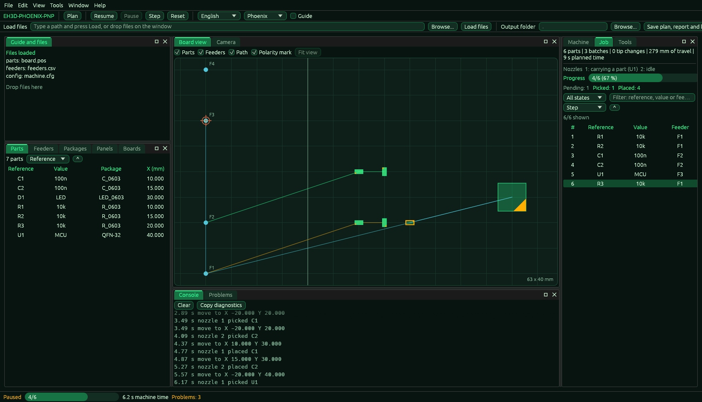
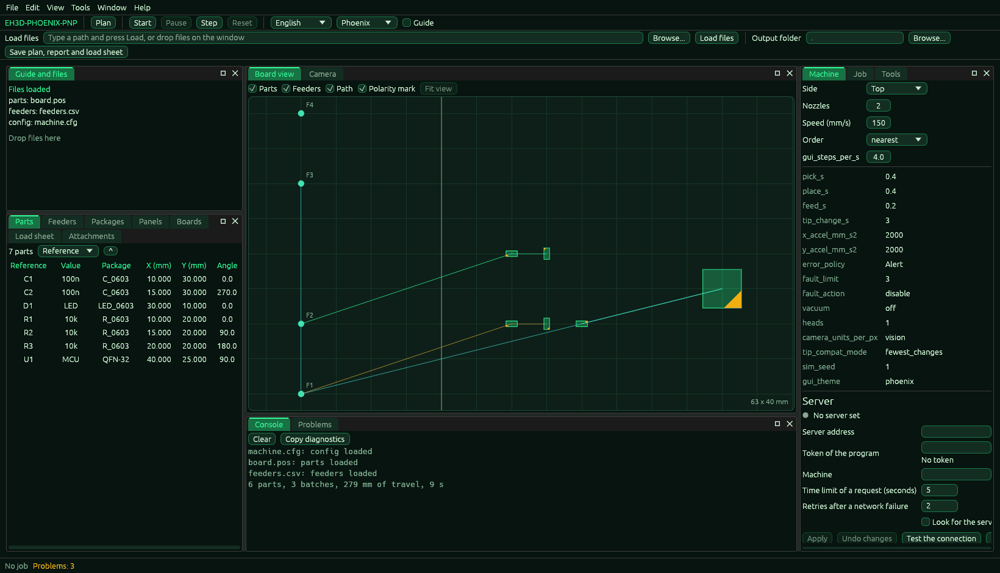

<p align="center">
  
</p>

# 📖 EH3D-PHOENIX-PNP

<p align="center">🇺🇸 <b>English</b> | <a href="README_spa.md">🇪🇸 Español</a> | <a href="README_fra.md">🇫🇷 Français</a> | <a href="README_ita.md">🇮🇹 Italiano</a> | <a href="README_deu.md">🇩🇪 Deutsch</a> | <a href="README_zho.md">🇨🇳 中文</a> | <a href="README_jpn.md">🇯🇵 日本語</a> | <a href="README_por.md">🇵🇹 Português</a></p>

### Pick and place assembly: positions, feeders and the order of the placements

<p align="center">
  
  
  
  
  
</p>

---

**Honesty check - what actually runs today:** a Rust library and a command line program (`phoenix-pnp`) with 1984 tests that run on a computer: reads the position file of a board, gives each part its feeder (with priorities, trays and strips), reads the settings of the machine from a file, plans the order of the placements for a head with up to six nozzles (ranks, nozzle tips, angle limits, time of the moves, panels), writes a load sheet and, on a simulated machine, carries the plan out step by step with injected failures. It also has a window (built with `--features gui`) whose logic is tested without a screen; the drawing itself is not covered by tests, and although the program takes pictures of its own window (`--shot`), no person has reviewed the drawing on a screen. It does not drive any machine: it has not been tried on a machine and it has not been checked against a collection of real files.

---

> **Safety and security status:** this program does not control any machine and is not a safety system. What it produces must be checked by a person before anything is run on a machine; nothing here has run on real hardware.


## 📋 At a glance

| | |
|---|---|
| Version | `0.1.5` |
| Maturity | Scaffolding |
| Tests | 1984 |
| Stack | Rust |
| On real hardware | Not tried: nothing here has run on a machine |

**Jump to:** [Overview](#-overview) · [Architecture](#-architecture) · [Quick start](#-quick-start) · [Testing](#-testing) · [Structure](#-repository-structure) · [Related](#-related-projects)

## 🚦 Project status

Each line is one part of this repository and the light says how far it is today. It is written from what the repository can show (tests, builds, runs), not from what is planned.

🟢 Done and verified · 🟡 Works, with known limits · 🟠 Partly done or not verified yet · 🔴 Not done or not working

| Area | State | What it means here |
|---|---|---|
| Core | 🟡 | reads the position file of a board, gives each part its feeder (priority, tray, strip), plans the order of the placements for a head with up to six nozzles with ranks, nozzle tips, angle limits and the time of the moves, plans panels and writes the load sheet; tested on a computer with normal and damaged input, not with a collection of real files. |
| Command line | 🟡 | `phoenix-pnp` runs the same functions as the library (`parts`, `check`, `plan`, `schedule`, `preflight`, `simulate`, `loadsheet`, `config-check`, `check-bottom`, `tables-check`, `recipe-check`, `import-centroid`, `vision-test`) and prints the result; every error comes back as a message with its `PHOENIX-PNP-NNN` code and a non-zero exit code. |
| Tests | 🟡 | 1984 tests pass (`cargo test`), with normal cases, edge cases, damaged input and small generated cases. |
| Machine configuration | 🟡 | a `key = value` file with a version, a validator that names the line, and the safety limits (travel of Z, limits of X and Y, retries, nozzle angles); the values have not been compared with a real machine. |
| Simulator and job | 🟡 | a virtual clock, failures injected by chance (with a seed) or at a chosen place, retries, the policies alert and defer, feeders that switch off after repeated faults, pause, step by step, and a saved state to resume from; it only simulates, nothing has driven a machine. |
| Security | 🟡 | Plain safe Rust (`forbid(unsafe_code)`): nothing panics on the files it is given and a bad value is an error with its reason; no independent review. |
| Window | 🟠 | An egui window (build it with `--features gui`; `phoenix-pnp` with no command opens it): tabs for the job, parts, packages, feeders, load sheet, machine, tools, problems and log, a map of the work table with the path of the head, polarity marks and the part that is next, a guide of five steps, problems with fixes that can be undone, a simulated job that can be paused, resumed and stepped, and the eight languages. Its logic is tested without a screen; the drawing is not covered by tests: the program takes pictures of its own window (`--shot`) but no person has reviewed the drawing on a screen. It also has tabs for panels (with the fiducials and the fit that moves the parts) and boards, a file picker, tables of feeders and packages that can be edited with undo, column widths that are remembered, and a program of its own (`phoenix-pnp-gui`) that opens without a console on Windows. The tabs are now panels of the docking frame of the suite (`eh3d-dock`): they can be moved, floated, folded and saved in three arrangements, there is a menu bar, and fifteen commands have a panel; this has been compiled and run without a window, not seen on a screen. |
| Real hardware | 🔴 | Not tried: nothing here has been run on a machine. |
| Documentation | 🟡 | README in eight languages, the changelog and the two pictures drawn from `docs/`. |

## 🎯 Overview

* **The parts** (`src/parts.rs`): a KiCad `.pos` file or a CSV (comma or semicolon, quotes, a header found by name) with positions in mm, mil or inches, the angles brought to 0-360, the side top or bottom, and every row that makes no sense refused with its number; a repeated reference is an error.
* **Parts that are not to be mounted, the tables of the examples and the report of a job** (`src/parts.rs`, `src/commands.rs`, `src/job.rs`): a column `dnp`, `do not place` or `fitted` in a CSV (or `--dnp R1,R2`) leaves parts out of the plan, the load sheet and the checks and lists them in the report; `tables-check` reads the tables (`--parts`, `--packages`, `--catalog`, `--feeders`, `--slots`) and names the code and the row of every error; `simulate --report-csv FILE` writes the statistics of the job as a CSV whose header never changes. `examples/` has a board with a `dnp` column, feeders of every kind and a table of common packages.
* **The feeders** (`src/feeders.rs`): a CSV of feeders (id, value, package, pick position, parts left); every part gets the first feeder that holds its value and package, without regard to case; a part with no feeder and a feeder that runs out are reported, and a second feeder of the same kind takes over.
* **The plan** (`src/plan.rs`): the places are walked nearest-first and cut in batches of one to six nozzles, the feeders of a batch are visited nearest-first, the bottom side is mirrored about the width of the board, and the plan gives the travel and an estimate of the time; it is written as a JSON job.
* **The tables and the settings** (`src/catalog.rs`, `src/config.rs`, `src/rotation.rs`): tables of parts and packages whose values are inherited (part, then package, then the defaults), a machine configuration file in `key = value` format (`examples/machine.cfg` documents every key), more names for the columns of a CSV position file, and corrections of the rotation by package.
* **The feeders with more than a tape** (`src/feeding.rs`): priority, trays, strips and feeders that are switched off; the feeder of a part is chosen the same whatever the order of the files.
* **The planner of the machine** (`src/planner.rs`, `src/motion.rs`): ranks (blocks that are placed one after the other), strategies of order, nozzle tips and their changes, the limits of the angle of the nozzle, the time of the moves with acceleration and jerk, shorter walks (2-opt) and the correction of the origin of a part.
* **Panels, load sheet and exports** (`src/panel.rs`, `src/loadsheet.rs`, `src/export.rs`): boards and panels inside panels, the slot of each kind of tape, a report, the list of what is missing and a G-code that only moves the head.
* **Fiducials of a panel** (`src/fiducial.rs`): the measured places of the marks are fitted to the designed ones (a similarity with two marks, an affine fit with three or more) and the parts of the panel are moved and turned by the fit; each mark has its residual, and a fit that misses a mark by more than `fiducial_max_residual_mm` is refused (`--fiducials FILE` with `--panel`, or the Panels tab of the window).
* **Boards marked as bad (X-out) and the marks of two levels** (`src/marks.rs`, `src/panel.rs`): a child of the panel file with `"x_out": true`, or `--x-out A,B/C`, is left out with everything inside it; the plan, the load sheet and the checks do not see it, and a name that no board has (`PHOENIX-PNP-042`) or a panel with every board left out (`PHOENIX-PNP-043`) is an error. A part of a board whose value or package holds a word of `fiducial_words`, or whose reference is a prefix of `fiducial_refs` followed by a number (`FID1`), is a mark of its board and is not placed; the file of `--fiducials` can then name the marks of the panel (`f1`) and of the boards (`A/FID1`): the marks of a board are fitted together and move only the parts of that board, and the parts of the boards without measured marks follow the fit of the panel. Simulated: no board was ever measured on a machine; the window does not use the marks of the boards yet.
* **More from the planner and the simulator:** the order in which the cells of a tray are emptied (rows, columns or a snake), a search for the order of the nozzle tips that counts the way and the trip to the changer (`tip_strategy = optimize`, limited by `tip_opt_max_evals` and `tip_opt_time_limit_s`), chances of failure by package and by feeder (`sim_part_fail`, `sim_feeder_fail`) with statistics by package and by feeder and the parts per hour, and `check-bottom`, which shows the angle that each rule of the bottom side gives.
* **The align step** (`src/job.rs`, `src/sim.rs`, `src/model.rs`): with `align = on` the job looks at each part with the camera after the pick and corrects the place by what it sees (the head goes to the place less the offset of the part, and the nozzle turns less the turn of the part); `pick_tolerance_mm` throws away a part that is further off, which is picked again as `error_policy` says; `align_passes` (1 to 5) and `align_settle_s` set the looks and the wait before each one, which add to the time of the plan; the simulated camera has an offset, an error and failures that can be injected (`sim_align_*`, `sim_camera_fail_rate`); and the correction (mean, largest, parts thrown away) is in the text, in the JSON report and in the `align` rows of `--report-csv`. Off by default: a job is then what it was. Not tried on a machine. With `align_rereads` above 0 (up to 5, 0 by default) the camera looks again at a part whose first look was over the tolerance before it is thrown away, a look within the tolerance counts as the first one, and the work report counts for each feeder the looks over the tolerance, the extra looks, the parts they saved, the parts thrown away and the looks without a reading.
* **The vision pipeline** (`src/vision.rs`, `src/sim.rs`, `examples/vision.cfg`): with `vision = pipeline` the simulated camera draws a picture of the part in memory (its size, its turn and how far it is from the nozzle, with a noise drawn from `sim_seed`) and measures it with the steps of a file of settings (`--vision FILE`): a mask, a median filter, a fixed or Otsu threshold, a range of area for the spot and the smallest turned rectangle, whose middle and angle are the offset that the align step corrects. A part that is not found, a spot of a wrong area and several spots are looks without a reading, each with its own code (`PHOENIX-PNP-037` to `PHOENIX-PNP-039`). `phoenix-pnp vision-test` draws a part from the size, turn, offset and noise that it is given and prints what was measured with its error. Off by default: a job is then what it was. Not tried with a real camera.
* **The work report** (`src/report.rs`, `src/job.rs`): after a job is simulated, `simulate` can write the report as text in the language of `--lang` (`--report-text`), as a page of HTML that holds everything it shows, with no script and nothing from outside, and that is never written over a file that exists (`--report-html`), as sections added after the rows of the CSV (`--report-csv`, the header does not change) and as `work` in the JSON (`--report`). It says how many parts were placed, put aside, left out by the person, still pending or not to be mounted; where the machine time went (feed and pick, the looks of the camera, the places, the moves of the head, the changes of tip); how many picks worked at the first attempt; the same by package, feeder, nozzle, nozzle tip and board of a panel; the errors that were raised with their codes; the findings before the job; and a histogram of what the camera corrected (X, Y and turn). Simulated: nothing in it was measured on a machine.
* **The Job tab and the decisions of the person** (`src/gui/jobtab.rs`, `src/gui/window.rs`, `src/job.rs`): the table shows the state of every placement (waiting, picked, aligned, placed, put aside, left out, failed) and the parts not to be mounted, a bar of progress with the machine time and an estimate of the time left, and filters by state, by text and by what is done. When an error stops the job a dialog names the step that failed and offers four actions that are carried out on the simulated job, which then goes on: retry, skip the part, put it aside, or switch the feeder off so that another feeder of the same kind takes over. Each decision is counted in the report. The logic needs no screen and is tested; no person has reviewed the drawing on a screen (the pictures of this tab in `images/screens/` are taken by the program itself).
* **The vacuum, the actuators and the window of faults of a feeder** (`src/sim.rs`, `src/job.rs`, `src/config.rs`): with `vacuum = on` the simulated pump sucks for `vacuum_suck_s` seconds after each pick and the level of the nozzle (kilopascals) is read; a level under `vacuum_pick_min_kpa` means the nozzle holds no part (`PHOENIX-PNP-044`, and the pick is tried again as the retries say) and, after the blow of `vacuum_blow_s` seconds at each place, a level over `vacuum_release_max_kpa` means the part is still stuck to the nozzle (`PHOENIX-PNP-045`). The sensor has a generator of its own (`sim_vacuum_noise_kpa`, `sim_vacuum_miss_rate`, `sim_vacuum_stuck_rate`) and is off by default, so a job without it is exactly what it was. On/off devices are declared with `actuator = NAME : DELAY_S` and switched with `Job::set_actuator`, which adds their delay to the clock (`PHOENIX-PNP-046` for a name the machine does not have). With `fault_action = alert` a feeder that reaches `fault_limit` faults among its last `fault_window` picks no longer switches itself off: the job stops (`PHOENIX-PNP-047`) and the dialog of the Job tab offers to try again, leave the part out, put it aside or switch the feeder off.
* **The camera model, the heads of the machine and the nozzle tips of a package** (`src/camera.rs`, `src/heads.rs`, `src/tips.rs`, `src/config.rs`): the camera is described by `camera_units_per_px` (0 is the size the pipeline is set to), `camera_offset_x_mm` and `camera_offset_y_mm` (where the axis of the nozzle is in the picture), `camera_rotation_deg`, `camera_flip_x` and `camera_flip_y`, and the lens (`camera_lens_scale`, `camera_lens_k1`); the simulated camera of the align step reads the part through it, with or without a picture, and with the default values a job is exactly what it was. `head = NAME : NOZZLES [: OFFSET_X : OFFSET_Y : CAMERA_X : CAMERA_Y : CAMERA_ROT : CAMERA_UNITS : CAMERA_LENS]` declares up to four heads, each with its nozzles, its offset and its camera; with two or more heads `schedule` gives every part to a head that reaches it (`PHOENIX-PNP-048` when none does), plans each head and counts, on the clock of the machine, the time a head waits for a feeder that another head is using. `tip_compat = PATTERN : TIP, TIP, ...` lists the tips that a package accepts and `tip_compat_mode` (`fewest_changes` or `preferred`) chooses one tip for every kind of part so that the machine changes tip as few times as it can; a tip named in the tables is kept.
* **Recipes** (`src/recipe.rs`, `src/job.rs`, `src/commands.rs`): a text file with a version (`examples/job.recipe`) fixes the steps a job goes through (`prepare`, `pick`, `align`, `place` and `check`, in that order and none twice; the align step and the vacuum check are on only when the recipe has them) and the parameters that change for a package, a feeder or a nozzle tip (`pick_retries`, `pick_tolerance_mm`, `vacuum_suck_s` and `vacuum_blow_s`; for each key the first rule that matches wins, the feeders first, then the packages and then the tips). `phoenix-pnp recipe-check FILE` reads and checks it and `simulate ... --recipe FILE` carries the job out with it. Its errors have the codes `PHOENIX-PNP-049` to `PHOENIX-PNP-052` (a line that is not valid, steps out of order, a file over its limits, a version that is too new) and the limits are the keys `recipe_max_bytes` and `recipe_max_rules` of `machine.cfg`. A saved state also remembers the feeder of the last pick and the pick that was stopped, so a job loaded in another run offers the same decisions to the person (an older state still loads).
* **Import of position files** (`src/import.rs`, `src/commands.rs`): `phoenix-pnp import-centroid FILE` reads a centroid CSV (`--map FILE` names its columns, `examples/centroid.map`; `examples/centroid.csv` needs no map), the text of positions of EAGLE (`examples/board.mnt`: name, x, y, rotation `R90` or `MR90` for the bottom side, value, package) or the `.pos` of KiCad (`--format auto|csv|eagle|kicad-pos`; `auto` tells them from the first row) and writes the table of parts `ref,val,package,x,y,rot,side,dnp` in millimetres to `--out` (a file that exists is never written over: `PHOENIX-PNP-040`) or to the standard output. The units are mm, mil or inch (in the header as `X (mil)`, in the cell as `0.5in`, in a comment as `## Unit = inch`, in the map or in `import_unit`); angles come out from 0 up to 360; the column of the side is optional; a column `dnp` or `fitted` (or `--dnp R1-R5,C7` with ranges of references) marks the parts that are not to be mounted; `import_bottom_mirror_width_mm` mirrors the X of the bottom side and `bottom_rotation` turns its angle. The three readers are the program's own (no other repository has a reader that can be used without adding a dependency) and the layout of the EAGLE text has not been compared with a file written by a real installation. Every error has a code from `PHOENIX-PNP-053` to `PHOENIX-PNP-056` (a line that is not valid, a header that lacks a column of the map, a format that is not known, a range of references that is not valid) and the number of the line.
* **Bill of materials** (`src/bom.rs`, `src/cmd_tools.rs`): `phoenix-pnp bom-check PARTS BOM` reads a BOM (`examples/bom.csv`: the references in a cell, as a range or one for each row, and the value, package, quantity and part number when it has them) and says which references only one side has, which are listed twice, which values or packages differ and which quantities do not add up; a part marked as not to be mounted may be in the BOM or not. An error of the file has the code `PHOENIX-PNP-057` and its line.
* **Stock for a run** (`src/stock.rs`): `phoenix-pnp stock PARTS FEEDERS --boards N` adds the boards up and says, kind of part by kind, how many parts N boards need against the parts in the feeders that are on, which kinds fall short, by how much and after how many boards the first reel runs out; it exits with 2 when something falls short and writes the table with `--out`. `bom-order --have FEEDERS` sets what the feeders already hold against the list of parts to buy and gives the columns `on_hand` and `to_buy`.
* **Camera calibration** (`src/calibrate.rs`): `phoenix-pnp camera-calibrate FILE` fits the model of the camera (size of a pixel, turn, mirror, and where the axis of the nozzle is in the picture) to sightings of a mark at known places of the head (`px,py,x_mm,y_mm` [see `examples/camera_points.csv`], at least three) and prints how well they fit and the `camera_*` lines for the configuration; the lens is not fitted. Its error is the code `PHOENIX-PNP-058`.
* **Nozzle runout** (`src/calibrate.rs`, `src/export.rs`): `phoenix-pnp nozzle-calibrate FILE` fits a circle to readings of the nozzle tip at several angles (`angle_deg,x_mm,y_mm` [see `examples/nozzle_readings.csv`]) and prints `nozzle_runout_mm` and `nozzle_runout_deg`; with the runout above 0 the G-code of `schedule --gcode` moves each place by the opposite of the runout at the angle of the part.
* **Panel of a grid of boards** (`src/panel.rs`, `src/cmd_tools.rs`): `phoenix-pnp panelize BOARD --cols N --rows N --pitch-x MM --pitch-y MM` writes the panel file for a grid of copies of one board, with the same turn for each, three fiducials at a margin (`--fiducials MM`, around the real size of the board given by `--board-size W,H`) and boards marked as bad by their names `P1`, `P2`, ... (`--x-out P2,P5`); a file that exists is never written over.
* **Sheet of the parts with a direction** (`src/polarity.rs`): `phoenix-pnp polarity-sheet PARTS` lists the parts whose reference matches `polarity_refs` or whose package matches `polarity_packages` (diodes, LEDs, chips, transistors, polarized capacitors and connectors by default) with their place and turn and an empty column to tick, for the look after a job; `--side` keeps one side.
* **Slack of the axes** (`src/sim.rs`, `src/motion.rs`): `backlash_x_mm`, `backlash_y_mm` and `backlash_mode` make the simulated machine end a move that reverses an axis short of the place by the slack (`off`, counted by `simulate`) or go past the place and come back from the positive side (`approach`, which takes more time and leaves no error); with a slack of 0 nothing changes.
* **List of parts to buy** (`src/bom.rs`): `phoenix-pnp bom-order BOM --boards N` adds the rows of a BOM that are the same part and gives each line the parts for N boards plus a spare (`order_spare_percent` per cent or `order_spare_min`, whichever is larger; `--spare-percent` and `--spare-min` win), leaving out the parts that `--parts PARTS` marks as not to be mounted; it writes a CSV sorted by package and value.
* **Teaching feeders** (`src/calibrate.rs`): `phoenix-pnp feeder-teach strip` gives the pitch and the angle of a strip from the places of its first and last parts, and `feeder-teach tray` the two pitches and the angle of a tray from three of its cells, with how far the columns are from being square; both print the columns of the file of feeders that they set. `feeder-teach --measures FILE` reads the places of several feeders from one file and prints one line and one row of the feeders file for each (`examples/feeder_measures.csv`).
* **The simulator and the job** (`src/sim.rs`, `src/job.rs`, `src/preflight.rs`, `src/model.rs`): the checks before a job, a machine with a virtual clock and failures that can be injected, and a job that can be paused, taken step by step, saved and resumed.
* **The window** (`src/gui.rs`, `src/gui/`): what the window does besides drawing needs no screen (the files that were loaded, the plan and its problems with fixes, the simulated job, the geometry of the map, the tables with a shared selection, the guide of five steps and the words in eight languages) and is tested; only `src/gui/window.rs`, built with `--features gui`, draws it with egui. The speed of the simulation, the theme and the size drawn for a part of an unknown package are keys of `machine.cfg` (`gui_steps_per_s`, `gui_theme`, `gui_part_size_mm`).
* **Interlocks of the axes** (`src/interlock.rs`, `src/driver.rs`, `src/gcodedriver.rs`, `examples/driver_marlin.cfg`): a line `interlock = SIGNAL | on|off | xy|z|rot|all` of a driver profile says that the axes it names may only move while the signal is in the state it names (the example keeps the carriage still in X and Y while the blow valve is on). The signals are the names of the actuators of the profile, which the session knows from what it last switched, and the names that a sensor is given with `Session::set_signal` (a door, the nozzles lifted); a signal that nobody has reported is unknown and does not satisfy a rule, so the move is refused. A refused move is a failure of safety like a move outside the limits: the lines of `safe_stop` are sent, the rules of safety slow the machine down and nothing more is sent until a new session. The refusal is told in the eight languages. All of it is a calculation on names and numbers, tried against the simulated controller with moves made by chance on a fixed seed, on which the session and the calculation must agree; no sensor of a real machine has been read.
* **The process of a board and the guided manual mode by phases** (`src/process.rs`, `src/cmd_import.rs`): a process is a list of phases (`phase = NAME | task, task`, with the tasks `load`, `place top`, `place bottom by hand`, `reflow`, `solder by hand`, `glue`, `through-hole` and `inspect`) or one of two presets, `pnp` (the machine places each side) and `manual` (a person places each side by hand); a phase starts only when the earlier ones are done and none is going on, it finishes only when it is going, its load-out (the feeders loaded for it) can be changed only while it is pending, and the state can be saved and taken back in. `phoenix-pnp assist PARTS --process pnp|manual|FILE` walks it: the parts of a side placed by hand are asked for one at a time, the other tasks are told in the language of the person and wait for `done`, a side that the machine places is told, and the phases of a side that has no parts are left out. The refusals are told in the eight languages. Nothing is moved: a person does the work.
* **The window on the docking frame of the suite** (`src/gui/docking.rs`, `src/gui/cmdpanel.rs`, `src/gui/window.rs`, `Cargo.toml`): the tabs of the window are panels of `eh3d-dock` of EH3D-COMMON (the build takes `EH3D-COMMON` at version 0.3.6): each one can be taken away, put back from the View menu, moved by dragging its tab to the middle or to a side of another group, floated over the window, folded into an edge, maximised and locked. The window starts in one of three arrangements, Setup, Run and Compact, with the board view, parts, feeders, job, camera, machine and console of the sector of pick and place and, besides, the guide, packages, panels, boards, load sheet, tools and problems; the menu bar has File (with the samples and the recent files), Edit, View, Tools (plan, start, pause, step, reset and the panels of the commands), Window (the arrangements, and the ones the person saves under a name) and Help, with F5 to F8 and the usual shortcuts, and an entry that cannot be used is off for its shortcut too. What the person arranged is kept in `window.cfg` under the keys `dock.` and comes back at the next start; a layout that is damaged or from another version is replaced by the factory one, with a notice. Eleven commands (`driver-check`, `driver-test`, `driver-run`, `safety-replay`, `homing-repeat`, `bringup`, `import-openpnp`, `assist`, `align-iterate`, `vacuum-calibrate` and `test-board-gen`) have a panel each, hidden at first (the View and Tools menus show them): a panel runs `phoenix-pnp` beside the window with the arguments typed in it (split by spaces and quotes, bounded, read by no shell), without a console window and with nothing to read from the keyboard, for at most `command_timeout_s` seconds (5 to 600, 60 by default, in `window.cfg`), and shows what it printed, so a panel and its command cannot disagree. The panels and the menus are data and are tested without a screen; the drawing with the frame has only been compiled and run in a context with no window, and no person has seen the arrangements on a screen.
* **Look at the part on the nozzle** (`src/inspect.rs`, `src/cmd_vis.rs`): `phoenix-pnp part-inspect READINGS --sizes SIZES` (or `--packages PACKAGES`) compares what the camera measured of each part (its two sides, where it hangs from the axis and how much it is turned) with the size of its package and says why it is refused (`part_size_tol_mm`, `part_angle_tol_deg`, `part_offset_max_mm`); the size comes from a table of sizes or from the columns `body_long_mm` and `body_short_mm` of the table of packages (`examples/packages_bodies.csv`), and the command exits with 2 while a part is refused or has no size.
* **Tubes and bulk feeders** (`src/feeding.rs`, `src/feedlib.rs`): besides a tape, a tray and a strip, the column `kind` of the table of feeders takes `tube` (a stick or rail whose parts slide to a stop) and `bulk` (loose parts in a bin or a bowl, which come in no fixed direction); both pick from the one place `x`, `y`, as a tape does, take the angle of the parts from `rotation`, are emptied by the count and are checked by `feeder-check`; the Feeders tab of the window offers all five kinds in the eight languages (`examples/feeders_tubes.csv`).
* **Parts placed and time by feeder** (`src/job.rs`, `src/feedrep.rs`, `src/report.rs`): the job notes which feeder each nozzle took its part from (also when another feeder of the kind took over) and counts the part as placed from that feeder, and adds the time of the steps that picked from each feeder (the way to it, the feed, the pick and the look); the work report, its JSON and `simulate --report-feeders` (the columns `placed` and `busy_s` at the end) show them, and a saved job keeps them.
* **Life of the nozzle tips** (`src/nozzlelife.rs`, `src/cmd_tools.rs`, `src/commands.rs`): `simulate --nozzle-life FILE` adds what a job that ran to its end did with each tip (the parts it placed and the times it was mounted) to a small CSV that the person keeps beside the configuration; a job is counted once, a file that is not a record of the tips is never written over, the file it replaces is kept as `FILE.prev` and the counts go down only when `nozzle-life FILE --reset TIP` records that a tip was replaced. `nozzle_life_warn` (default 500000, 0 does not warn) is the number of parts at which a tip is told to the person to look at, by `simulate` and by `nozzle-life`. New error code `PHOENIX-PNP-059`.
* **Which order is fastest** (`src/compare.rs`, `src/commands.rs`): `phoenix-pnp order-compare PARTS FEEDERS` plans the same board with every `order` of the places (nearest, part, height_part, pick, tips, none) and every `tip_strategy` (minimize, as_planned, optimize), and prints them side by side with the batches, the changes of tip, the travel of the head and the seconds, the fastest of each list marked, the one the configuration has marked, and a line that says how many seconds the better setting would save; it takes the options of `schedule` and changes nothing.
* **A picture of the plan** (`src/preview.rs`, `src/commands.rs`): `phoenix-pnp schedule PARTS FEEDERS OUT.json --svg OUT.svg` also writes the plan as one SVG file to look at before the machine moves, to print or to keep with the job: the feeders, the place of every part with the number of its turn and the colour of its nozzle, the line each part follows from its feeder, the dashed way the head travels over the whole job and the totals; it has no script and nothing from outside, whatever is typed in a reference or an id is escaped, and a picture that exists is never written over.
* **Camera calibration from a pattern** (`src/pattern.rs`, `src/cmd_tools.rs`): `phoenix-pnp camera-pattern FILE [--pitch MM]` reads the points of a grid (the inner corners of a chequerboard or the centres of dots) as `col,row,px,py` (`examples/camera_pattern.csv`) and fits the size of a pixel (`camera_units_per_px`) and the radial bending of the lens (`camera_lens_k1`) together with the turn, the shift and the mirror of the sheet in the picture, then says how far the points are from the model with and without the bending and which point is farthest; the lines for the configuration are printed, and the exit code is 2 when a point is over `camera_pattern_max_residual_mm`. The points are `camera_pattern_pitch_mm` apart. The turn and the offset of the camera still come from `camera-calibrate`, which moves the head. The Tools tab has the same calibration, and it refuses to put in the machine a fit that is over the limit.
* **Which fiducial is off** (`src/fidcheck.rs`, `src/gui/workspace.rs`, `src/gui/tables.rs`): when the measured marks of a panel are used, the window works out the residual of every mark (also when the fit is refused, so that the person can see why), the only mark that, left out, brings all the others within `fiducial_max_residual_mm`, and the turn, the scales and the shear against their limits. The table of fiducials marks a mark over the limit with `!` and the one that does not agree with `?` and the panel lists the warnings in words (also in the log); `fidcheck::analyze_marks`, `fidcheck::warnings` and `fidcheck::residual_table` give the same to the command `fiducial-check` and to the Fiducial check tool.
* **Queue of jobs** (`src/queue.rs`, `src/cmd_queue.rs`): several boards or panels one after the other. `phoenix-pnp queue-add QUEUE NAME SOURCE FEEDERS [--panel] [--boards N]` puts a job in a small CSV that survives the program stopping (it is written to a temporary file and moved into place, the file it replaces is kept as `PATH.prev`, and the last line holds a checksum, so a file that was cut or changed by hand is refused); `queue-status [--check]` lists the jobs and what became of each (pending, running, done, failed, skipped) and with `--check` plans the ones still to be made; `queue-edit` skips, resets, revokes the confirmation of or takes out a job; `queue-run` makes the jobs one board at a time on the simulated machine and writes the queue after every board. Nothing runs without a confirmation: with `queue_confirm` on (the default) a job runs only after `queue-confirm` recorded the identity of its plan (the plan and the text of the files it was made from), and a change to a file voids it; `queue_stop_on_failure` (default on) stops the queue at the first job that fails. A second `queue-run` on the same queue is refused while a `.lock` file is there. The Queue tool of the Tools tab does all of this with buttons. New error code `PHOENIX-PNP-060`.
* **Text in UTF-16** (`src/parts.rs`): every table and settings file that the commands and the window read (positions, feeders, packages, BOMs, panels, measured marks) may be UTF-16 with a byte order mark, as Windows programs and spreadsheets save "Unicode text"; it is read like UTF-8. Text that is neither is read as Latin-1 with a note, and a tool of the Tools tab that reads a file refuses it.
* **Correcting the lens** (`src/camera.rs`, `src/sim.rs`): with `camera_correct_lens = on` the camera takes the bending of the lens (`camera_lens_k1`, as `camera-pattern` finds it) out of what it sees, so the readings of the align step are those of a lens that bends nothing; `CameraModel::to_machine_corrected` and `read_corrected` do it by inverting `d * (1 + k1 * d * d)`. Off (the default) leaves the bending in the readings. `camera_units_per_px` should then be the true size of a pixel, as `camera-pattern` gives it.
* **Queue paths from the queue's folder** (`src/queue.rs`, `src/cmd_queue.rs`): with `queue_relative_paths = on` (or `queue-add --relative`) the files of a job that are in the folder of the queue file, or below it, are kept as paths from that folder, so the folder can be moved or shared; `queue-status`, `queue-confirm` and `queue-run` take them back from the folder of the queue, whatever folder they run from. Off (the default) keeps absolute paths; both run the same and give the same plan identity.
* **The queue with buttons** (`src/gui/queuetab.rs`, `src/gui/window.rs`): the Queue tool of the Tools tab reads a queue file as a list of jobs and has buttons to add a job (a form checked in the language of the window), check the plans, confirm the plan of the selected job, revoke the confirmation, skip, reset, take out and run. Each button runs the command of the same name as the program beside the window, so the window and the command line plan, confirm and run in one way (same plan identity, same lock). The first press of Run only asks (`queue_gui_ask_run`, default on); the second starts the run on the simulated machine, in the background, with a Stop button.
* **A simulated camera that can be made worse** (`src/vision.rs`): `vision.cfg` adds `sim_blur_px` (a camera out of focus), `sim_salt_pepper` (pixels that turn black or white), `sim_gradient_levels` (an uneven light), `sim_failure_rate` and `sim_failure_kind` (a share of the pictures spoilt: the part not there, the light off or everything saturated); all are off by default, and the noise of a job that does not use them does not move. `vision-test` and `simulate --vision` use them like the noise that was already there.
* **Readings to try the checks** (`src/visionsim.rs`, `src/cmd_vis.rs`): `phoenix-pnp vision-readings PARTS --sizes F` draws the picture that the simulated camera gives of each part of a position file (hanging a little off the axis and turned, within `--spread` and `--turn`; `--wrong-every N` makes every N-th part one of another size) and writes the readings in the file that `part-inspect` reads; `phoenix-pnp vision-marks DESIGN --shift X,Y --turn DEG --scale S` looks at each mark of a panel that lies as said and writes the measured marks that `fiducial-check` reads. Blur, noise and failures come from `--vision`; a picture in which nothing is found gives no reading and is told with its reason; the same `--seed` gives the same readings.
* **A work report to keep** (`src/report.rs`): `simulate --report-html FILE` (one page with no script and nothing from outside), `--report-text`, `--report` (JSON) and `--report-csv` now also say, for each feeder, how many parts were picked, placed, put aside and left out, and, for each nozzle tip, what the job added to its life (`--nozzle-life` gives the record from before the job), the uses before and after and a warning when a tip gets to `nozzle_life_warn`; the times, the findings of the checks and the errors with their codes were there already.
* **A truer time for the plan** (`src/planner.rs`): with `backlash_mode = approach` the machine goes past a place by the slack of an axis and comes back, which takes time; the plan used to leave it out and now counts it leg by leg (only where there is room before the limit), so its seconds are those of the simulated job, and `AdvancedPlan::approach_s`, the report of the plan and its JSON say how many seconds are for the second passes. Tips are still grouped in batches and the feeders of a batch visited nearest first; without the approach nothing changes.
* **Sizes of the common packages** (`src/pkggen.rs`, `src/cmd_tools.rs`): `phoenix-pnp package-gen 0603 SOT-23-5 SOIC-8 QFN-32-5x5 LQFP-48` (or `--from PARTS` for the packages of a position file) writes the rows of a table of packages (`package,height_mm,tape_mm,body_long_mm,body_short_mm`) from the nominal sizes of the chips of the EIA codes, SOT, SOD, SOIC (narrow and wide), TSSOP, QFN, DFN and QFP, with the width of the tape that holds the body; `--packages` of `part-inspect` and the catalog read the result. A name that is not known is an error with its reason, never a guess. `phoenix-pnp package-kicad PATH...` does the same from footprint files of KiCad (`src/kicadmod.rs`, `examples/chip_0603.kicad_mod`): the body is the box of the drawing on the fabrication layer (the courtyard, with a note, when there is none), the height is that of the package when the name is a known one or `--height`; the reading is limited in size, depth and items, and a file that is not understood is named with its reason.
* **Learned offsets of the placement** (`src/learn.rs`, `src/cmd_tools.rs`, `src/job.rs`): `phoenix-pnp place-learn READINGS --state F` takes rows `package,dx_mm,dy_mm` (how far a part ended from its place) and keeps the mean offset of each package in a file with a check number. A reading far from the others of its package is left out, a package with too few readings is not touched, the known offset counts for at most `place_learn_memory` readings so that a drifting machine is followed, and no offset is larger than `place_learn_cap_mm`; `--residual` is for readings taken with the offsets already applied, `--dry-run` writes nothing, `--show` and `--forget` read and trim the file. Learning is off until `place_learn` is on, and `simulate --place-offsets FILE` sends the head to each place less the offset of its package only when `place_learn_apply` is on; a file that was cut or changed by hand is refused.
* **A job in a file for other programs** (`src/exchange.rs`, `src/commands.rs`, `src/cmd_tools.rs`): `phoenix-pnp job-export PARTS FEEDERS OUT [--state F]` writes the plan (the document of `schedule`) and the state of each part (`pending`, `placed`, `deferred` with its reason, `skipped`) and the phase of the job (ready, paused, stopped, finished) in one JSON file with a version and a kind; with the saved state of `simulate` it says where that job is. `phoenix-pnp job-import FILE [--csv F]` reads such a file with every check (a size and a placement limit, finite numbers within 100000 mm, names and reasons of a length and without control characters, each reference once, batches and nozzles counted, a state row for each placement that names the same reference, and a phase that agrees with the statuses), says what it holds and can write the placements with their status as a table. Nothing is run from it and nothing is applied to a machine.
* **Hooks, off by default** (`src/hooks.rs`, `src/commands.rs`, `examples/hooks.csv`): `simulate --hooks FILE` runs a program of the operator for an event of the job (`job-finished`, `job-paused`, `job-stopped`, `part-aside`, `feeder-off`), to light a lamp, play a sound or send a message. Running a program is the riskiest thing the crate does, so it is off until `hooks` is on (`--hooks-dry-run` only lists what would be run). The rules file (`event,program,argument...`) is the list of what may be run: a program is a file that lies in the folder of the rules, named with letters, digits, `.`, `_` and `-`, never a path, a search of the system, a shell or a link out of the folder (a batch file, `.bat` or `.cmd`, is allowed, and each one that the rules name is warned about before the job runs, because it runs commands of the system); the arguments are passed one by one with the data of the event in `{event}`, `{reference}`, `{feeder}`, `{reason}`, `{phase}`, `{placed}` and `{total}`. A rules file has a size limit and at most 50 rules, at most `hooks_max_runs` programs are run for a job, each has `hooks_timeout_s` seconds and what it prints is cut to 4096 bytes; a hook that fails changes nothing about the job.
* **A journal of the simulated job** (`src/journal.rs`, `src/commands.rs`): `simulate --journal FILE` writes one row for every step of the job: the part, the feeder the plan takes it from, the nozzle, the second of the machine clock, how long the step took and how it ended (`ok`, or the code of the error that stopped the job). The job does the same steps as one that is not recorded; a job that an error stopped still leaves its journal, with the step that failed as the last row, and a file that exists is never written over.
* **What changed between two tables of parts** (`src/partsdiff.rs`, `src/cmd_more.rs`): `phoenix-pnp parts-diff FIRST SECOND [--tol MM] [--rot-tol DEG] [--out F]` compares two position files by reference and says, part by part, which were added or taken away, moved, turned, given another value or another package or put on the other side; a place within `--tol` and a turn within `--rot-tol` (measured the short way round) are the same, a value or a package that differs only in case is the same, and `--out` writes the changes as a CSV. The exit code is 2 when the tables differ.
* **What changed between two configurations** (`src/configdiff.rs`, `src/cmd_more.rs`): `phoenix-pnp config-diff FIRST SECOND` lists the settings that two configuration files give differently in what they mean, not in how they are written: `yes` and `on`, `5` and `5.0`, and a line that gives the default are the same as they are as no line. A setting that a file does not set shows as `(default)`, and a file that is not valid is named with its code. The exit code is 2 when the machines differ.
* **What a table of parts holds** (`src/boardstats.rs`, `src/cmd_more.rs`): `phoenix-pnp board-stats PARTS [--near MM] [--limit N]` counts the parts on each side, the kinds (value and package), each package and the box that holds the centres; with `--near` it finds, with a grid and not by comparing every pair, the parts of one side whose centres are closer than that distance (a part copied twice, two footprints at one origin), from 0.01 to 50 mm. The exit code is 2 when it finds a pair.
* **Whether the feeders last for a queue** (`src/queuestock.rs`, `src/cmd_more.rs`): `phoenix-pnp queue-stock QUEUE [--out F]` adds up what the jobs that are still to be made take from the feeders, one after the other, and says for each kind of part how many the feeders hold, how many are short and the job in which the reel runs out. Jobs that share a table of feeders share its reels; a feeder that is off and a panel are not counted. The exit code is 2 when a reel falls short.
* **The table of feeders after a job** (`src/deplete.rs`, `src/cmd_more.rs`): `phoenix-pnp feeder-deplete FEEDERS --state F [--out F]` reads the saved state of `simulate --state` and writes the table as it stands now: the count of each feeder is what is left, the next place of a strip moves along by the parts taken, a tray keeps its place (its next cell comes from its count) and the other columns are kept. It says which feeders are low or empty (under `warn_below`); a state of another table is refused. The exit code is 2 when a feeder is low.
* **The table of feeders after reels are changed** (`src/refill.rs`, `src/cmd_more.rs`): `phoenix-pnp feeder-refill FEEDERS REFILLS [--out F]` reads a table `id,count[,x,y]` with a row for each feeder that got a new reel and writes the table of feeders with the new counts; a strip starts again at `x,y` (it keeps its place when none is given), a tray cannot hold more than its cells, and a feeder that is not in the table, a count of 0, a place for a feeder that is not a strip and a feeder named twice are refused with the code `PHOENIX-PNP-013`, changing nothing. The other columns and the delimiter are kept.
* **The parts left for a person** (`src/asidesheet.rs`, `src/commands.rs`): `phoenix-pnp aside-sheet PARTS FEEDERS --state F [--pending] [--out F]` lists, after the job of a saved state, the parts that were put aside and the ones that were left out (with `--pending` also the ones the job did not get to), sorted by value and package so that a reel is picked up once, with the place and the turn of the table, why each was left behind and the feeder it was to come from. The exit code is 2 when there is any part on the sheet.
* **What differs between two jobs** (`src/jobdiff.rs`, `src/cmd_more.rs`): `phoenix-pnp job-diff FIRST SECOND [--out F]` compares two files of `job-export`: the parts that come and go, the feeder, the nozzle, the batch, the tip, where each part is picked and placed (a place within a thousandth of a millimetre and a turn within a hundredth of a degree are the same), what became of it, the order of the parts and the plan as a whole (batches, tip changes, travel, seconds, phase). The exit code is 2 when the jobs differ.
* **Where to stand the feeders** (`src/slots.rs`, `src/commands.rs`): `phoenix-pnp feeder-slots PARTS FEEDERS [--max-plans N] [--out F]` swaps the places of two feeders of the same kind (tape, tube or bulk, switched on) while the plan gets faster, planning the board again with each swap (at most N plans, 5000 by default), and says which feeders move, with their slot names, and what it saves in seconds and travel; `--out` writes the table with the new places. The feeders only trade places, and whether a tape fits the slot it moves to is left to the person. The exit code is 2 when a better way exists.
* **The same job many times** (`src/runs.rs`, `src/commands.rs`): `phoenix-pnp simulate-runs PARTS FEEDERS [--runs N] [--seed S] [--out F]` runs the plan N times (20 by default) on the simulated machine, each from another seed, and says how many runs placed every part, how many an error stopped and which, the parts placed and put aside and the least, middle and longest time; `--out` writes a row for each run and the same first seed gives the same table. It measures the plan and the settings on a simulated machine, not a machine. The exit code is 2 when a run did not place every part.
* **How many boards a reel lasts** (`src/runway.rs`, `src/commands.rs`): `phoenix-pnp reel-runway PARTS FEEDERS [--boards N] [--out F]` takes what the plan takes from each feeder that is switched on for one board and says how many whole boards its reel lasts, how many parts are left over after them and which reel runs out first; a feeder that no part takes from lasts for ever and is listed last, and a feeder that is off is not listed. `stock` answers for a number of boards that is asked; this answers the other way round. The exit code is 2 when a reel lasts fewer than N boards (1 when it is not given).
* **How many nozzles are worth it** (`src/nozzles.rs`, `src/commands.rs`): `phoenix-pnp nozzle-compare PARTS FEEDERS [--max N] [--out F]` plans the same board with one nozzle on the head, then two, up to N (6 by default), and shows the batches, the tip changes, the travel and the seconds of each, the fastest marked (the one with fewer nozzles when two tie), what each nozzle takes off the one before and what the fastest would save over the configuration. The heads that the configuration declares are left out (one head is planned with each number) and a number with which no plan can be made says why. Nothing in the settings is changed. The exit code is 2 when no number of nozzles gives a plan.
* **Which feeders give trouble** (`src/hotspots.rs`, `src/commands.rs`): `phoenix-pnp simulate-hotspots PARTS FEEDERS [--runs N] [--seed S] [--out F]` runs the plan on the simulated machine as `simulate-runs` does (N is `simulate_runs_count` when it is not given) and adds up for each feeder the parts picked up, the picks that failed (also those that a retry put right) and their share of the tries, the runs in which the feeder was switched off and the parts of the feeder that were put aside, the worst feeder first; `--out` writes a row for each feeder and the same first seed gives the same table. It measures the plan and the settings on a simulated machine, not a machine. The exit code is 2 when a feeder gave trouble in some run.
* **What to change between the jobs of a queue** (`src/changeover.rs`, `src/cmd_more.rs`): `phoenix-pnp queue-changeover QUEUE [--out F]` takes the jobs that are still to be made in the order of the queue and compares the table of feeders of each with the one of the job before it (a feeder is found by its id, and only the ones that are switched on count): a feeder that holds another kind of part is a reel to change, one that is switched on only for the next job is a reel to put in, one that the next job does not switch on is a reel that may stay, and the rest stay as they are; jobs that share a table follow each other with nothing to change. `--out` writes a row for each feeder of each change. The exit code is 2 when a reel has to be changed or put in.
* **The new commands as panels of the Tools tab** (`src/gui/toolmore.rs`, `src/gui/toolbox.rs`): Parts diff, Settings diff, Board statistics, Queue stock, Feeders after the job, Job journal, Reels changed, Parts by hand, Jobs diff, Feeder places and Many runs run the same library functions as `parts-diff`, `config-diff`, `board-stats`, `queue-stock`, `feeder-deplete`, `simulate --journal`, `feeder-refill`, `aside-sheet`, `job-diff`, `feeder-slots` and `simulate-runs`, in the eight languages and with the same refusals and codes of error. Some read a second text from a file of their own, a tool that needs a saved state takes the one of the job under way in the Job tab when none is given, and each writes its result to the output folder under its own name (`parts_diff.csv`, `journal.csv`, `runs.csv` and so on), never over a file that exists or over a file that was read.
* **Four more panels of the Tools tab** (`src/gui/toolmore.rs`, `src/gui/toolbox.rs`): Reel runway, Nozzles compared, Trouble spots and Queue changeover run the same library functions as `reel-runway`, `nozzle-compare`, `simulate-hotspots` and `queue-changeover`, in the eight languages and with the same refusals and codes of error; the first asks for the boards that are wanted (the reels that last fewer are marked), the second for the most nozzles, the third uses the runs and the first seed of the runs panel, the fourth the queue file of the queue tools, and each writes its result under its own name (`reel_runway.csv`, `nozzle_compare.csv`, `hotspots.csv`, `queue_changeover.csv`), never over a file that exists or over a file that was read.
* **The values of the forms are settings** (`src/toolvalues.rs`, `src/config.rs`, `examples/machine.cfg`): the tolerances of `parts-diff` (`parts_diff_tol_mm`, 0 to 100, and `parts_diff_rot_tol_deg`, 0 to 180), the distance and the pairs of `board-stats` (`board_stats_near_mm`, 0.01 to 50, with 0 the look is off, and `board_stats_limit`, 1 to 1000), the most plans of `feeder-slots` (`feeder_slots_max_plans`, 1 to 1000000), the runs of `simulate-runs` and `simulate-hotspots` (`simulate_runs_count`, 1 to 10000) and the steps of the journal panel (`journal_steps`, 0 to 1000000, 0 runs the job to its end) are keys of `machine.cfg`, each with its range (a value outside it is refused with `PHOENIX-PNP-006`) and with the value the program had before as its default. A command takes them when its option is not given, and the option is stronger; the panels of the Tools tab start with them and have a button that keeps what was typed in the file that was loaded last: only the lines of these keys change (or are added at the end), the comments, the other lines and the line endings stay as they are, the file is written beside itself and moved into place, and a value that the file would refuse leaves it as it was.
* **The EH3D server** (`src/server.rs`, `src/cmd_server.rs`, `examples/machine.cfg`): with `mode = server` and `server_address`, `server_token` and `server_machine` in the settings (`server_timeout_s` 0.5 to 120, `server_poll_ms` 50 to 60000, `server_attempts` 1 to 10; `mode` is `local` by default and nothing talks to a server then), `phoenix-pnp server-send PARTS FEEDERS` sends the table of feeders and the placements to the `pnp` machine of the EH3D server as jobs of its queue; `--start` starts the job and `--follow` follows it until it ends. `server-status` shows the machine and its feeders, `server-job ID --pause|--resume|--cancel` holds or stops a job and `server-request` writes the two requests as JSON files for other programs. `--sim` does it against a server in memory that keeps the rules of the plugin, and the token is never printed (`config-diff` shows `(set)`). It was tried against that server and a small one made in the tests, not against a real machine: the machine, its feeders and the head are the server's. A job of the server is authorised with the hash that the server itself made of it: `server-status JOB` shows `toolpath_sha256` and whether it is authorised, `server-job JOB --authorize HASH` asks for the job again and authorises it only while it is still that one (else `stale_authorization`), and `server-job JOB --start --hash HASH` names it with the start. While `work_require_authorization` is on at the server, a start without an authorization is refused (`authorization_required`) and the message gives the commands, for the loading of the feeders and the calibrations too. The token needs the scope `jobs:authorize`, which a program token of the template `phoenix` never has. The window does not authorise yet, and nothing of this has been tried against a real server.
* **The EH3D server through the common client** (`src/server.rs`, `src/cmd_server.rs`, `Cargo.toml`): the link is `eh3d-serverclient` of EH3D-COMMON (a sibling folder is needed to build): a request that fails on the network is tried again with growing pauses (`server_retries`, 0 to 5, 2 by default; a `POST` is never sent twice), the refusals of the server are told by their code in the language of the command, and `server_mdns` (off) is the only way the link may look for the server on the network. `phoenix-pnp server-feeders [list | set SLOT PART COUNT | clear SLOT] [--sim] [--out F]` reads and changes the feeders of the machine of the server with no job, `server-calibrate feeder|nozzle|camera TARGET [--offset X,Y]` makes a calibration job (up to 5 mm on each axis; the machine of the server measures nothing today) and `server-send --dry-run` asks the server to go through the job without taking a part off a feeder. The Server machine panel of the Tools tab does the same, one line for each thing (`list`, `set`, `clear`, `calibrate`, `load`, `dry-run`). Tried against the server in memory and a small server made in the tests, not against a real machine.
* **Exported tables and spreadsheets** (`src/parts.rs`, `tests/csvguard.rs`): in the CSV tables that the program writes, a text that starts with `=`, `+`, `-`, `@`, a tab or a return gets a single quote in front, so that a spreadsheet shows it and does not run it; numbers, negative ones too, are not touched. The quote is taken off when the program reads a table again, so the texts come back as they were. Another program that reads such a table sees the quote as part of the text.
* **A camera calibration tried on a made-up camera** (`src/calibsim.rs`, `src/cmd_flow.rs`): `phoenix-pnp camera-selftest [--points N] [--noise PX] [--field PX] [--seed S] [--tol MM] [--out F]` makes up the camera of the settings (the `camera_*` keys), looks at a mark in places chosen by chance from the seed, adds the noise of a reading, fits the camera as `camera-calibrate` does and says how far the camera that was found is from the one that was made up over a grid of the picture. It tells how many sightings and how little noise a calibration needs before a machine exists; `--out` writes the sightings for `camera-calibrate`. The exit code is 2 when the error is over `--tol` (0.05 mm by default). It tests the fit on a simulated camera, not a real one.
* **Starting points for the settings** (`src/template.rs`, `src/cmd_flow.rs`): `phoenix-pnp machine-template [NAME] [--out F]` lists, prints or writes short files of settings to start from (`desktop-1`, `desktop-2`, `dual-head`, `production-4`, `simulation`, `server`, and `full`, which is the documented `examples/machine.cfg`): each says only what differs from the defaults, with a comment that says why. They are read by the same reader as any settings file (a test reads them all) and the numbers are starting points to tune on the machine, not measurements. A file that exists is never written over.
* **Which lot each part came from** (`src/lottrace.rs`, `src/cmd_flow.rs`): `phoenix-pnp lot-trace PARTS FEEDERS LOTS [--serial S] [--out F]` joins the feeder each part is picked from with a table `feeder,lot[,reel][,date_code][,supplier]` of what is in the feeders (`examples/lots.csv`): a line for each lot with its parts, a CSV with a row for each part (the serial of the board in the first column), the feeders that give parts and have no lot, the parts no feeder holds and the lots that name a feeder that is not in the table. The exit code is 2 when a part has no feeder or a feeder that gives parts has no lot. It does not read the reels: the table says what the operator put in.
* **The parts for an assembler** (`src/asmexport.rs`, `src/cmd_flow.rs`): `phoenix-pnp export-assembler PARTS [--format cpl|kicad-pos|generic] [--side all|top|bottom] [--unit mm|inch] [--out F]` writes the table of parts in the shape that an assembler or another program asks for: the component placement list (designator, value, package, mid x, mid y, rotation, layer, the places with their unit), the text file with columns that KiCad writes and `parts` reads back, or a plain CSV with the unit in the name of its columns. The parts come in the order of their references, the turn is always from 0 up to 360, and what is written is read back to the digits that are written (a test does it for boards made by chance).
* **One board for several machines** (`src/splitjob.rs`, `src/cmd_flow.rs`): `phoenix-pnp split-job PARTS FEEDERS --machines N [--out F]` gives whole feeders to N machines (up to 16) so that each has about the same work: a reel is on one machine, so the parts of a feeder go together, the feeders with the most parts go first, each to the machine that has the least so far, and the same board and tables always give the same split. The work is the time of a pick and a placement of the settings; the moves of the head are left out, so the times are for comparing the machines and not for planning. `--out` writes a row `machine,feeder,reference` for each part. The exit code is 2 when a part has no feeder.
* **The odds of a good board** (`src/failodds.rs`, `src/cmd_flow.rs`): `phoenix-pnp failure-odds PARTS FEEDERS [--rules F] [--min-ok PERCENT] [--out F]` says, with arithmetic and no chance, how likely a board is to go through with no part in error for the retries that are allowed: a stage that fails with chance `p` and may be tried `r + 1` times ends in error with chance `p^(r+1)`, using `sim_feed_fail_rate`, `sim_pick_fail_rate`, `sim_place_fail_rate`, `sim_part_fail` and `sim_feeder_fail`. It gives the failures and retries expected for each package, the seconds the retries take and the chance of a good board. A file of rules `pattern,feed_retries,pick_retries,place_retries` (`examples/failure_rules.csv`) gives other retries to the packages that match, to compare the retries of a small part and of a large one (the job itself takes the retries of the settings). The exit code is 2 when the chance is under `--min-ok` (0 by default: never). The chances are the ones of the simulated machine, not of a real one.
* **A table of parts turned or flipped** (`src/reorient.rs`, `src/cmd_flow.rs`): `phoenix-pnp pos-transform PARTS [--rotate DEG] [--flip] [--shift X,Y] [--zero] [--format F] [--unit U] [--out F]` turns the whole table counter-clockwise about the origin, flips it left to right (the sides swap and the angles mirror), moves it, and with `--zero` moves it so that its lowest left corner is the origin, in this order, for a board that lies turned on the machine or is placed from its other side. It writes any of the shapes of `export-assembler` (`kicad-pos` by default). The distances between the parts do not change, a turn and its opposite or two flips give the table back, and a table that would go beyond a million millimetres is refused.
* **The height of the nozzle tips** (`src/nozzlez.rs`, `src/cmd_flow.rs`, `examples/z_probe.csv`): `phoenix-pnp nozzle-zcal [FILE | --simulate] [--nozzles N] [--probes N] [--noise MM] [--seed S] [--tol MM] [--out F]` takes several probings of the bed with each tip (`nozzle,z_mm`) and gives the mean height of each tip, how much its probings differ, its offset from the mean of the tips and the correction, calling out the tips that are out of line (over `nozzle_z_tol_mm`), noisy or probed once. With `--simulate` the heights of the tips and the probings are made up from a seed and the offsets are compared with the heights that were made up. The exit code is 2 when a tip needs a look. It tests the arithmetic on a simulated head, not a real one.
* **The marks of each board of a panel** (`src/panelfids.rs`, `src/cmd_flow.rs`, `examples/panel_marks.json`): `phoenix-pnp panel-fids PANEL [--x-out P2,P5] [--min-sep MM] [--out F]` lists the marks of every board (the parts of its file that are marks, such as `FID1`) in the coordinates of the panel, with the place and the turn of the board counted in, and says which boards cannot be aligned by their own marks: none, only one, or the farthest two closer than `panel_fid_min_sep_mm`. A board marked as bad is left out. The exit code is 2 when a board cannot be aligned.
* **The tapes, step by step** (`src/tapesteps.rs`, `src/commands.rs`): `phoenix-pnp tape-steps PARTS FEEDERS [--out F]` walks the plan and, for every pick, says which part of the reel it is, how many are left, the pick place and how far it is from the pick before on the same feeder (a strip must advance by its pitch, within `tape_pitch_tol_mm`), and marks the steps that are `low` (the first under the warning of the feeder), `last`, `empty`, off `pitch`, out of `reach` of the machine or of a feeder the table does not have. The exit code is 2 when a step is a fault.
* **The effectiveness of a shift** (`src/shiftoee.rs`, `src/commands.rs`): `phoenix-pnp shift-oee PARTS FEEDERS [--runs N] [--seed S] [--shift MINUTES] [--reel-change SECONDS] [--min-oee PERCENT] [--out F]` runs the plan on the simulated machine many times and gives availability (the shift less the changes of reels that its boards need, `shift_minutes` and `reel_change_s`), performance (the ideal time of the plan against the mean time of the runs), quality (the runs that placed every part), the boards that fit in the shift and the effectiveness, the product of the three. The exit code is 2 when it is under `--min-oee`. It is a figure for the plan and the settings on a simulated machine, not for a real shift.
* **Position files of assemblers** (`src/asmimport.rs`, `src/cmd_flow.rs`, `examples/altium_pnp.csv`): `phoenix-pnp import-assembler FILE [--format cpl|kicad-pos|generic] [--unit mm|inch] [--out F]` reads the position files that assemblers and other programs write (a designator column, the middle of the part as `Mid X` or `Center-X(mil)`, the layer as `Top`, `T` or `TopLayer`, numbers with their unit such as `12.5mm` or `490mil`), says which shape it found and gives the parts in millimetres in a shape every command reads. What `export-assembler` writes is read back; a row that cannot be read is an error with its line.
* **Several bills of materials in one list** (`src/bommerge.rs`, `src/cmd_flow.rs`, `examples/bom_b.csv`): `phoenix-pnp bom-merge FILE[:BOARDS]... [--out F]` adds the bills of materials of several boards, each for the number of boards that is wanted, joins the rows that are the same part (the value written alike, the package, the part number) and says which bill each part is for.
* **The server panel and the search for servers** (`src/gui/serverui.rs`, `src/server.rs`, `Cargo.toml`): the Machine tab of the window ends with the panel of `eh3d-view` of EH3D-COMMON: the settings of the server, the state of the link, the test of the connection and the login and logout of a person (the program is `phoenix-pnp` for the server and the password is wiped as soon as it is sent). What is applied goes to the configuration, `mode` follows the address and the keys are kept in the file of settings that was loaded, never the token. `phoenix-pnp server-discover [--sim]` lists the servers on the local network: it asks nothing of the network unless `server_mdns = on` is set and the build has `--features mdns`. `server_attempts` is read as the old name of `server_retries`, with a note.
* **Six more panels in the Tools tab** (`src/gui/toolbox.rs`, `src/gui/toolmore.rs`): the heights of the nozzles (`nozzle-zcal`), the marks of the panel (`panel-fids`), the tapes by step (`tape-steps`), the effectiveness of a shift (`shift-oee`), the position file of an assembler (`import-assembler`) and several bills of materials (`bom-merge`), each with the same text as its command, its words in the eight languages and its table written once to the output folder, never over a file.
* **The record of a board by its serial number** (`src/serialsig.rs`, `src/sha256.rs`, `src/cmd_shop.rs`, `examples/lots.csv`): `phoenix-pnp serial-sign PARTS FEEDERS --serial S [--lots F] [--prev SIG] [--key-file F] [--out F]` writes the serial, the fingerprints of the tables (`job-fingerprint` prints them), each placed reference with its feeder and the lot of its reel, and a signature (SHA-256, or HMAC-SHA-256 with a key from a file, never printed); `--prev` chains the record to the board before. `phoenix-pnp serial-verify FILE [--key-file F] [--prev SIG]` says whether a record is whole: a byte changed, a line taken out, the wrong key or a broken chain are found.
* **A shift and several heads** (`src/shiftplan.rs`, `src/headsplit.rs`, `src/cmd_shop.rs`): `phoenix-pnp shift-plan PARTS FEEDERS [--boards N] [--shift MINUTES] [--reel-change SECONDS]` runs the shift board by board and says at which board and minute each reel has to be changed, how many boards fit and the boards an hour; `phoenix-pnp head-split PARTS FEEDERS [--heads N]` plays the board on a machine with up to 8 heads that take from the same feeders (a reel is picked from by one head at a time), the board cut into bands against whole feeders to a head: the time of each head, the waits and the quicker way.
* **Packages and spaces** (`src/footcheck.rs`, `src/clearance.rs`, `src/cmd_shop.rs`): `phoenix-pnp footprint-check PARTS [--packages F]` says how each package of the board stands against the table of packages (known, an alias such as `R_0603_1608Metric` for `R_0603`, made from its name, a mistake away or unknown); `phoenix-pnp clearance PARTS --packages F [--min MM]` finds the pairs of parts on one side whose bodies, turned with the part, are nearer than the minimum (`clearance_min_mm`) or overlap.
* **Files for the houses that assemble a board** (`src/jlcpcb.rs`, `src/designators.rs`, `src/cmd_fab.rs`): `phoenix-pnp export-fab PARTS [--bom BOM] [--side all|top|bottom] [--mount] [--dnp-mode column|omit] [--cpl-out F] [--bom-out F]` writes the placement list that assembly houses ask for (`Designator`, `Mid X`, `Mid Y`, `Layer`, `Rotation`: a part on each line with the places in two columns, the parts that are soldered on the surface and the ones that go through the board, and the parts that are not to be mounted marked in a column whose name is `fab_dnp_column`, `Customer Supply` by default, or left out with `fab_dnp_mode = omit`) and the bill of materials (`MPN`, `Designator`, `Quantity`, `Description`, `Footprint`, with the part numbers of the bill of the CAD program and the designators in the natural order, `R2` before `R10`). The words that tell a part that goes through the board are the setting `fab_tht_words`. `phoenix-pnp fab-check FILE` reads a placement list and names every line that a house would refuse (a list or a range in the cell of a designator, a designator twice, a layer that is not `Top` or `Bottom`, a place that is not a number). The shape is the public one of these lists and has not been sent to a house.
* **Position files of KiCad, Altium, EAGLE and assembly houses** (`src/cplconv.rs`, `src/cmd_fab.rs`): `phoenix-pnp convert-cpl FILE [--from kicad|altium|eagle|jlcpcb|generic] [--to jlcpcb|cpl|kicad-pos|generic] [--origin X,Y] [--flip-y] [--cw] [--rot-offset DEG] [--bottom keep|mirror|half_turn] [--out F]` tells the dialect of a file from its header (or takes `--from`), reads it in millimetres and degrees and moves the origin, flips the Y axis (which also reverses the rotation), changes the way the rotation is counted, adds a turn and applies the rule of the bottom side, in that order; the defaults are the settings `cpl_*`, and a conversion can be taken back (`cplconv::undo`). It has not been compared with files written by real installations of those programs.
* **Names of footprints by IPC-7351B and a search by name** (`src/ipcname.rs`, `src/fpsearch.rs`, `src/cmd_fab.rs`): `phoenix-pnp ipc-name NAME... [--density L|N|M]` takes a name of the public convention apart (`RESC1608X55N`: the family, the body in tenths, the height in hundredths and the density; `SOIC127P600X175-8N` and `QFP50P1000X1000X160-48N` for parts with leads), writes it the one way, or names a chip package of the table (`R_0603`) by the convention; `ipc-name --make FAMILY --pitch ... --height ...` makes a name from the sizes. `phoenix-pnp footprint-find QUERY... [--packages F]` looks a name up in the table of packages: the same text, another name for the same footprint (`R_0603`, `Resistor_SMD:R_0603_1608Metric` and `RESC1608X55N` are one), the names that hold the words and the names a few letters away (`ipc_density`, `ipc_search_limit` and `ipc_search_distance` are settings). Only the convention of the names is used: no table of land patterns is held and the sizes of the lands are not computed.
* **Checks for assembly and the paste stencil** (`src/dfm.rs`, `src/stencil.rs`, `src/cmd_fab.rs`, `examples/features.csv`): `phoenix-pnp dfm-check PARTS FEATURES [--packages F] [--out F]` judges a board for assembly in the language of `--lang` (the eight of the suite): fine pitch, the gap between the pads of two parts, the space between the bodies of the parts on the surface, a hole inside a pad that is soldered, a track that ends in the middle of a pad, the size, the edge and the free ring of the fiducials, the tooling holes and the parts near their edge, and the width of the tabs. `FEATURES` is a table `kind,id,x_mm,y_mm,w_mm,h_mm,side`. Every limit is a setting (`dfm_*`, with the public figures of the guides of assembly houses as the defaults) and the report says that they are not verified for as long as `dfm_verified` is off. `phoenix-pnp stencil-apertures FEATURES [--out F]` makes the openings of the paste stencil from the pads (each side smaller by `stencil_reduction_percent`, more for a fine pitch, the thermal pad split into windows that cover `stencil_thermal_percent` of it) and warns when the thickness, the reductions, the cover, the web between windows or the area ratio of an opening (`L*W / (2*(L+W)*T)`, at least `stencil_area_ratio_min`) are out of their ranges. The exit code is 2 when there is a warning or an error.
* **Two views of a simulated job** (`src/busy.rs`, `src/tower.rs`, `src/cmd_fab.rs`, `examples/journal.csv`): from the journal that `simulate --journal` writes, `phoenix-pnp sim-busy JOURNAL` says how busy each nozzle and each feeder was (seconds, steps and share of the job) and where the machine waited (the `busy_gaps_listed` longest waits), and `phoenix-pnp sim-tower JOURNAL` says what light a signal tower would show at each second: red during a step that failed, yellow during a step slower than `tower_slow_factor` times the median of its kind and during a wait over `tower_idle_gap_s`, green the rest. Nothing is driven: they read a file.
* **Tests of the files for assembly** (`tests/fab.rs`, `tests/ipc.rs`, `tests/dfm.rs`, `tests/simviews.rs`, `tests/fabcli.rs`, `tests/fabfuzz.rs`): the example files damaged on a fixed seed for every new reader, boards and names made by chance (what is written is read back, a conversion is undone, a name is written the same after being read, the order of designators is a total order), every rule of the checks in the eight languages, the commands as a person runs them, and the new settings with their ranges.
* **The G-code driver, tried only on a simulator** (`src/gcodedriver.rs`, `src/gcodesim.rs`, `src/driver.rs`, `src/drivertest.rs`, `src/textmatch.rs`, `src/cmd_drive.rs`, `examples/driver_marlin.cfg`, `examples/driver_klipper.cfg`): the first driver is a profile in a file, for Marlin on a serial line and for Klipper through Moonraker: the lines that connect, home and leave the machine safe, the template of a move (always followed by the line that waits for it), the pins and pumps that switch, the patterns of an answer (`ok`, an error, `busy`, a position with the `E` axis), the feeds, heights and limits, the times and the retries. `phoenix-pnp driver-check PROFILE` reads and checks it (every key has its range; a feed over the greatest, a place outside the limits or a pattern that does not compile is an error with its line, in the eight languages); `driver-test PROFILE TRANSCRIPT` plays recorded answers against the patterns (`examples/marlin_answers.txt`, `examples/klipper_answers.txt`); `driver-run PARTS FEEDERS PROFILE [--fault ...]` plans the board and sends it, as the lines of the profile, to a simulated Marlin or Klipper that can be given faults (an error at a line, no answer, a halted controller, `busy` lines, a position that is not the real one): a query or a switch is asked again, a move is not sent twice (a wait that times out is settled by asking where the head is), and an error, a retry that is not enough or a position that is not the one asked for stop it after the lines of `safe_stop`, and nothing more is sent. `homing-repeat` (the spread of the places after N homings) and `bringup` (the steps of a first start with PASS or FAIL) run on the same simulator. No port is opened and no machine has been moved with it: it says `evidence=simulator`.
* **Moves of the driver and the language of the console** (`src/gcodedriver.rs`, `src/driver.rs`, `src/events.rs`): the axis of the nozzle goes to its angle of pick before every part is taken; a homing obeys the interlocks and the hold; a line the controller says it does not know stops the session (`stop_on_unknown_command`); the default stop closes the blow valve too; the square of `bringup` goes up first and stays within the limits. The console of the window says what the simulated machine does in the eight languages. All of it was tried on a computer only (`evidence=simulator`).
* **Rules that only make the machine safer** (`src/safety.rs`, `examples/safety_events.txt`): after a retry, a timeout or a refused move the feed is cut (`safety_careful_speed_pct`, then `safety_slow_speed_pct`) and then the machine is held; a position that is not the one asked for or a lost vacuum hold it at once and an error of the controller stops it. A good answer gives nothing back, and only a person brings a held machine back, to slow and never to normal. `phoenix-pnp safety-replay EVENTS` replays a file of events and exits with 2 when the machine ends held or stopped. The tests try every sequence of up to five events and 500 long runs made by chance, and fail if a change lets a trouble speed the machine up.
* **Look, move, look again, the vacuum and made-up boards** (`src/lookmove.rs`, `src/vacuumcal.rs`, `src/testboard.rs`, `src/cmd_import.rs`, `examples/vacuum_readings.csv`): `phoenix-pnp align-iterate` brings the head to a mark in small steps against a camera that is made up (no step over `lml_max_step_mm`; a look that gets worse halves the step and the gain for good, two in a row stop it, and a look that cannot be read stops it with no move); `phoenix-pnp vacuum-calibrate READINGS` proposes `vacuum_pick_min_kpa` and `vacuum_release_max_kpa` a margin inside the gap between the readings with and without a part and says when they overlap; `phoenix-pnp test-board-gen grid|mixed|dense` writes a board and its feeders made up from a seed, to compare machines and settings.
* **Importing the files of another program** (`src/xmlmini.rs`, `src/openpnp.rs`, `src/cmd_import.rs`, `examples/openpnp_machine.xml`, `examples/openpnp_package.xml`, `examples/openpnp_parts.xml`): `phoenix-pnp import-openpnp [--machine F] [--packages F] [--parts F] [--out-dir D]` reads, and never writes to, the packages, the parts and the feeders of OpenPnP into a table of packages, a table of parts and a table of feeders, with the units brought to millimetres. The reader of XML is bounded (8 MiB, 32 levels, 200000 elements; a document type is refused so that nothing is expanded) and never panics; whatever cannot be mapped (an unknown unit, a value that is not a number, a missing field, a name that is there twice, the heads, cameras and actuators) is told with its file and line in the eight languages, and a row that cannot be used is left out. The example files are written for the tests.
* **Projects of the suite** (`src/eh3dfile.rs`, `src/cmd_project.rs`, `docs/eh3d-project.md`, `tests/eh3dfile.rs`): `phoenix-pnp project list|save|import|open|take|extract` keeps the work in the branch `pnp/` of an `.eh3d` project, one file with a branch for each program: `save` puts the table of parts, the bill of materials, the table of feeders and the configuration there; `import` keeps a position file, a BOM or a table of feeders byte for byte with a report of what was read; `take` copies a file from another branch, such as `pcb/`, with the hash and the format of its source, so `list` and `open` say when it is out of date (exit code 2). Only `pnp/` is written: every other branch, known or not, keeps its bytes. It has only been tried with made-up projects.
* **Attachments of the project** (panel «Attachments», the crate `eh3d-attachpanel` of EH3D-COMMON): *File > Suite project (.eh3d)* opens a project (or the button of the panel); the window keeps no work in it and writes only its attachments. The data sheets, manuals and any other file kept in the `.eh3d` project are listed, attached (a file or only a link), linked to a part, extracted and removed after a question, and shown beside the list (PDF pages, pictures, text and the text of office documents). Programs, scripts, files with macros, compressed archives, HTML, SVG and unknown kinds ask before they leave the project; a program or a script is never opened, nothing is downloaded and a settings file with the token of the server is not attached. The package carries the PDF library (PDFium) with its licences. Not tried on a screen by a person. A file can be dropped on the panel, and its limits are read from the settings file of the window, `window.cfg` (`attachments.max_mb`, `viewer.max_*_mb`). A write of the panel is refused, with nothing written, when another program saved the project after the panel read it.
* **A guided manual mode** (`src/assist.rs`, `src/cmd_import.rs`, `examples/assist_answers.txt`): `phoenix-pnp assist PARTS [--feeders F] [--order reel|reference] [--out F] [--resume F]` walks a person through a board with no machine: one reel at a time, the top side before the bottom, each part with its reel, its place, its turn and whether it has a direction; the person types the reference when it is placed and the walk goes on only if it is the right one (`skip`, `back` and `quit` do what they say, and a checklist can be saved and read again).
* **Tests of the driver and of the import** (`tests/textmatch.rs`, `tests/driver.rs`, `tests/safety.rs`, `tests/drivercli.rs`, `tests/lookmove.rs`, `tests/vacuumcal.rs`, `tests/openpnp.rs`, `tests/assist.rs`, `tests/importcli.rs`, `tests/textvalues.rs`): the profile and its errors in the eight languages, the lines it writes, the answers it reads, a session with every fault, the rules of safety over every short sequence of events, the import cut at every place and damaged on a fixed seed, every new command as a person runs it, and that a value that looks like a number stays text in every table.
* **Rejects and retries by part** (`src/rejects.rs`, `src/retrypolicy.rs`, `src/cmd_shop.rs`, `examples/rejects.csv`, `examples/retry_rules.csv`): `phoenix-pnp reject-report PARTS FEEDERS REJECTS [--boards N] [--max-rate PERCENT]` gives the rejected parts of a run by reason (in the order of a Pareto chart), package, feeder and reference; `phoenix-pnp retry-policy PARTS FEEDERS RULES` gives each part the retries of the first rule that fits its reference, value, package or feeder, works out the chance of a good board and tells the rules that fit nothing or never act.
* **The cost of a run and the age of the reels** (`src/bomcost.rs`, `src/lotage.rs`, `src/cmd_shop.rs`, `examples/prices.csv`): `phoenix-pnp bom-cost BOM PRICES [--boards N] [--spare PERCENT]` costs a run from a table of prices with price breaks (the lowest quantity sold is bought when fewer are needed); `phoenix-pnp lot-age PARTS FEEDERS LOTS --week YYWW [--max-weeks N]` says how old the lot in each feeder is from its date code, against the week given and `lot_max_weeks`.
* **Tests by chance, of every key and of every command** (`tests/fuzz.rs`, `tests/keys.rs`, `tests/cli_all.rs`): the example files damaged in many ways and bytes made by chance (from a fixed seed, so they repeat) are given to every reader of a file and none may panic; boards made by chance keep the properties the tools promise (what is written is read back, a transform keeps the distances and is undone, a split gives every part once, the odds stay between 0 and 1, a request that is made is taken by the server in memory); every key of the settings is checked against the example, its check and its duplicates; and every command of the help is run with nothing, a wrong option and files that are not there, and must answer with an error line and never a panic.
* **More tests by chance and of every new command** (`tests/flow2.rs`, `tests/server.rs`): boards made by chance on a fixed seed check that what `export-assembler` writes is read back by `import-assembler` (in mm and in inches), that the offsets of the nozzles find the heights that were made up, that the effectiveness of a shift is the product of its three shares and that the new readers never panic on damaged files; the link to the server is tried with a transport that fails the first times and with the server in memory.
* **Combined camera calibration** (`src/combined.rs`, `src/cmd_tools.rs`, `src/gui/toolbox.rs`): `phoenix-pnp camera-combined FILE` reads `head_x,head_y,col,row,px,py` (`examples/camera_combined.csv`: a sheet fixed to the bed, the head moved to several places) and, with the place of the sheet (`camera_pattern_origin_x_mm`, `camera_pattern_origin_y_mm`) and its pitch, finds in one fit the size of a pixel, the turn, the mirror, the offset of the nozzle, the bending of the lens and how much the sheet is turned on the bed; the camera of `camera-calibrate` and the lens of `camera-pattern` in one go. It is off by default (`camera_combined = off`; the two separate commands do not depend on it), the head must stand at two or more places, and the offset is only as good as the measure of the origin. The Tools tab has the same calibration; putting it in the machine does not turn `camera_correct_lens` on. With `camera_combined_touch = on` (or `--touch`) the place of the sheet is taken from a row `origin,X,Y` of the file, where the nozzle touched the point 0,0, instead of from the settings; off by default.
* **More panels in the Tools tab** (`src/gui/toolbox.rs`): the use of the nozzle tips (the record that `nozzle-life` keeps, with the tips at or over `nozzle_life_warn` marked), the inspection of the parts on the nozzle against the sizes of the packages that are loaded, the check of the fiducials (the residual of each mark, the mark that does not agree and a warning for a mark over `fiducial_max_residual_mm`), the check of the table of feeders, the comparison of the orders and of the changes of tip (what the fastest would save) and the picture of the plan as an SVG; each writes its result to the output folder under its own name without going over a file that exists. The setup sheet of the tab reads the record of the nozzle tips when one is typed or read, and then says which tip is worn.
* **The setup sheet** (`src/setup.rs`, `src/commands.rs`, `src/gui/toolbox.rs`): `phoenix-pnp setup-sheet PARTS FEEDERS --boards N` gathers on one page, in the eight languages, the feeders to load in the order of their slots (kind, part, tape, nozzle tip, parts held, place), the parts that are missing for N boards, the nozzle tips of the run with their wear against `nozzle_life_warn` (`--life` reads the record of `simulate --nozzle-life`), the calibrations the job depends on and whether each is set (camera, runout of the nozzle, slack of the axes, place of the tip changer, fiducials of a panel) and the warnings (a feeder that is off but holds a part the board needs, a bulk feeder that holds a part that has a direction); `--out` writes the feeders as a CSV and the command exits with 2 while parts are missing. The Tools tab has the same sheet to print as `setup_sheet.txt`.
* **Tools tab** (`src/gui/toolbox.rs`): the slack of the axes, the runout of the nozzle, the camera calibration, the teaching of feeders, the sheet of the parts that have a direction, the check and the order of a bill of materials, the stock for a run and the panel of a grid of boards, each with the library functions of its command, a text that is typed or read from a file, the result on screen and, where it makes a file, a button that writes it to the output folder without going over a file that exists; the camera and the runout can be put in the machine. The values the forms start with are keys of `machine.cfg` (`order_boards`, `panel_cols`, `panel_rows`, `panel_pitch_x_mm`, `panel_pitch_y_mm`, `panel_fiducial_mm`, `panel_board_width_mm`, `panel_board_height_mm`).
* **The slots of the banks of feeders** (`src/slotbank.rs`, `src/cmd_nodes.rs`, `examples/slot_bank.csv`): `phoenix-pnp slot-bank TABLE [--tape MM]` reads which feeder stands in which slots of the left and of the right bank (`id,bank,first_slot,tape_mm,state,chain`) and draws each bank, one letter for each slot. A tape takes as many slots as its width and the gap ask for (`slot_pitch_mm`, `slot_gap_mm`: an 8 mm tape takes three slots of 4 mm, so a bank of `slot_bank_slots` = 60 holds twenty), two feeders may not share a slot, and no feeder may end farther from the edge of the bank than the head reaches (`slot_reach_mm`). What stands in a slot is free, occupied, depleted or jammed, and the moves between them (a reel is loaded, runs out, jams, is cleared or reloaded, or is taken away) are one table that a test walks entire. The exit code is 2 when a feeder is depleted or jammed.
* **The link to the nodes of the feeders and of the head** (`src/nodelink.rs`, `src/nodesim.rs`, `src/cmd_nodes.rs`): the head node and the feeder node answer over HTTP as their contracts say, and this program asks through the common client of the suite. A head and a feeder node on a computer speak the same contract, with silence, a refused token and a refusal drawn from a fixed seed (`phoenix-pnp node-sim [--seed S] [--silence PM]`). After `node_silence_limit` questions in a row without an answer, or when a node says it is in its safe state, the node is held and nothing that moves is asked of it until a person acknowledges. The interlock of the axes reads `xy_clear` from the head: the machine moves in X and Y only while the head has just said that every nozzle is raised, and a head that cannot be heard is never taken to be clear. The state of a feeder in the chain moves the state of its slot. Over the common client the reason of a refusal that a node gives as `why` is not seen. Nothing has talked to a real node.
* **The watch of the nodes** (`src/nodelink.rs`, `src/nodesim.rs`): a node goes to its safe state when no request with the token arrives for the time it says in its status (`link_lost_ms` of the head, `server_lost_ms` of the feeder node). The state is asked with the token; `node-sim` and the panel of the nodes say the time and warn when one question without an answer (`node_timeout_s`) is already enough, `node-sim --pause-ms` lets time pass between steps, and the library asks the node on a second link while an order is waited for. Tried on nodes on a computer only.
* **The pictures of a big part and a shorter walk** (`src/vision.rs`, `src/planner.rs`): `phoenix-pnp camera-shots LONG_MM SHORT_MM [--vision F]` places the pictures that see a part bigger than the camera, neighbours sharing `shot_overlap_pct` or more (exit code 2 over `shot_max`); nothing is captured or joined. With `or_opt = yes` a second pass after 2-opt moves stretches of one to three places to a better place and never makes the walk longer.
* **Panels of the slots and of the nodes** (`src/gui/nodeview.rs`, `src/gui/docking.rs`, `src/gui/window.rs`): two panels, hidden at the start and opened from the View or the Tools menu, draw the banks (a square for each slot, coloured by its state) and show whether the head and the feeder node answer, whether they are held and whether the machine may move; in the simulation a nozzle can be lowered, the link cut and a feeder jammed to see the rules work, and the panels say that the nodes are made up. An arrangement saved before the panels existed still loads, with the two new panels hidden. The words are in the eight languages.
* **The composition of a panel** (`src/panelcomp.rs`, `src/cmd_nodes.rs`, `examples/panel_compose.json`): `phoenix-pnp panel-compose SPEC [--clearance MM] [--out F]` takes the size of the sheet, the width of its four rails, the outline of each board and the units (which board, where its origin goes and by how many degrees it is turned), checks that each unit lies between the rails, that no two overlap and that none is closer to another than `panel_clearance_mm`, and writes the panel file that the other commands read, with the units sorted by name and the numbers written one way, so the same composition gives the same file. Each unit may be of another board. Nothing is written and the exit code is 2 when it does not fit.
* **The help teaches what works, and small guards** (`tests/helpdemo.rs`, `tests/textkeep.rs`, `src/revision.rs`): every example the help shows (`example: phoenix-pnp ...`) is run by a test, and the help lists the exit codes (0, 1 and 2). A value that looks like a number (`0402`, `007`) is kept as text by every reader of a table. `phoenix-pnp table-revision FILE` gives the revision of a table, and `feeder-refill ... --out FILE --revision TOKEN` replaces the file only if it is still as it was when the revision was taken.
* **Exit codes, and writes held to a revision** (`tests/exitcodes.rs`, `src/cmd_nodes.rs`, `src/revision.rs`): every command that checks something ends with 0 when all is well, 2 when its check is not passed (the feeders do not cover the board, a table or a plan is not valid, two files differ, something falls short) and 1 when it could not be run (a file that is not there, a wrong option); the help says the three codes and a test runs each command to see them. `--revision TOKEN` (the token that `table-revision` gives) lets `slot-bank --event ID=EVENT --out FILE`, `import-centroid --out FILE`, `queue-add`, `queue-confirm` and `queue-edit` replace the file they read, but only while it is as it was read; the window does the same when it reads a table of the banks from a file (drop it on the window), lets the state of a feeder be changed and saves it back.
* **Hooks while the job goes, and what each nozzle is doing** (`src/hooks.rs`, `src/journal.rs`, `src/commands.rs`): besides the events of the end of a job, a rule may name `nozzle-before-pick`, `nozzle-after-pick`, `nozzle-before-place`, `nozzle-after-place` and `placement-complete`, which `simulate --hooks` tells for every step as the job goes (the same seed gives the same list; the limits of the hooks count for the whole job). `{nozzle}`, `{step}` and `{nozzle_state}` join the data of the arguments, and the same data go to the program as one line of JSON of at most 1024 bytes on its input. The journal has a column `nozzle_state` (`idle`, `picking`, `carrying`, `placing`) that says what the nozzle is doing after each step.
* **Order, wiring and paths** (`src/placeorder.rs`, `src/wiring.rs`, `src/pathid.rs`): `placement_order = unit, height:desc, quantity:desc` orders the places by a list of keys (unit of a panel, feeder, part, height, area, quantity), each ascending or descending, in place of the single `order`. `phoenix-pnp wiring-sheet PROFILE [--out F] [--svg F]` reads a driver profile and writes what goes to which pin (the axes, the pump, the blow-off valve, and whether the line that makes the machine safe lets each go) and a drawing of the pneumatics; the exit code is 2 when a pin cannot be read, the pump or the valve is missing or two actuators share a pin. A path is kept in a queue with `/` between the names, without the prefix of Windows and without `..`, and two spellings of one file are told to be the same. What this program asks of the common client is in `docs/COMMON_REQUESTS.md`.
* **Homing without switches, firmware dumps, the sheet of the machine and the state of each nozzle** (`src/gcodedriver.rs`, `src/fwdiff.rs`, `src/machsheet.rs`, `src/tower.rs`, `src/gui/jobtab.rs`, `examples/firmware_old.txt`): a driver profile says `homing_mode = sensorless` with a sensitivity for X and one for Y (`homing_sensitivity_x` and `homing_sensitivity_y`, from -64 to 255) and the line that sets it; they go before the lines of `home`, and `homing-repeat` names them and shows how far apart the machine lands. `phoenix-pnp fw-config-diff FIRST SECOND` compares two dumps of the configuration of a firmware (the answer to `M503`) value by value, tells `80` and `80.00` to be the same and warns to reset the EEPROM when the firmware is not the same in both (the exit code is 2 when the values differ). `phoenix-pnp machine-sheet` prints the table, the machine, the work area, the smallest part tried and the greatest speed that the five `spec_` lines of the settings give; what nobody wrote says "not measured" in the eight languages, no figure is made up, and a report of a job carries the sheet. The Job tab shows what each nozzle is doing (idle, or carrying a part) and `sim-tower` names the nozzle and its state next to every light that is not green. Through the common client, the link to a node gives the `why` of a refusal as the node wrote it and keeps a fixed token. All of it was tried only on simulators.
* **The fingerprint of a job, a Klipper file, a bent board, equivalent parts, drag feeders and the order of the queue** (`src/toolpath.rs`, `src/heightmap.rs`, `src/equivalents.rs`, `src/drag.rs`, `src/cmd_extra.rs`, `src/fwdiff.rs`, `src/queue.rs`): `phoenix-pnp toolpath-hash PARTS FEEDERS PROFILE` writes the lines that the driver profile gives for the whole job and prints their SHA-256 (the same plan always gives the same one, a place moved by a thousandth of a millimetre gives another), and `--expect HASH` exits with 2 when the lines are not the ones that were seen; it is a local check only and prints `lines_sha256`: it never authorises a job of the server. `fw-config-diff` also reads the configuration of a Klipper controller (`[section]` and `key: value` lines, a macro as one value, the values saved by `SAVE_CONFIG` winning over the file above them) and never compares it with a Marlin dump. `phoenix-pnp height-map GRID --parts PARTS` reads heights measured on a whole grid, says how much the board bends (`heightmap_max_warp_mm`) and the change of height of each placement by bilinear interpolation; a place outside the grid has no correction. `phoenix-pnp equivalents PARTS FEEDERS GROUPS` puts the parts that no feeder holds on the feeder with an equivalent part and the most parts left, and says how many reels that saves. `phoenix-pnp drag-plan FEEDERS` gives for each strip the shortest stroke that is whole sprocket holes (`drag_hole_pitch_mm`) and whole pockets, the picks it serves (at most `drag_max_picks_per_stroke`) and the strokes of the tape. `queue-edit QUEUE NAME up|down|top|bottom` moves a job in the order while what is running or made keeps its place, with two buttons in the window, and the four new commands have a panel each (fifteen in all). Tried on files written by hand and on a simulated controller, never on a machine.

## 🧩 Role in EH3D

EH3D-PHOENIX-PNP is one program of the EH3D Fabrication Suite. Today it works as a library, a command line and a window (built with `--features gui`); the window does not yet have the look the other programs of the suite share. It reads and writes plain files, so it can be used on its own or between the other programs.

## 🏛️ Architecture

<p align="center">
  
</p>


How the parts of this repository fit together: who uses it, what it holds and what it depends on. The picture is drawn from `docs/architecture.json` and checked against the code.

## ✨ Features

* **A library and a command line:** every command of `phoenix-pnp` is a function of the library, so another program of the suite can call it without starting a process.
* **Strict command line:** an option that is written wrong (`--powr`) or a word too many is an error that names it, not something to ignore; the program would otherwise make its output with the default values.
* **Tests with damaged input:** the tests also feed empty files, garbage, huge numbers and cut files, and none of them may panic.
* **No guessing:** a value that does not make sense is an error that says which value and why, never a result that only looks right.
* **No unsafe code:** `#![forbid(unsafe_code)]` in the library and the program.
* **One reader for both tables, and fast on a big board:** the position file and the file of feeders are read by the same reader (comma or semicolon, fields in quotes with a delimiter or a line break), fifty thousand parts are checked, assigned and planned in moments, the plan never goes over a file it was made from, an unknown option is an error, and `--origin-x` says where the left edge of the board is when the bottom side is mirrored.

## 🔒 Security & Safety

| Threat | Defense |
|---|---|
| A damaged, truncated or empty file | no panic: the tests cut valid input at every position and feed garbage |
| A number that makes no sense (negative, not finite, absurdly large) | refused with an error that names the value; nothing is rounded into something plausible |
| Unsafe memory use | plain safe Rust with `forbid(unsafe_code)` |

**What is not defended:** a result that was produced cleanly is not a verified result. Nothing here knows the limits of a machine, and the program has had no independent review. Report a vulnerability privately (see [SECURITY.md](SECURITY.md)).

## 🔌 Interfaces

The library is `eh3d_phoenix_pnp` (`use eh3d_phoenix_pnp::...`); the command line is `phoenix-pnp`. The commands are these; each prints its result on the standard output and reports an error on the standard error with a non-zero exit code. There is no network access.

```text
phoenix-pnp [gui [FILES...]]                             the window (built with --features gui)
phoenix-pnp parts PARTS                                  the parts of a position file, in millimetres
phoenix-pnp check PARTS FEEDERS                          the parts with no feeder and the feeders that will run out
phoenix-pnp plan PARTS FEEDERS OUT.json                  the simple plan, as a JSON job
phoenix-pnp schedule PARTS FEEDERS OUT.json              the plan with the whole configuration, panels and fiducials
phoenix-pnp preflight PARTS FEEDERS                      the checks before a job
phoenix-pnp simulate PARTS FEEDERS                       the job on a simulated machine, with its reports
phoenix-pnp loadsheet PARTS SLOTS OUT.csv                the load sheet
phoenix-pnp config-check FILE                            whether a configuration file is valid
phoenix-pnp check-bottom PARTS                           the angle each rule of the bottom side gives
phoenix-pnp tables-check [--parts F] [--feeders F] ...   whether each table is valid, with the code and the row
phoenix-pnp recipe-check FILE                            whether a recipe is valid, with the code and the line
phoenix-pnp import-centroid FILE [--map F] [--out F]     an import of a CAD position file as the table of parts
phoenix-pnp bom-check PARTS BOM [--config F]              whether the bill of materials and the table of parts agree
phoenix-pnp camera-calibrate FILE [--config F]            the settings of the camera from sightings of a mark, with how well they fit
phoenix-pnp nozzle-calibrate FILE [--config F]            the runout of the nozzle tip from readings at several angles
phoenix-pnp panelize BOARD --cols N --rows N --pitch-x MM --pitch-y MM [--out F] a panel file for a grid of copies of one board
phoenix-pnp slot-bank TABLE [--tape MM] [--out F]  the banks of feeders: slots taken, free, depleted or jammed, and where a tape fits (exits with 2 when a feeder is depleted or jammed)
phoenix-pnp panel-compose SPEC [--clearance MM] [--out F]  checks a panel of boards put and turned on a sheet with rails and writes the panel file (exits with 2 and writes nothing when it does not fit)
phoenix-pnp node-sim [--steps N] [--seed S] [--silence PM] [--pause-ms N]  a job on a head node and a feeder node that are made up, with faults drawn from the seed (exits with 2 when the link was held)
phoenix-pnp table-revision FILE                    the revision of a table; feeder-refill --out F --revision TOKEN replaces F only if it still has it
phoenix-pnp polarity-sheet PARTS [--side top|bottom] [--out F] the parts that have a direction, as a CSV for the look after a job
phoenix-pnp bom-order BOM [--boards N] [--spare-percent P] [--out F] the parts to buy for N boards, with a spare
phoenix-pnp feeder-teach strip|tray [places and counts] | --measures FILE   the pitch and the angle of a strip or a tray from places measured on the machine
phoenix-pnp stock PARTS FEEDERS [--boards N] [--side top|bottom] [--out F] whether the feeders hold enough parts for N boards, kind by kind (exits with 2 if not)
phoenix-pnp part-inspect READINGS [--sizes F] [--packages F] [--out F] the parts on the nozzle against the size of their packages (exits with 2 if one is refused)
phoenix-pnp fiducial-check DESIGN MEASURED [--config F] the turn, scale, shear and shift that the measured marks put on the panel, against the limits
phoenix-pnp feeder-check FEEDERS [--packages F] [--catalog F] whether the table of feeders agrees with itself (slots, pitches, cells, places that clash)
phoenix-pnp nozzle-life FILE [--warn N] [--reset TIP] the parts each nozzle tip has placed, from a file kept beside the configuration (exits with 2 when a tip is at the warning level)
phoenix-pnp setup-sheet PARTS FEEDERS [--boards N] [--life F] [--out F] what to load in which slot, the parts missing for N boards, the nozzle tips and their wear, the calibrations the job depends on (in the language of --lang; exits with 2 if parts are missing)
phoenix-pnp order-compare PARTS FEEDERS [OPTIONS] the board planned with every order of the places and every way of changing the tips, side by side, the fastest marked
phoenix-pnp camera-pattern FILE [--pitch MM]             the size of a pixel and the bending of the lens from the points of a pattern on a grid
phoenix-pnp queue-add QUEUE NAME SOURCE FEEDERS          puts a job (boards or a panel) at the end of a queue of jobs
phoenix-pnp queue-status QUEUE [--check]                 the jobs of the queue and what became of each; --check plans the ones still to be made
phoenix-pnp queue-confirm QUEUE NAME                     records that the plan of a job, as it is now, may be run
phoenix-pnp queue-edit QUEUE NAME skip|reset|revoke|remove|up|down|top|bottom   leaves a job out, starts it again, takes its confirmation back, takes it out or moves it in the order
phoenix-pnp queue-run QUEUE [--only NAME]                makes the confirmed jobs one board at a time on the simulated machine
phoenix-pnp camera-combined FILE [--pitch MM] [--origin X,Y] [--touch]   the camera, the turn of the sheet and the bending of the lens from a pattern fixed to the bed while the head moves (needs camera_combined = on)
phoenix-pnp vision-readings PARTS --sizes F [--seed N]   the readings that the simulated camera gives of the parts, in the file that part-inspect reads
phoenix-pnp vision-marks DESIGN [--shift X,Y] [--turn DEG]   the measured marks of a panel that lies as said, as the simulated camera reads them, for fiducial-check
phoenix-pnp package-gen [NAME...] [--from PARTS]          the rows of a table of packages (body, height, tape) from standard names such as 0603, SOT-23, SOIC-8, QFN-32
phoenix-pnp package-kicad PATH... [--height MM]            the rows of a table of packages (body, height, tape) from footprint files of KiCad (.kicad_mod) or a folder of them
phoenix-pnp place-learn READINGS --state F                the mean offset of the placement of each package, learned from readings (package,dx_mm,dy_mm), strays left out, held within a cap (needs place_learn = on)
phoenix-pnp job-export PARTS FEEDERS OUT [--state F]       the plan and the state of each part in one JSON file for other programs
phoenix-pnp job-import FILE [--csv F]                      reads and checks such a file, says what it holds and can write the placements with their status as a table
phoenix-pnp parts-diff FIRST SECOND [--tol MM] [--rot-tol DEG] [--out F] what changed between two tables of parts, part by part: added, removed, moved, turned, value, package, side (exits with 2 if they differ)
phoenix-pnp config-diff FIRST SECOND                       the settings that two configuration files give differently in what they mean (yes and on, 5 and 5.0 are the same; exits with 2 if the machines differ)
phoenix-pnp fw-config-diff FIRST SECOND                    the values that two dumps of the configuration of a firmware (the answer to M503) give differently; warns to reset the EEPROM if the firmware changed (exits with 2 if the values differ)
phoenix-pnp machine-sheet [--config F]                     the specification sheet of the machine from the settings; what nobody measured says so
phoenix-pnp toolpath-hash PARTS FEEDERS PROFILE [--expect HASH] the SHA-256 (lines_sha256) of the lines that a driver profile writes for the whole job, a local check that authorises nothing; with --expect it exits with 2 if they are not the lines that were seen
phoenix-pnp height-map GRID [--parts PARTS] [--zero X,Y] [--out F] how much a board bends from a grid of measured heights and the change of height of each placement (exits with 2 if it bends too much or a part is outside the grid)
phoenix-pnp equivalents PARTS FEEDERS GROUPS [--out F]     the parts that no feeder holds, put on a feeder that holds an equivalent part and has parts left, and the reels this saves (exits with 2 if a part has no feeder)
phoenix-pnp drag-plan FEEDERS [--out F]                    the stroke of a drag feeder for each strip: whole sprocket holes and whole pockets, the picks a stroke serves, the strokes of a tape (exits with 2 if one cannot be dragged)
phoenix-pnp board-stats PARTS [--near MM] [--limit N]      what a table of parts holds (sides, kinds, packages, the box of the centres) and, with --near, the pairs of parts closer than MM (exits with 2 if it finds one)
phoenix-pnp queue-stock QUEUE [--out F]                    whether the feeders hold enough for all the jobs of a queue still to be made, and the job in which each reel runs out (exits with 2 if one falls short)
phoenix-pnp feeder-deplete FEEDERS --state F [--out F]     the table of feeders after the job of a saved state: the parts left and the next place of the strips (exits with 2 if a feeder is low or empty)
phoenix-pnp feeder-refill FEEDERS REFILLS [--out F]        the table of feeders after reels were changed: the new counts, and where a strip starts again
phoenix-pnp aside-sheet PARTS FEEDERS --state F [--pending] [--out F]  the parts a person has to place by hand after the job of a saved state: put aside, left out, with --pending not placed yet (exits with 2 if there are any)
phoenix-pnp job-diff FIRST SECOND [--out F]                what differs between two files of job-export, part by part and in the plan as a whole (exits with 2 if the jobs differ)
phoenix-pnp feeder-slots PARTS FEEDERS [--max-plans N] [--out F]  swaps the places of feeders of the same kind while the plan gets faster, and says what it saves (exits with 2 if a better way exists)
phoenix-pnp simulate-runs PARTS FEEDERS [--runs N] [--seed S] [--out F]  runs the job N times on the simulated machine from other seeds: runs that placed everything, errors, parts put aside, times (exits with 2 if a run did not place every part)
phoenix-pnp reel-runway PARTS FEEDERS [--boards N] [--out F]  how many whole boards each reel lasts and which one runs out first (exits with 2 if a reel lasts fewer than N boards)
phoenix-pnp nozzle-compare PARTS FEEDERS [--max N] [--out F]  the board planned with one to six nozzles on the head: batches, tips, travel, seconds, what each nozzle saves (exits with 2 if no plan can be made)
phoenix-pnp simulate-hotspots PARTS FEEDERS [--runs N] [--seed S] [--out F]  the feeders that give trouble over many simulated runs: failed picks, switched off, put aside (exits with 2 if one does)
phoenix-pnp queue-changeover QUEUE [--out F]  what to change on the feeders between the jobs of a queue: reels to change, to put in, that may stay (exits with 2 if a reel is to be changed)
phoenix-pnp server-send PARTS FEEDERS [--start] [--follow] [--dry-run] [--sim]  with mode = server, sends the feeders and the placements to the EH3D server as jobs; --follow reads the job (exits with 2 if it did not end done)
phoenix-pnp server-status [JOB]  the machine of the server (its state and the feeders it holds) or how a job goes, its hash and whether it is authorised
phoenix-pnp server-job ID --authorize HASH|--start [--hash HASH]|--pause|--resume|--cancel  authorises a job with the hash of the server, or tells it what to do, and says how it stands
phoenix-pnp server-feeders [list | set SLOT PART COUNT | clear SLOT]  the feeders the machine of the server holds, or one slot declared, refilled or emptied at once (exits with 2 if a feeder holds no parts)
phoenix-pnp server-calibrate feeder|nozzle|camera TARGET [--offset X,Y]  a calibration job on the machine of the server, started and followed (exits with 2 if it did not end done)
phoenix-pnp server-request PARTS FEEDERS --out DIR  writes the two requests that server-send would make (feeders.json, place.json) for other programs
phoenix-pnp camera-shots LONG_MM SHORT_MM [--vision F]  the pictures that see a part bigger than the camera (exits with 2 over shot_max)
phoenix-pnp camera-selftest [--points N] [--noise PX] [--seed S] [--tol MM]  a made-up camera, looked at by chance, fitted as camera-calibrate does: how far the fit is from the truth (exits with 2 over MM)
phoenix-pnp machine-template [NAME] [--out F]  the starting points for the settings of a machine (desktop-1, desktop-2, dual-head, production-4, simulation, server, full), printed or written
phoenix-pnp lot-trace PARTS FEEDERS LOTS [--serial S] [--out F]  the lot and reel each placed part came from, from a table of what is in the feeders (exits with 2 if a part has no lot)
phoenix-pnp export-assembler PARTS [--format cpl|kicad-pos|generic] [--side S] [--unit mm|inch] [--out F]  the parts in the shape that an assembler or another program asks for: placement list, KiCad .pos or plain CSV
phoenix-pnp split-job PARTS FEEDERS --machines N [--out F]  whole feeders given to N machines so that each has about the same work (exits with 2 if a part has no feeder)
phoenix-pnp failure-odds PARTS FEEDERS [--rules F] [--min-ok PERCENT] [--out F]  the chance that a board goes through with no part in error, for the retries allowed (exits with 2 if under PERCENT)
phoenix-pnp pos-transform PARTS [--rotate DEG] [--flip] [--shift X,Y] [--zero] [--out F]  the whole table of parts turned, flipped left to right (the sides swap), moved, or moved to the origin; the distances do not change
phoenix-pnp nozzle-zcal [FILE | --simulate] [--tol MM] [--out F]  the height of every nozzle tip from probings: mean, spread, offset and correction (exits with 2 if a tip needs a look)
phoenix-pnp panel-fids PANEL [--min-sep MM] [--out F]  the marks of every board of a panel in panel coordinates, and the boards that cannot be aligned (exits with 2 if there is one)
phoenix-pnp tape-steps PARTS FEEDERS [--out F]  the tapes at every step of the plan: parts left, pitch, reach (exits with 2 if a step is a fault)
phoenix-pnp shift-oee PARTS FEEDERS [--runs N] [--shift MINUTES] [--min-oee PERCENT]  availability, performance and quality of a shift on the simulated machine
phoenix-pnp import-assembler FILE [--format F] [--unit U] [--out F]  a position file of an assembler read into parts in millimetres
phoenix-pnp bom-merge FILE[:BOARDS]... [--out F]  the bills of materials of several boards added up into one list to buy
phoenix-pnp job-fingerprint FILE...  the SHA-256 of each table with the line endings made alike, and one for the set
phoenix-pnp serial-sign PARTS FEEDERS --serial S [--lots F] [--key-file F] [--out F]  the record of a board by its serial, signed with a hash (or a key) and chained to the board before
phoenix-pnp serial-verify FILE [--key-file F] [--prev SIG]  whether a record is whole (exits with 2 if it is not)
phoenix-pnp shift-plan PARTS FEEDERS [--boards N] [--shift MINUTES] [--out F]  the shift board by board: where the reels are changed and how many boards fit
phoenix-pnp head-split PARTS FEEDERS [--heads N] [--out F]  several heads on the same feeders: bands against whole feeders, the waits and the quicker way
phoenix-pnp footprint-check PARTS [--packages F] [--out F]  the packages of the board against the table of packages (exits with 2 if one needs a look)
phoenix-pnp reject-report PARTS FEEDERS REJECTS [--boards N] [--max-rate PERCENT] [--out F]  the rejected parts of a run by reason, package, feeder and reference
phoenix-pnp retry-policy PARTS FEEDERS RULES [--out F]  the retries of each part from rules; the rules that fit nothing (exits with 2)
phoenix-pnp clearance PARTS --packages F [--min MM] [--out F]  the parts whose bodies are too near or overlap (exits with 2 if there is one)
phoenix-pnp bom-cost BOM PRICES [--boards N] [--spare PERCENT] [--out F]  the cost of a run with price breaks (exits with 2 if a part has no price)
phoenix-pnp lot-age PARTS FEEDERS LOTS --week YYWW [--max-weeks N] [--out F]  how old the lot in each feeder is (exits with 2 if one is old)
phoenix-pnp export-fab PARTS [--bom BOM] [--cpl-out F] [--bom-out F]  the placement list and the bill of materials in the shape that assembly houses ask for
phoenix-pnp fab-check FILE  what an assembly house would refuse in a placement list (exits with 2 if there is a line)
phoenix-pnp convert-cpl FILE [--from D] [--to F] [--origin X,Y] [--flip-y] [--cw] [--rot-offset DEG] [--out F]  a position file of KiCad, Altium, EAGLE or a house brought to another origin and rotation
phoenix-pnp ipc-name NAME... [--density L|N|M] | --make FAMILY ...  names of footprints by the convention of IPC-7351B
phoenix-pnp footprint-find QUERY... [--packages F]  the names of the table of packages that are the query or another name for it (exits with 2 if one finds nothing)
phoenix-pnp dfm-check PARTS FEATURES [--packages F] [--out F]  the checks of the board for assembly in the eight languages (exits with 2 on a warning or an error)
phoenix-pnp stencil-apertures FEATURES [--out F]  the openings of the paste stencil and the warnings (exits with 2 on a warning)
phoenix-pnp sim-busy JOURNAL [--out F]  how busy each nozzle and feeder was in a simulated job and where it waited (exits with 2 if a step failed)
phoenix-pnp sim-tower JOURNAL [--out F]  the light of a signal tower at each second of a simulated job (exits with 2 if it was red)
phoenix-pnp driver-check PROFILE  reads and checks a profile of a G-code driver (Marlin by serial line, Klipper by Moonraker)
phoenix-pnp driver-test PROFILE TRANSCRIPT  plays recorded answers against the patterns of a profile (exits with 2 if one reads differently)
phoenix-pnp driver-run PARTS FEEDERS PROFILE [--fault ...] [--script-out F] [--log-out F]  plans the board and sends it to a SIMULATED controller (opens no port)
phoenix-pnp safety-replay EVENTS [--profile F]  replays events against the rules that only slow the machine down (exits with 2 if it ends held or stopped)
phoenix-pnp homing-repeat PROFILE [--runs N] [--jitter MM] [--max-spread MM]  how far apart a simulated machine lands after N homings (exits with 2 over the limit)
phoenix-pnp bringup PROFILE [--fault ...]  the steps of a first start on a simulated controller, PASS or FAIL each (exits with 2 on a FAIL)
phoenix-pnp import-openpnp [--machine F] [--packages F] [--parts F] [--out-dir D]  reads the files of OpenPnP into the tables of this program, never writing to them
phoenix-pnp assist PARTS [--feeders F] [--process pnp|manual|FILE] [--answers F] [--resume F] [--out F]  the guided manual mode: the parts one after the other, checked by reference
phoenix-pnp align-iterate [--error X,Y] [--noise MM] [--scale K] [--seed S]  looks, moves a part of what it saw and looks again against a made-up camera (exits with 2 if it does not align)
phoenix-pnp vacuum-calibrate READINGS [--out F]  the thresholds of the vacuum from readings state,kpa (exits with 2 if the readings overlap)
phoenix-pnp test-board-gen grid|mixed|dense PARTS_OUT FEEDERS_OUT [--seed S] [--count N]  a board made up from a seed, with its feeders
phoenix-pnp server-discover [--sim]  the servers on the local network (needs server_mdns = on and --features mdns)
phoenix-pnp vision-test [--turn DEG] [--dx MM] ...       measures the picture of a part made in memory
```

`phoenix-pnp help` lists every option. The options shared by `schedule`, `preflight`, `simulate` and `loadsheet` are `--config`, `--packages`, `--catalog`, `--panel`, `--fiducials`, `--x-out`, `--dnp`, `--side`, `--board-width`, `--origin-x`, `--nozzles`, `--speed`, `--order` and `--lang`; `--shot` and its companions take a picture of the window (see Quick start).

## ⚙️ Configuration

The machine and the planner are configured with a text file of `key = value` lines (`--config FILE`), the same format as the other programs of the suite; `examples/machine.cfg` lists every key with its default and what it does. A key that is missing keeps its default; a key that is not known, written twice or outside its range is an error that names the line. The options of the command line (`--nozzles`, `--speed`, `--order`, `--side`) win over the file.

The columns that mark a part as not to be mounted and the words they use are settings too: `header_dnp` and `header_fitted` add names for the column, `dnp_yes_words` and `dnp_no_words` add words for yes and no. A column called `dnp`, `do not place`, `do not populate`, `do not mount`, `do_not_place`, `not fitted` or `no montar` leaves the part out with a yes (`yes`, `y`, `true`, `1`, `x`); one called `fitted`, `populate`, `populated`, `mount`, `mounted` or `montar` leaves it out with a no (`no`, `n`, `false`, `0`, `-`); an empty cell mounts the part and any other word is an error that names the row.

The parts that are marks of their board are settings too: `fiducial_words` (default `fiducial`) and `fiducial_refs` (default `fid, fd`); an empty list turns the rule off.

The tables of packages and parts (`--packages`, `--catalog`) are CSV files in which an empty cell inherits; a panel (`--panel`) is a JSON file; the slots of the machine (`loadsheet`) are a CSV with `id,x,y,max_width_mm`. A file larger than `max_file_bytes` is refused. Every error has a code `PHOENIX-PNP-NNN`; its message is written in the language of the key `language` or of `--lang` (`en`, `es`, `de`, `fr`, `it`, `ja`, `zh` or `pt`):

| Code | Meaning |
|---|---|
| `PHOENIX-PNP-001` | The file is larger than the allowed size |
| `PHOENIX-PNP-002` | There are more parts than the limit allows |
| `PHOENIX-PNP-003` | A line of the configuration is not key = value |
| `PHOENIX-PNP-004` | The configuration has a key that is not known |
| `PHOENIX-PNP-005` | A value of the configuration is not valid |
| `PHOENIX-PNP-006` | A value of the configuration is outside its range |
| `PHOENIX-PNP-007` | The configuration was written for a newer version of the program |
| `PHOENIX-PNP-008` | A key of the configuration is written twice |
| `PHOENIX-PNP-009` | A setting is beyond the safety limits |
| `PHOENIX-PNP-010` | A row of the table of parts or packages is not valid |
| `PHOENIX-PNP-011` | A part or package is defined twice |
| `PHOENIX-PNP-012` | A rule of rotation offset is not valid |
| `PHOENIX-PNP-013` | A row of the feeders is not valid |
| `PHOENIX-PNP-014` | The panel file is not valid |
| `PHOENIX-PNP-015` | The panel is nested too deep or has too many boards |
| `PHOENIX-PNP-016` | The table of slots is not valid |
| `PHOENIX-PNP-017` | A setting of the plan is not valid |
| `PHOENIX-PNP-018` | The nozzle cannot turn to that angle within its limits |
| `PHOENIX-PNP-019` | The nozzle already holds a part: it cannot pick another |
| `PHOENIX-PNP-020` | The nozzle holds no part to place |
| `PHOENIX-PNP-021` | No feeder is available for the part |
| `PHOENIX-PNP-022` | The part could not be picked after all the attempts |
| `PHOENIX-PNP-023` | The feeder could not advance after all the attempts |
| `PHOENIX-PNP-024` | The part could not be placed after all the attempts |
| `PHOENIX-PNP-025` | The saved state belongs to another job |
| `PHOENIX-PNP-026` | The saved state of the job is not valid |
| `PHOENIX-PNP-027` | The job is paused, finished or stopped by an error |
| `PHOENIX-PNP-028` | The checks before the job found errors |
| `PHOENIX-PNP-029` | A length or an angle is not valid |
| `PHOENIX-PNP-030` | The driver did not accept the command |
| `PHOENIX-PNP-031` | The simulator injected a fault |
| `PHOENIX-PNP-032` | The fiducials are not valid or do not give a position |
| `PHOENIX-PNP-033` | A mark of mounting is not yes or no, or a reference to leave out is not known |
| `PHOENIX-PNP-034` | The file of positions is not valid |
| `PHOENIX-PNP-035` | The camera found the part further out of place than the tolerance allows |
| `PHOENIX-PNP-036` | The camera gave no reading of the part |
| `PHOENIX-PNP-037` | The vision did not find the part in the image |
| `PHOENIX-PNP-038` | The spot found in the image has an area outside the allowed range |
| `PHOENIX-PNP-039` | The vision found more than one spot that could be the part |
| `PHOENIX-PNP-040` | The report file already exists and is not written over |
| `PHOENIX-PNP-041` | The action does not fit the state of the job |
| `PHOENIX-PNP-042` | A board marked as bad (X-out) is not in the panel |
| `PHOENIX-PNP-043` | Every board of the panel is marked as bad (X-out): nothing is left to place |
| `PHOENIX-PNP-044` | The vacuum shows no part on the nozzle after the pick |
| `PHOENIX-PNP-045` | The vacuum shows the part still on the nozzle after the place |
| `PHOENIX-PNP-046` | The machine has no actuator with that name |
| `PHOENIX-PNP-047` | A feeder has too many faults among its last picks: the person decides |
| `PHOENIX-PNP-048` | No head of the machine can reach the part |
| `PHOENIX-PNP-049` | A line of the recipe is not valid |
| `PHOENIX-PNP-050` | The steps of the recipe are not in the order of the job |
| `PHOENIX-PNP-051` | The recipe is larger than its limits allow |
| `PHOENIX-PNP-052` | The recipe was written for a newer version of the program |
| `PHOENIX-PNP-053` | A line of the position file is not valid |
| `PHOENIX-PNP-054` | The column map, or the header it is applied to, does not give the columns that are needed |
| `PHOENIX-PNP-055` | The format of the position file is not known |
| `PHOENIX-PNP-056` | A range of references is not valid |
| `PHOENIX-PNP-057` | A line of the bill of materials is not valid |
| `PHOENIX-PNP-058` | The calibration points are not valid or do not give a result |
| `PHOENIX-PNP-059` | The file of the use of the nozzle tips is not valid |
| `PHOENIX-PNP-060` | The queue of jobs is not valid, or it was cut or changed by hand |

## 🚀 Quick start

You need a stable Rust toolchain (1.95 or newer).

```bash
cargo build --release
cargo test
cargo run --release -- plan examples/board.pos examples/feeders.csv examples/plan.json --nozzles 2
cargo run --release -- schedule examples/board.pos examples/feeders.csv examples/schedule.json --config examples/machine.cfg --packages examples/packages.csv --catalog examples/catalog.csv
cargo run --release -- simulate examples/board.pos examples/feeders.csv --config examples/machine.cfg --state examples/job_state.json --steps 5
cargo run --release -- loadsheet examples/board.pos examples/slots.csv examples/loadsheet.csv --packages examples/packages.csv
cargo run --release -- check-bottom examples/board.pos
cargo run --release -- schedule examples/board_dnp.csv examples/feeders.csv examples/schedule_dnp.json --config examples/machine.cfg --packages examples/packages.csv --catalog examples/catalog.csv
cargo run --release -- tables-check --parts examples/board_dnp.csv --packages examples/packages_common.csv --feeders examples/feeders_kinds.csv --slots examples/slots.csv --config examples/machine.cfg
cargo run --release -- simulate examples/board.pos examples/feeders.csv --config examples/machine.cfg --report-csv examples/job_report.csv
cargo run --release -- simulate examples/board.pos examples/feeders.csv --config examples/machine.cfg --report-text examples/job_report.txt --report-html examples/job_report.html
cargo run --release -- schedule examples/feeders.csv examples/schedule_panel.json --panel examples/panel.json --fiducials examples/marks.csv --config examples/machine.cfg
cargo run --release -- schedule examples/feeders.csv examples/schedule_xout.json --panel examples/panel.json --x-out B --config examples/machine.cfg
cargo run --release -- vision-test --vision examples/vision.cfg --turn 30 --dx 0.5 --dy -0.3
cargo run --release -- import-centroid examples/centroid_custom.csv --map examples/centroid.map --out examples/parts_from_centroid.csv
cargo run --release -- import-centroid examples/board.mnt --dnp R1-R2
cargo run --release --features gui -- --shot screen.png examples/board.pos examples/feeders.csv examples/machine.cfg   # a picture of the window
cargo run --release --features gui -- --shot job.png --window job --steps 9 examples/board.pos examples/feeders.csv examples/machine.cfg   # the Job tab with the job on its way
cargo run --release --features gui
```

To take a picture of the window without opening it by hand, run it with `--shot FILE.png` (also `--size WxH`, `--theme phoenix|light|contrast`, `--wait N`, `--window TAB`, `--steps N`, `--lang CODE`, `--open FILE`, `--replace`): it opens at that size, saves the PNG, keeps no settings and closes by itself (exit code 0 when the file was written, 1 when it was not, 2 for wrong arguments). `--window` chooses the tab of the picture (`job`, `parts`, `packages`, `feeders`, `panels`, `boards`, `loadsheet`, `machine`, `problems` or `log`) and `--steps N` makes N steps of the simulated job before it is taken, so that the Job tab shows a job on its way.

<p align="center">
  
  
</p>

The last line opens the window; so does `phoenix-pnp` with no command when it was built with `--features gui` (on Linux the window needs the development files of X11 or Wayland and OpenGL). With a command, the program stays a command line. On Windows `phoenix-pnp-gui` (built with the same feature) opens the window without a console; see `docs/windows-console.md`.

## 🧪 Testing

The suite has 1984 tests (`cargo test`, run on Windows and Linux in the CI). They check the normal cases, the edge cases and damaged input: empty files, garbage and cut files never panic. Small generated cases (from a fixed seed, so they give the same numbers on every run) check that the plan does not depend on the order of the files, that a walk is never made longer, that a job saved and resumed anywhere ends as the one that never stopped, and that lengths and angles convert back and forth. The CI also runs `cargo fmt --check`, `cargo clippy` with warnings as errors and `python -I tools/ci_validate.py`.

## 🏗️ Build & Release

The version lives in `Cargo.toml` and in `eh3d.project.json`; each version has its entry in [CHANGELOG.md](CHANGELOG.md). `build.bat` / `build.sh` build the program, `test.bat` / `test.sh` run the tests and `run.bat` / `run.sh` run it with a sample. Releases are published on GitHub.

## 📂 Repository Structure

<p align="center">
  
</p>

<details>
<summary>Text version of the tree</summary>

```text
EH3D-PHOENIX-PNP/
├── src/
│   ├── asidesheet.rs                            the sheet of the parts a person places by hand: put aside, left out, not placed yet
│   ├── asmexport.rs                             the parts written for assemblers: placement list, KiCad .pos, plain CSV, mm or inch
│   ├── asmimport.rs                             the position files of assemblers read as parts: Mid X, mil, TopLayer, units in numbers
│   ├── assist.rs                                the guided manual mode: parts one after the other, checked by reference, skip, back
│   ├── boardstats.rs                            the counts of a table of parts and the pairs of parts that sit too near each other
│   ├── bom.rs                                   the bill of materials: reading, the check against the board, the order
│   ├── bomcost.rs                               the cost of a run from the bill of materials and a table of prices with price breaks
│   ├── bommerge.rs                              the bills of materials of several boards added up into one list to buy
│   ├── busy.rs                                  how busy each nozzle and feeder was in a simulated job, and the waits, from its journal
│   ├── calibrate.rs                             the calibrations of the camera and of the nozzle tip, and the teaching of feeders
│   ├── calibsim.rs                              a camera calibration tried on a camera that is made up: sightings, fit, error
│   ├── camera.rs                                the model of a camera: size of a pixel, offsets, turn, mirror and lens
│   ├── catalog.rs                               the tables of parts and packages and the inheritance of their properties
│   ├── changeover.rs                            what to change on the feeders between the jobs of a queue: reels to change, put in, keep
│   ├── clearance.rs                             the space between the bodies of the parts of a board: pairs too near or overlapping
│   ├── cli_args.rs                              the arguments of the command line, strict: an unknown option is an error
│   ├── cmd_drive.rs                             the commands of the G-code driver: driver-check, driver-test, driver-run, bringup
│   ├── cmd_extra.rs                             the commands toolpath-hash, height-map, equivalents and drag-plan
│   ├── cmd_fab.rs                               the commands of the files for assembly, the checks, the stencil and the views of a journal
│   ├── cmd_flow.rs                              the flow commands without a machine: lots, split, odds, nozzle heights, marks, imports, bills
│   ├── cmd_import.rs                            the commands import-openpnp, assist, align-iterate, vacuum-calibrate, test-board-gen
│   ├── cmd_more.rs                              the commands of the diffs, board-stats, queue-stock, feeder-deplete and feeder-refill
│   ├── cmd_nodes.rs                             the commands slot-bank, panel-compose, node-sim and table-revision; exit code 2
│   ├── cmd_project.rs                           the command project: the work in an .eh3d project
│   ├── cmd_queue.rs                             the commands of the queue of jobs: add, status, confirm, edit, run
│   ├── cmd_server.rs                            the commands that talk to the EH3D server: send, request, status, job, feeders, calibrate
│   ├── cmd_shop.rs                              the commands of the shop floor: records, shifts, heads, footprints, rejects, costs, lots
│   ├── cmd_tools.rs                             the commands that check, calibrate and make files: BOM, calibration, panel
│   ├── cmd_vis.rs                               the commands part-inspect, fiducial-check and feeder-check
│   ├── combined.rs                              the calibration of the camera from a fixed pattern while the head moves
│   ├── commands.rs                              the commands with configuration: tables-check, check-bottom, tape-steps, shift-oee
│   ├── compare.rs                               the board planned with every order and tip strategy, side by side
│   ├── config.rs                                the configuration file of the machine: keys, ranges and safety limits
│   ├── configdiff.rs                            what two configuration files give differently, in what they mean
│   ├── cplconv.rs                               position files of KiCad, Altium, EAGLE and houses: one origin and one rotation
│   ├── deplete.rs                               the table of feeders after a job: the parts left and the next place of the strips
│   ├── designators.rs                           the natural order of designators (R2 before R10) and their writing as lists and ranges
│   ├── dfm.rs                                   the checks of a board for assembly, with the limits in the settings, in eight languages
│   ├── drag.rs                                  a feeder that drags the tape by its holes: the stroke and the picks it serves
│   ├── driver.rs                                a driver session: timeouts, retries, a stop that fails closed, slower after trouble
│   ├── drivertest.rs                            recorded answers of a controller played against the patterns of a profile
│   ├── eh3dfile.rs                              the branch pnp of an .eh3d project: save, import, take, open
│   ├── equivalents.rs                           parts that another part on a feeder can stand for, and the reels this saves
│   ├── error.rs                                 the error codes PHOENIX-PNP-NNN and their meaning in eight languages
│   ├── events.rs                                what the simulated machine says it did, in eight languages
│   ├── exchange.rs                              a job in a JSON file for other programs: the plan and the state of each part
│   ├── export.rs                                the report, the list of what is missing and the G-code of the movements
│   ├── failodds.rs                              the chance that a board goes through with no error for the retries allowed, by package
│   ├── feeders.rs                               a part of the logic
│   ├── feeding.rs                               feeders with priority, trays and strips, and the choice of the feeder for a part
│   ├── feedlib.rs                               whether the library of feeders agrees with itself
│   ├── feedrep.rs                               the picks of each feeder in a job
│   ├── fidcheck.rs                              what the fiducial fit says: turn, scale, shear, shift, the mark that disagrees
│   ├── fiducial.rs                              fiducials of a panel: the fit of the measured marks and the correction of the parts
│   ├── footcheck.rs                             the packages of a board against the table of packages: known, alias, generated, similar
│   ├── fpsearch.rs                              the names of footprints brought to one form, and a search in a library of them
│   ├── fwdiff.rs                                what two dumps of the configuration of a firmware give differently
│   ├── gcodedriver.rs                           the profile of a G-code driver in a file: lines, patterns, times, Moonraker requests
│   ├── gcodesim.rs                              a simulated Marlin and Klipper controller with faults, and the links to it
│   ├── gui.rs                                   the window: modules that need no screen, and the drawing in window.rs
│   ├── gui/app.rs                               the state of the window: load, plan, start, pause, step, fix, save
│   ├── gui/browse.rs                            the file picker: folders and files, up, typed paths
│   ├── gui/cmdpanel.rs                          the panels of the fifteen driver and assistant commands: run, limit, output
│   ├── gui/docking.rs                           the panels, the three arrangements and the menu bar handed to the docking frame
│   ├── gui/jobtab.rs                            the Job tab without the window: states, filters, progress, error dialog
│   ├── gui/log.rs                               the log with levels, and the text of the diagnostic that can be copied
│   ├── gui/nodeview.rs                          what the panels of the slots and of the nodes show: the bench, the lights, the cells
│   ├── gui/problems.rs                          the problems of a job and the fixes that put them right
│   ├── gui/queuetab.rs                          the Queue tool without the window: the list of jobs, the form and the buttons
│   ├── gui/samples.rs                           samples, from a small board to a large one
│   ├── gui/serverui.rs                          the server panel of the window: settings, link, login, kept in the file without the token
│   ├── gui/session.rs                           the simulated job that is started, paused, resumed and stepped
│   ├── gui/settings.rs                          what the window remembers: language, theme, layers, folders and the width of the columns
│   ├── gui/shot.rs                              the picture mode of the window (--shot): its arguments
│   ├── gui/tables.rs                            the rows, the sorting and the selection shared by the tables
│   ├── gui/texts.rs                             every word of the window in the eight languages
│   ├── gui/theme.rs                             the colours: phoenix green, light and high contrast
│   ├── gui/toolbox.rs                           the Tools tab without the window: the tools, their forms and what they write
│   ├── gui/toolmore.rs                          the compare and count panels of the Tools tab, without the window
│   ├── gui/view.rs                              the geometry of the map: bodies, polarity marks, fit, zoom and hit
│   ├── gui/window.rs                            the drawing with egui, built with the gui feature: tabs, map and tables
│   ├── gui/wizard.rs                            the guide of five steps from nothing to a simulated job
│   ├── gui/workspace.rs                         the files that were loaded, the plan and the edits, without a window
│   ├── gui_main.rs                              the window as a program of its own, without a console on Windows
│   ├── heads.rs                                 several heads: reach, sharing out the parts, waits for a feeder
│   ├── headsplit.rs                             several heads on one board and one row of feeders: bands against whole feeders, waits
│   ├── heightmap.rs                             the height of a bent board from a grid of measured points
│   ├── hooks.rs                                 programs run for the events of a job, off by default, with a limited list and time
│   ├── hotspots.rs                              which feeders give trouble over many simulated runs: failed picks, switched off, put aside
│   ├── import.rs                                the import of position files: a centroid CSV with a column map, EAGLE text, KiCad .pos
│   ├── inspect.rs                               the look at the part on the nozzle: size, turn and place
│   ├── interlock.rs                             the rules that keep an axis from moving while a signal is not as it should be
│   ├── ipcname.rs                               the names of footprints by the public convention of IPC-7351B, written and read
│   ├── jlcpcb.rs                                the placement list and the bill of materials in the shape that assembly houses ask for
│   ├── job.rs                                   the job: steps, pause, retries, policies, statistics and saved state
│   ├── jobdiff.rs                               what differs between two jobs in files, part by part and in the plan as a whole
│   ├── journal.rs                               the journal of a simulated job: a row for every step, with how it ended
│   ├── kicadmod.rs                              the size of the body of a package, read from a footprint file of KiCad
│   ├── learn.rs                                 the offset of the placement of each package, learned from readings
│   ├── lib.rs                                   the library: what every command uses
│   ├── loadsheet.rs                             the load sheet: the slot of each kind of tape
│   ├── lookmove.rs                              look, move, look again: capped steps toward a mark that only get smaller after a worse look
│   ├── lotage.rs                                how old the lot of each reel is, from its date code, against a week and a limit
│   ├── lottrace.rs                              the lot and the reel each placed part came from, and what is missing
│   ├── machsheet.rs                             the specification sheet of the machine; what is not measured says so
│   ├── main.rs                                  the command line, and the entry of the window when it runs with no command
│   ├── marks.rs                                 marks of two levels: the parts that are marks, the fit of a panel and of each board
│   ├── model.rs                                 the parts of a machine as traits: machine, nozzle, feeder, actuator, camera, driver
│   ├── motion.rs                                the time a move takes, with acceleration and jerk
│   ├── msg8.rs                                  texts in the eight languages: a row of eight strings with places to fill in
│   ├── nodelink.rs                              link to the head node and the feeder node: states, orders, refusals and the hold
│   ├── nodesim.rs                               a head node and a feeder node on a computer, with faults drawn from a seed
│   ├── nozzlelife.rs                            the use of the nozzle tips: parts placed, mountings, replacements, the warning level
│   ├── nozzles.rs                               the board planned with one to six nozzles: batches, tips, travel, seconds, the gain
│   ├── nozzlez.rs                               the height of each nozzle tip from probings: mean, spread, offset, correction, simulated
│   ├── openpnp.rs                               the read-only import of OpenPnP packages, parts and feeders, with units and findings
│   ├── panel.rs                                 panels: boards and panels inside panels, each in its place
│   ├── panelcomp.rs                             composition of a panel: sheet, rails, outlines, units put and turned; checks; panel file
│   ├── panelfids.rs                             the marks of each board of a panel, in panel coordinates, and which cannot be aligned
│   ├── parts.rs                                 the position file and the parts that are not to be mounted
│   ├── partsdiff.rs                             what changed between two tables of parts, part by part
│   ├── pathid.rs                                portable paths: how a path is saved and how two paths are told to be one file
│   ├── pattern.rs                               the calibration of the camera from a pattern: pixel size, lens bending, residual
│   ├── pkggen.rs                                the sizes of the common packages from their names
│   ├── placeorder.rs                            the composite order of the places: a list of keys, each ascending or descending
│   ├── plan.rs                                  a part of the logic
│   ├── planner.rs                               the planner that knows the machine: ranks, order, tips and their search, angles and time
│   ├── polarity.rs                              the sheet of the parts that have a direction
│   ├── preflight.rs                             the checks before a job, with a severity and what they point at
│   ├── preview.rs                               a picture of the plan: feeders, places, the way of the head
│   ├── process.rs                               the phases of a board (load, place, oven, solder, inspect), their order and their load-out
│   ├── queue.rs                                 the queue of jobs: the file with its checksum, states, the gate of the confirmation
│   ├── queuestock.rs                            whether the feeders last for the jobs of a queue, and where a reel runs out
│   ├── recipe.rs                                the recipe of a job: its file, its steps and the parameters by package, feeder and tip
│   ├── refill.rs                                the table of feeders after reels are changed: the new count and the first place of a strip
│   ├── rejects.rs                               the rejected parts of a run by reason, package, feeder and reference, in Pareto order
│   ├── reorient.rs                              a table of parts turned, flipped or moved as a whole, keeping the distances
│   ├── report.rs                                the report of a job: phases, picks, groups, errors; text, HTML, CSV, JSON
│   ├── retrypolicy.rs                           the retries of each part from rules on reference, value, package or feeder
│   ├── revision.rs                              revision of a shared table: a write is refused when the file changed since it was read
│   ├── rotation.rs                              corrections of the rotation by package, and how a limited nozzle turns
│   ├── runs.rs                                  the same job run many times on the simulated machine, each time from another seed
│   ├── runway.rs                                how many whole boards each reel lasts, the reel that runs out first, the parts left over
│   ├── safety.rs                                the rules that only slow the machine down after a trouble and never give speed back
│   ├── serialsig.rs                             the record of a board by its serial, signed with a hash and chained to the board before
│   ├── server.rs                                the way to the EH3D server: requests, jobs, the common client and a server in memory
│   ├── setup.rs                                 the setup sheet: feeders by slot, missing parts, tips, calibrations
│   ├── sha256.rs                                SHA-256 and HMAC-SHA-256, checked against the published test vectors
│   ├── shiftoee.rs                              the effectiveness of a shift: availability, performance, quality, boards that fit, simulated
│   ├── shiftplan.rs                             a shift board by board: where the reels are changed and how many boards fit
│   ├── sim.rs                                   the simulated machine: virtual clock and failures that can be injected
│   ├── slotbank.rs                              slots of the banks of feeders: how many a tape takes, overlaps, reach and the states
│   ├── slots.rs                                 where the feeders stand so that the plan is fastest: swaps of places between feeders
│   ├── splitjob.rs                              one board shared between machines: whole feeders to each, the work balanced
│   ├── stencil.rs                               the openings of the paste stencil from the pads: reduction, thermal windows, area ratio
│   ├── stock.rs                                 the parts the feeders hold against the parts a run of boards needs
│   ├── tapesteps.rs                             the tapes checked at every step: parts left, pitch, reach, low, last, empty
│   ├── template.rs                              starting points for the settings of a machine, each read by the settings reader
│   ├── testboard.rs                             boards made up from a seed: a grid, a mix on both sides, a dense one, with their feeders
│   ├── textmatch.rs                             a small pattern matcher with a bounded time for the lines a controller answers
│   ├── tips.rs                                  the nozzle tips that a package accepts and the choice of one for every kind of part
│   ├── toolpath.rs                              the lines of a job and their SHA-256 fingerprint
│   ├── toolvalues.rs                            the values of the tool forms as settings of the machine file, and keeping them there
│   ├── tower.rs                                 the signal tower of a simulated job: the light at each second, read from the journal
│   ├── units.rs                                 lengths and places that carry their unit
│   ├── vacuumcal.rs                             the thresholds of the vacuum from readings, a margin inside the gap
│   ├── vision.rs                                the vision pipeline: filter, threshold, spots and the smallest turned rectangle
│   ├── visionsim.rs                             the readings of the simulated camera for part-inspect and fiducial-check
│   ├── wiring.rs                                the wiring sheet and the pneumatic drawing, read from a driver profile
│   └── xmlmini.rs                               a bounded reader of XML for the files of other programs: limits, no entities
├── tests/
│   ├── align.rs                                 tests of the align step: camera, corrected place, tolerance and time
│   ├── approach.rs                              tests of the time of the plan with the approach: the second passes and the job's seconds
│   ├── asidesheet.rs                            tests of the sheet of parts by hand: put aside, left out, pending, the order, the command
│   ├── asmexport.rs                             tests of the files for assemblers: columns, units, sides, read back, the command
│   ├── assist.rs                                tests of the guided mode: order, check, skip, back, checklist, resume, words
│   ├── backlash.rs                              tests of the slack of the axes of the simulated machine
│   ├── boardstats.rs                            tests of the counts and of the parts that sit too near: the grid against every pair
│   ├── bom.rs                                   tests of the bill of materials: reading, the check, the code, bom-check
│   ├── bom_order.rs                             tests of the list of parts to buy
│   ├── calibrate.rs                             tests of the calibrations: the fits, the files, the lines of the configuration, the G-code
│   ├── calibsim.rs                              tests of the camera calibration on a made-up camera: fit, mirror, noise, the command
│   ├── camera.rs                                tests of the camera model, the cameras of the heads and the camera of the simulator
│   ├── changeover.rs                            tests of the changes between jobs: reels to change, put in, keep, the queue, the command
│   ├── cli_all.rs                               tests that every command answers an error line, never a panic, and the help names them all
│   ├── cmdpanel.rs                              tests of the command panels: the arguments, the run, the time limit and the cut output
│   ├── combined.rs                              tests of the combined calibration: the file, the fit, the mode, the command, the tool
│   ├── commands.rs                              tests of the commands that use the configuration
│   ├── compare.rs                               tests of the comparison of orders: the fastest, the text, the advice, the command
│   ├── configdiff.rs                            tests of the difference of two configurations: same meaning, the default, lists
│   ├── deplete.rs                               tests of the table of feeders after a job: the counts, the strip, the tray, the command
│   ├── csvguard.rs                              tests of the exported tables against formulas: hostile texts there and back, numbers untouched
│   ├── dfm.rs                                   tests of the checks for assembly and of the paste stencil: every rule, eight languages
│   ├── docking.rs                               tests of the docking frame: panels, arrangements, menus, saved layout and shortcuts
│   ├── drag.rs                                  tests of the drag feeder: the stroke, the picks, refused pitches, the command
│   ├── driver.rs                                tests of the driver: profile, lines, answers, Moonraker, simulated controller, session
│   ├── drivercli.rs                             tests of driver-check, driver-test, driver-run, safety-replay, homing-repeat, bringup
│   ├── encoding.rs                              tests of the encoding of the files: UTF-8, UTF-16 and Latin-1
│   ├── eh3dfile.rs                              tests of the branch pnp: bytes kept, out of date, imports, damage
│   ├── equivalent.rs                            tests of the equivalents: the swaps, what is left, refused tables, the command
│   ├── exchange.rs                              tests of the job exchange file: writing, reading, every refusal, the commands
│   ├── exitcodes.rs                             tests of the exit code 2 for a check that is not passed, command by command
│   ├── fab.rs                                   tests of the files for assembly houses and of the conversion of position files
│   ├── fabcli.rs                                tests of the commands of the files for assembly, run with the example files
│   ├── fabfuzz.rs                               tests by chance on a fixed seed of the readers and writers of the files for assembly
│   ├── failodds.rs                              tests of the odds of a good board: the retries, the rules, the file of rules, the command
│   ├── feeding.rs                               tests of the feeders: priority, trays and strips
│   ├── feedlib.rs                               tests of the check of the library of feeders
│   ├── feedrep.rs                               tests of the picks of each feeder
│   ├── fidcheck.rs                              tests of the check of the fiducial fit
│   ├── flow2.rs                                 tests of nozzle heights, panel marks, tapes, the shift, assembler files, merged bills
│   ├── flow3.rs                                 chance on a fixed seed for the new readers, records, shifts, bodies, costs and rejects
│   ├── fuzz.rs                                  tests with chance on a fixed seed: damaged files never panic, what is written is read back
│   ├── fwdiff.rs                                tests of the difference of two firmware dumps and the EEPROM warning
│   ├── gui.rs                                   tests of the window without a screen: state, plan, job, map, tables and guide
│   ├── heads.rs                                 tests of the heads: lines of the configuration, reach, sharing out, the clock and schedule
│   ├── heightmap.rs                             tests of the bent board: heights, outside places, refused grids, the command
│   ├── helpdemo.rs                              tests that run every example of the help and check the exit codes it promises
│   ├── homingmode.rs                            tests of homing without end switches: the mode, the sensitivities, the order
│   ├── hooks.rs                                 tests of the hooks: off by default, the rules, the events, the calls, running, simulate --hooks
│   ├── hotspots.rs                              tests of the trouble spots of the runs: failed picks, switched off, the order, the command
│   ├── import.rs                                tests of the import: formats, units, bottom side, DNP, ranges, errors with their line
│   ├── importcli.rs                             tests of import-openpnp, assist, align-iterate, vacuum-calibrate and test-board-gen
│   ├── inspect.rs                               tests of the look at the part on the nozzle
│   ├── interlock.rs                             tests of the interlocks: the rules, the refusal, the stop and moves made by chance
│   ├── ipc.rs                                   tests of the names of footprints by IPC-7351B and of the search in a library
│   ├── job.rs                                   tests of the job: steps, retries and saved state
│   ├── jobdiff.rs                               tests of the difference of two jobs: each change, the tolerances, the order, the command
│   ├── jobreport.rs                             tests of the work report to keep: the parts lost by feeder, the life of the tips, the files
│   ├── jobtab.rs                                tests of the Job tab without a screen: states, filters, progress, dialog
│   ├── journal.rs                               tests of the journal of a job: a row for every step, the error that stops it, the command
│   ├── keys.rs                                  tests of every key of the settings: the list, the example, the checks, duplicates
│   ├── kicadmod.rs                              tests of the footprints of KiCad: the body, the courtyard, damaged files, the row, the command
│   ├── klippercfg.rs                            tests of the Klipper comparison: sections, the saved block, macros, a Marlin dump
│   ├── learn.rs                                 tests of the learned offsets: the readings, the strays, the cap, the file, the job, the command
│   ├── loadsheet.rs                             tests of the load sheet and the exports
│   ├── lookmove.rs                              tests of look, move, look again: convergence, the cap, only smaller steps, settings
│   ├── looks.rs                                 tests of the extra looks of the camera and of the looks counted for each feeder in the report
│   ├── lottrace.rs                              tests of the lot trace: the lot of each part, what is missing, the table of lots, the command
│   ├── machsheet.rs                             tests of the sheet of the machine: given, not measured in eight languages, in the report
│   ├── marks.rs                                 tests of the boards marked as bad, the parts that are marks and the marks of two levels
│   ├── model.rs                                 tests of the data model: codes, lengths, configuration and tables
│   ├── more.rs                                  more tests of the library and the command line
│   ├── names.rs                                 tests of the names of the files: no two that differ only in case, none that Windows cannot hold
│   ├── nodedock.rs                              tests of the panels of slots and nodes: in the frame, hidden, saved layouts, the bench
│   ├── nodelink.rs                              tests of the link to the nodes: orders, refusals, silence, holds, seeded faults, the interlock
│   ├── nodereason.rs                            tests of the reason of a refusal and the fixed token
│   ├── nozzlelife.rs                            tests of the use of the nozzle tips: the file, what a job adds, the commands
│   ├── nozzles.rs                               tests of the nozzles compared: the rows, the fastest, the gain, the command
│   ├── nozzleview.rs                            tests of the state of each nozzle in the journal, the signal tower and the Job tab
│   ├── openpnp.rs                               tests of the XML reader and of the OpenPnP import: limits, units, findings, damaged files
│   ├── panel.rs                                 tests of panels and of their fiducials
│   ├── panelcomp.rs                             tests of the composition of a panel: rails, overlaps, distances, stable file, the command
│   ├── panelize.rs                              tests of the panel of a grid of boards and of panelize
│   ├── partsdiff.rs                             tests of what changed between two tables of parts: each kind, the tolerances, the command
│   ├── pathid.rs                                tests of portable paths and of the identity of two paths
│   ├── pattern.rs                               tests of the calibration from a pattern: the file, the fit, the limit, the command and the tool
│   ├── pkggen.rs                                tests of the sizes of the packages: the families, the errors, the table, the command
│   ├── placeorder.rs                            tests of the composite order of the places and of its setting
│   ├── planner.rs                               tests of the time of the moves and of the planner
│   ├── pnp.rs                                   tests of the library and the command line
│   ├── polarity.rs                              tests of the sheet of the parts that have a direction
│   ├── preflight.rs                             tests of the checks before a job
│   ├── preview.rs                               tests of the picture of the plan: its parts, escaping, size and --svg
│   ├── process.rs                               tests of the process: phases, order, load-out, saved state and the walk of the guided mode
│   ├── queue.rs                                 tests of the queue of jobs: the file, the checksum, the gate, the commands and the tool
│   ├── queuemove.rs                             tests of the queue order: up, down, first, last, what is fixed, the command
│   ├── queuestock.rs                            tests of the feeders against a queue: the running total, where a reel runs out, the command
│   ├── readme.rs                                tests that the README can be run and is complete
│   ├── recipe.rs                                tests of the recipe: the file, the limits, the steps, the rules in the job and the saved state
│   ├── refill.rs                                tests of the table after reels are changed: counts, strip, tray, refusals, the command
│   ├── reorient.rs                              tests of the table moved as a whole: turn, flip, shift, distances kept, the command
│   ├── report.rs                                tests of the job report: phases, picks, histograms, groups, decisions, formats
│   ├── reqs.rs                                  tests of the register of requirements: each names a test that exists and a state that agrees
│   ├── revision.rs                              tests of the revision of a table: token, stale writes refused, no half file
│   ├── runs.rs                                  tests of the many runs of a job: seeds, errors, times, the command
│   ├── runway.rs                                tests of the boards a reel lasts: the count, the order, unused feeders, the command
│   ├── safety.rs                                tests that fail if a change lets a trouble speed the machine up or release a hold
│   ├── samples.rs                               tests of the examples of the calibrations and of the file of measures of the feeders
│   ├── server.rs                                tests of the server link: settings, retries, routes, server in memory, commands
│   ├── serverui.rs                              the server panel of the window on a server in memory: settings, login, file, no token
│   ├── setup.rs                                 tests of the setup sheet: lists, languages, command and tool
│   ├── shop.rs                                  the commands of the shop floor run as a person runs them, on the example files
│   ├── shot.rs                                  tests of the picture mode of the window: its arguments, read and checked without a screen
│   ├── sim.rs                                   tests of the simulated machine
│   ├── simviews.rs                              tests of the use of nozzles and feeders, the waits and the signal tower, read from a journal
│   ├── slotbank.rs                              tests of the slots of the banks: widths, overlaps, reach, the states table, the chain
│   ├── slots.rs                                 tests of the places of the feeders: the swaps, what they save, the slots, the command
│   ├── splitjob.rs                              tests of the board shared between machines: whole feeders, balance, the command
│   ├── stock.rs                                 tests of the stock for a run and of the parts to buy
│   ├── strict.rs                                tests of the command line: options and words it does not know
│   ├── tables.rs                                tests of the parts not to be mounted, of tables-check and of the report of a job as a CSV
│   ├── teach.rs                                 tests of the teaching of strips and trays
│   ├── template.rs                              tests of the starting points for the settings: valid, what each changes, the command
│   ├── textkeep.rs                              tests that a value that looks like a number is kept as text by every reader
│   ├── textmatch.rs                             tests of the pattern matcher: syntax, refusals, bounded time, text made by chance
│   ├── tips.rs                                  tests of the tips that a package accepts: the rules, the choice and the plan
│   ├── toolbox.rs                               tests of the Tools tab: its settings, each tool on the examples, what it applies and writes
│   ├── toolflow.rs                              tests of the panels for reels, nozzles, trouble spots, changeovers and kept values
│   ├── toolmore.rs                              tests of the compare and count panels of the Tools tab: against the commands, the files
│   ├── toolpanels.rs                            tests of the panels for reels, parts by hand, jobs diff, places and runs, and their words
│   ├── toolpath.rs                              tests of the job fingerprint: a known value, --expect, a moved place, seeds
│   ├── toolshop.rs                              the six new panels of the Tools tab: what the command says, the words, the saved tables
│   ├── toolvalues.rs                            tests of the form values as settings: ranges, defaults, commands, keeping them
│   ├── vacuum.rs                                tests of the vacuum, the actuators and the window of faults of a feeder
│   ├── vacuumcal.rs                             tests of the vacuum thresholds and of the boards made up from a seed
│   ├── vis_cli.rs                               tests of the commands part-inspect, fiducial-check, feeder-check and --report-feeders
│   ├── vision.rs                                tests of the vision pipeline: pictures checked by hand, failures, settings
│   ├── vision_job.rs                            tests of the vision in the job and vision-test: readings, failures, saved state
│   ├── visionsim.rs                             tests of the worse camera and of the readings it gives to the two checks
│   └── wiring.rs                                tests of the wiring sheet and of the drawing of the pneumatics
├── examples/
│   ├── altium_pnp.csv                           a position file in the Altium shape, places in mils, for import-assembler
│   ├── assist_answers.txt                       the answers of a person walking the example board in the guided mode
│   ├── board.mnt                                the positions of a board as the text of EAGLE has them
│   ├── board.pos                                a sample to try the program with
│   ├── board_dnp.csv                            a board with a dnp column: two of its parts are not to be mounted
│   ├── board_equiv.pos                          a small board whose parts have no feeder of their own, for equivalents
│   ├── board_marks.pos                          the example board with two fiducial parts, for panel-fids
│   ├── bom.csv                                  a bill of materials that agrees with board.pos
│   ├── bom_b.csv                                the bill of materials of a second board, for bom-merge
│   ├── camera_combined.csv                      sightings of a fixed pattern from four places of the head for camera-combined
│   ├── camera_pattern.csv                       points of a pattern on a grid for camera-pattern
│   ├── camera_points.csv                        sightings of a mark for camera-calibrate
│   ├── catalog.csv                              a table of parts: rank and height
│   ├── centroid.csv                             a centroid CSV with a column of parts not to be mounted and a value with a comma
│   ├── centroid.map                             the map of the columns of centroid_custom.csv
│   ├── centroid_custom.csv                      a centroid CSV with other column names, mils in the headers and words for the sides
│   ├── chip_0603.kicad_mod                      a footprint of KiCad of a 0603 chip, for package-kicad
│   ├── driver_klipper.cfg                       a driver profile for Klipper through Moonraker, every key explained
│   ├── driver_marlin.cfg                        a driver profile for Marlin on a serial line, every key explained
│   ├── equivalents.csv                          groups of parts that may stand for each other (group,value,package)
│   ├── failure_rules.csv                        retries by package for failure-odds
│   ├── features.csv                             outline, pads, hole, fiducials, tab: for dfm-check and stencil-apertures
│   ├── feeder_measures.csv                      places measured for a strip and a tray, for feeder-teach
│   ├── feeders.csv                              a sample to try the program with
│   ├── feeders_drag.csv                         feeders with strips of 2, 3 and 4 mm and a tray, for drag-plan
│   ├── feeders_kinds.csv                        feeders of every kind: tape, strip, tray and one switched off
│   ├── feeders_tubes.csv                        a table of feeders with a tube and a bulk feeder besides a tape
│   ├── fid_design.csv                           the designed places of four fiducials
│   ├── fid_measured.csv                         the same four fiducials as measured on the machine
│   ├── firmware_new.txt                         the same machine after a new firmware: other values, one line less, one more
│   ├── firmware_old.txt                         a dump of the configuration of a firmware (the answer to M503), for fw-config-diff
│   ├── height_grid.csv                          heights of a board measured on a grid of three by three points, for height-map
│   ├── hooks.csv                                rules of the hooks for simulate --hooks: an event and a program for each
│   ├── job.recipe                               a recipe with every step and rules by package, feeder and tip
│   ├── job_basic.recipe                         the shortest recipe: prepare, pick and place
│   ├── journal.csv                              a simulated job with a slow step, a wait and a failure, for sim-busy
│   ├── klipper_answers.txt                      answers of Klipper through the link, written down by hand
│   ├── klipper_new.cfg                          the same Klipper machine after tuning, with a saved block and a new macro
│   ├── klipper_old.cfg                          the configuration of a pick and place machine on Klipper, for fw-config-diff
│   ├── lots.csv                                 the lot and reel in each feeder, for lot-trace
│   ├── machine.cfg                              the settings of the machine, every key explained
│   ├── marks.csv                                the measured places of the fiducials of the panel
│   ├── marlin_answers.txt                       answers of Marlin written down by hand, to play against the profile
│   ├── nozzle_life.csv                          the use of two nozzle tips, one of them over the level of the warning
│   ├── nozzle_readings.csv                      readings of the nozzle tip at several angles for nozzle-calibrate
│   ├── nozzle_reads.csv                         readings of parts on the nozzle for part-inspect
│   ├── openpnp_machine.xml                      a file of a machine with feeders in the shape of OpenPnP, written for the tests
│   ├── openpnp_package.xml                      a file of packages in the shape of OpenPnP, written for the tests
│   ├── openpnp_parts.xml                        a file of parts in the shape of OpenPnP, written for the tests
│   ├── package_sizes.csv                        the size of the body of each package
│   ├── packages.csv                             a table of packages: height, nozzle tip, rank and tape
│   ├── packages_bodies.csv                      a table of packages with the size of the body of each, for part-inspect
│   ├── packages_common.csv                      a table of common packages, from 0201 resistors to QFN, to adjust to your own parts
│   ├── panel.json                               a panel of two boards
│   ├── panel_compose.json                       a panel of four units of two boards, put and turned, for panel-compose
│   ├── panel_marks.json                         a panel of boards with marks, one turned and one marked bad, for panel-fids
│   ├── prices.csv                               a table of prices with price breaks, for bom-cost
│   ├── rejects.csv                              the parts rejected in a run, with reason and board, for reject-report
│   ├── retry_rules.csv                          rules for the retries of a part by reference, value, package or feeder, for retry-policy
│   ├── safety_events.txt                        events of a run for safety-replay
│   ├── slot_bank.csv                            the banks of feeders: which tape stands in which slots, for slot-bank
│   ├── slots.csv                                the slots of the machine
│   ├── vacuum_readings.csv                      readings of the vacuum sensor with a part held, free and released
│   ├── vision.cfg                               the settings of the vision pipeline, every key explained
│   └── z_probe.csv                              probings of two nozzle tips, for nozzle-zcal
├── docs/
│   ├── architecture.json                        data of the Architecture picture
│   ├── COMMON_REQUESTS.md                       what this program asked of the common client and where it stands now
│   ├── NOT_YET.md                               good ideas that are left out of this version, with why and when
│   ├── REQUIREMENTS.md                          the register of requirements: state, evidence and the test of each
│   ├── SCOPE.md                                 what the program is for, what it will not do and what it never decides
│   ├── STATUS.md                                what exists, what is missing and what is still open
│   ├── structure.json                           data of the Repository Structure picture
│   ├── eh3d-project.md                          the .eh3d project and the branch pnp
│   └── windows-console.md                       why the window is a program of its own on Windows
├── tools/                                       CI check, README check and the picture tools
├── images/                                      banner, Architecture and Structure pictures, and the pictures of the window
├── .github/                                     CI and release workflows, issue and pull-request templates
├── eh3d.project.json                            manifest: version, role, maturity and build command
├── Cargo.toml Cargo.lock                        the workspace and its locked dependencies
├── rust-toolchain.toml                          the pinned Rust toolchain
├── CHANGELOG.md                                 what changed in each version
├── AGENTS.md                                    the rules for anyone who changes the repository
├── SECURITY.md SUPPORT.md                       how to report a vulnerability and where to ask
└── CONTRIBUTING.md CODE_OF_CONDUCT.md LICENSE   how to contribute, the code of conduct and the licence
```

</details>

## 🗺️ Roadmap & Known limits

**Known limits today**

* The drawing of the window has not been reviewed by a person on a screen (the pictures in `images/screens/` are taken by the program itself with `--shot`); the window has no jog and no real camera, and it does not yet use the marks that are parts of a board.
* It has not been tried on a machine nor with a collection of real files, and it has had no independent review; everything it does with a machine is a simulation.
* The readers of the position files of KiCad, Altium, EAGLE and assembly houses, the files written for assembly houses, the names by IPC-7351B and the figures of the checks for assembly and of the stencil have not been compared with real files, with the standard or with the rules of a house; the rule for the angle of the bottom side of a CSV (`bottom_rotation`, `cpl_bottom_rotation`) has not been compared with real files of any CAD program.
* The driver has been tried only against a simulated Marlin and Klipper: no port is opened, no machine has been moved and the answers in the examples are written by hand, not captured from a real controller; the import of the files of OpenPnP has not been tried with real files; the guided mode and the made-up camera are not a machine.
* The camera and the vision are simulated: there is no real camera, no correction of the pick from a real picture and no driver of a real machine; the plan is a JSON file for another program to run.

**Next**

* Bring the window to the look shared by the programs of the suite, and make it use the marks that are parts of a board and show the boards marked as bad.
* Try the vision pipeline with pictures of a real camera and the marks of two levels with a real panel; send a plan to a machine only after trying it on a real one.
* Try it with real files and with the other programs of the suite.

## 🌍 Languages

README and texts exist in English, Spanish, French, Italian, German, Chinese, Japanese and European Portuguese.

## 🔗 Related Projects

* [EH3D-VISION-STUDIO](https://github.com/JuanenRac/EH3D-VISION-STUDIO): cameras, fiducials and inspection
* [EH3D-MOTIONCNC](https://github.com/JuanenRac/EH3D-MOTIONCNC): the machine control program
* [EH3D-GERBERVIEWER](https://github.com/JuanenRac/EH3D-GERBERVIEWER): the viewer of Gerber layers
* [EH3D-TOOL-MANAGER](https://github.com/JuanenRac/EH3D-TOOL-MANAGER): the tool crib shared by the CAM programs
* [EH3D-SUITE-LAUNCHER](https://github.com/JuanenRac/EH3D-SUITE-LAUNCHER): the hub that finds and starts the programs of the suite

## 📚 Documentation

* [Changelog](CHANGELOG.md)
* [Scope](docs/SCOPE.md): what the program is for, what it will not do and what it never decides.
* [Requirements](docs/REQUIREMENTS.md): the register of capabilities, the state of each and the test that shows it.
* [Status](docs/STATUS.md): what exists, what is missing and what is still open.
* [Not yet](docs/NOT_YET.md): good ideas that are left out of this version.
* [Rules for changing the repository](AGENTS.md): the rules for anyone who changes the repository.
* [Architecture and structure data](docs/architecture.json): the data the two pictures are drawn from.
* [Why the window is a program of its own on Windows](docs/windows-console.md)

## 🤝 Contributing & Community

* Before a pull request run `cargo fmt --check`, `cargo clippy --all-targets -- -D warnings`, `cargo test` and `python -I tools/ci_validate.py`: all must pass. See [CONTRIBUTING.md](CONTRIBUTING.md) and the [code of conduct](CODE_OF_CONDUCT.md).
* The README exists in eight languages: a change to the text is made in all eight files, and the two pictures are drawn from `docs/architecture.json` and `docs/structure.json` by `tools/make_architecture.py` and `tools/make_structure.py`.
* Report a vulnerability privately: [SECURITY.md](SECURITY.md). Questions, ideas and reports: electrohobby3d@gmail.com ([SUPPORT.md](SUPPORT.md)).

## 👤 AUTHOR

**JuanenRac (Electro Hobby 3D)** · electrohobby3d@gmail.com

## 📜 LICENSE

Software: GPL-3.0-or-later. See [LICENSE](LICENSE). Hardware designs of the suite use CERN OHL-S.
