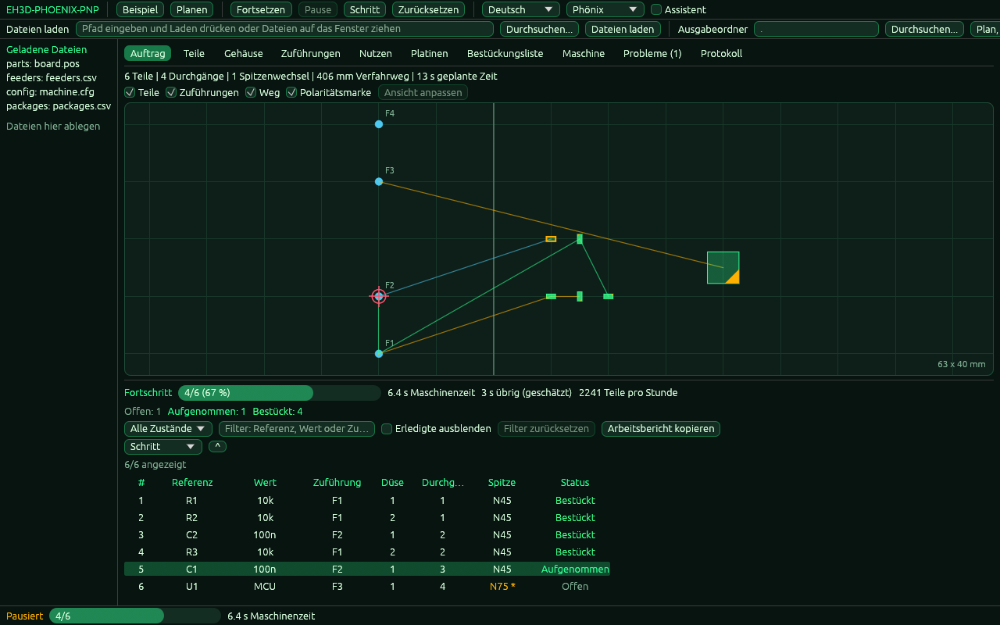

<p align="center">
  
</p>

# 📖 EH3D-PHOENIX-PNP

<p align="center"><a href="README.md">🇺🇸 English</a> | <a href="README_spa.md">🇪🇸 Español</a> | <a href="README_fra.md">🇫🇷 Français</a> | <a href="README_ita.md">🇮🇹 Italiano</a> | 🇩🇪 <b>Deutsch</b> | <a href="README_zho.md">🇨🇳 中文</a> | <a href="README_jpn.md">🇯🇵 日本語</a> | <a href="README_por.md">🇵🇹 Português</a></p>

### Pick-and-Place-Bestückung: Positionen, Zuführer und Reihenfolge der Bestückung

<p align="center">
  
  
  
  
  
</p>

---

**Ehrlichkeitscheck - was heute wirklich läuft:** eine Rust-Bibliothek und ein Kommandozeilenprogramm (`phoenix-pnp`) mit 434 Tests, die auf einem Computer laufen: liest die Positionsdatei einer Platine, ordnet jedem Bauteil seinen Zuführer zu (mit Prioritäten, Trays und Streifen), liest die Maschineneinstellungen aus einer Datei, plant die Reihenfolge der Bestückung für einen Kopf mit bis zu sechs Düsen (Ränge, Düsenspitzen, Winkelgrenzen, Zeit der Bewegungen, Panels), schreibt eine Ladeliste und führt den Plan auf einer simulierten Maschine Schritt für Schritt mit eingespeisten Fehlern aus. Es hat außerdem ein Fenster (gebaut mit `--features gui`), dessen Logik ohne Bildschirm getestet wird; die Zeichnung selbst ist nicht durch Tests abgedeckt und wurde nicht auf einem Bildschirm geprüft. Es steuert keine Maschine: Es wurde nicht auf einer Maschine erprobt und nicht an einer Sammlung echter Dateien geprüft.

---

> **Sicherheitsstatus:** Dieses Programm steuert keine Maschine und ist kein Sicherheitssystem. Was es erzeugt, muss ein Mensch prüfen, bevor etwas an einer Maschine läuft; nichts davon lief auf echter Hardware.


## 📋 Auf einen Blick

| | |
|---|---|
| Version | `0.0.5` |
| Reifegrad | Gerüst |
| Tests | 434 |
| Technologie-Stack | Rust |
| Auf echter Hardware | Nicht erprobt: nichts davon lief an einer Maschine |

**Springe zu:** [Überblick](#-überblick) · [Architektur](#-architektur) · [Schnellstart](#-schnellstart) · [Tests](#-tests) · [Struktur](#-struktur-des-repositorys) · [Verwandte](#-verwandte-projekte)

## 🚦 Projektstatus

Jede Zeile ist ein Teil dieses Repositorys, und die Ampel sagt, wie weit er heute ist. Sie beruht auf dem, was das Repository zeigen kann (Tests, Builds, Läufe), nicht auf dem, was geplant ist.

🟢 Fertig und überprüft · 🟡 Funktioniert, mit bekannten Grenzen · 🟠 Teilweise fertig oder noch nicht überprüft · 🔴 Nicht gemacht oder funktioniert nicht

| Bereich | Stand | Was das hier bedeutet |
|---|---|---|
| Kern | 🟡 | liest die Positionsdatei einer Platine, ordnet jedem Bauteil seinen Zuführer zu (Priorität, Tray, Streifen), plant die Reihenfolge der Bestückung für einen Kopf mit bis zu sechs Düsen mit Rängen, Düsenspitzen, Winkelgrenzen und der Zeit der Bewegungen, plant Panels und schreibt die Ladeliste; auf einem Computer mit normalen und beschädigten Eingaben getestet, nicht mit einer Sammlung echter Dateien. |
| Kommandozeile | 🟡 | `phoenix-pnp` führt dieselben Funktionen wie die Bibliothek aus (`parts`, `check`, `plan`, `schedule`, `preflight`, `simulate`, `loadsheet`, `config-check`, `check-bottom`, `tables-check`, `vision-test`) und gibt das Ergebnis aus; jeder Fehler kommt als Meldung mit seinem Code `PHOENIX-PNP-NNN` und einem Exit-Code ungleich null zurück. |
| Tests | 🟡 | 434 Tests bestehen (`cargo test`), mit Normalfällen, Grenzfällen, beschädigten Eingaben und kleinen erzeugten Fällen. |
| Maschinenkonfiguration | 🟡 | eine Datei `Schlüssel = Wert` mit Version, ein Prüfer, der die Zeile nennt, und die Sicherheitsgrenzen (Z-Weg, Grenzen von X und Y, Wiederholungen, Düsenwinkel); die Werte wurden nicht mit einer echten Maschine verglichen. |
| Simulator und Auftrag | 🟡 | eine virtuelle Uhr, zufällig (mit Startwert) oder an gewählter Stelle eingespeiste Fehler, Wiederholungen, die Richtlinien Alarm und Aufschieben, Zuführer, die nach wiederholten Fehlern abschalten, Pause, Einzelschritte und ein gespeicherter Zustand zum Fortsetzen; es simuliert nur, nichts hat eine Maschine bewegt. |
| Sicherheit | 🟡 | Reines sicheres Rust (`forbid(unsafe_code)`): nichts gerät bei den übergebenen Dateien in Panik und ein schlechter Wert ist ein Fehler mit Begründung; keine unabhängige Prüfung. |
| Fenster | 🟠 | Ein egui-Fenster (mit `--features gui` bauen; `phoenix-pnp` ohne Befehl öffnet es): Reiter für Auftrag, Teile, Gehäuse, Zuführungen, Bestückungsliste, Maschine, Probleme und Protokoll, eine Karte des Arbeitstisches mit dem Weg des Kopfes, Polaritätsmarken und dem nächsten Teil, ein Assistent in fünf Schritten, Probleme mit rückgängig machbaren Lösungen, ein simulierter Auftrag mit Pause, Fortsetzen und Einzelschritt und die acht Sprachen. Die Logik wird ohne Bildschirm getestet; die Zeichnung ist nicht durch Tests abgedeckt und wurde nicht auf einem Bildschirm geprüft. Dazu kommen Reiter für Nutzen (mit den Passmarken und der Anpassung, die die Teile verschiebt) und Platinen, eine Dateiauswahl, Tabellen der Zuführer und Gehäuse, die sich mit Rückgängig bearbeiten lassen, gemerkte Spaltenbreiten und ein eigenes Programm (`phoenix-pnp-gui`), das unter Windows ohne Konsole startet. |
| Echte Hardware | 🔴 | Nicht erprobt: nichts davon wurde an einer Maschine ausgeführt. |
| Dokumentation | 🟡 | README in acht Sprachen, das Changelog und die zwei aus `docs/` gezeichneten Bilder. |

## 🎯 Überblick

* **Die Bauteile** (`src/parts.rs`): eine KiCad-`.pos`-Datei oder eine CSV (Komma oder Semikolon, Anführungszeichen, Kopfzeile nach Namen gefunden) mit Positionen in mm, mil oder Zoll, Winkel auf 0-360 gebracht, Seite oben oder unten; jede unsinnige Zeile wird mit ihrer Nummer abgelehnt, eine doppelte Referenz ist ein Fehler.
* **Nicht zu bestückende Bauteile, die Tabellen der Beispiele und der Bericht eines Auftrags** (`src/parts.rs`, `src/commands.rs`, `src/job.rs`): eine Spalte `dnp`, `do not place` oder `fitted` in einer CSV (oder `--dnp R1,R2`) lässt Bauteile aus Plan, Ladeliste und Prüfungen heraus und führt sie im Bericht auf; `tables-check` liest die Tabellen (`--parts`, `--packages`, `--catalog`, `--feeders`, `--slots`) und nennt Code und Zeile jedes Fehlers; `simulate --report-csv DATEI` schreibt die Statistik des Auftrags als CSV, deren Kopfzeile sich nie ändert. `examples/` enthält eine Platine mit `dnp`-Spalte, Zuführer jeder Art und eine Tabelle üblicher Gehäuse.
* **Die Zuführer** (`src/feeders.rs`): eine CSV der Zuführer (ID, Wert, Gehäuse, Abholposition, verbleibende Teile); jedes Bauteil bekommt den ersten Zuführer mit seinem Wert und Gehäuse, ohne Beachtung der Groß-/Kleinschreibung; ein Bauteil ohne Zuführer und ein Zuführer, der leer wird, werden gemeldet, und ein zweiter Zuführer derselben Art springt ein.
* **Der Plan** (`src/plan.rs`): Die Orte werden nächster-zuerst abgelaufen und in Stapel von einer bis sechs Düsen geschnitten, die Zuführer eines Stapels nächster-zuerst besucht, die Unterseite um die Breite der Platine gespiegelt, und der Plan liefert den Weg und eine Zeitschätzung; er wird als JSON-Auftrag geschrieben.
* **Die Tabellen und die Einstellungen** (`src/catalog.rs`, `src/config.rs`, `src/rotation.rs`): Tabellen von Teilen und Gehäusen, deren Werte vererbt werden (Teil, dann Gehäuse, dann die Standardwerte), eine Maschinenkonfigurationsdatei im Format `Schlüssel = Wert` (`examples/machine.cfg` dokumentiert jeden Schlüssel), weitere Namen für die Spalten einer CSV-Positionsdatei und Drehwinkelkorrekturen je Gehäuse.
* **Die Zuführer mit mehr als einem Gurt** (`src/feeding.rs`): Priorität, Trays, Streifen und abgeschaltete Zuführer; der Zuführer eines Bauteils wird unabhängig von der Reihenfolge der Dateien gleich gewählt.
* **Der Planer der Maschine** (`src/planner.rs`, `src/motion.rs`): Ränge (Blöcke, die nacheinander bestückt werden), Ordnungsstrategien, Düsenspitzen und ihr Wechsel, die Grenzen des Düsenwinkels, die Zeit der Bewegungen mit Beschleunigung und Ruck, kürzere Wege (2-opt) und die Korrektur des Ursprungs eines Bauteils.
* **Panels, Ladeliste und Exporte** (`src/panel.rs`, `src/loadsheet.rs`, `src/export.rs`): Platinen und Panels in Panels, der Platz jeder Gurtart, ein Bericht, die Liste des Fehlenden und ein G-Code, der nur den Kopf bewegt.
* **Passmarken eines Nutzens** (`src/fiducial.rs`): die gemessenen Lagen der Marken werden an die entworfenen angepasst (eine Ähnlichkeitsabbildung mit zwei Marken, eine affine Anpassung mit drei oder mehr), und die Teile des Nutzens werden mit der Anpassung verschoben und gedreht; jede Marke hat ihren Restfehler, und eine Anpassung, die eine Marke um mehr als `fiducial_max_residual_mm` verfehlt, wird abgelehnt (`--fiducials DATEI` mit `--panel` oder der Reiter Nutzen des Fensters).
* **Mehr vom Planer und vom Simulator:** die Reihenfolge, in der die Zellen eines Trays geleert werden (Zeilen, Spalten oder Schlangenlinie), eine Suche nach der Reihenfolge der Düsenspitzen, die den Weg und die Fahrt zum Wechsler zählt (`tip_strategy = optimize`, begrenzt durch `tip_opt_max_evals` und `tip_opt_time_limit_s`), Ausfallwahrscheinlichkeiten je Gehäuse und je Zuführer (`sim_part_fail`, `sim_feeder_fail`) mit Statistiken je Gehäuse und je Zuführer und den Teilen pro Stunde sowie `check-bottom`, das den Winkel zeigt, den jede Regel der Unterseite ergibt.
* **Der Ausrichtschritt** (`src/job.rs`, `src/sim.rs`, `src/model.rs`): Mit `align = on` sieht sich der Auftrag jedes Teil nach dem Aufnehmen mit der Kamera an und korrigiert die Platzierung nach dem Gesehenen (der Kopf fährt zum Platz abzüglich des Versatzes des Teils, und die Düse dreht um dessen Drehung weniger); `pick_tolerance_mm` wirft ein Teil weg, das weiter daneben liegt, und es wird so neu aufgenommen, wie `error_policy` es sagt; `align_passes` (1 bis 5) und `align_settle_s` legen die Blicke und das Warten vor jedem fest und zählen zur Zeit des Plans; die simulierte Kamera hat einen Versatz, einen Fehler und einspeisbare Ausfälle (`sim_align_*`, `sim_camera_fail_rate`); und die Korrektur (Mittel, größte, weggeworfene Teile) steht im Text, im JSON-Bericht und in den `align`-Zeilen von `--report-csv`. Standardmäßig aus: Ein Auftrag ist dann derselbe wie immer. Nicht an einer Maschine erprobt.
* **Die Bildverarbeitung** (`src/vision.rs`, `src/sim.rs`, `examples/vision.cfg`): mit `vision = pipeline` zeichnet die simulierte Kamera ein Bild des Teils im Speicher (seine Größe, seine Drehung und sein Abstand zur Düse, mit einem aus `sim_seed` gezogenen Rauschen) und misst es mit den Schritten einer Einstellungsdatei (`--vision FILE`): eine Maske, ein Medianfilter, eine feste oder Otsu-Schwelle, ein Flächenbereich für den Fleck und das kleinste gedrehte Rechteck, dessen Mitte und Winkel die Abweichung sind, die der Ausrichtschritt korrigiert. Ein Teil, das nicht gefunden wird, ein Fleck mit falscher Fläche und mehrere Flecken sind Blicke ohne Messwert, jeder mit eigenem Code (`PHOENIX-PNP-037` bis `PHOENIX-PNP-039`). `phoenix-pnp vision-test` zeichnet ein Teil aus Größe, Drehung, Abweichung und Rauschen, die man ihm gibt, und gibt das Gemessene mit seinem Fehler aus. Standardmäßig aus: ein Auftrag ist dann derselbe wie zuvor. Nicht mit einer echten Kamera erprobt.
* **Der Arbeitsbericht** (`src/report.rs`, `src/job.rs`): Nach einem simulierten Auftrag kann `simulate` den Bericht schreiben: als Text in der Sprache von `--lang` (`--report-text`), als HTML-Seite, die alles enthält, ohne Skript und ohne etwas von außen, und die nie über eine vorhandene Datei geschrieben wird (`--report-html`), als Abschnitte hinter den Zeilen der CSV (`--report-csv`, die Kopfzeile bleibt) und als `work` im JSON (`--report`). Er nennt, wie viele Teile bestückt, zurückgestellt, von der Person ausgelassen, noch offen oder nicht zu bestücken sind; wohin die Maschinenzeit ging (Zuführen und Aufnehmen, Blicke der Kamera, Bestücken, Kopfbewegungen, Düsenwechsel); wie viele Aufnahmen beim ersten Versuch gelangen; dasselbe nach Gehäuse, Zuführung, Düse, Düsenspitze und Platine eines Nutzens; die aufgetretenen Fehler mit ihren Codes; die Hinweise vor dem Auftrag; und ein Histogramm dessen, was die Kamera korrigiert hat (X, Y und Drehung). Simuliert: nichts davon wurde an einer Maschine gemessen.
* **Der Reiter Auftrag und die Entscheidungen der Person** (`src/gui/jobtab.rs`, `src/gui/window.rs`, `src/job.rs`): Die Tabelle zeigt den Zustand jeder Platzierung (wartet, aufgenommen, ausgerichtet, bestückt, zurückgestellt, ausgelassen, fehlgeschlagen) und die nicht zu bestückenden Teile, einen Fortschrittsbalken mit der Maschinenzeit und eine Schätzung der Restzeit sowie Filter nach Zustand, nach Text und nach Erledigtem. Hält ein Fehler den Auftrag an, nennt ein Dialog den fehlgeschlagenen Schritt und bietet vier Aktionen, die am simulierten Auftrag ausgeführt werden, der danach weiterläuft: wiederholen, das Teil auslassen, es zurückstellen oder die Zuführung abschalten, damit eine andere derselben Art übernimmt. Jede Entscheidung wird im Bericht gezählt. Die Logik braucht keinen Bildschirm und ist getestet; die Darstellung hat keine Person an einem Bildschirm geprüft.
* **Der Simulator und der Auftrag** (`src/sim.rs`, `src/job.rs`, `src/preflight.rs`, `src/model.rs`): die Prüfungen vor einem Auftrag, eine Maschine mit virtueller Uhr und einspeisbaren Fehlern und ein Auftrag, der pausiert, Schritt für Schritt ausgeführt, gespeichert und fortgesetzt werden kann.
* **Das Fenster** (`src/gui.rs`, `src/gui/`): was das Fenster außer dem Zeichnen tut, braucht keinen Bildschirm (die geladenen Dateien, der Plan und seine Probleme mit Lösungen, der simulierte Auftrag, die Geometrie der Karte, die Tabellen mit gemeinsamer Auswahl, der Assistent in fünf Schritten und die Texte in acht Sprachen) und wird getestet; nur `src/gui/window.rs`, gebaut mit `--features gui`, zeichnet es mit egui. Die Geschwindigkeit der Simulation, das Design und die Größe, die für ein Teil mit unbekanntem Gehäuse gezeichnet wird, sind Schlüssel von `machine.cfg` (`gui_steps_per_s`, `gui_theme`, `gui_part_size_mm`).

## 🧩 Rolle in EH3D

EH3D-PHOENIX-PNP ist ein Programm der EH3D Fabrication Suite. Heute arbeitet es als Bibliothek, Kommandozeile und Fenster (gebaut mit `--features gui`); das Fenster hat noch nicht das gemeinsame Aussehen der Suite. Es liest und schreibt einfache Dateien und lässt sich allein oder zwischen den anderen Programmen nutzen.

## 🏛️ Architektur

<p align="center">
  
</p>


Wie die Teile dieses Repositorys zusammenpassen: wer es nutzt, was es enthält und wovon es abhängt. Das Bild wird aus `docs/architecture.json` gezeichnet und gegen den Code geprüft.

## ✨ Funktionen

* **Bibliothek und Kommandozeile:** Jeder Befehl von `phoenix-pnp` ist eine Funktion der Bibliothek, sodass ein anderes Programm der Suite ihn ohne Prozessstart aufrufen kann.
* **Strenge Kommandozeile:** Eine falsch geschriebene Option (`--powr`) oder ein überzähliges Wort ist ein Fehler, der sie nennt, und wird nicht ignoriert; sonst würde das Programm seine Ausgabe mit den Standardwerten erzeugen.
* **Tests mit beschädigten Eingaben:** Die Tests füttern auch leere Dateien, Datenmüll, riesige Zahlen und abgeschnittene Dateien; keiner darf in Panik geraten.
* **Kein Raten:** Ein unsinniger Wert ist ein Fehler, der sagt welcher und warum, nie ein Ergebnis, das nur richtig aussieht.
* **Kein unsafe-Code:** `#![forbid(unsafe_code)]` in Bibliothek und Programm.
* **Ein Leser für beide Tabellen, und schnell bei einer großen Platine:** die Positionsdatei und die Zuführungsdatei werden vom selben Leser gelesen (Komma oder Semikolon, Felder in Anführungszeichen mit Trennzeichen oder Zeilenumbruch), fünfzigtausend Bauteile werden in Augenblicken geprüft, zugeordnet und geplant, der Plan überschreibt nie eine Datei, aus der er erstellt wurde, eine unbekannte Option ist ein Fehler, und `--origin-x` sagt, wo die linke Kante der Platine liegt, wenn die Unterseite gespiegelt wird.

## 🔒 Sicherheit und Schutz

| Bedrohung | Schutz |
|---|---|
| Eine beschädigte, abgeschnittene oder leere Datei | keine Panik: die Tests schneiden gültige Eingaben an jeder Stelle ab und füttern Datenmüll |
| Eine unsinnige Zahl (negativ, nicht endlich, absurd groß) | wird mit einem Fehler abgelehnt, der den Wert nennt; nichts wird zu etwas Plausiblem gerundet |
| Unsichere Speichernutzung | reines sicheres Rust mit `forbid(unsafe_code)` |

**Was nicht abgesichert ist:** Ein fehlerfrei erzeugtes Ergebnis ist kein geprüftes Ergebnis. Nichts hier kennt die Grenzen einer Maschine, und das Programm hatte keine unabhängige Prüfung. Eine Schwachstelle bitte privat melden (siehe [SECURITY.md](SECURITY.md)).

## 🔌 Schnittstellen

Die Bibliothek ist `eh3d_phoenix_pnp` (`use eh3d_phoenix_pnp::...`); die Kommandozeile ist `phoenix-pnp`. Die Befehle sind diese; jeder gibt sein Ergebnis auf der Standardausgabe aus und meldet einen Fehler auf der Fehlerausgabe mit einem Exit-Code ungleich null. Es gibt keinen Netzwerkzugriff.

```text
EH3D-PHOENIX-PNP/
├── src/
│   ├── catalog.rs                               die Tabellen von Teilen und Gehäusen und die Vererbung ihrer Eigenschaften
│   ├── cli_args.rs                              die Argumente der Kommandozeile, streng: eine unbekannte Option ist ein Fehler
│   ├── commands.rs                              die Befehle mit Konfiguration, tables-check und check-bottom
│   ├── config.rs                                die Konfigurationsdatei der Maschine: Schlüssel, Bereiche und Sicherheitsgrenzen
│   ├── error.rs                                 die Fehlercodes PHOENIX-PNP-NNN und ihre Bedeutung in acht Sprachen
│   ├── export.rs                                der Bericht, die Liste des Fehlenden und der G-Code der Bewegungen
│   ├── feeders.rs                               ein Teil der Logik
│   ├── feeding.rs                               Zuführer mit Priorität, Trays und Streifen und die Wahl des Zuführers für ein Bauteil
│   ├── fiducial.rs                              Passmarken eines Nutzens: die Anpassung der gemessenen Marken und die Korrektur der Teile
│   ├── gui.rs                                   das Fenster: Module ohne Bildschirm und die Zeichnung in window.rs
│   ├── gui/app.rs                               der Zustand des Fensters: laden, planen, starten, pausieren, Schritt, beheben, speichern
│   ├── gui/browse.rs                            die Dateiauswahl: Ordner und Dateien, hinauf, eingetippte Pfade
│   ├── gui/jobtab.rs                            der Reiter Auftrag ohne Fenster: Zustände, Filter, Fortschritt, Fehlerdialog
│   ├── gui/log.rs                               das Protokoll mit Stufen und der Text der kopierbaren Diagnose
│   ├── gui/problems.rs                          die Probleme eines Auftrags und die Lösungen dafür
│   ├── gui/samples.rs                           Beispiele, von der kleinen bis zur großen Platine
│   ├── gui/session.rs                           der simulierte Auftrag: starten, pausieren, fortsetzen, Einzelschritt
│   ├── gui/settings.rs                          was das Fenster sich merkt: Sprache, Design, Ebenen, Ordner und die Breite der Spalten
│   ├── gui/shot.rs                              der Bildmodus des Fensters (--shot): seine Argumente
│   ├── gui/tables.rs                            die Zeilen, die Sortierung und die gemeinsame Auswahl der Tabellen
│   ├── gui/texts.rs                             jedes Wort des Fensters in den acht Sprachen
│   ├── gui/theme.rs                             die Farben: Phönixgrün, hell und hoher Kontrast
│   ├── gui/view.rs                              die Geometrie der Karte: Körper, Polaritätsmarken, Anpassung, Zoom und Treffer
│   ├── gui/window.rs                            die Zeichnung mit egui, gebaut mit dem Feature gui: Reiter, Karte und Tabellen
│   ├── gui/wizard.rs                            der Assistent in fünf Schritten, von nichts zu einem simulierten Auftrag
│   ├── gui/workspace.rs                         die geladenen Dateien, der Plan und die Änderungen, ohne Fenster
│   ├── gui_main.rs                              das Fenster als eigenes Programm, unter Windows ohne Konsole
│   ├── job.rs                                   der Auftrag: Schritte, Pause, Wiederholungen, Richtlinien, Statistik und gespeicherter Zustand
│   ├── lib.rs                                   die Bibliothek: was jeder Befehl nutzt
│   ├── loadsheet.rs                             die Ladeliste: der Platz jeder Gurtart
│   ├── main.rs                                  die Kommandozeile und der Einstieg des Fensters, wenn es ohne Befehl läuft
│   ├── model.rs                                 die Teile einer Maschine als Traits: Maschine, Düse, Zuführer, Aktor, Kamera, Treiber
│   ├── motion.rs                                die Zeit einer Bewegung, mit Beschleunigung und Ruck
│   ├── panel.rs                                 Panels: Platinen und Panels in Panels, jede an ihrem Platz
│   ├── parts.rs                                 die Positionsdatei und die nicht zu bestückenden Teile
│   ├── plan.rs                                  ein Teil der Logik
│   ├── planner.rs                               der Planer, der die Maschine kennt: Ränge, Reihenfolge, Spitzen und ihre Suche, Winkel und Zeit
│   ├── preflight.rs                             die Prüfungen vor einem Auftrag, mit Schwere und dem, worauf sie zeigen
│   ├── report.rs                                der Auftragsbericht: Phasen, Aufnahmen, Gruppen, Fehler; Text, HTML, CSV, JSON
│   ├── rotation.rs                              Drehwinkelkorrekturen je Gehäuse und wie sich eine begrenzte Düse dreht
│   ├── sim.rs                                   die simulierte Maschine: virtuelle Uhr und einspeisbare Fehler
│   ├── units.rs                                 Längen und Orte, die ihre Einheit tragen
│   └── vision.rs                                die Bildverarbeitung: Filter, Schwelle, Flecken, kleinstes gedrehtes Rechteck
├── tests/
│   ├── align.rs                                 Tests des Ausrichtschritts: Kamera, korrigierter Platz, Toleranz und Zeit
│   ├── commands.rs                              Tests der Befehle, die die Konfiguration nutzen
│   ├── feeding.rs                               Tests der Zuführer: Priorität, Trays und Streifen
│   ├── gui.rs                                   Tests des Fensters ohne Bildschirm: Zustand, Plan, Auftrag, Karte, Tabellen und Assistent
│   ├── job.rs                                   Tests des Auftrags: Schritte, Wiederholungen und gespeicherter Zustand
│   ├── jobtab.rs                                Tests des Reiters Auftrag ohne Bildschirm: Zustände, Filter, Fortschritt, Dialog
│   ├── loadsheet.rs                             Tests der Ladeliste und der Exporte
│   ├── model.rs                                 Tests des Datenmodells: Codes, Längen, Konfiguration und Tabellen
│   ├── more.rs                                  weitere Tests von Bibliothek und Kommandozeile
│   ├── panel.rs                                 Tests der Panels und ihrer Passmarken
│   ├── planner.rs                               Tests der Bewegungszeit und des Planers
│   ├── pnp.rs                                   Tests von Bibliothek und Kommandozeile
│   ├── preflight.rs                             Tests der Prüfungen vor einem Auftrag
│   ├── readme.rs                                Tests, dass die README ausführbar und vollständig ist
│   ├── report.rs                                Tests des Berichts: Phasen, Aufnahmen, Histogramme, Gruppen, Entscheidungen
│   ├── sim.rs                                   Tests der simulierten Maschine
│   ├── strict.rs                                Tests der Kommandozeile: Optionen und Wörter, die sie nicht kennt
│   ├── tables.rs                                Tests der nicht zu bestückenden Teile, von tables-check und des Auftragsberichts als CSV
│   ├── vision.rs                                Tests der Bildverarbeitung: von Hand geprüfte Bilder, Fehler, Einstellungen
│   └── vision_job.rs                            Tests der Bildverarbeitung im Auftrag, vision-test: Messungen, Fehler, Zustand
├── examples/
│   ├── board.pos                                ein Beispiel zum Ausprobieren
│   ├── board_dnp.csv                            eine Platine mit einer dnp-Spalte: zwei ihrer Teile werden nicht bestückt
│   ├── catalog.csv                              eine Teiletabelle: Rang und Höhe
│   ├── feeders.csv                              ein Beispiel zum Ausprobieren
│   ├── feeders_kinds.csv                        Zuführer jeder Art: Gurt, Streifen, Tray und einer ausgeschaltet
│   ├── machine.cfg                              die Maschineneinstellungen, jeder Schlüssel erklärt
│   ├── marks.csv                                die gemessenen Lagen der Passmarken des Nutzens
│   ├── packages.csv                             eine Gehäusetabelle: Höhe, Spitze, Rang und Gurt
│   ├── packages_common.csv                      eine Tabelle üblicher Gehäuse, von 0201-Widerständen bis QFN, zum Anpassen an die eigenen Teile
│   ├── panel.json                               ein Panel aus zwei Platinen
│   ├── slots.csv                                die Plätze der Maschine
│   └── vision.cfg                               die Einstellungen der Bildverarbeitung, jeder Schlüssel erklärt
├── docs/
│   ├── architecture.json                        Daten des Architektur-Bildes
│   ├── structure.json                           Daten des Struktur-Bildes
│   └── windows-console.md                       warum das Fenster unter Windows ein eigenes Programm ist
├── tools/                                       CI-Prüfung, README-Prüfung und die Bildwerkzeuge
├── images/                                      Banner, Bilder von Architektur und Struktur und Bilder des Fensters
├── .github/                                     CI- und Release-Workflows, Vorlagen für Issues und Pull Requests
├── eh3d.project.json                            Manifest: Version, Rolle, Reifegrad und Build-Befehl
├── Cargo.toml Cargo.lock                        der Workspace und seine festgelegten Abhängigkeiten
├── rust-toolchain.toml                          die festgelegte Rust-Toolchain
├── CHANGELOG.md                                 was sich in jeder Version geändert hat
├── SECURITY.md SUPPORT.md                       Schwachstellen melden und Fragen stellen
└── CONTRIBUTING.md CODE_OF_CONDUCT.md LICENSE   Mitwirken, Verhaltenskodex und Lizenz
```

## ⚙️ Konfiguration

Maschine und Planer werden mit einer Textdatei aus Zeilen `Schlüssel = Wert` konfiguriert (`--config DATEI`), im selben Format wie bei den anderen Programmen der Suite; `examples/machine.cfg` listet jeden Schlüssel mit seinem Standardwert und seiner Wirkung auf. Ein fehlender Schlüssel behält seinen Standardwert; ein unbekannter, doppelt geschriebener oder außerhalb seines Bereichs liegender Schlüssel ist ein Fehler, der die Zeile nennt. Die Optionen der Kommandozeile (`--nozzles`, `--speed`, `--order`, `--side`) haben Vorrang vor der Datei.

Die Spalten, die ein Bauteil als nicht zu bestücken markieren, und ihre Wörter sind ebenfalls Einstellungen: `header_dnp` und `header_fitted` fügen Namen der Spalte hinzu, `dnp_yes_words` und `dnp_no_words` fügen Wörter für Ja und Nein hinzu. Eine Spalte namens `dnp`, `do not place`, `do not populate`, `do not mount`, `do_not_place`, `not fitted` oder `no montar` lässt das Bauteil bei einem Ja (`yes`, `y`, `true`, `1`, `x`) weg; eine namens `fitted`, `populate`, `populated`, `mount`, `mounted` oder `montar` lässt es bei einem Nein (`no`, `n`, `false`, `0`, `-`) weg; eine leere Zelle bestückt das Bauteil, und jedes andere Wort ist ein Fehler, der die Zeile nennt.

Die Tabellen der Gehäuse und Teile (`--packages`, `--catalog`) sind CSV-Dateien, in denen eine leere Zelle erbt; ein Panel (`--panel`) ist eine JSON-Datei; die Plätze der Maschine (`loadsheet`) sind eine CSV mit `id,x,y,max_width_mm`. Eine Datei, die größer als `max_file_bytes` ist, wird abgelehnt. Jeder Fehler hat einen Code `PHOENIX-PNP-NNN`; seine Meldung steht in der Sprache des Schlüssels `language` oder von `--lang` (`en`, `es`, `de`, `fr`, `it`, `ja`, `zh` oder `pt`):

| Code | Bedeutung |
|---|---|
| `PHOENIX-PNP-001` | Die Datei ist größer als erlaubt |
| `PHOENIX-PNP-002` | Es gibt mehr Teile, als das Limit erlaubt |
| `PHOENIX-PNP-003` | Eine Zeile der Konfiguration ist nicht Schlüssel = Wert |
| `PHOENIX-PNP-004` | Die Konfiguration enthält einen unbekannten Schlüssel |
| `PHOENIX-PNP-005` | Ein Wert der Konfiguration ist ungültig |
| `PHOENIX-PNP-006` | Ein Wert der Konfiguration liegt außerhalb seines Bereichs |
| `PHOENIX-PNP-007` | Die Konfiguration wurde für eine neuere Programmversion geschrieben |
| `PHOENIX-PNP-008` | Ein Schlüssel der Konfiguration steht doppelt |
| `PHOENIX-PNP-009` | Eine Einstellung überschreitet die Sicherheitsgrenzen |
| `PHOENIX-PNP-010` | Eine Zeile der Teile- oder Gehäusetabelle ist ungültig |
| `PHOENIX-PNP-011` | Ein Teil oder Gehäuse ist doppelt definiert |
| `PHOENIX-PNP-012` | Eine Regel für den Drehwinkelversatz ist ungültig |
| `PHOENIX-PNP-013` | Eine Zeile der Zuführungen ist ungültig |
| `PHOENIX-PNP-014` | Die Panel-Datei ist ungültig |
| `PHOENIX-PNP-015` | Das Panel ist zu tief verschachtelt oder hat zu viele Platinen |
| `PHOENIX-PNP-016` | Die Slot-Tabelle ist ungültig |
| `PHOENIX-PNP-017` | Eine Einstellung des Plans ist ungültig |
| `PHOENIX-PNP-018` | Die Düse kann sich innerhalb ihrer Grenzen nicht auf diesen Winkel drehen |
| `PHOENIX-PNP-019` | Die Düse hält schon ein Teil: sie kann kein weiteres aufnehmen |
| `PHOENIX-PNP-020` | Die Düse hält kein Teil zum Bestücken |
| `PHOENIX-PNP-021` | Für das Teil ist keine Zuführung verfügbar |
| `PHOENIX-PNP-022` | Das Teil konnte nach allen Versuchen nicht aufgenommen werden |
| `PHOENIX-PNP-023` | Die Zuführung konnte nach allen Versuchen nicht weiterschalten |
| `PHOENIX-PNP-024` | Das Teil konnte nach allen Versuchen nicht bestückt werden |
| `PHOENIX-PNP-025` | Der gespeicherte Zustand gehört zu einem anderen Auftrag |
| `PHOENIX-PNP-026` | Der gespeicherte Zustand des Auftrags ist ungültig |
| `PHOENIX-PNP-027` | Der Auftrag ist pausiert, beendet oder durch einen Fehler gestoppt |
| `PHOENIX-PNP-028` | Die Prüfungen vor dem Auftrag haben Fehler gefunden |
| `PHOENIX-PNP-029` | Eine Länge oder ein Winkel ist ungültig |
| `PHOENIX-PNP-030` | Der Treiber hat den Befehl nicht angenommen |
| `PHOENIX-PNP-031` | Der Simulator hat einen Fehler eingespeist |
| `PHOENIX-PNP-032` | Die Passmarken sind ungültig oder ergeben keine Lage |
| `PHOENIX-PNP-033` | Eine Bestückungsmarkierung ist weder ja noch nein, oder eine auszulassende Referenz ist unbekannt |
| `PHOENIX-PNP-034` | Die Positionsdatei ist ungültig |
| `PHOENIX-PNP-035` | Die Kamera fand das Teil weiter verschoben, als die Toleranz erlaubt |
| `PHOENIX-PNP-036` | Die Kamera lieferte keine Messung des Teils |
| `PHOENIX-PNP-037` | Die Bildverarbeitung fand das Teil im Bild nicht |
| `PHOENIX-PNP-038` | Der im Bild gefundene Fleck hat eine Fläche außerhalb des erlaubten Bereichs |
| `PHOENIX-PNP-039` | Die Bildverarbeitung fand mehr als einen Fleck, der das Teil sein könnte |
| `PHOENIX-PNP-040` | Die Berichtsdatei existiert bereits und wird nicht überschrieben |
| `PHOENIX-PNP-041` | Die Aktion passt nicht zum Zustand des Auftrags |

## 🚀 Schnellstart

Sie brauchen eine stabile Rust-Toolchain (1.95 oder neuer).

```bash
cargo build --release
cargo test
cargo run --release -- plan examples/board.pos examples/feeders.csv examples/plan.json --nozzles 2
cargo run --release -- schedule examples/board.pos examples/feeders.csv examples/schedule.json --config examples/machine.cfg --packages examples/packages.csv --catalog examples/catalog.csv
cargo run --release -- simulate examples/board.pos examples/feeders.csv --config examples/machine.cfg --state examples/job_state.json --steps 5
cargo run --release -- loadsheet examples/board.pos examples/slots.csv examples/loadsheet.csv --packages examples/packages.csv
cargo run --release -- check-bottom examples/board.pos
cargo run --release -- schedule examples/board_dnp.csv examples/feeders.csv examples/schedule_dnp.json --config examples/machine.cfg --packages examples/packages.csv --catalog examples/catalog.csv
cargo run --release -- tables-check --parts examples/board_dnp.csv --packages examples/packages_common.csv --feeders examples/feeders_kinds.csv --slots examples/slots.csv --config examples/machine.cfg
cargo run --release -- simulate examples/board.pos examples/feeders.csv --config examples/machine.cfg --report-csv examples/job_report.csv
cargo run --release -- simulate examples/board.pos examples/feeders.csv --config examples/machine.cfg --report-text examples/job_report.txt --report-html examples/job_report.html
cargo run --release -- schedule examples/feeders.csv examples/schedule_panel.json --panel examples/panel.json --fiducials examples/marks.csv --config examples/machine.cfg
cargo run --release -- vision-test --vision examples/vision.cfg --turn 30 --dx 0.5 --dy -0.3
cargo run --release --features gui -- --shot screen.png examples/board.pos examples/feeders.csv examples/machine.cfg   # a picture of the window
cargo run --release --features gui -- --shot job.png --window job --steps 9 examples/board.pos examples/feeders.csv examples/machine.cfg   # the Job tab with the job on its way
cargo run --release --features gui
```

Um ein Bild des Fensters aufzunehmen, ohne es von Hand zu öffnen, starten Sie es mit `--shot DATEI.png` (auch `--size WxH`, `--theme phoenix|light|contrast`, `--wait N`, `--window TAB`, `--steps N`, `--lang CODE`, `--open FILE`, `--replace`): Es öffnet sich in dieser Größe, speichert das PNG, behält keine Einstellungen und schließt sich selbst (Exit-Code 0, wenn die Datei geschrieben wurde, 1, wenn nicht, 2 bei falschen Argumenten). `--window` wählt den Reiter des Bildes (`job`, `parts`, `packages`, `feeders`, `panels`, `boards`, `loadsheet`, `machine`, `problems` oder `log`), und `--steps N` führt vor der Aufnahme N Schritte des simulierten Auftrags aus, sodass der Reiter Auftrag einen laufenden Auftrag zeigt.

<p align="center">
  
</p>

Die letzte Zeile öffnet das Fenster; das tut auch `phoenix-pnp` ohne Befehl, wenn es mit `--features gui` gebaut wurde (unter Linux braucht das Fenster die Entwicklungsdateien von X11 oder Wayland und OpenGL). Mit einem Befehl bleibt das Programm eine Kommandozeile. Unter Windows öffnet `phoenix-pnp-gui` (mit demselben Feature gebaut) das Fenster ohne Konsole; siehe `docs/windows-console.md`.

## 🧪 Tests

Die Suite hat 434 Tests (`cargo test`, in der CI unter Windows und Linux ausgeführt). Sie prüfen die Normalfälle, die Grenzfälle und beschädigte Eingaben: leere Dateien, Müll und abgeschnittene Dateien führen nie zu einer Panik. Kleine erzeugte Fälle (aus einem festen Startwert, also mit denselben Zahlen bei jedem Lauf) prüfen, dass der Plan nicht von der Reihenfolge der Dateien abhängt, dass ein Weg nie länger wird, dass ein irgendwo gespeicherter und fortgesetzter Auftrag genauso endet wie einer, der nie angehalten wurde, und dass sich Längen und Winkel hin und zurück umrechnen lassen. Die CI führt außerdem `cargo fmt --check`, `cargo clippy` mit Warnungen als Fehlern und `python -I tools/ci_validate.py` aus.

## 🏗️ Build und Veröffentlichung

Die Version steht in `Cargo.toml` und in `eh3d.project.json`; jede Version hat ihren Eintrag in [CHANGELOG.md](CHANGELOG.md). `build.bat` / `build.sh` bauen das Programm, `test.bat` / `test.sh` führen die Tests aus und `run.bat` / `run.sh` starten es mit einem Beispiel. Releases erscheinen auf GitHub.

## 📂 Struktur des Repositorys

<p align="center">
  
</p>

<details>
<summary>Textversion des Baums</summary>

```text
EH3D-PHOENIX-PNP/
├── src/
│   ├── catalog.rs                               die Tabellen von Teilen und Gehäusen und die Vererbung ihrer Eigenschaften
│   ├── cli_args.rs                              die Argumente der Kommandozeile, streng: eine unbekannte Option ist ein Fehler
│   ├── commands.rs                              die Befehle mit Konfiguration, tables-check und check-bottom
│   ├── config.rs                                die Konfigurationsdatei der Maschine: Schlüssel, Bereiche und Sicherheitsgrenzen
│   ├── error.rs                                 die Fehlercodes PHOENIX-PNP-NNN und ihre Bedeutung in acht Sprachen
│   ├── export.rs                                der Bericht, die Liste des Fehlenden und der G-Code der Bewegungen
│   ├── feeders.rs                               ein Teil der Logik
│   ├── feeding.rs                               Zuführer mit Priorität, Trays und Streifen und die Wahl des Zuführers für ein Bauteil
│   ├── fiducial.rs                              Passmarken eines Nutzens: die Anpassung der gemessenen Marken und die Korrektur der Teile
│   ├── gui.rs                                   das Fenster: Module ohne Bildschirm und die Zeichnung in window.rs
│   ├── gui/app.rs                               der Zustand des Fensters: laden, planen, starten, pausieren, Schritt, beheben, speichern
│   ├── gui/browse.rs                            die Dateiauswahl: Ordner und Dateien, hinauf, eingetippte Pfade
│   ├── gui/jobtab.rs                            der Reiter Auftrag ohne Fenster: Zustände, Filter, Fortschritt, Fehlerdialog
│   ├── gui/log.rs                               das Protokoll mit Stufen und der Text der kopierbaren Diagnose
│   ├── gui/problems.rs                          die Probleme eines Auftrags und die Lösungen dafür
│   ├── gui/samples.rs                           Beispiele, von der kleinen bis zur großen Platine
│   ├── gui/session.rs                           der simulierte Auftrag: starten, pausieren, fortsetzen, Einzelschritt
│   ├── gui/settings.rs                          was das Fenster sich merkt: Sprache, Design, Ebenen, Ordner und die Breite der Spalten
│   ├── gui/shot.rs                              der Bildmodus des Fensters (--shot): seine Argumente
│   ├── gui/tables.rs                            die Zeilen, die Sortierung und die gemeinsame Auswahl der Tabellen
│   ├── gui/texts.rs                             jedes Wort des Fensters in den acht Sprachen
│   ├── gui/theme.rs                             die Farben: Phönixgrün, hell und hoher Kontrast
│   ├── gui/view.rs                              die Geometrie der Karte: Körper, Polaritätsmarken, Anpassung, Zoom und Treffer
│   ├── gui/window.rs                            die Zeichnung mit egui, gebaut mit dem Feature gui: Reiter, Karte und Tabellen
│   ├── gui/wizard.rs                            der Assistent in fünf Schritten, von nichts zu einem simulierten Auftrag
│   ├── gui/workspace.rs                         die geladenen Dateien, der Plan und die Änderungen, ohne Fenster
│   ├── gui_main.rs                              das Fenster als eigenes Programm, unter Windows ohne Konsole
│   ├── job.rs                                   der Auftrag: Schritte, Pause, Wiederholungen, Richtlinien, Statistik und gespeicherter Zustand
│   ├── lib.rs                                   die Bibliothek: was jeder Befehl nutzt
│   ├── loadsheet.rs                             die Ladeliste: der Platz jeder Gurtart
│   ├── main.rs                                  die Kommandozeile und der Einstieg des Fensters, wenn es ohne Befehl läuft
│   ├── model.rs                                 die Teile einer Maschine als Traits: Maschine, Düse, Zuführer, Aktor, Kamera, Treiber
│   ├── motion.rs                                die Zeit einer Bewegung, mit Beschleunigung und Ruck
│   ├── panel.rs                                 Panels: Platinen und Panels in Panels, jede an ihrem Platz
│   ├── parts.rs                                 die Positionsdatei und die nicht zu bestückenden Teile
│   ├── plan.rs                                  ein Teil der Logik
│   ├── planner.rs                               der Planer, der die Maschine kennt: Ränge, Reihenfolge, Spitzen und ihre Suche, Winkel und Zeit
│   ├── preflight.rs                             die Prüfungen vor einem Auftrag, mit Schwere und dem, worauf sie zeigen
│   ├── report.rs                                der Auftragsbericht: Phasen, Aufnahmen, Gruppen, Fehler; Text, HTML, CSV, JSON
│   ├── rotation.rs                              Drehwinkelkorrekturen je Gehäuse und wie sich eine begrenzte Düse dreht
│   ├── sim.rs                                   die simulierte Maschine: virtuelle Uhr und einspeisbare Fehler
│   ├── units.rs                                 Längen und Orte, die ihre Einheit tragen
│   └── vision.rs                                die Bildverarbeitung: Filter, Schwelle, Flecken, kleinstes gedrehtes Rechteck
├── tests/
│   ├── align.rs                                 Tests des Ausrichtschritts: Kamera, korrigierter Platz, Toleranz und Zeit
│   ├── commands.rs                              Tests der Befehle, die die Konfiguration nutzen
│   ├── feeding.rs                               Tests der Zuführer: Priorität, Trays und Streifen
│   ├── gui.rs                                   Tests des Fensters ohne Bildschirm: Zustand, Plan, Auftrag, Karte, Tabellen und Assistent
│   ├── job.rs                                   Tests des Auftrags: Schritte, Wiederholungen und gespeicherter Zustand
│   ├── jobtab.rs                                Tests des Reiters Auftrag ohne Bildschirm: Zustände, Filter, Fortschritt, Dialog
│   ├── loadsheet.rs                             Tests der Ladeliste und der Exporte
│   ├── model.rs                                 Tests des Datenmodells: Codes, Längen, Konfiguration und Tabellen
│   ├── more.rs                                  weitere Tests von Bibliothek und Kommandozeile
│   ├── panel.rs                                 Tests der Panels und ihrer Passmarken
│   ├── planner.rs                               Tests der Bewegungszeit und des Planers
│   ├── pnp.rs                                   Tests von Bibliothek und Kommandozeile
│   ├── preflight.rs                             Tests der Prüfungen vor einem Auftrag
│   ├── readme.rs                                Tests, dass die README ausführbar und vollständig ist
│   ├── report.rs                                Tests des Berichts: Phasen, Aufnahmen, Histogramme, Gruppen, Entscheidungen
│   ├── sim.rs                                   Tests der simulierten Maschine
│   ├── strict.rs                                Tests der Kommandozeile: Optionen und Wörter, die sie nicht kennt
│   ├── tables.rs                                Tests der nicht zu bestückenden Teile, von tables-check und des Auftragsberichts als CSV
│   ├── vision.rs                                Tests der Bildverarbeitung: von Hand geprüfte Bilder, Fehler, Einstellungen
│   └── vision_job.rs                            Tests der Bildverarbeitung im Auftrag, vision-test: Messungen, Fehler, Zustand
├── examples/
│   ├── board.pos                                ein Beispiel zum Ausprobieren
│   ├── board_dnp.csv                            eine Platine mit einer dnp-Spalte: zwei ihrer Teile werden nicht bestückt
│   ├── catalog.csv                              eine Teiletabelle: Rang und Höhe
│   ├── feeders.csv                              ein Beispiel zum Ausprobieren
│   ├── feeders_kinds.csv                        Zuführer jeder Art: Gurt, Streifen, Tray und einer ausgeschaltet
│   ├── machine.cfg                              die Maschineneinstellungen, jeder Schlüssel erklärt
│   ├── marks.csv                                die gemessenen Lagen der Passmarken des Nutzens
│   ├── packages.csv                             eine Gehäusetabelle: Höhe, Spitze, Rang und Gurt
│   ├── packages_common.csv                      eine Tabelle üblicher Gehäuse, von 0201-Widerständen bis QFN, zum Anpassen an die eigenen Teile
│   ├── panel.json                               ein Panel aus zwei Platinen
│   ├── slots.csv                                die Plätze der Maschine
│   └── vision.cfg                               die Einstellungen der Bildverarbeitung, jeder Schlüssel erklärt
├── docs/
│   ├── architecture.json                        Daten des Architektur-Bildes
│   ├── structure.json                           Daten des Struktur-Bildes
│   └── windows-console.md                       warum das Fenster unter Windows ein eigenes Programm ist
├── tools/                                       CI-Prüfung, README-Prüfung und die Bildwerkzeuge
├── images/                                      Banner, Bilder von Architektur und Struktur und Bilder des Fensters
├── .github/                                     CI- und Release-Workflows, Vorlagen für Issues und Pull Requests
├── eh3d.project.json                            Manifest: Version, Rolle, Reifegrad und Build-Befehl
├── Cargo.toml Cargo.lock                        der Workspace und seine festgelegten Abhängigkeiten
├── rust-toolchain.toml                          die festgelegte Rust-Toolchain
├── CHANGELOG.md                                 was sich in jeder Version geändert hat
├── SECURITY.md SUPPORT.md                       Schwachstellen melden und Fragen stellen
└── CONTRIBUTING.md CODE_OF_CONDUCT.md LICENSE   Mitwirken, Verhaltenskodex und Lizenz
```

</details>

## 🗺️ Roadmap und bekannte Grenzen

**Bekannte Grenzen heute**

* Die Zeichnung des Fensters wurde nicht auf einem Bildschirm geprüft; seine Tabellen merken sich die Spaltenbreiten nicht, und es hat keine Reiter für Panels und Platinen, keinen Jog und keine Kamera.
* Es wurde weder auf einer Maschine noch mit einer Sammlung echter Dateien erprobt und hatte keine unabhängige Prüfung; alles, was es mit einer Maschine tut, ist eine Simulation.
* Es liest nicht die Dateien anderer Bestückungsprogramme, und die Regel für den Winkel der Unterseite einer CSV (`bottom_rotation`) wurde nicht mit echten Dateien eines CAD-Programms verglichen.
* Es gibt noch keine Kamera, keine Korrektur der Aufnahme per Bildverarbeitung und keinen Treiber für eine echte Maschine; der Plan ist eine JSON-Datei, die ein anderes Programm ausführen soll.

**Als Nächstes**

* Das Fenster in das gemeinsame Aussehen der Programme der Suite bringen und ergänzen, was fehlt: Reiter für Panels und Platinen, gemerkte Spaltenbreiten und das Bearbeiten der Tabellen der Gehäuse.
* Passmarken von Platine und Panel und die Korrektur per Kamera von EH3D-VISION-STUDIO; einen Plan erst an eine Maschine senden, nachdem er auf einer echten erprobt wurde.
* Mit echten Dateien und mit den anderen Programmen der Suite ausprobieren.

## 🌍 Sprachen

README und Texte gibt es auf Englisch, Spanisch, Französisch, Italienisch, Deutsch, Chinesisch, Japanisch und europäischem Portugiesisch.

## 🔗 Verwandte Projekte

* [EH3D-VISION-STUDIO](https://github.com/JuanenRac/EH3D-VISION-STUDIO): Kameras, Passmarken und Inspektion
* [EH3D-MOTIONCNC](https://github.com/JuanenRac/EH3D-MOTIONCNC): das Maschinensteuerungsprogramm
* [EH3D-GERBERVIEWER](https://github.com/JuanenRac/EH3D-GERBERVIEWER): der Betrachter für Gerber-Lagen
* [EH3D-TOOL-MANAGER](https://github.com/JuanenRac/EH3D-TOOL-MANAGER): das Werkzeuglager der CAM-Programme
* [EH3D-SUITE-LAUNCHER](https://github.com/JuanenRac/EH3D-SUITE-LAUNCHER): die Zentrale, die die Programme der Suite findet und startet

## 📚 Dokumentation

* [Changelog](CHANGELOG.md)
* [Architektur- und Strukturdaten](docs/architecture.json): die Daten, aus denen die beiden Bilder gezeichnet werden.

## 🤝 Mitwirken und Community

* Vor einem Pull Request `cargo fmt --check`, `cargo clippy --all-targets -- -D warnings`, `cargo test` und `python -I tools/ci_validate.py` ausführen: alles muss bestehen. Siehe [CONTRIBUTING.md](CONTRIBUTING.md) und den [Verhaltenskodex](CODE_OF_CONDUCT.md).
* Die README gibt es in acht Sprachen: Eine Textänderung erfolgt in allen acht Dateien, und die zwei Bilder werden aus `docs/architecture.json` und `docs/structure.json` mit `tools/make_architecture.py` und `tools/make_structure.py` gezeichnet.
* Eine Schwachstelle privat melden: [SECURITY.md](SECURITY.md). Fragen, Ideen und Berichte: electrohobby3d@gmail.com ([SUPPORT.md](SUPPORT.md)).

## 👤 AUTOR

**JuanenRac (Electro Hobby 3D)** · electrohobby3d@gmail.com

## 📜 LIZENZ

Software: GPL-3.0-or-later. Siehe [LICENSE](LICENSE). Die Hardware-Entwürfe der Suite verwenden die CERN OHL-S.
