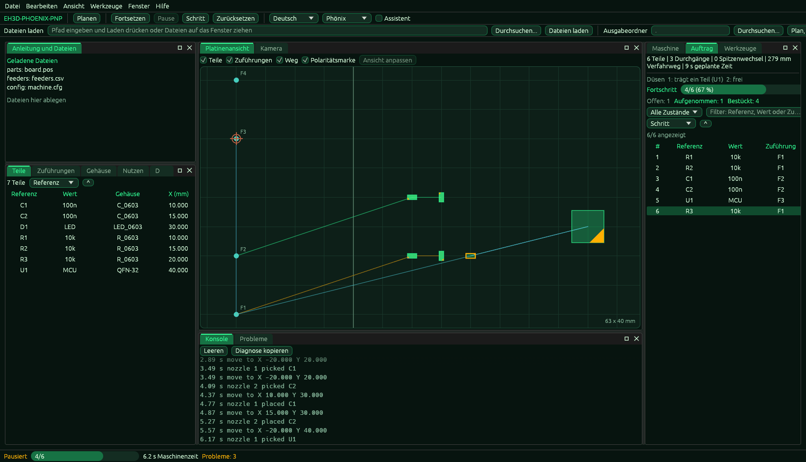
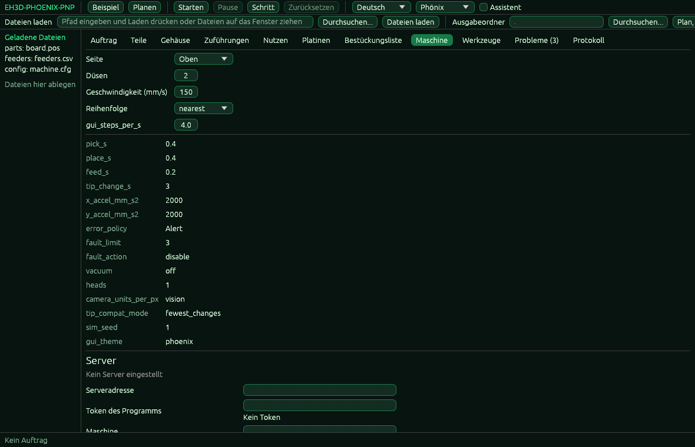

<p align="center">
  
</p>

# 📖 EH3D-PHOENIX-PNP

<p align="center"><a href="README.md">🇺🇸 English</a> | <a href="README_spa.md">🇪🇸 Español</a> | <a href="README_fra.md">🇫🇷 Français</a> | <a href="README_ita.md">🇮🇹 Italiano</a> | 🇩🇪 <b>Deutsch</b> | <a href="README_zho.md">🇨🇳 中文</a> | <a href="README_jpn.md">🇯🇵 日本語</a> | <a href="README_por.md">🇵🇹 Português</a></p>

### Pick-and-Place-Bestückung: Positionen, Zuführer und Reihenfolge der Bestückung

<p align="center">
  
  
  
  
  
</p>

---

**Ehrlichkeitscheck - was heute wirklich läuft:** eine Rust-Bibliothek und ein Kommandozeilenprogramm (`phoenix-pnp`) mit 1915 Tests, die auf einem Computer laufen: liest die Positionsdatei einer Platine, ordnet jedem Bauteil seinen Zuführer zu (mit Prioritäten, Trays und Streifen), liest die Maschineneinstellungen aus einer Datei, plant die Reihenfolge der Bestückung für einen Kopf mit bis zu sechs Düsen (Ränge, Düsenspitzen, Winkelgrenzen, Zeit der Bewegungen, Panels), schreibt eine Ladeliste und führt den Plan auf einer simulierten Maschine Schritt für Schritt mit eingespeisten Fehlern aus. Es hat außerdem ein Fenster (gebaut mit `--features gui`), dessen Logik ohne Bildschirm getestet wird; die Zeichnung selbst ist nicht durch Tests abgedeckt, und obwohl das Programm Bilder seines eigenen Fensters aufnimmt (`--shot`), hat keine Person die Zeichnung auf einem Bildschirm geprüft. Es steuert keine Maschine: Es wurde nicht auf einer Maschine erprobt und nicht an einer Sammlung echter Dateien geprüft.

---

> **Sicherheitsstatus:** Dieses Programm steuert keine Maschine und ist kein Sicherheitssystem. Was es erzeugt, muss ein Mensch prüfen, bevor etwas an einer Maschine läuft; nichts davon lief auf echter Hardware.


## 📋 Auf einen Blick

| | |
|---|---|
| Version | `0.1.4` |
| Reifegrad | Gerüst |
| Tests | 1915 |
| Technologie-Stack | Rust |
| Auf echter Hardware | Nicht erprobt: nichts davon lief an einer Maschine |

**Springe zu:** [Überblick](#-überblick) · [Architektur](#-architektur) · [Schnellstart](#-schnellstart) · [Tests](#-tests) · [Struktur](#-struktur-des-repositorys) · [Verwandte](#-verwandte-projekte)

## 🚦 Projektstatus

Jede Zeile ist ein Teil dieses Repositorys, und die Ampel sagt, wie weit er heute ist. Sie beruht auf dem, was das Repository zeigen kann (Tests, Builds, Läufe), nicht auf dem, was geplant ist.

🟢 Fertig und überprüft · 🟡 Funktioniert, mit bekannten Grenzen · 🟠 Teilweise fertig oder noch nicht überprüft · 🔴 Nicht gemacht oder funktioniert nicht

| Bereich | Stand | Was das hier bedeutet |
|---|---|---|
| Kern | 🟡 | liest die Positionsdatei einer Platine, ordnet jedem Bauteil seinen Zuführer zu (Priorität, Tray, Streifen), plant die Reihenfolge der Bestückung für einen Kopf mit bis zu sechs Düsen mit Rängen, Düsenspitzen, Winkelgrenzen und der Zeit der Bewegungen, plant Panels und schreibt die Ladeliste; auf einem Computer mit normalen und beschädigten Eingaben getestet, nicht mit einer Sammlung echter Dateien. |
| Kommandozeile | 🟡 | `phoenix-pnp` führt dieselben Funktionen wie die Bibliothek aus (`parts`, `check`, `plan`, `schedule`, `preflight`, `simulate`, `loadsheet`, `config-check`, `check-bottom`, `tables-check`, `recipe-check`, `import-centroid`, `vision-test`) und gibt das Ergebnis aus; jeder Fehler kommt als Meldung mit seinem Code `PHOENIX-PNP-NNN` und einem Exit-Code ungleich null zurück. |
| Tests | 🟡 | 1915 Tests bestehen (`cargo test`), mit Normalfällen, Grenzfällen, beschädigten Eingaben und kleinen erzeugten Fällen. |
| Maschinenkonfiguration | 🟡 | eine Datei `Schlüssel = Wert` mit Version, ein Prüfer, der die Zeile nennt, und die Sicherheitsgrenzen (Z-Weg, Grenzen von X und Y, Wiederholungen, Düsenwinkel); die Werte wurden nicht mit einer echten Maschine verglichen. |
| Simulator und Auftrag | 🟡 | eine virtuelle Uhr, zufällig (mit Startwert) oder an gewählter Stelle eingespeiste Fehler, Wiederholungen, die Richtlinien Alarm und Aufschieben, Zuführer, die nach wiederholten Fehlern abschalten, Pause, Einzelschritte und ein gespeicherter Zustand zum Fortsetzen; es simuliert nur, nichts hat eine Maschine bewegt. |
| Sicherheit | 🟡 | Reines sicheres Rust (`forbid(unsafe_code)`): nichts gerät bei den übergebenen Dateien in Panik und ein schlechter Wert ist ein Fehler mit Begründung; keine unabhängige Prüfung. |
| Fenster | 🟠 | Ein egui-Fenster (mit `--features gui` bauen; `phoenix-pnp` ohne Befehl öffnet es): Reiter für Auftrag, Teile, Gehäuse, Zuführungen, Bestückungsliste, Maschine, Werkzeuge, Probleme und Protokoll, eine Karte des Arbeitstisches mit dem Weg des Kopfes, Polaritätsmarken und dem nächsten Teil, ein Assistent in fünf Schritten, Probleme mit rückgängig machbaren Lösungen, ein simulierter Auftrag mit Pause, Fortsetzen und Einzelschritt und die acht Sprachen. Die Logik wird ohne Bildschirm getestet; die Zeichnung ist nicht durch Tests abgedeckt: Das Programm nimmt Bilder seines eigenen Fensters auf (`--shot`), aber keine Person hat die Zeichnung auf einem Bildschirm geprüft. Dazu kommen Reiter für Nutzen (mit den Passmarken und der Anpassung, die die Teile verschiebt) und Platinen, eine Dateiauswahl, Tabellen der Zuführer und Gehäuse, die sich mit Rückgängig bearbeiten lassen, gemerkte Spaltenbreiten und ein eigenes Programm (`phoenix-pnp-gui`), das unter Windows ohne Konsole startet. Die Register sind jetzt Bereiche des Andock-Rahmens der Suite (`eh3d-dock`): Sie lassen sich verschieben, schweben lassen, einklappen und in drei Anordnungen speichern, es gibt eine Menüleiste, und fünfzehn Befehle haben einen Bereich; das wurde ohne Fenster übersetzt und ausgeführt, nicht auf einem Bildschirm gesehen. |
| Echte Hardware | 🔴 | Nicht erprobt: nichts davon wurde an einer Maschine ausgeführt. |
| Dokumentation | 🟡 | README in acht Sprachen, das Changelog und die zwei aus `docs/` gezeichneten Bilder. |

## 🎯 Überblick

* **Die Bauteile** (`src/parts.rs`): eine KiCad-`.pos`-Datei oder eine CSV (Komma oder Semikolon, Anführungszeichen, Kopfzeile nach Namen gefunden) mit Positionen in mm, mil oder Zoll, Winkel auf 0-360 gebracht, Seite oben oder unten; jede unsinnige Zeile wird mit ihrer Nummer abgelehnt, eine doppelte Referenz ist ein Fehler.
* **Nicht zu bestückende Bauteile, die Tabellen der Beispiele und der Bericht eines Auftrags** (`src/parts.rs`, `src/commands.rs`, `src/job.rs`): eine Spalte `dnp`, `do not place` oder `fitted` in einer CSV (oder `--dnp R1,R2`) lässt Bauteile aus Plan, Ladeliste und Prüfungen heraus und führt sie im Bericht auf; `tables-check` liest die Tabellen (`--parts`, `--packages`, `--catalog`, `--feeders`, `--slots`) und nennt Code und Zeile jedes Fehlers; `simulate --report-csv DATEI` schreibt die Statistik des Auftrags als CSV, deren Kopfzeile sich nie ändert. `examples/` enthält eine Platine mit `dnp`-Spalte, Zuführer jeder Art und eine Tabelle üblicher Gehäuse.
* **Die Zuführer** (`src/feeders.rs`): eine CSV der Zuführer (ID, Wert, Gehäuse, Abholposition, verbleibende Teile); jedes Bauteil bekommt den ersten Zuführer mit seinem Wert und Gehäuse, ohne Beachtung der Groß-/Kleinschreibung; ein Bauteil ohne Zuführer und ein Zuführer, der leer wird, werden gemeldet, und ein zweiter Zuführer derselben Art springt ein.
* **Der Plan** (`src/plan.rs`): Die Orte werden nächster-zuerst abgelaufen und in Stapel von einer bis sechs Düsen geschnitten, die Zuführer eines Stapels nächster-zuerst besucht, die Unterseite um die Breite der Platine gespiegelt, und der Plan liefert den Weg und eine Zeitschätzung; er wird als JSON-Auftrag geschrieben.
* **Die Tabellen und die Einstellungen** (`src/catalog.rs`, `src/config.rs`, `src/rotation.rs`): Tabellen von Teilen und Gehäusen, deren Werte vererbt werden (Teil, dann Gehäuse, dann die Standardwerte), eine Maschinenkonfigurationsdatei im Format `Schlüssel = Wert` (`examples/machine.cfg` dokumentiert jeden Schlüssel), weitere Namen für die Spalten einer CSV-Positionsdatei und Drehwinkelkorrekturen je Gehäuse.
* **Die Zuführer mit mehr als einem Gurt** (`src/feeding.rs`): Priorität, Trays, Streifen und abgeschaltete Zuführer; der Zuführer eines Bauteils wird unabhängig von der Reihenfolge der Dateien gleich gewählt.
* **Der Planer der Maschine** (`src/planner.rs`, `src/motion.rs`): Ränge (Blöcke, die nacheinander bestückt werden), Ordnungsstrategien, Düsenspitzen und ihr Wechsel, die Grenzen des Düsenwinkels, die Zeit der Bewegungen mit Beschleunigung und Ruck, kürzere Wege (2-opt) und die Korrektur des Ursprungs eines Bauteils.
* **Panels, Ladeliste und Exporte** (`src/panel.rs`, `src/loadsheet.rs`, `src/export.rs`): Platinen und Panels in Panels, der Platz jeder Gurtart, ein Bericht, die Liste des Fehlenden und ein G-Code, der nur den Kopf bewegt.
* **Passmarken eines Nutzens** (`src/fiducial.rs`): die gemessenen Lagen der Marken werden an die entworfenen angepasst (eine Ähnlichkeitsabbildung mit zwei Marken, eine affine Anpassung mit drei oder mehr), und die Teile des Nutzens werden mit der Anpassung verschoben und gedreht; jede Marke hat ihren Restfehler, und eine Anpassung, die eine Marke um mehr als `fiducial_max_residual_mm` verfehlt, wird abgelehnt (`--fiducials DATEI` mit `--panel` oder der Reiter Nutzen des Fensters).
* **Als schlecht markierte Platinen (X-out) und Marken auf zwei Ebenen** (`src/marks.rs`, `src/panel.rs`): Ein Kind der Panel-Datei mit `"x_out": true` oder `--x-out A,B/C` wird mit allem, was darin ist, ausgelassen; Plan, Ladeliste und Prüfungen sehen es nicht, und ein Name, den keine Platine hat (`PHOENIX-PNP-042`), oder ein Nutzen, dessen Platinen alle ausgelassen sind (`PHOENIX-PNP-043`), ist ein Fehler. Ein Bauteil einer Platine, dessen Wert oder Gehäuse ein Wort aus `fiducial_words` enthält oder dessen Referenz ein Präfix aus `fiducial_refs` mit einer Zahl ist (`FID1`), ist eine Marke seiner Platine und wird nicht bestückt; die Datei von `--fiducials` kann dann die Marken des Nutzens (`f1`) und der Platinen (`A/FID1`) benennen: Die Marken einer Platine werden zusammen angepasst und bewegen nur die Teile dieser Platine, die Teile der Platinen ohne gemessene Marken folgen der Anpassung des Nutzens. Simuliert: Keine Platine wurde je auf einer Maschine gemessen; das Fenster nutzt die Marken der Platinen noch nicht.
* **Mehr vom Planer und vom Simulator:** die Reihenfolge, in der die Zellen eines Trays geleert werden (Zeilen, Spalten oder Schlangenlinie), eine Suche nach der Reihenfolge der Düsenspitzen, die den Weg und die Fahrt zum Wechsler zählt (`tip_strategy = optimize`, begrenzt durch `tip_opt_max_evals` und `tip_opt_time_limit_s`), Ausfallwahrscheinlichkeiten je Gehäuse und je Zuführer (`sim_part_fail`, `sim_feeder_fail`) mit Statistiken je Gehäuse und je Zuführer und den Teilen pro Stunde sowie `check-bottom`, das den Winkel zeigt, den jede Regel der Unterseite ergibt.
* **Der Ausrichtschritt** (`src/job.rs`, `src/sim.rs`, `src/model.rs`): Mit `align = on` sieht sich der Auftrag jedes Teil nach dem Aufnehmen mit der Kamera an und korrigiert die Platzierung nach dem Gesehenen (der Kopf fährt zum Platz abzüglich des Versatzes des Teils, und die Düse dreht um dessen Drehung weniger); `pick_tolerance_mm` wirft ein Teil weg, das weiter daneben liegt, und es wird so neu aufgenommen, wie `error_policy` es sagt; `align_passes` (1 bis 5) und `align_settle_s` legen die Blicke und das Warten vor jedem fest und zählen zur Zeit des Plans; die simulierte Kamera hat einen Versatz, einen Fehler und einspeisbare Ausfälle (`sim_align_*`, `sim_camera_fail_rate`); und die Korrektur (Mittel, größte, weggeworfene Teile) steht im Text, im JSON-Bericht und in den `align`-Zeilen von `--report-csv`. Standardmäßig aus: Ein Auftrag ist dann derselbe wie immer. Nicht an einer Maschine erprobt. Mit `align_rereads` über 0 (bis 5, standardmäßig 0) schaut die Kamera ein Teil, dessen erster Blick außerhalb der Toleranz lag, noch einmal an, bevor es verworfen wird; ein Blick innerhalb der Toleranz zählt als der erste, und der Arbeitsbericht zählt je Zuführung die Blicke außerhalb der Toleranz, die Zusatzblicke, die dadurch geretteten Teile, die verworfenen Teile und die Blicke ohne Messwert.
* **Die Bildverarbeitung** (`src/vision.rs`, `src/sim.rs`, `examples/vision.cfg`): mit `vision = pipeline` zeichnet die simulierte Kamera ein Bild des Teils im Speicher (seine Größe, seine Drehung und sein Abstand zur Düse, mit einem aus `sim_seed` gezogenen Rauschen) und misst es mit den Schritten einer Einstellungsdatei (`--vision FILE`): eine Maske, ein Medianfilter, eine feste oder Otsu-Schwelle, ein Flächenbereich für den Fleck und das kleinste gedrehte Rechteck, dessen Mitte und Winkel die Abweichung sind, die der Ausrichtschritt korrigiert. Ein Teil, das nicht gefunden wird, ein Fleck mit falscher Fläche und mehrere Flecken sind Blicke ohne Messwert, jeder mit eigenem Code (`PHOENIX-PNP-037` bis `PHOENIX-PNP-039`). `phoenix-pnp vision-test` zeichnet ein Teil aus Größe, Drehung, Abweichung und Rauschen, die man ihm gibt, und gibt das Gemessene mit seinem Fehler aus. Standardmäßig aus: ein Auftrag ist dann derselbe wie zuvor. Nicht mit einer echten Kamera erprobt.
* **Der Arbeitsbericht** (`src/report.rs`, `src/job.rs`): Nach einem simulierten Auftrag kann `simulate` den Bericht schreiben: als Text in der Sprache von `--lang` (`--report-text`), als HTML-Seite, die alles enthält, ohne Skript und ohne etwas von außen, und die nie über eine vorhandene Datei geschrieben wird (`--report-html`), als Abschnitte hinter den Zeilen der CSV (`--report-csv`, die Kopfzeile bleibt) und als `work` im JSON (`--report`). Er nennt, wie viele Teile bestückt, zurückgestellt, von der Person ausgelassen, noch offen oder nicht zu bestücken sind; wohin die Maschinenzeit ging (Zuführen und Aufnehmen, Blicke der Kamera, Bestücken, Kopfbewegungen, Düsenwechsel); wie viele Aufnahmen beim ersten Versuch gelangen; dasselbe nach Gehäuse, Zuführung, Düse, Düsenspitze und Platine eines Nutzens; die aufgetretenen Fehler mit ihren Codes; die Hinweise vor dem Auftrag; und ein Histogramm dessen, was die Kamera korrigiert hat (X, Y und Drehung). Simuliert: nichts davon wurde an einer Maschine gemessen.
* **Der Reiter Auftrag und die Entscheidungen der Person** (`src/gui/jobtab.rs`, `src/gui/window.rs`, `src/job.rs`): Die Tabelle zeigt den Zustand jeder Platzierung (wartet, aufgenommen, ausgerichtet, bestückt, zurückgestellt, ausgelassen, fehlgeschlagen) und die nicht zu bestückenden Teile, einen Fortschrittsbalken mit der Maschinenzeit und eine Schätzung der Restzeit sowie Filter nach Zustand, nach Text und nach Erledigtem. Hält ein Fehler den Auftrag an, nennt ein Dialog den fehlgeschlagenen Schritt und bietet vier Aktionen, die am simulierten Auftrag ausgeführt werden, der danach weiterläuft: wiederholen, das Teil auslassen, es zurückstellen oder die Zuführung abschalten, damit eine andere derselben Art übernimmt. Jede Entscheidung wird im Bericht gezählt. Die Logik braucht keinen Bildschirm und ist getestet; keine Person hat die Darstellung an einem Bildschirm geprüft (die Bilder dieses Reiters in `images/screens/` nimmt das Programm selbst auf).
* **Das Vakuum, die Aktoren und das Fehlerfenster einer Zuführung** (`src/sim.rs`, `src/job.rs`, `src/config.rs`): Mit `vacuum = on` saugt die simulierte Pumpe nach jedem Aufnehmen `vacuum_suck_s` Sekunden lang, und der Pegel der Düse (Kilopascal) wird gelesen; ein Pegel unter `vacuum_pick_min_kpa` bedeutet, dass die Düse kein Teil hält (`PHOENIX-PNP-044`, und das Aufnehmen wird wiederholt, wie die Wiederholungen es sagen), und nach dem Ausblasen von `vacuum_blow_s` Sekunden bei jedem Bestücken bedeutet ein Pegel über `vacuum_release_max_kpa`, dass das Teil noch an der Düse klebt (`PHOENIX-PNP-045`). Der Sensor hat einen eigenen Generator (`sim_vacuum_noise_kpa`, `sim_vacuum_miss_rate`, `sim_vacuum_stuck_rate`) und ist standardmäßig aus; ein Auftrag ohne ihn ist genau der, der er war. Ein-/Aus-Geräte werden mit `actuator = NAME : VERZÖGERUNG_S` deklariert und mit `Job::set_actuator` geschaltet, das ihre Verzögerung zur Uhr addiert (`PHOENIX-PNP-046` bei einem Namen, den die Maschine nicht hat). Mit `fault_action = alert` schaltet sich eine Zuführung, die `fault_limit` Fehler in ihren letzten `fault_window` Aufnahmen erreicht, nicht mehr selbst ab: Der Auftrag hält an (`PHOENIX-PNP-047`), und der Dialog des Job-Tabs bietet an, es erneut zu versuchen, das Teil auszulassen, beiseitezulegen oder die Zuführung abzuschalten.
* **Das Kameramodell, die Köpfe der Maschine und die Düsenspitzen eines Gehäuses** (`src/camera.rs`, `src/heads.rs`, `src/tips.rs`, `src/config.rs`): Die Kamera wird durch `camera_units_per_px` (0 ist die Größe, auf die die Pipeline eingestellt ist), `camera_offset_x_mm` und `camera_offset_y_mm` (wo die Düsenachse im Bild liegt), `camera_rotation_deg`, `camera_flip_x` und `camera_flip_y` sowie das Objektiv (`camera_lens_scale`, `camera_lens_k1`) beschrieben; die simulierte Kamera des Ausrichtungsschritts liest das Teil durch sie, mit oder ohne Bild, und mit den Standardwerten ist ein Auftrag genau der, der er war. `head = NAME : DÜSEN [: VERSATZ_X : VERSATZ_Y : KAMERA_X : KAMERA_Y : KAMERA_ROT : KAMERA_EINHEITEN : KAMERA_OBJEKTIV]` deklariert bis zu vier Köpfe, jeden mit seinen Düsen, seinem Versatz und seiner Kamera; bei zwei oder mehr Köpfen gibt `schedule` jedes Teil einem Kopf, der es erreicht (`PHOENIX-PNP-048`, wenn keiner es erreicht), plant jeden Kopf und zählt auf der Uhr der Maschine die Zeit, die ein Kopf auf eine Zuführung wartet, die ein anderer Kopf benutzt. `tip_compat = MUSTER : SPITZE, SPITZE, ...` listet die Spitzen auf, die ein Gehäuse akzeptiert, und `tip_compat_mode` (`fewest_changes` oder `preferred`) wählt für jede Teileart eine Spitze, sodass die Maschine so selten wie möglich die Spitze wechselt; eine in den Tabellen genannte Spitze bleibt erhalten.
* **Rezepte** (`src/recipe.rs`, `src/job.rs`, `src/commands.rs`): Eine Textdatei mit Version (`examples/job.recipe`) legt die Schritte fest, die ein Auftrag durchläuft (`prepare`, `pick`, `align`, `place` und `check`, in dieser Reihenfolge und keiner doppelt; der Ausrichtungsschritt und die Vakuumprüfung sind nur aktiv, wenn das Rezept sie enthält), sowie die Parameter, die sich für ein Gehäuse, eine Zuführung oder eine Düsenspitze ändern (`pick_retries`, `pick_tolerance_mm`, `vacuum_suck_s` und `vacuum_blow_s`; für jeden Schlüssel gewinnt die erste passende Regel, zuerst die der Zuführungen, dann die der Gehäuse und dann die der Spitzen). `phoenix-pnp recipe-check DATEI` liest und prüft sie, und `simulate ... --recipe DATEI` führt den Auftrag damit aus. Ihre Fehler tragen die Codes `PHOENIX-PNP-049` bis `PHOENIX-PNP-052` (eine ungültige Zeile, Schritte in falscher Reihenfolge, eine Datei über ihren Grenzen, eine zu neue Version); die Grenzen sind die Schlüssel `recipe_max_bytes` und `recipe_max_rules` der `machine.cfg`. Ein gespeicherter Zustand merkt sich auch die Zuführung der letzten Aufnahme und die gestoppte Aufnahme, sodass ein in einem anderen Lauf geladener Auftrag der Person dieselben Entscheidungen anbietet (ein älterer Zustand lässt sich weiterhin laden).
* **Import von Positionsdateien** (`src/import.rs`, `src/commands.rs`): `phoenix-pnp import-centroid DATEI` liest ein Centroid-CSV (`--map DATEI` benennt seine Spalten, `examples/centroid.map`; `examples/centroid.csv` braucht keine Zuordnung), den Positionstext von EAGLE (`examples/board.mnt`: Name, x, y, Drehung `R90` oder `MR90` für die Unterseite, Wert, Gehäuse) oder das `.pos` von KiCad (`--format auto|csv|eagle|kicad-pos`; `auto` erkennt sie an der ersten Zeile) und schreibt die Teiletabelle `ref,val,package,x,y,rot,side,dnp` in Millimetern nach `--out` (eine vorhandene Datei wird nie überschrieben: `PHOENIX-PNP-040`) oder auf die Standardausgabe. Einheiten sind mm, mil oder Zoll (in der Kopfzeile als `X (mil)`, in der Zelle als `0.5in`, in einem Kommentar als `## Unit = inch`, in der Zuordnung oder in `import_unit`); Winkel kommen von 0 bis 360 heraus; die Seitenspalte ist optional; eine Spalte `dnp` oder `fitted` (oder `--dnp R1-R5,C7` mit Bereichen von Referenzen) markiert die nicht zu bestückenden Teile; `import_bottom_mirror_width_mm` spiegelt das X der Unterseite und `bottom_rotation` dreht ihren Winkel. Die drei Leser gehören dem Programm selbst (kein anderes Repository hat einen Leser, den man ohne zusätzliche Abhängigkeit nutzen könnte), und das Layout des EAGLE-Textes wurde nicht mit einer Datei einer echten Installation verglichen. Jeder Fehler trägt einen Code von `PHOENIX-PNP-053` bis `PHOENIX-PNP-056` (eine ungültige Zeile, eine Kopfzeile, der eine Spalte der Zuordnung fehlt, ein unbekanntes Format, ein ungültiger Bereich von Referenzen) und die Zeilennummer.
* **Stückliste** (`src/bom.rs`, `src/cmd_tools.rs`): `phoenix-pnp bom-check TEILE BOM` liest eine Stückliste (`examples/bom.csv`: die Referenzen in einer Zelle, als Bereich oder eine je Zeile, und Wert, Gehäuse, Menge und Teilenummer, wenn vorhanden) und nennt Referenzen, die nur eine Seite hat, doppelt aufgeführte, abweichende Werte oder Gehäuse und Mengen, die nicht aufgehen; ein als nicht zu bestücken markiertes Teil darf in der Stückliste stehen oder nicht. Ein Fehler der Datei trägt den Code `PHOENIX-PNP-057` und seine Zeile.
* **Bestand für einen Lauf** (`src/stock.rs`): `phoenix-pnp stock TEILE ZUFÜHRUNGEN --boards N` addiert die Platinen und sagt, Sorte für Sorte, wie viele Teile N Platinen brauchen im Vergleich zu denen in den eingeschalteten Zuführungen, welche Sorten nicht reichen, um wie viel und nach wie vielen Platinen die erste Rolle leer ist; es endet mit 2, wenn etwas fehlt, und schreibt die Tabelle mit `--out`. `bom-order --have ZUFÜHRUNGEN` rechnet an die Einkaufsliste an, was die Zuführungen schon halten, und gibt die Spalten `on_hand` und `to_buy`.
* **Kamerakalibrierung** (`src/calibrate.rs`): `phoenix-pnp camera-calibrate DATEI` passt das Kameramodell (Pixelgröße, Drehung, Spiegelung und Lage der Düsenachse im Bild) an Sichtungen einer Marke an bekannten Orten des Kopfes an (`px,py,x_mm,y_mm` [siehe `examples/camera_points.csv`], mindestens drei) und gibt die Güte und die Zeilen `camera_*` für die Konfiguration aus; das Objektiv wird nicht angepasst. Sein Fehler ist der Code `PHOENIX-PNP-058`.
* **Rundlauffehler der Düse** (`src/calibrate.rs`, `src/export.rs`): `phoenix-pnp nozzle-calibrate DATEI` passt einen Kreis an Messungen der Düsenspitze bei mehreren Winkeln an (`angle_deg,x_mm,y_mm` [siehe `examples/nozzle_readings.csv`]) und gibt `nozzle_runout_mm` und `nozzle_runout_deg` aus; bei einem Rundlauffehler über 0 verschiebt der G-Code von `schedule --gcode` jeden Platz um das Gegenteil des Fehlers beim Winkel des Teils.
* **Panel aus einem Raster von Platinen** (`src/panel.rs`, `src/cmd_tools.rs`): `phoenix-pnp panelize PLATINE --cols N --rows N --pitch-x MM --pitch-y MM` schreibt die Panel-Datei für ein Raster von Kopien einer Platine, alle gleich gedreht, mit drei Fiducials in einem Abstand (`--fiducials MM`, um die wirkliche Größe der Leiterplatte, die `--board-size W,H` angibt) und als schlecht markierten Platinen mit den Namen `P1`, `P2`, ... (`--x-out P2,P5`); eine vorhandene Datei wird nie überschrieben.
* **Blatt der Teile mit Orientierung** (`src/polarity.rs`): `phoenix-pnp polarity-sheet TEILE` listet die Teile auf, deren Referenz zu `polarity_refs` oder deren Gehäuse zu `polarity_packages` passt (standardmäßig Dioden, LEDs, ICs, Transistoren, gepolte Kondensatoren und Steckverbinder), mit Ort, Drehung und einer leeren Spalte zum Abhaken für die Sichtprüfung nach einem Auftrag; `--side` behält eine Seite.
* **Spiel der Achsen** (`src/sim.rs`, `src/motion.rs`): `backlash_x_mm`, `backlash_y_mm` und `backlash_mode` lassen die simulierte Maschine eine Bewegung mit Achsumkehr um das Spiel zu kurz enden (`off`, von `simulate` gezählt) oder über den Platz hinausfahren und von der positiven Seite zurückkommen (`approach`, das dauert länger und lässt keinen Fehler); bei Spiel 0 ändert sich nichts.
* **Einkaufsliste** (`src/bom.rs`): `phoenix-pnp bom-order BOM --boards N` addiert die Zeilen einer Stückliste, die dasselbe Teil sind, und gibt jeder Zeile die Teile für N Platinen plus Reserve (`order_spare_percent` Prozent oder `order_spare_min`, je nachdem was größer ist; `--spare-percent` und `--spare-min` haben Vorrang), ohne die Teile, die `--parts TEILE` als nicht zu bestücken markiert; es schreibt eine nach Gehäuse und Wert sortierte CSV.
* **Einlernen von Zuführungen** (`src/calibrate.rs`): `phoenix-pnp feeder-teach strip` gibt Teilung und Winkel eines Gurts aus den Orten des ersten und letzten Teils an, `feeder-teach tray` die beiden Teilungen und den Winkel eines Trays aus drei seiner Zellen, mit der Abweichung von der Rechtwinkligkeit; beide geben die Spalten der Zuführungsdatei aus, die sie festlegen. `feeder-teach --measures DATEI` liest die Orte mehrerer Zuführungen aus einer Datei und gibt für jede eine Zeile und eine Zeile der Zuführungsdatei aus (`examples/feeder_measures.csv`).
* **Der Simulator und der Auftrag** (`src/sim.rs`, `src/job.rs`, `src/preflight.rs`, `src/model.rs`): die Prüfungen vor einem Auftrag, eine Maschine mit virtueller Uhr und einspeisbaren Fehlern und ein Auftrag, der pausiert, Schritt für Schritt ausgeführt, gespeichert und fortgesetzt werden kann.
* **Das Fenster** (`src/gui.rs`, `src/gui/`): was das Fenster außer dem Zeichnen tut, braucht keinen Bildschirm (die geladenen Dateien, der Plan und seine Probleme mit Lösungen, der simulierte Auftrag, die Geometrie der Karte, die Tabellen mit gemeinsamer Auswahl, der Assistent in fünf Schritten und die Texte in acht Sprachen) und wird getestet; nur `src/gui/window.rs`, gebaut mit `--features gui`, zeichnet es mit egui. Die Geschwindigkeit der Simulation, das Design und die Größe, die für ein Teil mit unbekanntem Gehäuse gezeichnet wird, sind Schlüssel von `machine.cfg` (`gui_steps_per_s`, `gui_theme`, `gui_part_size_mm`).
* **Verriegelungen der Achsen** (`src/interlock.rs`, `src/driver.rs`, `src/gcodedriver.rs`, `examples/driver_marlin.cfg`): eine Zeile `interlock = SIGNAL | on|off | xy|z|rot|all` eines Treiberprofils sagt, dass die genannten Achsen sich nur bewegen dürfen, solange das Signal im genannten Zustand ist (das Beispiel hält den Schlitten in X und Y still, solange das Ausblasventil an ist). Signale sind die Namen der Aktoren des Profils, die die Sitzung aus dem zuletzt Geschalteten kennt, und die Namen, die man einem Sensor mit `Session::set_signal` gibt (eine Tür, die angehobenen Düsen); ein Signal, das niemand gemeldet hat, ist unbekannt und erfüllt keine Regel, die Bewegung wird abgelehnt. Eine abgelehnte Bewegung ist ein Sicherheitsfehler wie eine Bewegung außerhalb der Grenzen: die Zeilen von `safe_stop` werden gesendet, die Sicherheitsregeln bremsen die Maschine, und bis zu einer neuen Sitzung wird nichts mehr gesendet. Die Ablehnung wird in den acht Sprachen gesagt. Alles ist eine Rechnung mit Namen und Zahlen, gegen die simulierte Steuerung mit zufälligen Bewegungen auf festem Startwert geprüft, bei denen Sitzung und Rechnung übereinstimmen müssen; kein Sensor einer echten Maschine wurde gelesen.
* **Der Ablauf einer Platine und der geführte manuelle Modus nach Phasen** (`src/process.rs`, `src/cmd_import.rs`): ein Ablauf ist eine Liste von Phasen (`phase = NAME | Aufgabe, Aufgabe` mit den Aufgaben `load`, `place top`, `place bottom by hand`, `reflow`, `solder by hand`, `glue`, `through-hole` und `inspect`) oder eines von zwei Presets, `pnp` (die Maschine bestückt jede Seite) und `manual` (eine Person bestückt jede Seite von Hand); eine Phase beginnt nur, wenn die früheren fertig sind und keine läuft, sie endet nur, wenn sie läuft, ihre Bestückung (die für sie geladenen Zuführungen) lässt sich nur ändern, solange sie offen ist, und der Zustand lässt sich speichern und wieder einlesen. `phoenix-pnp assist TEILE --process pnp|manual|DATEI` geht ihn durch: die Teile einer von Hand bestückten Seite werden einzeln verlangt, die anderen Aufgaben werden in der Sprache der Person genannt und warten auf `done`, eine von der Maschine bestückte Seite wird genannt, und Phasen einer Seite ohne Teile entfallen. Die Ablehnungen werden in den acht Sprachen gesagt. Nichts wird bewegt: Eine Person macht die Arbeit.
* **Das Fenster auf dem Andock-Rahmen der Suite** (`src/gui/docking.rs`, `src/gui/cmdpanel.rs`, `src/gui/window.rs`, `Cargo.toml`): die Register des Fensters sind Bereiche von `eh3d-dock` aus EH3D-COMMON (der Build nimmt `EH3D-COMMON` in Version 0.3.0): jeder lässt sich entfernen, über das Menü Ansicht zurückholen, durch Ziehen seines Reiters in die Mitte oder an die Seite einer anderen Gruppe verschieben, über dem Fenster schweben lassen, an einen Rand einklappen, maximieren und sperren. Das Fenster startet in einer von drei Anordnungen, Einrichten, Ausführen und Kompakt, mit Platinenansicht, Teilen, Zuführungen, Auftrag, Kamera, Maschine und Konsole des Bereichs Pick and Place sowie Anleitung, Gehäusen, Panels, Platinen, Bestückungsliste, Werkzeugen und Problemen; die Menüleiste hat Datei (mit den Beispielen und den zuletzt geöffneten Dateien), Bearbeiten, Ansicht, Werkzeuge (planen, starten, pausieren, Schritt, zurücksetzen und die Bereiche der Befehle), Fenster (die Anordnungen und die, die man unter einem Namen speichert) und Hilfe, mit F5 bis F8 und den üblichen Kürzeln; ein Eintrag, der nicht benutzbar ist, ist auch für sein Kürzel aus. Was man angeordnet hat, steht in `window.cfg` unter den Schlüsseln `dock.` und kommt beim nächsten Start wieder; eine beschädigte oder aus einer anderen Version stammende Anordnung wird mit einem Hinweis durch die Werksanordnung ersetzt. Elf Befehle (`driver-check`, `driver-test`, `driver-run`, `safety-replay`, `homing-repeat`, `bringup`, `import-openpnp`, `assist`, `align-iterate`, `vacuum-calibrate` und `test-board-gen`) haben je einen Bereich, zunächst verborgen (die Menüs Ansicht und Werkzeuge zeigen sie): ein Bereich startet `phoenix-pnp` neben dem Fenster mit den dort getippten Argumenten (durch Leerzeichen und Anführungszeichen getrennt, begrenzt, von keiner Shell gelesen), ohne Konsolenfenster und ohne etwas von der Tastatur zu lesen, höchstens `command_timeout_s` Sekunden lang (5 bis 600, standardmäßig 60, in `window.cfg`), und zeigt, was ausgegeben wurde; so können Bereich und Befehl nicht voneinander abweichen. Die Bereiche und die Menüs sind Daten und werden ohne Bildschirm getestet; die Zeichnung mit dem Rahmen wurde nur in einem Kontext ohne Fenster übersetzt und ausgeführt, und niemand hat die Anordnungen auf einem Bildschirm gesehen.
* **Der Blick auf das Teil an der Düse** (`src/inspect.rs`, `src/cmd_vis.rs`): `phoenix-pnp part-inspect MESSWERTE --sizes GRÖSSEN` (oder `--packages GEHÄUSE`) vergleicht, was die Kamera von jedem Teil gemessen hat (seine zwei Seiten, wo es von der Achse hängt und wie stark es gedreht ist), mit der Größe seines Gehäuses und nennt den Grund einer Ablehnung (`part_size_tol_mm`, `part_angle_tol_deg`, `part_offset_max_mm`); die Größe kommt aus einer Größentabelle oder aus den Spalten `body_long_mm` und `body_short_mm` der Gehäusetabelle (`examples/packages_bodies.csv`), und der Befehl endet mit 2, solange ein Teil abgelehnt wird oder keine Größe hat.
* **Stangen und Schüttgut-Zuführungen** (`src/feeding.rs`, `src/feedlib.rs`): neben Gurt, Tray und Streifen nimmt die Spalte `kind` der Zuführungstabelle `tube` (eine Stange oder Schiene, deren Teile bis zu einem Anschlag rutschen) und `bulk` (lose Teile in einem Behälter oder einer Schale, die in keiner festen Richtung kommen); beide nehmen vom einen Ort `x`, `y` auf wie ein Gurt, nehmen den Winkel der Teile aus `rotation`, werden über die Anzahl geleert und von `feeder-check` geprüft; der Reiter Zuführungen des Fensters bietet alle fünf Arten in den acht Sprachen an (`examples/feeders_tubes.csv`).
* **Bestückte Teile und Zeit je Zuführung** (`src/job.rs`, `src/feedrep.rs`, `src/report.rs`): der Auftrag merkt sich, aus welcher Zuführung jede Düse ihr Teil genommen hat (auch wenn eine andere Zuführung der Sorte übernommen hat), und zählt das Teil als von dort bestückt; er addiert die Zeit der Schritte, die aus jeder Zuführung aufgenommen haben (der Weg dorthin, der Vorschub, das Aufnehmen und der Blick); der Arbeitsbericht, sein JSON und `simulate --report-feeders` (die Spalten `placed` und `busy_s` am Ende) zeigen sie, und ein gespeicherter Auftrag behält sie.
* **Lebensdauer der Düsenspitzen** (`src/nozzlelife.rs`, `src/cmd_tools.rs`, `src/commands.rs`): `simulate --nozzle-life DATEI` addiert, was ein bis zum Ende gelaufener Auftrag mit jeder Spitze gemacht hat (die bestückten Teile und die Montagen), zu einer kleinen CSV, die die Person neben der Konfiguration hält; ein Auftrag wird einmal gezählt, eine Datei, die kein Protokoll der Spitzen ist, wird nie überschrieben, die ersetzte Datei bleibt als `DATEI.prev` erhalten, und die Zähler sinken nur, wenn `nozzle-life DATEI --reset SPITZE` einen Austausch einträgt. `nozzle_life_warn` (Standard 500000, 0 warnt nicht) ist die Teilezahl, ab der die Person bei einer Spitze nachsehen soll, durch `simulate` und `nozzle-life`. Neuer Fehlercode `PHOENIX-PNP-059`.
* **Welche Reihenfolge am schnellsten ist** (`src/compare.rs`, `src/commands.rs`): `phoenix-pnp order-compare TEILE ZUFÜHRUNGEN` plant dieselbe Platine mit jeder `order` der Plätze (nearest, part, height_part, pick, tips, none) und jeder `tip_strategy` (minimize, as_planned, optimize) und zeigt sie nebeneinander mit den Stapeln, den Spitzenwechseln, dem Weg des Kopfes und den Sekunden, die schnellste jeder Liste markiert, die der Konfiguration markiert, und eine Zeile, die sagt, wie viele Sekunden die bessere Einstellung spart; er nimmt die Optionen von `schedule` und ändert nichts.
* **Ein Bild des Plans** (`src/preview.rs`, `src/commands.rs`): `phoenix-pnp schedule TEILE ZUFÜHRUNGEN AUSGABE.json --svg AUSGABE.svg` schreibt den Plan zusätzlich als eine SVG-Datei, um ihn anzusehen, bevor sich die Maschine bewegt, zum Drucken oder zum Aufbewahren beim Auftrag: die Zuführungen, den Platz jedes Teils mit der Nummer seiner Reihe und der Farbe seiner Düse, die Linie, die jedes Teil von seiner Zuführung nimmt, den gestrichelten Weg des Kopfes über den ganzen Auftrag und die Summen; sie enthält kein Skript und nichts von außen, was in einer Referenz oder einer Kennung steht, wird maskiert, und ein vorhandenes Bild wird nie überschrieben.
* **Kamerakalibrierung mit einem Muster** (`src/pattern.rs`, `src/cmd_tools.rs`): `phoenix-pnp camera-pattern DATEI [--pitch MM]` liest die Punkte eines Rasters (die inneren Ecken eines Schachbretts oder die Mitten von Punkten) als `col,row,px,py` (`examples/camera_pattern.csv`) und passt die Pixelgröße (`camera_units_per_px`) und die radiale Verzeichnung des Objektivs (`camera_lens_k1`) zusammen mit Drehung, Verschiebung und Spiegelung des Blattes im Bild an; danach sagt es, wie weit die Punkte mit und ohne Verzeichnung vom Modell entfernt sind und welcher Punkt am weitesten abweicht; die Zeilen für die Konfiguration werden ausgegeben, und der Exitcode ist 2, wenn ein Punkt über `camera_pattern_max_residual_mm` liegt. Die Punkte liegen `camera_pattern_pitch_mm` auseinander. Drehung und Versatz der Kamera kommen weiter von `camera-calibrate`, das den Kopf bewegt. Der Reiter Werkzeuge hat dieselbe Kalibrierung und weigert sich, eine Anpassung über dem Limit in die Maschine zu übernehmen.
* **Welches Fiducial abweicht** (`src/fidcheck.rs`, `src/gui/workspace.rs`, `src/gui/tables.rs`): Werden die gemessenen Marken eines Nutzens verwendet, berechnet das Fenster die Abweichung jeder Marke (auch wenn die Anpassung abgelehnt wird, damit man den Grund sieht), die einzige Marke, nach deren Weglassen alle anderen innerhalb von `fiducial_max_residual_mm` liegen, sowie Drehung, Maßstäbe und Scherung gegen ihre Grenzwerte. Die Fiducial-Tabelle kennzeichnet eine Marke über dem Grenzwert mit `!` und die, die nicht passt, mit `?`, und der Bereich listet die Warnungen in Worten (auch im Protokoll); `fidcheck::analyze_marks`, `fidcheck::warnings` und `fidcheck::residual_table` liefern dasselbe für den Befehl `fiducial-check` und das Werkzeug zur Fiducial-Prüfung.
* **Warteschlange von Aufträgen** (`src/queue.rs`, `src/cmd_queue.rs`): mehrere Platinen oder Nutzen nacheinander. `phoenix-pnp queue-add WARTESCHLANGE NAME QUELLE ZUFÜHRUNGEN [--panel] [--boards N]` legt einen Auftrag in einer kleinen CSV ab, die das Anhalten des Programms übersteht (sie wird in eine temporäre Datei geschrieben und an ihren Platz verschoben, die ersetzte Datei bleibt als `PFAD.prev` erhalten, und die letzte Zeile trägt eine Prüfsumme, sodass eine abgeschnittene oder von Hand geänderte Datei abgelehnt wird); `queue-status [--check]` listet die Aufträge und was aus jedem wurde (pending, running, done, failed, skipped) und plant mit `--check` die noch offenen; `queue-edit` überspringt, setzt zurück, widerruft die Bestätigung oder entfernt einen Auftrag; `queue-run` fertigt die Aufträge Platine für Platine auf der simulierten Maschine und schreibt die Warteschlange nach jeder Platine. Nichts läuft ohne Bestätigung: Bei eingeschaltetem `queue_confirm` (Standard) läuft ein Auftrag erst, nachdem `queue-confirm` die Identität seines Plans (den Plan und den Text der Dateien, aus denen er entstand) festgehalten hat, und eine Änderung an einer Datei hebt sie auf; `queue_stop_on_failure` (Standard an) hält die Warteschlange beim ersten fehlgeschlagenen Auftrag an. Ein zweites `queue-run` auf derselben Warteschlange wird abgelehnt, solange eine `.lock`-Datei existiert. Das Werkzeug Warteschlange im Reiter Werkzeuge macht all das mit Schaltflächen. Neuer Fehlercode `PHOENIX-PNP-060`.
* **Text in UTF-16** (`src/parts.rs`): jede Tabelle und Einstellungsdatei, die die Befehle und das Fenster lesen (Positionen, Zuführungen, Gehäuse, Stücklisten, Nutzen, gemessene Marken), darf UTF-16 mit Byte-Order-Mark sein, wie Windows-Programme und Tabellenkalkulationen "Unicode-Text" speichern; sie wird wie UTF-8 gelesen. Text, der keines von beiden ist, wird mit Hinweis als Latin-1 gelesen, und ein Werkzeug des Reiters Werkzeuge, das eine Datei liest, lehnt ihn ab.
* **Das Objektiv korrigieren** (`src/camera.rs`, `src/sim.rs`): Mit `camera_correct_lens = on` nimmt die Kamera die Verzeichnung des Objektivs (`camera_lens_k1`, wie `camera-pattern` sie findet) aus dem heraus, was sie sieht; die Messwerte des Ausrichtschritts sind dann die eines Objektivs ohne Verzeichnung; `CameraModel::to_machine_corrected` und `read_corrected` tun das, indem sie `d * (1 + k1 * d * d)` umkehren. Aus (Standard) bleibt die Verzeichnung in den Messwerten. `camera_units_per_px` sollte dann die wahre Pixelgröße sein, wie `camera-pattern` sie liefert.
* **Pfade der Warteschlange ab ihrem Ordner** (`src/queue.rs`, `src/cmd_queue.rs`): mit `queue_relative_paths = on` (oder `queue-add --relative`) werden die Dateien eines Auftrags, die im Ordner der Warteschlangendatei oder darunter liegen, als Pfade ab diesem Ordner gespeichert, sodass der Ordner verschoben oder geteilt werden kann; `queue-status`, `queue-confirm` und `queue-run` lesen sie ab dem Ordner der Warteschlange, aus welchem Ordner sie auch laufen. Aus (Standard) speichert absolute Pfade; beide laufen gleich und ergeben dieselbe Identität des Plans.
* **Die Warteschlange mit Schaltflächen** (`src/gui/queuetab.rs`, `src/gui/window.rs`): das Werkzeug Warteschlange im Reiter Werkzeuge liest eine Warteschlangendatei als Liste von Aufträgen und hat Schaltflächen, um einen Auftrag hinzuzufügen (ein Formular, in der Sprache des Fensters geprüft), die Pläne zu prüfen, den Plan des gewählten Auftrags zu bestätigen, die Bestätigung zurückzunehmen, auszulassen, zurückzusetzen, zu entfernen und auszuführen. Jede Schaltfläche führt den gleichnamigen Befehl als Programm neben dem Fenster aus, sodass Fenster und Befehlszeile auf eine Weise planen, bestätigen und ausführen (gleiche Identität des Plans, gleiche Sperre). Der erste Druck auf Ausführen fragt nur (`queue_gui_ask_run`, standardmäßig an); der zweite startet den Lauf auf der simulierten Maschine im Hintergrund, mit einer Schaltfläche zum Stoppen.
* **Eine simulierte Kamera, die man schlechter machen kann** (`src/vision.rs`): `vision.cfg` bekommt `sim_blur_px` (unscharfe Kamera), `sim_salt_pepper` (Pixel, die schwarz oder weiß werden), `sim_gradient_levels` (ungleichmäßiges Licht), `sim_failure_rate` und `sim_failure_kind` (ein Anteil der Bilder verdorben: das Teil fehlt, das Licht ist aus oder alles übersteuert); alles ist standardmäßig aus, und das Rauschen eines Auftrags, der sie nicht nutzt, ändert sich nicht. `vision-test` und `simulate --vision` nutzen sie wie das schon vorhandene Rauschen.
* **Messwerte zum Ausprobieren der Prüfungen** (`src/visionsim.rs`, `src/cmd_vis.rs`): `phoenix-pnp vision-readings PARTS --sizes F` zeichnet das Bild, das die simulierte Kamera von jedem Teil einer Positionsdatei gibt (etwas neben der Achse hängend und gedreht, innerhalb von `--spread` und `--turn`; `--wrong-every N` macht jedes N-te Teil zu einem anderer Größe) und schreibt die Messwerte in die Datei, die `part-inspect` liest; `phoenix-pnp vision-marks DESIGN --shift X,Y --turn DEG --scale S` betrachtet jede Marke eines Nutzens, der so liegt wie angegeben, und schreibt die gemessenen Marken, die `fiducial-check` liest. Unschärfe, Rauschen und Ausfälle kommen aus `--vision`; ein Bild, in dem nichts gefunden wird, gibt keinen Messwert und wird mit Grund gemeldet; derselbe `--seed` gibt dieselben Messwerte.
* **Ein Arbeitsbericht zum Aufbewahren** (`src/report.rs`): `simulate --report-html FILE` (eine Seite ohne Skript und ohne etwas von außen), `--report-text`, `--report` (JSON) und `--report-csv` sagen jetzt auch je Zuführung, wie viele Teile aufgenommen, bestückt, zurückgestellt und ausgelassen wurden, und je Düsenspitze, was der Auftrag ihrer Lebensdauer hinzugefügt hat (`--nozzle-life` gibt die Aufzeichnung von vor dem Auftrag), die Einsätze vorher und nachher und eine Warnung, wenn eine Spitze `nozzle_life_warn` erreicht; die Zeiten, die Befunde der Prüfungen und die Fehler mit ihren Codes gab es schon.
* **Eine genauere Zeit für den Plan** (`src/planner.rs`): mit `backlash_mode = approach` fährt die Maschine um das Spiel einer Achse über einen Ort hinaus und zurück, was Zeit kostet; der Plan ließ das aus und zählt es jetzt Strecke für Strecke (nur wo vor der Grenze Platz ist), sodass seine Sekunden die des simulierten Auftrags sind, und `AdvancedPlan::approach_s`, der Bericht des Plans und sein JSON sagen, wie viele Sekunden auf die zweiten Durchgänge entfallen. Spitzen bleiben in Stapeln gruppiert, die Zuführungen eines Stapels werden nächster zuerst besucht; ohne approach ändert sich nichts.
* **Größen der gängigen Gehäuse** (`src/pkggen.rs`, `src/cmd_tools.rs`): `phoenix-pnp package-gen 0603 SOT-23-5 SOIC-8 QFN-32-5x5 LQFP-48` (oder `--from PARTS` für die Gehäuse einer Positionsdatei) schreibt die Zeilen einer Gehäusetabelle (`package,height_mm,tape_mm,body_long_mm,body_short_mm`) aus den Nenngrößen der Chips der EIA-Codes, SOT, SOD, SOIC (schmal und breit), TSSOP, QFN, DFN und QFP, mit der Breite des Gurts, der den Körper hält; `--packages` von `part-inspect` und der Katalog lesen das Ergebnis. Ein unbekannter Name ist ein Fehler mit Grund, nie eine Vermutung. `phoenix-pnp package-kicad PFAD...` tut dasselbe mit KiCad-Footprint-Dateien (`src/kicadmod.rs`, `examples/chip_0603.kicad_mod`): Das Gehäuse ist der Rahmen der Zeichnung auf der Fertigungslage (sonst, mit Hinweis, der Courtyard), die Höhe ist die des Packages bei bekanntem Namen oder `--height`; das Lesen ist in Größe, Tiefe und Elementen begrenzt, und eine nicht verstandene Datei wird mit ihrem Grund genannt.
* **Gelernte Bestückungsversätze** (`src/learn.rs`, `src/cmd_tools.rs`, `src/job.rs`): `phoenix-pnp place-learn READINGS --state F` nimmt Zeilen `package,dx_mm,dy_mm` (wie weit ein Teil von seinem Platz entfernt landete) und hält den mittleren Versatz jedes Packages in einer Datei mit Prüfnummer. Ein Messwert weit von den anderen seines Packages wird ausgelassen, ein Package mit zu wenigen Messwerten bleibt unberührt, der bekannte Versatz zählt höchstens für `place_learn_memory` Messwerte, damit eine driftende Maschine verfolgt wird, und kein Versatz ist größer als `place_learn_cap_mm`; `--residual` ist für Messwerte mit bereits angewendeten Versätzen, `--dry-run` schreibt nichts, `--show` und `--forget` lesen und kürzen die Datei. Das Lernen ist aus, bis `place_learn` an ist, und `simulate --place-offsets FILE` fährt den Kopf zu jedem Platz abzüglich des Versatzes seines Packages nur, wenn `place_learn_apply` an ist; eine abgeschnittene oder von Hand geänderte Datei wird abgelehnt.
* **Ein Auftrag in einer Datei für andere Programme** (`src/exchange.rs`, `src/commands.rs`, `src/cmd_tools.rs`): `phoenix-pnp job-export PARTS FEEDERS OUT [--state F]` schreibt den Plan (das Dokument von `schedule`), den Zustand jedes Teils (`pending`, `placed`, `deferred` mit Grund, `skipped`) und die Phase des Auftrags (bereit, pausiert, gestoppt, beendet) in eine JSON-Datei mit Version und Art; mit dem gespeicherten Zustand von `simulate` sagt sie, wo dieser Auftrag steht. `phoenix-pnp job-import FILE [--csv F]` liest eine solche Datei mit allen Prüfungen (Größen- und Bestückungsgrenze, endliche Zahlen innerhalb von 100000 mm, Namen und Gründe mit begrenzter Länge und ohne Steuerzeichen, jede Referenz einmal, Chargen und Düsen gezählt, je Bestückung eine Zustandszeile mit derselben Referenz und eine zu den Zuständen passende Phase), sagt, was sie enthält, und kann die Bestückungen mit ihrem Zustand als Tabelle schreiben. Nichts wird daraus ausgeführt und nichts auf eine Maschine angewendet.
* **Hooks, standardmäßig aus** (`src/hooks.rs`, `src/commands.rs`, `examples/hooks.csv`): `simulate --hooks FILE` führt für ein Ereignis des Auftrags (`job-finished`, `job-paused`, `job-stopped`, `part-aside`, `feeder-off`) ein Programm des Bedieners aus, um eine Lampe einzuschalten, einen Ton abzuspielen oder eine Nachricht zu senden. Ein Programm auszuführen ist das Riskanteste, was die Bibliothek tut, daher ist es aus, bis `hooks` an ist (`--hooks-dry-run` listet nur auf, was ausgeführt würde). Die Regeldatei (`event,program,argument...`) ist die Liste dessen, was ausgeführt werden darf: Ein Programm ist eine Datei im Ordner der Regeln mit Buchstaben, Ziffern, `.`, `_` und `-` im Namen, nie ein Pfad, eine Suche im System, eine Shell oder ein Link aus dem Ordner hinaus (eine Batchdatei, `.bat` oder `.cmd`, ist erlaubt, und jede, die die Regeln nennen, wird vor dem Auftrag angemahnt, weil sie Befehle des Systems ausführt); die Argumente werden einzeln übergeben, mit den Daten des Ereignisses in `{event}`, `{reference}`, `{feeder}`, `{reason}`, `{phase}`, `{placed}` und `{total}`. Eine Regeldatei hat eine Größengrenze und höchstens 50 Regeln, je Auftrag laufen höchstens `hooks_max_runs` Programme, jedes hat `hooks_timeout_s` Sekunden, und was es ausgibt, wird auf 4096 Bytes gekürzt; ein fehlschlagender Hook ändert nichts am Auftrag.
* **Ein Journal des simulierten Auftrags** (`src/journal.rs`, `src/commands.rs`): `simulate --journal FILE` schreibt für jeden Schritt des Auftrags eine Zeile: das Bauteil, die Zuführung, aus der der Plan es nimmt, die Düse, die Sekunde der Maschinenuhr, wie lange der Schritt dauerte und wie er endete (`ok` oder der Code des Fehlers, der den Auftrag gestoppt hat). Der Auftrag macht dieselben Schritte wie einer ohne Aufzeichnung; hat ein Fehler ihn gestoppt, bleibt das Journal trotzdem erhalten, mit dem fehlgeschlagenen Schritt als letzter Zeile, und eine vorhandene Datei wird nie überschrieben.
* **Was sich zwischen zwei Bauteiltabellen geändert hat** (`src/partsdiff.rs`, `src/cmd_more.rs`): `phoenix-pnp parts-diff FIRST SECOND [--tol MM] [--rot-tol DEG] [--out F]` vergleicht zwei Positionsdateien nach Referenz und sagt Bauteil für Bauteil, welche hinzugekommen oder weggefallen sind, verschoben, gedreht, einen anderen Wert oder ein anderes Gehäuse bekommen haben oder auf die andere Seite gesetzt wurden; ein Ort innerhalb von `--tol` und eine Drehung innerhalb von `--rot-tol` (auf dem kurzen Weg gemessen) gelten als gleich, ebenso ein Wert oder Gehäuse, das sich nur in der Groß- und Kleinschreibung unterscheidet, und `--out` schreibt die Änderungen als CSV. Exit 2, wenn die Tabellen sich unterscheiden.
* **Was sich zwischen zwei Konfigurationen geändert hat** (`src/configdiff.rs`, `src/cmd_more.rs`): `phoenix-pnp config-diff FIRST SECOND` listet die Einstellungen auf, die zwei Konfigurationsdateien in ihrer Bedeutung unterschiedlich festlegen, nicht in ihrer Schreibweise: `yes` und `on`, `5` und `5.0` und eine Zeile, die den Standardwert nennt, sind dasselbe wie keine Zeile. Eine Einstellung, die eine Datei nicht setzt, erscheint als `(default)`, und eine ungültige Datei wird mit ihrem Code genannt. Exit 2, wenn die Maschinen sich unterscheiden.
* **Was eine Bauteiltabelle enthält** (`src/boardstats.rs`, `src/cmd_more.rs`): `phoenix-pnp board-stats PARTS [--near MM] [--limit N]` zählt die Bauteile je Seite, die Sorten (Wert und Gehäuse), jedes Gehäuse und den Kasten um die Mittelpunkte; mit `--near` findet es mit einem Raster, nicht durch den Vergleich aller Paare, die Bauteile einer Seite, deren Mittelpunkte näher als dieser Abstand beieinander liegen (ein doppelt kopiertes Bauteil, zwei Footprints am selben Ursprung), von 0,01 bis 50 mm. Exit 2, wenn es ein Paar findet.
* **Ob die Zuführungen für eine Warteschlange reichen** (`src/queuestock.rs`, `src/cmd_more.rs`): `phoenix-pnp queue-stock QUEUE [--out F]` addiert, was die noch offenen Aufträge nacheinander den Zuführungen entnehmen, und sagt für jede Teilesorte, wie viele die Zuführungen halten, wie viele fehlen und in welchem Auftrag die Rolle ausgeht. Aufträge, die eine Zuführungstabelle teilen, teilen ihre Rollen; eine ausgeschaltete Zuführung und ein Panel werden nicht gezählt. Exit 2, wenn eine Rolle nicht reicht.
* **Die Zuführungstabelle nach einem Auftrag** (`src/deplete.rs`, `src/cmd_more.rs`): `phoenix-pnp feeder-deplete FEEDERS --state F [--out F]` liest den gespeicherten Zustand von `simulate --state` und schreibt die Tabelle, wie sie jetzt steht: der Bestand jeder Zuführung ist, was übrig ist, der nächste Platz eines Streifens rückt um die entnommenen Teile weiter, ein Tray behält seinen Platz (seine nächste Zelle ergibt sich aus dem Bestand) und die übrigen Spalten bleiben erhalten. Es nennt die Zuführungen, die knapp oder leer sind (unter `warn_below`); ein Zustand einer anderen Tabelle wird abgelehnt. Exit 2, wenn eine Zuführung knapp ist.
* **Die Zuführungstabelle nach einem Rollenwechsel** (`src/refill.rs`, `src/cmd_more.rs`): `phoenix-pnp feeder-refill FEEDERS REFILLS [--out F]` liest eine Tabelle `id,count[,x,y]` mit einer Zeile für jede Zuführung mit neuer Rolle und schreibt die Zuführungstabelle mit den neuen Beständen; ein Streifen beginnt wieder bei `x,y` (ohne Angabe behält er seinen Platz), ein Tray fasst nicht mehr Teile als Zellen, und eine Zuführung, die nicht in der Tabelle steht, ein Bestand von 0, ein Platz für eine Zuführung, die kein Streifen ist, und eine zweimal genannte Zuführung werden mit dem Code `PHOENIX-PNP-013` abgelehnt, ohne etwas zu ändern. Die übrigen Spalten und das Trennzeichen bleiben erhalten.
* **Die Teile, die für eine Person übrig bleiben** (`src/asidesheet.rs`, `src/commands.rs`): `phoenix-pnp aside-sheet PARTS FEEDERS --state F [--pending] [--out F]` listet nach dem Auftrag eines gespeicherten Zustands die beiseitegelegten und die ausgelassenen Teile auf (mit `--pending` auch die, zu denen der Auftrag nicht kam), nach Wert und Gehäuse sortiert, damit eine Rolle nur einmal geholt wird, mit Ort und Drehung aus der Tabelle, dem Grund, warum jedes zurückblieb, und der Zuführung, aus der es kommen sollte. Exit 2, wenn ein Teil auf dem Blatt steht.
* **Was zwei Aufträge unterscheidet** (`src/jobdiff.rs`, `src/cmd_more.rs`): `phoenix-pnp job-diff FIRST SECOND [--out F]` vergleicht zwei Dateien von `job-export`: die Teile, die hinzukommen und wegfallen, die Zuführung, die Düse, die Charge, die Spitze, wo jedes Teil aufgenommen und gesetzt wird (ein Ort innerhalb eines Tausendstel Millimeters und eine Drehung innerhalb eines Hundertstel Grads gelten als gleich), was daraus wurde, die Reihenfolge der Teile und den Plan insgesamt (Chargen, Spitzenwechsel, Weg, Sekunden, Phase). Exit 2, wenn die Aufträge abweichen.
* **Wo die Zuführungen stehen sollen** (`src/slots.rs`, `src/commands.rs`): `phoenix-pnp feeder-slots PARTS FEEDERS [--max-plans N] [--out F]` tauscht die Plätze zweier Zuführungen derselben Art (Gurt, Stange oder Schüttgut, eingeschaltet), solange der Plan schneller wird, und plant die Platine bei jedem Tausch neu (höchstens N Pläne, standardmäßig 5000); es nennt die Zuführungen, die umziehen, mit ihren Platznamen, und die Ersparnis an Sekunden und Weg; `--out` schreibt die Tabelle mit den neuen Plätzen. Die Zuführungen tauschen nur die Plätze, und ob ein Gurt in den neuen Platz passt, prüft die Person. Exit 2, wenn es besser geht.
* **Derselbe Auftrag viele Male** (`src/runs.rs`, `src/commands.rs`): `phoenix-pnp simulate-runs PARTS FEEDERS [--runs N] [--seed S] [--out F]` führt den Plan N-mal (standardmäßig 20) auf der simulierten Maschine aus, jedes Mal mit einem anderen Startwert, und sagt, wie viele Läufe alle Teile gesetzt haben, wie viele ein Fehler stoppte und welcher, die gesetzten und beiseitegelegten Teile und die kürzeste, mittlere und längste Zeit; `--out` schreibt eine Zeile je Lauf, und derselbe erste Startwert gibt dieselbe Tabelle. Gemessen werden der Plan und die Einstellungen an einer simulierten Maschine, nicht an einer Maschine. Exit 2, wenn ein Lauf nicht alle Teile gesetzt hat.
* **Wie viele Platinen eine Rolle reicht** (`src/runway.rs`, `src/commands.rs`): `phoenix-pnp reel-runway PARTS FEEDERS [--boards N] [--out F]` nimmt, was der Plan für eine Platine aus jeder eingeschalteten Zuführung entnimmt, und sagt, wie viele ganze Platinen die Rolle reicht, wie viele Teile danach übrig sind und welche Rolle zuerst leer wird; eine Zuführung, aus der kein Teil entnommen wird, reicht ewig und steht zuletzt, eine ausgeschaltete steht nicht in der Liste. `stock` antwortet für eine gefragte Zahl Platinen; dies antwortet andersherum. Exit 2, wenn eine Rolle für weniger als N Platinen reicht (1, wenn nicht angegeben).
* **Wie viele Düsen sich lohnen** (`src/nozzles.rs`, `src/commands.rs`): `phoenix-pnp nozzle-compare PARTS FEEDERS [--max N] [--out F]` plant dieselbe Platine mit einer Düse am Kopf, dann mit zwei, bis N (standardmäßig 6), und zeigt Chargen, Spitzenwechsel, Verfahrweg und Sekunden jeder Variante, die schnellste markiert (bei Gleichstand die mit weniger Düsen), was jede Düse gegenüber der vorigen spart und was die schnellste gegenüber der Konfiguration sparen würde. Die Köpfe, die die Konfiguration deklariert, bleiben außen vor (geplant wird ein Kopf mit jeder Zahl), und eine Zahl, mit der kein Plan möglich ist, sagt warum. An den Einstellungen wird nichts geändert. Exit 2, wenn keine Düsenzahl einen Plan ergibt.
* **Welche Zuführungen Probleme machen** (`src/hotspots.rs`, `src/commands.rs`): `phoenix-pnp simulate-hotspots PARTS FEEDERS [--runs N] [--seed S] [--out F]` führt den Plan wie `simulate-runs` auf der simulierten Maschine aus (N ist `simulate_runs_count`, wenn nicht angegeben) und addiert für jede Zuführung die aufgenommenen Teile, die fehlgeschlagenen Aufnahmen (auch die, die ein Wiederholungsversuch behob) und ihren Anteil an den Versuchen, die Läufe, in denen die Zuführung abgeschaltet wurde, und ihre beiseitegelegten Teile, die schlechteste zuerst; `--out` schreibt eine Zeile je Zuführung, und derselbe erste Startwert gibt dieselbe Tabelle. Es misst den Plan und die Einstellungen auf einer simulierten Maschine, nicht eine Maschine. Exit 2, wenn eine Zuführung in irgendeinem Lauf Probleme machte.
* **Was zwischen den Aufträgen einer Warteschlange zu ändern ist** (`src/changeover.rs`, `src/cmd_more.rs`): `phoenix-pnp queue-changeover QUEUE [--out F]` nimmt die noch offenen Aufträge in der Reihenfolge der Warteschlange und vergleicht die Zuführungstabelle jedes Auftrags mit der des vorigen (eine Zuführung wird an ihrer ID erkannt, und nur eingeschaltete zählen): Eine Zuführung mit einer anderen Teilesorte ist eine Rolle zum Wechseln, eine nur für den nächsten Auftrag eingeschaltete ist eine Rolle zum Einsetzen, eine, die der nächste nicht einschaltet, ist eine Rolle, die bleiben darf, und der Rest bleibt, wie er ist; Aufträge mit gemeinsamer Tabelle folgen aufeinander, ohne dass etwas zu ändern ist. `--out` schreibt eine Zeile je Zuführung jedes Wechsels. Exit 2, wenn eine Rolle gewechselt oder eingesetzt werden muss.
* **Die neuen Befehle als Felder des Werkzeug-Reiters** (`src/gui/toolmore.rs`, `src/gui/toolbox.rs`): Teile-Vergleich, Einstellungen-Vergleich, Platinenstatistik, Bestand der Warteschlange, Zuführungen nach dem Auftrag, Auftragsjournal, Rollenwechsel, Teile von Hand, Auftrags-Vergleich, Zuführungsplätze und Viele Läufe rufen dieselben Bibliotheksfunktionen auf wie `parts-diff`, `config-diff`, `board-stats`, `queue-stock`, `feeder-deplete`, `simulate --journal`, `feeder-refill`, `aside-sheet`, `job-diff`, `feeder-slots` und `simulate-runs`, in den acht Sprachen und mit denselben Ablehnungen und Fehlercodes. Einige lesen einen zweiten Text aus einer eigenen Datei, ein Werkzeug, das einen gespeicherten Zustand braucht, nimmt ohne Angabe den des laufenden Auftrags im Reiter Auftrag, und jedes schreibt sein Ergebnis unter eigenem Namen in den Ausgabeordner (`parts_diff.csv`, `journal.csv`, `runs.csv` und so weiter), nie über eine vorhandene oder eine gelesene Datei.
* **Vier weitere Felder des Werkzeug-Reiters** (`src/gui/toolmore.rs`, `src/gui/toolbox.rs`): Rollenreichweite, Düsenvergleich, Problemstellen und Umrüsten der Warteschlange rufen dieselben Bibliotheksfunktionen auf wie `reel-runway`, `nozzle-compare`, `simulate-hotspots` und `queue-changeover`, in den acht Sprachen und mit denselben Ablehnungen und Fehlercodes; das erste fragt nach den gewünschten Platinen (Rollen, die weniger reichen, werden markiert), das zweite nach der Höchstzahl Düsen, das dritte nutzt die Läufe und den ersten Startwert des Läufe-Felds, das vierte die Warteschlangendatei der Warteschlangen-Werkzeuge, und jedes schreibt sein Ergebnis unter eigenem Namen (`reel_runway.csv`, `nozzle_compare.csv`, `hotspots.csv`, `queue_changeover.csv`), nie über eine vorhandene oder gelesene Datei.
* **Die Werte der Formulare sind Einstellungen** (`src/toolvalues.rs`, `src/config.rs`, `examples/machine.cfg`): die Toleranzen von `parts-diff` (`parts_diff_tol_mm`, 0 bis 100, und `parts_diff_rot_tol_deg`, 0 bis 180), der Abstand und die Paare von `board-stats` (`board_stats_near_mm`, 0,01 bis 50, bei 0 ist die Suche aus, und `board_stats_limit`, 1 bis 1000), die höchste Planzahl von `feeder-slots` (`feeder_slots_max_plans`, 1 bis 1000000), die Läufe von `simulate-runs` und `simulate-hotspots` (`simulate_runs_count`, 1 bis 10000) und die Schritte des Journal-Felds (`journal_steps`, 0 bis 1000000, bei 0 läuft der Auftrag bis zum Ende) sind Schlüssel von `machine.cfg`, jeder mit seinem Bereich (ein Wert außerhalb wird mit `PHOENIX-PNP-006` abgelehnt) und mit dem Wert, den das Programm vorher hatte, als Standard. Ein Befehl nimmt sie, wenn seine Option fehlt, und die Option gilt stärker; die Felder des Werkzeug-Reiters starten damit und haben eine Schaltfläche, die das Eingegebene in der zuletzt geladenen Datei speichert: Nur die Zeilen dieser Schlüssel ändern sich (oder werden am Ende angefügt), die Kommentare, die übrigen Zeilen und die Zeilenenden bleiben, die Datei wird neben sich selbst geschrieben und an ihren Platz verschoben, und ein Wert, den die Datei ablehnen würde, lässt sie unverändert.
* **Der EH3D-Server** (`src/server.rs`, `src/cmd_server.rs`, `examples/machine.cfg`): mit `mode = server` sowie `server_address`, `server_token` und `server_machine` in den Einstellungen (`server_timeout_s` 0,5 bis 120, `server_poll_ms` 50 bis 60000, `server_attempts` 1 bis 10; `mode` ist standardmäßig `local`, dann spricht nichts mit einem Server) schickt `phoenix-pnp server-send PARTS FEEDERS` die Tabelle der Zuführungen und die Platzierungen als Aufträge seiner Warteschlange an die Maschine `pnp` des EH3D-Servers; `--start` startet den Auftrag und `--follow` verfolgt ihn bis zum Ende. `server-status` zeigt die Maschine und ihre Zuführungen, `server-job ID --pause|--resume|--cancel` hält oder stoppt einen Auftrag und `server-request` schreibt die beiden Anfragen als JSON-Dateien für andere Programme. `--sim` läuft gegen einen Server im Speicher, der die Regeln des Plugins einhält, und das Token wird nie ausgegeben (`config-diff` zeigt `(set)`). Getestet wurde gegen diesen Server und einen kleinen in den Tests, nicht gegen eine echte Maschine: Maschine, Zuführungen und Kopf gehören dem Server.
* **Der EH3D-Server über den gemeinsamen Client** (`src/server.rs`, `src/cmd_server.rs`, `Cargo.toml`): die Verbindung ist `eh3d-serverclient` aus EH3D-COMMON (zum Bauen wird ein Nachbarordner gebraucht): eine Anfrage, die im Netz scheitert, wird mit wachsenden Pausen wiederholt (`server_retries`, 0 bis 5, standardmäßig 2; ein `POST` wird nie zweimal gesendet), die Ablehnungen des Servers werden mit ihrem Code in der Sprache des Befehls gesagt, und `server_mdns` (aus) ist der einzige Weg, auf dem die Verbindung den Server im Netz suchen darf. `phoenix-pnp server-feeders [list | set SLOT PART COUNT | clear SLOT] [--sim] [--out F]` liest und ändert die Zuführungen der Maschine des Servers ohne Auftrag, `server-calibrate feeder|nozzle|camera TARGET [--offset X,Y]` macht einen Kalibrierauftrag (bis zu 5 mm je Achse; die Maschine des Servers misst heute nichts) und `server-send --dry-run` bittet den Server, den Auftrag durchzugehen, ohne ein Teil aus einer Zuführung zu nehmen. Das Feld Servermaschine des Werkzeug-Reiters tut dasselbe, eine Zeile für jeden Schritt (`list`, `set`, `clear`, `calibrate`, `load`, `dry-run`). Erprobt gegen den Server im Speicher und einen kleinen, in den Tests gebauten, nicht gegen eine echte Maschine.
* **Eine Kamerakalibrierung an einer erfundenen Kamera** (`src/calibsim.rs`, `src/cmd_flow.rs`): `phoenix-pnp camera-selftest [--points N] [--noise PX] [--field PX] [--seed S] [--tol MM] [--out F]` erfindet die Kamera der Einstellungen (die Schlüssel `camera_*`), betrachtet eine Marke an zufällig nach dem Startwert gewählten Orten, fügt das Rauschen einer Messung hinzu, passt die Kamera wie `camera-calibrate` an und sagt, wie weit die gefundene Kamera über einem Raster des Bildes von der erfundenen entfernt ist. So weiß man, wie viele Sichtungen und wie wenig Rauschen eine Kalibrierung braucht, bevor es eine Maschine gibt; `--out` schreibt die Sichtungen für `camera-calibrate`. Der Exit-Code ist 2, wenn der Fehler über `--tol` liegt (standardmäßig 0,05 mm). Getestet wird die Anpassung an einer simulierten, nicht an einer echten Kamera.
* **Ausgangspunkte für die Einstellungen** (`src/template.rs`, `src/cmd_flow.rs`): `phoenix-pnp machine-template [NAME] [--out F]` listet, gibt aus oder schreibt kurze Einstellungsdateien zum Starten (`desktop-1`, `desktop-2`, `dual-head`, `production-4`, `simulation`, `server` und `full`, die dokumentierte `examples/machine.cfg`): jede nennt nur, was von den Standardwerten abweicht, mit einem Kommentar, warum. Sie werden vom selben Leser wie jede Einstellungsdatei gelesen (ein Test liest alle) und die Zahlen sind Ausgangswerte zum Abstimmen an der Maschine, keine Messungen. Eine vorhandene Datei wird nie überschrieben.
* **Aus welcher Charge jedes Teil kam** (`src/lottrace.rs`, `src/cmd_flow.rs`): `phoenix-pnp lot-trace PARTS FEEDERS LOTS [--serial S] [--out F]` verbindet die Zuführung, aus der jedes Teil kommt, mit einer Tabelle `feeder,lot[,reel][,date_code][,supplier]` dessen, was in den Zuführungen ist (`examples/lots.csv`): eine Zeile je Charge mit ihren Teilen, ein CSV mit einer Zeile je Teil (die Seriennummer der Platine in der ersten Spalte), die Zuführungen, die Teile liefern und keine Charge haben, die Teile ohne Zuführung und die Chargen, die eine Zuführung nennen, die nicht in der Tabelle steht. Der Exit-Code ist 2, wenn ein Teil keine Zuführung hat oder eine Zuführung, die Teile liefert, keine Charge. Die Rollen werden nicht gelesen: Die Tabelle sagt, was die Bedienperson eingelegt hat.
* **Die Teile für einen Bestücker** (`src/asmexport.rs`, `src/cmd_flow.rs`): `phoenix-pnp export-assembler PARTS [--format cpl|kicad-pos|generic] [--side all|top|bottom] [--unit mm|inch] [--out F]` schreibt die Teiletabelle in der Form, die ein Bestücker oder ein anderes Programm verlangt: die Bestückungsliste (Bezeichner, Wert, Gehäuse, Mitte X, Mitte Y, Drehung, Lage, die Positionen mit Einheit), die Textdatei mit Spalten, die KiCad schreibt und `parts` zurückliest, oder ein einfaches CSV mit der Einheit im Namen der Spalten. Die Teile kommen in der Reihenfolge ihrer Referenzen, die Drehung ist immer von 0 bis unter 360, und das Geschriebene wird bis auf die geschriebenen Stellen zurückgelesen (ein Test macht das mit zufälligen Platinen).
* **Eine Platine für mehrere Maschinen** (`src/splitjob.rs`, `src/cmd_flow.rs`): `phoenix-pnp split-job PARTS FEEDERS --machines N [--out F]` gibt ganze Zuführungen an N Maschinen (bis 16), sodass jede etwa gleich viel Arbeit hat: Eine Rolle ist auf einer Maschine, also bleiben die Teile einer Zuführung zusammen, die Zuführungen mit den meisten Teilen kommen zuerst, jede an die Maschine mit bisher am wenigsten, und dieselbe Platine und dieselben Tabellen ergeben immer dieselbe Aufteilung. Die Arbeit ist die Zeit für Aufnehmen und Platzieren aus den Einstellungen; die Bewegungen des Kopfes bleiben außen vor, die Zeiten dienen also dem Vergleich der Maschinen und nicht der Planung. `--out` schreibt je Teil eine Zeile `machine,feeder,reference`. Der Exit-Code ist 2, wenn ein Teil keine Zuführung hat.
* **Die Chance auf eine gute Platine** (`src/failodds.rs`, `src/cmd_flow.rs`): `phoenix-pnp failure-odds PARTS FEEDERS [--rules F] [--min-ok PERCENT] [--out F]` sagt mit Rechnung und ohne Zufall, wie wahrscheinlich eine Platine bei den erlaubten Wiederholungen ohne Teil im Fehler durchläuft: Eine Stufe, die mit der Chance `p` fehlschlägt und `r + 1`-mal versucht werden darf, endet mit der Chance `p^(r+1)` im Fehler, aus `sim_feed_fail_rate`, `sim_pick_fail_rate`, `sim_place_fail_rate`, `sim_part_fail` und `sim_feeder_fail`. Es nennt die erwarteten Fehler und Wiederholungen je Gehäuse, die Sekunden der Wiederholungen und die Chance auf eine gute Platine. Eine Regeldatei `pattern,feed_retries,pick_retries,place_retries` (`examples/failure_rules.csv`) gibt den passenden Gehäusen andere Wiederholungen, um die eines kleinen und eines großen Teils zu vergleichen (der Auftrag selbst nimmt die Wiederholungen der Einstellungen). Der Exit-Code ist 2, wenn die Chance unter `--min-ok` liegt (standardmäßig 0: nie). Die Chancen sind die der simulierten, nicht einer echten Maschine.
* **Eine gedrehte oder gespiegelte Teiletabelle** (`src/reorient.rs`, `src/cmd_flow.rs`): `phoenix-pnp pos-transform PARTS [--rotate DEG] [--flip] [--shift X,Y] [--zero] [--format F] [--unit U] [--out F]` dreht die ganze Tabelle gegen den Uhrzeigersinn um den Ursprung, spiegelt sie von links nach rechts (die Seiten tauschen und die Winkel spiegeln), verschiebt sie und setzt sie mit `--zero` so, dass ihre untere linke Ecke der Ursprung ist, in dieser Reihenfolge, für eine Platine, die gedreht auf der Maschine liegt oder von der anderen Seite bestückt wird. Es schreibt jede Form von `export-assembler` (standardmäßig `kicad-pos`). Die Abstände zwischen den Teilen ändern sich nicht, eine Drehung und ihre Umkehrung oder zwei Spiegelungen geben die Tabelle zurück, und eine Tabelle, die über eine Million Millimeter hinausginge, wird abgelehnt.
* **Die Höhe der Düsen** (`src/nozzlez.rs`, `src/cmd_flow.rs`, `examples/z_probe.csv`): `phoenix-pnp nozzle-zcal [FILE | --simulate] [--nozzles N] [--probes N] [--noise MM] [--seed S] [--tol MM] [--out F]` nimmt mehrere Antastungen des Bettes mit jeder Düse (`nozzle,z_mm`) und gibt die mittlere Höhe jeder Düse, wie stark ihre Antastungen abweichen, ihre Abweichung vom Mittel der Düsen und die Korrektur an und nennt die Düsen, die aus der Reihe fallen (über `nozzle_z_tol_mm`), verrauscht sind oder nur einmal angetastet wurden. Mit `--simulate` werden die Höhen der Düsen und die Antastungen aus einem Startwert erfunden und die Abweichungen mit den erfundenen Höhen verglichen. Exit 2, wenn eine Düse einen Blick braucht. Es prüft die Rechnung an einem simulierten Kopf, nicht an einem echten.
* **Die Marken jeder Platine eines Nutzens** (`src/panelfids.rs`, `src/cmd_flow.rs`, `examples/panel_marks.json`): `phoenix-pnp panel-fids PANEL [--x-out P2,P5] [--min-sep MM] [--out F]` listet die Marken jeder Platine (die Teile ihrer Datei, die Marken sind, wie `FID1`) in den Koordinaten des Nutzens auf, mit Platz und Drehung der Platine eingerechnet, und sagt, welche Platinen sich nicht mit ihren eigenen Marken ausrichten lassen: keine, nur eine oder die beiden am weitesten entfernten näher als `panel_fid_min_sep_mm`. Eine als schlecht markierte Platine bleibt draußen. Exit 2, wenn sich eine Platine nicht ausrichten lässt.
* **Die Gurte, Schritt für Schritt** (`src/tapesteps.rs`, `src/commands.rs`): `phoenix-pnp tape-steps PARTS FEEDERS [--out F]` geht den Plan durch und sagt bei jeder Entnahme, das wievielte Teil der Rolle es ist, wie viele noch übrig sind, den Entnahmeort und wie weit er von der Entnahme davor an derselben Zuführung entfernt ist (ein Streifen muss um sein Raster weiterrücken, innerhalb von `tape_pitch_tol_mm`), und markiert die Schritte, die `low` (der erste unter der Warnung der Zuführung), `last`, `empty`, im falschen `pitch`, außerhalb der Reichweite (`reach`) der Maschine oder an einer Zuführung sind, die die Tabelle nicht hat. Exit 2, wenn ein Schritt ein Fehler ist.
* **Die Effektivität einer Schicht** (`src/shiftoee.rs`, `src/commands.rs`): `phoenix-pnp shift-oee PARTS FEEDERS [--runs N] [--seed S] [--shift MINUTES] [--reel-change SECONDS] [--min-oee PERCENT] [--out F]` lässt den Plan viele Male auf der simulierten Maschine laufen und gibt die Verfügbarkeit (die Schicht abzüglich der Rollenwechsel, die ihre Platinen brauchen, `shift_minutes` und `reel_change_s`), die Leistung (die Idealzeit des Plans gegen die mittlere Zeit der Läufe), die Qualität (die Läufe, die jedes Teil gesetzt haben), die Platinen, die in die Schicht passen, und die Effektivität an, das Produkt der drei. Exit 2, wenn sie unter `--min-oee` liegt. Es ist eine Zahl für den Plan und die Einstellungen an einer simulierten Maschine, nicht für eine echte Schicht.
* **Positionsdateien von Bestückern** (`src/asmimport.rs`, `src/cmd_flow.rs`, `examples/altium_pnp.csv`): `phoenix-pnp import-assembler FILE [--format cpl|kicad-pos|generic] [--unit mm|inch] [--out F]` liest die Positionsdateien, die Bestücker und andere Programme schreiben (eine Spalte mit Bezeichnern, die Mitte des Teils als `Mid X` oder `Center-X(mil)`, die Lage als `Top`, `T` oder `TopLayer`, Zahlen mit ihrer Einheit wie `12.5mm` oder `490mil`), sagt, welche Form es gefunden hat, und gibt die Teile in Millimetern in einer Form aus, die jeder Befehl liest. Was `export-assembler` schreibt, wird zurückgelesen; eine nicht lesbare Zeile ist ein Fehler mit ihrer Zeilennummer.
* **Mehrere Stücklisten in einer Liste** (`src/bommerge.rs`, `src/cmd_flow.rs`, `examples/bom_b.csv`): `phoenix-pnp bom-merge FILE[:BOARDS]... [--out F]` addiert die Stücklisten mehrerer Platinen, jede für die gewünschte Zahl Platinen, fasst die Zeilen zusammen, die dasselbe Teil sind (der gleich geschriebene Wert, das Gehäuse, die Teilenummer), und sagt, für welche Stückliste jedes Teil ist.
* **Das Serverpanel und die Suche nach Servern** (`src/gui/serverui.rs`, `src/server.rs`, `Cargo.toml`): der Reiter Maschine des Fensters endet mit dem Panel von `eh3d-view` aus EH3D-COMMON: die Einstellungen des Servers, der Zustand der Verbindung, der Verbindungstest sowie Anmeldung und Abmeldung einer Person (das Programm heißt für den Server `phoenix-pnp`, das Passwort wird gelöscht, sobald es gesendet ist). Was übernommen wird, geht in die Konfiguration, `mode` folgt der Adresse und die Schlüssel werden in der geladenen Einstellungsdatei gespeichert, nie das Token. `phoenix-pnp server-discover [--sim]` listet die Server im lokalen Netz: es fragt das Netz nur bei `server_mdns = on` und einem Build mit `--features mdns`. `server_attempts` wird als alter Name von `server_retries` gelesen, mit einem Hinweis.
* **Sechs weitere Panels im Werkzeug-Tab** (`src/gui/toolbox.rs`, `src/gui/toolmore.rs`): die Höhen der Düsen (`nozzle-zcal`), die Marken des Panels (`panel-fids`), die Gurte Schritt für Schritt (`tape-steps`), die Effektivität einer Schicht (`shift-oee`), die Positionsdatei eines Bestückers (`import-assembler`) und mehrere Stücklisten (`bom-merge`), jedes mit demselben Text wie sein Befehl, seinen Wörtern in den acht Sprachen und seiner Tabelle, die einmal in den Ausgabeordner geschrieben wird, nie über eine Datei.
* **Das Protokoll einer Platine nach Seriennummer** (`src/serialsig.rs`, `src/sha256.rs`, `src/cmd_shop.rs`, `examples/lots.csv`): `phoenix-pnp serial-sign PARTS FEEDERS --serial S [--lots F] [--prev SIG] [--key-file F] [--out F]` schreibt die Seriennummer, die Fingerabdrücke der Tabellen (`job-fingerprint` gibt sie aus), jeden gesetzten Bezeichner mit seinem Feeder und dem Los seiner Rolle sowie eine Signatur (SHA-256 oder HMAC-SHA-256 mit einem Schlüssel aus einer Datei, der nie ausgegeben wird); `--prev` kettet das Protokoll an die vorige Platine. `phoenix-pnp serial-verify FILE [--key-file F] [--prev SIG]` sagt, ob ein Protokoll unversehrt ist: ein geändertes Byte, eine entfernte Zeile, der falsche Schlüssel oder eine gerissene Kette werden gefunden.
* **Eine Schicht und mehrere Köpfe** (`src/shiftplan.rs`, `src/headsplit.rs`, `src/cmd_shop.rs`): `phoenix-pnp shift-plan PARTS FEEDERS [--boards N] [--shift MINUTES] [--reel-change SECONDS]` spielt die Schicht Platine für Platine durch und sagt, bei welcher Platine und in welcher Minute jede Rolle gewechselt werden muss, wie viele Platinen hineinpassen und die Platinen pro Stunde; `phoenix-pnp head-split PARTS FEEDERS [--heads N]` spielt die Platine an einer Maschine mit bis zu 8 Köpfen durch, die aus denselben Feedern nehmen (eine Rolle bedient jeweils ein Kopf), mit der in Bänder geschnittenen Platine gegen ganze Feeder je Kopf: die Zeit jedes Kopfes, die Wartezeiten und den schnelleren Weg.
* **Gehäuse und Abstände** (`src/footcheck.rs`, `src/clearance.rs`, `src/cmd_shop.rs`): `phoenix-pnp footprint-check PARTS [--packages F]` sagt, wie jedes Gehäuse der Platine zur Gehäusetabelle steht (bekannt, ein Alias wie `R_0603_1608Metric` für `R_0603`, aus dem Namen erzeugt, einen Tippfehler entfernt oder unbekannt); `phoenix-pnp clearance PARTS --packages F [--min MM]` findet die Paare von Teilen einer Seite, deren Körper, mit dem Teil gedreht, näher als das Minimum (`clearance_min_mm`) beieinander liegen oder sich überlappen.
* **Dateien für die Betriebe, die eine Platine bestücken** (`src/jlcpcb.rs`, `src/designators.rs`, `src/cmd_fab.rs`): `phoenix-pnp export-fab PARTS [--bom BOM] [--side all|top|bottom] [--mount] [--dnp-mode column|omit] [--cpl-out F] [--bom-out F]` schreibt die Bestückungsliste, die Bestücker verlangen (`Designator`, `Mid X`, `Mid Y`, `Layer`, `Rotation`: ein Bauteil je Zeile mit den Orten in zwei Spalten, die oberflächenmontierten und die durchgesteckten Bauteile, und die Bauteile, die nicht bestückt werden, in einer Spalte markiert, deren Name `fab_dnp_column` ist, standardmäßig `Customer Supply`, oder mit `fab_dnp_mode = omit` weggelassen) und die Stückliste (`MPN`, `Designator`, `Quantity`, `Description`, `Footprint`, mit den Teilenummern aus der Stückliste des CAD-Programms und den Bezeichnern in natürlicher Reihenfolge, `R2` vor `R10`). Die Wörter, die ein durchgestecktes Bauteil kennzeichnen, sind die Einstellung `fab_tht_words`. `phoenix-pnp fab-check FILE` liest eine Bestückungsliste und nennt jede Zeile, die ein Betrieb zurückweisen würde (eine Liste oder ein Bereich in der Zelle eines Bezeichners, ein Bezeichner doppelt, eine Lage, die weder `Top` noch `Bottom` ist, ein Ort, der keine Zahl ist). Die Form ist die öffentliche dieser Listen und wurde keinem Betrieb geschickt.
* **Positionsdateien von KiCad, Altium, EAGLE und Bestückern** (`src/cplconv.rs`, `src/cmd_fab.rs`): `phoenix-pnp convert-cpl FILE [--from kicad|altium|eagle|jlcpcb|generic] [--to jlcpcb|cpl|kicad-pos|generic] [--origin X,Y] [--flip-y] [--cw] [--rot-offset DEG] [--bottom keep|mirror|half_turn] [--out F]` erkennt den Dialekt einer Datei an ihrer Kopfzeile (oder nimmt `--from`), liest sie in Millimetern und Grad und verschiebt den Ursprung, spiegelt die Y-Achse (was auch die Drehung umkehrt), ändert die Zählrichtung der Drehung, addiert eine Drehung und wendet die Regel der Unterseite an, in dieser Reihenfolge; die Vorgaben sind die Einstellungen `cpl_*`, und eine Umwandlung lässt sich rückgängig machen (`cplconv::undo`). Sie wurde nicht mit Dateien echter Installationen dieser Programme verglichen.
* **Footprint-Namen nach IPC-7351B und Suche nach Namen** (`src/ipcname.rs`, `src/fpsearch.rs`, `src/cmd_fab.rs`): `phoenix-pnp ipc-name NAME... [--density L|N|M]` zerlegt einen Namen der öffentlichen Konvention (`RESC1608X55N`: die Familie, der Körper in Zehnteln, die Höhe in Hundertsteln und die Dichte; `SOIC127P600X175-8N` und `QFP50P1000X1000X160-48N` für Bauteile mit Anschlüssen), schreibt ihn auf eine Weise oder benennt ein Chip-Gehäuse der Tabelle (`R_0603`) nach der Konvention; `ipc-name --make FAMILY --pitch ... --height ...` macht einen Namen aus den Maßen. `phoenix-pnp footprint-find QUERY... [--packages F]` sucht einen Namen in der Gehäusetabelle: derselbe Text, ein anderer Name für denselben Footprint (`R_0603`, `Resistor_SMD:R_0603_1608Metric` und `RESC1608X55N` sind einer), die Namen mit den Wörtern und die Namen einige Buchstaben entfernt (`ipc_density`, `ipc_search_limit` und `ipc_search_distance` sind Einstellungen). Nur die Namenskonvention wird benutzt: es gibt keine Tabelle von Lötflächenmustern, und ihre Maße werden nicht berechnet.
* **Montageprüfungen und Pastenschablone** (`src/dfm.rs`, `src/stencil.rs`, `src/cmd_fab.rs`, `examples/features.csv`): `phoenix-pnp dfm-check PARTS FEATURES [--packages F] [--out F]` beurteilt eine Platine für die Bestückung in der Sprache von `--lang` (die acht der Suite): Fine Pitch, den Abstand zwischen den Pads zweier Bauteile, den Abstand zwischen den Gehäusen der Oberflächenbauteile, ein Loch in einem Pad, das gelötet wird, eine Leiterbahn, die in der Padmitte endet, Größe, Rand und freien Ring der Passmarken, die Werkzeuglöcher und die Bauteile nahe ihrem Rand sowie die Breite der Stege. `FEATURES` ist eine Tabelle `kind,id,x_mm,y_mm,w_mm,h_mm,side`. Jede Grenze ist eine Einstellung (`dfm_*`, mit den öffentlichen Zahlen der Leitfäden der Bestücker als Vorgabe), und der Bericht sagt, dass sie nicht verifiziert sind, solange `dfm_verified` aus ist. `phoenix-pnp stencil-apertures FEATURES [--out F]` macht die Öffnungen der Pastenschablone aus den Pads (jede Seite um `stencil_reduction_percent` kleiner, bei Fine Pitch mehr, das Wärmepad in Fenster geteilt, die `stencil_thermal_percent` davon abdecken) und warnt, wenn die Dicke, die Verkleinerungen, die Abdeckung, der Steg zwischen Fenstern oder das Flächenverhältnis einer Öffnung (`L*W / (2*(L+W)*T)`, mindestens `stencil_area_ratio_min`) außerhalb ihrer Bereiche liegen. Der Exit-Code ist 2 bei einer Warnung oder einem Fehler.
* **Zwei Ansichten eines simulierten Auftrags** (`src/busy.rs`, `src/tower.rs`, `src/cmd_fab.rs`, `examples/journal.csv`): aus dem Journal, das `simulate --journal` schreibt, sagt `phoenix-pnp sim-busy JOURNAL`, wie ausgelastet jede Düse und jeder Zuführer war (Sekunden, Schritte und Anteil am Auftrag) und wo die Maschine wartete (die `busy_gaps_listed` längsten Wartezeiten), und `phoenix-pnp sim-tower JOURNAL`, welches Licht eine Signalleuchte in jeder Sekunde zeigen würde: rot während eines fehlgeschlagenen Schritts, gelb während eines Schritts, der langsamer ist als das `tower_slow_factor`-Fache des Medians seiner Art, und während einer Wartezeit über `tower_idle_gap_s`, sonst grün. Es wird nichts angesteuert: sie lesen eine Datei.
* **Tests der Montagedateien** (`tests/fab.rs`, `tests/ipc.rs`, `tests/dfm.rs`, `tests/simviews.rs`, `tests/fabcli.rs`, `tests/fabfuzz.rs`): die Beispieldateien mit festem Startwert beschädigt für jeden neuen Leser, zufällig erzeugte Platinen und Namen (was geschrieben wird, wird zurückgelesen, eine Umwandlung wird rückgängig gemacht, ein Name wird nach dem Lesen gleich geschrieben, die Reihenfolge der Bezeichner ist eine Totalordnung), jede Regel der Prüfungen in den acht Sprachen, die Befehle so, wie eine Person sie ausführt, und die neuen Einstellungen mit ihren Bereichen.
* **Der G-Code-Treiber, nur an einem Simulator erprobt** (`src/gcodedriver.rs`, `src/gcodesim.rs`, `src/driver.rs`, `src/drivertest.rs`, `src/textmatch.rs`, `src/cmd_drive.rs`, `examples/driver_marlin.cfg`, `examples/driver_klipper.cfg`): der erste Treiber ist ein Profil in einer Datei, für Marlin an einer seriellen Leitung und für Klipper über Moonraker: die Zeilen, die verbinden, referenzieren und die Maschine sicher hinterlassen, die Vorlage einer Fahrt (immer gefolgt von der Zeile, die auf sie wartet), die Pins und Pumpen, die schalten, die Muster einer Antwort (`ok`, ein Fehler, `busy`, eine Position mit der Achse `E`), die Vorschübe, Höhen und Grenzen, die Zeiten und die Wiederholungen. `phoenix-pnp driver-check PROFILE` liest und prüft es (jeder Schlüssel hat seinen Bereich; ein Vorschub über dem größten, ein Ort außerhalb der Grenzen oder ein Muster, das sich nicht übersetzen lässt, ist ein Fehler mit seiner Zeile, in den acht Sprachen); `driver-test PROFILE TRANSCRIPT` spielt aufgezeichnete Antworten gegen die Muster (`examples/marlin_answers.txt`, `examples/klipper_answers.txt`); `driver-run PARTS FEEDERS PROFILE [--fault ...]` plant die Platine und sendet sie als Zeilen des Profils an einen simulierten Marlin oder Klipper, dem Fehler eingegeben werden können (ein Fehler in einer Zeile, keine Antwort, eine angehaltene Steuerung, `busy`-Zeilen, eine Position, die nicht die wirkliche ist): eine Abfrage oder ein Schaltbefehl wird erneut gestellt, eine Fahrt wird nicht zweimal gesendet (ein Warten, das abläuft, wird durch die Frage nach der Kopfposition geklärt), und ein Fehler, eine Wiederholung, die nicht reicht, oder eine Position, die nicht die verlangte ist, halten ihn nach den Zeilen von `safe_stop` an, danach wird nichts mehr gesendet. `homing-repeat` (die Streuung der Orte nach N Referenzfahrten) und `bringup` (die Schritte einer ersten Inbetriebnahme mit PASS oder FAIL) laufen im selben Simulator. Es wird kein Port geöffnet und keine Maschine bewegt: es meldet `evidence=simulator`.
* **Regeln, die die Maschine nur sicherer machen** (`src/safety.rs`, `examples/safety_events.txt`): nach einer Wiederholung, einer Zeitüberschreitung oder einer abgelehnten Fahrt wird der Vorschub gekürzt (`safety_careful_speed_pct`, dann `safety_slow_speed_pct`) und danach die Maschine angehalten; eine Position, die nicht die verlangte ist, oder ein verlorenes Vakuum halten sie sofort an, ein Fehler der Steuerung stoppt sie. Eine gute Antwort gibt nichts zurück, und nur eine Person gibt eine angehaltene Maschine frei, auf langsam und nie auf normal. `phoenix-pnp safety-replay EVENTS` spielt eine Datei mit Ereignissen ab und endet mit 2, wenn die Maschine angehalten oder gestoppt endet. Die Tests prüfen jede Folge von bis zu fünf Ereignissen und 500 lange Läufe nach Zufall und scheitern, wenn eine Änderung eine Störung die Maschine beschleunigen lässt.
* **Schauen, bewegen, wieder schauen, das Vakuum und erfundene Platinen** (`src/lookmove.rs`, `src/vacuumcal.rs`, `src/testboard.rs`, `src/cmd_import.rs`, `examples/vacuum_readings.csv`): `phoenix-pnp align-iterate` bringt den Kopf in kleinen Schritten gegen eine erfundene Kamera zu einer Marke (kein Schritt über `lml_max_step_mm`; ein Blick, der schlechter wird, halbiert Schritt und Verstärkung für immer, zwei in Folge halten an, ein nicht lesbarer Blick hält ohne Fahrt an); `phoenix-pnp vacuum-calibrate READINGS` schlägt `vacuum_pick_min_kpa` und `vacuum_release_max_kpa` mit einem Abstand innerhalb der Lücke zwischen den Messwerten mit und ohne Teil vor und meldet, wenn sie sich überlappen; `phoenix-pnp test-board-gen grid|mixed|dense` schreibt eine aus einem Startwert erfundene Platine mit ihren Zuführern, um Maschinen und Einstellungen zu vergleichen.
* **Dateien eines anderen Programms importieren** (`src/xmlmini.rs`, `src/openpnp.rs`, `src/cmd_import.rs`, `examples/openpnp_machine.xml`, `examples/openpnp_package.xml`, `examples/openpnp_parts.xml`): `phoenix-pnp import-openpnp [--machine F] [--packages F] [--parts F] [--out-dir D]` liest die Gehäuse, Teile und Zuführer von OpenPnP, ohne je darin zu schreiben, in eine Gehäusetabelle, eine Teiletabelle und eine Zuführertabelle, die Einheiten in Millimetern. Der XML-Leser ist begrenzt (8 MiB, 32 Ebenen, 200000 Elemente; ein Dokumenttyp wird abgelehnt, damit nichts expandiert wird) und gerät nie in Panik; was sich nicht abbilden lässt (eine unbekannte Einheit, ein Wert, der keine Zahl ist, ein fehlendes Feld, ein doppelter Name, die Köpfe, Kameras und Aktoren), wird mit Datei und Zeile in den acht Sprachen genannt, und eine Zeile, die sich nicht verwenden lässt, bleibt weg. Die Beispieldateien sind für die Tests geschrieben.
* **Ein geführter Handbetrieb** (`src/assist.rs`, `src/cmd_import.rs`, `examples/assist_answers.txt`): `phoenix-pnp assist PARTS [--feeders F] [--order reel|reference] [--out F] [--resume F]` führt eine Person ohne Maschine durch eine Platine: eine Rolle nach der anderen, die Oberseite vor der Unterseite, jedes Teil mit seiner Rolle, seinem Ort, seiner Drehung und ob es eine Richtung hat; die Person tippt die Referenz, wenn das Teil gesetzt ist, und der Ablauf geht nur weiter, wenn es die richtige ist (`skip`, `back` und `quit` tun, was sie sagen, und eine Checkliste lässt sich speichern und wieder lesen).
* **Tests des Treibers und des Imports** (`tests/textmatch.rs`, `tests/driver.rs`, `tests/safety.rs`, `tests/drivercli.rs`, `tests/lookmove.rs`, `tests/vacuumcal.rs`, `tests/openpnp.rs`, `tests/assist.rs`, `tests/importcli.rs`, `tests/textvalues.rs`): das Profil und seine Fehler in den acht Sprachen, die Zeilen, die es schreibt, die Antworten, die es liest, eine Sitzung mit jedem Fehler, die Sicherheitsregeln über jede kurze Folge von Ereignissen, der an jeder Stelle abgeschnittene und mit festem Startwert beschädigte Import, jeder neue Befehl so, wie ihn eine Person ausführt, und dass ein Wert, der wie eine Zahl aussieht, in jeder Tabelle Text bleibt.
* **Ausschuss und Wiederholungen je Teil** (`src/rejects.rs`, `src/retrypolicy.rs`, `src/cmd_shop.rs`, `examples/rejects.csv`, `examples/retry_rules.csv`): `phoenix-pnp reject-report PARTS FEEDERS REJECTS [--boards N] [--max-rate PERCENT]` gibt die ausgesonderten Teile eines Laufs nach Grund (in der Reihenfolge eines Pareto-Diagramms), Gehäuse, Feeder und Bezeichner; `phoenix-pnp retry-policy PARTS FEEDERS RULES` gibt jedem Teil die Wiederholungen der ersten Regel, die zu Bezeichner, Wert, Gehäuse oder Feeder passt, errechnet die Wahrscheinlichkeit einer guten Platine und nennt die Regeln, die auf nichts passen oder nie wirken.
* **Die Kosten eines Laufs und das Alter der Rollen** (`src/bomcost.rs`, `src/lotage.rs`, `src/cmd_shop.rs`, `examples/prices.csv`): `phoenix-pnp bom-cost BOM PRICES [--boards N] [--spare PERCENT]` berechnet die Kosten eines Laufs aus einer Preistabelle mit Staffelpreisen (bei geringerem Bedarf wird die kleinste verkaufte Menge gekauft); `phoenix-pnp lot-age PARTS FEEDERS LOTS --week YYWW [--max-weeks N]` sagt, wie alt das Los in jedem Feeder nach seinem Datumscode ist, gegen die angegebene Woche und `lot_max_weeks`.
* **Tests mit Zufall, für jeden Schlüssel und jeden Befehl** (`tests/fuzz.rs`, `tests/keys.rs`, `tests/cli_all.rs`): Die auf viele Arten beschädigten Beispieldateien und zufällige Bytes (mit festem Startwert, also wiederholbar) gehen an jeden Dateileser, und keiner darf in Panik geraten; zufällige Platinen behalten die Eigenschaften, die die Werkzeuge versprechen (Geschriebenes wird zurückgelesen, eine Transformation erhält die Abstände und lässt sich umkehren, eine Aufteilung gibt jedes Teil einmal, die Chancen bleiben zwischen 0 und 1, eine gestellte Anfrage nimmt der Server im Speicher an); jeder Schlüssel der Einstellungen wird gegen das Beispiel, seine Prüfung und seine Doppelungen geprüft; und jeder Befehl der Hilfe läuft mit nichts, mit einer falschen Option und mit nicht vorhandenen Dateien und muss mit einer Fehlerzeile antworten, nie mit einer Panik.
* **Mehr Tests mit Zufall und für jeden neuen Befehl** (`tests/flow2.rs`, `tests/server.rs`): mit festem Startwert zufällig gebaute Platinen prüfen, dass `import-assembler` zurückliest, was `export-assembler` schreibt (in mm und in Zoll), dass die Abweichungen der Düsen die erfundenen Höhen finden, dass die Effektivität einer Schicht das Produkt ihrer drei Anteile ist und dass die neuen Leser bei beschädigten Dateien nie abstürzen; die Verbindung zum Server wird mit einem Transport, der die ersten Male scheitert, und mit dem Server im Speicher erprobt.
* **Kombinierte Kamerakalibrierung** (`src/combined.rs`, `src/cmd_tools.rs`, `src/gui/toolbox.rs`): `phoenix-pnp camera-combined FILE` liest `head_x,head_y,col,row,px,py` (`examples/camera_combined.csv`: ein am Tisch befestigtes Blatt, der Kopf an mehrere Orte gefahren) und findet mit dem Ort des Blattes (`camera_pattern_origin_x_mm`, `camera_pattern_origin_y_mm`) und seinem Raster in einer Anpassung die Pixelgröße, die Drehung, die Spiegelung, den Versatz der Düse, die Verzeichnung des Objektivs und wie weit das Blatt auf dem Tisch gedreht ist; die Kamera von `camera-calibrate` und das Objektiv von `camera-pattern` in einem Zug. Sie ist standardmäßig aus (`camera_combined = off`; die beiden getrennten Befehle hängen nicht davon ab), der Kopf muss an zwei oder mehr Orten stehen, und der Versatz ist nur so gut wie die Messung des Ursprungs. Der Reiter Werkzeuge hat dieselbe Kalibrierung; sie in die Maschine zu übernehmen schaltet `camera_correct_lens` nicht ein. Mit `camera_combined_touch = on` (oder `--touch`) wird der Ort des Blattes aus einer Zeile `origin,X,Y` der Datei genommen, wo die Düse den Punkt 0,0 berührt hat, statt aus den Einstellungen; standardmäßig aus.
* **Mehr Bereiche im Reiter Werkzeuge** (`src/gui/toolbox.rs`): die Nutzung der Düsenspitzen (die Aufzeichnung, die `nozzle-life` führt, mit den Spitzen ab `nozzle_life_warn` markiert), die Prüfung der Teile an der Düse gegen die Größen der geladenen Gehäuse, die Prüfung der Fiducials (die Abweichung jeder Marke, die Marke, die nicht passt, und eine Warnung für eine Marke über `fiducial_max_residual_mm`), die Prüfung der Zuführungstabelle, der Vergleich der Reihenfolgen und der Spitzenwechsel (was die schnellste sparen würde) und das Bild des Plans als SVG; jedes schreibt sein Ergebnis unter eigenem Namen in den Ausgabeordner, ohne eine vorhandene Datei zu überschreiben. Die Rüstliste des Reiters liest die Aufzeichnung der Düsenspitzen, wenn eine getippt oder gelesen wird, und sagt dann, welche Spitze verschlissen ist.
* **Die Rüstliste** (`src/setup.rs`, `src/commands.rs`, `src/gui/toolbox.rs`): `phoenix-pnp setup-sheet TEILE ZUFÜHRUNGEN --boards N` fasst auf einer Seite in den acht Sprachen zusammen: die zu ladenden Zuführungen in der Reihenfolge ihrer Plätze (Art, Teil, Gurt, Düsenspitze, enthaltene Teile, Ort), die für N Platinen fehlenden Teile, die Düsenspitzen des Laufs mit ihrem Verschleiß gegenüber `nozzle_life_warn` (`--life` liest das Protokoll von `simulate --nozzle-life`), die Kalibrierungen, von denen der Auftrag abhängt, und ob jede gesetzt ist (Kamera, Rundlauf der Düse, Spiel der Achsen, Ort des Spitzenwechslers, Fiducials eines Nutzens) sowie die Warnungen (eine abgeschaltete Zuführung, die ein von der Platine gebrauchtes Teil enthält, eine Schüttgut-Zuführung mit einem Teil, das eine Richtung hat); `--out` schreibt die Zuführungen als CSV, und der Befehl endet mit 2, solange Teile fehlen. Der Werkzeug-Reiter hat dieselbe Liste zum Drucken als `setup_sheet.txt`.
* **Werkzeug-Reiter** (`src/gui/toolbox.rs`): das Spiel der Achsen, der Rundlauf der Düse, die Kamerakalibrierung, das Einlernen von Zuführungen, die Liste der Teile mit Richtung, die Prüfung und die Bestellung einer Stückliste, der Bestand für einen Lauf und der Nutzen aus einem Raster von Platinen, jeweils mit den Bibliotheksfunktionen ihres Befehls, einem eingetippten oder aus einer Datei gelesenen Text, dem Ergebnis auf dem Bildschirm und, wo eine Datei entsteht, einer Schaltfläche, die sie in den Ausgabeordner schreibt, ohne eine vorhandene Datei zu überschreiben; Kamera und Rundlauf lassen sich in die Maschine übernehmen. Die Startwerte der Formulare sind Schlüssel von `machine.cfg` (`order_boards`, `panel_cols`, `panel_rows`, `panel_pitch_x_mm`, `panel_pitch_y_mm`, `panel_fiducial_mm`, `panel_board_width_mm`, `panel_board_height_mm`).
* **Die Slots der Zuführungsbänke** (`src/slotbank.rs`, `src/cmd_nodes.rs`, `examples/slot_bank.csv`): `phoenix-pnp slot-bank TABELLE [--tape MM]` liest, welche Zuführung in welchen Slots der linken und der rechten Bank steht (`id,bank,first_slot,tape_mm,state,chain`), und zeichnet jede Bank mit einem Buchstaben je Slot. Ein Gurt belegt so viele Slots, wie seine Breite und der Zwischenraum verlangen (`slot_pitch_mm`, `slot_gap_mm`: ein 8-mm-Gurt belegt drei Slots zu 4 mm, eine Bank mit `slot_bank_slots` = 60 fasst also zwanzig), zwei Zuführungen dürfen sich keinen Slot teilen, und keine darf weiter vom Bankrand enden, als der Kopf reicht (`slot_reach_mm`). Was in einem Slot steht, ist frei, belegt, leer oder verklemmt, und die Übergänge (eine Rolle wird eingelegt, geht aus, klemmt, wird gelöst oder neu bestückt, oder wird entfernt) sind eine Tabelle, die ein Test vollständig durchläuft. Der Exit-Code ist 2, wenn eine Zuführung leer oder verklemmt ist.
* **Die Verbindung zu den Knoten der Zuführungen und des Kopfes** (`src/nodelink.rs`, `src/nodesim.rs`, `src/cmd_nodes.rs`): der Kopfknoten und der Zuführungsknoten antworten über HTTP, wie ihre Verträge es sagen, und dieses Programm fragt über den gemeinsamen Client der Suite. Ein Kopf- und ein Zuführungsknoten auf dem Rechner sprechen denselben Vertrag, mit Stille, abgelehntem Token und Ablehnung aus einem festen Seed (`phoenix-pnp node-sim [--seed S] [--silence PM]`). Nach `node_silence_limit` unbeantworteten Fragen in Folge, oder wenn ein Knoten meldet, im sicheren Zustand zu sein, wird der Knoten gesperrt, und nichts, was sich bewegt, wird verlangt, bis eine Person quittiert. Die Verriegelung der Achsen liest `xy_clear` vom Kopf: Die Maschine fährt in X und Y nur, solange der Kopf gerade gemeldet hat, dass alle Düsen oben sind, und ein Kopf, der nicht zu hören ist, gilt nie als frei. Der Zustand einer Zuführung in der Kette bewegt den Zustand ihres Slots. Über den gemeinsamen Client ist der Grund einer Ablehnung, den ein Knoten als `why` gibt, nicht zu sehen. Nichts hat mit einem echten Knoten gesprochen.
* **Panels der Slots und der Knoten** (`src/gui/nodeview.rs`, `src/gui/docking.rs`, `src/gui/window.rs`): zwei Panels, zu Beginn versteckt und über das Menü Ansicht oder Werkzeuge zu öffnen, zeichnen die Bänke (ein Feld je Slot, nach Zustand gefärbt) und zeigen, ob Kopf- und Zuführungsknoten antworten, ob sie gesperrt sind und ob die Maschine fahren darf; in der Simulation lassen sich eine Düse senken, die Verbindung trennen und eine Zuführung verklemmen, um die Regeln wirken zu sehen, und die Panels sagen, dass die Knoten simuliert sind. Eine Anordnung, die vor den Panels gespeichert wurde, lädt weiter, mit den zwei neuen Panels versteckt. Die Texte gibt es in den acht Sprachen.
* **Die Zusammenstellung eines Panels** (`src/panelcomp.rs`, `src/cmd_nodes.rs`, `examples/panel_compose.json`): `phoenix-pnp panel-compose SPEZ [--clearance MM] [--out F]` nimmt die Größe der Platte, die Breite ihrer vier Schienen, den Umriss jeder Platine und die Einheiten (welche Platine, wohin ihr Ursprung kommt und um wie viele Grad sie gedreht ist), prüft, dass jede Einheit zwischen den Schienen liegt, keine zwei sich überlappen und keine näher an einer anderen liegt als `panel_clearance_mm`, und schreibt die Panel-Datei, die die anderen Befehle lesen, mit nach Namen sortierten Einheiten und einheitlich geschriebenen Zahlen, sodass dieselbe Zusammenstellung dieselbe Datei ergibt. Jede Einheit kann von einer anderen Platine sein. Passt es nicht, wird nichts geschrieben und der Exit-Code ist 2.
* **Die Hilfe lehrt, was funktioniert, und kleine Wächter** (`tests/helpdemo.rs`, `tests/textkeep.rs`, `src/revision.rs`): Jedes Beispiel der Hilfe (`example: phoenix-pnp ...`) wird von einem Test ausgeführt, und die Hilfe nennt die Exit-Codes (0, 1 und 2). Ein Wert, der wie eine Zahl aussieht (`0402`, `007`), bleibt in jedem Tabellenleser Text. `phoenix-pnp table-revision DATEI` gibt die Revision einer Tabelle, und `feeder-refill ... --out DATEI --revision TOKEN` ersetzt die Datei nur, wenn sie noch so ist wie bei der Revision.
* **Exit-Codes und an eine Revision gebundene Schreibvorgänge** (`tests/exitcodes.rs`, `src/cmd_nodes.rs`, `src/revision.rs`): Jeder Befehl, der etwas prüft, endet mit 0, wenn alles gut ist, mit 2, wenn seine Prüfung nicht bestanden wird (die Zuführungen decken die Platine nicht ab, eine Tabelle oder ein Plan ist ungültig, zwei Dateien unterscheiden sich, etwas reicht nicht), und mit 1, wenn er nicht ausgeführt werden konnte (eine Datei fehlt, eine Option ist falsch); die Hilfe nennt die drei Codes, und ein Test führt jeden Befehl aus, um sie zu sehen. Mit `--revision TOKEN` (das Token von `table-revision`) dürfen `slot-bank --event ID=EREIGNIS --out DATEI`, `import-centroid --out DATEI`, `queue-add`, `queue-confirm` und `queue-edit` die gelesene Datei ersetzen, aber nur solange sie so ist, wie sie gelesen wurde; das Fenster tut dasselbe, wenn es eine Banktabelle aus einer Datei liest (auf das Fenster ziehen), den Zustand einer Zuführung ändern lässt und sie zurückspeichert.
* **Hooks während des Auftrags und was jede Düse tut** (`src/hooks.rs`, `src/journal.rs`, `src/commands.rs`): Zusätzlich zu den Ereignissen am Ende eines Auftrags kann eine Regel `nozzle-before-pick`, `nozzle-after-pick`, `nozzle-before-place`, `nozzle-after-place` und `placement-complete` nennen, die `simulate --hooks` bei jedem Schritt meldet, während der Auftrag läuft (derselbe Seed ergibt dieselbe Liste; die Grenzen der Hooks gelten für den ganzen Auftrag). `{nozzle}`, `{step}` und `{nozzle_state}` kommen zu den Daten der Argumente hinzu, und dieselben Daten gehen als eine JSON-Zeile von höchstens 1024 Bytes an die Eingabe des Programms. Das Journal hat eine Spalte `nozzle_state` (`idle`, `picking`, `carrying`, `placing`), die sagt, was die Düse nach jedem Schritt tut.
* **Reihenfolge, Verdrahtung und Pfade** (`src/placeorder.rs`, `src/wiring.rs`, `src/pathid.rs`): `placement_order = unit, height:desc, quantity:desc` ordnet die Bestückung nach einer Liste von Schlüsseln (Einheit eines Nutzens, Feeder, Teil, Höhe, Fläche, Menge), jeweils auf- oder absteigend, anstelle des einzelnen `order`. `phoenix-pnp wiring-sheet PROFIL [--out F] [--svg F]` liest ein Treiberprofil und schreibt, was an welchen Pin gehört (die Achsen, die Pumpe, das Abblasventil und ob die Zeile, die die Maschine sicher macht, jedes freigibt), sowie eine Zeichnung der Pneumatik; der Exit-Code ist 2, wenn ein Pin nicht gelesen werden kann, die Pumpe oder das Ventil fehlt oder zwei Aktoren einen Pin teilen. Ein Pfad wird in einer Warteschlange mit `/` zwischen den Namen gespeichert, ohne das Präfix von Windows und ohne `..`, und zwei Schreibweisen einer Datei gelten als dieselbe. Was dieses Programm vom gemeinsamen Client verlangt, steht in `docs/COMMON_REQUESTS.md`.
* **Referenzfahrt ohne Endschalter, Firmware-Auszüge, das Datenblatt der Maschine und der Zustand jeder Düse** (`src/gcodedriver.rs`, `src/fwdiff.rs`, `src/machsheet.rs`, `src/tower.rs`, `src/gui/jobtab.rs`, `examples/firmware_old.txt`): Ein Treiberprofil sagt `homing_mode = sensorless` mit einer Empfindlichkeit für X und einer für Y (`homing_sensitivity_x` und `homing_sensitivity_y`, von -64 bis 255) und die Zeile, die sie setzt; sie gehen den Zeilen von `home` voraus, und `homing-repeat` nennt sie und zeigt, wie weit auseinander die Maschine landet. `phoenix-pnp fw-config-diff FIRST SECOND` vergleicht zwei Auszüge der Firmware-Konfiguration (die Antwort auf `M503`) Wert für Wert, hält `80` und `80.00` für gleich und warnt vor dem Zurücksetzen des EEPROM, wenn die Firmware nicht in beiden dieselbe ist (Ausgangscode 2 bei Unterschieden). `phoenix-pnp machine-sheet` gibt Tisch, Maschine, Arbeitsbereich, kleinstes erprobtes Teil und Höchstgeschwindigkeit aus, die die fünf `spec_`-Zeilen der Einstellungen liefern; was niemand eintrug, heißt in den acht Sprachen "nicht gemessen", keine Zahl wird erfunden, und der Bericht eines Auftrags trägt das Datenblatt. Der Reiter Auftrag zeigt, was jede Düse tut (frei oder mit einem Teil), und `sim-tower` nennt die Düse und ihren Zustand neben jedem Licht, das nicht grün ist. Über den gemeinsamen Client liefert die Verbindung zu einem Knoten das `why` einer Ablehnung, wie der Knoten es schrieb, und behält ein festes Token. Alles wurde nur an Simulatoren erprobt.
* **Der Fingerabdruck eines Auftrags, eine Klipper-Datei, eine verzogene Platine, gleichwertige Teile, Schleppzuführungen und die Reihenfolge der Warteschlange** (`src/toolpath.rs`, `src/heightmap.rs`, `src/equivalents.rs`, `src/drag.rs`, `src/cmd_extra.rs`, `src/fwdiff.rs`, `src/queue.rs`): `phoenix-pnp toolpath-hash PARTS FEEDERS PROFILE` schreibt die Zeilen, die das Treiberprofil für den ganzen Auftrag ergibt, und gibt ihr SHA-256 aus (derselbe Plan ergibt immer denselben, ein um ein Tausendstel Millimeter verschobener Ort einen anderen); `--expect HASH` endet mit 2, wenn die Zeilen nicht die gesehenen sind. Es ist nicht der Fingerabdruck, den der Server bildet. `fw-config-diff` liest auch die Konfiguration einer Klipper-Steuerung (`[Abschnitt]`- und `Schlüssel: Wert`-Zeilen, ein Makro als ein Wert, die von `SAVE_CONFIG` gespeicherten Werte gelten vor der Datei darüber) und vergleicht sie nie mit einem Marlin-Auszug. `phoenix-pnp height-map GRID --parts PARTS` liest auf einem vollständigen Raster gemessene Höhen, sagt, wie stark sich die Platine wölbt (`heightmap_max_warp_mm`), und die Höhenänderung jeder Bestückung durch bilineare Interpolation; ein Ort außerhalb des Rasters hat keine Korrektur. `phoenix-pnp equivalents PARTS FEEDERS GROUPS` legt Teile ohne Zuführung auf die Zuführung mit gleichwertigem Teil und dem größten Restbestand und sagt, wie viele Rollen das spart. `phoenix-pnp drag-plan FEEDERS` gibt je Streifen den kürzesten Hub aus ganzen Transportlöchern (`drag_hole_pitch_mm`) und ganzen Taschen, die bedienten Aufnahmen (höchstens `drag_max_picks_per_stroke`) und die Hübe des Gurts. `queue-edit WARTESCHLANGE NAME up|down|top|bottom` verschiebt einen Auftrag, während Laufendes und Fertiges seinen Platz behält, mit zwei Knöpfen im Fenster; die vier neuen Befehle haben je einen Bereich (insgesamt fünfzehn). Erprobt an von Hand geschriebenen Dateien und an einer simulierten Steuerung, nie an einer Maschine.

## 🧩 Rolle in EH3D

EH3D-PHOENIX-PNP ist ein Programm der EH3D Fabrication Suite. Heute arbeitet es als Bibliothek, Kommandozeile und Fenster (gebaut mit `--features gui`); das Fenster hat noch nicht das gemeinsame Aussehen der Suite. Es liest und schreibt einfache Dateien und lässt sich allein oder zwischen den anderen Programmen nutzen.

## 🏛️ Architektur

<p align="center">
  
</p>


Wie die Teile dieses Repositorys zusammenpassen: wer es nutzt, was es enthält und wovon es abhängt. Das Bild wird aus `docs/architecture.json` gezeichnet und gegen den Code geprüft.

## ✨ Funktionen

* **Bibliothek und Kommandozeile:** Jeder Befehl von `phoenix-pnp` ist eine Funktion der Bibliothek, sodass ein anderes Programm der Suite ihn ohne Prozessstart aufrufen kann.
* **Strenge Kommandozeile:** Eine falsch geschriebene Option (`--powr`) oder ein überzähliges Wort ist ein Fehler, der sie nennt, und wird nicht ignoriert; sonst würde das Programm seine Ausgabe mit den Standardwerten erzeugen.
* **Tests mit beschädigten Eingaben:** Die Tests füttern auch leere Dateien, Datenmüll, riesige Zahlen und abgeschnittene Dateien; keiner darf in Panik geraten.
* **Kein Raten:** Ein unsinniger Wert ist ein Fehler, der sagt welcher und warum, nie ein Ergebnis, das nur richtig aussieht.
* **Kein unsafe-Code:** `#![forbid(unsafe_code)]` in Bibliothek und Programm.
* **Ein Leser für beide Tabellen, und schnell bei einer großen Platine:** die Positionsdatei und die Zuführungsdatei werden vom selben Leser gelesen (Komma oder Semikolon, Felder in Anführungszeichen mit Trennzeichen oder Zeilenumbruch), fünfzigtausend Bauteile werden in Augenblicken geprüft, zugeordnet und geplant, der Plan überschreibt nie eine Datei, aus der er erstellt wurde, eine unbekannte Option ist ein Fehler, und `--origin-x` sagt, wo die linke Kante der Platine liegt, wenn die Unterseite gespiegelt wird.

## 🔒 Sicherheit und Schutz

| Bedrohung | Schutz |
|---|---|
| Eine beschädigte, abgeschnittene oder leere Datei | keine Panik: die Tests schneiden gültige Eingaben an jeder Stelle ab und füttern Datenmüll |
| Eine unsinnige Zahl (negativ, nicht endlich, absurd groß) | wird mit einem Fehler abgelehnt, der den Wert nennt; nichts wird zu etwas Plausiblem gerundet |
| Unsichere Speichernutzung | reines sicheres Rust mit `forbid(unsafe_code)` |

**Was nicht abgesichert ist:** Ein fehlerfrei erzeugtes Ergebnis ist kein geprüftes Ergebnis. Nichts hier kennt die Grenzen einer Maschine, und das Programm hatte keine unabhängige Prüfung. Eine Schwachstelle bitte privat melden (siehe [SECURITY.md](SECURITY.md)).

## 🔌 Schnittstellen

Die Bibliothek ist `eh3d_phoenix_pnp` (`use eh3d_phoenix_pnp::...`); die Kommandozeile ist `phoenix-pnp`. Die Befehle sind diese; jeder gibt sein Ergebnis auf der Standardausgabe aus und meldet einen Fehler auf der Fehlerausgabe mit einem Exit-Code ungleich null. Es gibt keinen Netzwerkzugriff.

```text
phoenix-pnp [gui [FILES...]]                             das Fenster (gebaut mit --features gui)
phoenix-pnp parts PARTS                                  die Teile einer Positionsdatei, in Millimetern
phoenix-pnp check PARTS FEEDERS                          die Teile ohne Zuführer und die Zuführer, die leer laufen
phoenix-pnp plan PARTS FEEDERS OUT.json                  der einfache Plan als JSON-Auftrag
phoenix-pnp schedule PARTS FEEDERS OUT.json              der Plan mit der ganzen Konfiguration, Nutzen und Passmarken
phoenix-pnp preflight PARTS FEEDERS                      die Prüfungen vor einem Auftrag
phoenix-pnp simulate PARTS FEEDERS                       der Auftrag auf einer simulierten Maschine, mit seinen Berichten
phoenix-pnp loadsheet PARTS SLOTS OUT.csv                die Ladeliste
phoenix-pnp config-check FILE                            ob eine Konfigurationsdatei gültig ist
phoenix-pnp check-bottom PARTS                           der Winkel, den jede Regel der Unterseite ergibt
phoenix-pnp tables-check [--parts F] [--feeders F] ...   ob jede Tabelle gültig ist, mit Code und Zeile
phoenix-pnp recipe-check FILE                            ob ein Rezept gültig ist, mit Code und Zeile
phoenix-pnp import-centroid FILE [--map F] [--out F]     eine Positionsdatei eines CAD als Teiletabelle
phoenix-pnp bom-check PARTS BOM [--config F]              ob die Stückliste und die Teiletabelle übereinstimmen
phoenix-pnp camera-calibrate FILE [--config F]            die Kameraeinstellungen aus Sichtungen einer Marke, mit der Güte der Anpassung
phoenix-pnp nozzle-calibrate FILE [--config F]            der Rundlauffehler der Düsenspitze aus Messungen bei mehreren Winkeln
phoenix-pnp panelize BOARD --cols N --rows N --pitch-x MM --pitch-y MM [--out F] eine Panel-Datei für ein Raster aus Kopien einer Platine
phoenix-pnp slot-bank TABELLE [--tape MM] [--out F]  die Zuführungsbänke: belegte, freie, leere oder verklemmte Slots und wo ein Gurt passt (Exit 2, wenn eine Zuführung leer oder verklemmt ist)
phoenix-pnp panel-compose SPEZ [--clearance MM] [--out F]  prüft ein Panel aus gesetzten und gedrehten Platinen auf einer Platte mit Schienen und schreibt die Panel-Datei (Exit 2 und nichts geschrieben, wenn es nicht passt)
phoenix-pnp node-sim [--steps N] [--seed S] [--silence PM]  ein Auftrag auf einem simulierten Kopf- und Zuführungsknoten, mit Fehlern aus dem Seed (Exit 2, wenn die Verbindung gesperrt wurde)
phoenix-pnp table-revision DATEI                   die Revision einer Tabelle; feeder-refill --out F --revision TOKEN ersetzt F nur, wenn sie noch gilt
phoenix-pnp polarity-sheet PARTS [--side top|bottom] [--out F] die Teile mit Orientierung als CSV für die Sichtprüfung nach einem Auftrag
phoenix-pnp bom-order BOM [--boards N] [--spare-percent P] [--out F] die für N Platinen zu kaufenden Teile mit Reserve
phoenix-pnp feeder-teach strip|tray [places and counts] | --measures FILE   Teilung und Winkel eines Gurts oder Trays aus an der Maschine gemessenen Orten
phoenix-pnp stock PARTS FEEDERS [--boards N] [--side top|bottom] [--out F] ob die Zuführungen für N Platinen genug Teile halten, Sorte für Sorte (Exit 2, wenn nicht)
phoenix-pnp part-inspect READINGS [--sizes F] [--packages F] [--out F] die Teile an der Düse gegen die Größe ihres Gehäuses (Exit 2, wenn eines abgelehnt wird)
phoenix-pnp fiducial-check DESIGN MEASURED [--config F] Drehung, Maßstab, Scherung und Verschiebung, die die gemessenen Marken dem Nutzen geben, gegen die Grenzen
phoenix-pnp feeder-check FEEDERS [--packages F] [--catalog F] ob die Zuführungstabelle in sich stimmig ist (Plätze, Raster, Zellen, kollidierende Orte)
phoenix-pnp nozzle-life FILE [--warn N] [--reset TIP] die Teile, die jede Düsenspitze bestückt hat, aus einer Datei neben der Konfiguration (Exit 2, wenn eine Spitze die Warnschwelle erreicht)
phoenix-pnp setup-sheet PARTS FEEDERS [--boards N] [--life F] [--out F] was in welchen Platz geladen wird, die fehlenden Teile für N Platinen, die Düsenspitzen und ihr Verschleiß, die Kalibrierungen, von denen der Auftrag abhängt (in der Sprache von --lang; Exit 2, wenn Teile fehlen)
phoenix-pnp order-compare PARTS FEEDERS [OPTIONS] die Platine mit jeder Reihenfolge der Plätze und jeder Art, die Spitzen zu wechseln, nebeneinander geplant, die schnellste markiert
phoenix-pnp camera-pattern FILE [--pitch MM]             die Pixelgröße und die Verzeichnung des Objektivs aus den Punkten eines Musters auf einem Raster
phoenix-pnp queue-add QUEUE NAME SOURCE FEEDERS          hängt einen Auftrag (Platinen oder einen Nutzen) an eine Warteschlange an
phoenix-pnp queue-status QUEUE [--check]                 die Aufträge der Warteschlange und was aus jedem wurde; --check plant die noch offenen
phoenix-pnp queue-confirm QUEUE NAME                     hält fest, dass der Plan eines Auftrags, so wie er jetzt ist, laufen darf
phoenix-pnp queue-edit QUEUE NAME skip|reset|revoke|remove|up|down|top|bottom   lässt einen Auftrag aus, startet ihn neu, widerruft seine Bestätigung, entfernt ihn oder verschiebt ihn in der Reihenfolge
phoenix-pnp queue-run QUEUE [--only NAME]                fertigt die bestätigten Aufträge Platine für Platine auf der simulierten Maschine
phoenix-pnp camera-combined FILE [--pitch MM] [--origin X,Y] [--touch]   die Kamera, die Drehung des Blattes und die Verzeichnung des Objektivs mit einem am Tisch befestigten Muster, während der Kopf fährt (braucht camera_combined = on)
phoenix-pnp vision-readings PARTS --sizes F [--seed N]   die Messwerte, die die simulierte Kamera von den Teilen gibt, in der Datei, die part-inspect liest
phoenix-pnp vision-marks DESIGN [--shift X,Y] [--turn DEG]   die gemessenen Marken eines Nutzens, der so liegt wie angegeben, wie die simulierte Kamera sie liest, für fiducial-check
phoenix-pnp package-gen [NAME...] [--from PARTS]          die Zeilen einer Gehäusetabelle (Körper, Höhe, Gurt) aus Standardnamen wie 0603, SOT-23, SOIC-8, QFN-32
phoenix-pnp package-kicad PATH... [--height MM]            die Zeilen einer Gehäusetabelle (Körper, Höhe, Gurt) aus KiCad-Footprint-Dateien (.kicad_mod) oder einem Ordner davon
phoenix-pnp place-learn READINGS --state F                der mittlere Versatz der Bestückung je Package, aus Messwerten gelernt (package,dx_mm,dy_mm), Ausreißer ausgelassen, nach oben begrenzt (braucht place_learn = on)
phoenix-pnp job-export PARTS FEEDERS OUT [--state F]       der Plan und der Zustand jedes Teils in einer JSON-Datei für andere Programme
phoenix-pnp job-import FILE [--csv F]                      liest und prüft eine solche Datei, sagt, was sie enthält, und kann die Bestückungen mit ihrem Zustand als Tabelle schreiben
phoenix-pnp parts-diff FIRST SECOND [--tol MM] [--rot-tol DEG] [--out F] was sich zwischen zwei Bauteiltabellen geändert hat, Bauteil für Bauteil: neu, weg, verschoben, gedreht, Wert, Gehäuse, Seite (Exit 2, wenn sie sich unterscheiden)
phoenix-pnp config-diff FIRST SECOND                       die Einstellungen, die zwei Konfigurationsdateien in ihrer Bedeutung verschieden festlegen (yes und on, 5 und 5.0 sind gleich; Exit 2, wenn die Maschinen sich unterscheiden)
phoenix-pnp fw-config-diff FIRST SECOND                    die Werte, die zwei Auszüge der Firmware-Konfiguration (Antwort auf M503) verschieden festlegen; warnt vor dem EEPROM-Reset, wenn die Firmware wechselte (Ausgang 2 bei Unterschieden)
phoenix-pnp machine-sheet [--config F]                     das Datenblatt der Maschine aus den Einstellungen; Nicht Gemessenes wird so genannt
phoenix-pnp toolpath-hash PARTS FEEDERS PROFILE [--expect HASH] das SHA-256 der Zeilen, die ein Treiberprofil für den ganzen Auftrag schreibt; mit --expect Exit 2, wenn es nicht die gesehenen Zeilen sind
phoenix-pnp height-map GRID [--parts PARTS] [--zero X,Y] [--out F] wie stark sich eine Platine aus einem Raster gemessener Höhen wölbt und die Höhenänderung jeder Bestückung (Exit 2, wenn sie sich zu stark wölbt oder ein Teil außerhalb liegt)
phoenix-pnp equivalents PARTS FEEDERS GROUPS [--out F]     die Teile ohne Zuführung, auf eine Zuführung mit gleichwertigem Teil und Restbestand gelegt, und die eingesparten Rollen (Exit 2, wenn ein Teil keine Zuführung hat)
phoenix-pnp drag-plan FEEDERS [--out F]                    der Hub einer Schleppzuführung je Streifen: ganze Transportlöcher und Taschen, die bedienten Aufnahmen, die Hübe eines Gurts (Exit 2, wenn einer nicht gezogen werden kann)
phoenix-pnp board-stats PARTS [--near MM] [--limit N]      was eine Bauteiltabelle enthält (Seiten, Sorten, Gehäuse, der Kasten der Mittelpunkte) und mit --near die Paare, die näher als MM liegen (Exit 2, wenn es eines findet)
phoenix-pnp queue-stock QUEUE [--out F]                    ob die Zuführungen für alle noch offenen Aufträge einer Warteschlange reichen und in welchem Auftrag jede Rolle ausgeht (Exit 2, wenn eine nicht reicht)
phoenix-pnp feeder-deplete FEEDERS --state F [--out F]     die Zuführungstabelle nach dem Auftrag eines gespeicherten Zustands: die restlichen Teile und der nächste Platz der Streifen (Exit 2, wenn eine knapp oder leer ist)
phoenix-pnp feeder-refill FEEDERS REFILLS [--out F]        die Zuführungstabelle nach einem Rollenwechsel: die neuen Anzahlen und wo ein Streifen neu beginnt
phoenix-pnp aside-sheet PARTS FEEDERS --state F [--pending] [--out F]  die Teile, die nach dem Auftrag eines gespeicherten Zustands von Hand zu setzen sind: beiseitegelegt, ausgelassen, mit --pending noch nicht gesetzte (Exit 2, wenn es welche gibt)
phoenix-pnp job-diff FIRST SECOND [--out F]                was zwei Dateien von job-export unterscheidet, Teil für Teil und im Plan insgesamt (Exit 2, wenn die Aufträge abweichen)
phoenix-pnp feeder-slots PARTS FEEDERS [--max-plans N] [--out F]  tauscht die Plätze von Zuführungen derselben Art, solange der Plan schneller wird, und nennt die Ersparnis (Exit 2, wenn es besser geht)
phoenix-pnp simulate-runs PARTS FEEDERS [--runs N] [--seed S] [--out F]  führt den Auftrag N-mal auf der simulierten Maschine mit anderen Startwerten aus: Läufe mit allen Teilen, Fehler, beiseitegelegte Teile, Zeiten (Exit 2, wenn ein Lauf nicht alle Teile gesetzt hat)
phoenix-pnp reel-runway PARTS FEEDERS [--boards N] [--out F]  wie viele ganze Platinen jede Rolle reicht und welche zuerst leer wird (Exit 2, wenn eine Rolle für weniger als N reicht)
phoenix-pnp nozzle-compare PARTS FEEDERS [--max N] [--out F]  die Platine mit einer bis sechs Düsen am Kopf geplant: Chargen, Spitzen, Weg, Sekunden, Gewinn je Düse (Exit 2, wenn kein Plan möglich ist)
phoenix-pnp simulate-hotspots PARTS FEEDERS [--runs N] [--seed S] [--out F]  die Zuführungen, die in vielen simulierten Läufen Probleme machen: Fehlgriffe, abgeschaltet, beiseitegelegt (Exit 2, wenn eine es tut)
phoenix-pnp queue-changeover QUEUE [--out F]  was an den Zuführungen zwischen den Aufträgen einer Warteschlange zu ändern ist: Rollen wechseln, einsetzen, belassen (Exit 2, wenn eine zu wechseln ist)
phoenix-pnp server-send PARTS FEEDERS [--start] [--follow] [--dry-run] [--sim]  mit mode = server schickt es Zuführungen und Platzierungen als Aufträge an den EH3D-Server; --follow liest den Auftrag (Ausgang 1, wenn er nicht fertig wurde)
phoenix-pnp server-status [JOB]  die Maschine des Servers (Zustand und Zuführungen) oder wie ein Auftrag läuft
phoenix-pnp server-job ID --start|--pause|--resume|--cancel  sagt einem Auftrag des Servers, was er tun soll, und wie er steht
phoenix-pnp server-feeders [list | set SLOT PART COUNT | clear SLOT]  die Zuführungen der Maschine des Servers oder ein Platz, der auf einmal angelegt, aufgefüllt oder geleert wird (Exit 2, wenn eine Zuführung keine Teile hält)
phoenix-pnp server-calibrate feeder|nozzle|camera TARGET [--offset X,Y]  ein Kalibrierauftrag auf der Maschine des Servers, gestartet und verfolgt (Exit 2, wenn er nicht gut endete)
phoenix-pnp server-request PARTS FEEDERS --out DIR  schreibt die zwei Anfragen von server-send (feeders.json, place.json) für andere Programme
phoenix-pnp camera-selftest [--points N] [--noise PX] [--seed S] [--tol MM]  eine erfundene Kamera, zufällig betrachtet und wie camera-calibrate angepasst: wie weit die Anpassung von der Wahrheit liegt (Ausgang 1 über MM)
phoenix-pnp machine-template [NAME] [--out F]  die Ausgangspunkte für die Einstellungen einer Maschine (desktop-1, desktop-2, dual-head, production-4, simulation, server, full), ausgegeben oder geschrieben
phoenix-pnp lot-trace PARTS FEEDERS LOTS [--serial S] [--out F]  Charge und Rolle jedes bestückten Teils aus einer Tabelle dessen, was in den Zuführungen ist (Ausgang 1, wenn ein Teil keine Charge hat)
phoenix-pnp export-assembler PARTS [--format cpl|kicad-pos|generic] [--side S] [--unit mm|inch] [--out F]  die Teile in der Form, die ein Bestücker oder ein anderes Programm verlangt: Bestückungsliste, KiCad-.pos oder einfaches CSV
phoenix-pnp split-job PARTS FEEDERS --machines N [--out F]  ganze Zuführungen auf N Maschinen verteilt, damit jede etwa gleich viel Arbeit hat (Ausgang 1, wenn ein Teil keine Zuführung hat)
phoenix-pnp failure-odds PARTS FEEDERS [--rules F] [--min-ok PERCENT] [--out F]  die Chance, dass eine Platine ohne Fehler durchläuft, bei den erlaubten Wiederholungen (Ausgang 1 unter PERCENT)
phoenix-pnp pos-transform PARTS [--rotate DEG] [--flip] [--shift X,Y] [--zero] [--out F]  die ganze Teiletabelle gedreht, von links nach rechts gespiegelt (die Seiten tauschen), verschoben oder zum Ursprung gesetzt; die Abstände bleiben
phoenix-pnp nozzle-zcal [FILE | --simulate] [--tol MM] [--out F]  die Höhe jeder Düse aus Antastungen: Mittel, Streuung, Abweichung und Korrektur (Exit 2, wenn eine einen Blick braucht)
phoenix-pnp panel-fids PANEL [--min-sep MM] [--out F]  die Marken jeder Platine eines Nutzens in Nutzenkoordinaten und die Platinen, die sich nicht ausrichten lassen (Exit 2, wenn es eine gibt)
phoenix-pnp tape-steps PARTS FEEDERS [--out F]  die Gurte bei jedem Schritt des Plans: Restteile, Raster, Reichweite (Exit 2, wenn ein Schritt ein Fehler ist)
phoenix-pnp shift-oee PARTS FEEDERS [--runs N] [--shift MINUTES] [--min-oee PERCENT]  Verfügbarkeit, Leistung und Qualität einer Schicht an der simulierten Maschine
phoenix-pnp import-assembler FILE [--format F] [--unit U] [--out F]  eine Positionsdatei eines Bestückers als Teile in Millimetern gelesen
phoenix-pnp bom-merge FILE[:BOARDS]... [--out F]  die Stücklisten mehrerer Platinen zu einer Einkaufsliste addiert
phoenix-pnp job-fingerprint FILE...  der SHA-256 jeder Tabelle mit angeglichenen Zeilenenden und einer für die Menge
phoenix-pnp serial-sign PARTS FEEDERS --serial S [--lots F] [--key-file F] [--out F]  das Protokoll einer Platine nach Seriennummer, mit Hash (oder Schlüssel) signiert und an die vorige gekettet
phoenix-pnp serial-verify FILE [--key-file F] [--prev SIG]  ob ein Protokoll unversehrt ist (Exit 2, wenn nicht)
phoenix-pnp shift-plan PARTS FEEDERS [--boards N] [--shift MINUTES] [--out F]  die Schicht Platine für Platine: wo die Rollen gewechselt werden und wie viele Platinen passen
phoenix-pnp head-split PARTS FEEDERS [--heads N] [--out F]  mehrere Köpfe an denselben Feedern: Bänder gegen ganze Feeder, Wartezeiten und der schnellere Weg
phoenix-pnp footprint-check PARTS [--packages F] [--out F]  die Gehäuse der Platine gegen die Gehäusetabelle (Exit 2, wenn eines geprüft werden muss)
phoenix-pnp reject-report PARTS FEEDERS REJECTS [--boards N] [--max-rate PERCENT] [--out F]  die ausgesonderten Teile eines Laufs nach Grund, Gehäuse, Feeder und Bezeichner
phoenix-pnp retry-policy PARTS FEEDERS RULES [--out F]  die Wiederholungen jedes Teils nach Regeln; Regeln, die auf nichts passen (Exit 2)
phoenix-pnp clearance PARTS --packages F [--min MM] [--out F]  die Teile, deren Körper zu nah beieinander liegen oder sich überlappen (Exit 2, wenn es eines gibt)
phoenix-pnp bom-cost BOM PRICES [--boards N] [--spare PERCENT] [--out F]  die Kosten eines Laufs mit Staffelpreisen (Exit 2, wenn ein Teil keinen Preis hat)
phoenix-pnp lot-age PARTS FEEDERS LOTS --week YYWW [--max-weeks N] [--out F]  wie alt das Los in jedem Feeder ist (Exit 2, wenn eines alt ist)
phoenix-pnp export-fab PARTS [--bom BOM] [--cpl-out F] [--bom-out F]  die Bestückungsliste und die Stückliste in der Form, die Bestücker verlangen
phoenix-pnp fab-check FILE  was ein Bestücker in einer Bestückungsliste zurückweisen würde (Exit-Code 2, wenn es eine Zeile gibt)
phoenix-pnp convert-cpl FILE [--from D] [--to F] [--origin X,Y] [--flip-y] [--cw] [--rot-offset DEG] [--out F]  eine Positionsdatei von KiCad, Altium, EAGLE oder einem Bestücker auf einen anderen Ursprung und eine andere Drehung gebracht
phoenix-pnp ipc-name NAME... [--density L|N|M] | --make FAMILY ...  Footprint-Namen nach der Konvention von IPC-7351B
phoenix-pnp footprint-find QUERY... [--packages F]  die Namen der Gehäusetabelle, die die Anfrage sind oder ein anderer Name dafür (Exit-Code 2, wenn eine nichts findet)
phoenix-pnp dfm-check PARTS FEATURES [--packages F] [--out F]  die Montageprüfungen der Platine in den acht Sprachen (Exit-Code 2 bei Warnung oder Fehler)
phoenix-pnp stencil-apertures FEATURES [--out F]  die Öffnungen der Pastenschablone und die Warnungen (Exit-Code 2 bei einer Warnung)
phoenix-pnp sim-busy JOURNAL [--out F]  wie ausgelastet jede Düse und jeder Zuführer in einem simulierten Auftrag war und wo er wartete (Exit-Code 2, wenn ein Schritt scheiterte)
phoenix-pnp sim-tower JOURNAL [--out F]  das Licht einer Signalleuchte in jeder Sekunde eines simulierten Auftrags (Exit-Code 2, wenn es rot war)
phoenix-pnp driver-check PROFILE  liest und prüft ein Profil eines G-Code-Treibers (Marlin an serieller Leitung, Klipper über Moonraker)
phoenix-pnp driver-test PROFILE TRANSCRIPT  spielt aufgezeichnete Antworten gegen die Muster eines Profils (endet mit 2, wenn eine anders gelesen wird)
phoenix-pnp driver-run PARTS FEEDERS PROFILE [--fault ...] [--script-out F] [--log-out F]  plant die Platine und sendet sie an eine SIMULIERTE Steuerung (öffnet keinen Port)
phoenix-pnp safety-replay EVENTS [--profile F]  spielt Ereignisse gegen die Regeln ab, die die Maschine nur bremsen (endet mit 2, wenn sie angehalten oder gestoppt endet)
phoenix-pnp homing-repeat PROFILE [--runs N] [--jitter MM] [--max-spread MM]  wie weit die Orte einer simulierten Maschine nach N Referenzfahrten auseinanderliegen (endet mit 2 über der Grenze)
phoenix-pnp bringup PROFILE [--fault ...]  die Schritte einer ersten Inbetriebnahme an einer simulierten Steuerung, je PASS oder FAIL (endet mit 2 bei einem FAIL)
phoenix-pnp import-openpnp [--machine F] [--packages F] [--parts F] [--out-dir D]  liest die Dateien von OpenPnP in die Tabellen dieses Programms, ohne je darin zu schreiben
phoenix-pnp assist PARTS [--feeders F] [--process pnp|manual|FILE] [--answers F] [--resume F] [--out F]  der geführte Handbetrieb: die Teile nacheinander, per Referenz geprüft
phoenix-pnp align-iterate [--error X,Y] [--noise MM] [--scale K] [--seed S]  schaut, bewegt einen Teil des Gesehenen und schaut wieder gegen eine erfundene Kamera (endet mit 2, wenn es nicht ausrichtet)
phoenix-pnp vacuum-calibrate READINGS [--out F]  die Vakuumschwellen aus Messwerten Zustand,kpa (endet mit 2, wenn sich die Messwerte überlappen)
phoenix-pnp test-board-gen grid|mixed|dense PARTS_OUT FEEDERS_OUT [--seed S] [--count N]  eine aus einem Startwert erfundene Platine mit ihren Zuführern
phoenix-pnp server-discover [--sim]  die Server im lokalen Netz (braucht server_mdns = on und --features mdns)
phoenix-pnp vision-test [--turn DEG] [--dx MM] ...       misst das im Speicher erzeugte Bild eines Teils
```

`phoenix-pnp help` listet alle Optionen auf. Die gemeinsamen Optionen von `schedule`, `preflight`, `simulate` und `loadsheet` sind `--config`, `--packages`, `--catalog`, `--panel`, `--fiducials`, `--x-out`, `--dnp`, `--side`, `--board-width`, `--origin-x`, `--nozzles`, `--speed`, `--order` und `--lang`; `--shot` und seine Begleiter nehmen ein Bild des Fensters auf (siehe Schnellstart).

## ⚙️ Konfiguration

Maschine und Planer werden mit einer Textdatei aus Zeilen `Schlüssel = Wert` konfiguriert (`--config DATEI`), im selben Format wie bei den anderen Programmen der Suite; `examples/machine.cfg` listet jeden Schlüssel mit seinem Standardwert und seiner Wirkung auf. Ein fehlender Schlüssel behält seinen Standardwert; ein unbekannter, doppelt geschriebener oder außerhalb seines Bereichs liegender Schlüssel ist ein Fehler, der die Zeile nennt. Die Optionen der Kommandozeile (`--nozzles`, `--speed`, `--order`, `--side`) haben Vorrang vor der Datei.

Die Spalten, die ein Bauteil als nicht zu bestücken markieren, und ihre Wörter sind ebenfalls Einstellungen: `header_dnp` und `header_fitted` fügen Namen der Spalte hinzu, `dnp_yes_words` und `dnp_no_words` fügen Wörter für Ja und Nein hinzu. Eine Spalte namens `dnp`, `do not place`, `do not populate`, `do not mount`, `do_not_place`, `not fitted` oder `no montar` lässt das Bauteil bei einem Ja (`yes`, `y`, `true`, `1`, `x`) weg; eine namens `fitted`, `populate`, `populated`, `mount`, `mounted` oder `montar` lässt es bei einem Nein (`no`, `n`, `false`, `0`, `-`) weg; eine leere Zelle bestückt das Bauteil, und jedes andere Wort ist ein Fehler, der die Zeile nennt.

Auch die Bauteile, die Marken ihrer Platine sind, sind Einstellungen: `fiducial_words` (Standard `fiducial`) und `fiducial_refs` (Standard `fid, fd`); eine leere Liste schaltet die Regel ab.

Die Tabellen der Gehäuse und Teile (`--packages`, `--catalog`) sind CSV-Dateien, in denen eine leere Zelle erbt; ein Panel (`--panel`) ist eine JSON-Datei; die Plätze der Maschine (`loadsheet`) sind eine CSV mit `id,x,y,max_width_mm`. Eine Datei, die größer als `max_file_bytes` ist, wird abgelehnt. Jeder Fehler hat einen Code `PHOENIX-PNP-NNN`; seine Meldung steht in der Sprache des Schlüssels `language` oder von `--lang` (`en`, `es`, `de`, `fr`, `it`, `ja`, `zh` oder `pt`):

| Code | Bedeutung |
|---|---|
| `PHOENIX-PNP-001` | Die Datei ist größer als erlaubt |
| `PHOENIX-PNP-002` | Es gibt mehr Teile, als das Limit erlaubt |
| `PHOENIX-PNP-003` | Eine Zeile der Konfiguration ist nicht Schlüssel = Wert |
| `PHOENIX-PNP-004` | Die Konfiguration enthält einen unbekannten Schlüssel |
| `PHOENIX-PNP-005` | Ein Wert der Konfiguration ist ungültig |
| `PHOENIX-PNP-006` | Ein Wert der Konfiguration liegt außerhalb seines Bereichs |
| `PHOENIX-PNP-007` | Die Konfiguration wurde für eine neuere Programmversion geschrieben |
| `PHOENIX-PNP-008` | Ein Schlüssel der Konfiguration steht doppelt |
| `PHOENIX-PNP-009` | Eine Einstellung überschreitet die Sicherheitsgrenzen |
| `PHOENIX-PNP-010` | Eine Zeile der Teile- oder Gehäusetabelle ist ungültig |
| `PHOENIX-PNP-011` | Ein Teil oder Gehäuse ist doppelt definiert |
| `PHOENIX-PNP-012` | Eine Regel für den Drehwinkelversatz ist ungültig |
| `PHOENIX-PNP-013` | Eine Zeile der Zuführungen ist ungültig |
| `PHOENIX-PNP-014` | Die Panel-Datei ist ungültig |
| `PHOENIX-PNP-015` | Das Panel ist zu tief verschachtelt oder hat zu viele Platinen |
| `PHOENIX-PNP-016` | Die Slot-Tabelle ist ungültig |
| `PHOENIX-PNP-017` | Eine Einstellung des Plans ist ungültig |
| `PHOENIX-PNP-018` | Die Düse kann sich innerhalb ihrer Grenzen nicht auf diesen Winkel drehen |
| `PHOENIX-PNP-019` | Die Düse hält schon ein Teil: sie kann kein weiteres aufnehmen |
| `PHOENIX-PNP-020` | Die Düse hält kein Teil zum Bestücken |
| `PHOENIX-PNP-021` | Für das Teil ist keine Zuführung verfügbar |
| `PHOENIX-PNP-022` | Das Teil konnte nach allen Versuchen nicht aufgenommen werden |
| `PHOENIX-PNP-023` | Die Zuführung konnte nach allen Versuchen nicht weiterschalten |
| `PHOENIX-PNP-024` | Das Teil konnte nach allen Versuchen nicht bestückt werden |
| `PHOENIX-PNP-025` | Der gespeicherte Zustand gehört zu einem anderen Auftrag |
| `PHOENIX-PNP-026` | Der gespeicherte Zustand des Auftrags ist ungültig |
| `PHOENIX-PNP-027` | Der Auftrag ist pausiert, beendet oder durch einen Fehler gestoppt |
| `PHOENIX-PNP-028` | Die Prüfungen vor dem Auftrag haben Fehler gefunden |
| `PHOENIX-PNP-029` | Eine Länge oder ein Winkel ist ungültig |
| `PHOENIX-PNP-030` | Der Treiber hat den Befehl nicht angenommen |
| `PHOENIX-PNP-031` | Der Simulator hat einen Fehler eingespeist |
| `PHOENIX-PNP-032` | Die Passmarken sind ungültig oder ergeben keine Lage |
| `PHOENIX-PNP-033` | Eine Bestückungsmarkierung ist weder ja noch nein, oder eine auszulassende Referenz ist unbekannt |
| `PHOENIX-PNP-034` | Die Positionsdatei ist ungültig |
| `PHOENIX-PNP-035` | Die Kamera fand das Teil weiter verschoben, als die Toleranz erlaubt |
| `PHOENIX-PNP-036` | Die Kamera lieferte keine Messung des Teils |
| `PHOENIX-PNP-037` | Die Bildverarbeitung fand das Teil im Bild nicht |
| `PHOENIX-PNP-038` | Der im Bild gefundene Fleck hat eine Fläche außerhalb des erlaubten Bereichs |
| `PHOENIX-PNP-039` | Die Bildverarbeitung fand mehr als einen Fleck, der das Teil sein könnte |
| `PHOENIX-PNP-040` | Die Berichtsdatei existiert bereits und wird nicht überschrieben |
| `PHOENIX-PNP-041` | Die Aktion passt nicht zum Zustand des Auftrags |
| `PHOENIX-PNP-042` | Eine als schlecht markierte Platine (X-out) ist nicht im Nutzen |
| `PHOENIX-PNP-043` | Alle Platinen des Nutzens sind als schlecht markiert (X-out): nichts mehr zu bestücken |
| `PHOENIX-PNP-044` | Das Vakuum zeigt nach dem Aufnehmen kein Teil an der Düse |
| `PHOENIX-PNP-045` | Das Vakuum zeigt, dass das Teil nach dem Bestücken noch an der Düse hängt |
| `PHOENIX-PNP-046` | Die Maschine hat keinen Aktor mit diesem Namen |
| `PHOENIX-PNP-047` | Eine Zuführung hat zu viele Fehler bei den letzten Aufnahmen: die Person entscheidet |
| `PHOENIX-PNP-048` | Kein Kopf der Maschine erreicht das Teil |
| `PHOENIX-PNP-049` | Eine Zeile des Rezepts ist ungültig |
| `PHOENIX-PNP-050` | Die Schritte des Rezepts folgen nicht der Reihenfolge des Auftrags |
| `PHOENIX-PNP-051` | Das Rezept überschreitet die erlaubten Grenzen |
| `PHOENIX-PNP-052` | Das Rezept wurde für eine neuere Programmversion geschrieben |
| `PHOENIX-PNP-053` | Eine Zeile der Positionsdatei ist ungültig |
| `PHOENIX-PNP-054` | Die Spaltenzuordnung oder die Kopfzeile, auf die sie angewendet wird, liefert nicht die nötigen Spalten |
| `PHOENIX-PNP-055` | Das Format der Positionsdatei ist nicht bekannt |
| `PHOENIX-PNP-056` | Ein Bereich von Referenzen ist ungültig |
| `PHOENIX-PNP-057` | Eine Zeile der Stückliste ist ungültig |
| `PHOENIX-PNP-058` | Die Kalibrierpunkte sind ungültig oder ergeben kein Ergebnis |
| `PHOENIX-PNP-059` | Die Datei der Nutzung der Düsenspitzen ist ungültig |
| `PHOENIX-PNP-060` | Die Warteschlange der Aufträge ist ungültig oder wurde abgeschnitten oder von Hand geändert |

## 🚀 Schnellstart

Sie brauchen eine stabile Rust-Toolchain (1.95 oder neuer).

```bash
cargo build --release
cargo test
cargo run --release -- plan examples/board.pos examples/feeders.csv examples/plan.json --nozzles 2
cargo run --release -- schedule examples/board.pos examples/feeders.csv examples/schedule.json --config examples/machine.cfg --packages examples/packages.csv --catalog examples/catalog.csv
cargo run --release -- simulate examples/board.pos examples/feeders.csv --config examples/machine.cfg --state examples/job_state.json --steps 5
cargo run --release -- loadsheet examples/board.pos examples/slots.csv examples/loadsheet.csv --packages examples/packages.csv
cargo run --release -- check-bottom examples/board.pos
cargo run --release -- schedule examples/board_dnp.csv examples/feeders.csv examples/schedule_dnp.json --config examples/machine.cfg --packages examples/packages.csv --catalog examples/catalog.csv
cargo run --release -- tables-check --parts examples/board_dnp.csv --packages examples/packages_common.csv --feeders examples/feeders_kinds.csv --slots examples/slots.csv --config examples/machine.cfg
cargo run --release -- simulate examples/board.pos examples/feeders.csv --config examples/machine.cfg --report-csv examples/job_report.csv
cargo run --release -- simulate examples/board.pos examples/feeders.csv --config examples/machine.cfg --report-text examples/job_report.txt --report-html examples/job_report.html
cargo run --release -- schedule examples/feeders.csv examples/schedule_panel.json --panel examples/panel.json --fiducials examples/marks.csv --config examples/machine.cfg
cargo run --release -- schedule examples/feeders.csv examples/schedule_xout.json --panel examples/panel.json --x-out B --config examples/machine.cfg
cargo run --release -- vision-test --vision examples/vision.cfg --turn 30 --dx 0.5 --dy -0.3
cargo run --release -- import-centroid examples/centroid_custom.csv --map examples/centroid.map --out examples/parts_from_centroid.csv
cargo run --release -- import-centroid examples/board.mnt --dnp R1-R2
cargo run --release --features gui -- --shot screen.png examples/board.pos examples/feeders.csv examples/machine.cfg   # a picture of the window
cargo run --release --features gui -- --shot job.png --window job --steps 9 examples/board.pos examples/feeders.csv examples/machine.cfg   # the Job tab with the job on its way
cargo run --release --features gui
```

Um ein Bild des Fensters aufzunehmen, ohne es von Hand zu öffnen, starten Sie es mit `--shot DATEI.png` (auch `--size WxH`, `--theme phoenix|light|contrast`, `--wait N`, `--window TAB`, `--steps N`, `--lang CODE`, `--open FILE`, `--replace`): Es öffnet sich in dieser Größe, speichert das PNG, behält keine Einstellungen und schließt sich selbst (Exit-Code 0, wenn die Datei geschrieben wurde, 1, wenn nicht, 2 bei falschen Argumenten). `--window` wählt den Reiter des Bildes (`job`, `parts`, `packages`, `feeders`, `panels`, `boards`, `loadsheet`, `machine`, `problems` oder `log`), und `--steps N` führt vor der Aufnahme N Schritte des simulierten Auftrags aus, sodass der Reiter Auftrag einen laufenden Auftrag zeigt.

<p align="center">
  
  
</p>

Die letzte Zeile öffnet das Fenster; das tut auch `phoenix-pnp` ohne Befehl, wenn es mit `--features gui` gebaut wurde (unter Linux braucht das Fenster die Entwicklungsdateien von X11 oder Wayland und OpenGL). Mit einem Befehl bleibt das Programm eine Kommandozeile. Unter Windows öffnet `phoenix-pnp-gui` (mit demselben Feature gebaut) das Fenster ohne Konsole; siehe `docs/windows-console.md`.

## 🧪 Tests

Die Suite hat 1915 Tests (`cargo test`, in der CI unter Windows und Linux ausgeführt). Sie prüfen die Normalfälle, die Grenzfälle und beschädigte Eingaben: leere Dateien, Müll und abgeschnittene Dateien führen nie zu einer Panik. Kleine erzeugte Fälle (aus einem festen Startwert, also mit denselben Zahlen bei jedem Lauf) prüfen, dass der Plan nicht von der Reihenfolge der Dateien abhängt, dass ein Weg nie länger wird, dass ein irgendwo gespeicherter und fortgesetzter Auftrag genauso endet wie einer, der nie angehalten wurde, und dass sich Längen und Winkel hin und zurück umrechnen lassen. Die CI führt außerdem `cargo fmt --check`, `cargo clippy` mit Warnungen als Fehlern und `python -I tools/ci_validate.py` aus.

## 🏗️ Build und Veröffentlichung

Die Version steht in `Cargo.toml` und in `eh3d.project.json`; jede Version hat ihren Eintrag in [CHANGELOG.md](CHANGELOG.md). `build.bat` / `build.sh` bauen das Programm, `test.bat` / `test.sh` führen die Tests aus und `run.bat` / `run.sh` starten es mit einem Beispiel. Releases erscheinen auf GitHub.

## 📂 Struktur des Repositorys

<p align="center">
  
</p>

<details>
<summary>Textversion des Baums</summary>

```text
EH3D-PHOENIX-PNP/
├── src/
│   ├── asidesheet.rs                            das Blatt der Teile, die eine Person nach einem Auftrag von Hand setzt: beiseitegelegt, ausgelassen, noch nicht gesetzt
│   ├── asmexport.rs                             die Teile für Bestücker geschrieben: Bestückungsliste, KiCad-.pos, einfaches CSV, mm oder Zoll
│   ├── asmimport.rs                             Positionsdateien von Bestückern als Teile gelesen: Mid X, mil, TopLayer, Einheiten
│   ├── assist.rs                                der geführte Handbetrieb: Teile nacheinander, per Referenz geprüft, überspringen, zurück
│   ├── boardstats.rs                            die Zählungen einer Bauteiltabelle und die Paare zu nah beieinander liegender Bauteile
│   ├── bom.rs                                   die Stückliste: Lesen, Abgleich mit der Platine, Bestellung
│   ├── bomcost.rs                               die Kosten eines Laufs aus Stückliste und Preistabelle mit Staffelpreisen
│   ├── bommerge.rs                              die Stücklisten mehrerer Platinen zu einer Einkaufsliste addiert
│   ├── busy.rs                                  Auslastung jeder Düse und jedes Zuführers im simulierten Auftrag und Wartezeiten, aus dem Journal
│   ├── calibrate.rs                             die Kalibrierungen von Kamera und Düsenspitze und das Einlernen von Zuführungen
│   ├── calibsim.rs                              eine Kamerakalibrierung an einer erfundenen Kamera: Sichtungen, Anpassung, Fehler
│   ├── camera.rs                                das Modell einer Kamera: Pixelgröße, Versatz, Drehung, Spiegelung und Objektiv
│   ├── catalog.rs                               die Tabellen von Teilen und Gehäusen und die Vererbung ihrer Eigenschaften
│   ├── changeover.rs                            was an den Zuführungen zwischen den Aufträgen einer Warteschlange zu ändern ist
│   ├── clearance.rs                             der Abstand zwischen den Körpern der Teile einer Platine: zu nahe oder überlappende Paare
│   ├── cli_args.rs                              die Argumente der Kommandozeile, streng: eine unbekannte Option ist ein Fehler
│   ├── cmd_drive.rs                             die Befehle des G-Code-Treibers: driver-check, driver-test, driver-run, bringup
│   ├── cmd_extra.rs                             die Befehle toolpath-hash, height-map, equivalents und drag-plan
│   ├── cmd_fab.rs                               die Befehle der Montagedateien, der Prüfungen, der Schablone und der Journalansichten
│   ├── cmd_flow.rs                              Ablaufbefehle ohne Maschine: Chargen, Aufteilung, Risiko, Düsenhöhen, Marken, Import, Listen
│   ├── cmd_import.rs                            die Befehle import-openpnp, assist, align-iterate, vacuum-calibrate, test-board-gen
│   ├── cmd_more.rs                              die Befehle parts-diff, config-diff, board-stats, queue-stock, feeder-deplete, feeder-refill und job-diff
│   ├── cmd_nodes.rs                             die Befehle slot-bank, panel-compose, node-sim und table-revision; Exit-Code 2
│   ├── cmd_queue.rs                             die Befehle der Auftragswarteschlange: hinzufügen, Status, bestätigen, bearbeiten, ausführen
│   ├── cmd_server.rs                            die Befehle für den EH3D-Server: senden, Anfrage, Status, Auftrag, Zuführungen, Kalibrieren
│   ├── cmd_shop.rs                              die Befehle der Werkstatt: Protokolle, Schichten, Köpfe, Footprints, Ausschuss, Kosten, Lose
│   ├── cmd_tools.rs                             die Befehle zum Prüfen, Kalibrieren und Erzeugen: Stückliste, Kalibrierung, Panel
│   ├── cmd_vis.rs                               die Befehle part-inspect, fiducial-check und feeder-check
│   ├── combined.rs                              die Kamerakalibrierung mit festem Muster, während der Kopf fährt
│   ├── commands.rs                              die Befehle mit Konfiguration, tables-check, check-bottom, tape-steps, shift-oee
│   ├── compare.rs                               die Platine mit jeder Reihenfolge und Spitzenstrategie nebeneinander
│   ├── config.rs                                die Konfigurationsdatei der Maschine: Schlüssel, Bereiche und Sicherheitsgrenzen
│   ├── configdiff.rs                            was zwei Konfigurationsdateien verschieden festlegen, nach Bedeutung
│   ├── cplconv.rs                               Positionsdateien von KiCad, Altium, EAGLE und Bestückern: Ursprung und Drehung vereinheitlicht
│   ├── deplete.rs                               die Zuführungstabelle nach einem Auftrag: die restlichen Teile und der nächste Platz der Streifen
│   ├── designators.rs                           die natürliche Reihenfolge der Bezeichner (R2 vor R10) und ihre Schreibweise als Listen
│   ├── dfm.rs                                   die Montageprüfungen einer Platine mit den Grenzen in den Einstellungen, in acht Sprachen
│   ├── drag.rs                                  eine Zuführung, die den Gurt an den Transportlöchern zieht: der Hub, die bedienten Aufnahmen und die Hübe eines Gurts
│   ├── driver.rs                                eine Treibersitzung: Zeitgrenzen, Wiederholungen, ein sicherer Stopp, langsamer nach Störungen
│   ├── drivertest.rs                            aufgezeichnete Antworten einer Steuerung, gegen die Muster eines Profils gespielt
│   ├── equivalents.rs                           Teile, die ein anderes Teil auf einer Zuführung ersetzen kann, mit den eingesparten Rollen
│   ├── error.rs                                 die Fehlercodes PHOENIX-PNP-NNN und ihre Bedeutung in acht Sprachen
│   ├── exchange.rs                              ein Auftrag in einer JSON-Datei für andere Programme: Plan und Zustand jedes Teils
│   ├── export.rs                                der Bericht, die Liste des Fehlenden und der G-Code der Bewegungen
│   ├── failodds.rs                              die Chance, dass eine Platine mit den erlaubten Wiederholungen fehlerfrei durchläuft, je Gehäuse
│   ├── feeders.rs                               ein Teil der Logik
│   ├── feeding.rs                               Zuführer mit Priorität, Trays und Streifen und die Wahl des Zuführers für ein Bauteil
│   ├── feedlib.rs                               ob die Bibliothek der Zuführungen stimmig ist
│   ├── feedrep.rs                               die Aufnahmen jeder Zuführung in einem Auftrag
│   ├── fidcheck.rs                              was die Fiducial-Anpassung sagt: Drehung, Skalierung, Scherung, Verschiebung, die abweichende Marke
│   ├── fiducial.rs                              Passmarken eines Nutzens: die Anpassung der gemessenen Marken und die Korrektur der Teile
│   ├── footcheck.rs                             die Gehäuse einer Platine gegen die Gehäusetabelle: bekannt, Alias, erzeugt, ähnlich
│   ├── fpsearch.rs                              die Namen von Footprints in eine Form gebracht und eine Suche in einer Bibliothek
│   ├── fwdiff.rs                                was zwei Auszüge der Firmware-Konfiguration verschieden festlegen
│   ├── gcodedriver.rs                           das Profil eines G-Code-Treibers in einer Datei: Zeilen, Muster, Zeiten, Moonraker
│   ├── gcodesim.rs                              eine simulierte Marlin- und Klipper-Steuerung mit Fehlern und die Verbindungen dazu
│   ├── gui.rs                                   das Fenster: Module ohne Bildschirm und die Zeichnung in window.rs
│   ├── gui/app.rs                               der Zustand des Fensters: laden, planen, starten, pausieren, Schritt, beheben, speichern
│   ├── gui/browse.rs                            die Dateiauswahl: Ordner und Dateien, hinauf, eingetippte Pfade
│   ├── gui/cmdpanel.rs                          die Bereiche der fünfzehn Treiber- und Assistentenbefehle: ausführen, Grenze, Ausgabe
│   ├── gui/docking.rs                           die Bereiche, die drei Anordnungen und die Menüleiste für den Andock-Rahmen
│   ├── gui/jobtab.rs                            der Reiter Auftrag ohne Fenster: Zustände, Filter, Fortschritt, Fehlerdialog
│   ├── gui/log.rs                               das Protokoll mit Stufen und der Text der kopierbaren Diagnose
│   ├── gui/nodeview.rs                          was die Panels der Slots und Knoten zeigen: Prüfstand, Lichter, Zellen
│   ├── gui/problems.rs                          die Probleme eines Auftrags und die Lösungen dafür
│   ├── gui/queuetab.rs                          das Werkzeug Warteschlange ohne Fenster: Auftragsliste, Formular und Schaltflächen
│   ├── gui/samples.rs                           Beispiele, von der kleinen bis zur großen Platine
│   ├── gui/serverui.rs                          das Serverpanel des Fensters: Einstellungen, Verbindung, Anmeldung; gespeichert ohne Token
│   ├── gui/session.rs                           der simulierte Auftrag: starten, pausieren, fortsetzen, Einzelschritt
│   ├── gui/settings.rs                          was das Fenster sich merkt: Sprache, Design, Ebenen, Ordner und die Breite der Spalten
│   ├── gui/shot.rs                              der Bildmodus des Fensters (--shot): seine Argumente
│   ├── gui/tables.rs                            die Zeilen, die Sortierung und die gemeinsame Auswahl der Tabellen
│   ├── gui/texts.rs                             jedes Wort des Fensters in den acht Sprachen
│   ├── gui/theme.rs                             die Farben: Phönixgrün, hell und hoher Kontrast
│   ├── gui/toolbox.rs                           der Werkzeug-Reiter ohne das Fenster: die Werkzeuge, ihre Formulare und was sie schreiben
│   ├── gui/toolmore.rs                          die Felder des Werkzeug-Reiters, die vergleichen und zählen, ohne das Fenster: Vergleiche, Statistik, Bestand, Journal, Läufe
│   ├── gui/view.rs                              die Geometrie der Karte: Körper, Polaritätsmarken, Anpassung, Zoom und Treffer
│   ├── gui/window.rs                            die Zeichnung mit egui, gebaut mit dem Feature gui: Reiter, Karte und Tabellen
│   ├── gui/wizard.rs                            der Assistent in fünf Schritten, von nichts zu einem simulierten Auftrag
│   ├── gui/workspace.rs                         die geladenen Dateien, der Plan und die Änderungen, ohne Fenster
│   ├── gui_main.rs                              das Fenster als eigenes Programm, unter Windows ohne Konsole
│   ├── heads.rs                                 mehrere Köpfe: Reichweite, Verteilung der Teile, Warten auf eine Zuführung
│   ├── headsplit.rs                             mehrere Köpfe an einer Platine mit einer Feederreihe: Bänder oder ganze Feeder, Wartezeiten
│   ├── heightmap.rs                             die Höhe einer verzogenen Platine aus einem Raster gemessener Punkte und die Höhenänderung jeder Bestückung
│   ├── hooks.rs                                 bei Ereignissen eines Auftrags ausgeführte Programme, standardmäßig aus, mit begrenzter Liste und Zeit
│   ├── hotspots.rs                              welche Zuführungen in vielen simulierten Läufen Probleme machen: Fehlgriffe, abgeschaltet
│   ├── import.rs                                der Import von Positionsdateien: Centroid-CSV mit Spaltenzuordnung, EAGLE-Text, KiCad-.pos
│   ├── inspect.rs                               der Blick auf das Teil an der Düse: Größe, Drehung und Lage
│   ├── interlock.rs                             die Regeln, die eine Achse sperren, solange ein Signal nicht stimmt
│   ├── ipcname.rs                               die Namen von Footprints nach der öffentlichen Konvention IPC-7351B, geschrieben und gelesen
│   ├── jlcpcb.rs                                die Bestückungsliste und die Stückliste in der Form, die Bestücker verlangen
│   ├── job.rs                                   der Auftrag: Schritte, Pause, Wiederholungen, Richtlinien, Statistik und gespeicherter Zustand
│   ├── jobdiff.rs                               was zwei Aufträge in Dateien unterscheidet, Teil für Teil und im Plan insgesamt
│   ├── journal.rs                               das Journal eines simulierten Auftrags: eine Zeile je Schritt, mit seinem Ausgang
│   ├── kicadmod.rs                              die Gehäusegröße eines Packages, aus einer KiCad-Footprint-Datei gelesen
│   ├── learn.rs                                 der Bestückungsversatz je Package, aus Messwerten gelernt
│   ├── lib.rs                                   die Bibliothek: was jeder Befehl nutzt
│   ├── loadsheet.rs                             die Ladeliste: der Platz jeder Gurtart
│   ├── lookmove.rs                              schauen, bewegen, wieder schauen: begrenzte Schritte zu einer Marke, nur kleiner nach Verschlechterung
│   ├── lotage.rs                                das Alter des Loses jeder Rolle aus dem Datumscode, gegen eine Woche und eine Grenze
│   ├── lottrace.rs                              Charge und Rolle, aus der jedes bestückte Teil stammt, und was fehlt
│   ├── machsheet.rs                             das Datenblatt der Maschine; Nicht Gemessenes wird so genannt
│   ├── main.rs                                  die Kommandozeile und der Einstieg des Fensters, wenn es ohne Befehl läuft
│   ├── marks.rs                                 Marken auf zwei Ebenen: Bauteile, die Marken sind, und die Anpassung von Nutzen und Platine
│   ├── model.rs                                 die Teile einer Maschine als Traits: Maschine, Düse, Zuführer, Aktor, Kamera, Treiber
│   ├── motion.rs                                die Zeit einer Bewegung, mit Beschleunigung und Ruck
│   ├── msg8.rs                                  Texte in den acht Sprachen: eine Zeile mit acht Zeichenketten und Platzhaltern
│   ├── nodelink.rs                              Verbindung zu Kopf- und Zuführungsknoten: Zustände, Befehle, Ablehnungen und Sperre
│   ├── nodesim.rs                               ein Kopf- und ein Zuführungsknoten auf dem Rechner, mit Fehlern aus einem Seed
│   ├── nozzlelife.rs                            die Nutzung der Düsenspitzen: bestückte Teile, Montagen, Austausch, die Warnschwelle
│   ├── nozzles.rs                               die Platine mit einer bis sechs Düsen geplant: Chargen, Spitzen, Weg, Sekunden, Gewinn
│   ├── nozzlez.rs                               die Höhe jeder Düse aus Antastungen: Mittel, Streuung, Abweichung, Korrektur, simuliert
│   ├── openpnp.rs                               der Import (nur lesend) von OpenPnP-Gehäusen, Teilen und Zuführern, mit Einheiten
│   ├── panel.rs                                 Panels: Platinen und Panels in Panels, jede an ihrem Platz
│   ├── panelcomp.rs                             Panelzusammenstellung: Platte, Schienen, Umrisse, gesetzte und gedrehte Einheiten
│   ├── panelfids.rs                             die Marken jeder Platine eines Nutzens in Nutzenkoordinaten, und welche nicht passen
│   ├── parts.rs                                 die Positionsdatei und die nicht zu bestückenden Teile
│   ├── partsdiff.rs                             was sich zwischen zwei Bauteiltabellen geändert hat, Bauteil für Bauteil
│   ├── pathid.rs                                portable Pfade: wie ein Pfad gespeichert wird und wann zwei Pfade dieselbe Datei sind
│   ├── pattern.rs                               die Kamerakalibrierung mit einem Muster: Pixelgröße, Verzeichnung, Abweichung
│   ├── pkggen.rs                                die Größen der gängigen Gehäuse aus ihren Namen
│   ├── placeorder.rs                            die zusammengesetzte Bestückungsreihenfolge: eine Liste von Schlüsseln, auf- oder absteigend
│   ├── plan.rs                                  ein Teil der Logik
│   ├── planner.rs                               der Planer, der die Maschine kennt: Ränge, Reihenfolge, Spitzen und ihre Suche, Winkel und Zeit
│   ├── polarity.rs                              das Blatt der Teile mit Orientierung
│   ├── preflight.rs                             die Prüfungen vor einem Auftrag, mit Schwere und dem, worauf sie zeigen
│   ├── preview.rs                               ein Bild des Plans: Zuführungen, Plätze, der Weg des Kopfes
│   ├── process.rs                               die Phasen einer Platine (laden, bestücken, Ofen, löten, prüfen), Reihenfolge und Bestückung
│   ├── queue.rs                                 die Auftragswarteschlange: Datei mit Prüfsumme, Zustände, die Schranke der Bestätigung
│   ├── queuestock.rs                            ob die Zuführungen für die Aufträge einer Warteschlange reichen, und wo eine Rolle ausgeht
│   ├── recipe.rs                                das Rezept eines Auftrags: seine Datei, seine Schritte und die Parameter je Gehäuse, Zuführung und Spitze
│   ├── refill.rs                                die Zuführungstabelle nach einem Rollenwechsel: die neue Anzahl und der erste Platz eines Streifens
│   ├── rejects.rs                               die ausgesonderten Teile eines Laufs nach Grund, Gehäuse, Feeder und Bezeichner, in Pareto-Reihenfolge
│   ├── reorient.rs                              eine Teiletabelle als Ganzes gedreht, gespiegelt oder verschoben, Abstände bleiben
│   ├── report.rs                                der Auftragsbericht: Phasen, Aufnahmen, Gruppen, Fehler; Text, HTML, CSV, JSON
│   ├── retrypolicy.rs                           die Wiederholungen jedes Teils nach Regeln für Bezeichner, Wert, Gehäuse oder Feeder
│   ├── revision.rs                              Revision einer gemeinsamen Tabelle: Schreiben wird abgelehnt, wenn sich die Datei änderte
│   ├── rotation.rs                              Drehwinkelkorrekturen je Gehäuse und wie sich eine begrenzte Düse dreht
│   ├── runs.rs                                  derselbe Auftrag viele Male auf der simulierten Maschine, jedes Mal mit einem anderen Startwert
│   ├── runway.rs                                wie viele ganze Platinen jede Rolle reicht, welche zuerst leer wird, übrige Teile
│   ├── safety.rs                                die Regeln, die die Maschine nach einer Störung nur bremsen und nie Tempo zurückgeben
│   ├── serialsig.rs                             das Protokoll einer Platine nach Seriennummer, mit Hash signiert und an die vorige gekettet
│   ├── server.rs                                der Weg zum EH3D-Server: Anfragen, Aufträge, der gemeinsame Client, ein Server im Speicher
│   ├── setup.rs                                 die Rüstliste: Zuführungen nach Platz, Teile, Spitzen, Kalibrierungen
│   ├── sha256.rs                                SHA-256 und HMAC-SHA-256, geprüft mit den veröffentlichten Testvektoren
│   ├── shiftoee.rs                              die Effektivität einer Schicht: Verfügbarkeit, Leistung, Qualität, Platinen, simuliert
│   ├── shiftplan.rs                             eine Schicht Platine für Platine: wo die Rollen gewechselt werden und wie viele passen
│   ├── sim.rs                                   die simulierte Maschine: virtuelle Uhr und einspeisbare Fehler
│   ├── slotbank.rs                              Slots der Zuführungsbänke: wie viele ein Gurt belegt, Überlappung, Reichweite, Zustände
│   ├── slots.rs                                 wo die Zuführungen stehen, damit der Plan am schnellsten ist: Platztausch zwischen Zuführungen derselben Art
│   ├── splitjob.rs                              eine Platine auf Maschinen verteilt: ganze Zuführungen je Maschine, Arbeit ausgeglichen
│   ├── stencil.rs                               die Öffnungen der Pastenschablone aus den Pads: Verkleinerung, Wärmefenster, Flächenverhältnis
│   ├── stock.rs                                 die Teile der Zuführungen gegenüber dem Bedarf eines Laufs von Platinen
│   ├── tapesteps.rs                             die Gurte bei jedem Schritt geprüft: Restteile, Raster, Reichweite, knapp, letzte, leer
│   ├── template.rs                              Ausgangspunkte für die Einstellungen einer Maschine, jeder vom Einstellungsleser gelesen
│   ├── testboard.rs                             aus einem Startwert erzeugte Platinen: Raster, Mischung beidseitig, dicht, mit Zuführern
│   ├── textmatch.rs                             ein kleiner Mustervergleicher mit begrenzter Zeit für die Zeilen einer Steuerung
│   ├── tips.rs                                  die Düsenspitzen, die ein Gehäuse akzeptiert, und die Wahl einer für jede Teileart
│   ├── toolpath.rs                              die Zeilen, die ein Treiberprofil für einen Auftrag schreibt, und ihr SHA-256-Fingerabdruck
│   ├── toolvalues.rs                            die Werte der Formulare der Werkzeuge als Einstellungen der Datei und ihr Speichern dort
│   ├── tower.rs                                 die Signalleuchte eines simulierten Auftrags: das Licht je Sekunde, aus dem Journal
│   ├── units.rs                                 Längen und Orte, die ihre Einheit tragen
│   ├── vacuumcal.rs                             die Schwellen des Vakuums aus Messwerten, mit Abstand innerhalb der Lücke
│   ├── vision.rs                                die Bildverarbeitung: Filter, Schwelle, Flecken, kleinstes gedrehtes Rechteck
│   ├── visionsim.rs                             die Messwerte der simulierten Kamera für part-inspect und fiducial-check
│   ├── wiring.rs                                das Verdrahtungsblatt und die Pneumatikzeichnung aus einem Treiberprofil
│   └── xmlmini.rs                               ein begrenzter XML-Leser für Dateien anderer Programme: Grenzen, keine Entitäten
├── tests/
│   ├── align.rs                                 Tests des Ausrichtschritts: Kamera, korrigierter Platz, Toleranz und Zeit
│   ├── approach.rs                              Tests der Planzeit mit approach: die zweiten Durchgänge und die Sekunden des Auftrags
│   ├── asidesheet.rs                            Tests des Blatts der Teile von Hand: beiseitegelegt, ausgelassen, ausstehend, die Reihenfolge, der Befehl
│   ├── asmexport.rs                             Tests der Dateien für Bestücker: Spalten, Einheiten, Seiten, Rücklesen, Befehl
│   ├── assist.rs                                Tests des geführten Modus: Reihenfolge, Prüfung, überspringen, zurück, Liste, Fortsetzen
│   ├── backlash.rs                              Tests des Achsspiels der simulierten Maschine
│   ├── boardstats.rs                            Tests der Zählungen und der zu nahen Bauteile: das Raster gegen jedes Paar
│   ├── bom.rs                                   Tests der Stückliste: Lesen, Abgleich, Code, bom-check
│   ├── bom_order.rs                             Tests der Einkaufsliste
│   ├── calibrate.rs                             Tests der Kalibrierungen: Anpassungen, Dateien, Konfigurationszeilen, G-Code
│   ├── calibsim.rs                              Tests der Kamerakalibrierung an einer erfundenen Kamera: Anpassung, Spiegelung, Rauschen, Befehl
│   ├── camera.rs                                Tests des Kameramodells, der Kameras der Köpfe und der Kamera des Simulators
│   ├── changeover.rs                            Tests der Wechsel zwischen Aufträgen: die Sorten, zu wechselnde und einzusetzende Rollen, Warteschlange, Befehl
│   ├── cli_all.rs                               Tests, dass jeder Befehl eine Fehlerzeile statt einer Panik liefert und die Hilfe alle nennt
│   ├── cmdpanel.rs                              Tests der Befehlsbereiche: Argumente, Lauf, Zeitgrenze und gekürzte Ausgabe
│   ├── combined.rs                              Tests der kombinierten Kalibrierung: Datei, Anpassung, Modus, Befehl, Werkzeug
│   ├── commands.rs                              Tests der Befehle, die die Konfiguration nutzen
│   ├── compare.rs                               Tests des Vergleichs der Reihenfolgen: die schnellste, der Text, der Rat, der Befehl
│   ├── configdiff.rs                            Tests des Unterschieds zweier Konfigurationen: gleiche Bedeutung, Standardwert, Listen
│   ├── deplete.rs                               Tests der Zuführungstabelle nach einem Auftrag: Bestände, Streifen, Tray, Befehl
│   ├── dfm.rs                                   Tests der Montageprüfungen und der Pastenschablone: jede Regel, acht Sprachen
│   ├── docking.rs                               Tests des Andock-Rahmens: Bereiche, Anordnungen, Menüs, gespeicherte Anordnung, Kürzel
│   ├── drag.rs                                  Tests der Schleppzuführung: Hub, Aufnahmen eines Hubs, abgelehnte Teilungen, Teilungen aus festem Seed, der Befehl
│   ├── driver.rs                                Tests des Treibers: Profil, Zeilen, Antworten, Moonraker, simulierte Steuerung, Sitzung
│   ├── drivercli.rs                             Tests von driver-check, driver-test, driver-run, safety-replay, homing-repeat, bringup
│   ├── encoding.rs                              Tests der Kodierung der Dateien: UTF-8, UTF-16 und Latin-1
│   ├── equivalent.rs                            Tests der gleichwertigen Teile: die Tausche, die Restbestände, die Reihenfolge der Zuführungen, abgelehnte Tabellen, der Befehl
│   ├── exchange.rs                              Tests der Austauschdatei eines Auftrags: Schreiben, Lesen, jede Ablehnung, die Befehle
│   ├── exitcodes.rs                             Tests des Exit-Codes 2 für eine nicht bestandene Prüfung, Befehl für Befehl
│   ├── fab.rs                                   Tests der Dateien für Bestücker und der Umwandlung von Positionsdateien
│   ├── fabcli.rs                                Tests der Befehle der Montagedateien mit den Beispieldateien
│   ├── fabfuzz.rs                               Zufallstests mit festem Startwert der Leser und Schreiber der Montagedateien
│   ├── failodds.rs                              Tests der Chance auf eine gute Platine: Wiederholungen, Regeln, Regeldatei, Befehl
│   ├── feeding.rs                               Tests der Zuführer: Priorität, Trays und Streifen
│   ├── feedlib.rs                               Tests der Prüfung der Zuführungsbibliothek
│   ├── feedrep.rs                               Tests der Aufnahmen jeder Zuführung
│   ├── fidcheck.rs                              Tests der Prüfung der Fiducial-Anpassung
│   ├── flow2.rs                                 Tests zu Düsenhöhen, Nutzenmarken, Gurten, Schicht, Bestücker-Dateien und Stücklisten
│   ├── flow3.rs                                 Zufall mit festem Startwert für die neuen Leser, Protokolle, Schichten, Körper, Kosten und Ausschuss
│   ├── fuzz.rs                                  Tests mit Zufall und festem Startwert: beschädigte Dateien lösen keine Panik aus, Geschriebenes wird gelesen
│   ├── fwdiff.rs                                Tests des Unterschieds zweier Firmware-Auszüge und der EEPROM-Warnung
│   ├── gui.rs                                   Tests des Fensters ohne Bildschirm: Zustand, Plan, Auftrag, Karte, Tabellen und Assistent
│   ├── heads.rs                                 Tests der Köpfe: Zeilen der Konfiguration, Reichweite, Verteilung, die Uhr und schedule
│   ├── heightmap.rs                             Tests der Höhe einer verzogenen Platine: bilineare Höhen, eine Ebene mit festem Seed, Orte außerhalb, abgelehnte Raster, der Befehl
│   ├── helpdemo.rs                              Tests, die jedes Beispiel der Hilfe ausführen und die Exit-Codes prüfen
│   ├── homingmode.rs                            Tests der Referenzfahrt ohne Endschalter: Modus, Empfindlichkeiten, Reihenfolge der Zeilen
│   ├── hooks.rs                                 Tests der Hooks: standardmäßig aus, Regeln, Ereignisse, Aufrufe, Ausführung, simulate --hooks
│   ├── hotspots.rs                              Tests der Problemstellen der Läufe: Aufnahmen, Fehler, abgeschaltet, beiseitegelegt, Reihenfolge, Befehl
│   ├── import.rs                                Tests des Imports: Formate, Einheiten, Unterseite, DNP, Bereiche, Fehler mit Zeile
│   ├── importcli.rs                             Tests von import-openpnp, assist, align-iterate, vacuum-calibrate und test-board-gen
│   ├── inspect.rs                               Tests des Blicks auf das Teil an der Düse
│   ├── interlock.rs                             Tests der Verriegelungen: Regeln, Ablehnung, Stopp und zufällige Bewegungen
│   ├── ipc.rs                                   Tests der Footprint-Namen nach IPC-7351B und der Suche in einer Bibliothek
│   ├── job.rs                                   Tests des Auftrags: Schritte, Wiederholungen und gespeicherter Zustand
│   ├── jobdiff.rs                               Tests dessen, was zwei Aufträge unterscheidet: jede Art von Änderung, die Toleranzen, die Reihenfolge, der Befehl
│   ├── jobreport.rs                             Tests des Arbeitsberichts: verlorene Teile je Zuführung, Lebensdauer der Spitzen, die Dateien
│   ├── jobtab.rs                                Tests des Reiters Auftrag ohne Bildschirm: Zustände, Filter, Fortschritt, Dialog
│   ├── journal.rs                               Tests des Journals eines Auftrags: eine Zeile je Schritt, der stoppende Fehler, der Befehl
│   ├── keys.rs                                  Tests jedes Schlüssels der Einstellungen: Liste, Beispiel, Prüfungen, Doppelte
│   ├── kicadmod.rs                              Tests der KiCad-Footprints: Gehäuse, Courtyard, beschädigte Dateien, die Zeile, der Befehl
│   ├── klippercfg.rs                            Tests des Vergleichs der Konfiguration einer Klipper-Steuerung: Abschnitte, der gespeicherte Block, Makros, ein Marlin-Auszug getrennt
│   ├── learn.rs                                 Tests der gelernten Versätze: Messwerte, Ausreißer, Grenze, Datei, Auftrag, Befehl
│   ├── loadsheet.rs                             Tests der Ladeliste und der Exporte
│   ├── lookmove.rs                              Tests von schauen, bewegen, wieder schauen: Konvergenz, Grenze, nur kleinere Schritte
│   ├── looks.rs                                 Tests der zusätzlichen Kamerablicke und der je Zuführung gezählten Blicke im Bericht
│   ├── lottrace.rs                              Tests der Chargenverfolgung: Charge je Teil, was fehlt, Chargentabelle, Befehl
│   ├── machsheet.rs                             Tests des Maschinendatenblatts: Angegebenes, Nicht-Gemessenes in acht Sprachen, im Bericht
│   ├── marks.rs                                 Tests der als schlecht markierten Platinen, der Bauteile, die Marken sind, und der Marken auf zwei Ebenen
│   ├── model.rs                                 Tests des Datenmodells: Codes, Längen, Konfiguration und Tabellen
│   ├── more.rs                                  weitere Tests von Bibliothek und Kommandozeile
│   ├── names.rs                                 Tests der Dateinamen: keine, die sich nur in der Groß-/Kleinschreibung unterscheiden, keine, die Windows nicht kann
│   ├── nodedock.rs                              Tests der Slot- und Knoten-Panels: im Rahmen, versteckt, gespeicherte Anordnungen, Prüfstand
│   ├── nodelink.rs                              Tests der Knotenverbindung: Befehle, Ablehnungen, Stille, Sperren, Seed-Fehler, Verriegelung
│   ├── nodereason.rs                            Tests des Ablehnungsgrunds und des festen Tokens
│   ├── nozzlelife.rs                            Tests der Nutzung der Düsenspitzen: die Datei, was ein Auftrag hinzufügt, die Befehle
│   ├── nozzles.rs                               Tests des Düsenvergleichs: die Zeilen, die schnellste, der Gewinn, ausgelassene Köpfe, der Befehl
│   ├── nozzleview.rs                            Tests des Zustands jeder Düse im Journal, in der Signalleuchte und im Reiter Auftrag
│   ├── openpnp.rs                               Tests des XML-Lesers und des OpenPnP-Imports: Grenzen, Einheiten, Hinweise, beschädigte Dateien
│   ├── panel.rs                                 Tests der Panels und ihrer Passmarken
│   ├── panelcomp.rs                             Tests der Panelzusammenstellung: Schienen, Überlappung, Abstände, stabile Datei, Befehl
│   ├── panelize.rs                              Tests des Panels aus einem Plattenraster und von panelize
│   ├── partsdiff.rs                             Tests der Änderungen zwischen zwei Bauteiltabellen: jede Art, Toleranzen, Befehl
│   ├── pathid.rs                                Tests portabler Pfade und der Identität zweier Pfade
│   ├── pattern.rs                               Tests der Kalibrierung mit einem Muster: Datei, Anpassung, Grenzwert, Befehl und Werkzeug
│   ├── pkggen.rs                                Tests der Gehäusegrößen: die Familien, die Fehler, die Tabelle, der Befehl
│   ├── placeorder.rs                            Tests der zusammengesetzten Bestückungsreihenfolge und ihrer Einstellung
│   ├── planner.rs                               Tests der Bewegungszeit und des Planers
│   ├── pnp.rs                                   Tests von Bibliothek und Kommandozeile
│   ├── polarity.rs                              Tests des Blatts der Teile mit Orientierung
│   ├── preflight.rs                             Tests der Prüfungen vor einem Auftrag
│   ├── preview.rs                               Tests des Plan-Bildes: Teile, Maskierung, Größe und --svg
│   ├── process.rs                               Tests des Ablaufs: Phasen, Reihenfolge, Bestückung, gespeicherter Zustand, geführter Modus
│   ├── queue.rs                                 Tests der Auftragswarteschlange: Datei, Prüfsumme, Schranke, Befehle und Werkzeug
│   ├── queuemove.rs                             Tests der Reihenfolge der Warteschlange: nach oben, unten, erster, letzter, Festes behält seinen Platz, Verschiebungen mit festem Seed, der Befehl
│   ├── queuestock.rs                            Tests der Zuführungen gegen eine Warteschlange: laufende Summe, wo eine Rolle ausgeht, Befehl
│   ├── readme.rs                                Tests, dass die README ausführbar und vollständig ist
│   ├── recipe.rs                                Tests des Rezepts: die Datei, die Grenzen, die Schritte, die Regeln im Auftrag und der gespeicherte Zustand
│   ├── refill.rs                                Tests der Zuführungstabelle nach einem Rollenwechsel: die Anzahlen, der Streifen, das Tray, jede Ablehnung, der Befehl
│   ├── reorient.rs                              Tests der als Ganzes bewegten Tabelle: Drehung, Spiegelung, Verschiebung, Abstände, Befehl
│   ├── report.rs                                Tests des Berichts: Phasen, Aufnahmen, Histogramme, Gruppen, Entscheidungen
│   ├── reqs.rs                                  Tests des Anforderungsregisters: jede nennt einen vorhandenen Test und einen passenden Stand
│   ├── revision.rs                              Tests der Tabellenrevision: Token, veraltete Schreibvorgänge abgelehnt, keine halben Dateien
│   ├── runs.rs                                  Tests der vielen Läufe eines Auftrags: die Startwerte, die Läufe mit allen Teilen, die Fehler, die Zeiten, der Befehl
│   ├── runway.rs                                Tests der Platinen pro Rolle: die Zählung, die Reihenfolge, abgeschaltete und ungenutzte Zuführungen, Befehl
│   ├── safety.rs                                Tests, die scheitern, wenn eine Änderung nach einer Störung beschleunigt oder eine Sperre löst
│   ├── samples.rs                               Tests der Beispiele der Kalibrierungen und der Messdatei der Zuführungen
│   ├── server.rs                                Tests des Wegs zum Server: Einstellungen, Wiederholungen, Routen, Server im Speicher, Befehle
│   ├── serverui.rs                              das Serverpanel des Fensters an einem Server im Speicher: Einstellungen, Anmeldung, Datei, kein Token
│   ├── setup.rs                                 Tests der Rüstliste: Listen, Sprachen, Befehl und Werkzeug
│   ├── shop.rs                                  die Befehle der Werkstatt, so ausgeführt wie von einer Person, mit den Beispieldateien
│   ├── shot.rs                                  Tests des Bildmodus des Fensters: seine Argumente, ohne Bildschirm gelesen und geprüft
│   ├── sim.rs                                   Tests der simulierten Maschine
│   ├── simviews.rs                              Tests der Auslastung, der Wartezeiten und der Signalleuchte aus einem Journal
│   ├── slotbank.rs                              Tests der Bank-Slots: Breiten, Überlappung, Reichweite, Zustandstabelle, Kette
│   ├── slots.rs                                 Tests der Zuführungsplätze: die Tausche, was sie sparen, was sich nie bewegt, die Platznamen, die Grenze, der Befehl
│   ├── splitjob.rs                              Tests der auf Maschinen verteilten Platine: ganze Zuführungen, Ausgleich, Befehl
│   ├── stock.rs                                 Tests des Bestands für einen Lauf und der Einkaufsliste
│   ├── strict.rs                                Tests der Kommandozeile: Optionen und Wörter, die sie nicht kennt
│   ├── tables.rs                                Tests der nicht zu bestückenden Teile, von tables-check und des Auftragsberichts als CSV
│   ├── teach.rs                                 Tests des Einlernens von Gurten und Trays
│   ├── template.rs                              Tests der Ausgangspunkte für die Einstellungen: gültig, was jeder ändert, Befehl
│   ├── textkeep.rs                              Tests, dass ein zahlenähnlicher Wert von jedem Leser als Text erhalten bleibt
│   ├── textmatch.rs                             Tests des Mustervergleichers: Syntax, Ablehnungen, begrenzte Zeit, zufälliger Text
│   ├── tips.rs                                  Tests der Spitzen, die ein Gehäuse akzeptiert: die Regeln, die Wahl und der Plan
│   ├── toolbox.rs                               Tests des Werkzeug-Reiters: seine Einstellungen, jedes Werkzeug mit den Beispielen, was es anwendet und schreibt
│   ├── toolflow.rs                              Tests der Felder für Rollen, Düsen, Problemstellen und Wechsel und des Speicherns der Formularwerte
│   ├── toolmore.rs                              Tests der Vergleichs- und Zählfelder des Werkzeug-Reiters: jedes gegen seinen Befehl, die Ablehnungen, die Dateien
│   ├── toolpanels.rs                            Tests der Felder für Rollen, Teile von Hand, Auftragsvergleich, Zuführungsplätze und viele Läufe sowie der Wörter des Reiters
│   ├── toolpath.rs                              Tests des Fingerabdrucks der Zeilen eines Auftrags: ein bekannter Wert, --expect, ein verschobener Ort, Platinen mit festem Seed
│   ├── toolshop.rs                              die sechs neuen Panels des Werkzeug-Tabs: was der Befehl sagt, die Wörter, die Tabellen
│   ├── toolvalues.rs                            Tests der Formularwerte als Einstellungen: Bereiche, Standardwerte, Befehle, Speichern in der Datei
│   ├── vacuum.rs                                Tests des Vakuums, der Aktoren und des Fehlerfensters einer Zuführung
│   ├── vacuumcal.rs                             Tests der Vakuumschwellen und der aus einem Startwert erzeugten Platinen
│   ├── vis_cli.rs                               Tests der Befehle part-inspect, fiducial-check, feeder-check und --report-feeders
│   ├── vision.rs                                Tests der Bildverarbeitung: von Hand geprüfte Bilder, Fehler, Einstellungen
│   ├── vision_job.rs                            Tests der Bildverarbeitung im Auftrag, vision-test: Messungen, Fehler, Zustand
│   ├── visionsim.rs                             Tests der schlechteren Kamera und ihrer Messwerte für die beiden Prüfungen
│   └── wiring.rs                                Tests des Verdrahtungsblatts und der Pneumatikzeichnung
├── examples/
│   ├── altium_pnp.csv                           eine Positionsdatei im Altium-Format, in mil, für import-assembler
│   ├── assist_answers.txt                       die Antworten einer Person, die die Beispielplatine im geführten Modus durchgeht
│   ├── board.mnt                                die Positionen einer Platine, wie der Text von EAGLE sie hat
│   ├── board.pos                                ein Beispiel zum Ausprobieren
│   ├── board_dnp.csv                            eine Platine mit einer dnp-Spalte: zwei ihrer Teile werden nicht bestückt
│   ├── board_equiv.pos                          eine kleine Platine, deren Teile keine eigene Zuführung haben, für equivalents
│   ├── board_marks.pos                          die Beispielplatine mit zwei Fiducial-Teilen, für panel-fids
│   ├── bom.csv                                  eine Stückliste, die zu board.pos passt
│   ├── bom_b.csv                                die Stückliste einer zweiten Platine, für bom-merge
│   ├── camera_combined.csv                      Sichtungen eines festen Musters von vier Kopfpositionen für camera-combined
│   ├── camera_pattern.csv                       Punkte eines Musters auf einem Raster für camera-pattern
│   ├── camera_points.csv                        Sichtungen einer Marke für camera-calibrate
│   ├── catalog.csv                              eine Teiletabelle: Rang und Höhe
│   ├── centroid.csv                             ein Centroid-CSV mit einer Spalte für nicht zu bestückende Teile und einem Wert mit Komma
│   ├── centroid.map                             die Spaltenzuordnung von centroid_custom.csv
│   ├── centroid_custom.csv                      ein Centroid-CSV mit anderen Spaltennamen, Mil in den Kopfzeilen und Wörtern für die Seiten
│   ├── chip_0603.kicad_mod                      ein KiCad-Footprint eines 0603-Chips, für package-kicad
│   ├── driver_klipper.cfg                       ein Treiberprofil für Klipper über Moonraker, jeder Schlüssel erklärt
│   ├── driver_marlin.cfg                        ein Treiberprofil für Marlin an einer seriellen Leitung, jeder Schlüssel erklärt
│   ├── equivalents.csv                          Gruppen von Teilen, die einander ersetzen dürfen (group,value,package)
│   ├── failure_rules.csv                        Wiederholungen je Gehäuse für failure-odds
│   ├── features.csv                             Umriss, Pads, Loch, Passmarken, Werkzeugloch und Steg, für dfm-check und stencil-apertures
│   ├── feeder_measures.csv                      gemessene Orte eines Gurts und eines Trays für feeder-teach
│   ├── feeders.csv                              ein Beispiel zum Ausprobieren
│   ├── feeders_drag.csv                         eine Zuführungstabelle mit Streifen von 2, 3 und 4 mm und einem Tray, für drag-plan und equivalents
│   ├── feeders_kinds.csv                        Zuführer jeder Art: Gurt, Streifen, Tray und einer ausgeschaltet
│   ├── feeders_tubes.csv                        eine Zuführungstabelle mit einer Stange und einer Schüttgut-Zuführung neben einem Gurt
│   ├── fid_design.csv                           die Entwurfsorte von vier Fiducials
│   ├── fid_measured.csv                         dieselben vier Fiducials, an der Maschine gemessen
│   ├── firmware_new.txt                         dieselbe Maschine nach neuer Firmware: andere Werte, eine Zeile weniger, eine mehr
│   ├── firmware_old.txt                         ein Auszug der Firmware-Konfiguration (Antwort auf M503) für fw-config-diff
│   ├── height_grid.csv                          Höhen einer Platine, gemessen auf einem Raster von drei mal drei Punkten, für height-map
│   ├── hooks.csv                                Regeln der Hooks für simulate --hooks: je ein Ereignis und ein Programm
│   ├── job.recipe                               ein Rezept mit allen Schritten und Regeln je Gehäuse, Zuführung und Spitze
│   ├── job_basic.recipe                         das kürzeste Rezept: vorbereiten, aufnehmen und bestücken
│   ├── journal.csv                              das Journal eines simulierten Auftrags mit langsamem Schritt, Wartezeit und Fehler, für sim-busy
│   ├── klipper_answers.txt                      Antworten von Klipper über die Verbindung, von Hand notiert
│   ├── klipper_new.cfg                          dieselbe Klipper-Maschine nach dem Abstimmen der Werte, mit gespeichertem Block und neuem Makro
│   ├── klipper_old.cfg                          die Konfiguration einer Bestückungsmaschine mit Klipper-Steuerung, für fw-config-diff
│   ├── lots.csv                                 Charge und Rolle in jeder Zuführung, für lot-trace
│   ├── machine.cfg                              die Maschineneinstellungen, jeder Schlüssel erklärt
│   ├── marks.csv                                die gemessenen Lagen der Passmarken des Nutzens
│   ├── marlin_answers.txt                       Antworten von Marlin von Hand notiert, gegen das Profil zu spielen
│   ├── nozzle_life.csv                          die Nutzung zweier Düsenspitzen, eine davon über der Warnschwelle
│   ├── nozzle_readings.csv                      Messwerte der Düsenspitze bei mehreren Winkeln für nozzle-calibrate
│   ├── nozzle_reads.csv                         Messwerte von Teilen an der Düse für part-inspect
│   ├── openpnp_machine.xml                      eine Maschinendatei mit Zuführern in der Form von OpenPnP, für die Tests geschrieben
│   ├── openpnp_package.xml                      eine Gehäusedatei in der Form von OpenPnP, für die Tests geschrieben
│   ├── openpnp_parts.xml                        eine Teiledatei in der Form von OpenPnP, für die Tests geschrieben
│   ├── package_sizes.csv                        die Größe des Gehäuses jeder Bauform
│   ├── packages.csv                             eine Gehäusetabelle: Höhe, Spitze, Rang und Gurt
│   ├── packages_bodies.csv                      eine Gehäusetabelle mit der Körpergröße jeder Bauform, für part-inspect
│   ├── packages_common.csv                      eine Tabelle üblicher Gehäuse, von 0201-Widerständen bis QFN, zum Anpassen an die eigenen Teile
│   ├── panel.json                               ein Panel aus zwei Platinen
│   ├── panel_compose.json                       ein Panel aus vier Einheiten zweier Platinen, gesetzt und gedreht, für panel-compose
│   ├── panel_marks.json                         ein Nutzen mit Marken, eine Platine gedreht, eine schlecht, für panel-fids
│   ├── prices.csv                               eine Preistabelle mit Staffelpreisen, für bom-cost
│   ├── rejects.csv                              die in einem Lauf ausgesonderten Teile mit Grund und Platine, für reject-report
│   ├── retry_rules.csv                          Regeln für die Wiederholungen eines Teils nach Bezeichner, Wert, Gehäuse oder Feeder, für retry-policy
│   ├── safety_events.txt                        Ereignisse eines Laufs für safety-replay
│   ├── slot_bank.csv                            die Zuführungsbänke: welcher Gurt in welchen Slots steht, für slot-bank
│   ├── slots.csv                                die Plätze der Maschine
│   ├── vacuum_readings.csv                      Messwerte des Vakuumsensors mit gehaltenem, freiem und gelöstem Teil
│   ├── vision.cfg                               die Einstellungen der Bildverarbeitung, jeder Schlüssel erklärt
│   └── z_probe.csv                              Antastungen zweier Düsen, für nozzle-zcal
├── docs/
│   ├── architecture.json                        Daten des Architektur-Bildes
│   ├── COMMON_REQUESTS.md                       was dieses Programm vom gemeinsamen Client verlangte und wo es jetzt steht
│   ├── NOT_YET.md                               gute Ideen außerhalb dieser Version, mit Grund und Zeitpunkt
│   ├── REQUIREMENTS.md                          das Register der Anforderungen: Stand, Nachweis und Test jeder einzelnen
│   ├── SCOPE.md                                 wofür es da ist, was es nicht tut und was es nie entscheidet
│   ├── STATUS.md                                was es gibt, was fehlt und was offen ist
│   ├── structure.json                           Daten des Struktur-Bildes
│   └── windows-console.md                       warum das Fenster unter Windows ein eigenes Programm ist
├── tools/                                       CI-Prüfung, README-Prüfung und die Bildwerkzeuge
├── images/                                      Banner, Bilder von Architektur und Struktur und Bilder des Fensters
├── .github/                                     CI- und Release-Workflows, Vorlagen für Issues und Pull Requests
├── eh3d.project.json                            Manifest: Version, Rolle, Reifegrad und Build-Befehl
├── Cargo.toml Cargo.lock                        der Workspace und seine festgelegten Abhängigkeiten
├── rust-toolchain.toml                          die festgelegte Rust-Toolchain
├── CHANGELOG.md                                 was sich in jeder Version geändert hat
├── AGENTS.md                                    die Regeln für alle, die das Repository ändern
├── SECURITY.md SUPPORT.md                       Schwachstellen melden und Fragen stellen
└── CONTRIBUTING.md CODE_OF_CONDUCT.md LICENSE   Mitwirken, Verhaltenskodex und Lizenz
```

</details>

## 🗺️ Roadmap und bekannte Grenzen

**Bekannte Grenzen heute**

* Die Zeichnung des Fensters hat keine Person an einem Bildschirm geprüft (die Bilder in `images/screens/` nimmt das Programm selbst mit `--shot` auf); das Fenster hat keinen Jog und keine echte Kamera und nutzt die Marken, die Bauteile einer Platine sind, noch nicht.
* Es wurde weder auf einer Maschine noch mit einer Sammlung echter Dateien erprobt und hatte keine unabhängige Prüfung; alles, was es mit einer Maschine tut, ist eine Simulation.
* Die Leser der Positionsdateien von KiCad, Altium, EAGLE und Bestückern, die für Bestücker geschriebenen Dateien, die Namen nach IPC-7351B und die Zahlen der Montageprüfungen und der Schablone wurden weder mit echten Dateien noch mit der Norm oder den Regeln eines Bestückers verglichen; die Regel für den Winkel der Unterseite einer CSV (`bottom_rotation`, `cpl_bottom_rotation`) wurde nicht mit echten Dateien eines CAD-Programms verglichen.
* Der Treiber wurde nur gegen einen simulierten Marlin und Klipper erprobt: es wird kein Port geöffnet, keine Maschine bewegt, und die Antworten der Beispiele sind von Hand geschrieben und nicht von einer echten Steuerung aufgezeichnet; der Import der OpenPnP-Dateien wurde nicht mit echten Dateien erprobt; der geführte Modus und die erfundene Kamera sind keine Maschine.
* Kamera und Bildverarbeitung sind simuliert: Es gibt keine echte Kamera, keine Korrektur der Aufnahme nach einem echten Bild und keinen Treiber für eine echte Maschine; der Plan ist eine JSON-Datei, die ein anderes Programm ausführen soll.

**Als Nächstes**

* Das Fenster in das gemeinsame Aussehen der Programme der Suite bringen und dafür sorgen, dass es die Marken nutzt, die Bauteile einer Platine sind, und die als schlecht markierten Platinen zeigt.
* Die Bildverarbeitung mit Bildern einer echten Kamera und die Marken auf zwei Ebenen mit einem echten Nutzen erproben; einen Plan erst an eine Maschine senden, nachdem er auf einer echten erprobt wurde.
* Mit echten Dateien und mit den anderen Programmen der Suite ausprobieren.

## 🌍 Sprachen

README und Texte gibt es auf Englisch, Spanisch, Französisch, Italienisch, Deutsch, Chinesisch, Japanisch und europäischem Portugiesisch.

## 🔗 Verwandte Projekte

* [EH3D-VISION-STUDIO](https://github.com/JuanenRac/EH3D-VISION-STUDIO): Kameras, Passmarken und Inspektion
* [EH3D-MOTIONCNC](https://github.com/JuanenRac/EH3D-MOTIONCNC): das Maschinensteuerungsprogramm
* [EH3D-GERBERVIEWER](https://github.com/JuanenRac/EH3D-GERBERVIEWER): der Betrachter für Gerber-Lagen
* [EH3D-TOOL-MANAGER](https://github.com/JuanenRac/EH3D-TOOL-MANAGER): das Werkzeuglager der CAM-Programme
* [EH3D-SUITE-LAUNCHER](https://github.com/JuanenRac/EH3D-SUITE-LAUNCHER): die Zentrale, die die Programme der Suite findet und startet

## 📚 Dokumentation

* [Changelog](CHANGELOG.md)
* [Umfang](docs/SCOPE.md): wofür das Programm da ist, was es nicht tut und was es nie entscheidet.
* [Anforderungen](docs/REQUIREMENTS.md): das Register der Fähigkeiten, der Stand jeder einzelnen und der Test, der sie zeigt.
* [Stand](docs/STATUS.md): was es gibt, was fehlt und was noch offen ist.
* [Noch nicht](docs/NOT_YET.md): gute Ideen, die in dieser Version fehlen.
* [Regeln für Änderungen am Repository](AGENTS.md): die Regeln für alle, die das Repository ändern.
* [Architektur- und Strukturdaten](docs/architecture.json): die Daten, aus denen die beiden Bilder gezeichnet werden.
* [Warum das Fenster unter Windows ein eigenes Programm ist](docs/windows-console.md)

## 🤝 Mitwirken und Community

* Vor einem Pull Request `cargo fmt --check`, `cargo clippy --all-targets -- -D warnings`, `cargo test` und `python -I tools/ci_validate.py` ausführen: alles muss bestehen. Siehe [CONTRIBUTING.md](CONTRIBUTING.md) und den [Verhaltenskodex](CODE_OF_CONDUCT.md).
* Die README gibt es in acht Sprachen: Eine Textänderung erfolgt in allen acht Dateien, und die zwei Bilder werden aus `docs/architecture.json` und `docs/structure.json` mit `tools/make_architecture.py` und `tools/make_structure.py` gezeichnet.
* Eine Schwachstelle privat melden: [SECURITY.md](SECURITY.md). Fragen, Ideen und Berichte: electrohobby3d@gmail.com ([SUPPORT.md](SUPPORT.md)).

## 👤 AUTOR

**JuanenRac (Electro Hobby 3D)** · electrohobby3d@gmail.com

## 📜 LIZENZ

Software: GPL-3.0-or-later. Siehe [LICENSE](LICENSE). Die Hardware-Entwürfe der Suite verwenden die CERN OHL-S.
