<p align="center">
  
</p>

# 📖 EH3D-PNP-MANAGER

<p align="center"><a href="README.md">🇺🇸 English</a> | <a href="README_spa.md">🇪🇸 Español</a> | <a href="README_fra.md">🇫🇷 Français</a> | <a href="README_ita.md">🇮🇹 Italiano</a> | 🇩🇪 <b>Deutsch</b> | <a href="README_zho.md">🇨🇳 中文</a> | <a href="README_jpn.md">🇯🇵 日本語</a> | <a href="README_por.md">🇵🇹 Português</a></p>

### Pick-and-Place-Bestückung: Positionen, Zuführer und Reihenfolge der Bestückung

<p align="center">
  
  
  
  
  
</p>

---

**Ehrlichkeitscheck - was heute wirklich läuft:** eine Rust-Bibliothek und ein Kommandozeilenprogramm (`eh3d-pnp`) mit 38 Tests, die auf einem Computer laufen: liest die Positionsdatei einer Platine, ordnet jedem Bauteil seinen Zuführer zu, meldet, was fehlt, und plant die Bestückungsreihenfolge für einen Kopf mit bis zu sechs Düsen. Es hat noch kein Fenster, wurde an keiner Maschine ausprobiert und nicht an einer Sammlung echter Dateien geprüft.

---

> **Sicherheitsstatus:** Dieses Programm steuert keine Maschine und ist kein Sicherheitssystem. Was es erzeugt, muss ein Mensch prüfen, bevor etwas an einer Maschine läuft; nichts davon lief auf echter Hardware.


## 📋 Auf einen Blick

| | |
|---|---|
| Version | `0.0.3` |
| Reifegrad | Gerüst |
| Tests | 38 |
| Technologie-Stack | Rust |
| Auf echter Hardware | Nicht erprobt: nichts davon lief an einer Maschine |

**Springe zu:** [Überblick](#-überblick) · [Architektur](#-architektur) · [Schnellstart](#-schnellstart) · [Tests](#-tests) · [Struktur](#-struktur-des-repositorys) · [Verwandte](#-verwandte-projekte)

## 🚦 Projektstatus

Jede Zeile ist ein Teil dieses Repositorys, und die Ampel sagt, wie weit er heute ist. Sie beruht auf dem, was das Repository zeigen kann (Tests, Builds, Läufe), nicht auf dem, was geplant ist.

🟢 Fertig und überprüft · 🟡 Funktioniert, mit bekannten Grenzen · 🟠 Teilweise fertig oder noch nicht überprüft · 🔴 Nicht gemacht oder funktioniert nicht

| Bereich | Stand | Was das hier bedeutet |
|---|---|---|
| Kern | 🟡 | liest die Positionsdatei einer Platine, ordnet jedem Bauteil seinen Zuführer zu, meldet, was fehlt, und plant die Bestückungsreihenfolge für einen Kopf mit bis zu sechs Düsen; am Computer mit normalen und beschädigten Eingaben getestet, nicht mit einer Sammlung echter Dateien. |
| Kommandozeile | 🟡 | `eh3d-pnp` führt dieselben Funktionen wie die Bibliothek aus und gibt das Ergebnis aus; jeder Fehler kommt als Meldung mit einem Exit-Code ungleich null zurück. |
| Tests | 🟡 | 38 Tests bestehen (`cargo test`), mit Normalfällen, Grenzfällen und beschädigten Eingaben. |
| Sicherheit | 🟡 | Reines sicheres Rust (`forbid(unsafe_code)`): nichts gerät bei den übergebenen Dateien in Panik und ein schlechter Wert ist ein Fehler mit Begründung; keine unabhängige Prüfung. |
| Fenster | 🔴 | Geplant: das egui-Fenster, das die Suite gemeinsam nutzt; heute gibt es nur die Kommandozeile. |
| Echte Hardware | 🔴 | Nicht erprobt: nichts davon wurde an einer Maschine ausgeführt. |
| Dokumentation | 🟡 | README in acht Sprachen, das Changelog und die zwei aus `docs/` gezeichneten Bilder. |

## 🎯 Überblick

* **Die Bauteile** (`src/parts.rs`): eine KiCad-`.pos`-Datei oder eine CSV (Komma oder Semikolon, Anführungszeichen, Kopfzeile nach Namen gefunden) mit Positionen in mm, mil oder Zoll, Winkel auf 0-360 gebracht, Seite oben oder unten; jede unsinnige Zeile wird mit ihrer Nummer abgelehnt, eine doppelte Referenz ist ein Fehler.
* **Die Zuführer** (`src/feeders.rs`): eine CSV der Zuführer (ID, Wert, Gehäuse, Abholposition, verbleibende Teile); jedes Bauteil bekommt den ersten Zuführer mit seinem Wert und Gehäuse, ohne Beachtung der Groß-/Kleinschreibung; ein Bauteil ohne Zuführer und ein Zuführer, der leer wird, werden gemeldet, und ein zweiter Zuführer derselben Art springt ein.
* **Der Plan** (`src/plan.rs`): Die Orte werden nächster-zuerst abgelaufen und in Stapel von einer bis sechs Düsen geschnitten, die Zuführer eines Stapels nächster-zuerst besucht, die Unterseite um die Breite der Platine gespiegelt, und der Plan liefert den Weg und eine Zeitschätzung; er wird als JSON-Auftrag geschrieben.

## 🧩 Rolle in EH3D

EH3D-PNP-MANAGER ist ein Programm der EH3D Fabrication Suite. Heute arbeitet es als Bibliothek und Kommandozeile; sein Fenster im gemeinsamen Aussehen der Suite ist geplant. Es liest und schreibt einfache Dateien und lässt sich allein oder zwischen den anderen Programmen nutzen.

## 🏛️ Architektur

<p align="center">
  
</p>


Wie die Teile dieses Repositorys zusammenpassen: wer es nutzt, was es enthält und wovon es abhängt. Das Bild wird aus `docs/architecture.json` gezeichnet und gegen den Code geprüft.

## ✨ Funktionen

* **Bibliothek und Kommandozeile:** Jeder Befehl von `eh3d-pnp` ist eine Funktion der Bibliothek, sodass ein anderes Programm der Suite ihn ohne Prozessstart aufrufen kann.
* **Strenge Kommandozeile:** Eine falsch geschriebene Option (`--powr`) oder ein überzähliges Wort ist ein Fehler, der sie nennt, und wird nicht ignoriert; sonst würde das Programm seine Ausgabe mit den Standardwerten erzeugen.
* **Tests mit beschädigten Eingaben:** Die Tests füttern auch leere Dateien, Datenmüll, riesige Zahlen und abgeschnittene Dateien; keiner darf in Panik geraten.
* **Kein Raten:** Ein unsinniger Wert ist ein Fehler, der sagt welcher und warum, nie ein Ergebnis, das nur richtig aussieht.
* **Kein unsafe-Code:** `#![forbid(unsafe_code)]` in Bibliothek und Programm.

## 🔒 Sicherheit und Schutz

| Bedrohung | Schutz |
|---|---|
| Eine beschädigte, abgeschnittene oder leere Datei | keine Panik: die Tests schneiden gültige Eingaben an jeder Stelle ab und füttern Datenmüll |
| Eine unsinnige Zahl (negativ, nicht endlich, absurd groß) | wird mit einem Fehler abgelehnt, der den Wert nennt; nichts wird zu etwas Plausiblem gerundet |
| Unsichere Speichernutzung | reines sicheres Rust mit `forbid(unsafe_code)` |

**Was nicht abgesichert ist:** Ein fehlerfrei erzeugtes Ergebnis ist kein geprüftes Ergebnis. Nichts hier kennt die Grenzen einer Maschine, und das Programm hatte keine unabhängige Prüfung. Eine Schwachstelle bitte privat melden (siehe [SECURITY.md](SECURITY.md)).

## 🔌 Schnittstellen

Die Bibliothek ist `eh3d_pnp_manager` (`use eh3d_pnp_manager::...`); die Kommandozeile ist `eh3d-pnp`. Die Befehle sind diese; jeder gibt sein Ergebnis auf der Standardausgabe aus und meldet einen Fehler auf der Fehlerausgabe mit einem Exit-Code ungleich null. Es gibt keinen Netzwerkzugriff.

```text
EH3D-PNP-MANAGER/
├── src/
│   ├── feeders.rs                               ein Teil der Logik
│   ├── lib.rs                                   die Bibliothek: was jeder Befehl nutzt
│   ├── main.rs                                  die Kommandozeile
│   ├── parts.rs                                 ein Teil der Logik
│   └── plan.rs                                  ein Teil der Logik
├── tests/
│   ├── pnp.rs                                   Tests von Bibliothek und Kommandozeile
│   └── strict.rs                                Tests der Kommandozeile: Optionen und Wörter, die sie nicht kennt
├── examples/
│   ├── board.pos                                ein Beispiel zum Ausprobieren
│   └── feeders.csv                              ein Beispiel zum Ausprobieren
├── docs/
│   ├── architecture.json                        Daten des Architektur-Bildes
│   └── structure.json                           Daten des Struktur-Bildes
├── tools/                                       CI-Prüfung, README-Prüfung und die Bildwerkzeuge
├── images/                                      Banner und die Bilder von Architektur und Repository-Struktur
├── .github/                                     CI- und Release-Workflows, Vorlagen für Issues und Pull Requests
├── eh3d.project.json                            Manifest: Version, Rolle, Reifegrad und Build-Befehl
├── Cargo.toml Cargo.lock                        der Workspace und seine festgelegten Abhängigkeiten
├── rust-toolchain.toml                          die festgelegte Rust-Toolchain
├── CHANGELOG.md                                 was sich in jeder Version geändert hat
├── SECURITY.md SUPPORT.md                       Schwachstellen melden und Fragen stellen
└── CONTRIBUTING.md CODE_OF_CONDUCT.md LICENSE   Mitwirken, Verhaltenskodex und Lizenz
```

## ⚙️ Konfiguration

Es gibt noch keine Konfigurationsdatei: Was die Person wählt, wird als Argument der Kommandozeile angegeben (siehe Schnittstellen), und jeder Standardwert steht in der Hilfe des Befehls (`eh3d-pnp help`). Die festen Grenzen stehen als benannte Konstanten im Code und sind durch Tests abgedeckt.

## 🚀 Schnellstart

Sie brauchen eine stabile Rust-Toolchain (1.75 oder neuer).

```bash
cargo build --release
cargo test
cargo run --release -- plan examples/board.pos examples/feeders.csv examples/plan.json --nozzles 2
```

## 🧪 Tests

Die Suite hat 38 Tests (`cargo test`, in der CI unter Windows und Linux). Sie prüfen Normalfälle, Grenzfälle und beschädigte Eingaben: leere Dateien, Datenmüll und abgeschnittene Dateien lösen nie eine Panik aus. Die CI führt außerdem `cargo fmt --check`, `cargo clippy` mit Warnungen als Fehlern und `python -I tools/ci_validate.py` aus.

## 🏗️ Build und Veröffentlichung

Die Version steht in `Cargo.toml` und in `eh3d.project.json`; jede Version hat ihren Eintrag in [CHANGELOG.md](CHANGELOG.md). `build.bat` / `build.sh` bauen das Programm, `test.bat` / `test.sh` führen die Tests aus und `run.bat` / `run.sh` starten es mit einem Beispiel. Releases erscheinen auf GitHub.

## 📂 Struktur des Repositorys

<p align="center">
  
</p>

<details>
<summary>Textversion des Baums</summary>

```text
EH3D-PNP-MANAGER/
├── src/
│   ├── feeders.rs                               ein Teil der Logik
│   ├── lib.rs                                   die Bibliothek: was jeder Befehl nutzt
│   ├── main.rs                                  die Kommandozeile
│   ├── parts.rs                                 ein Teil der Logik
│   └── plan.rs                                  ein Teil der Logik
├── tests/
│   ├── pnp.rs                                   Tests von Bibliothek und Kommandozeile
│   └── strict.rs                                Tests der Kommandozeile: Optionen und Wörter, die sie nicht kennt
├── examples/
│   ├── board.pos                                ein Beispiel zum Ausprobieren
│   └── feeders.csv                              ein Beispiel zum Ausprobieren
├── docs/
│   ├── architecture.json                        Daten des Architektur-Bildes
│   └── structure.json                           Daten des Struktur-Bildes
├── tools/                                       CI-Prüfung, README-Prüfung und die Bildwerkzeuge
├── images/                                      Banner und die Bilder von Architektur und Repository-Struktur
├── .github/                                     CI- und Release-Workflows, Vorlagen für Issues und Pull Requests
├── eh3d.project.json                            Manifest: Version, Rolle, Reifegrad und Build-Befehl
├── Cargo.toml Cargo.lock                        der Workspace und seine festgelegten Abhängigkeiten
├── rust-toolchain.toml                          die festgelegte Rust-Toolchain
├── CHANGELOG.md                                 was sich in jeder Version geändert hat
├── SECURITY.md SUPPORT.md                       Schwachstellen melden und Fragen stellen
└── CONTRIBUTING.md CODE_OF_CONDUCT.md LICENSE   Mitwirken, Verhaltenskodex und Lizenz
```

</details>

## 🗺️ Roadmap und bekannte Grenzen

**Bekannte Grenzen heute**

* Es hat noch kein Fenster: nur Bibliothek und Kommandozeile existieren.
* Es wurde weder an einer Maschine noch mit einer Sammlung echter Dateien erprobt und hatte keine unabhängige Prüfung.
* Es gibt noch keine Kamera und keine Maschinensteuerung (der Plan ist eine JSON-Datei, die ein anderes Programm ausführt), die Zuführer werden von Hand in einer CSV beschrieben, und die Bandrotation wird nicht je Gehäuse korrigiert.

**Als Nächstes**

* Den Winkel jedes Gehäuses auf dem Gurt korrigieren, die Bauteile mit der Kamera von EH3D-VISION-STUDIO zentrieren und den Plan an die Maschine senden.
* Das Fenster im gemeinsamen Aussehen der Suite in den acht Sprachen ergänzen.
* Mit echten Dateien und den anderen Programmen der Suite ausprobieren.

## 🌍 Sprachen

README und Texte gibt es auf Englisch, Spanisch, Französisch, Italienisch, Deutsch, Chinesisch, Japanisch und europäischem Portugiesisch.

## 🔗 Verwandte Projekte

* [EH3D-VISION-STUDIO](https://github.com/JuanenRac/EH3D-VISION-STUDIO): Kameras, Passmarken und Inspektion
* [EH3D-MOTIONCNC](https://github.com/JuanenRac/EH3D-MOTIONCNC): das Maschinensteuerungsprogramm
* [EH3D-GERBERVIEWER](https://github.com/JuanenRac/EH3D-GERBERVIEWER): der Betrachter für Gerber-Lagen
* [EH3D-TOOL-MANAGER](https://github.com/JuanenRac/EH3D-TOOL-MANAGER): das Werkzeuglager der CAM-Programme
* [EH3D-SUITE-LAUNCHER](https://github.com/JuanenRac/EH3D-SUITE-LAUNCHER): die Zentrale, die die Programme der Suite findet und startet

## 📚 Dokumentation

* [Changelog](CHANGELOG.md)
* [Architektur- und Strukturdaten](docs/architecture.json): die Daten, aus denen die beiden Bilder gezeichnet werden.

## 🤝 Mitwirken und Community

* Vor einem Pull Request `cargo fmt --check`, `cargo clippy --all-targets -- -D warnings`, `cargo test` und `python -I tools/ci_validate.py` ausführen: alles muss bestehen. Siehe [CONTRIBUTING.md](CONTRIBUTING.md) und den [Verhaltenskodex](CODE_OF_CONDUCT.md).
* Die README gibt es in acht Sprachen: Eine Textänderung erfolgt in allen acht Dateien, und die zwei Bilder werden aus `docs/architecture.json` und `docs/structure.json` mit `tools/make_architecture.py` und `tools/make_structure.py` gezeichnet.
* Eine Schwachstelle privat melden: [SECURITY.md](SECURITY.md). Fragen, Ideen und Berichte: electrohobby3d@gmail.com ([SUPPORT.md](SUPPORT.md)).

## 👤 AUTOR

**JuanenRac (Electro Hobby 3D)** · electrohobby3d@gmail.com

## 📜 LIZENZ

Software: GPL-3.0-or-later. Siehe [LICENSE](LICENSE). Die Hardware-Entwürfe der Suite verwenden die CERN OHL-S.
