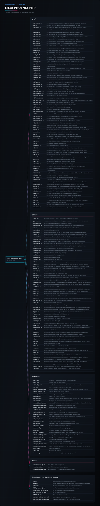

<p align="center">
  
</p>

# 📖 EH3D-PHOENIX-PNP

<p align="center"><a href="README.md">🇺🇸 English</a> | <a href="README_spa.md">🇪🇸 Español</a> | 🇫🇷 <b>Français</b> | <a href="README_ita.md">🇮🇹 Italiano</a> | <a href="README_deu.md">🇩🇪 Deutsch</a> | <a href="README_zho.md">🇨🇳 中文</a> | <a href="README_jpn.md">🇯🇵 日本語</a> | <a href="README_por.md">🇵🇹 Português</a></p>

### Assemblage pick and place : positions, chargeurs et ordre de pose

<p align="center">
  
  
  
  
  
</p>

---

**Vérification d'honnêteté - ce qui fonctionne aujourd'hui :** une bibliothèque Rust et un programme en ligne de commande (`phoenix-pnp`) avec 978 tests qui s'exécutent sur un ordinateur : lit le fichier de positions d'une carte, donne à chaque composant son alimentateur (avec des priorités, des plateaux et des bandes), lit les réglages de la machine dans un fichier, planifie l'ordre de pose pour une tête de jusqu'à six buses (rangs, pointes de buse, limites d'angle, temps des déplacements, panneaux), écrit une feuille de chargement et, sur une machine simulée, exécute le plan pas à pas avec des pannes injectées. Il a aussi une fenêtre (construite avec `--features gui`) dont la logique est testée sans écran ; le dessin lui-même n'est pas couvert par des tests et, bien que le programme prenne des captures de sa propre fenêtre (`--shot`), aucune personne n'a vérifié le dessin sur un écran. Il ne pilote aucune machine : il n'a pas été essayé sur une machine et il n'a pas été vérifié avec une collection de fichiers réels.

---

> **État de sécurité :** ce programme ne commande aucune machine et n'est pas un système de sécurité. Ce qu'il produit doit être vérifié par une personne avant tout essai sur une machine ; rien ici n'a fonctionné sur du matériel réel.


## 📋 En un coup d'œil

| | |
|---|---|
| Version | `0.0.9` |
| Maturité | Échafaudage |
| Tests | 978 |
| Pile technique | Rust |
| Sur du matériel réel | Non essayé : rien ici n'a fonctionné sur une machine |

**Aller à  :** [Présentation](#-présentation) · [Architecture](#-architecture) · [Démarrage rapide](#-démarrage-rapide) · [Tests](#-tests) · [Structure](#-structure-du-dépôt) · [Liés](#-projets-liés)

## 🚦 État du projet

Chaque ligne est une partie de ce dépôt et le feu dit où elle en est aujourd'hui. Elle est écrite d'après ce que le dépôt peut montrer (tests, compilations, exécutions), pas d'après ce qui est prévu.

🟢 Fait et vérifié · 🟡 Fonctionne, avec des limites connues · 🟠 À moitié fait ou pas encore vérifié · 🔴 Pas fait ou ne fonctionne pas

| Domaine | État | Ce que cela veut dire ici |
|---|---|---|
| Cœur | 🟡 | lit le fichier de positions d'une carte, donne à chaque composant son alimentateur (priorité, plateau, bande), planifie l'ordre de pose pour une tête de jusqu'à six buses avec des rangs, des pointes de buse, des limites d'angle et le temps des déplacements, planifie des panneaux et écrit la feuille de chargement ; testé sur un ordinateur avec des entrées normales et abîmées, pas avec une collection de fichiers réels. |
| Ligne de commande | 🟡 | `phoenix-pnp` exécute les mêmes fonctions que la bibliothèque (`parts`, `check`, `plan`, `schedule`, `preflight`, `simulate`, `loadsheet`, `config-check`, `check-bottom`, `tables-check`, `recipe-check`, `import-centroid`, `vision-test`) et affiche le résultat ; chaque erreur revient comme un message avec son code `PHOENIX-PNP-NNN` et un code de sortie non nul. |
| Tests | 🟡 | 978 tests passent (`cargo test`), avec des cas normaux, des cas limites, des entrées abîmées et de petits cas générés. |
| Configuration de la machine | 🟡 | un fichier `clé = valeur` avec une version, un validateur qui nomme la ligne et les limites de sécurité (course de Z, limites de X et Y, nouvelles tentatives, angles de buse) ; les valeurs n'ont pas été comparées à une machine réelle. |
| Simulateur et travail | 🟡 | une horloge virtuelle, des pannes injectées au hasard (avec une graine) ou à un endroit choisi, des nouvelles tentatives, les politiques alerte et report, des alimentateurs qui s'éteignent après des pannes répétées, pause, pas à pas et un état enregistré pour reprendre ; il ne fait que simuler, rien n'a piloté une machine. |
| Sécurité | 🟡 | Rust sûr et simple (`forbid(unsafe_code)`) : rien ne panique sur les fichiers reçus et une mauvaise valeur est une erreur avec sa raison ; pas de revue indépendante. |
| Fenêtre | 🟠 | Une fenêtre egui (à construire avec `--features gui` ; `phoenix-pnp` sans commande l'ouvre) : onglets de travail, pièces, boîtiers, alimentateurs, feuille de chargement, machine, outils, problèmes et journal, une carte de la table de travail avec le trajet de la tête, des marques de polarité et la pièce suivante, un assistant en cinq étapes, des problèmes avec des corrections qu'on peut annuler, un travail simulé qu'on peut mettre en pause, reprendre et avancer pas à pas, et les huit langues. Sa logique est testée sans écran ; le dessin n'est pas couvert par des tests : le programme prend des captures de sa propre fenêtre (`--shot`), mais aucune personne n'a vérifié le dessin sur un écran. Elle a aussi des onglets de panneaux (avec les repères et l'ajustement qui déplace les pièces) et de cartes, un sélecteur de fichiers, des tableaux d'alimentateurs et de boîtiers modifiables avec annulation, des largeurs de colonnes mémorisées et un programme à part (`phoenix-pnp-gui`) qui s'ouvre sans console sous Windows. |
| Matériel réel | 🔴 | Non essayé : rien ici n'a été exécuté sur une machine. |
| Documentation | 🟡 | README en huit langues, le journal des modifications et les deux images dessinées depuis `docs/`. |

## 🎯 Présentation

* **Les composants** (`src/parts.rs`) : un fichier `.pos` de KiCad ou un CSV (virgule ou point-virgule, guillemets, en-tête trouvé par nom) avec des positions en mm, mil ou pouces, les angles ramenés à 0-360, la face dessus ou dessous, et chaque ligne absurde est refusée avec son numéro ; une référence répétée est une erreur.
* **Composants à ne pas monter, les tables des exemples et le rapport d'un travail** (`src/parts.rs`, `src/commands.rs`, `src/job.rs`) : une colonne `dnp`, `do not place` ou `fitted` dans un CSV (ou `--dnp R1,R2`) laisse des composants hors du plan, de la feuille de chargement et des vérifications et les liste dans le rapport ; `tables-check` lit les tables (`--parts`, `--packages`, `--catalog`, `--feeders`, `--slots`) et nomme le code et la ligne de chaque erreur ; `simulate --report-csv FICHIER` écrit les statistiques du travail en CSV dont l'en-tête ne change jamais. `examples/` contient une carte avec une colonne `dnp`, des alimentateurs de tous les types et une table de boîtiers courants.
* **Les chargeurs** (`src/feeders.rs`) : un CSV de chargeurs (id, valeur, boîtier, position de prise, pièces restantes) ; chaque composant reçoit le premier chargeur qui contient sa valeur et son boîtier, sans tenir compte de la casse ; un composant sans chargeur et un chargeur qui s'épuise sont signalés, et un second chargeur du même type prend le relais.
* **Le plan** (`src/plan.rs`) : les emplacements sont parcourus au plus proche et coupés en lots d'une à six buses, les chargeurs d'un lot sont visités au plus proche, la face dessous est inversée selon la largeur de la carte, et le plan donne le trajet et une estimation du temps ; il s'écrit comme un travail JSON.
* **Les tables et les réglages** (`src/catalog.rs`, `src/config.rs`, `src/rotation.rs`) : des tables de pièces et de boîtiers dont les valeurs sont héritées (pièce, puis boîtier, puis les valeurs par défaut), un fichier de configuration de la machine au format `clé = valeur` (`examples/machine.cfg` documente chaque clé), davantage de noms pour les colonnes d'un CSV de positions et des corrections de rotation par boîtier.
* **Les alimentateurs avec plus qu'une bande** (`src/feeding.rs`) : priorité, plateaux, bandes et alimentateurs éteints ; l'alimentateur d'un composant est choisi de la même façon quel que soit l'ordre des fichiers.
* **Le planificateur de la machine** (`src/planner.rs`, `src/motion.rs`) : rangs (blocs posés l'un après l'autre), stratégies d'ordre, pointes de buse et leurs changements, limites de l'angle de la buse, temps des déplacements avec accélération et à-coup, parcours plus courts (2-opt) et correction de l'origine d'un composant.
* **Panneaux, feuille de chargement et exports** (`src/panel.rs`, `src/loadsheet.rs`, `src/export.rs`) : cartes et panneaux dans des panneaux, l'emplacement de chaque type de bande, un rapport, la liste de ce qui manque et un G-code qui ne fait que déplacer la tête.
* **Repères d'un panneau** (`src/fiducial.rs`) : les positions mesurées des repères sont ajustées aux positions prévues (une similitude avec deux repères, un ajustement affine avec trois ou plus) et les pièces du panneau sont déplacées et tournées par l'ajustement ; chaque repère a son résidu, et un ajustement qui manque un repère de plus de `fiducial_max_residual_mm` est refusé (`--fiducials FICHIER` avec `--panel`, ou l'onglet Panneaux de la fenêtre).
* **Cartes marquées comme mauvaises (X-out) et repères à deux niveaux** (`src/marks.rs`, `src/panel.rs`) : un enfant du fichier du panneau avec `"x_out": true`, ou `--x-out A,B/C`, est laissé de côté avec tout ce qu'il contient ; le plan, la feuille de chargement et les vérifications ne le voient pas, et un nom qu'aucune carte n'a (`PHOENIX-PNP-042`) ou un panneau dont toutes les cartes sont écartées (`PHOENIX-PNP-043`) est une erreur. Une pièce d'une carte dont la valeur ou le boîtier contient un mot de `fiducial_words`, ou dont la référence est un préfixe de `fiducial_refs` suivi d'un nombre (`FID1`), est un repère de sa carte et n'est pas posée ; le fichier de `--fiducials` peut alors nommer les repères du panneau (`f1`) et des cartes (`A/FID1`) : les repères d'une carte sont ajustés ensemble et ne déplacent que les pièces de cette carte, et les pièces des cartes sans repères mesurés suivent l'ajustement du panneau. Simulé : aucune carte n'a jamais été mesurée sur une machine ; la fenêtre n'utilise pas encore les repères des cartes.
* **Plus du planificateur et du simulateur :** l'ordre dans lequel les cellules d'un plateau sont vidées (lignes, colonnes ou serpentin), une recherche de l'ordre des pointes de buse qui compte le trajet et le déplacement vers le changeur (`tip_strategy = optimize`, limitée par `tip_opt_max_evals` et `tip_opt_time_limit_s`), des probabilités de panne par boîtier et par alimentateur (`sim_part_fail`, `sim_feeder_fail`) avec des statistiques par boîtier et par alimentateur et les pièces par heure, et `check-bottom`, qui montre l'angle que donne chaque règle de la face inférieure.
* **L'étape d'alignement** (`src/job.rs`, `src/sim.rs`, `src/model.rs`) : avec `align = on`, le travail regarde chaque pièce avec la caméra après la prise et corrige le placement d'après ce qu'elle voit (la tête va à la place moins le décalage de la pièce, et la buse tourne de la rotation de la pièce en moins) ; `pick_tolerance_mm` jette une pièce plus décalée, qui est reprise comme le dit `error_policy` ; `align_passes` (de 1 à 5) et `align_settle_s` fixent les regards et l'attente avant chacun, qui s'ajoutent au temps du plan ; la caméra simulée a un décalage, une erreur et des pannes injectables (`sim_align_*`, `sim_camera_fail_rate`) ; et la correction (moyenne, plus grande, pièces jetées) figure dans le texte, dans le rapport JSON et dans les lignes `align` de `--report-csv`. Désactivée par défaut : un travail est alors celui de toujours. Non essayée sur une machine. Avec `align_rereads` supérieur à 0 (jusqu'à 5, 0 par défaut) la caméra regarde de nouveau une pièce dont le premier regard était hors tolérance avant de la rejeter, un regard dans la tolérance compte comme le premier, et le rapport de travail compte par alimentateur les regards hors tolérance, les regards en plus, les pièces qu'ils ont sauvées, les pièces rejetées et les regards sans mesure.
* **La chaîne de vision** (`src/vision.rs`, `src/sim.rs`, `examples/vision.cfg`) : avec `vision = pipeline`, la caméra simulée dessine en mémoire une image de la pièce (sa taille, sa rotation et sa distance à la buse, avec un bruit tiré de `sim_seed`) et la mesure avec les étapes d'un fichier de réglages (`--vision FILE`) : un masque, un filtre médian, un seuil fixe ou d'Otsu, une plage d'aire pour la tache et le plus petit rectangle tourné, dont le centre et l'angle sont le décalage que corrige l'étape d'alignement. Une pièce introuvable, une tache d'aire erronée et plusieurs taches sont des regards sans mesure, chacun avec son code (`PHOENIX-PNP-037` à `PHOENIX-PNP-039`). `phoenix-pnp vision-test` dessine une pièce à partir de la taille, de la rotation, du décalage et du bruit donnés et affiche ce qui a été mesuré avec son erreur. Désactivé par défaut : un travail est alors celui d'avant. Non essayé avec une vraie caméra.
* **Le rapport de travail** (`src/report.rs`, `src/job.rs`) : après un travail simulé, `simulate` peut écrire le rapport sous forme de texte dans la langue de `--lang` (`--report-text`), de page HTML qui contient tout, sans script ni rien d'extérieur, et qui n'est jamais écrite par-dessus un fichier existant (`--report-html`), de sections ajoutées après les lignes du CSV (`--report-csv`, l'en-tête ne change pas) et de `work` dans le JSON (`--report`). Il dit combien de pièces ont été placées, mises de côté, ignorées par la personne, encore en attente ou à ne pas monter ; où est passé le temps machine (alimenter et prélever, regards de la caméra, placements, déplacements de la tête, changements de buse) ; combien de prélèvements ont réussi au premier essai ; la même chose par boîtier, alimentateur, buse, pointe de buse et carte d'un panneau ; les erreurs survenues avec leurs codes ; les avis avant le travail ; et un histogramme de ce que la caméra a corrigé (X, Y et rotation). Simulé : rien de cela n'a été mesuré sur une machine.
* **L'onglet Travail et les décisions de la personne** (`src/gui/jobtab.rs`, `src/gui/window.rs`, `src/job.rs`) : le tableau montre l'état de chaque placement (en attente, prélevé, aligné, placé, mis de côté, ignoré, en échec) et les pièces à ne pas monter, une barre de progression avec le temps machine et une estimation du temps restant, et des filtres par état, par texte et par ce qui est fait. Quand une erreur arrête le travail, une boîte de dialogue nomme l'étape en échec et propose quatre actions exécutées sur le travail simulé, qui repart ensuite : réessayer, ignorer la pièce, la mettre de côté, ou éteindre l'alimentateur pour qu'un autre du même type prenne le relais. Chaque décision est comptée dans le rapport. La logique n'a pas besoin d'écran et est testée ; aucune personne n'a vérifié l'affichage sur un écran (les images de cet onglet dans `images/screens/` sont prises par le programme lui-même).
* **Le vide, les actionneurs et la fenêtre de défauts d'un alimentateur** (`src/sim.rs`, `src/job.rs`, `src/config.rs`) : avec `vacuum = on`, la pompe simulée aspire pendant `vacuum_suck_s` secondes après chaque prise et le niveau de la buse (kilopascals) est lu ; un niveau sous `vacuum_pick_min_kpa` signifie que la buse ne tient aucune pièce (`PHOENIX-PNP-044`, et la prise est refaite comme le disent les nouvelles tentatives) et, après le soufflage de `vacuum_blow_s` secondes à chaque dépose, un niveau au-dessus de `vacuum_release_max_kpa` signifie que la pièce reste collée à la buse (`PHOENIX-PNP-045`). Le capteur a son propre générateur (`sim_vacuum_noise_kpa`, `sim_vacuum_miss_rate`, `sim_vacuum_stuck_rate`) et est désactivé par défaut : un travail sans lui est exactement ce qu'il était. Les dispositifs tout ou rien se déclarent avec `actuator = NOM : DÉLAI_S` et se commutent avec `Job::set_actuator`, qui ajoute leur délai à l'horloge (`PHOENIX-PNP-046` pour un nom que la machine n'a pas). Avec `fault_action = alert`, un alimentateur qui atteint `fault_limit` défauts parmi ses `fault_window` dernières prises ne se désactive plus tout seul : le travail s'arrête (`PHOENIX-PNP-047`) et la boîte de dialogue de l'onglet Job propose de réessayer, d'écarter la pièce, de la mettre de côté ou de désactiver l'alimentateur.
* **Le modèle de caméra, les têtes de la machine et les embouts d'un boîtier** (`src/camera.rs`, `src/heads.rs`, `src/tips.rs`, `src/config.rs`): la caméra est décrite par `camera_units_per_px` (0 est la taille pour laquelle la vision est réglée), `camera_offset_x_mm` et `camera_offset_y_mm` (où se trouve l'axe de la buse dans l'image), `camera_rotation_deg`, `camera_flip_x` et `camera_flip_y`, et l'objectif (`camera_lens_scale`, `camera_lens_k1`) ; la caméra simulée de l'étape d'alignement lit la pièce à travers ce modèle, avec ou sans image, et avec les valeurs par défaut un travail est exactement ce qu'il était. `head = NOM : BUSES [: DÉCALAGE_X : DÉCALAGE_Y : CAMÉRA_X : CAMÉRA_Y : CAMÉRA_ROT : CAMÉRA_UNITÉS : CAMÉRA_OBJECTIF]` déclare jusqu'à quatre têtes, chacune avec ses buses, son décalage et sa caméra ; avec deux têtes ou plus, `schedule` donne chaque pièce à une tête qui l'atteint (`PHOENIX-PNP-048` si aucune ne l'atteint), planifie chaque tête et compte, sur l'horloge de la machine, le temps qu'une tête attend un alimentateur utilisé par une autre. `tip_compat = MOTIF : EMBOUT, EMBOUT, ...` liste les embouts qu'un boîtier accepte et `tip_compat_mode` (`fewest_changes` ou `preferred`) choisit un embout pour chaque sorte de pièce afin que la machine change d'embout le moins souvent possible ; un embout nommé dans les tables est conservé.
* **Recettes** (`src/recipe.rs`, `src/job.rs`, `src/commands.rs`) : un fichier texte avec une version (`examples/job.recipe`) fixe les étapes que traverse un travail (`prepare`, `pick`, `align`, `place` et `check`, dans cet ordre et aucune deux fois ; l'étape d'alignement et le contrôle du vide ne sont actifs que si la recette les contient) et les paramètres qui changent pour un boîtier, un alimentateur ou un embout (`pick_retries`, `pick_tolerance_mm`, `vacuum_suck_s` et `vacuum_blow_s` ; pour chaque clé la première règle qui correspond l'emporte, d'abord celles des alimentateurs, puis celles des boîtiers et enfin celles des embouts). `phoenix-pnp recipe-check FICHIER` la lit et la vérifie, et `simulate ... --recipe FICHIER` exécute le travail avec elle. Ses erreurs portent les codes `PHOENIX-PNP-049` à `PHOENIX-PNP-052` (une ligne non valide, des étapes dans le désordre, un fichier hors de ses limites, une version trop récente) et les limites sont les clés `recipe_max_bytes` et `recipe_max_rules` de `machine.cfg`. Un état enregistré se souvient aussi de l'alimentateur de la dernière prise et de la prise qui a été arrêtée, si bien qu'un travail chargé dans une autre exécution offre à la personne les mêmes décisions (un ancien état se charge toujours).
* **Import de fichiers de positions** (`src/import.rs`, `src/commands.rs`) : `phoenix-pnp import-centroid FICHIER` lit un CSV de centroïdes (`--map FICHIER` nomme ses colonnes, `examples/centroid.map` ; `examples/centroid.csv` n'a pas besoin de carte), le texte de positions d'EAGLE (`examples/board.mnt` : nom, x, y, rotation `R90` ou `MR90` pour la face inférieure, valeur, boîtier) ou le `.pos` de KiCad (`--format auto|csv|eagle|kicad-pos` ; `auto` les distingue par la première ligne) et écrit le tableau des pièces `ref,val,package,x,y,rot,side,dnp` en millimètres dans `--out` (un fichier qui existe n'est jamais écrasé : `PHOENIX-PNP-040`) ou sur la sortie standard. Les unités sont mm, mil ou pouce (dans l'en-tête comme `X (mil)`, dans la cellule comme `0.5in`, dans un commentaire comme `## Unit = inch`, dans la carte ou dans `import_unit`) ; les angles sortent de 0 à 360 ; la colonne de la face est facultative ; une colonne `dnp` ou `fitted` (ou `--dnp R1-R5,C7` avec des plages de références) marque les pièces à ne pas monter ; `import_bottom_mirror_width_mm` reflète le X de la face inférieure et `bottom_rotation` tourne son angle. Les trois lecteurs sont ceux du programme (aucun autre dépôt n'a de lecteur utilisable sans ajouter une dépendance) et la disposition du texte d'EAGLE n'a pas été comparée à un fichier écrit par une installation réelle. Chaque erreur porte un code de `PHOENIX-PNP-053` à `PHOENIX-PNP-056` (une ligne non valide, un en-tête sans une colonne de la carte, un format inconnu, une plage de références non valide) et le numéro de la ligne.
* **Nomenclature** (`src/bom.rs`, `src/cmd_tools.rs`) : `phoenix-pnp bom-check PIÈCES BOM` lit une nomenclature (`examples/bom.csv` : les références dans une cellule, en plage ou une par ligne, et la valeur, le boîtier, la quantité et la référence fabricant si elles existent) et dit quelles références n'existent que d'un côté, lesquelles sont listées deux fois, quelles valeurs ou quels boîtiers diffèrent et quelles quantités ne concordent pas ; une pièce marquée comme à ne pas monter peut figurer ou non dans la nomenclature. Une erreur du fichier porte le code `PHOENIX-PNP-057` et sa ligne.
* **Stock pour une série** (`src/stock.rs`) : `phoenix-pnp stock PIÈCES ALIMENTATEURS --boards N` additionne les cartes et dit, type de pièce par type, combien de pièces N cartes demandent face à celles des alimentateurs allumés, quels types manquent, de combien et après combien de cartes la première bobine se vide ; il sort avec 1 si quelque chose manque et écrit le tableau avec `--out`. `bom-order --have ALIMENTATEURS` déduit de la liste d'achat ce que les alimentateurs contiennent déjà et donne les colonnes `on_hand` et `to_buy`.
* **Étalonnage de la caméra** (`src/calibrate.rs`) : `phoenix-pnp camera-calibrate FICHIER` ajuste le modèle de la caméra (taille d'un pixel, rotation, miroir et position de l'axe de la buse dans l'image) à des observations d'un repère à des endroits connus de la tête (`px,py,x_mm,y_mm` [voir `examples/camera_points.csv`], au moins trois) et affiche la qualité de l'ajustement et les lignes `camera_*` pour la configuration ; l'objectif n'est pas ajusté. Son erreur est le code `PHOENIX-PNP-058`.
* **Faux-rond de la buse** (`src/calibrate.rs`, `src/export.rs`) : `phoenix-pnp nozzle-calibrate FICHIER` ajuste un cercle à des lectures de la pointe de buse à plusieurs angles (`angle_deg,x_mm,y_mm` [voir `examples/nozzle_readings.csv`]) et affiche `nozzle_runout_mm` et `nozzle_runout_deg` ; avec un faux-rond supérieur à 0, le G-code de `schedule --gcode` déplace chaque emplacement de l'opposé du faux-rond à l'angle de la pièce.
* **Panneau d'une grille de cartes** (`src/panel.rs`, `src/cmd_tools.rs`) : `phoenix-pnp panelize CARTE --cols N --rows N --pitch-x MM --pitch-y MM` écrit le fichier de panneau d'une grille de copies d'une carte, toutes tournées pareil, avec trois repères à une marge (`--fiducials MM`, autour de la taille réelle de la carte donnée par `--board-size W,H`) et des cartes marquées mauvaises par leurs noms `P1`, `P2`, ... (`--x-out P2,P5`) ; un fichier qui existe n'est jamais écrasé.
* **Feuille des pièces polarisées** (`src/polarity.rs`) : `phoenix-pnp polarity-sheet PIÈCES` liste les pièces dont la référence correspond à `polarity_refs` ou dont le boîtier correspond à `polarity_packages` (par défaut diodes, LED, circuits, transistors, condensateurs polarisés et connecteurs) avec leur position et leur rotation et une colonne vide à cocher, pour le contrôle après un travail ; `--side` garde un seul côté.
* **Jeu des axes** (`src/sim.rs`, `src/motion.rs`) : `backlash_x_mm`, `backlash_y_mm` et `backlash_mode` font que la machine simulée termine un déplacement qui inverse un axe trop court du jeu (`off`, compté par `simulate`) ou le dépasse et revient par le côté positif (`approach`, plus long et sans erreur) ; avec un jeu de 0 rien ne change.
* **Liste des pièces à acheter** (`src/bom.rs`) : `phoenix-pnp bom-order BOM --boards N` additionne les lignes d'une nomenclature qui sont la même pièce et donne à chaque ligne les pièces pour N cartes plus une réserve (`order_spare_percent` pour cent ou `order_spare_min`, le plus grand ; `--spare-percent` et `--spare-min` l'emportent), sans les pièces que `--parts PIÈCES` marque comme à ne pas monter ; il écrit un CSV trié par boîtier et valeur.
* **Apprentissage des alimentateurs** (`src/calibrate.rs`) : `phoenix-pnp feeder-teach strip` donne le pas et l'angle d'une bande d'après les positions de sa première et de sa dernière pièce, et `feeder-teach tray` les deux pas et l'angle d'un plateau d'après trois de ses cases, avec l'écart à l'équerre ; les deux affichent les colonnes du fichier des alimentateurs qu'ils fixent. `feeder-teach --measures FICHIER` lit les positions de plusieurs alimentateurs dans un fichier et affiche pour chacun une ligne et une ligne du fichier des alimentateurs (`examples/feeder_measures.csv`).
* **Le simulateur et le travail** (`src/sim.rs`, `src/job.rs`, `src/preflight.rs`, `src/model.rs`) : les vérifications avant un travail, une machine à horloge virtuelle et pannes injectables, et un travail qu'on peut mettre en pause, exécuter pas à pas, enregistrer et reprendre.
* **La fenêtre** (`src/gui.rs`, `src/gui/`) : ce que la fenêtre fait en dehors du dessin n'a pas besoin d'écran (les fichiers chargés, le plan et ses problèmes avec corrections, le travail simulé, la géométrie de la carte, les tableaux à sélection partagée, l'assistant en cinq étapes et les textes en huit langues) et est testé ; seul `src/gui/window.rs`, construit avec `--features gui`, le dessine avec egui. La vitesse de la simulation, le thème et la taille dessinée pour une pièce de boîtier inconnu sont des clés de `machine.cfg` (`gui_steps_per_s`, `gui_theme`, `gui_part_size_mm`).
* **Le regard sur la pièce à la buse** (`src/inspect.rs`, `src/cmd_vis.rs`) : `phoenix-pnp part-inspect LECTURES --sizes TAILLES` (ou `--packages BOÎTIERS`) compare ce que la caméra a mesuré de chaque pièce (ses deux côtés, où elle pend par rapport à l'axe et de combien elle est tournée) à la taille de son boîtier et dit pourquoi elle est refusée (`part_size_tol_mm`, `part_angle_tol_deg`, `part_offset_max_mm`) ; la taille vient d'une table de tailles ou des colonnes `body_long_mm` et `body_short_mm` de la table des boîtiers (`examples/packages_bodies.csv`), et la commande sort avec 1 tant qu'une pièce est refusée ou n'a pas de taille.
* **Tubes et alimentateurs en vrac** (`src/feeding.rs`, `src/feedlib.rs`) : en plus d'une bande, d'un plateau et d'une réglette, la colonne `kind` de la table des alimentateurs accepte `tube` (un bâton ou un rail dont les pièces glissent jusqu'à une butée) et `bulk` (pièces en vrac dans un bac ou une cuve, qui n'arrivent dans aucune direction fixe) ; les deux prélèvent à l'unique endroit `x`, `y`, comme une bande, prennent l'angle des pièces de `rotation`, se vident selon le compte et sont vérifiés par `feeder-check` ; l'onglet Alimentateurs de la fenêtre propose les cinq types dans les huit langues (`examples/feeders_tubes.csv`).
* **Pièces placées et temps par alimentateur** (`src/job.rs`, `src/feedrep.rs`, `src/report.rs`) : le travail note de quel alimentateur chaque buse a pris sa pièce (aussi quand un autre alimentateur du type a pris le relais) et compte la pièce comme placée depuis cet alimentateur, et additionne le temps des étapes qui ont prélevé dans chaque alimentateur (le trajet jusqu'à lui, l'avance, le prélèvement et le regard) ; le rapport de travail, son JSON et `simulate --report-feeders` (les colonnes `placed` et `busy_s` à la fin) les montrent, et un travail sauvegardé les conserve.
* **Durée de vie des pointes de buse** (`src/nozzlelife.rs`, `src/cmd_tools.rs`, `src/commands.rs`) : `simulate --nozzle-life FICHIER` ajoute ce qu'un travail mené à son terme a fait de chaque pointe (les pièces placées et les montages) à un petit CSV que la personne garde à côté de la configuration ; un travail n'est compté qu'une fois, un fichier qui n'est pas un relevé des pointes n'est jamais écrasé, le fichier remplacé est conservé sous `FICHIER.prev` et les compteurs ne baissent que lorsque `nozzle-life FICHIER --reset POINTE` note qu'une pointe a été remplacée. `nozzle_life_warn` (500000 par défaut, 0 n'avertit pas) est le nombre de pièces à partir duquel on dit à la personne de regarder une pointe, avec `simulate` et `nozzle-life`. Nouveau code d'erreur `PHOENIX-PNP-059`.
* **Quel ordre est le plus rapide** (`src/compare.rs`, `src/commands.rs`) : `phoenix-pnp order-compare PIÈCES ALIMENTATEURS` planifie la même carte avec chaque `order` des places (nearest, part, height_part, pick, tips, none) et chaque `tip_strategy` (minimize, as_planned, optimize), et les montre côte à côte avec les lots, les changements de pointe, le trajet de la tête et les secondes, la plus rapide de chaque liste marquée, celle de la configuration marquée, et une ligne qui dit combien de secondes le meilleur réglage ferait gagner ; elle prend les options de `schedule` et ne change rien.
* **Une image du plan** (`src/preview.rs`, `src/commands.rs`) : `phoenix-pnp schedule PIÈCES ALIMENTATEURS SORTIE.json --svg SORTIE.svg` écrit aussi le plan en un fichier SVG à regarder avant que la machine ne bouge, à imprimer ou à garder avec le travail : les alimentateurs, la place de chaque pièce avec le numéro de son tour et la couleur de sa buse, la ligne que suit chaque pièce depuis son alimentateur, le trajet en pointillés de la tête sur tout le travail et les totaux ; il n'a ni script ni rien d'extérieur, ce qui est tapé dans une référence ou un id est échappé, et une image qui existe n'est jamais écrasée.
* **Étalonnage de la caméra avec une mire** (`src/pattern.rs`, `src/cmd_tools.rs`) : `phoenix-pnp camera-pattern FICHIER [--pitch MM]` lit les points d'une grille (les coins intérieurs d'un damier ou les centres de points) sous la forme `col,row,px,py` (`examples/camera_pattern.csv`) et ajuste la taille d'un pixel (`camera_units_per_px`) et la distorsion radiale de l'objectif (`camera_lens_k1`) avec la rotation, le décalage et le miroir de la feuille dans l'image, puis dit de combien les points s'écartent du modèle avec et sans la distorsion et quel point est le plus éloigné ; les lignes pour la configuration sont affichées, et le code de sortie est 1 quand un point dépasse `camera_pattern_max_residual_mm`. Les points sont distants de `camera_pattern_pitch_mm`. La rotation et le décalage de la caméra viennent toujours de `camera-calibrate`, qui déplace la tête. L'onglet Outils a le même étalonnage et refuse de mettre dans la machine un ajustement au-delà de la limite.
* **Quel repère est en défaut** (`src/fidcheck.rs`, `src/gui/workspace.rs`, `src/gui/tables.rs`) : quand les repères mesurés d'un panneau sont utilisés, la fenêtre calcule le résidu de chaque repère (même quand l'ajustement est refusé, pour qu'on voie pourquoi), le seul repère qui, écarté, ramène tous les autres sous `fiducial_max_residual_mm`, et la rotation, les échelles et le cisaillement face à leurs limites. Le tableau des repères marque d'un `!` un repère au-delà de la limite et d'un `?` celui qui ne concorde pas, et le panneau liste les avertissements en toutes lettres (aussi dans le journal) ; `fidcheck::analyze_marks`, `fidcheck::warnings` et `fidcheck::residual_table` donnent la même chose à la commande `fiducial-check` et à l'outil de contrôle des repères.
* **File de travaux** (`src/queue.rs`, `src/cmd_queue.rs`) : plusieurs cartes ou panneaux l'un après l'autre. `phoenix-pnp queue-add FILE NOM SOURCE ALIMENTATEURS [--panel] [--boards N]` met un travail dans un petit CSV qui survit à l'arrêt du programme (il est écrit dans un fichier temporaire puis déplacé à sa place, le fichier remplacé est gardé en `CHEMIN.prev`, et la dernière ligne porte une somme de contrôle, de sorte qu'un fichier coupé ou modifié à la main est refusé) ; `queue-status [--check]` liste les travaux et ce qu'est devenu chacun (pending, running, done, failed, skipped) et, avec `--check`, planifie ceux qui restent à faire ; `queue-edit` saute, remet à zéro, retire la confirmation d'un travail ou l'enlève ; `queue-run` fait les travaux carte par carte sur la machine simulée et écrit la file après chaque carte. Rien ne s'exécute sans confirmation : avec `queue_confirm` activé (par défaut) un travail ne s'exécute qu'après que `queue-confirm` a enregistré l'identité de son plan (le plan et le texte des fichiers dont il est fait), et un changement dans un fichier l'annule ; `queue_stop_on_failure` (activé par défaut) arrête la file au premier travail qui échoue. Un second `queue-run` sur la même file est refusé tant qu'un fichier `.lock` existe. L'outil File de l'onglet Outils fait tout cela avec des boutons. Nouveau code d'erreur `PHOENIX-PNP-060`.
* **Texte en UTF-16** (`src/parts.rs`) : chaque table et fichier de réglages que lisent les commandes et la fenêtre (positions, alimentateurs, boîtiers, nomenclatures, panneaux, repères mesurés) peut être en UTF-16 avec marque d'ordre des octets, comme les programmes Windows et les tableurs enregistrent le « texte Unicode » ; il est lu comme de l'UTF-8. Un texte qui n'est ni l'un ni l'autre est lu en Latin-1 avec une note, et un outil de l'onglet Outils qui lit un fichier le refuse.
* **Corriger l'objectif** (`src/camera.rs`, `src/sim.rs`) : avec `camera_correct_lens = on` la caméra retire de ce qu'elle voit la distorsion de l'objectif (`camera_lens_k1`, telle que `camera-pattern` la trouve), de sorte que les mesures de l'étape d'alignement sont celles d'un objectif qui ne déforme rien ; `CameraModel::to_machine_corrected` et `read_corrected` le font en inversant `d * (1 + k1 * d * d)`. Désactivé (par défaut), la distorsion reste dans les mesures. `camera_units_per_px` doit alors être la vraie taille d'un pixel, comme la donne `camera-pattern`.
* **Chemins de la file depuis son dossier** (`src/queue.rs`, `src/cmd_queue.rs`) : avec `queue_relative_paths = on` (ou `queue-add --relative`) les fichiers d'un travail qui sont dans le dossier du fichier de la file, ou en dessous, sont gardés comme chemins depuis ce dossier, de sorte que le dossier peut être déplacé ou partagé ; `queue-status`, `queue-confirm` et `queue-run` les reprennent depuis le dossier de la file, quel que soit le dossier d'où ils s'exécutent. Désactivé (par défaut) garde des chemins absolus ; les deux fonctionnent pareil et donnent la même identité du plan.
* **La file avec des boutons** (`src/gui/queuetab.rs`, `src/gui/window.rs`) : l'outil File de l'onglet Outils lit un fichier de file comme une liste de travaux et a des boutons pour ajouter un travail (un formulaire vérifié dans la langue de la fenêtre), vérifier les plans, confirmer le plan du travail choisi, retirer la confirmation, ignorer, réinitialiser, retirer et exécuter. Chaque bouton lance la commande du même nom comme le programme à côté de la fenêtre, de sorte que la fenêtre et la ligne de commande planifient, confirment et exécutent d'une seule façon (même identité du plan, même verrou). Le premier appui sur Exécuter ne fait que demander (`queue_gui_ask_run`, activé par défaut) ; le second lance l'exécution sur la machine simulée, en arrière-plan, avec un bouton Arrêter.
* **Une caméra simulée qu'on peut dégrader** (`src/vision.rs`) : `vision.cfg` ajoute `sim_blur_px` (caméra floue), `sim_salt_pepper` (pixels qui deviennent noirs ou blancs), `sim_gradient_levels` (lumière inégale), `sim_failure_rate` et `sim_failure_kind` (une part des images gâchée : la pièce absente, la lumière éteinte ou tout saturé) ; tout est désactivé par défaut et le bruit d'un travail qui ne s'en sert pas ne bouge pas. `vision-test` et `simulate --vision` les utilisent comme le bruit qui existait déjà.
* **Mesures pour essayer les contrôles** (`src/visionsim.rs`, `src/cmd_vis.rs`) : `phoenix-pnp vision-readings PARTS --sizes F` dessine l'image que la caméra simulée donne de chaque pièce d'un fichier de positions (pendant un peu hors de l'axe et tournée, dans `--spread` et `--turn` ; `--wrong-every N` fait de chaque N-ième pièce une pièce d'une autre taille) et écrit les mesures dans le fichier que lit `part-inspect` ; `phoenix-pnp vision-marks DESIGN --shift X,Y --turn DEG --scale S` regarde chaque repère d'un panneau posé comme indiqué et écrit les repères mesurés que lit `fiducial-check`. Le flou, le bruit et les pannes viennent de `--vision` ; une image où rien n'est trouvé ne donne pas de mesure et est signalée avec sa raison ; le même `--seed` donne les mêmes mesures.
* **Un rapport de travail à garder** (`src/report.rs`) : `simulate --report-html FILE` (une page sans script ni rien d'extérieur), `--report-text`, `--report` (JSON) et `--report-csv` disent maintenant aussi, par alimentateur, combien de pièces ont été prises, placées, mises de côté et ignorées, et, par pointe de buse, ce que le travail a ajouté à sa vie (`--nozzle-life` donne le relevé d'avant le travail), les usages avant et après et un avertissement quand une pointe atteint `nozzle_life_warn` ; les temps, les constats des contrôles et les erreurs avec leurs codes y étaient déjà.
* **Un temps plus fidèle pour le plan** (`src/planner.rs`) : avec `backlash_mode = approach` la machine dépasse un emplacement du jeu d'un axe et revient, ce qui prend du temps ; le plan l'omettait et le compte maintenant tronçon par tronçon (seulement là où il y a de la place avant la limite), de sorte que ses secondes sont celles du travail simulé, et `AdvancedPlan::approach_s`, le rapport du plan et son JSON disent combien de secondes vont aux secondes passes. Les pointes restent groupées en lots et les alimentateurs d'un lot sont visités du plus proche au plus lointain ; sans approach rien ne change.
* **Tailles des boîtiers courants** (`src/pkggen.rs`, `src/cmd_tools.rs`) : `phoenix-pnp package-gen 0603 SOT-23-5 SOIC-8 QFN-32-5x5 LQFP-48` (ou `--from PARTS` pour les boîtiers d'un fichier de positions) écrit les lignes d'une table de boîtiers (`package,height_mm,tape_mm,body_long_mm,body_short_mm`) à partir des tailles nominales des puces des codes EIA, SOT, SOD, SOIC (étroit et large), TSSOP, QFN, DFN et QFP, avec la largeur de la bande qui tient le corps ; `--packages` de `part-inspect` et le catalogue lisent le résultat. Un nom inconnu est une erreur avec sa raison, jamais une supposition. `phoenix-pnp package-kicad CHEMIN...` fait la même chose à partir de fichiers d'empreinte de KiCad (`src/kicadmod.rs`, `examples/chip_0603.kicad_mod`) : le corps est la boîte du dessin sur la couche de fabrication (la zone d'exclusion, avec une note, s'il n'y en a pas), la hauteur est celle du boîtier si le nom est connu, ou `--height` ; la lecture est limitée en taille, profondeur et éléments, et un fichier non compris est nommé avec son motif.
* **Décalages de placement appris** (`src/learn.rs`, `src/cmd_tools.rs`, `src/job.rs`) : `phoenix-pnp place-learn READINGS --state F` prend des lignes `package,dx_mm,dy_mm` (de combien une pièce a fini loin de sa place) et garde le décalage moyen de chaque boîtier dans un fichier avec un numéro de contrôle. Une mesure éloignée des autres de son boîtier est écartée, un boîtier avec trop peu de mesures n'est pas touché, le décalage connu compte au plus pour `place_learn_memory` mesures afin de suivre une machine qui dérive, et aucun décalage ne dépasse `place_learn_cap_mm` ; `--residual` sert pour des mesures prises avec les décalages déjà appliqués, `--dry-run` n'écrit rien, `--show` et `--forget` lisent et élaguent le fichier. L'apprentissage est désactivé tant que `place_learn` n'est pas activé, et `simulate --place-offsets FILE` envoie la tête à chaque place moins le décalage de son boîtier seulement si `place_learn_apply` est activé ; un fichier coupé ou modifié à la main est refusé.
* **Un travail dans un fichier pour d'autres programmes** (`src/exchange.rs`, `src/commands.rs`, `src/cmd_tools.rs`) : `phoenix-pnp job-export PARTS FEEDERS OUT [--state F]` écrit le plan (le document de `schedule`), l'état de chaque pièce (`pending`, `placed`, `deferred` avec son motif, `skipped`) et la phase du travail (prêt, en pause, arrêté, terminé) dans un fichier JSON avec une version et un genre ; avec l'état enregistré de `simulate` il dit où en est ce travail. `phoenix-pnp job-import FILE [--csv F]` lit un tel fichier avec toutes les vérifications (limite de taille et de placements, nombres finis dans 100000 mm, noms et motifs d'une longueur donnée et sans caractère de contrôle, chaque référence une fois, lots et buses comptés, une ligne d'état par placement qui nomme la même référence, et une phase en accord avec les états), dit ce qu'il contient et peut écrire les placements avec leur état sous forme de tableau. Rien n'en est exécuté et rien n'est appliqué à une machine.
* **Crochets (hooks), désactivés par défaut** (`src/hooks.rs`, `src/commands.rs`, `examples/hooks.csv`) : `simulate --hooks FILE` exécute un programme de l'opérateur pour un événement du travail (`job-finished`, `job-paused`, `job-stopped`, `part-aside`, `feeder-off`), pour allumer une lampe, jouer un son ou envoyer un message. Exécuter un programme est ce que la bibliothèque fait de plus risqué ; c'est donc désactivé tant que `hooks` n'est pas activé (`--hooks-dry-run` liste seulement ce qui serait exécuté). Le fichier de règles (`event,program,argument...`) est la liste de ce qui peut être exécuté : un programme est un fichier du dossier des règles, nommé avec des lettres, des chiffres, `.`, `_` et `-`, jamais un chemin, une recherche dans le système, un interpréteur de commandes, un lien hors du dossier ni un fichier de commandes ; les arguments sont passés un à un avec les données de l'événement dans `{event}`, `{reference}`, `{feeder}`, `{reason}`, `{phase}`, `{placed}` et `{total}`. Un fichier de règles a une limite de taille et au plus 50 règles, au plus `hooks_max_runs` programmes sont exécutés par travail, chacun a `hooks_timeout_s` secondes et ce qu'il affiche est coupé à 4096 octets ; un crochet qui échoue ne change rien au travail.
* **Un journal du travail simulé** (`src/journal.rs`, `src/commands.rs`) : `simulate --journal FILE` écrit une ligne pour chaque étape du travail : la pièce, l'alimentateur où le plan la prend, la buse, la seconde de l'horloge de la machine, la durée de l'étape et sa fin (`ok`, ou le code de l'erreur qui a arrêté le travail). Le travail fait les mêmes étapes qu'un travail non enregistré ; si une erreur l'arrête, le journal reste quand même, avec l'étape qui a échoué comme dernière ligne, et un fichier qui existe n'est jamais écrasé.
* **Ce qui a changé entre deux tables de pièces** (`src/partsdiff.rs`, `src/cmd_more.rs`) : `phoenix-pnp parts-diff FIRST SECOND [--tol MM] [--rot-tol DEG] [--out F]` compare deux fichiers de positions par référence et dit, pièce par pièce, lesquelles ont été ajoutées ou retirées, déplacées, tournées, ont reçu une autre valeur ou un autre boîtier ou sont passées sur l'autre face ; une place dans `--tol` et une rotation dans `--rot-tol` (mesurée par le chemin court) sont les mêmes, une valeur ou un boîtier qui ne diffère que par la casse est le même, et `--out` écrit les changements en CSV. Sortie 1 si les tables diffèrent.
* **Ce qui a changé entre deux configurations** (`src/configdiff.rs`, `src/cmd_more.rs`) : `phoenix-pnp config-diff FIRST SECOND` liste les réglages que deux fichiers de configuration donnent différemment dans ce qu'ils signifient, pas dans la façon dont ils sont écrits : `yes` et `on`, `5` et `5.0`, et une ligne qui donne la valeur par défaut valent l'absence de ligne. Un réglage qu'un fichier ne donne pas apparaît comme `(default)`, et un fichier non valide est nommé avec son code. Sortie 1 si les machines diffèrent.
* **Ce que contient une table de pièces** (`src/boardstats.rs`, `src/cmd_more.rs`) : `phoenix-pnp board-stats PARTS [--near MM] [--limit N]` compte les pièces de chaque face, les types (valeur et boîtier), chaque boîtier et la boîte qui contient les centres ; avec `--near` il trouve, avec une grille et sans comparer chaque paire, les pièces d'une face dont les centres sont plus proches que cette distance (une pièce copiée deux fois, deux empreintes à la même origine), de 0,01 à 50 mm. Sortie 1 s'il trouve une paire.
* **Étalonnage combiné de la caméra** (`src/combined.rs`, `src/cmd_tools.rs`, `src/gui/toolbox.rs`) : `phoenix-pnp camera-combined FILE` lit `head_x,head_y,col,row,px,py` (`examples/camera_combined.csv` : une feuille fixée à la table, la tête déplacée à plusieurs endroits) et, avec l'emplacement de la feuille (`camera_pattern_origin_x_mm`, `camera_pattern_origin_y_mm`) et son pas, trouve en un seul ajustement la taille du pixel, la rotation, le miroir, le décalage de la buse, la distorsion de l'objectif et de combien la feuille est tournée sur la table ; la caméra de `camera-calibrate` et l'objectif de `camera-pattern` d'un coup. Désactivé par défaut (`camera_combined = off` ; les deux commandes séparées n'en dépendent pas), la tête doit se trouver à deux endroits ou plus, et le décalage n'est aussi bon que la mesure de l'origine. L'onglet Outils a le même étalonnage ; l'appliquer à la machine n'active pas `camera_correct_lens`. Avec `camera_combined_touch = on` (ou `--touch`) l'emplacement de la feuille est pris dans une ligne `origin,X,Y` du fichier, là où la buse a touché le point 0,0, au lieu des réglages ; désactivé par défaut.
* **Plus de panneaux dans l'onglet Outils** (`src/gui/toolbox.rs`) : l'usage des pointes de buse (le relevé que garde `nozzle-life`, avec les pointes arrivées à `nozzle_life_warn` marquées), le contrôle des pièces sur la buse contre les tailles des boîtiers chargés, le contrôle des repères (le résidu de chaque repère, le repère qui ne concorde pas et un avertissement pour un repère au-delà de `fiducial_max_residual_mm`), le contrôle de la table des alimentateurs, la comparaison des ordres et des changements de pointe (ce que le plus rapide économiserait) et le dessin du plan en SVG ; chacun écrit son résultat dans le dossier de sortie sous son propre nom sans écraser un fichier existant. La fiche de préparation de l'onglet lit le relevé des pointes quand on en tape ou lit un, et dit alors quelle pointe est usée.
* **La fiche de préparation** (`src/setup.rs`, `src/commands.rs`, `src/gui/toolbox.rs`) : `phoenix-pnp setup-sheet PIÈCES ALIMENTATEURS --boards N` réunit sur une page, dans les huit langues, les alimentateurs à charger dans l'ordre de leurs emplacements (type, pièce, bande, pointe, pièces contenues, endroit), les pièces manquantes pour N cartes, les pointes de buse de la série avec leur usure face à `nozzle_life_warn` (`--life` lit le relevé de `simulate --nozzle-life`), les étalonnages dont dépend le travail et s'ils sont réglés (caméra, faux-rond de la buse, jeu des axes, endroit du changeur de pointes, repères d'un panneau) et les avertissements (un alimentateur éteint qui contient une pièce dont la carte a besoin, un alimentateur en vrac qui contient une pièce ayant un sens) ; `--out` écrit les alimentateurs en CSV et la commande sort avec 1 tant qu'il manque des pièces. L'onglet Outils a la même fiche à imprimer sous `setup_sheet.txt`.
* **Onglet des outils** (`src/gui/toolbox.rs`) : le jeu des axes, le faux-rond de la buse, l'étalonnage de la caméra, l'apprentissage des alimentateurs, la feuille des pièces à sens, la vérification et la commande d'une nomenclature, le stock pour une série et le panneau d'une grille de cartes, chacun avec les fonctions de la bibliothèque de sa commande, un texte saisi ou lu dans un fichier, le résultat à l'écran et, quand il fait un fichier, un bouton qui l'écrit dans le dossier de sortie sans écraser un fichier existant ; la caméra et le faux-rond peuvent être mis dans la machine. Les valeurs de départ des formulaires sont des clés de `machine.cfg` (`order_boards`, `panel_cols`, `panel_rows`, `panel_pitch_x_mm`, `panel_pitch_y_mm`, `panel_fiducial_mm`, `panel_board_width_mm`, `panel_board_height_mm`).

## 🧩 Rôle dans EH3D

EH3D-PHOENIX-PNP est un programme de l'EH3D Fabrication Suite. Aujourd'hui il fonctionne comme bibliothèque, ligne de commande et fenêtre (construite avec `--features gui`) ; la fenêtre n'a pas encore l'aspect commun aux autres programmes de la suite. Il lit et écrit des fichiers simples et peut donc s'utiliser seul ou entre les autres programmes.

## 🏛️ Architecture

<p align="center">
  
</p>


Comment les parties de ce dépôt s'articulent : qui l'utilise, ce qu'il contient et de quoi il dépend. L'image est dessinée depuis `docs/architecture.json` et vérifiée avec le code.

## ✨ Fonctionnalités

* **Une bibliothèque et une ligne de commande :** chaque commande de `phoenix-pnp` est une fonction de la bibliothèque ; un autre programme de la suite peut l'appeler sans lancer de processus.
* **Ligne de commande stricte :** une option mal écrite (`--powr`) ou un mot en trop est une erreur qui la nomme, et non quelque chose d'ignoré ; sinon le programme ferait sa sortie avec les valeurs par défaut.
* **Tests avec entrées abîmées :** les tests fournissent aussi des fichiers vides, du bruit, des nombres énormes et des fichiers coupés, et aucun ne doit paniquer.
* **Sans deviner :** une valeur absurde est une erreur qui dit laquelle et pourquoi, jamais un résultat qui n'en a que l'air.
* **Pas de code unsafe :** `#![forbid(unsafe_code)]` dans la bibliothèque et le programme.
* **Un seul lecteur pour les deux tables, et rapide sur une grande carte :** le fichier de positions et celui des alimentateurs sont lus par le même lecteur (virgule ou point-virgule, champs entre guillemets avec un séparateur ou un saut de ligne), cinquante mille composants sont vérifiés, affectés et planifiés en un instant, le plan n'est jamais écrit sur un fichier dont il vient, une option inconnue est une erreur, et `--origin-x` dit où se trouve le bord gauche de la carte quand la face inférieure est en miroir.

## 🔒 Sécurité et protection

| Menace | Défense |
|---|---|
| Un fichier abîmé, coupé ou vide | pas de panique : les tests coupent une entrée valide à chaque position et fournissent du bruit |
| Un nombre absurde (négatif, non fini, démesuré) | refusé avec une erreur qui nomme la valeur ; rien n'est arrondi en quelque chose de plausible |
| Usage non sûr de la mémoire | Rust sûr et simple avec `forbid(unsafe_code)` |

**Ce qui n'est pas défendu :** un résultat produit sans erreur n'est pas un résultat vérifié. Rien ici ne connaît les limites d'une machine et le programme n'a pas eu de revue indépendante. Signalez une vulnérabilité en privé (voir [SECURITY.md](SECURITY.md)).

## 🔌 Interfaces

La bibliothèque est `eh3d_phoenix_pnp` (`use eh3d_phoenix_pnp::...`) ; la ligne de commande est `phoenix-pnp`. Les commandes sont celles-ci ; chacune affiche son résultat sur la sortie standard et signale une erreur sur la sortie d'erreur avec un code de sortie non nul. Il n'y a pas d'accès réseau.

```text
phoenix-pnp [gui [FILES...]]                             la fenêtre (construite avec --features gui)
phoenix-pnp parts PARTS                                  les pièces d'un fichier de positions, en millimètres
phoenix-pnp check PARTS FEEDERS                          les pièces sans alimentateur et les alimentateurs qui seront vides
phoenix-pnp plan PARTS FEEDERS OUT.json                  le plan simple, sous forme de travail JSON
phoenix-pnp schedule PARTS FEEDERS OUT.json              le plan avec toute la configuration, les panneaux et les repères
phoenix-pnp preflight PARTS FEEDERS                      les vérifications avant un travail
phoenix-pnp simulate PARTS FEEDERS                       le travail sur une machine simulée, avec ses rapports
phoenix-pnp loadsheet PARTS SLOTS OUT.csv                la feuille de chargement
phoenix-pnp config-check FILE                            si un fichier de configuration est valide
phoenix-pnp check-bottom PARTS                           l'angle que donne chaque règle de la face inférieure
phoenix-pnp tables-check [--parts F] [--feeders F] ...   si chaque table est valide, avec le code et la ligne
phoenix-pnp recipe-check FILE                            si une recette est valide, avec le code et la ligne
phoenix-pnp import-centroid FILE [--map F] [--out F]     un fichier de positions d'un CAO comme tableau de pièces
phoenix-pnp bom-check PARTS BOM [--config F]              si la nomenclature et la table des pièces concordent
phoenix-pnp camera-calibrate FILE [--config F]            les réglages de la caméra d'après des observations d'un repère, avec la qualité de l'ajustement
phoenix-pnp nozzle-calibrate FILE [--config F]            le faux-rond de la pointe de buse d'après des lectures à plusieurs angles
phoenix-pnp panelize BOARD --cols N --rows N --pitch-x MM --pitch-y MM [--out F] un fichier de panneau pour une grille de copies d'une carte
phoenix-pnp polarity-sheet PARTS [--side top|bottom] [--out F] les pièces polarisées, en CSV pour le contrôle après un travail
phoenix-pnp bom-order BOM [--boards N] [--spare-percent P] [--out F] les pièces à acheter pour N cartes, avec une réserve
phoenix-pnp feeder-teach strip|tray [places and counts] | --measures FILE   le pas et l'angle d'une bande ou d'un plateau d'après des positions mesurées sur la machine
phoenix-pnp stock PARTS FEEDERS [--boards N] [--side top|bottom] [--out F] si les alimentateurs contiennent assez de pièces pour N cartes, type par type (sortie 1 sinon)
phoenix-pnp part-inspect READINGS [--sizes F] [--packages F] [--out F] les pièces à la buse contre la taille de leur boîtier (sort avec 1 si l'une est refusée)
phoenix-pnp fiducial-check DESIGN MEASURED [--config F] la rotation, l'échelle, le cisaillement et le décalage que les repères mesurés donnent au panneau, face aux limites
phoenix-pnp feeder-check FEEDERS [--packages F] [--catalog F] si la table des alimentateurs est cohérente (emplacements, pas, cellules, endroits en conflit)
phoenix-pnp nozzle-life FILE [--warn N] [--reset TIP] les pièces que chaque pointe de buse a placées, d'après un fichier à côté de la configuration (sort avec 1 si une pointe atteint le seuil d'alerte)
phoenix-pnp setup-sheet PARTS FEEDERS [--boards N] [--life F] [--out F] quoi charger dans quel emplacement, les pièces manquantes pour N cartes, les pointes de buse et leur usure, les étalonnages dont dépend le travail (dans la langue de --lang ; sort avec 1 s'il manque des pièces)
phoenix-pnp order-compare PARTS FEEDERS [OPTIONS] la carte planifiée avec chaque ordre des places et chaque façon de changer les pointes, côte à côte, la plus rapide marquée
phoenix-pnp camera-pattern FILE [--pitch MM]             la taille d'un pixel et la distorsion de l'objectif d'après les points d'une mire sur une grille
phoenix-pnp queue-add QUEUE NAME SOURCE FEEDERS          met un travail (cartes ou un panneau) à la fin d'une file de travaux
phoenix-pnp queue-status QUEUE [--check]                 les travaux de la file et ce qu'est devenu chacun ; --check planifie ceux qui restent
phoenix-pnp queue-confirm QUEUE NAME                     enregistre que le plan d'un travail, tel qu'il est maintenant, peut être exécuté
phoenix-pnp queue-edit QUEUE NAME skip|reset|revoke|remove   saute un travail, le recommence, retire sa confirmation ou l'enlève
phoenix-pnp queue-run QUEUE [--only NAME]                fait les travaux confirmés carte par carte sur la machine simulée
phoenix-pnp camera-combined FILE [--pitch MM] [--origin X,Y] [--touch]   la caméra, la rotation de la feuille et la distorsion de l'objectif avec une mire fixée à la table pendant que la tête se déplace (demande camera_combined = on)
phoenix-pnp vision-readings PARTS --sizes F [--seed N]   les mesures que la caméra simulée donne des pièces, dans le fichier que lit part-inspect
phoenix-pnp vision-marks DESIGN [--shift X,Y] [--turn DEG]   les repères mesurés d'un panneau posé comme indiqué, tels que la caméra simulée les lit, pour fiducial-check
phoenix-pnp package-gen [NAME...] [--from PARTS]          les lignes d'une table de boîtiers (corps, hauteur, bande) à partir de noms standard comme 0603, SOT-23, SOIC-8, QFN-32
phoenix-pnp package-kicad PATH... [--height MM]            les lignes d'une table de boîtiers (corps, hauteur, bande) à partir de fichiers d'empreinte de KiCad (.kicad_mod) ou d'un dossier de ceux-ci
phoenix-pnp place-learn READINGS --state F                le décalage moyen du placement de chaque boîtier, appris à partir de mesures (package,dx_mm,dy_mm), sans les valeurs aberrantes et plafonné (demande place_learn = on)
phoenix-pnp job-export PARTS FEEDERS OUT [--state F]       le plan et l'état de chaque pièce dans un fichier JSON pour d'autres programmes
phoenix-pnp job-import FILE [--csv F]                      lit et vérifie un tel fichier, dit ce qu'il contient et peut écrire les placements avec leur état sous forme de tableau
phoenix-pnp parts-diff FIRST SECOND [--tol MM] [--rot-tol DEG] [--out F] ce qui a changé entre deux tables de pièces, pièce par pièce : ajoutée, retirée, déplacée, tournée, valeur, boîtier, face (sortie 1 si elles diffèrent)
phoenix-pnp config-diff FIRST SECOND                       les réglages que deux fichiers de configuration donnent différemment dans leur sens (yes et on, 5 et 5.0 sont les mêmes ; sortie 1 si les machines diffèrent)
phoenix-pnp board-stats PARTS [--near MM] [--limit N]      ce que contient une table de pièces (faces, types, boîtiers, la boîte des centres) et, avec --near, les paires de pièces plus proches que MM (sortie 1 s'il en trouve)
phoenix-pnp vision-test [--turn DEG] [--dx MM] ...       mesure l'image d'une pièce créée en mémoire
```

`phoenix-pnp help` liste toutes les options. Les options communes à `schedule`, `preflight`, `simulate` et `loadsheet` sont `--config`, `--packages`, `--catalog`, `--panel`, `--fiducials`, `--x-out`, `--dnp`, `--side`, `--board-width`, `--origin-x`, `--nozzles`, `--speed`, `--order` et `--lang` ; `--shot` et ses compagnons prennent une capture de la fenêtre (voir le démarrage rapide).

## ⚙️ Configuration

La machine et le planificateur se configurent avec un fichier texte de lignes `clé = valeur` (`--config FICHIER`), le même format que les autres programmes de la suite ; `examples/machine.cfg` liste chaque clé avec sa valeur par défaut et son effet. Une clé absente garde sa valeur par défaut ; une clé inconnue, écrite deux fois ou hors de sa plage est une erreur qui nomme la ligne. Les options de la ligne de commande (`--nozzles`, `--speed`, `--order`, `--side`) l'emportent sur le fichier.

Les colonnes qui marquent un composant comme à ne pas monter et les mots qu'elles emploient sont aussi des réglages : `header_dnp` et `header_fitted` ajoutent des noms de la colonne, `dnp_yes_words` et `dnp_no_words` ajoutent des mots pour oui et non. Une colonne nommée `dnp`, `do not place`, `do not populate`, `do not mount`, `do_not_place`, `not fitted` ou `no montar` laisse le composant de côté avec un oui (`yes`, `y`, `true`, `1`, `x`) ; une nommée `fitted`, `populate`, `populated`, `mount`, `mounted` ou `montar` le laisse de côté avec un non (`no`, `n`, `false`, `0`, `-`) ; une cellule vide monte le composant et tout autre mot est une erreur qui nomme la ligne.

Les pièces qui sont des repères de leur carte sont aussi des réglages : `fiducial_words` (par défaut `fiducial`) et `fiducial_refs` (par défaut `fid, fd`) ; une liste vide désactive la règle.

Les tables de boîtiers et de pièces (`--packages`, `--catalog`) sont des fichiers CSV où une cellule vide hérite ; un panneau (`--panel`) est un fichier JSON ; les emplacements de la machine (`loadsheet`) sont un CSV avec `id,x,y,max_width_mm`. Un fichier plus grand que `max_file_bytes` est refusé. Chaque erreur a un code `PHOENIX-PNP-NNN` ; son message est écrit dans la langue de la clé `language` ou de `--lang` (`en`, `es`, `de`, `fr`, `it`, `ja`, `zh` ou `pt`) :

| Code | Signification |
|---|---|
| `PHOENIX-PNP-001` | Le fichier dépasse la taille autorisée |
| `PHOENIX-PNP-002` | Il y a plus de pièces que la limite ne l'autorise |
| `PHOENIX-PNP-003` | Une ligne de la configuration n'est pas clé = valeur |
| `PHOENIX-PNP-004` | La configuration contient une clé inconnue |
| `PHOENIX-PNP-005` | Une valeur de la configuration n'est pas valide |
| `PHOENIX-PNP-006` | Une valeur de la configuration est hors de sa plage |
| `PHOENIX-PNP-007` | La configuration a été écrite pour une version plus récente du programme |
| `PHOENIX-PNP-008` | Une clé de la configuration est écrite deux fois |
| `PHOENIX-PNP-009` | Un réglage dépasse les limites de sécurité |
| `PHOENIX-PNP-010` | Une ligne de la table des pièces ou des boîtiers n'est pas valide |
| `PHOENIX-PNP-011` | Une pièce ou un boîtier est défini deux fois |
| `PHOENIX-PNP-012` | Une règle de correction de rotation n'est pas valide |
| `PHOENIX-PNP-013` | Une ligne des alimentateurs n'est pas valide |
| `PHOENIX-PNP-014` | Le fichier du panneau n'est pas valide |
| `PHOENIX-PNP-015` | Le panneau est imbriqué trop profondément ou a trop de cartes |
| `PHOENIX-PNP-016` | La table des emplacements n'est pas valide |
| `PHOENIX-PNP-017` | Un réglage du plan n'est pas valide |
| `PHOENIX-PNP-018` | La buse ne peut pas tourner à cet angle dans ses limites |
| `PHOENIX-PNP-019` | La buse tient déjà une pièce : elle ne peut pas en prendre une autre |
| `PHOENIX-PNP-020` | La buse ne tient aucune pièce à poser |
| `PHOENIX-PNP-021` | Aucun alimentateur n'est disponible pour la pièce |
| `PHOENIX-PNP-022` | La pièce n'a pas pu être prise après toutes les tentatives |
| `PHOENIX-PNP-023` | L'alimentateur n'a pas pu avancer après toutes les tentatives |
| `PHOENIX-PNP-024` | La pièce n'a pas pu être posée après toutes les tentatives |
| `PHOENIX-PNP-025` | L'état enregistré appartient à un autre travail |
| `PHOENIX-PNP-026` | L'état enregistré du travail n'est pas valide |
| `PHOENIX-PNP-027` | Le travail est en pause, terminé ou arrêté par une erreur |
| `PHOENIX-PNP-028` | Les vérifications avant le travail ont trouvé des erreurs |
| `PHOENIX-PNP-029` | Une longueur ou un angle n'est pas valide |
| `PHOENIX-PNP-030` | Le pilote n'a pas accepté la commande |
| `PHOENIX-PNP-031` | Le simulateur a injecté une panne |
| `PHOENIX-PNP-032` | Les repères ne sont pas valides ou ne donnent pas de position |
| `PHOENIX-PNP-033` | Une marque de montage n'est ni oui ni non, ou une référence à omettre est inconnue |
| `PHOENIX-PNP-034` | Le fichier des positions n'est pas valide |
| `PHOENIX-PNP-035` | La caméra a trouvé la pièce plus décalée que la tolérance ne l'autorise |
| `PHOENIX-PNP-036` | La caméra n'a donné aucune mesure de la pièce |
| `PHOENIX-PNP-037` | La vision n'a pas trouvé la pièce dans l'image |
| `PHOENIX-PNP-038` | La tache trouvée dans l'image a une aire hors de la plage autorisée |
| `PHOENIX-PNP-039` | La vision a trouvé plus d'une tache pouvant être la pièce |
| `PHOENIX-PNP-040` | Le fichier du rapport existe déjà et n'est pas écrasé |
| `PHOENIX-PNP-041` | L'action ne convient pas à l'état du travail |
| `PHOENIX-PNP-042` | Une carte marquée comme mauvaise (X-out) n'est pas dans le panneau |
| `PHOENIX-PNP-043` | Toutes les cartes du panneau sont marquées comme mauvaises (X-out) : il ne reste rien à placer |
| `PHOENIX-PNP-044` | Le vide ne montre aucune pièce sur la buse après la prise |
| `PHOENIX-PNP-045` | Le vide montre que la pièce est encore sur la buse après la dépose |
| `PHOENIX-PNP-046` | La machine n'a aucun actionneur de ce nom |
| `PHOENIX-PNP-047` | Un alimentateur a trop d'échecs parmi ses dernières prises : la personne décide |
| `PHOENIX-PNP-048` | Aucune tête de la machine n'atteint la pièce |
| `PHOENIX-PNP-049` | Une ligne de la recette n'est pas valide |
| `PHOENIX-PNP-050` | Les étapes de la recette ne suivent pas l'ordre du travail |
| `PHOENIX-PNP-051` | La recette dépasse les limites autorisées |
| `PHOENIX-PNP-052` | La recette a été écrite pour une version plus récente du programme |
| `PHOENIX-PNP-053` | Une ligne du fichier de positions n'est pas valide |
| `PHOENIX-PNP-054` | La carte des colonnes, ou l'en-tête à laquelle elle s'applique, ne donne pas les colonnes nécessaires |
| `PHOENIX-PNP-055` | Le format du fichier de positions n'est pas connu |
| `PHOENIX-PNP-056` | Une plage de références n'est pas valide |
| `PHOENIX-PNP-057` | Une ligne de la nomenclature n'est pas valide |
| `PHOENIX-PNP-058` | Les points d'étalonnage ne sont pas valides ou ne donnent pas de résultat |
| `PHOENIX-PNP-059` | Le fichier de l'usage des pointes de buse n'est pas valide |
| `PHOENIX-PNP-060` | La file des travaux n'est pas valide, ou elle a été coupée ou modifiée à la main |

## 🚀 Démarrage rapide

Il faut une chaîne d'outils Rust stable (1.95 ou plus récente).

```bash
cargo build --release
cargo test
cargo run --release -- plan examples/board.pos examples/feeders.csv examples/plan.json --nozzles 2
cargo run --release -- schedule examples/board.pos examples/feeders.csv examples/schedule.json --config examples/machine.cfg --packages examples/packages.csv --catalog examples/catalog.csv
cargo run --release -- simulate examples/board.pos examples/feeders.csv --config examples/machine.cfg --state examples/job_state.json --steps 5
cargo run --release -- loadsheet examples/board.pos examples/slots.csv examples/loadsheet.csv --packages examples/packages.csv
cargo run --release -- check-bottom examples/board.pos
cargo run --release -- schedule examples/board_dnp.csv examples/feeders.csv examples/schedule_dnp.json --config examples/machine.cfg --packages examples/packages.csv --catalog examples/catalog.csv
cargo run --release -- tables-check --parts examples/board_dnp.csv --packages examples/packages_common.csv --feeders examples/feeders_kinds.csv --slots examples/slots.csv --config examples/machine.cfg
cargo run --release -- simulate examples/board.pos examples/feeders.csv --config examples/machine.cfg --report-csv examples/job_report.csv
cargo run --release -- simulate examples/board.pos examples/feeders.csv --config examples/machine.cfg --report-text examples/job_report.txt --report-html examples/job_report.html
cargo run --release -- schedule examples/feeders.csv examples/schedule_panel.json --panel examples/panel.json --fiducials examples/marks.csv --config examples/machine.cfg
cargo run --release -- schedule examples/feeders.csv examples/schedule_xout.json --panel examples/panel.json --x-out B --config examples/machine.cfg
cargo run --release -- vision-test --vision examples/vision.cfg --turn 30 --dx 0.5 --dy -0.3
cargo run --release -- import-centroid examples/centroid_custom.csv --map examples/centroid.map --out examples/parts_from_centroid.csv
cargo run --release -- import-centroid examples/board.mnt --dnp R1-R2
cargo run --release --features gui -- --shot screen.png examples/board.pos examples/feeders.csv examples/machine.cfg   # a picture of the window
cargo run --release --features gui -- --shot job.png --window job --steps 9 examples/board.pos examples/feeders.csv examples/machine.cfg   # the Job tab with the job on its way
cargo run --release --features gui
```

Pour prendre une capture de la fenêtre sans l'ouvrir à la main, lancez-la avec `--shot FICHIER.png` (aussi `--size WxH`, `--theme phoenix|light|contrast`, `--wait N`, `--window TAB`, `--steps N`, `--lang CODE`, `--open FILE`, `--replace`) : elle s'ouvre à cette taille, enregistre le PNG, ne garde aucun réglage et se ferme toute seule (code de sortie 0 si le fichier a été écrit, 1 sinon, 2 si les arguments sont erronés). `--window` choisit l'onglet de la capture (`job`, `parts`, `packages`, `feeders`, `panels`, `boards`, `loadsheet`, `machine`, `problems` ou `log`) et `--steps N` fait N pas du travail simulé avant de la prendre, de sorte que l'onglet Travail montre un travail en cours.

<p align="center">
  
</p>

La dernière ligne ouvre la fenêtre ; `phoenix-pnp` sans commande le fait aussi s'il a été construit avec `--features gui` (sous Linux la fenêtre demande les fichiers de développement de X11 ou Wayland et d'OpenGL). Avec une commande, le programme reste une ligne de commande. Sous Windows, `phoenix-pnp-gui` (construit avec la même fonctionnalité) ouvre la fenêtre sans console ; voir `docs/windows-console.md`.

## 🧪 Tests

La suite compte 978 tests (`cargo test`, exécutés sous Windows et Linux dans la CI). Ils vérifient les cas normaux, les cas limites et les entrées abîmées : les fichiers vides, le bruit et les fichiers coupés ne provoquent jamais de panique. De petits cas générés (à partir d'une graine fixe, donc avec les mêmes nombres à chaque exécution) vérifient que le plan ne dépend pas de l'ordre des fichiers, qu'un parcours n'est jamais allongé, qu'un travail enregistré puis repris n'importe où se termine comme celui qui ne s'est jamais arrêté, et que les longueurs et les angles se convertissent dans les deux sens. La CI exécute aussi `cargo fmt --check`, `cargo clippy` avec les avertissements en erreurs et `python -I tools/ci_validate.py`.

## 🏗️ Compilation et publication

La version se trouve dans `Cargo.toml` et `eh3d.project.json` ; chaque version a son entrée dans [CHANGELOG.md](CHANGELOG.md). `build.bat` / `build.sh` compilent le programme, `test.bat` / `test.sh` lancent les tests et `run.bat` / `run.sh` l'exécutent avec un exemple. Les versions sont publiées sur GitHub.

## 📂 Structure du dépôt

<p align="center">
  
</p>

<details>
<summary>Version texte de l'arborescence</summary>

```text
EH3D-PHOENIX-PNP/
├── src/
│   ├── boardstats.rs                            les décomptes d'une table de pièces et les paires de pièces trop proches
│   ├── bom.rs                                   la nomenclature : lecture, vérification avec la carte, commande
│   ├── calibrate.rs                             les étalonnages de la caméra et de la pointe de buse, et l'apprentissage des alimentateurs
│   ├── camera.rs                                le modèle d'une caméra : taille du pixel, décalages, rotation, miroir et objectif
│   ├── catalog.rs                               les tables de pièces et de boîtiers et l'héritage de leurs propriétés
│   ├── cli_args.rs                              les arguments de la ligne de commande, stricts : une option inconnue est une erreur
│   ├── cmd_more.rs                              les commandes parts-diff, config-diff, board-stats, queue-stock et feeder-deplete
│   ├── cmd_queue.rs                             les commandes de la file de travaux : ajouter, état, confirmer, modifier, exécuter
│   ├── cmd_tools.rs                             les commandes qui vérifient, étalonnent et créent : nomenclature, étalonnage, panneau
│   ├── cmd_vis.rs                               les commandes part-inspect, fiducial-check et feeder-check
│   ├── combined.rs                              l'étalonnage de la caméra avec une mire fixe pendant que la tête bouge
│   ├── commands.rs                              les commandes avec configuration, tables-check et check-bottom
│   ├── compare.rs                               la carte planifiée avec chaque ordre et stratégie de pointes, côte à côte
│   ├── config.rs                                le fichier de configuration de la machine : clés, plages et limites de sécurité
│   ├── configdiff.rs                            ce que deux fichiers de configuration donnent différemment, selon leur sens
│   ├── error.rs                                 les codes d'erreur PHOENIX-PNP-NNN et leur sens en huit langues
│   ├── exchange.rs                              un travail dans un fichier JSON pour d'autres programmes : le plan et l'état de chaque pièce
│   ├── export.rs                                le rapport, la liste de ce qui manque et le G-code des déplacements
│   ├── feeders.rs                               une partie de la logique
│   ├── feeding.rs                               alimentateurs avec priorité, plateaux et bandes, et le choix de l'alimentateur d'un composant
│   ├── feedlib.rs                               si la bibliothèque d'alimenteurs est cohérente
│   ├── feedrep.rs                               les prises de chaque alimenteur dans un travail
│   ├── fidcheck.rs                              ce que dit l'ajustement des fiduciaux : rotation, échelle, cisaillement, décalage, repère discordant
│   ├── fiducial.rs                              repères d'un panneau : l'ajustement des repères mesurés et la correction des pièces
│   ├── gui.rs                                   la fenêtre : des modules sans écran et le dessin dans window.rs
│   ├── gui/app.rs                               l'état de la fenêtre : charger, planifier, démarrer, pause, pas, corriger, enregistrer
│   ├── gui/browse.rs                            le sélecteur de fichiers : dossiers et fichiers, monter, chemins saisis
│   ├── gui/jobtab.rs                            l'onglet Travail sans fenêtre : états, filtres, progression, dialogue d'erreur
│   ├── gui/log.rs                               le journal avec niveaux et le texte du diagnostic à copier
│   ├── gui/problems.rs                          les problèmes d'un travail et les corrections qui les règlent
│   ├── gui/queuetab.rs                          l'outil File sans la fenêtre : la liste des travaux, le formulaire et les boutons
│   ├── gui/samples.rs                           des exemples, de la petite carte à la grande
│   ├── gui/session.rs                           le travail simulé qu'on démarre, met en pause, reprend et avance pas à pas
│   ├── gui/settings.rs                          ce dont la fenêtre se souvient : langue, thème, couches, dossiers et largeur des colonnes
│   ├── gui/shot.rs                              le mode capture de la fenêtre (--shot) : ses arguments
│   ├── gui/tables.rs                            les lignes, le tri et la sélection partagée par les tableaux
│   ├── gui/texts.rs                             chaque mot de la fenêtre dans les huit langues
│   ├── gui/theme.rs                             les couleurs : vert phénix, clair et contraste élevé
│   ├── gui/toolbox.rs                           l'onglet des outils sans la fenêtre : les outils, leurs formulaires et ce qu'ils écrivent
│   ├── gui/view.rs                              la géométrie de la carte : corps, marques de polarité, ajustement, zoom et sélection
│   ├── gui/window.rs                            le dessin avec egui, construit avec la fonctionnalité gui : onglets, carte et tableaux
│   ├── gui/wizard.rs                            l'assistant en cinq étapes, de rien à un travail simulé
│   ├── gui/workspace.rs                         les fichiers chargés, le plan et les modifications, sans fenêtre
│   ├── gui_main.rs                              la fenêtre comme programme à part, sans console sous Windows
│   ├── heads.rs                                 plusieurs têtes : portée, répartition des pièces, attentes d'un alimentateur
│   ├── hooks.rs                                 programmes exécutés lors des événements d'un travail, désactivés par défaut, liste et durée limitées
│   ├── import.rs                                l'import de positions : CSV de centroïdes avec carte des colonnes, texte d'EAGLE, .pos de KiCad
│   ├── inspect.rs                               le regard sur la pièce à la buse : taille, rotation et place
│   ├── job.rs                                   le travail : étapes, pause, nouvelles tentatives, politiques, statistiques et état enregistré
│   ├── journal.rs                               le journal d'un travail simulé : une ligne par étape, avec sa fin
│   ├── kicadmod.rs                              la taille du corps d'un boîtier, lue dans un fichier d'empreinte de KiCad
│   ├── learn.rs                                 le décalage de placement de chaque boîtier, appris à partir de mesures
│   ├── lib.rs                                   la bibliothèque : ce que chaque commande utilise
│   ├── loadsheet.rs                             la feuille de chargement : l'emplacement de chaque type de bande
│   ├── main.rs                                  la ligne de commande et l'entrée de la fenêtre quand il s'exécute sans commande
│   ├── marks.rs                                 repères à deux niveaux : les pièces qui sont des repères, l'ajustement du panneau et de chaque carte
│   ├── model.rs                                 les parties d'une machine en traits : machine, buse, alimentateur, actionneur, caméra, pilote
│   ├── motion.rs                                le temps d'un déplacement, avec accélération et à-coup
│   ├── nozzlelife.rs                            l'usage des pointes de buse : pièces placées, montages, remplacements, le seuil d'alerte
│   ├── panel.rs                                 panneaux : cartes et panneaux dans des panneaux, chacun à sa place
│   ├── parts.rs                                 le fichier de positions et les pièces à ne pas monter
│   ├── partsdiff.rs                             ce qui a changé entre deux tables de pièces, pièce par pièce
│   ├── pattern.rs                               l'étalonnage de la caméra avec une mire : taille du pixel, distorsion, résidu
│   ├── pkggen.rs                                les tailles des boîtiers courants d'après leurs noms
│   ├── plan.rs                                  une partie de la logique
│   ├── planner.rs                               le planificateur qui connaît la machine : rangs, ordre, pointes et leur recherche, angles et temps
│   ├── polarity.rs                              la feuille des pièces polarisées
│   ├── preflight.rs                             les vérifications avant un travail, avec une gravité et ce qu'elles désignent
│   ├── preview.rs                               une image du plan : alimentateurs, places, trajet de la tête
│   ├── queue.rs                                 la file de travaux : le fichier avec sa somme de contrôle, états, la barrière de confirmation
│   ├── recipe.rs                                la recette d'un travail : son fichier, ses étapes et les paramètres par boîtier, alimentateur et embout
│   ├── report.rs                                le rapport de travail : phases, prises, groupes, erreurs ; texte, HTML, CSV, JSON
│   ├── rotation.rs                              corrections de rotation par boîtier, et comment tourne une buse limitée
│   ├── setup.rs                                 la fiche de préparation : alimentateurs, pièces, pointes, étalonnages
│   ├── sim.rs                                   la machine simulée : horloge virtuelle et pannes injectables
│   ├── stock.rs                                 les pièces des alimentateurs face à celles qu'une série de cartes demande
│   ├── tips.rs                                  les embouts qu'un boîtier accepte et le choix d'un pour chaque sorte de pièce
│   ├── units.rs                                 longueurs et lieux qui portent leur unité
│   ├── vision.rs                                la chaîne de vision : filtre, seuil, taches, plus petit rectangle tourné
│   └── visionsim.rs                             les mesures de la caméra simulée pour part-inspect et fiducial-check
├── tests/
│   ├── align.rs                                 tests de l'étape d'alignement : caméra, place corrigée, tolérance et temps
│   ├── approach.rs                              tests du temps du plan avec approach : les secondes passes et les secondes du travail
│   ├── backlash.rs                              tests du jeu des axes de la machine simulée
│   ├── boardstats.rs                            tests des décomptes et des pièces trop proches : la grille contre chaque paire
│   ├── bom.rs                                   tests de la nomenclature : lecture, vérification, code, bom-check
│   ├── bom_order.rs                             tests de la liste des pièces à acheter
│   ├── calibrate.rs                             tests des étalonnages : ajustements, fichiers, lignes de configuration, G-code
│   ├── camera.rs                                tests du modèle de caméra, des caméras des têtes et de la caméra du simulateur
│   ├── combined.rs                              tests de l'étalonnage combiné : le fichier, l'ajustement, le mode, la commande, l'outil
│   ├── commands.rs                              tests des commandes qui utilisent la configuration
│   ├── compare.rs                               tests de la comparaison des ordres : la plus rapide, le texte, le conseil, la commande
│   ├── configdiff.rs                            tests de la différence entre deux configurations : même sens, valeur par défaut, listes
│   ├── encoding.rs                              tests de l'encodage des fichiers : UTF-8, UTF-16 et Latin-1
│   ├── exchange.rs                              tests du fichier d'échange d'un travail : écriture, lecture, chaque refus, les commandes
│   ├── feeding.rs                               tests des alimentateurs : priorité, plateaux et bandes
│   ├── feedlib.rs                               tests de la vérification de la bibliothèque d'alimenteurs
│   ├── feedrep.rs                               tests des prises de chaque alimenteur
│   ├── fidcheck.rs                              tests de la vérification de l'ajustement des fiduciaux
│   ├── gui.rs                                   tests de la fenêtre sans écran : état, plan, travail, carte, tableaux et assistant
│   ├── heads.rs                                 tests des têtes : lignes de la configuration, portée, répartition, l'horloge et schedule
│   ├── hooks.rs                                 tests des hooks : désactivés par défaut, règles, événements, appels, exécution, simulate --hooks
│   ├── import.rs                                tests de l'import : formats, unités, face inférieure, DNP, plages, erreurs avec leur ligne
│   ├── inspect.rs                               tests du regard sur la pièce à la buse
│   ├── job.rs                                   tests du travail : étapes, nouvelles tentatives et état enregistré
│   ├── jobreport.rs                             tests du rapport de travail : les pièces perdues par alimentateur, la vie des pointes, les fichiers
│   ├── jobtab.rs                                tests de l'onglet Travail sans écran : états, filtres, progression, dialogue
│   ├── journal.rs                               tests du journal d'un travail : une ligne par étape, l'erreur qui l'arrête, la commande
│   ├── kicadmod.rs                              tests des empreintes de KiCad : le corps, la zone d'exclusion, fichiers abîmés, la ligne, la commande
│   ├── learn.rs                                 tests des décalages appris : mesures, aberrantes, plafond, fichier, travail, commande
│   ├── loadsheet.rs                             tests de la feuille de chargement et des exports
│   ├── looks.rs                                 tests des regards en plus de la caméra et des regards comptés par alimentateur dans le rapport
│   ├── marks.rs                                 tests des cartes marquées comme mauvaises, des pièces qui sont des repères et des repères à deux niveaux
│   ├── model.rs                                 tests du modèle de données : codes, longueurs, configuration et tables
│   ├── more.rs                                  d'autres tests de la bibliothèque et de la ligne de commande
│   ├── names.rs                                 tests des noms de fichiers : aucun qui ne diffère que par la casse, aucun que Windows refuse
│   ├── nozzlelife.rs                            tests de l'usage des pointes de buse : le fichier, ce qu'ajoute un travail, les commandes
│   ├── panel.rs                                 tests des panneaux et de leurs repères
│   ├── panelize.rs                              tests du panneau d'une grille de cartes et de panelize
│   ├── partsdiff.rs                             tests de ce qui a changé entre deux tables de pièces : chaque sorte, tolérances, commande
│   ├── pattern.rs                               tests de l'étalonnage avec une mire : le fichier, l'ajustement, la limite, la commande et l'outil
│   ├── pkggen.rs                                tests des tailles de boîtiers : les familles, les erreurs, la table, la commande
│   ├── planner.rs                               tests du temps des déplacements et du planificateur
│   ├── pnp.rs                                   tests de la bibliothèque et de la ligne de commande
│   ├── polarity.rs                              tests de la feuille des pièces polarisées
│   ├── preflight.rs                             tests des vérifications avant un travail
│   ├── preview.rs                               tests de l'image du plan : ses éléments, l'échappement, la taille et --svg
│   ├── queue.rs                                 tests de la file de travaux : le fichier, la somme de contrôle, la barrière, les commandes et l'outil
│   ├── readme.rs                                tests que le README est exécutable et complet
│   ├── recipe.rs                                tests de la recette : le fichier, les limites, les étapes, les règles dans le travail et l'état enregistré
│   ├── report.rs                                tests du rapport : phases, prises, histogrammes, groupes, décisions, formats
│   ├── samples.rs                               tests des exemples d'étalonnage et du fichier de mesures des alimentateurs
│   ├── setup.rs                                 tests de la fiche de préparation : listes, langues, commande et outil
│   ├── shot.rs                                  tests du mode capture de la fenêtre : ses arguments, lus et vérifiés sans écran
│   ├── sim.rs                                   tests de la machine simulée
│   ├── stock.rs                                 tests du stock d'une série et des pièces à acheter
│   ├── strict.rs                                tests de la ligne de commande : options et mots qu'elle ne connaît pas
│   ├── tables.rs                                tests des pièces à ne pas monter, de tables-check et du rapport d'un travail en CSV
│   ├── teach.rs                                 tests de l'apprentissage des bandes et des plateaux
│   ├── tips.rs                                  tests des embouts qu'un boîtier accepte : les règles, le choix et le plan
│   ├── toolbox.rs                               tests de l'onglet des outils : ses réglages, chaque outil sur les exemples, ce qu'il applique et écrit
│   ├── vacuum.rs                                tests du vide, des actionneurs et de la fenêtre de défauts d'un alimentateur
│   ├── vis_cli.rs                               tests des commandes part-inspect, fiducial-check, feeder-check et --report-feeders
│   ├── vision.rs                                tests de la vision : images calculées à la main, échecs, réglages
│   ├── vision_job.rs                            tests de la vision dans le travail, vision-test : mesures, échecs, état
│   └── visionsim.rs                             tests de la caméra dégradée et des mesures qu'elle donne aux deux contrôles
├── examples/
│   ├── board.mnt                                les positions d'une carte comme le texte d'EAGLE les a
│   ├── board.pos                                un exemple pour essayer le programme
│   ├── board_dnp.csv                            une carte avec une colonne dnp : deux de ses pièces ne sont pas montées
│   ├── bom.csv                                  une nomenclature qui concorde avec board.pos
│   ├── camera_combined.csv                      observations d'une mire fixe depuis quatre positions de la tête pour camera-combined
│   ├── camera_points.csv                        relevés d'une marque pour camera-calibrate
│   ├── camera_pattern.csv                       points d'une mire sur une grille pour camera-pattern
│   ├── catalog.csv                              une table de pièces : rang et hauteur
│   ├── centroid.csv                             un CSV de centroïdes avec une colonne de pièces à ne pas monter et une valeur avec une virgule
│   ├── centroid.map                             la carte des colonnes de centroid_custom.csv
│   ├── centroid_custom.csv                      un CSV de centroïdes avec d'autres noms de colonnes, des millièmes de pouce dans les en-têtes et des mots pour les faces
│   ├── chip_0603.kicad_mod                      une empreinte de KiCad d'une puce 0603, pour package-kicad
│   ├── feeder_measures.csv                      positions mesurées d'une bande et d'un plateau pour feeder-teach
│   ├── feeders.csv                              un exemple pour essayer le programme
│   ├── feeders_kinds.csv                        alimentateurs de chaque type : bande, réglette, plateau et un éteint
│   ├── feeders_tubes.csv                        une table d'alimentateurs avec un tube et un alimentateur en vrac en plus d'une bande
│   ├── hooks.csv                                règles des hooks pour simulate --hooks : un événement et un programme chacune
│   ├── fid_design.csv                           les places de conception de quatre fiduciaux
│   ├── fid_measured.csv                         les mêmes quatre fiduciaux mesurés sur la machine
│   ├── job.recipe                               une recette avec toutes les étapes et des règles par boîtier, alimentateur et embout
│   ├── job_basic.recipe                         la recette la plus courte : préparer, prendre et poser
│   ├── machine.cfg                              les réglages de la machine, chaque clé expliquée
│   ├── marks.csv                                les positions mesurées des repères du panneau
│   ├── nozzle_life.csv                          l'usage de deux pointes de buse, l'une au-dessus du seuil d'alerte
│   ├── nozzle_readings.csv                      relevés de la pointe de la buse à plusieurs angles pour nozzle-calibrate
│   ├── nozzle_reads.csv                         lectures de pièces à la buse pour part-inspect
│   ├── package_sizes.csv                        la taille du corps de chaque boîtier
│   ├── packages.csv                             une table de boîtiers : hauteur, pointe, rang et bande
│   ├── packages_bodies.csv                      une table de boîtiers avec la taille du corps de chacun, pour part-inspect
│   ├── packages_common.csv                      une table de boîtiers courants, des résistances 0201 aux QFN, à ajuster à vos pièces
│   ├── panel.json                               un panneau de deux cartes
│   ├── slots.csv                                les emplacements de la machine
│   └── vision.cfg                               les réglages de la chaîne de vision, chaque clé expliquée
├── docs/
│   ├── architecture.json                        données de l'image d'Architecture
│   ├── structure.json                           données de l'image de Structure
│   └── windows-console.md                       pourquoi la fenêtre est un programme à part sous Windows
├── tools/                                       contrôle de la CI et du README et outils d'images
├── images/                                      bannière, images d'Architecture et de Structure, et captures de la fenêtre
├── .github/                                     workflows de CI et de publication, modèles d'issues et de pull requests
├── eh3d.project.json                            manifeste : version, rôle, maturité et commande de compilation
├── Cargo.toml Cargo.lock                        le workspace et ses dépendances verrouillées
├── rust-toolchain.toml                          la toolchain Rust épinglée
├── CHANGELOG.md                                 ce qui a changé dans chaque version
├── SECURITY.md SUPPORT.md                       signaler une vulnérabilité et poser des questions
└── CONTRIBUTING.md CODE_OF_CONDUCT.md LICENSE   contribuer, code de conduite et licence
```

</details>

## 🗺️ Feuille de route et limites connues

**Limites connues aujourd'hui**

* Aucune personne n'a vérifié le dessin de la fenêtre sur un écran (les images de `images/screens/` sont prises par le programme lui-même avec `--shot`) ; la fenêtre n'a ni jog ni caméra réelle, et elle n'utilise pas encore les repères qui sont des pièces d'une carte.
* Il n'a pas été essayé sur une machine ni avec une collection de fichiers réels, et il n'a eu aucune revue indépendante ; tout ce qu'il fait avec une machine est une simulation.
* Il ne lit pas les fichiers d'autres programmes de pose, et la règle de l'angle de la face inférieure d'un CSV (`bottom_rotation`) n'a pas été comparée à des fichiers réels d'un programme de CAO.
* La caméra et la vision sont simulées : il n'y a ni caméra réelle, ni correction de la prise à partir d'une image réelle, ni pilote d'une machine réelle ; le plan est un fichier JSON qu'un autre programme doit exécuter.

**Ensuite**

* Amener la fenêtre à l'aspect commun aux programmes de la suite, et lui faire utiliser les repères qui sont des pièces d'une carte et montrer les cartes marquées comme mauvaises.
* Essayer la chaîne de vision avec des images d'une caméra réelle et les repères à deux niveaux avec un vrai panneau ; n'envoyer un plan à une machine qu'après l'avoir essayé sur une vraie.
* L'essayer avec des fichiers réels et avec les autres programmes de la suite.

## 🌍 Langues

Le README et les textes existent en anglais, espagnol, français, italien, allemand, chinois, japonais et portugais européen.

## 🔗 Projets liés

* [EH3D-VISION-STUDIO](https://github.com/JuanenRac/EH3D-VISION-STUDIO): les caméras, les fiduciaires et l'inspection
* [EH3D-MOTIONCNC](https://github.com/JuanenRac/EH3D-MOTIONCNC): le programme de commande de machine
* [EH3D-GERBERVIEWER](https://github.com/JuanenRac/EH3D-GERBERVIEWER): le visualiseur de couches Gerber
* [EH3D-TOOL-MANAGER](https://github.com/JuanenRac/EH3D-TOOL-MANAGER): le magasin d'outils partagé par les programmes CAM
* [EH3D-SUITE-LAUNCHER](https://github.com/JuanenRac/EH3D-SUITE-LAUNCHER): le centre qui trouve et lance les programmes de la suite

## 📚 Documentation

* [Journal des modifications](CHANGELOG.md)
* [Données d'architecture et de structure](docs/architecture.json) : les données qui servent à dessiner les deux images.
* [Pourquoi la fenêtre est un programme à part sous Windows](docs/windows-console.md)

## 🤝 Contribuer et communauté

* Avant une pull request, lancez `cargo fmt --check`, `cargo clippy --all-targets -- -D warnings`, `cargo test` et `python -I tools/ci_validate.py` : tout doit passer. Voir [CONTRIBUTING.md](CONTRIBUTING.md) et le [code de conduite](CODE_OF_CONDUCT.md).
* Le README existe en huit langues : un changement de texte se fait dans les huit fichiers, et les deux images sont dessinées depuis `docs/architecture.json` et `docs/structure.json` par `tools/make_architecture.py` et `tools/make_structure.py`.
* Signalez une vulnérabilité en privé : [SECURITY.md](SECURITY.md). Questions, idées et rapports : electrohobby3d@gmail.com ([SUPPORT.md](SUPPORT.md)).

## 👤 AUTEUR

**JuanenRac (Electro Hobby 3D)** · electrohobby3d@gmail.com

## 📜 LICENCE

Logiciel : GPL-3.0-or-later. Voir [LICENSE](LICENSE). Les conceptions matérielles de la suite utilisent la CERN OHL-S.
