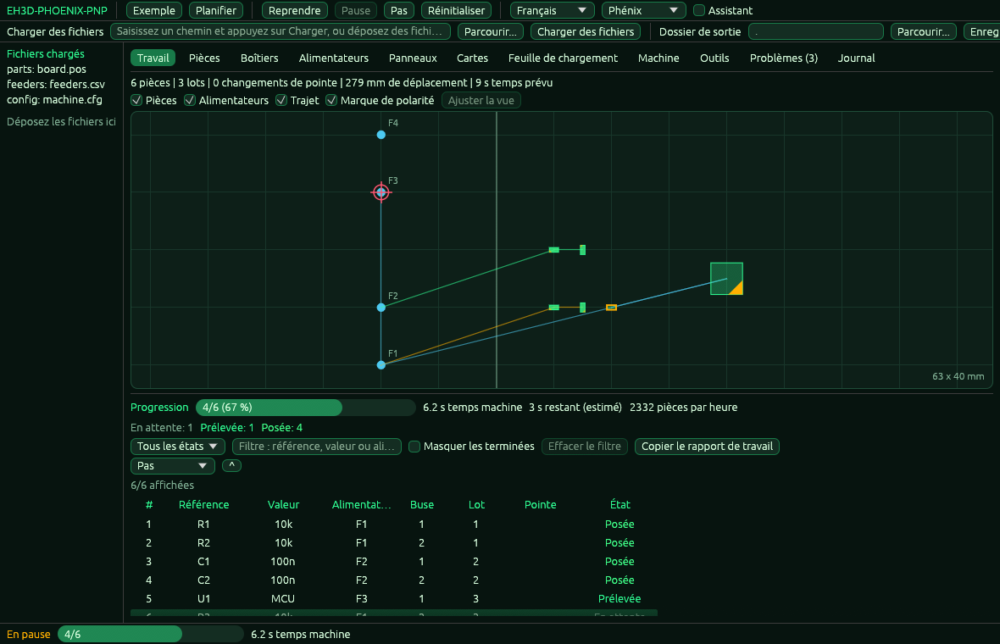
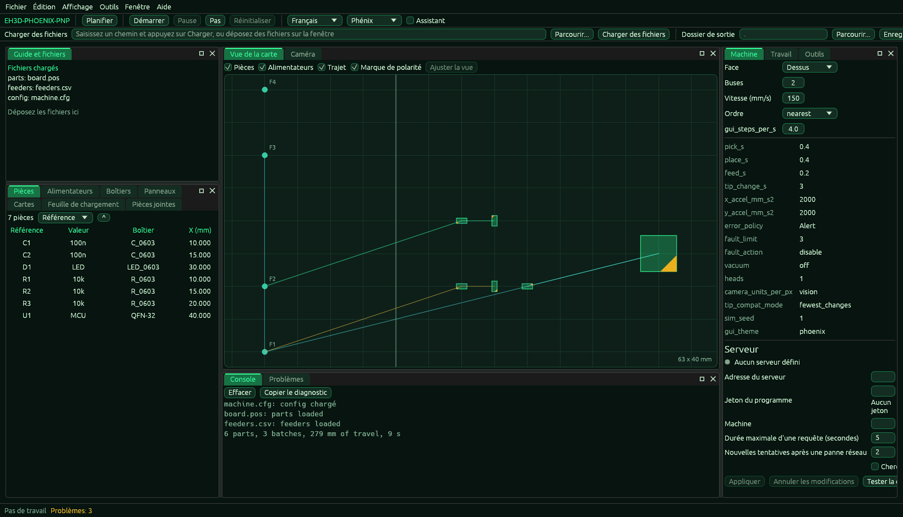

<p align="center">
  
</p>

# 📖 EH3D-PHOENIX-PNP

<p align="center"><a href="README.md">🇺🇸 English</a> | <a href="README_spa.md">🇪🇸 Español</a> | 🇫🇷 <b>Français</b> | <a href="README_ita.md">🇮🇹 Italiano</a> | <a href="README_deu.md">🇩🇪 Deutsch</a> | <a href="README_zho.md">🇨🇳 中文</a> | <a href="README_jpn.md">🇯🇵 日本語</a> | <a href="README_por.md">🇵🇹 Português</a></p>

### Assemblage pick and place : positions, chargeurs et ordre de pose

<p align="center">
  
  
  
  
  
</p>

---

**Vérification d'honnêteté - ce qui fonctionne aujourd'hui :** une bibliothèque Rust et un programme en ligne de commande (`phoenix-pnp`) avec 1915 tests qui s'exécutent sur un ordinateur : lit le fichier de positions d'une carte, donne à chaque composant son alimentateur (avec des priorités, des plateaux et des bandes), lit les réglages de la machine dans un fichier, planifie l'ordre de pose pour une tête de jusqu'à six buses (rangs, pointes de buse, limites d'angle, temps des déplacements, panneaux), écrit une feuille de chargement et, sur une machine simulée, exécute le plan pas à pas avec des pannes injectées. Il a aussi une fenêtre (construite avec `--features gui`) dont la logique est testée sans écran ; le dessin lui-même n'est pas couvert par des tests et, bien que le programme prenne des captures de sa propre fenêtre (`--shot`), aucune personne n'a vérifié le dessin sur un écran. Il ne pilote aucune machine : il n'a pas été essayé sur une machine et il n'a pas été vérifié avec une collection de fichiers réels.

---

> **État de sécurité :** ce programme ne commande aucune machine et n'est pas un système de sécurité. Ce qu'il produit doit être vérifié par une personne avant tout essai sur une machine ; rien ici n'a fonctionné sur du matériel réel.


## 📋 En un coup d'œil

| | |
|---|---|
| Version | `0.1.3` |
| Maturité | Échafaudage |
| Tests | 1915 |
| Pile technique | Rust |
| Sur du matériel réel | Non essayé : rien ici n'a fonctionné sur une machine |

**Aller à  :** [Présentation](#-présentation) · [Architecture](#-architecture) · [Démarrage rapide](#-démarrage-rapide) · [Tests](#-tests) · [Structure](#-structure-du-dépôt) · [Liés](#-projets-liés)

## 🚦 État du projet

Chaque ligne est une partie de ce dépôt et le feu dit où elle en est aujourd'hui. Elle est écrite d'après ce que le dépôt peut montrer (tests, compilations, exécutions), pas d'après ce qui est prévu.

🟢 Fait et vérifié · 🟡 Fonctionne, avec des limites connues · 🟠 À moitié fait ou pas encore vérifié · 🔴 Pas fait ou ne fonctionne pas

| Domaine | État | Ce que cela veut dire ici |
|---|---|---|
| Cœur | 🟡 | lit le fichier de positions d'une carte, donne à chaque composant son alimentateur (priorité, plateau, bande), planifie l'ordre de pose pour une tête de jusqu'à six buses avec des rangs, des pointes de buse, des limites d'angle et le temps des déplacements, planifie des panneaux et écrit la feuille de chargement ; testé sur un ordinateur avec des entrées normales et abîmées, pas avec une collection de fichiers réels. |
| Ligne de commande | 🟡 | `phoenix-pnp` exécute les mêmes fonctions que la bibliothèque (`parts`, `check`, `plan`, `schedule`, `preflight`, `simulate`, `loadsheet`, `config-check`, `check-bottom`, `tables-check`, `recipe-check`, `import-centroid`, `vision-test`) et affiche le résultat ; chaque erreur revient comme un message avec son code `PHOENIX-PNP-NNN` et un code de sortie non nul. |
| Tests | 🟡 | 1915 tests passent (`cargo test`), avec des cas normaux, des cas limites, des entrées abîmées et de petits cas générés. |
| Configuration de la machine | 🟡 | un fichier `clé = valeur` avec une version, un validateur qui nomme la ligne et les limites de sécurité (course de Z, limites de X et Y, nouvelles tentatives, angles de buse) ; les valeurs n'ont pas été comparées à une machine réelle. |
| Simulateur et travail | 🟡 | une horloge virtuelle, des pannes injectées au hasard (avec une graine) ou à un endroit choisi, des nouvelles tentatives, les politiques alerte et report, des alimentateurs qui s'éteignent après des pannes répétées, pause, pas à pas et un état enregistré pour reprendre ; il ne fait que simuler, rien n'a piloté une machine. |
| Sécurité | 🟡 | Rust sûr et simple (`forbid(unsafe_code)`) : rien ne panique sur les fichiers reçus et une mauvaise valeur est une erreur avec sa raison ; pas de revue indépendante. |
| Fenêtre | 🟠 | Une fenêtre egui (à construire avec `--features gui` ; `phoenix-pnp` sans commande l'ouvre) : onglets de travail, pièces, boîtiers, alimentateurs, feuille de chargement, machine, outils, problèmes et journal, une carte de la table de travail avec le trajet de la tête, des marques de polarité et la pièce suivante, un assistant en cinq étapes, des problèmes avec des corrections qu'on peut annuler, un travail simulé qu'on peut mettre en pause, reprendre et avancer pas à pas, et les huit langues. Sa logique est testée sans écran ; le dessin n'est pas couvert par des tests : le programme prend des captures de sa propre fenêtre (`--shot`), mais aucune personne n'a vérifié le dessin sur un écran. Elle a aussi des onglets de panneaux (avec les repères et l'ajustement qui déplace les pièces) et de cartes, un sélecteur de fichiers, des tableaux d'alimentateurs et de boîtiers modifiables avec annulation, des largeurs de colonnes mémorisées et un programme à part (`phoenix-pnp-gui`) qui s'ouvre sans console sous Windows. Les onglets sont maintenant des panneaux du cadre d'ancrage de la suite (`eh3d-dock`) : ils se déplacent, se détachent, se replient et s'enregistrent en trois dispositions, il y a une barre de menus, et quinze commandes ont un panneau ; cela a été compilé et exécuté sans fenêtre, pas vu sur un écran. |
| Matériel réel | 🔴 | Non essayé : rien ici n'a été exécuté sur une machine. |
| Documentation | 🟡 | README en huit langues, le journal des modifications et les deux images dessinées depuis `docs/`. |

## 🎯 Présentation

* **Les composants** (`src/parts.rs`) : un fichier `.pos` de KiCad ou un CSV (virgule ou point-virgule, guillemets, en-tête trouvé par nom) avec des positions en mm, mil ou pouces, les angles ramenés à 0-360, la face dessus ou dessous, et chaque ligne absurde est refusée avec son numéro ; une référence répétée est une erreur.
* **Composants à ne pas monter, les tables des exemples et le rapport d'un travail** (`src/parts.rs`, `src/commands.rs`, `src/job.rs`) : une colonne `dnp`, `do not place` ou `fitted` dans un CSV (ou `--dnp R1,R2`) laisse des composants hors du plan, de la feuille de chargement et des vérifications et les liste dans le rapport ; `tables-check` lit les tables (`--parts`, `--packages`, `--catalog`, `--feeders`, `--slots`) et nomme le code et la ligne de chaque erreur ; `simulate --report-csv FICHIER` écrit les statistiques du travail en CSV dont l'en-tête ne change jamais. `examples/` contient une carte avec une colonne `dnp`, des alimentateurs de tous les types et une table de boîtiers courants.
* **Les chargeurs** (`src/feeders.rs`) : un CSV de chargeurs (id, valeur, boîtier, position de prise, pièces restantes) ; chaque composant reçoit le premier chargeur qui contient sa valeur et son boîtier, sans tenir compte de la casse ; un composant sans chargeur et un chargeur qui s'épuise sont signalés, et un second chargeur du même type prend le relais.
* **Le plan** (`src/plan.rs`) : les emplacements sont parcourus au plus proche et coupés en lots d'une à six buses, les chargeurs d'un lot sont visités au plus proche, la face dessous est inversée selon la largeur de la carte, et le plan donne le trajet et une estimation du temps ; il s'écrit comme un travail JSON.
* **Les tables et les réglages** (`src/catalog.rs`, `src/config.rs`, `src/rotation.rs`) : des tables de pièces et de boîtiers dont les valeurs sont héritées (pièce, puis boîtier, puis les valeurs par défaut), un fichier de configuration de la machine au format `clé = valeur` (`examples/machine.cfg` documente chaque clé), davantage de noms pour les colonnes d'un CSV de positions et des corrections de rotation par boîtier.
* **Les alimentateurs avec plus qu'une bande** (`src/feeding.rs`) : priorité, plateaux, bandes et alimentateurs éteints ; l'alimentateur d'un composant est choisi de la même façon quel que soit l'ordre des fichiers.
* **Le planificateur de la machine** (`src/planner.rs`, `src/motion.rs`) : rangs (blocs posés l'un après l'autre), stratégies d'ordre, pointes de buse et leurs changements, limites de l'angle de la buse, temps des déplacements avec accélération et à-coup, parcours plus courts (2-opt) et correction de l'origine d'un composant.
* **Panneaux, feuille de chargement et exports** (`src/panel.rs`, `src/loadsheet.rs`, `src/export.rs`) : cartes et panneaux dans des panneaux, l'emplacement de chaque type de bande, un rapport, la liste de ce qui manque et un G-code qui ne fait que déplacer la tête.
* **Repères d'un panneau** (`src/fiducial.rs`) : les positions mesurées des repères sont ajustées aux positions prévues (une similitude avec deux repères, un ajustement affine avec trois ou plus) et les pièces du panneau sont déplacées et tournées par l'ajustement ; chaque repère a son résidu, et un ajustement qui manque un repère de plus de `fiducial_max_residual_mm` est refusé (`--fiducials FICHIER` avec `--panel`, ou l'onglet Panneaux de la fenêtre).
* **Cartes marquées comme mauvaises (X-out) et repères à deux niveaux** (`src/marks.rs`, `src/panel.rs`) : un enfant du fichier du panneau avec `"x_out": true`, ou `--x-out A,B/C`, est laissé de côté avec tout ce qu'il contient ; le plan, la feuille de chargement et les vérifications ne le voient pas, et un nom qu'aucune carte n'a (`PHOENIX-PNP-042`) ou un panneau dont toutes les cartes sont écartées (`PHOENIX-PNP-043`) est une erreur. Une pièce d'une carte dont la valeur ou le boîtier contient un mot de `fiducial_words`, ou dont la référence est un préfixe de `fiducial_refs` suivi d'un nombre (`FID1`), est un repère de sa carte et n'est pas posée ; le fichier de `--fiducials` peut alors nommer les repères du panneau (`f1`) et des cartes (`A/FID1`) : les repères d'une carte sont ajustés ensemble et ne déplacent que les pièces de cette carte, et les pièces des cartes sans repères mesurés suivent l'ajustement du panneau. Simulé : aucune carte n'a jamais été mesurée sur une machine ; la fenêtre n'utilise pas encore les repères des cartes.
* **Plus du planificateur et du simulateur :** l'ordre dans lequel les cellules d'un plateau sont vidées (lignes, colonnes ou serpentin), une recherche de l'ordre des pointes de buse qui compte le trajet et le déplacement vers le changeur (`tip_strategy = optimize`, limitée par `tip_opt_max_evals` et `tip_opt_time_limit_s`), des probabilités de panne par boîtier et par alimentateur (`sim_part_fail`, `sim_feeder_fail`) avec des statistiques par boîtier et par alimentateur et les pièces par heure, et `check-bottom`, qui montre l'angle que donne chaque règle de la face inférieure.
* **L'étape d'alignement** (`src/job.rs`, `src/sim.rs`, `src/model.rs`) : avec `align = on`, le travail regarde chaque pièce avec la caméra après la prise et corrige le placement d'après ce qu'elle voit (la tête va à la place moins le décalage de la pièce, et la buse tourne de la rotation de la pièce en moins) ; `pick_tolerance_mm` jette une pièce plus décalée, qui est reprise comme le dit `error_policy` ; `align_passes` (de 1 à 5) et `align_settle_s` fixent les regards et l'attente avant chacun, qui s'ajoutent au temps du plan ; la caméra simulée a un décalage, une erreur et des pannes injectables (`sim_align_*`, `sim_camera_fail_rate`) ; et la correction (moyenne, plus grande, pièces jetées) figure dans le texte, dans le rapport JSON et dans les lignes `align` de `--report-csv`. Désactivée par défaut : un travail est alors celui de toujours. Non essayée sur une machine. Avec `align_rereads` supérieur à 0 (jusqu'à 5, 0 par défaut) la caméra regarde de nouveau une pièce dont le premier regard était hors tolérance avant de la rejeter, un regard dans la tolérance compte comme le premier, et le rapport de travail compte par alimentateur les regards hors tolérance, les regards en plus, les pièces qu'ils ont sauvées, les pièces rejetées et les regards sans mesure.
* **La chaîne de vision** (`src/vision.rs`, `src/sim.rs`, `examples/vision.cfg`) : avec `vision = pipeline`, la caméra simulée dessine en mémoire une image de la pièce (sa taille, sa rotation et sa distance à la buse, avec un bruit tiré de `sim_seed`) et la mesure avec les étapes d'un fichier de réglages (`--vision FILE`) : un masque, un filtre médian, un seuil fixe ou d'Otsu, une plage d'aire pour la tache et le plus petit rectangle tourné, dont le centre et l'angle sont le décalage que corrige l'étape d'alignement. Une pièce introuvable, une tache d'aire erronée et plusieurs taches sont des regards sans mesure, chacun avec son code (`PHOENIX-PNP-037` à `PHOENIX-PNP-039`). `phoenix-pnp vision-test` dessine une pièce à partir de la taille, de la rotation, du décalage et du bruit donnés et affiche ce qui a été mesuré avec son erreur. Désactivé par défaut : un travail est alors celui d'avant. Non essayé avec une vraie caméra.
* **Le rapport de travail** (`src/report.rs`, `src/job.rs`) : après un travail simulé, `simulate` peut écrire le rapport sous forme de texte dans la langue de `--lang` (`--report-text`), de page HTML qui contient tout, sans script ni rien d'extérieur, et qui n'est jamais écrite par-dessus un fichier existant (`--report-html`), de sections ajoutées après les lignes du CSV (`--report-csv`, l'en-tête ne change pas) et de `work` dans le JSON (`--report`). Il dit combien de pièces ont été placées, mises de côté, ignorées par la personne, encore en attente ou à ne pas monter ; où est passé le temps machine (alimenter et prélever, regards de la caméra, placements, déplacements de la tête, changements de buse) ; combien de prélèvements ont réussi au premier essai ; la même chose par boîtier, alimentateur, buse, pointe de buse et carte d'un panneau ; les erreurs survenues avec leurs codes ; les avis avant le travail ; et un histogramme de ce que la caméra a corrigé (X, Y et rotation). Simulé : rien de cela n'a été mesuré sur une machine.
* **L'onglet Travail et les décisions de la personne** (`src/gui/jobtab.rs`, `src/gui/window.rs`, `src/job.rs`) : le tableau montre l'état de chaque placement (en attente, prélevé, aligné, placé, mis de côté, ignoré, en échec) et les pièces à ne pas monter, une barre de progression avec le temps machine et une estimation du temps restant, et des filtres par état, par texte et par ce qui est fait. Quand une erreur arrête le travail, une boîte de dialogue nomme l'étape en échec et propose quatre actions exécutées sur le travail simulé, qui repart ensuite : réessayer, ignorer la pièce, la mettre de côté, ou éteindre l'alimentateur pour qu'un autre du même type prenne le relais. Chaque décision est comptée dans le rapport. La logique n'a pas besoin d'écran et est testée ; aucune personne n'a vérifié l'affichage sur un écran (les images de cet onglet dans `images/screens/` sont prises par le programme lui-même).
* **Le vide, les actionneurs et la fenêtre de défauts d'un alimentateur** (`src/sim.rs`, `src/job.rs`, `src/config.rs`) : avec `vacuum = on`, la pompe simulée aspire pendant `vacuum_suck_s` secondes après chaque prise et le niveau de la buse (kilopascals) est lu ; un niveau sous `vacuum_pick_min_kpa` signifie que la buse ne tient aucune pièce (`PHOENIX-PNP-044`, et la prise est refaite comme le disent les nouvelles tentatives) et, après le soufflage de `vacuum_blow_s` secondes à chaque dépose, un niveau au-dessus de `vacuum_release_max_kpa` signifie que la pièce reste collée à la buse (`PHOENIX-PNP-045`). Le capteur a son propre générateur (`sim_vacuum_noise_kpa`, `sim_vacuum_miss_rate`, `sim_vacuum_stuck_rate`) et est désactivé par défaut : un travail sans lui est exactement ce qu'il était. Les dispositifs tout ou rien se déclarent avec `actuator = NOM : DÉLAI_S` et se commutent avec `Job::set_actuator`, qui ajoute leur délai à l'horloge (`PHOENIX-PNP-046` pour un nom que la machine n'a pas). Avec `fault_action = alert`, un alimentateur qui atteint `fault_limit` défauts parmi ses `fault_window` dernières prises ne se désactive plus tout seul : le travail s'arrête (`PHOENIX-PNP-047`) et la boîte de dialogue de l'onglet Job propose de réessayer, d'écarter la pièce, de la mettre de côté ou de désactiver l'alimentateur.
* **Le modèle de caméra, les têtes de la machine et les embouts d'un boîtier** (`src/camera.rs`, `src/heads.rs`, `src/tips.rs`, `src/config.rs`): la caméra est décrite par `camera_units_per_px` (0 est la taille pour laquelle la vision est réglée), `camera_offset_x_mm` et `camera_offset_y_mm` (où se trouve l'axe de la buse dans l'image), `camera_rotation_deg`, `camera_flip_x` et `camera_flip_y`, et l'objectif (`camera_lens_scale`, `camera_lens_k1`) ; la caméra simulée de l'étape d'alignement lit la pièce à travers ce modèle, avec ou sans image, et avec les valeurs par défaut un travail est exactement ce qu'il était. `head = NOM : BUSES [: DÉCALAGE_X : DÉCALAGE_Y : CAMÉRA_X : CAMÉRA_Y : CAMÉRA_ROT : CAMÉRA_UNITÉS : CAMÉRA_OBJECTIF]` déclare jusqu'à quatre têtes, chacune avec ses buses, son décalage et sa caméra ; avec deux têtes ou plus, `schedule` donne chaque pièce à une tête qui l'atteint (`PHOENIX-PNP-048` si aucune ne l'atteint), planifie chaque tête et compte, sur l'horloge de la machine, le temps qu'une tête attend un alimentateur utilisé par une autre. `tip_compat = MOTIF : EMBOUT, EMBOUT, ...` liste les embouts qu'un boîtier accepte et `tip_compat_mode` (`fewest_changes` ou `preferred`) choisit un embout pour chaque sorte de pièce afin que la machine change d'embout le moins souvent possible ; un embout nommé dans les tables est conservé.
* **Recettes** (`src/recipe.rs`, `src/job.rs`, `src/commands.rs`) : un fichier texte avec une version (`examples/job.recipe`) fixe les étapes que traverse un travail (`prepare`, `pick`, `align`, `place` et `check`, dans cet ordre et aucune deux fois ; l'étape d'alignement et le contrôle du vide ne sont actifs que si la recette les contient) et les paramètres qui changent pour un boîtier, un alimentateur ou un embout (`pick_retries`, `pick_tolerance_mm`, `vacuum_suck_s` et `vacuum_blow_s` ; pour chaque clé la première règle qui correspond l'emporte, d'abord celles des alimentateurs, puis celles des boîtiers et enfin celles des embouts). `phoenix-pnp recipe-check FICHIER` la lit et la vérifie, et `simulate ... --recipe FICHIER` exécute le travail avec elle. Ses erreurs portent les codes `PHOENIX-PNP-049` à `PHOENIX-PNP-052` (une ligne non valide, des étapes dans le désordre, un fichier hors de ses limites, une version trop récente) et les limites sont les clés `recipe_max_bytes` et `recipe_max_rules` de `machine.cfg`. Un état enregistré se souvient aussi de l'alimentateur de la dernière prise et de la prise qui a été arrêtée, si bien qu'un travail chargé dans une autre exécution offre à la personne les mêmes décisions (un ancien état se charge toujours).
* **Import de fichiers de positions** (`src/import.rs`, `src/commands.rs`) : `phoenix-pnp import-centroid FICHIER` lit un CSV de centroïdes (`--map FICHIER` nomme ses colonnes, `examples/centroid.map` ; `examples/centroid.csv` n'a pas besoin de carte), le texte de positions d'EAGLE (`examples/board.mnt` : nom, x, y, rotation `R90` ou `MR90` pour la face inférieure, valeur, boîtier) ou le `.pos` de KiCad (`--format auto|csv|eagle|kicad-pos` ; `auto` les distingue par la première ligne) et écrit le tableau des pièces `ref,val,package,x,y,rot,side,dnp` en millimètres dans `--out` (un fichier qui existe n'est jamais écrasé : `PHOENIX-PNP-040`) ou sur la sortie standard. Les unités sont mm, mil ou pouce (dans l'en-tête comme `X (mil)`, dans la cellule comme `0.5in`, dans un commentaire comme `## Unit = inch`, dans la carte ou dans `import_unit`) ; les angles sortent de 0 à 360 ; la colonne de la face est facultative ; une colonne `dnp` ou `fitted` (ou `--dnp R1-R5,C7` avec des plages de références) marque les pièces à ne pas monter ; `import_bottom_mirror_width_mm` reflète le X de la face inférieure et `bottom_rotation` tourne son angle. Les trois lecteurs sont ceux du programme (aucun autre dépôt n'a de lecteur utilisable sans ajouter une dépendance) et la disposition du texte d'EAGLE n'a pas été comparée à un fichier écrit par une installation réelle. Chaque erreur porte un code de `PHOENIX-PNP-053` à `PHOENIX-PNP-056` (une ligne non valide, un en-tête sans une colonne de la carte, un format inconnu, une plage de références non valide) et le numéro de la ligne.
* **Nomenclature** (`src/bom.rs`, `src/cmd_tools.rs`) : `phoenix-pnp bom-check PIÈCES BOM` lit une nomenclature (`examples/bom.csv` : les références dans une cellule, en plage ou une par ligne, et la valeur, le boîtier, la quantité et la référence fabricant si elles existent) et dit quelles références n'existent que d'un côté, lesquelles sont listées deux fois, quelles valeurs ou quels boîtiers diffèrent et quelles quantités ne concordent pas ; une pièce marquée comme à ne pas monter peut figurer ou non dans la nomenclature. Une erreur du fichier porte le code `PHOENIX-PNP-057` et sa ligne.
* **Stock pour une série** (`src/stock.rs`) : `phoenix-pnp stock PIÈCES ALIMENTATEURS --boards N` additionne les cartes et dit, type de pièce par type, combien de pièces N cartes demandent face à celles des alimentateurs allumés, quels types manquent, de combien et après combien de cartes la première bobine se vide ; il sort avec 2 si quelque chose manque et écrit le tableau avec `--out`. `bom-order --have ALIMENTATEURS` déduit de la liste d'achat ce que les alimentateurs contiennent déjà et donne les colonnes `on_hand` et `to_buy`.
* **Étalonnage de la caméra** (`src/calibrate.rs`) : `phoenix-pnp camera-calibrate FICHIER` ajuste le modèle de la caméra (taille d'un pixel, rotation, miroir et position de l'axe de la buse dans l'image) à des observations d'un repère à des endroits connus de la tête (`px,py,x_mm,y_mm` [voir `examples/camera_points.csv`], au moins trois) et affiche la qualité de l'ajustement et les lignes `camera_*` pour la configuration ; l'objectif n'est pas ajusté. Son erreur est le code `PHOENIX-PNP-058`.
* **Faux-rond de la buse** (`src/calibrate.rs`, `src/export.rs`) : `phoenix-pnp nozzle-calibrate FICHIER` ajuste un cercle à des lectures de la pointe de buse à plusieurs angles (`angle_deg,x_mm,y_mm` [voir `examples/nozzle_readings.csv`]) et affiche `nozzle_runout_mm` et `nozzle_runout_deg` ; avec un faux-rond supérieur à 0, le G-code de `schedule --gcode` déplace chaque emplacement de l'opposé du faux-rond à l'angle de la pièce.
* **Panneau d'une grille de cartes** (`src/panel.rs`, `src/cmd_tools.rs`) : `phoenix-pnp panelize CARTE --cols N --rows N --pitch-x MM --pitch-y MM` écrit le fichier de panneau d'une grille de copies d'une carte, toutes tournées pareil, avec trois repères à une marge (`--fiducials MM`, autour de la taille réelle de la carte donnée par `--board-size W,H`) et des cartes marquées mauvaises par leurs noms `P1`, `P2`, ... (`--x-out P2,P5`) ; un fichier qui existe n'est jamais écrasé.
* **Feuille des pièces polarisées** (`src/polarity.rs`) : `phoenix-pnp polarity-sheet PIÈCES` liste les pièces dont la référence correspond à `polarity_refs` ou dont le boîtier correspond à `polarity_packages` (par défaut diodes, LED, circuits, transistors, condensateurs polarisés et connecteurs) avec leur position et leur rotation et une colonne vide à cocher, pour le contrôle après un travail ; `--side` garde un seul côté.
* **Jeu des axes** (`src/sim.rs`, `src/motion.rs`) : `backlash_x_mm`, `backlash_y_mm` et `backlash_mode` font que la machine simulée termine un déplacement qui inverse un axe trop court du jeu (`off`, compté par `simulate`) ou le dépasse et revient par le côté positif (`approach`, plus long et sans erreur) ; avec un jeu de 0 rien ne change.
* **Liste des pièces à acheter** (`src/bom.rs`) : `phoenix-pnp bom-order BOM --boards N` additionne les lignes d'une nomenclature qui sont la même pièce et donne à chaque ligne les pièces pour N cartes plus une réserve (`order_spare_percent` pour cent ou `order_spare_min`, le plus grand ; `--spare-percent` et `--spare-min` l'emportent), sans les pièces que `--parts PIÈCES` marque comme à ne pas monter ; il écrit un CSV trié par boîtier et valeur.
* **Apprentissage des alimentateurs** (`src/calibrate.rs`) : `phoenix-pnp feeder-teach strip` donne le pas et l'angle d'une bande d'après les positions de sa première et de sa dernière pièce, et `feeder-teach tray` les deux pas et l'angle d'un plateau d'après trois de ses cases, avec l'écart à l'équerre ; les deux affichent les colonnes du fichier des alimentateurs qu'ils fixent. `feeder-teach --measures FICHIER` lit les positions de plusieurs alimentateurs dans un fichier et affiche pour chacun une ligne et une ligne du fichier des alimentateurs (`examples/feeder_measures.csv`).
* **Le simulateur et le travail** (`src/sim.rs`, `src/job.rs`, `src/preflight.rs`, `src/model.rs`) : les vérifications avant un travail, une machine à horloge virtuelle et pannes injectables, et un travail qu'on peut mettre en pause, exécuter pas à pas, enregistrer et reprendre.
* **La fenêtre** (`src/gui.rs`, `src/gui/`) : ce que la fenêtre fait en dehors du dessin n'a pas besoin d'écran (les fichiers chargés, le plan et ses problèmes avec corrections, le travail simulé, la géométrie de la carte, les tableaux à sélection partagée, l'assistant en cinq étapes et les textes en huit langues) et est testé ; seul `src/gui/window.rs`, construit avec `--features gui`, le dessine avec egui. La vitesse de la simulation, le thème et la taille dessinée pour une pièce de boîtier inconnu sont des clés de `machine.cfg` (`gui_steps_per_s`, `gui_theme`, `gui_part_size_mm`).
* **Verrouillages des axes** (`src/interlock.rs`, `src/driver.rs`, `src/gcodedriver.rs`, `examples/driver_marlin.cfg`) : une ligne `interlock = SIGNAL | on|off | xy|z|rot|all` d'un profil de pilote dit que les axes nommés ne peuvent bouger que tant que le signal est dans l'état nommé (l'exemple garde le chariot immobile en X et Y tant que la vanne de soufflage est active). Les signaux sont les noms des actionneurs du profil, que la session connaît par ce qu'elle a commuté en dernier, et les noms donnés à un capteur avec `Session::set_signal` (une porte, les buses relevées) ; un signal que personne n'a signalé est inconnu et ne satisfait aucune règle, le mouvement est donc refusé. Un mouvement refusé est un échec de sécurité comme un mouvement hors des limites : les lignes de `safe_stop` sont envoyées, les règles de sécurité ralentissent la machine et plus rien n'est envoyé avant une nouvelle session. Le refus est dit dans les huit langues. Tout est un calcul sur des noms et des nombres, essayé contre le contrôleur simulé avec des mouvements au hasard sur une graine fixe, sur lesquels la session et le calcul doivent s'accorder ; aucun capteur d'une machine réelle n'a été lu.
* **Le processus d'une carte et le mode manuel guidé par phases** (`src/process.rs`, `src/cmd_import.rs`) : un processus est une liste de phases (`phase = NOM | tâche, tâche`, avec les tâches `load`, `place top`, `place bottom by hand`, `reflow`, `solder by hand`, `glue`, `through-hole` et `inspect`) ou l'un de deux préréglages, `pnp` (la machine pose chaque face) et `manual` (une personne pose chaque face à la main) ; une phase ne commence que lorsque les précédentes sont faites et qu'aucune n'est en cours, elle ne finit que lorsqu'elle est en cours, son chargement (les alimentateurs chargés pour elle) ne peut changer que tant qu'elle est à faire, et l'état peut être enregistré et repris. `phoenix-pnp assist PIÈCES --process pnp|manual|FICHIER` le parcourt : les pièces d'une face posée à la main sont demandées une à une, les autres tâches sont dites dans la langue de la personne et attendent `done`, une face posée par la machine est signalée, et les phases d'une face sans pièces sont omises. Les refus sont dits dans les huit langues. Rien n'est déplacé : une personne fait le travail.
* **La fenêtre sur le cadre d'ancrage de la suite** (`src/gui/docking.rs`, `src/gui/cmdpanel.rs`, `src/gui/window.rs`, `Cargo.toml`) : les onglets de la fenêtre sont des panneaux de `eh3d-dock` d'EH3D-COMMON (la compilation prend `EH3D-COMMON` en version 0.3.0) : chacun peut être retiré, remis depuis le menu Affichage, déplacé en faisant glisser son onglet au milieu ou sur un côté d'un autre groupe, détaché au-dessus de la fenêtre, replié sur un bord, agrandi et verrouillé. La fenêtre démarre dans l'une de trois dispositions, Configurer, Exécuter et Compact, avec la vue de la carte, les pièces, les alimentateurs, le travail, la caméra, la machine et la console du secteur du pick and place et, en plus, le guide, les boîtiers, les panneaux, les cartes, la feuille de chargement, les outils et les problèmes ; la barre de menus a Fichier (avec les exemples et les fichiers récents), Édition, Affichage, Outils (planifier, démarrer, pause, pas, réinitialiser et les panneaux des commandes), Fenêtre (les dispositions et celles que la personne enregistre sous un nom) et Aide, avec F5 à F8 et les raccourcis habituels ; une entrée inutilisable est aussi éteinte pour son raccourci. Ce que la personne a disposé est conservé dans `window.cfg` sous les clés `dock.` et revient au démarrage suivant ; une disposition abîmée ou d'une autre version est remplacée par celle d'usine, avec un avis. Onze commandes (`driver-check`, `driver-test`, `driver-run`, `safety-replay`, `homing-repeat`, `bringup`, `import-openpnp`, `assist`, `align-iterate`, `vacuum-calibrate` et `test-board-gen`) ont chacune un panneau, caché au début (les menus Affichage et Outils le montrent) : un panneau lance `phoenix-pnp` à côté de la fenêtre avec les arguments saisis (séparés par des espaces et des guillemets, bornés, lus par aucun shell), sans fenêtre de console et sans rien à lire au clavier, pendant `command_timeout_s` secondes au plus (de 5 à 600, 60 par défaut, dans `window.cfg`), et montre ce qu'il a imprimé, si bien qu'un panneau et sa commande ne peuvent pas diverger. Les panneaux et les menus sont des données et sont testés sans écran ; le dessin avec le cadre n'a été que compilé et exécuté dans un contexte sans fenêtre, et personne n'a vu les dispositions sur un écran.
* **Le regard sur la pièce à la buse** (`src/inspect.rs`, `src/cmd_vis.rs`) : `phoenix-pnp part-inspect LECTURES --sizes TAILLES` (ou `--packages BOÎTIERS`) compare ce que la caméra a mesuré de chaque pièce (ses deux côtés, où elle pend par rapport à l'axe et de combien elle est tournée) à la taille de son boîtier et dit pourquoi elle est refusée (`part_size_tol_mm`, `part_angle_tol_deg`, `part_offset_max_mm`) ; la taille vient d'une table de tailles ou des colonnes `body_long_mm` et `body_short_mm` de la table des boîtiers (`examples/packages_bodies.csv`), et la commande sort avec 2 tant qu'une pièce est refusée ou n'a pas de taille.
* **Tubes et alimentateurs en vrac** (`src/feeding.rs`, `src/feedlib.rs`) : en plus d'une bande, d'un plateau et d'une réglette, la colonne `kind` de la table des alimentateurs accepte `tube` (un bâton ou un rail dont les pièces glissent jusqu'à une butée) et `bulk` (pièces en vrac dans un bac ou une cuve, qui n'arrivent dans aucune direction fixe) ; les deux prélèvent à l'unique endroit `x`, `y`, comme une bande, prennent l'angle des pièces de `rotation`, se vident selon le compte et sont vérifiés par `feeder-check` ; l'onglet Alimentateurs de la fenêtre propose les cinq types dans les huit langues (`examples/feeders_tubes.csv`).
* **Pièces placées et temps par alimentateur** (`src/job.rs`, `src/feedrep.rs`, `src/report.rs`) : le travail note de quel alimentateur chaque buse a pris sa pièce (aussi quand un autre alimentateur du type a pris le relais) et compte la pièce comme placée depuis cet alimentateur, et additionne le temps des étapes qui ont prélevé dans chaque alimentateur (le trajet jusqu'à lui, l'avance, le prélèvement et le regard) ; le rapport de travail, son JSON et `simulate --report-feeders` (les colonnes `placed` et `busy_s` à la fin) les montrent, et un travail sauvegardé les conserve.
* **Durée de vie des pointes de buse** (`src/nozzlelife.rs`, `src/cmd_tools.rs`, `src/commands.rs`) : `simulate --nozzle-life FICHIER` ajoute ce qu'un travail mené à son terme a fait de chaque pointe (les pièces placées et les montages) à un petit CSV que la personne garde à côté de la configuration ; un travail n'est compté qu'une fois, un fichier qui n'est pas un relevé des pointes n'est jamais écrasé, le fichier remplacé est conservé sous `FICHIER.prev` et les compteurs ne baissent que lorsque `nozzle-life FICHIER --reset POINTE` note qu'une pointe a été remplacée. `nozzle_life_warn` (500000 par défaut, 0 n'avertit pas) est le nombre de pièces à partir duquel on dit à la personne de regarder une pointe, avec `simulate` et `nozzle-life`. Nouveau code d'erreur `PHOENIX-PNP-059`.
* **Quel ordre est le plus rapide** (`src/compare.rs`, `src/commands.rs`) : `phoenix-pnp order-compare PIÈCES ALIMENTATEURS` planifie la même carte avec chaque `order` des places (nearest, part, height_part, pick, tips, none) et chaque `tip_strategy` (minimize, as_planned, optimize), et les montre côte à côte avec les lots, les changements de pointe, le trajet de la tête et les secondes, la plus rapide de chaque liste marquée, celle de la configuration marquée, et une ligne qui dit combien de secondes le meilleur réglage ferait gagner ; elle prend les options de `schedule` et ne change rien.
* **Une image du plan** (`src/preview.rs`, `src/commands.rs`) : `phoenix-pnp schedule PIÈCES ALIMENTATEURS SORTIE.json --svg SORTIE.svg` écrit aussi le plan en un fichier SVG à regarder avant que la machine ne bouge, à imprimer ou à garder avec le travail : les alimentateurs, la place de chaque pièce avec le numéro de son tour et la couleur de sa buse, la ligne que suit chaque pièce depuis son alimentateur, le trajet en pointillés de la tête sur tout le travail et les totaux ; il n'a ni script ni rien d'extérieur, ce qui est tapé dans une référence ou un id est échappé, et une image qui existe n'est jamais écrasée.
* **Étalonnage de la caméra avec une mire** (`src/pattern.rs`, `src/cmd_tools.rs`) : `phoenix-pnp camera-pattern FICHIER [--pitch MM]` lit les points d'une grille (les coins intérieurs d'un damier ou les centres de points) sous la forme `col,row,px,py` (`examples/camera_pattern.csv`) et ajuste la taille d'un pixel (`camera_units_per_px`) et la distorsion radiale de l'objectif (`camera_lens_k1`) avec la rotation, le décalage et le miroir de la feuille dans l'image, puis dit de combien les points s'écartent du modèle avec et sans la distorsion et quel point est le plus éloigné ; les lignes pour la configuration sont affichées, et le code de sortie est 2 quand un point dépasse `camera_pattern_max_residual_mm`. Les points sont distants de `camera_pattern_pitch_mm`. La rotation et le décalage de la caméra viennent toujours de `camera-calibrate`, qui déplace la tête. L'onglet Outils a le même étalonnage et refuse de mettre dans la machine un ajustement au-delà de la limite.
* **Quel repère est en défaut** (`src/fidcheck.rs`, `src/gui/workspace.rs`, `src/gui/tables.rs`) : quand les repères mesurés d'un panneau sont utilisés, la fenêtre calcule le résidu de chaque repère (même quand l'ajustement est refusé, pour qu'on voie pourquoi), le seul repère qui, écarté, ramène tous les autres sous `fiducial_max_residual_mm`, et la rotation, les échelles et le cisaillement face à leurs limites. Le tableau des repères marque d'un `!` un repère au-delà de la limite et d'un `?` celui qui ne concorde pas, et le panneau liste les avertissements en toutes lettres (aussi dans le journal) ; `fidcheck::analyze_marks`, `fidcheck::warnings` et `fidcheck::residual_table` donnent la même chose à la commande `fiducial-check` et à l'outil de contrôle des repères.
* **File de travaux** (`src/queue.rs`, `src/cmd_queue.rs`) : plusieurs cartes ou panneaux l'un après l'autre. `phoenix-pnp queue-add FILE NOM SOURCE ALIMENTATEURS [--panel] [--boards N]` met un travail dans un petit CSV qui survit à l'arrêt du programme (il est écrit dans un fichier temporaire puis déplacé à sa place, le fichier remplacé est gardé en `CHEMIN.prev`, et la dernière ligne porte une somme de contrôle, de sorte qu'un fichier coupé ou modifié à la main est refusé) ; `queue-status [--check]` liste les travaux et ce qu'est devenu chacun (pending, running, done, failed, skipped) et, avec `--check`, planifie ceux qui restent à faire ; `queue-edit` saute, remet à zéro, retire la confirmation d'un travail ou l'enlève ; `queue-run` fait les travaux carte par carte sur la machine simulée et écrit la file après chaque carte. Rien ne s'exécute sans confirmation : avec `queue_confirm` activé (par défaut) un travail ne s'exécute qu'après que `queue-confirm` a enregistré l'identité de son plan (le plan et le texte des fichiers dont il est fait), et un changement dans un fichier l'annule ; `queue_stop_on_failure` (activé par défaut) arrête la file au premier travail qui échoue. Un second `queue-run` sur la même file est refusé tant qu'un fichier `.lock` existe. L'outil File de l'onglet Outils fait tout cela avec des boutons. Nouveau code d'erreur `PHOENIX-PNP-060`.
* **Texte en UTF-16** (`src/parts.rs`) : chaque table et fichier de réglages que lisent les commandes et la fenêtre (positions, alimentateurs, boîtiers, nomenclatures, panneaux, repères mesurés) peut être en UTF-16 avec marque d'ordre des octets, comme les programmes Windows et les tableurs enregistrent le « texte Unicode » ; il est lu comme de l'UTF-8. Un texte qui n'est ni l'un ni l'autre est lu en Latin-1 avec une note, et un outil de l'onglet Outils qui lit un fichier le refuse.
* **Corriger l'objectif** (`src/camera.rs`, `src/sim.rs`) : avec `camera_correct_lens = on` la caméra retire de ce qu'elle voit la distorsion de l'objectif (`camera_lens_k1`, telle que `camera-pattern` la trouve), de sorte que les mesures de l'étape d'alignement sont celles d'un objectif qui ne déforme rien ; `CameraModel::to_machine_corrected` et `read_corrected` le font en inversant `d * (1 + k1 * d * d)`. Désactivé (par défaut), la distorsion reste dans les mesures. `camera_units_per_px` doit alors être la vraie taille d'un pixel, comme la donne `camera-pattern`.
* **Chemins de la file depuis son dossier** (`src/queue.rs`, `src/cmd_queue.rs`) : avec `queue_relative_paths = on` (ou `queue-add --relative`) les fichiers d'un travail qui sont dans le dossier du fichier de la file, ou en dessous, sont gardés comme chemins depuis ce dossier, de sorte que le dossier peut être déplacé ou partagé ; `queue-status`, `queue-confirm` et `queue-run` les reprennent depuis le dossier de la file, quel que soit le dossier d'où ils s'exécutent. Désactivé (par défaut) garde des chemins absolus ; les deux fonctionnent pareil et donnent la même identité du plan.
* **La file avec des boutons** (`src/gui/queuetab.rs`, `src/gui/window.rs`) : l'outil File de l'onglet Outils lit un fichier de file comme une liste de travaux et a des boutons pour ajouter un travail (un formulaire vérifié dans la langue de la fenêtre), vérifier les plans, confirmer le plan du travail choisi, retirer la confirmation, ignorer, réinitialiser, retirer et exécuter. Chaque bouton lance la commande du même nom comme le programme à côté de la fenêtre, de sorte que la fenêtre et la ligne de commande planifient, confirment et exécutent d'une seule façon (même identité du plan, même verrou). Le premier appui sur Exécuter ne fait que demander (`queue_gui_ask_run`, activé par défaut) ; le second lance l'exécution sur la machine simulée, en arrière-plan, avec un bouton Arrêter.
* **Une caméra simulée qu'on peut dégrader** (`src/vision.rs`) : `vision.cfg` ajoute `sim_blur_px` (caméra floue), `sim_salt_pepper` (pixels qui deviennent noirs ou blancs), `sim_gradient_levels` (lumière inégale), `sim_failure_rate` et `sim_failure_kind` (une part des images gâchée : la pièce absente, la lumière éteinte ou tout saturé) ; tout est désactivé par défaut et le bruit d'un travail qui ne s'en sert pas ne bouge pas. `vision-test` et `simulate --vision` les utilisent comme le bruit qui existait déjà.
* **Mesures pour essayer les contrôles** (`src/visionsim.rs`, `src/cmd_vis.rs`) : `phoenix-pnp vision-readings PARTS --sizes F` dessine l'image que la caméra simulée donne de chaque pièce d'un fichier de positions (pendant un peu hors de l'axe et tournée, dans `--spread` et `--turn` ; `--wrong-every N` fait de chaque N-ième pièce une pièce d'une autre taille) et écrit les mesures dans le fichier que lit `part-inspect` ; `phoenix-pnp vision-marks DESIGN --shift X,Y --turn DEG --scale S` regarde chaque repère d'un panneau posé comme indiqué et écrit les repères mesurés que lit `fiducial-check`. Le flou, le bruit et les pannes viennent de `--vision` ; une image où rien n'est trouvé ne donne pas de mesure et est signalée avec sa raison ; le même `--seed` donne les mêmes mesures.
* **Un rapport de travail à garder** (`src/report.rs`) : `simulate --report-html FILE` (une page sans script ni rien d'extérieur), `--report-text`, `--report` (JSON) et `--report-csv` disent maintenant aussi, par alimentateur, combien de pièces ont été prises, placées, mises de côté et ignorées, et, par pointe de buse, ce que le travail a ajouté à sa vie (`--nozzle-life` donne le relevé d'avant le travail), les usages avant et après et un avertissement quand une pointe atteint `nozzle_life_warn` ; les temps, les constats des contrôles et les erreurs avec leurs codes y étaient déjà.
* **Un temps plus fidèle pour le plan** (`src/planner.rs`) : avec `backlash_mode = approach` la machine dépasse un emplacement du jeu d'un axe et revient, ce qui prend du temps ; le plan l'omettait et le compte maintenant tronçon par tronçon (seulement là où il y a de la place avant la limite), de sorte que ses secondes sont celles du travail simulé, et `AdvancedPlan::approach_s`, le rapport du plan et son JSON disent combien de secondes vont aux secondes passes. Les pointes restent groupées en lots et les alimentateurs d'un lot sont visités du plus proche au plus lointain ; sans approach rien ne change.
* **Tailles des boîtiers courants** (`src/pkggen.rs`, `src/cmd_tools.rs`) : `phoenix-pnp package-gen 0603 SOT-23-5 SOIC-8 QFN-32-5x5 LQFP-48` (ou `--from PARTS` pour les boîtiers d'un fichier de positions) écrit les lignes d'une table de boîtiers (`package,height_mm,tape_mm,body_long_mm,body_short_mm`) à partir des tailles nominales des puces des codes EIA, SOT, SOD, SOIC (étroit et large), TSSOP, QFN, DFN et QFP, avec la largeur de la bande qui tient le corps ; `--packages` de `part-inspect` et le catalogue lisent le résultat. Un nom inconnu est une erreur avec sa raison, jamais une supposition. `phoenix-pnp package-kicad CHEMIN...` fait la même chose à partir de fichiers d'empreinte de KiCad (`src/kicadmod.rs`, `examples/chip_0603.kicad_mod`) : le corps est la boîte du dessin sur la couche de fabrication (la zone d'exclusion, avec une note, s'il n'y en a pas), la hauteur est celle du boîtier si le nom est connu, ou `--height` ; la lecture est limitée en taille, profondeur et éléments, et un fichier non compris est nommé avec son motif.
* **Décalages de placement appris** (`src/learn.rs`, `src/cmd_tools.rs`, `src/job.rs`) : `phoenix-pnp place-learn READINGS --state F` prend des lignes `package,dx_mm,dy_mm` (de combien une pièce a fini loin de sa place) et garde le décalage moyen de chaque boîtier dans un fichier avec un numéro de contrôle. Une mesure éloignée des autres de son boîtier est écartée, un boîtier avec trop peu de mesures n'est pas touché, le décalage connu compte au plus pour `place_learn_memory` mesures afin de suivre une machine qui dérive, et aucun décalage ne dépasse `place_learn_cap_mm` ; `--residual` sert pour des mesures prises avec les décalages déjà appliqués, `--dry-run` n'écrit rien, `--show` et `--forget` lisent et élaguent le fichier. L'apprentissage est désactivé tant que `place_learn` n'est pas activé, et `simulate --place-offsets FILE` envoie la tête à chaque place moins le décalage de son boîtier seulement si `place_learn_apply` est activé ; un fichier coupé ou modifié à la main est refusé.
* **Un travail dans un fichier pour d'autres programmes** (`src/exchange.rs`, `src/commands.rs`, `src/cmd_tools.rs`) : `phoenix-pnp job-export PARTS FEEDERS OUT [--state F]` écrit le plan (le document de `schedule`), l'état de chaque pièce (`pending`, `placed`, `deferred` avec son motif, `skipped`) et la phase du travail (prêt, en pause, arrêté, terminé) dans un fichier JSON avec une version et un genre ; avec l'état enregistré de `simulate` il dit où en est ce travail. `phoenix-pnp job-import FILE [--csv F]` lit un tel fichier avec toutes les vérifications (limite de taille et de placements, nombres finis dans 100000 mm, noms et motifs d'une longueur donnée et sans caractère de contrôle, chaque référence une fois, lots et buses comptés, une ligne d'état par placement qui nomme la même référence, et une phase en accord avec les états), dit ce qu'il contient et peut écrire les placements avec leur état sous forme de tableau. Rien n'en est exécuté et rien n'est appliqué à une machine.
* **Crochets (hooks), désactivés par défaut** (`src/hooks.rs`, `src/commands.rs`, `examples/hooks.csv`) : `simulate --hooks FILE` exécute un programme de l'opérateur pour un événement du travail (`job-finished`, `job-paused`, `job-stopped`, `part-aside`, `feeder-off`), pour allumer une lampe, jouer un son ou envoyer un message. Exécuter un programme est ce que la bibliothèque fait de plus risqué ; c'est donc désactivé tant que `hooks` n'est pas activé (`--hooks-dry-run` liste seulement ce qui serait exécuté). Le fichier de règles (`event,program,argument...`) est la liste de ce qui peut être exécuté : un programme est un fichier du dossier des règles, nommé avec des lettres, des chiffres, `.`, `_` et `-`, jamais un chemin, une recherche dans le système, un interpréteur de commandes ni un lien hors du dossier (un fichier de commandes, `.bat` ou `.cmd`, est admis, et chacun que les règles nomment est signalé avant l'exécution du travail, car il exécute des commandes du système) ; les arguments sont passés un à un avec les données de l'événement dans `{event}`, `{reference}`, `{feeder}`, `{reason}`, `{phase}`, `{placed}` et `{total}`. Un fichier de règles a une limite de taille et au plus 50 règles, au plus `hooks_max_runs` programmes sont exécutés par travail, chacun a `hooks_timeout_s` secondes et ce qu'il affiche est coupé à 4096 octets ; un crochet qui échoue ne change rien au travail.
* **Un journal du travail simulé** (`src/journal.rs`, `src/commands.rs`) : `simulate --journal FILE` écrit une ligne pour chaque étape du travail : la pièce, l'alimentateur où le plan la prend, la buse, la seconde de l'horloge de la machine, la durée de l'étape et sa fin (`ok`, ou le code de l'erreur qui a arrêté le travail). Le travail fait les mêmes étapes qu'un travail non enregistré ; si une erreur l'arrête, le journal reste quand même, avec l'étape qui a échoué comme dernière ligne, et un fichier qui existe n'est jamais écrasé.
* **Ce qui a changé entre deux tables de pièces** (`src/partsdiff.rs`, `src/cmd_more.rs`) : `phoenix-pnp parts-diff FIRST SECOND [--tol MM] [--rot-tol DEG] [--out F]` compare deux fichiers de positions par référence et dit, pièce par pièce, lesquelles ont été ajoutées ou retirées, déplacées, tournées, ont reçu une autre valeur ou un autre boîtier ou sont passées sur l'autre face ; une place dans `--tol` et une rotation dans `--rot-tol` (mesurée par le chemin court) sont les mêmes, une valeur ou un boîtier qui ne diffère que par la casse est le même, et `--out` écrit les changements en CSV. Sortie 2 si les tables diffèrent.
* **Ce qui a changé entre deux configurations** (`src/configdiff.rs`, `src/cmd_more.rs`) : `phoenix-pnp config-diff FIRST SECOND` liste les réglages que deux fichiers de configuration donnent différemment dans ce qu'ils signifient, pas dans la façon dont ils sont écrits : `yes` et `on`, `5` et `5.0`, et une ligne qui donne la valeur par défaut valent l'absence de ligne. Un réglage qu'un fichier ne donne pas apparaît comme `(default)`, et un fichier non valide est nommé avec son code. Sortie 2 si les machines diffèrent.
* **Ce que contient une table de pièces** (`src/boardstats.rs`, `src/cmd_more.rs`) : `phoenix-pnp board-stats PARTS [--near MM] [--limit N]` compte les pièces de chaque face, les types (valeur et boîtier), chaque boîtier et la boîte qui contient les centres ; avec `--near` il trouve, avec une grille et sans comparer chaque paire, les pièces d'une face dont les centres sont plus proches que cette distance (une pièce copiée deux fois, deux empreintes à la même origine), de 0,01 à 50 mm. Sortie 2 s'il trouve une paire.
* **Si les alimentateurs suffisent pour une file** (`src/queuestock.rs`, `src/cmd_more.rs`) : `phoenix-pnp queue-stock QUEUE [--out F]` additionne ce que les travaux encore à faire prennent aux alimentateurs, l'un après l'autre, et dit pour chaque type de pièce combien en contiennent les alimentateurs, combien manquent et dans quel travail la bobine s'épuise. Les travaux qui partagent une table d'alimentateurs partagent ses bobines ; un alimentateur éteint et un panneau ne sont pas comptés. Sortie 2 si une bobine ne suffit pas.
* **La table des alimentateurs après un travail** (`src/deplete.rs`, `src/cmd_more.rs`) : `phoenix-pnp feeder-deplete FEEDERS --state F [--out F]` lit l'état enregistré de `simulate --state` et écrit la table telle qu'elle est maintenant : le compte de chaque alimentateur est ce qui reste, la prochaine place d'une bande avance des pièces prises, un plateau garde sa place (sa prochaine case vient du compte) et les autres colonnes sont conservées. Il dit quels alimentateurs sont bas ou vides (sous `warn_below`) ; un état d'une autre table est refusé. Sortie 2 si un alimentateur est bas.
* **La table des alimentateurs après un changement de bobines** (`src/refill.rs`, `src/cmd_more.rs`) : `phoenix-pnp feeder-refill FEEDERS REFILLS [--out F]` lit une table `id,count[,x,y]` avec une ligne pour chaque alimentateur qui a reçu une nouvelle bobine et écrit la table des alimentateurs avec les nouveaux comptes ; une bande recommence en `x,y` (elle garde sa place si rien n'est donné), un plateau ne peut pas contenir plus de pièces que de cases, et un alimentateur absent de la table, un compte de 0, une place pour un alimentateur qui n'est pas une bande et un alimentateur nommé deux fois sont refusés avec le code `PHOENIX-PNP-013`, sans rien changer. Les autres colonnes et le délimiteur sont conservés.
* **Les pièces qui restent pour une personne** (`src/asidesheet.rs`, `src/commands.rs`) : `phoenix-pnp aside-sheet PARTS FEEDERS --state F [--pending] [--out F]` liste, après le travail d'un état enregistré, les pièces mises de côté et celles laissées (avec `--pending` aussi celles que le travail n'a pas atteintes), triées par valeur et boîtier pour ne prendre une bobine qu'une fois, avec la place et la rotation de la table, la raison pour laquelle chacune est restée et l'alimentateur d'où elle devait venir. Sortie 2 s'il y a une pièce sur la feuille.
* **Ce qui diffère entre deux travaux** (`src/jobdiff.rs`, `src/cmd_more.rs`) : `phoenix-pnp job-diff FIRST SECOND [--out F]` compare deux fichiers de `job-export` : les pièces qui arrivent et partent, l'alimentateur, la buse, le lot, la pointe, où chaque pièce est prise et posée (une place à un millième de millimètre près et une rotation à un centième de degré près sont identiques), ce qu'elle est devenue, l'ordre des pièces et le plan dans son ensemble (lots, changements de pointe, parcours, secondes, phase). Sortie 2 si les travaux diffèrent.
* **Où placer les alimentateurs** (`src/slots.rs`, `src/commands.rs`) : `phoenix-pnp feeder-slots PARTS FEEDERS [--max-plans N] [--out F]` échange les places de deux alimentateurs du même type (bande, tube ou vrac, activés) tant que le plan accélère, en replanifiant la carte à chaque échange (au plus N plans, 5000 par défaut), et dit quels alimentateurs bougent, avec leurs noms d'emplacement, et ce que cela fait gagner en secondes et en parcours ; `--out` écrit la table avec les nouvelles places. Les alimentateurs ne font qu'échanger leurs places, et vérifier qu'une bande tient dans l'emplacement où elle va reste à la personne. Sortie 2 s'il existe mieux.
* **Le même travail plusieurs fois** (`src/runs.rs`, `src/commands.rs`) : `phoenix-pnp simulate-runs PARTS FEEDERS [--runs N] [--seed S] [--out F]` exécute le plan N fois (20 par défaut) sur la machine simulée, chaque fois avec une autre graine, et dit combien d'exécutions ont posé toutes les pièces, combien une erreur a arrêtées et laquelle, les pièces posées et mises de côté et la durée la plus courte, la médiane et la plus longue ; `--out` écrit une ligne par exécution et la même première graine donne la même table. Il mesure le plan et les réglages sur une machine simulée, pas une machine. Sortie 2 si une exécution n'a pas posé toutes les pièces.
* **Combien de cartes dure une bobine** (`src/runway.rs`, `src/commands.rs`) : `phoenix-pnp reel-runway PARTS FEEDERS [--boards N] [--out F]` prend ce que le plan retire de chaque alimentateur activé pour une carte et dit combien de cartes entières dure sa bobine, combien de pièces restent après elles et quelle bobine s'épuise la première ; un alimentateur auquel aucune pièce ne prend dure toujours et est listé en dernier, un alimentateur éteint n'est pas listé. `stock` répond pour un nombre de cartes demandé ; ceci répond dans l'autre sens. Sortie 2 si une bobine dure moins de N cartes (1 si non donné).
* **Combien de buses valent la peine** (`src/nozzles.rs`, `src/commands.rs`) : `phoenix-pnp nozzle-compare PARTS FEEDERS [--max N] [--out F]` planifie la même carte avec une buse sur la tête, puis deux, jusqu'à N (6 par défaut), et montre les lots, les changements de pointe, le trajet et les secondes de chacune, la plus rapide marquée (celle qui a le moins de buses en cas d'égalité), ce que chaque buse retire à la précédente et ce que la plus rapide économiserait par rapport à la configuration. Les têtes que déclare la configuration sont laissées de côté (on planifie une tête avec chaque nombre) et un nombre avec lequel aucun plan n'est possible dit pourquoi. Rien n'est modifié dans les réglages. Sortie 2 si aucun nombre de buses ne donne de plan.
* **Quels alimentateurs posent problème** (`src/hotspots.rs`, `src/commands.rs`) : `phoenix-pnp simulate-hotspots PARTS FEEDERS [--runs N] [--seed S] [--out F]` exécute le plan sur la machine simulée comme `simulate-runs` (N vaut `simulate_runs_count` si non donné) et additionne pour chaque alimentateur les pièces prises, les prises ratées (aussi celles qu'une nouvelle tentative a rattrapées) et leur part des essais, les exécutions où l'alimentateur a été désactivé et ses pièces mises de côté, le pire en premier ; `--out` écrit une ligne par alimentateur et la même première graine donne la même table. Cela mesure le plan et les réglages sur une machine simulée, pas une machine. Sortie 2 si un alimentateur a posé problème dans une exécution.
* **Ce qu'il faut changer entre les travaux d'une file** (`src/changeover.rs`, `src/cmd_more.rs`) : `phoenix-pnp queue-changeover QUEUE [--out F]` prend les travaux encore à faire dans l'ordre de la file et compare la table d'alimentateurs de chacun à celle du travail précédent (un alimentateur se reconnaît à son id, et seuls les activés comptent) : un alimentateur qui contient un autre type de pièce est une bobine à changer, un alimentateur activé seulement pour le travail suivant est une bobine à mettre, un alimentateur que le suivant n'active pas est une bobine qui peut rester, et le reste demeure tel quel ; les travaux qui partagent une table se suivent sans rien à changer. `--out` écrit une ligne par alimentateur de chaque changement. Sortie 2 s'il faut changer ou mettre une bobine.
* **Les nouvelles commandes en panneaux de l'onglet des outils** (`src/gui/toolmore.rs`, `src/gui/toolbox.rs`) : Écarts de pièces, Écarts de réglages, Statistiques de la carte, Stock de la file, Alimentateurs après le travail, Journal du travail, Bobines changées, Pièces à la main, Écarts de travaux, Places des alimentateurs et Nombreuses exécutions appellent les mêmes fonctions de la bibliothèque que `parts-diff`, `config-diff`, `board-stats`, `queue-stock`, `feeder-deplete`, `simulate --journal`, `feeder-refill`, `aside-sheet`, `job-diff`, `feeder-slots` et `simulate-runs`, dans les huit langues et avec les mêmes refus et codes d'erreur. Certains lisent un second texte dans un fichier à part, l'outil qui a besoin d'un état enregistré prend celui du travail en cours de l'onglet Travail quand aucun n'est donné, et chacun écrit son résultat dans le dossier de sortie sous son propre nom (`parts_diff.csv`, `journal.csv`, `runs.csv`, etc.), jamais sur un fichier qui existe ni sur un fichier lu.
* **Quatre panneaux de plus dans l'onglet des outils** (`src/gui/toolmore.rs`, `src/gui/toolbox.rs`) : Autonomie des bobines, Comparaison des buses, Points sensibles et Changements de la file appellent les mêmes fonctions de la bibliothèque que `reel-runway`, `nozzle-compare`, `simulate-hotspots` et `queue-changeover`, dans les huit langues et avec les mêmes refus et codes d'erreur ; le premier demande les cartes voulues (les bobines qui durent moins sont marquées), le deuxième le nombre maximal de buses, le troisième utilise les exécutions et la première graine du panneau des exécutions, le quatrième le fichier de file des outils de file, et chacun écrit son résultat sous son propre nom (`reel_runway.csv`, `nozzle_compare.csv`, `hotspots.csv`, `queue_changeover.csv`), jamais par-dessus un fichier existant ou lu.
* **Les valeurs des formulaires sont des réglages** (`src/toolvalues.rs`, `src/config.rs`, `examples/machine.cfg`) : les tolérances de `parts-diff` (`parts_diff_tol_mm`, de 0 à 100, et `parts_diff_rot_tol_deg`, de 0 à 180), la distance et les paires de `board-stats` (`board_stats_near_mm`, de 0,01 à 50, avec 0 la recherche est désactivée, et `board_stats_limit`, de 1 à 1000), le nombre maximal de plans de `feeder-slots` (`feeder_slots_max_plans`, de 1 à 1000000), les exécutions de `simulate-runs` et `simulate-hotspots` (`simulate_runs_count`, de 1 à 10000) et les étapes du panneau du journal (`journal_steps`, de 0 à 1000000, avec 0 le travail va jusqu'au bout) sont des clés de `machine.cfg`, chacune avec sa plage (une valeur hors plage est refusée avec `PHOENIX-PNP-006`) et avec pour défaut la valeur qu'avait le programme avant. Une commande les prend quand son option n'est pas donnée, et l'option l'emporte ; les panneaux de l'onglet des outils démarrent avec elles et ont un bouton qui enregistre ce qui a été saisi dans le fichier chargé en dernier : seules les lignes de ces clés changent (ou sont ajoutées à la fin), les commentaires, les autres lignes et les fins de ligne restent tels quels, le fichier est écrit à côté de lui-même puis déplacé à sa place, et une valeur que le fichier refuserait le laisse comme il était.
* **Le serveur EH3D** (`src/server.rs`, `src/cmd_server.rs`, `examples/machine.cfg`) : avec `mode = server` et `server_address`, `server_token` et `server_machine` dans les réglages (`server_timeout_s` de 0,5 à 120, `server_poll_ms` de 50 à 60000, `server_attempts` de 1 à 10 ; `mode` vaut `local` par défaut et rien ne parle alors à un serveur), `phoenix-pnp server-send PARTS FEEDERS` envoie la table des alimentateurs et les placements à la machine `pnp` du serveur EH3D comme travaux de sa file ; `--start` lance le travail et `--follow` le suit jusqu'à la fin. `server-status` montre la machine et ses alimentateurs, `server-job ID --pause|--resume|--cancel` retient ou arrête un travail et `server-request` écrit les deux requêtes en fichiers JSON pour d'autres programmes. `--sim` le fait contre un serveur en mémoire qui garde les règles du greffon, et le jeton n'est jamais affiché (`config-diff` montre `(set)`). Essayé contre ce serveur et un petit serveur fait dans les tests, pas contre une vraie machine : la machine, ses alimentateurs et la tête sont ceux du serveur.
* **Le serveur EH3D par le client commun** (`src/server.rs`, `src/cmd_server.rs`, `Cargo.toml`) : le lien est `eh3d-serverclient` d'EH3D-COMMON (un dossier voisin est nécessaire pour compiler) : une requête qui échoue sur le réseau est refaite avec des pauses croissantes (`server_retries`, de 0 à 5, 2 par défaut ; un `POST` n'est jamais envoyé deux fois), les refus du serveur sont dits par leur code dans la langue de la commande, et `server_mdns` (éteint) est le seul moyen pour le lien de chercher le serveur sur le réseau. `phoenix-pnp server-feeders [list | set SLOT PART COUNT | clear SLOT] [--sim] [--out F]` lit et change les alimentateurs de la machine du serveur sans travail, `server-calibrate feeder|nozzle|camera TARGET [--offset X,Y]` fait un travail d'étalonnage (jusqu'à 5 mm par axe ; la machine du serveur ne mesure rien aujourd'hui) et `server-send --dry-run` demande au serveur de parcourir le travail sans prendre de pièce sur un alimentateur. Le panneau Machine du serveur de l'onglet des outils fait de même, une ligne pour chaque chose (`list`, `set`, `clear`, `calibrate`, `load`, `dry-run`). Essayé contre le serveur en mémoire et un petit serveur fait dans les tests, pas contre une machine réelle.
* **Un étalonnage de caméra essayé sur une caméra inventée** (`src/calibsim.rs`, `src/cmd_flow.rs`) : `phoenix-pnp camera-selftest [--points N] [--noise PX] [--field PX] [--seed S] [--tol MM] [--out F]` invente la caméra des réglages (les clés `camera_*`), regarde une marque en des endroits choisis au hasard d'après la graine, ajoute le bruit d'une lecture, ajuste la caméra comme `camera-calibrate` et dit à quelle distance la caméra trouvée est de celle qui a été inventée sur une grille de l'image. Il indique combien de repérages et quel bruit au plus un étalonnage supporte avant qu'une machine existe ; `--out` écrit les repérages pour `camera-calibrate`. Le code de sortie est 2 quand l'erreur dépasse `--tol` (0,05 mm par défaut). Il teste l'ajustement sur une caméra simulée, pas sur une vraie.
* **Points de départ pour les réglages** (`src/template.rs`, `src/cmd_flow.rs`) : `phoenix-pnp machine-template [NAME] [--out F]` liste, affiche ou écrit de courts fichiers de réglages pour commencer (`desktop-1`, `desktop-2`, `dual-head`, `production-4`, `simulation`, `server` et `full`, qui est le `examples/machine.cfg` documenté) : chacun dit seulement ce qui diffère des valeurs par défaut, avec un commentaire qui dit pourquoi. Ils sont lus par le même lecteur que tout fichier de réglages (un test les lit tous) et les nombres sont des points de départ à régler sur la machine, pas des mesures. Un fichier qui existe n'est jamais écrasé.
* **De quel lot vient chaque pièce** (`src/lottrace.rs`, `src/cmd_flow.rs`) : `phoenix-pnp lot-trace PARTS FEEDERS LOTS [--serial S] [--out F]` joint l'alimentateur d'où est prise chaque pièce à une table `feeder,lot[,reel][,date_code][,supplier]` de ce qui se trouve dans les alimentateurs (`examples/lots.csv`) : une ligne par lot avec ses pièces, un CSV avec une ligne par pièce (le numéro de série de la carte dans la première colonne), les alimentateurs qui donnent des pièces et n'ont pas de lot, les pièces qu'aucun alimentateur ne tient et les lots qui nomment un alimentateur absent de la table. Le code de sortie est 2 quand une pièce n'a pas d'alimentateur ou qu'un alimentateur qui donne des pièces n'a pas de lot. Il ne lit pas les bobines : la table dit ce que l'opérateur a mis.
* **Les pièces pour un assembleur** (`src/asmexport.rs`, `src/cmd_flow.rs`) : `phoenix-pnp export-assembler PARTS [--format cpl|kicad-pos|generic] [--side all|top|bottom] [--unit mm|inch] [--out F]` écrit la table des pièces sous la forme que demande un assembleur ou un autre programme : la liste de placement (désignation, valeur, boîtier, mid x, mid y, rotation, couche, les positions avec leur unité), le fichier texte à colonnes que KiCad écrit et que `parts` relit, ou un CSV simple avec l'unité dans le nom des colonnes. Les pièces viennent dans l'ordre de leurs références, la rotation est toujours de 0 à moins de 360, et ce qui est écrit se relit aux chiffres écrits près (un test le fait avec des cartes faites au hasard).
* **Une carte pour plusieurs machines** (`src/splitjob.rs`, `src/cmd_flow.rs`) : `phoenix-pnp split-job PARTS FEEDERS --machines N [--out F]` donne des alimentateurs entiers à N machines (jusqu'à 16) pour que chacune ait à peu près le même travail : une bobine est sur une machine, donc les pièces d'un alimentateur vont ensemble, les alimentateurs qui ont le plus de pièces passent d'abord, chacun à la machine qui en a le moins jusque-là, et la même carte avec les mêmes tables donne toujours le même partage. Le travail est le temps d'une prise et d'une pose des réglages ; les déplacements de la tête sont laissés de côté, donc les durées servent à comparer les machines et non à planifier. `--out` écrit une ligne `machine,feeder,reference` par pièce. Le code de sortie est 2 quand une pièce n'a pas d'alimentateur.
* **La probabilité d'une bonne carte** (`src/failodds.rs`, `src/cmd_flow.rs`) : `phoenix-pnp failure-odds PARTS FEEDERS [--rules F] [--min-ok PERCENT] [--out F]` dit, par le calcul et sans hasard, quelle probabilité a une carte de passer sans aucune pièce en erreur avec les reprises permises : une étape qui échoue avec la probabilité `p` et peut être tentée `r + 1` fois finit en erreur avec la probabilité `p^(r+1)`, d'après `sim_feed_fail_rate`, `sim_pick_fail_rate`, `sim_place_fail_rate`, `sim_part_fail` et `sim_feeder_fail`. Il donne les échecs et reprises attendus par boîtier, les secondes que coûtent les reprises et la probabilité d'une bonne carte. Un fichier de règles `pattern,feed_retries,pick_retries,place_retries` (`examples/failure_rules.csv`) donne d'autres reprises aux boîtiers qui correspondent, pour comparer celles d'une petite pièce et d'une grande (le travail lui-même prend les reprises des réglages). Le code de sortie est 2 quand la probabilité est sous `--min-ok` (0 par défaut : jamais). Ce sont les probabilités de la machine simulée, pas d'une vraie.
* **Une table de pièces tournée ou retournée** (`src/reorient.rs`, `src/cmd_flow.rs`) : `phoenix-pnp pos-transform PARTS [--rotate DEG] [--flip] [--shift X,Y] [--zero] [--format F] [--unit U] [--out F]` tourne toute la table dans le sens antihoraire autour de l'origine, la retourne de gauche à droite (les faces s'échangent et les angles se reflètent), la déplace et, avec `--zero`, la déplace pour que son coin inférieur gauche soit l'origine, dans cet ordre, pour une carte qui est posée tournée sur la machine ou montée par son autre face. Il écrit n'importe quelle forme de `export-assembler` (`kicad-pos` par défaut). Les distances entre les pièces ne changent pas, une rotation et son contraire ou deux retournements rendent la table, et une table qui irait au-delà d'un million de millimètres est refusée.
* **La hauteur des buses** (`src/nozzlez.rs`, `src/cmd_flow.rs`, `examples/z_probe.csv`) : `phoenix-pnp nozzle-zcal [FILE | --simulate] [--nozzles N] [--probes N] [--noise MM] [--seed S] [--tol MM] [--out F]` prend plusieurs palpages du plateau avec chaque buse (`nozzle,z_mm`) et donne la hauteur moyenne de chacune, l'écart de ses palpages, son décalage par rapport à la moyenne des buses et la correction, en signalant les buses hors ligne (au-delà de `nozzle_z_tol_mm`), bruyantes ou palpées une seule fois. Avec `--simulate`, les hauteurs des buses et les palpages sont inventés à partir d'une graine et les décalages sont comparés aux hauteurs inventées. Sortie 2 si une buse demande un coup d'œil. Il teste le calcul sur une tête simulée, pas sur une vraie.
* **Les repères de chaque carte d'un panneau** (`src/panelfids.rs`, `src/cmd_flow.rs`, `examples/panel_marks.json`) : `phoenix-pnp panel-fids PANEL [--x-out P2,P5] [--min-sep MM] [--out F]` liste les repères de chaque carte (les pièces de son fichier qui sont des repères, comme `FID1`) dans les coordonnées du panneau, avec la place et la rotation de la carte comptées, et dit quelles cartes ne peuvent pas être alignées sur leurs propres repères : aucun, un seul, ou les deux plus éloignés à moins de `panel_fid_min_sep_mm`. Une carte marquée mauvaise est laissée de côté. Sortie 2 si une carte ne peut pas être alignée.
* **Les bandes, pas à pas** (`src/tapesteps.rs`, `src/commands.rs`) : `phoenix-pnp tape-steps PARTS FEEDERS [--out F]` parcourt le plan et, à chaque prise, dit quelle pièce de la bobine c'est, combien il en reste, le lieu de prise et sa distance à la prise précédente du même alimentateur (une bande doit avancer de son pas, à `tape_pitch_tol_mm` près), et marque les pas `low` (le premier sous l'alerte de l'alimentateur), `last`, `empty`, au mauvais `pitch`, hors de portée (`reach`) de la machine ou d'un alimentateur que la table n'a pas. Sortie 2 si un pas est une faute.
* **L'efficacité d'une équipe** (`src/shiftoee.rs`, `src/commands.rs`) : `phoenix-pnp shift-oee PARTS FEEDERS [--runs N] [--seed S] [--shift MINUTES] [--reel-change SECONDS] [--min-oee PERCENT] [--out F]` exécute le plan de nombreuses fois sur la machine simulée et donne la disponibilité (l'équipe moins les changements de bobines que ses cartes demandent, `shift_minutes` et `reel_change_s`), la performance (le temps idéal du plan face au temps moyen des exécutions), la qualité (les exécutions qui ont posé toutes les pièces), les cartes qui tiennent dans l'équipe et l'efficacité, produit des trois. Sortie 2 si elle est sous `--min-oee`. C'est un chiffre pour le plan et les réglages sur une machine simulée, pas pour une vraie équipe.
* **Fichiers de positions d'assembleurs** (`src/asmimport.rs`, `src/cmd_flow.rs`, `examples/altium_pnp.csv`) : `phoenix-pnp import-assembler FILE [--format cpl|kicad-pos|generic] [--unit mm|inch] [--out F]` lit les fichiers de positions qu'écrivent les assembleurs et d'autres programmes (une colonne de désignateurs, le centre de la pièce comme `Mid X` ou `Center-X(mil)`, la couche comme `Top`, `T` ou `TopLayer`, des nombres avec leur unité comme `12.5mm` ou `490mil`), dit quelle forme il a trouvée et donne les pièces en millimètres sous une forme que toute commande lit. Ce qu'écrit `export-assembler` est relu ; une ligne illisible est une erreur avec son numéro.
* **Plusieurs nomenclatures en une liste** (`src/bommerge.rs`, `src/cmd_flow.rs`, `examples/bom_b.csv`) : `phoenix-pnp bom-merge FILE[:BOARDS]... [--out F]` additionne les nomenclatures de plusieurs cartes, chacune pour le nombre de cartes voulu, réunit les lignes qui sont la même pièce (la valeur écrite de même, le boîtier, la référence) et dit pour quelle nomenclature est chaque pièce.
* **Le panneau du serveur et la recherche de serveurs** (`src/gui/serverui.rs`, `src/server.rs`, `Cargo.toml`) : l'onglet Machine de la fenêtre se termine par le panneau d'`eh3d-view` d'EH3D-COMMON : les réglages du serveur, l'état du lien, le test de connexion et la connexion et la déconnexion d'une personne (le programme s'appelle `phoenix-pnp` pour le serveur et le mot de passe est effacé dès qu'il est envoyé). Ce qui est appliqué passe dans la configuration, `mode` suit l'adresse et les clés sont gardées dans le fichier de réglages chargé, jamais le jeton. `phoenix-pnp server-discover [--sim]` liste les serveurs du réseau local : il ne demande rien au réseau sauf avec `server_mdns = on` et une compilation avec `--features mdns`. `server_attempts` est lu comme l'ancien nom de `server_retries`, avec une note.
* **Six panneaux de plus dans l'onglet Outils** (`src/gui/toolbox.rs`, `src/gui/toolmore.rs`) : les hauteurs des buses (`nozzle-zcal`), les repères du panneau (`panel-fids`), les bandes pas à pas (`tape-steps`), l'efficacité d'un poste (`shift-oee`), le fichier de positions d'un assembleur (`import-assembler`) et plusieurs nomenclatures (`bom-merge`), chacun avec le même texte que sa commande, ses mots dans les huit langues et sa table écrite une fois dans le dossier de sortie, jamais sur un fichier.
* **La fiche d'une carte par son numéro de série** (`src/serialsig.rs`, `src/sha256.rs`, `src/cmd_shop.rs`, `examples/lots.csv`) : `phoenix-pnp serial-sign PARTS FEEDERS --serial S [--lots F] [--prev SIG] [--key-file F] [--out F]` écrit le numéro de série, les empreintes des tables (`job-fingerprint` les imprime), chaque référence posée avec son chargeur et le lot de sa bobine, et une signature (SHA-256, ou HMAC-SHA-256 avec une clé tirée d'un fichier, jamais imprimée) ; `--prev` chaîne la fiche à la carte précédente. `phoenix-pnp serial-verify FILE [--key-file F] [--prev SIG]` dit si une fiche est intacte : un octet changé, une ligne retirée, la mauvaise clé ou une chaîne rompue sont repérés.
* **Un poste et plusieurs têtes** (`src/shiftplan.rs`, `src/headsplit.rs`, `src/cmd_shop.rs`) : `phoenix-pnp shift-plan PARTS FEEDERS [--boards N] [--shift MINUTES] [--reel-change SECONDS]` déroule le poste carte par carte et dit à quelle carte et à quelle minute chaque bobine doit être changée, combien de cartes tiennent et les cartes par heure ; `phoenix-pnp head-split PARTS FEEDERS [--heads N]` joue la carte sur une machine à 8 têtes au plus qui prennent aux mêmes chargeurs (une bobine n'est servie que par une tête à la fois), avec la carte coupée en bandes contre des chargeurs entiers par tête : le temps de chaque tête, les attentes et la voie la plus rapide.
* **Boîtiers et espaces** (`src/footcheck.rs`, `src/clearance.rs`, `src/cmd_shop.rs`) : `phoenix-pnp footprint-check PARTS [--packages F]` dit où en est chaque boîtier de la carte face à la table des boîtiers (connu, un alias comme `R_0603_1608Metric` pour `R_0603`, généré d'après son nom, à une faute près ou inconnu) ; `phoenix-pnp clearance PARTS --packages F [--min MM]` trouve les paires de pièces d'une face dont les corps, tournés avec la pièce, sont plus proches que le minimum (`clearance_min_mm`) ou se chevauchent.
* **Fichiers pour les assembleurs de cartes** (`src/jlcpcb.rs`, `src/designators.rs`, `src/cmd_fab.rs`) : `phoenix-pnp export-fab PARTS [--bom BOM] [--side all|top|bottom] [--mount] [--dnp-mode column|omit] [--cpl-out F] [--bom-out F]` écrit la liste de placement que demandent les assembleurs (`Designator`, `Mid X`, `Mid Y`, `Layer`, `Rotation` : un composant par ligne avec les positions en deux colonnes, les composants soudés en surface et ceux qui traversent la carte, et les composants à ne pas monter marqués dans une colonne dont le nom est `fab_dnp_column`, `Customer Supply` par défaut, ou omis avec `fab_dnp_mode = omit`) et la nomenclature (`MPN`, `Designator`, `Quantity`, `Description`, `Footprint`, avec les références de la nomenclature du logiciel de CAO et les désignations dans l'ordre naturel, `R2` avant `R10`). Les mots qui disent qu'un composant traverse la carte sont le réglage `fab_tht_words`. `phoenix-pnp fab-check FILE` lit une liste de placement et nomme chaque ligne qu'un assembleur refuserait (une liste ou une plage dans la cellule d'une désignation, une désignation en double, une couche qui n'est ni `Top` ni `Bottom`, une position qui n'est pas un nombre). La forme est la forme publique de ces listes et n'a été envoyée à aucun assembleur.
* **Fichiers de positions de KiCad, Altium, EAGLE et d'assembleurs** (`src/cplconv.rs`, `src/cmd_fab.rs`) : `phoenix-pnp convert-cpl FILE [--from kicad|altium|eagle|jlcpcb|generic] [--to jlcpcb|cpl|kicad-pos|generic] [--origin X,Y] [--flip-y] [--cw] [--rot-offset DEG] [--bottom keep|mirror|half_turn] [--out F]` reconnaît le dialecte d'un fichier d'après son en-tête (ou prend `--from`), le lit en millimètres et en degrés, puis déplace l'origine, inverse l'axe Y (ce qui inverse aussi la rotation), change le sens de comptage de la rotation, ajoute un tour et applique la règle de la face inférieure, dans cet ordre ; les valeurs par défaut sont les réglages `cpl_*`, et une conversion peut être défaite (`cplconv::undo`). Elle n'a pas été comparée à des fichiers écrits par de vraies installations de ces logiciels.
* **Noms d'empreintes selon IPC-7351B et recherche par nom** (`src/ipcname.rs`, `src/fpsearch.rs`, `src/cmd_fab.rs`) : `phoenix-pnp ipc-name NAME... [--density L|N|M]` décompose un nom de la convention publique (`RESC1608X55N` : la famille, le corps en dixièmes, la hauteur en centièmes et la densité ; `SOIC127P600X175-8N` et `QFP50P1000X1000X160-48N` pour les composants à broches), l'écrit d'une seule façon, ou nomme selon la convention un boîtier de puce de la table (`R_0603`) ; `ipc-name --make FAMILY --pitch ... --height ...` fait un nom à partir des dimensions. `phoenix-pnp footprint-find QUERY... [--packages F]` cherche un nom dans la table des boîtiers : le même texte, un autre nom de la même empreinte (`R_0603`, `Resistor_SMD:R_0603_1608Metric` et `RESC1608X55N` n'en font qu'un), les noms qui contiennent les mots et les noms à quelques lettres (`ipc_density`, `ipc_search_limit` et `ipc_search_distance` sont des réglages). Seule la convention des noms est utilisée : aucune table de motifs de pastilles n'est tenue et leurs dimensions ne sont pas calculées.
* **Contrôles d'assemblage et pochoir de pâte** (`src/dfm.rs`, `src/stencil.rs`, `src/cmd_fab.rs`, `examples/features.csv`) : `phoenix-pnp dfm-check PARTS FEATURES [--packages F] [--out F]` juge une carte pour l'assemblage dans la langue de `--lang` (les huit de la suite) : pas fin, l'espace entre les pastilles de deux composants, l'espace entre les corps des composants de surface, un trou dans une pastille soudée, une piste qui finit au centre d'une pastille, la taille, le bord et l'anneau libre des repères, les trous d'outillage et les composants près de leur bord, et la largeur des languettes. `FEATURES` est un tableau `kind,id,x_mm,y_mm,w_mm,h_mm,side`. Chaque limite est un réglage (`dfm_*`, avec les chiffres publics des guides d'assembleurs par défaut) et le rapport dit qu'elles ne sont pas vérifiées tant que `dfm_verified` est désactivé. `phoenix-pnp stencil-apertures FEATURES [--out F]` fait les ouvertures du pochoir de pâte à partir des pastilles (chaque côté plus petit de `stencil_reduction_percent`, plus pour un pas fin, la pastille thermique découpée en fenêtres qui en couvrent `stencil_thermal_percent`) et avertit quand l'épaisseur, les réductions, la couverture, le pont entre fenêtres ou le rapport de surface d'une ouverture (`L*W / (2*(L+W)*T)`, au moins `stencil_area_ratio_min`) sont hors de leurs plages. Le code de sortie est 2 s'il y a un avertissement ou une erreur.
* **Deux vues d'un travail simulé** (`src/busy.rs`, `src/tower.rs`, `src/cmd_fab.rs`, `examples/journal.csv`) : à partir du journal qu'écrit `simulate --journal`, `phoenix-pnp sim-busy JOURNAL` dit l'occupation de chaque buse et de chaque alimentateur (secondes, étapes et part du travail) et où la machine a attendu (les `busy_gaps_listed` attentes les plus longues), et `phoenix-pnp sim-tower JOURNAL` dit quelle lumière montrerait une colonne lumineuse à chaque seconde : rouge pendant une étape en échec, jaune pendant une étape plus lente que `tower_slow_factor` fois la médiane de son genre et pendant une attente de plus de `tower_idle_gap_s`, vert le reste. Rien n'est piloté : elles lisent un fichier.
* **Tests des fichiers d'assemblage** (`tests/fab.rs`, `tests/ipc.rs`, `tests/dfm.rs`, `tests/simviews.rs`, `tests/fabcli.rs`, `tests/fabfuzz.rs`) : les fichiers d'exemple abîmés sur une graine fixe pour chaque nouveau lecteur, des cartes et des noms faits au hasard (ce qui est écrit est relu, une conversion est défaite, un nom s'écrit pareil après lecture, l'ordre des désignations est un ordre total), chaque règle des contrôles dans les huit langues, les commandes comme une personne les lance et les nouveaux réglages avec leurs plages.
* **Le pilote G-code, essayé seulement sur un simulateur** (`src/gcodedriver.rs`, `src/gcodesim.rs`, `src/driver.rs`, `src/drivertest.rs`, `src/textmatch.rs`, `src/cmd_drive.rs`, `examples/driver_marlin.cfg`, `examples/driver_klipper.cfg`) : le premier pilote est un profil dans un fichier, pour Marlin sur liaison série et pour Klipper via Moonraker : les lignes qui connectent, font la prise d'origine et laissent la machine en sécurité, le modèle d'un déplacement (toujours suivi de la ligne qui l'attend), les broches et pompes qui commutent, les motifs d'une réponse (`ok`, une erreur, `busy`, une position avec l'axe `E`), les avances, hauteurs et limites, les délais et les essais. `phoenix-pnp driver-check PROFILE` le lit et le vérifie (chaque clé a sa plage ; une avance au-dessus du maximum, un endroit hors des limites ou un motif qui ne se compile pas est une erreur avec sa ligne, dans les huit langues) ; `driver-test PROFILE TRANSCRIPT` joue des réponses enregistrées contre les motifs (`examples/marlin_answers.txt`, `examples/klipper_answers.txt`) ; `driver-run PARTS FEEDERS PROFILE [--fault ...]` planifie la carte et l'envoie, sous forme de lignes du profil, à un Marlin ou un Klipper simulé auquel on peut donner des pannes (une erreur à une ligne, pas de réponse, un contrôleur arrêté, des lignes `busy`, une position qui n'est pas la vraie) : une question ou une commutation est redemandée, un déplacement n'est pas envoyé deux fois (une attente qui expire se règle en demandant où est la tête), et une erreur, un essai qui ne suffit pas ou une position qui n'est pas celle demandée l'arrêtent après les lignes de `safe_stop`, puis rien d'autre n'est envoyé. `homing-repeat` (la dispersion des endroits après N prises d'origine) et `bringup` (les étapes d'une première mise en route avec PASS ou FAIL) tournent sur le même simulateur. Aucun port n'est ouvert et aucune machine n'a été déplacée avec lui : il affiche `evidence=simulator`.
* **Des règles qui ne font que rendre la machine plus sûre** (`src/safety.rs`, `examples/safety_events.txt`) : après un essai, un délai dépassé ou un déplacement refusé, l'avance est réduite (`safety_careful_speed_pct`, puis `safety_slow_speed_pct`) et la machine est ensuite retenue ; une position qui n'est pas celle demandée ou un vide perdu la retiennent aussitôt et une erreur du contrôleur l'arrête. Une bonne réponse ne rend rien, et seule une personne remet une machine retenue en marche, à lent et jamais à normal. `phoenix-pnp safety-replay EVENTS` rejoue un fichier d'événements et sort avec 2 si la machine finit retenue ou arrêtée. Les tests essaient toutes les suites d'au plus cinq événements et 500 longs essais au hasard, et échouent si un changement laisse un incident accélérer la machine.
* **Regarder, bouger, regarder encore, le vide et des cartes inventées** (`src/lookmove.rs`, `src/vacuumcal.rs`, `src/testboard.rs`, `src/cmd_import.rs`, `examples/vacuum_readings.csv`) : `phoenix-pnp align-iterate` amène la tête à un repère par petits pas contre une caméra inventée (aucun pas au-dessus de `lml_max_step_mm` ; un regard qui empire divise par deux le pas et le gain pour de bon, deux de suite l'arrêtent, et un regard illisible l'arrête sans déplacement) ; `phoenix-pnp vacuum-calibrate READINGS` propose `vacuum_pick_min_kpa` et `vacuum_release_max_kpa` avec une marge dans l'écart entre les mesures avec et sans pièce et dit quand elles se chevauchent ; `phoenix-pnp test-board-gen grid|mixed|dense` écrit une carte et ses alimentateurs inventés depuis une graine, pour comparer des machines et des réglages.
* **Importer les fichiers d'un autre programme** (`src/xmlmini.rs`, `src/openpnp.rs`, `src/cmd_import.rs`, `examples/openpnp_machine.xml`, `examples/openpnp_package.xml`, `examples/openpnp_parts.xml`) : `phoenix-pnp import-openpnp [--machine F] [--packages F] [--parts F] [--out-dir D]` lit, sans jamais y écrire, les boîtiers, les pièces et les alimentateurs d'OpenPnP dans une table de boîtiers, une de pièces et une d'alimentateurs, avec les unités ramenées en millimètres. Le lecteur XML est borné (8 Mio, 32 niveaux, 200000 éléments ; un type de document est refusé pour que rien ne soit développé) et ne panique jamais ; ce qui ne peut pas être converti (une unité inconnue, une valeur qui n'est pas un nombre, un champ manquant, un nom en double, les têtes, caméras et actionneurs) est signalé avec son fichier et sa ligne dans les huit langues, et une ligne inutilisable est laissée de côté. Les fichiers d'exemple sont écrits pour les tests.
* **Un mode manuel guidé** (`src/assist.rs`, `src/cmd_import.rs`, `examples/assist_answers.txt`) : `phoenix-pnp assist PARTS [--feeders F] [--order reel|reference] [--out F] [--resume F]` guide une personne à travers une carte sans machine : une bobine à la fois, le dessus avant le dessous, chaque pièce avec sa bobine, son endroit, sa rotation et son sens éventuel ; la personne saisit la référence une fois la pièce posée et le parcours continue seulement si c'est la bonne (`skip`, `back` et `quit` font ce qu'ils disent, et une liste de contrôle peut être enregistrée et relue).
* **Tests du pilote et de l'import** (`tests/textmatch.rs`, `tests/driver.rs`, `tests/safety.rs`, `tests/drivercli.rs`, `tests/lookmove.rs`, `tests/vacuumcal.rs`, `tests/openpnp.rs`, `tests/assist.rs`, `tests/importcli.rs`, `tests/textvalues.rs`) : le profil et ses erreurs dans les huit langues, les lignes qu'il écrit, les réponses qu'il lit, une session avec chaque panne, les règles de sécurité sur toute suite courte d'événements, l'import coupé à chaque endroit et abîmé avec une graine fixe, chaque nouvelle commande comme une personne l'exécute, et qu'une valeur qui ressemble à un nombre reste du texte dans chaque table.
* **Rebuts et nouvelles tentatives par pièce** (`src/rejects.rs`, `src/retrypolicy.rs`, `src/cmd_shop.rs`, `examples/rejects.csv`, `examples/retry_rules.csv`) : `phoenix-pnp reject-report PARTS FEEDERS REJECTS [--boards N] [--max-rate PERCENT]` donne les pièces rejetées d'une série par motif (dans l'ordre d'un diagramme de Pareto), boîtier, chargeur et référence ; `phoenix-pnp retry-policy PARTS FEEDERS RULES` donne à chaque pièce les nouvelles tentatives de la première règle qui convient à sa référence, sa valeur, son boîtier ou son chargeur, calcule la chance d'une bonne carte et signale les règles qui ne conviennent à rien ou n'agissent jamais.
* **Le coût d'une série et l'âge des bobines** (`src/bomcost.rs`, `src/lotage.rs`, `src/cmd_shop.rs`, `examples/prices.csv`) : `phoenix-pnp bom-cost BOM PRICES [--boards N] [--spare PERCENT]` calcule le coût d'une série à partir d'un tableau de prix par paliers (on achète la plus petite quantité vendue quand il en faut moins) ; `phoenix-pnp lot-age PARTS FEEDERS LOTS --week YYWW [--max-weeks N]` dit l'âge du lot de chaque chargeur d'après son code de date, face à la semaine donnée et à `lot_max_weeks`.
* **Tests avec hasard, de chaque clé et de chaque commande** (`tests/fuzz.rs`, `tests/keys.rs`, `tests/cli_all.rs`) : les fichiers d'exemple abîmés de bien des façons et des octets faits au hasard (à graine fixe, donc répétables) sont donnés à chaque lecteur de fichier et aucun ne doit paniquer ; les cartes faites au hasard gardent les propriétés que promettent les outils (ce qui est écrit se relit, une transformation garde les distances et se défait, un partage donne chaque pièce une fois, les probabilités restent entre 0 et 1, une requête faite est acceptée par le serveur en mémoire) ; chaque clé des réglages est vérifiée contre l'exemple, son contrôle et ses doublons ; et chaque commande de l'aide est lancée sans rien, avec une mauvaise option et avec des fichiers absents, et doit répondre par une ligne d'erreur et jamais une panique.
* **Plus de tests au hasard et de chaque nouvelle commande** (`tests/flow2.rs`, `tests/server.rs`) : des cartes faites au hasard sur une graine fixe vérifient que ce qu'écrit `export-assembler` est relu par `import-assembler` (en mm et en pouces), que les décalages des buses retrouvent les hauteurs inventées, que l'efficacité d'une équipe est le produit de ses trois parts et que les nouveaux lecteurs ne paniquent jamais sur des fichiers abîmés ; le lien avec le serveur est essayé avec un transport qui échoue les premières fois et avec le serveur en mémoire.
* **Étalonnage combiné de la caméra** (`src/combined.rs`, `src/cmd_tools.rs`, `src/gui/toolbox.rs`) : `phoenix-pnp camera-combined FILE` lit `head_x,head_y,col,row,px,py` (`examples/camera_combined.csv` : une feuille fixée à la table, la tête déplacée à plusieurs endroits) et, avec l'emplacement de la feuille (`camera_pattern_origin_x_mm`, `camera_pattern_origin_y_mm`) et son pas, trouve en un seul ajustement la taille du pixel, la rotation, le miroir, le décalage de la buse, la distorsion de l'objectif et de combien la feuille est tournée sur la table ; la caméra de `camera-calibrate` et l'objectif de `camera-pattern` d'un coup. Désactivé par défaut (`camera_combined = off` ; les deux commandes séparées n'en dépendent pas), la tête doit se trouver à deux endroits ou plus, et le décalage n'est aussi bon que la mesure de l'origine. L'onglet Outils a le même étalonnage ; l'appliquer à la machine n'active pas `camera_correct_lens`. Avec `camera_combined_touch = on` (ou `--touch`) l'emplacement de la feuille est pris dans une ligne `origin,X,Y` du fichier, là où la buse a touché le point 0,0, au lieu des réglages ; désactivé par défaut.
* **Plus de panneaux dans l'onglet Outils** (`src/gui/toolbox.rs`) : l'usage des pointes de buse (le relevé que garde `nozzle-life`, avec les pointes arrivées à `nozzle_life_warn` marquées), le contrôle des pièces sur la buse contre les tailles des boîtiers chargés, le contrôle des repères (le résidu de chaque repère, le repère qui ne concorde pas et un avertissement pour un repère au-delà de `fiducial_max_residual_mm`), le contrôle de la table des alimentateurs, la comparaison des ordres et des changements de pointe (ce que le plus rapide économiserait) et le dessin du plan en SVG ; chacun écrit son résultat dans le dossier de sortie sous son propre nom sans écraser un fichier existant. La fiche de préparation de l'onglet lit le relevé des pointes quand on en tape ou lit un, et dit alors quelle pointe est usée.
* **La fiche de préparation** (`src/setup.rs`, `src/commands.rs`, `src/gui/toolbox.rs`) : `phoenix-pnp setup-sheet PIÈCES ALIMENTATEURS --boards N` réunit sur une page, dans les huit langues, les alimentateurs à charger dans l'ordre de leurs emplacements (type, pièce, bande, pointe, pièces contenues, endroit), les pièces manquantes pour N cartes, les pointes de buse de la série avec leur usure face à `nozzle_life_warn` (`--life` lit le relevé de `simulate --nozzle-life`), les étalonnages dont dépend le travail et s'ils sont réglés (caméra, faux-rond de la buse, jeu des axes, endroit du changeur de pointes, repères d'un panneau) et les avertissements (un alimentateur éteint qui contient une pièce dont la carte a besoin, un alimentateur en vrac qui contient une pièce ayant un sens) ; `--out` écrit les alimentateurs en CSV et la commande sort avec 2 tant qu'il manque des pièces. L'onglet Outils a la même fiche à imprimer sous `setup_sheet.txt`.
* **Onglet des outils** (`src/gui/toolbox.rs`) : le jeu des axes, le faux-rond de la buse, l'étalonnage de la caméra, l'apprentissage des alimentateurs, la feuille des pièces à sens, la vérification et la commande d'une nomenclature, le stock pour une série et le panneau d'une grille de cartes, chacun avec les fonctions de la bibliothèque de sa commande, un texte saisi ou lu dans un fichier, le résultat à l'écran et, quand il fait un fichier, un bouton qui l'écrit dans le dossier de sortie sans écraser un fichier existant ; la caméra et le faux-rond peuvent être mis dans la machine. Les valeurs de départ des formulaires sont des clés de `machine.cfg` (`order_boards`, `panel_cols`, `panel_rows`, `panel_pitch_x_mm`, `panel_pitch_y_mm`, `panel_fiducial_mm`, `panel_board_width_mm`, `panel_board_height_mm`).
* **Les emplacements des bancs d'alimentateurs** (`src/slotbank.rs`, `src/cmd_nodes.rs`, `examples/slot_bank.csv`) : `phoenix-pnp slot-bank TABLE [--tape MM]` lit quel alimentateur se trouve dans quels emplacements du banc gauche et du banc droit (`id,bank,first_slot,tape_mm,state,chain`) et dessine chaque banc, une lettre par emplacement. Une bande prend autant d'emplacements que l'exigent sa largeur et le jeu (`slot_pitch_mm`, `slot_gap_mm` : une bande de 8 mm prend trois emplacements de 4 mm, donc un banc de `slot_bank_slots` = 60 en accueille vingt), deux alimentateurs ne partagent pas un emplacement, et aucun ne peut finir plus loin du bord du banc que la tête n'atteint (`slot_reach_mm`). Ce qui se trouve dans un emplacement est libre, occupé, épuisé ou bloqué, et les passages de l'un à l'autre (une bobine est chargée, se termine, se bloque, est dégagée ou rechargée, ou est retirée) forment une table qu'un test parcourt en entier. Le code de sortie est 2 quand un alimentateur est épuisé ou bloqué.
* **La liaison avec les nœuds des alimentateurs et de la tête** (`src/nodelink.rs`, `src/nodesim.rs`, `src/cmd_nodes.rs`) : le nœud de la tête et celui des alimentateurs répondent en HTTP comme le disent leurs contrats, et ce programme interroge par le client commun de la suite. Un nœud de tête et un nœud d'alimentateurs sur ordinateur parlent le même contrat, avec silence, jeton refusé et refus tirés d'une graine fixe (`phoenix-pnp node-sim [--seed S] [--silence PM]`). Après `node_silence_limit` questions de suite sans réponse, ou quand un nœud dit être en état sûr, le nœud est retenu et rien qui bouge ne lui est demandé jusqu'à l'acquittement d'une personne. Le verrouillage des axes lit `xy_clear` de la tête : la machine ne bouge en X et Y que si la tête vient de dire que toutes les buses sont relevées, et une tête qu'on n'entend pas n'est jamais tenue pour libre. L'état d'un alimentateur de la chaîne fait évoluer l'état de son emplacement. Par le client commun, la raison d'un refus qu'un nœud donne sous `why` n'est pas visible. Rien n'a parlé à un vrai nœud.
* **Panneaux des emplacements et des nœuds** (`src/gui/nodeview.rs`, `src/gui/docking.rs`, `src/gui/window.rs`) : deux panneaux, cachés au départ et ouverts depuis le menu Affichage ou Outils, dessinent les bancs (un carré par emplacement, coloré selon son état) et montrent si la tête et le nœud d'alimentateurs répondent, s'ils sont retenus et si la machine peut bouger ; en simulation on peut baisser une buse, couper la liaison et bloquer un alimentateur pour voir agir les règles, et les panneaux disent que les nœuds sont simulés. Une disposition enregistrée avant l'existence des panneaux se charge toujours, avec les deux nouveaux panneaux cachés. Les textes sont en huit langues.
* **La composition d'un panneau** (`src/panelcomp.rs`, `src/cmd_nodes.rs`, `examples/panel_compose.json`) : `phoenix-pnp panel-compose SPEC [--clearance MM] [--out F]` prend la taille de la feuille, la largeur de ses quatre rails, le contour de chaque carte et les unités (quelle carte, où va son origine et de combien de degrés elle est tournée), vérifie que chaque unité reste entre les rails, que deux ne se chevauchent pas et qu'aucune n'est plus proche d'une autre que `panel_clearance_mm`, et écrit le fichier de panneau que lisent les autres commandes, avec les unités triées par nom et les nombres écrits d'une seule façon, si bien que la même composition donne le même fichier. Chaque unité peut être d'une autre carte. Si cela ne tient pas, rien n'est écrit et le code de sortie est 2.
* **L'aide enseigne ce qui marche, et de petites gardes** (`tests/helpdemo.rs`, `tests/textkeep.rs`, `src/revision.rs`) : chaque exemple de l'aide (`example: phoenix-pnp ...`) est exécuté par un test, et l'aide liste les codes de sortie (0, 1 et 2). Une valeur qui ressemble à un nombre (`0402`, `007`) reste du texte dans tout lecteur de table. `phoenix-pnp table-revision FICHIER` donne la révision d'une table, et `feeder-refill ... --out FICHIER --revision JETON` ne remplace le fichier que s'il est encore comme au moment de la révision.
* **Codes de sortie et écritures liées à une révision** (`tests/exitcodes.rs`, `src/cmd_nodes.rs`, `src/revision.rs`) : toute commande qui vérifie quelque chose se termine par 0 quand tout va bien, par 2 quand sa vérification n'est pas réussie (les chargeurs ne couvrent pas la carte, une table ou un plan n'est pas valide, deux fichiers diffèrent, quelque chose manque) et par 1 quand elle n'a pas pu être exécutée (un fichier absent, une option fausse) ; l'aide dit les trois codes et un test exécute chaque commande pour les voir. `--revision TOKEN` (le jeton que donne `table-revision`) permet à `slot-bank --event ID=ÉVÉNEMENT --out FICHIER`, `import-centroid --out FICHIER`, `queue-add`, `queue-confirm` et `queue-edit` de remplacer le fichier lu, mais seulement tant qu'il est tel qu'il a été lu ; la fenêtre fait de même quand elle lit une table des bancs depuis un fichier (à déposer sur la fenêtre), laisse changer l'état d'un chargeur et l'enregistre de nouveau.
* **Crochets pendant le travail et ce que fait chaque buse** (`src/hooks.rs`, `src/journal.rs`, `src/commands.rs`) : en plus des événements de fin de travail, une règle peut nommer `nozzle-before-pick`, `nozzle-after-pick`, `nozzle-before-place`, `nozzle-after-place` et `placement-complete`, que `simulate --hooks` annonce à chaque étape pendant que le travail avance (la même graine donne la même liste ; les limites des crochets valent pour tout le travail). `{nozzle}`, `{step}` et `{nozzle_state}` s'ajoutent aux données des arguments, et les mêmes données arrivent au programme sous la forme d'une ligne de JSON d'au plus 1024 octets sur son entrée. Le journal a une colonne `nozzle_state` (`idle`, `picking`, `carrying`, `placing`) qui dit ce que fait la buse après chaque étape.
* **Ordre, câblage et chemins** (`src/placeorder.rs`, `src/wiring.rs`, `src/pathid.rs`) : `placement_order = unit, height:desc, quantity:desc` ordonne les poses selon une liste de clés (unité d'un panneau, chargeur, pièce, hauteur, surface, quantité), chacune croissante ou décroissante, à la place de l'unique `order`. `phoenix-pnp wiring-sheet PROFIL [--out F] [--svg F]` lit un profil de pilote et écrit ce qui va sur quelle broche (les axes, la pompe, la vanne de soufflage et si la ligne qui met la machine en sécurité relâche chacun) ainsi qu'un dessin de la pneumatique ; le code de sortie est 2 quand une broche ne peut pas être lue, que la pompe ou la vanne manque ou que deux actionneurs partagent une broche. Un chemin est gardé dans une file avec `/` entre les noms, sans le préfixe de Windows et sans `..`, et deux écritures d'un fichier sont reconnues comme le même. Ce que ce programme demande au client commun est dans `docs/COMMON_REQUESTS.md`.
* **Prise d'origine sans fins de course, relevés de firmware, fiche de la machine et état de chaque buse** (`src/gcodedriver.rs`, `src/fwdiff.rs`, `src/machsheet.rs`, `src/tower.rs`, `src/gui/jobtab.rs`, `examples/firmware_old.txt`) : un profil de pilote dit `homing_mode = sensorless` avec une sensibilité pour X et une pour Y (`homing_sensitivity_x` et `homing_sensitivity_y`, de -64 à 255) et la ligne qui la règle ; elles précèdent les lignes de `home`, et `homing-repeat` les nomme et montre l'écart où la machine se pose. `phoenix-pnp fw-config-diff FIRST SECOND` compare deux relevés de la configuration d'un firmware (la réponse à `M503`) valeur par valeur, tient `80` et `80.00` pour égaux et avertit de réinitialiser l'EEPROM quand le firmware n'est pas le même dans les deux (code de sortie 2 si les valeurs diffèrent). `phoenix-pnp machine-sheet` affiche la table, la machine, la zone de travail, la plus petite pièce essayée et la vitesse maximale que donnent les cinq lignes `spec_` des réglages ; ce que personne n'a écrit dit « non mesuré » dans les huit langues, aucun chiffre n'est inventé et le rapport d'un travail porte la fiche. L'onglet Travail montre ce que fait chaque buse (libre ou avec une pièce) et `sim-tower` nomme la buse et son état à côté de chaque feu qui n'est pas vert. Par le client commun, la liaison avec un nœud donne le `why` d'un refus tel que le nœud l'a écrit et garde un jeton fixe. Tout n'a été essayé que sur des simulateurs.
* **L'empreinte d'un travail, un fichier Klipper, une carte déformée, des pièces équivalentes, des alimentateurs à traînage et l'ordre de la file** (`src/toolpath.rs`, `src/heightmap.rs`, `src/equivalents.rs`, `src/drag.rs`, `src/cmd_extra.rs`, `src/fwdiff.rs`, `src/queue.rs`) : `phoenix-pnp toolpath-hash PARTS FEEDERS PROFILE` écrit les lignes que le profil de pilote donne pour tout le travail et affiche leur SHA-256 (le même plan donne toujours la même, une place déplacée d'un millième de millimètre en donne une autre), et `--expect HASH` sort avec 2 quand les lignes ne sont pas celles qui ont été vues ; ce n'est pas l'empreinte que calcule le serveur. `fw-config-diff` lit aussi la configuration d'un contrôleur Klipper (lignes `[section]` et `clé: valeur`, une macro comme une seule valeur, les valeurs enregistrées par `SAVE_CONFIG` l'emportant sur le fichier au-dessus) et ne la compare jamais à un relevé Marlin. `phoenix-pnp height-map GRID --parts PARTS` lit des hauteurs mesurées sur une grille complète, dit de combien la carte se déforme (`heightmap_max_warp_mm`) et le changement de hauteur de chaque placement par interpolation bilinéaire ; une place hors de la grille n'a pas de correction. `phoenix-pnp equivalents PARTS FEEDERS GROUPS` met les pièces sans alimentateur sur celui qui porte une pièce équivalente et le plus de pièces restantes, et dit combien de bobines cela évite. `phoenix-pnp drag-plan FEEDERS` donne pour chaque bande la plus courte course faite de trous entiers (`drag_hole_pitch_mm`) et d'alvéoles entiers, les prises servies (au plus `drag_max_picks_per_stroke`) et les courses de la bande. `queue-edit FILE NOM up|down|top|bottom` déplace un travail dans l'ordre tandis que ce qui tourne ou est fait garde sa place, avec deux boutons dans la fenêtre, et les quatre nouvelles commandes ont chacune un panneau (quinze en tout). Essayé sur des fichiers écrits à la main et sur un contrôleur simulé, jamais sur une machine.

## 🧩 Rôle dans EH3D

EH3D-PHOENIX-PNP est un programme de l'EH3D Fabrication Suite. Aujourd'hui il fonctionne comme bibliothèque, ligne de commande et fenêtre (construite avec `--features gui`) ; la fenêtre n'a pas encore l'aspect commun aux autres programmes de la suite. Il lit et écrit des fichiers simples et peut donc s'utiliser seul ou entre les autres programmes.

## 🏛️ Architecture

<p align="center">
  
</p>


Comment les parties de ce dépôt s'articulent : qui l'utilise, ce qu'il contient et de quoi il dépend. L'image est dessinée depuis `docs/architecture.json` et vérifiée avec le code.

## ✨ Fonctionnalités

* **Une bibliothèque et une ligne de commande :** chaque commande de `phoenix-pnp` est une fonction de la bibliothèque ; un autre programme de la suite peut l'appeler sans lancer de processus.
* **Ligne de commande stricte :** une option mal écrite (`--powr`) ou un mot en trop est une erreur qui la nomme, et non quelque chose d'ignoré ; sinon le programme ferait sa sortie avec les valeurs par défaut.
* **Tests avec entrées abîmées :** les tests fournissent aussi des fichiers vides, du bruit, des nombres énormes et des fichiers coupés, et aucun ne doit paniquer.
* **Sans deviner :** une valeur absurde est une erreur qui dit laquelle et pourquoi, jamais un résultat qui n'en a que l'air.
* **Pas de code unsafe :** `#![forbid(unsafe_code)]` dans la bibliothèque et le programme.
* **Un seul lecteur pour les deux tables, et rapide sur une grande carte :** le fichier de positions et celui des alimentateurs sont lus par le même lecteur (virgule ou point-virgule, champs entre guillemets avec un séparateur ou un saut de ligne), cinquante mille composants sont vérifiés, affectés et planifiés en un instant, le plan n'est jamais écrit sur un fichier dont il vient, une option inconnue est une erreur, et `--origin-x` dit où se trouve le bord gauche de la carte quand la face inférieure est en miroir.

## 🔒 Sécurité et protection

| Menace | Défense |
|---|---|
| Un fichier abîmé, coupé ou vide | pas de panique : les tests coupent une entrée valide à chaque position et fournissent du bruit |
| Un nombre absurde (négatif, non fini, démesuré) | refusé avec une erreur qui nomme la valeur ; rien n'est arrondi en quelque chose de plausible |
| Usage non sûr de la mémoire | Rust sûr et simple avec `forbid(unsafe_code)` |

**Ce qui n'est pas défendu :** un résultat produit sans erreur n'est pas un résultat vérifié. Rien ici ne connaît les limites d'une machine et le programme n'a pas eu de revue indépendante. Signalez une vulnérabilité en privé (voir [SECURITY.md](SECURITY.md)).

## 🔌 Interfaces

La bibliothèque est `eh3d_phoenix_pnp` (`use eh3d_phoenix_pnp::...`) ; la ligne de commande est `phoenix-pnp`. Les commandes sont celles-ci ; chacune affiche son résultat sur la sortie standard et signale une erreur sur la sortie d'erreur avec un code de sortie non nul. Il n'y a pas d'accès réseau.

```text
phoenix-pnp [gui [FILES...]]                             la fenêtre (construite avec --features gui)
phoenix-pnp parts PARTS                                  les pièces d'un fichier de positions, en millimètres
phoenix-pnp check PARTS FEEDERS                          les pièces sans alimentateur et les alimentateurs qui seront vides
phoenix-pnp plan PARTS FEEDERS OUT.json                  le plan simple, sous forme de travail JSON
phoenix-pnp schedule PARTS FEEDERS OUT.json              le plan avec toute la configuration, les panneaux et les repères
phoenix-pnp preflight PARTS FEEDERS                      les vérifications avant un travail
phoenix-pnp simulate PARTS FEEDERS                       le travail sur une machine simulée, avec ses rapports
phoenix-pnp loadsheet PARTS SLOTS OUT.csv                la feuille de chargement
phoenix-pnp config-check FILE                            si un fichier de configuration est valide
phoenix-pnp check-bottom PARTS                           l'angle que donne chaque règle de la face inférieure
phoenix-pnp tables-check [--parts F] [--feeders F] ...   si chaque table est valide, avec le code et la ligne
phoenix-pnp recipe-check FILE                            si une recette est valide, avec le code et la ligne
phoenix-pnp import-centroid FILE [--map F] [--out F]     un fichier de positions d'un CAO comme tableau de pièces
phoenix-pnp bom-check PARTS BOM [--config F]              si la nomenclature et la table des pièces concordent
phoenix-pnp camera-calibrate FILE [--config F]            les réglages de la caméra d'après des observations d'un repère, avec la qualité de l'ajustement
phoenix-pnp nozzle-calibrate FILE [--config F]            le faux-rond de la pointe de buse d'après des lectures à plusieurs angles
phoenix-pnp panelize BOARD --cols N --rows N --pitch-x MM --pitch-y MM [--out F] un fichier de panneau pour une grille de copies d'une carte
phoenix-pnp slot-bank TABLE [--tape MM] [--out F]  les bancs d'alimentateurs : emplacements pris, libres, épuisés ou bloqués, et où une bande tient (sort avec 2 si un alimentateur est épuisé ou bloqué)
phoenix-pnp panel-compose SPEC [--clearance MM] [--out F]  vérifie un panneau de cartes placées et tournées sur une feuille à rails et écrit le fichier de panneau (sort avec 2 sans rien écrire si cela ne tient pas)
phoenix-pnp node-sim [--steps N] [--seed S] [--silence PM]  un travail sur un nœud de tête et un nœud d'alimentateurs simulés, avec des pannes tirées de la graine (sort avec 2 si la liaison a été retenue)
phoenix-pnp table-revision FICHIER                 la révision d'une table ; feeder-refill --out F --revision JETON ne remplace F que s'il l'a encore
phoenix-pnp polarity-sheet PARTS [--side top|bottom] [--out F] les pièces polarisées, en CSV pour le contrôle après un travail
phoenix-pnp bom-order BOM [--boards N] [--spare-percent P] [--out F] les pièces à acheter pour N cartes, avec une réserve
phoenix-pnp feeder-teach strip|tray [places and counts] | --measures FILE   le pas et l'angle d'une bande ou d'un plateau d'après des positions mesurées sur la machine
phoenix-pnp stock PARTS FEEDERS [--boards N] [--side top|bottom] [--out F] si les alimentateurs contiennent assez de pièces pour N cartes, type par type (sortie 2 sinon)
phoenix-pnp part-inspect READINGS [--sizes F] [--packages F] [--out F] les pièces à la buse contre la taille de leur boîtier (sort avec 2 si l'une est refusée)
phoenix-pnp fiducial-check DESIGN MEASURED [--config F] la rotation, l'échelle, le cisaillement et le décalage que les repères mesurés donnent au panneau, face aux limites
phoenix-pnp feeder-check FEEDERS [--packages F] [--catalog F] si la table des alimentateurs est cohérente (emplacements, pas, cellules, endroits en conflit)
phoenix-pnp nozzle-life FILE [--warn N] [--reset TIP] les pièces que chaque pointe de buse a placées, d'après un fichier à côté de la configuration (sort avec 2 si une pointe atteint le seuil d'alerte)
phoenix-pnp setup-sheet PARTS FEEDERS [--boards N] [--life F] [--out F] quoi charger dans quel emplacement, les pièces manquantes pour N cartes, les pointes de buse et leur usure, les étalonnages dont dépend le travail (dans la langue de --lang ; sort avec 2 s'il manque des pièces)
phoenix-pnp order-compare PARTS FEEDERS [OPTIONS] la carte planifiée avec chaque ordre des places et chaque façon de changer les pointes, côte à côte, la plus rapide marquée
phoenix-pnp camera-pattern FILE [--pitch MM]             la taille d'un pixel et la distorsion de l'objectif d'après les points d'une mire sur une grille
phoenix-pnp queue-add QUEUE NAME SOURCE FEEDERS          met un travail (cartes ou un panneau) à la fin d'une file de travaux
phoenix-pnp queue-status QUEUE [--check]                 les travaux de la file et ce qu'est devenu chacun ; --check planifie ceux qui restent
phoenix-pnp queue-confirm QUEUE NAME                     enregistre que le plan d'un travail, tel qu'il est maintenant, peut être exécuté
phoenix-pnp queue-edit QUEUE NAME skip|reset|revoke|remove|up|down|top|bottom   saute un travail, le recommence, retire sa confirmation, l'enlève ou le déplace dans l'ordre
phoenix-pnp queue-run QUEUE [--only NAME]                fait les travaux confirmés carte par carte sur la machine simulée
phoenix-pnp camera-combined FILE [--pitch MM] [--origin X,Y] [--touch]   la caméra, la rotation de la feuille et la distorsion de l'objectif avec une mire fixée à la table pendant que la tête se déplace (demande camera_combined = on)
phoenix-pnp vision-readings PARTS --sizes F [--seed N]   les mesures que la caméra simulée donne des pièces, dans le fichier que lit part-inspect
phoenix-pnp vision-marks DESIGN [--shift X,Y] [--turn DEG]   les repères mesurés d'un panneau posé comme indiqué, tels que la caméra simulée les lit, pour fiducial-check
phoenix-pnp package-gen [NAME...] [--from PARTS]          les lignes d'une table de boîtiers (corps, hauteur, bande) à partir de noms standard comme 0603, SOT-23, SOIC-8, QFN-32
phoenix-pnp package-kicad PATH... [--height MM]            les lignes d'une table de boîtiers (corps, hauteur, bande) à partir de fichiers d'empreinte de KiCad (.kicad_mod) ou d'un dossier de ceux-ci
phoenix-pnp place-learn READINGS --state F                le décalage moyen du placement de chaque boîtier, appris à partir de mesures (package,dx_mm,dy_mm), sans les valeurs aberrantes et plafonné (demande place_learn = on)
phoenix-pnp job-export PARTS FEEDERS OUT [--state F]       le plan et l'état de chaque pièce dans un fichier JSON pour d'autres programmes
phoenix-pnp job-import FILE [--csv F]                      lit et vérifie un tel fichier, dit ce qu'il contient et peut écrire les placements avec leur état sous forme de tableau
phoenix-pnp parts-diff FIRST SECOND [--tol MM] [--rot-tol DEG] [--out F] ce qui a changé entre deux tables de pièces, pièce par pièce : ajoutée, retirée, déplacée, tournée, valeur, boîtier, face (sortie 2 si elles diffèrent)
phoenix-pnp config-diff FIRST SECOND                       les réglages que deux fichiers de configuration donnent différemment dans leur sens (yes et on, 5 et 5.0 sont les mêmes ; sortie 2 si les machines diffèrent)
phoenix-pnp fw-config-diff FIRST SECOND                    les valeurs que deux relevés de la configuration d'un firmware (réponse à M503) donnent différemment ; avertit de réinitialiser l'EEPROM si le firmware a changé (sort avec 2 si les valeurs diffèrent)
phoenix-pnp machine-sheet [--config F]                     la fiche de la machine d'après les réglages ; ce que personne n'a mesuré le dit
phoenix-pnp toolpath-hash PARTS FEEDERS PROFILE [--expect HASH] le SHA-256 des lignes qu'un profil de pilote écrit pour tout le travail ; avec --expect, sort avec 2 si ce ne sont pas les lignes vues
phoenix-pnp height-map GRID [--parts PARTS] [--zero X,Y] [--out F] de combien une carte se déforme d'après une grille de hauteurs mesurées et le changement de hauteur de chaque placement (sort avec 2 si elle se déforme trop ou si une pièce est hors grille)
phoenix-pnp equivalents PARTS FEEDERS GROUPS [--out F]     les pièces sans alimentateur, mises sur un alimentateur qui porte une pièce équivalente et en a encore, et les bobines évitées (sort avec 2 si une pièce n'a pas d'alimentateur)
phoenix-pnp drag-plan FEEDERS [--out F]                    la course d'un alimentateur à traînage pour chaque bande : trous et alvéoles entiers, les prises servies, les courses d'une bande (sort avec 2 si l'une ne peut pas être tirée)
phoenix-pnp board-stats PARTS [--near MM] [--limit N]      ce que contient une table de pièces (faces, types, boîtiers, la boîte des centres) et, avec --near, les paires de pièces plus proches que MM (sortie 2 s'il en trouve)
phoenix-pnp queue-stock QUEUE [--out F]                    si les alimentateurs suffisent pour tous les travaux encore à faire d'une file, et dans quel travail chaque bobine s'épuise (sortie 2 si l'une ne suffit pas)
phoenix-pnp feeder-deplete FEEDERS --state F [--out F]     la table des alimentateurs après le travail d'un état enregistré : les pièces restantes et la prochaine place des bandes (sortie 2 si un alimentateur est bas ou vide)
phoenix-pnp feeder-refill FEEDERS REFILLS [--out F]        la table des alimentateurs après un changement de bobines : les nouveaux comptes et où une bande recommence
phoenix-pnp aside-sheet PARTS FEEDERS --state F [--pending] [--out F]  les pièces à poser à la main après le travail d'un état enregistré : mises de côté, laissées, avec --pending pas encore posées (sortie 2 s'il y en a)
phoenix-pnp job-diff FIRST SECOND [--out F]                ce qui diffère entre deux fichiers de job-export, pièce par pièce et dans le plan dans son ensemble (sortie 2 si les travaux diffèrent)
phoenix-pnp feeder-slots PARTS FEEDERS [--max-plans N] [--out F]  échange les places d'alimentateurs du même type tant que le plan accélère, et dit ce qu'il fait gagner (sortie 2 s'il existe mieux)
phoenix-pnp simulate-runs PARTS FEEDERS [--runs N] [--seed S] [--out F]  exécute le travail N fois sur la machine simulée avec d'autres graines : exécutions qui ont tout posé, erreurs, pièces mises de côté, durées (sortie 2 si une exécution n'a pas tout posé)
phoenix-pnp reel-runway PARTS FEEDERS [--boards N] [--out F]  combien de cartes entières dure chaque bobine et laquelle s'épuise la première (sortie 2 si une bobine dure moins de N cartes)
phoenix-pnp nozzle-compare PARTS FEEDERS [--max N] [--out F]  la carte planifiée avec une à six buses sur la tête : lots, pointes, trajet, secondes, gain de chaque buse (sortie 2 si aucun plan n'est possible)
phoenix-pnp simulate-hotspots PARTS FEEDERS [--runs N] [--seed S] [--out F]  les alimentateurs qui posent problème sur de nombreuses exécutions simulées : prises ratées, désactivés, mises de côté (sortie 2 si l'un d'eux)
phoenix-pnp queue-changeover QUEUE [--out F]  ce qu'il faut changer sur les alimentateurs entre les travaux d'une file : bobines à changer, à mettre, qui peuvent rester (sortie 2 s'il y en a une à changer)
phoenix-pnp server-send PARTS FEEDERS [--start] [--follow] [--dry-run] [--sim]  avec mode = server, envoie les alimentateurs et les placements au serveur EH3D comme travaux ; --follow lit le travail (sort avec 2 s'il n'a pas fini)
phoenix-pnp server-status [JOB]  la machine du serveur (son état et ses alimentateurs) ou l'avancement d'un travail
phoenix-pnp server-job ID --start|--pause|--resume|--cancel  dit à un travail du serveur quoi faire et où il en est
phoenix-pnp server-feeders [list | set SLOT PART COUNT | clear SLOT]  les alimentateurs de la machine du serveur, ou un emplacement déclaré, rempli ou vidé d'un coup (sortie 2 si un alimentateur n'a plus de pièces)
phoenix-pnp server-calibrate feeder|nozzle|camera TARGET [--offset X,Y]  un travail d'étalonnage sur la machine du serveur, lancé et suivi (sortie 2 s'il ne s'est pas bien terminé)
phoenix-pnp server-request PARTS FEEDERS --out DIR  écrit les deux requêtes de server-send (feeders.json, place.json) pour d'autres programmes
phoenix-pnp camera-selftest [--points N] [--noise PX] [--seed S] [--tol MM]  une caméra inventée, regardée au hasard et ajustée comme camera-calibrate : l'écart de l'ajustement à la vérité (sort avec 2 au-delà de MM)
phoenix-pnp machine-template [NAME] [--out F]  les points de départ des réglages d'une machine (desktop-1, desktop-2, dual-head, production-4, simulation, server, full), affichés ou écrits
phoenix-pnp lot-trace PARTS FEEDERS LOTS [--serial S] [--out F]  le lot et la bobine d'où vient chaque pièce posée, d'après une table de ce qu'il y a dans les alimentateurs (sort avec 2 s'il manque un lot)
phoenix-pnp export-assembler PARTS [--format cpl|kicad-pos|generic] [--side S] [--unit mm|inch] [--out F]  les pièces sous la forme que demande un assembleur ou un autre programme : liste de placement, .pos KiCad ou CSV simple
phoenix-pnp split-job PARTS FEEDERS --machines N [--out F]  des alimentateurs entiers répartis sur N machines pour que chacune ait à peu près le même travail (sort avec 2 s'il manque un alimentateur)
phoenix-pnp failure-odds PARTS FEEDERS [--rules F] [--min-ok PERCENT] [--out F]  la probabilité qu'une carte passe sans pièce en erreur avec les reprises permises (sort avec 2 sous PERCENT)
phoenix-pnp pos-transform PARTS [--rotate DEG] [--flip] [--shift X,Y] [--zero] [--out F]  toute la table des pièces tournée, retournée de gauche à droite (les faces s'échangent), déplacée ou ramenée à l'origine ; les distances ne changent pas
phoenix-pnp nozzle-zcal [FILE | --simulate] [--tol MM] [--out F]  la hauteur de chaque buse par palpages : moyenne, écart, décalage et correction (sortie 2 si une demande un coup d'œil)
phoenix-pnp panel-fids PANEL [--min-sep MM] [--out F]  les repères de chaque carte d'un panneau en coordonnées du panneau, et les cartes non alignables (sortie 2 s'il y en a)
phoenix-pnp tape-steps PARTS FEEDERS [--out F]  les bandes à chaque pas du plan : pièces restantes, pas, portée (sortie 2 si un pas est une faute)
phoenix-pnp shift-oee PARTS FEEDERS [--runs N] [--shift MINUTES] [--min-oee PERCENT]  disponibilité, performance et qualité d'une équipe sur la machine simulée
phoenix-pnp import-assembler FILE [--format F] [--unit U] [--out F]  un fichier de positions d'assembleur lu comme pièces en millimètres
phoenix-pnp bom-merge FILE[:BOARDS]... [--out F]  les nomenclatures de plusieurs cartes additionnées en une liste d'achat
phoenix-pnp job-fingerprint FILE...  le SHA-256 de chaque table, fins de ligne uniformisées, et un pour l'ensemble
phoenix-pnp serial-sign PARTS FEEDERS --serial S [--lots F] [--key-file F] [--out F]  la fiche d'une carte par son numéro de série, signée par un hachage (ou une clé) et chaînée à la précédente
phoenix-pnp serial-verify FILE [--key-file F] [--prev SIG]  si une fiche est intacte (sort avec 2 sinon)
phoenix-pnp shift-plan PARTS FEEDERS [--boards N] [--shift MINUTES] [--out F]  le poste carte par carte : où changer les bobines et combien de cartes tiennent
phoenix-pnp head-split PARTS FEEDERS [--heads N] [--out F]  plusieurs têtes sur les mêmes chargeurs : bandes contre chargeurs entiers, attentes et voie la plus rapide
phoenix-pnp footprint-check PARTS [--packages F] [--out F]  les boîtiers de la carte face à la table des boîtiers (sort avec 2 si l'un demande un examen)
phoenix-pnp reject-report PARTS FEEDERS REJECTS [--boards N] [--max-rate PERCENT] [--out F]  les pièces rejetées d'une série par motif, boîtier, chargeur et référence
phoenix-pnp retry-policy PARTS FEEDERS RULES [--out F]  les nouvelles tentatives de chaque pièce selon des règles ; les règles qui ne conviennent à rien (sort avec 2)
phoenix-pnp clearance PARTS --packages F [--min MM] [--out F]  les pièces dont les corps sont trop proches ou se chevauchent (sort avec 2 s'il y en a)
phoenix-pnp bom-cost BOM PRICES [--boards N] [--spare PERCENT] [--out F]  le coût d'une série avec des paliers de prix (sort avec 2 si une pièce n'a pas de prix)
phoenix-pnp lot-age PARTS FEEDERS LOTS --week YYWW [--max-weeks N] [--out F]  l'âge du lot de chaque chargeur (sort avec 2 si l'un est vieux)
phoenix-pnp export-fab PARTS [--bom BOM] [--cpl-out F] [--bom-out F]  la liste de placement et la nomenclature sous la forme demandée par les assembleurs
phoenix-pnp fab-check FILE  ce qu'un assembleur refuserait dans une liste de placement (sort avec 2 s'il y a une ligne)
phoenix-pnp convert-cpl FILE [--from D] [--to F] [--origin X,Y] [--flip-y] [--cw] [--rot-offset DEG] [--out F]  un fichier de positions de KiCad, Altium, EAGLE ou d'un assembleur ramené à une autre origine et rotation
phoenix-pnp ipc-name NAME... [--density L|N|M] | --make FAMILY ...  noms d'empreintes selon la convention d'IPC-7351B
phoenix-pnp footprint-find QUERY... [--packages F]  les noms de la table des boîtiers qui sont la requête ou un autre nom pour elle (sort avec 2 si une ne trouve rien)
phoenix-pnp dfm-check PARTS FEATURES [--packages F] [--out F]  les contrôles de la carte pour l'assemblage dans les huit langues (sort avec 2 sur un avertissement ou une erreur)
phoenix-pnp stencil-apertures FEATURES [--out F]  les ouvertures du pochoir de pâte et les avertissements (sort avec 2 sur un avertissement)
phoenix-pnp sim-busy JOURNAL [--out F]  l'occupation de chaque buse et alimentateur dans un travail simulé et où il a attendu (sort avec 2 si une étape a échoué)
phoenix-pnp sim-tower JOURNAL [--out F]  la lumière d'une colonne lumineuse à chaque seconde d'un travail simulé (sort avec 2 s'il y a eu du rouge)
phoenix-pnp driver-check PROFILE  lit et vérifie un profil de pilote G-code (Marlin par liaison série, Klipper par Moonraker)
phoenix-pnp driver-test PROFILE TRANSCRIPT  joue des réponses enregistrées contre les motifs d'un profil (sort avec 2 si l'une se lit autrement)
phoenix-pnp driver-run PARTS FEEDERS PROFILE [--fault ...] [--script-out F] [--log-out F]  planifie la carte et l'envoie à un contrôleur SIMULÉ (n'ouvre aucun port)
phoenix-pnp safety-replay EVENTS [--profile F]  rejoue des événements contre les règles qui ne font que ralentir la machine (sort avec 2 si elle finit retenue ou arrêtée)
phoenix-pnp homing-repeat PROFILE [--runs N] [--jitter MM] [--max-spread MM]  l'écart entre les endroits d'une machine simulée après N prises d'origine (sort avec 2 au-dessus de la limite)
phoenix-pnp bringup PROFILE [--fault ...]  les étapes d'une première mise en route sur un contrôleur simulé, PASS ou FAIL chacune (sort avec 2 sur un FAIL)
phoenix-pnp import-openpnp [--machine F] [--packages F] [--parts F] [--out-dir D]  lit les fichiers d'OpenPnP dans les tables de ce programme, sans jamais y écrire
phoenix-pnp assist PARTS [--feeders F] [--process pnp|manual|FILE] [--answers F] [--resume F] [--out F]  le mode manuel guidé : les pièces l'une après l'autre, vérifiées par référence
phoenix-pnp align-iterate [--error X,Y] [--noise MM] [--scale K] [--seed S]  regarde, bouge une part de ce qu'il a vu et regarde encore contre une caméra inventée (sort avec 2 s'il ne s'aligne pas)
phoenix-pnp vacuum-calibrate READINGS [--out F]  les seuils du vide à partir de mesures état,kpa (sort avec 2 si les mesures se chevauchent)
phoenix-pnp test-board-gen grid|mixed|dense PARTS_OUT FEEDERS_OUT [--seed S] [--count N]  une carte inventée depuis une graine, avec ses alimentateurs
phoenix-pnp server-discover [--sim]  les serveurs du réseau local (demande server_mdns = on et --features mdns)
phoenix-pnp vision-test [--turn DEG] [--dx MM] ...       mesure l'image d'une pièce créée en mémoire
```

`phoenix-pnp help` liste toutes les options. Les options communes à `schedule`, `preflight`, `simulate` et `loadsheet` sont `--config`, `--packages`, `--catalog`, `--panel`, `--fiducials`, `--x-out`, `--dnp`, `--side`, `--board-width`, `--origin-x`, `--nozzles`, `--speed`, `--order` et `--lang` ; `--shot` et ses compagnons prennent une capture de la fenêtre (voir le démarrage rapide).

## ⚙️ Configuration

La machine et le planificateur se configurent avec un fichier texte de lignes `clé = valeur` (`--config FICHIER`), le même format que les autres programmes de la suite ; `examples/machine.cfg` liste chaque clé avec sa valeur par défaut et son effet. Une clé absente garde sa valeur par défaut ; une clé inconnue, écrite deux fois ou hors de sa plage est une erreur qui nomme la ligne. Les options de la ligne de commande (`--nozzles`, `--speed`, `--order`, `--side`) l'emportent sur le fichier.

Les colonnes qui marquent un composant comme à ne pas monter et les mots qu'elles emploient sont aussi des réglages : `header_dnp` et `header_fitted` ajoutent des noms de la colonne, `dnp_yes_words` et `dnp_no_words` ajoutent des mots pour oui et non. Une colonne nommée `dnp`, `do not place`, `do not populate`, `do not mount`, `do_not_place`, `not fitted` ou `no montar` laisse le composant de côté avec un oui (`yes`, `y`, `true`, `1`, `x`) ; une nommée `fitted`, `populate`, `populated`, `mount`, `mounted` ou `montar` le laisse de côté avec un non (`no`, `n`, `false`, `0`, `-`) ; une cellule vide monte le composant et tout autre mot est une erreur qui nomme la ligne.

Les pièces qui sont des repères de leur carte sont aussi des réglages : `fiducial_words` (par défaut `fiducial`) et `fiducial_refs` (par défaut `fid, fd`) ; une liste vide désactive la règle.

Les tables de boîtiers et de pièces (`--packages`, `--catalog`) sont des fichiers CSV où une cellule vide hérite ; un panneau (`--panel`) est un fichier JSON ; les emplacements de la machine (`loadsheet`) sont un CSV avec `id,x,y,max_width_mm`. Un fichier plus grand que `max_file_bytes` est refusé. Chaque erreur a un code `PHOENIX-PNP-NNN` ; son message est écrit dans la langue de la clé `language` ou de `--lang` (`en`, `es`, `de`, `fr`, `it`, `ja`, `zh` ou `pt`) :

| Code | Signification |
|---|---|
| `PHOENIX-PNP-001` | Le fichier dépasse la taille autorisée |
| `PHOENIX-PNP-002` | Il y a plus de pièces que la limite ne l'autorise |
| `PHOENIX-PNP-003` | Une ligne de la configuration n'est pas clé = valeur |
| `PHOENIX-PNP-004` | La configuration contient une clé inconnue |
| `PHOENIX-PNP-005` | Une valeur de la configuration n'est pas valide |
| `PHOENIX-PNP-006` | Une valeur de la configuration est hors de sa plage |
| `PHOENIX-PNP-007` | La configuration a été écrite pour une version plus récente du programme |
| `PHOENIX-PNP-008` | Une clé de la configuration est écrite deux fois |
| `PHOENIX-PNP-009` | Un réglage dépasse les limites de sécurité |
| `PHOENIX-PNP-010` | Une ligne de la table des pièces ou des boîtiers n'est pas valide |
| `PHOENIX-PNP-011` | Une pièce ou un boîtier est défini deux fois |
| `PHOENIX-PNP-012` | Une règle de correction de rotation n'est pas valide |
| `PHOENIX-PNP-013` | Une ligne des alimentateurs n'est pas valide |
| `PHOENIX-PNP-014` | Le fichier du panneau n'est pas valide |
| `PHOENIX-PNP-015` | Le panneau est imbriqué trop profondément ou a trop de cartes |
| `PHOENIX-PNP-016` | La table des emplacements n'est pas valide |
| `PHOENIX-PNP-017` | Un réglage du plan n'est pas valide |
| `PHOENIX-PNP-018` | La buse ne peut pas tourner à cet angle dans ses limites |
| `PHOENIX-PNP-019` | La buse tient déjà une pièce : elle ne peut pas en prendre une autre |
| `PHOENIX-PNP-020` | La buse ne tient aucune pièce à poser |
| `PHOENIX-PNP-021` | Aucun alimentateur n'est disponible pour la pièce |
| `PHOENIX-PNP-022` | La pièce n'a pas pu être prise après toutes les tentatives |
| `PHOENIX-PNP-023` | L'alimentateur n'a pas pu avancer après toutes les tentatives |
| `PHOENIX-PNP-024` | La pièce n'a pas pu être posée après toutes les tentatives |
| `PHOENIX-PNP-025` | L'état enregistré appartient à un autre travail |
| `PHOENIX-PNP-026` | L'état enregistré du travail n'est pas valide |
| `PHOENIX-PNP-027` | Le travail est en pause, terminé ou arrêté par une erreur |
| `PHOENIX-PNP-028` | Les vérifications avant le travail ont trouvé des erreurs |
| `PHOENIX-PNP-029` | Une longueur ou un angle n'est pas valide |
| `PHOENIX-PNP-030` | Le pilote n'a pas accepté la commande |
| `PHOENIX-PNP-031` | Le simulateur a injecté une panne |
| `PHOENIX-PNP-032` | Les repères ne sont pas valides ou ne donnent pas de position |
| `PHOENIX-PNP-033` | Une marque de montage n'est ni oui ni non, ou une référence à omettre est inconnue |
| `PHOENIX-PNP-034` | Le fichier des positions n'est pas valide |
| `PHOENIX-PNP-035` | La caméra a trouvé la pièce plus décalée que la tolérance ne l'autorise |
| `PHOENIX-PNP-036` | La caméra n'a donné aucune mesure de la pièce |
| `PHOENIX-PNP-037` | La vision n'a pas trouvé la pièce dans l'image |
| `PHOENIX-PNP-038` | La tache trouvée dans l'image a une aire hors de la plage autorisée |
| `PHOENIX-PNP-039` | La vision a trouvé plus d'une tache pouvant être la pièce |
| `PHOENIX-PNP-040` | Le fichier du rapport existe déjà et n'est pas écrasé |
| `PHOENIX-PNP-041` | L'action ne convient pas à l'état du travail |
| `PHOENIX-PNP-042` | Une carte marquée comme mauvaise (X-out) n'est pas dans le panneau |
| `PHOENIX-PNP-043` | Toutes les cartes du panneau sont marquées comme mauvaises (X-out) : il ne reste rien à placer |
| `PHOENIX-PNP-044` | Le vide ne montre aucune pièce sur la buse après la prise |
| `PHOENIX-PNP-045` | Le vide montre que la pièce est encore sur la buse après la dépose |
| `PHOENIX-PNP-046` | La machine n'a aucun actionneur de ce nom |
| `PHOENIX-PNP-047` | Un alimentateur a trop d'échecs parmi ses dernières prises : la personne décide |
| `PHOENIX-PNP-048` | Aucune tête de la machine n'atteint la pièce |
| `PHOENIX-PNP-049` | Une ligne de la recette n'est pas valide |
| `PHOENIX-PNP-050` | Les étapes de la recette ne suivent pas l'ordre du travail |
| `PHOENIX-PNP-051` | La recette dépasse les limites autorisées |
| `PHOENIX-PNP-052` | La recette a été écrite pour une version plus récente du programme |
| `PHOENIX-PNP-053` | Une ligne du fichier de positions n'est pas valide |
| `PHOENIX-PNP-054` | La carte des colonnes, ou l'en-tête à laquelle elle s'applique, ne donne pas les colonnes nécessaires |
| `PHOENIX-PNP-055` | Le format du fichier de positions n'est pas connu |
| `PHOENIX-PNP-056` | Une plage de références n'est pas valide |
| `PHOENIX-PNP-057` | Une ligne de la nomenclature n'est pas valide |
| `PHOENIX-PNP-058` | Les points d'étalonnage ne sont pas valides ou ne donnent pas de résultat |
| `PHOENIX-PNP-059` | Le fichier de l'usage des pointes de buse n'est pas valide |
| `PHOENIX-PNP-060` | La file des travaux n'est pas valide, ou elle a été coupée ou modifiée à la main |

## 🚀 Démarrage rapide

Il faut une chaîne d'outils Rust stable (1.95 ou plus récente).

```bash
cargo build --release
cargo test
cargo run --release -- plan examples/board.pos examples/feeders.csv examples/plan.json --nozzles 2
cargo run --release -- schedule examples/board.pos examples/feeders.csv examples/schedule.json --config examples/machine.cfg --packages examples/packages.csv --catalog examples/catalog.csv
cargo run --release -- simulate examples/board.pos examples/feeders.csv --config examples/machine.cfg --state examples/job_state.json --steps 5
cargo run --release -- loadsheet examples/board.pos examples/slots.csv examples/loadsheet.csv --packages examples/packages.csv
cargo run --release -- check-bottom examples/board.pos
cargo run --release -- schedule examples/board_dnp.csv examples/feeders.csv examples/schedule_dnp.json --config examples/machine.cfg --packages examples/packages.csv --catalog examples/catalog.csv
cargo run --release -- tables-check --parts examples/board_dnp.csv --packages examples/packages_common.csv --feeders examples/feeders_kinds.csv --slots examples/slots.csv --config examples/machine.cfg
cargo run --release -- simulate examples/board.pos examples/feeders.csv --config examples/machine.cfg --report-csv examples/job_report.csv
cargo run --release -- simulate examples/board.pos examples/feeders.csv --config examples/machine.cfg --report-text examples/job_report.txt --report-html examples/job_report.html
cargo run --release -- schedule examples/feeders.csv examples/schedule_panel.json --panel examples/panel.json --fiducials examples/marks.csv --config examples/machine.cfg
cargo run --release -- schedule examples/feeders.csv examples/schedule_xout.json --panel examples/panel.json --x-out B --config examples/machine.cfg
cargo run --release -- vision-test --vision examples/vision.cfg --turn 30 --dx 0.5 --dy -0.3
cargo run --release -- import-centroid examples/centroid_custom.csv --map examples/centroid.map --out examples/parts_from_centroid.csv
cargo run --release -- import-centroid examples/board.mnt --dnp R1-R2
cargo run --release --features gui -- --shot screen.png examples/board.pos examples/feeders.csv examples/machine.cfg   # a picture of the window
cargo run --release --features gui -- --shot job.png --window job --steps 9 examples/board.pos examples/feeders.csv examples/machine.cfg   # the Job tab with the job on its way
cargo run --release --features gui
```

Pour prendre une capture de la fenêtre sans l'ouvrir à la main, lancez-la avec `--shot FICHIER.png` (aussi `--size WxH`, `--theme phoenix|light|contrast`, `--wait N`, `--window TAB`, `--steps N`, `--lang CODE`, `--open FILE`, `--replace`) : elle s'ouvre à cette taille, enregistre le PNG, ne garde aucun réglage et se ferme toute seule (code de sortie 0 si le fichier a été écrit, 1 sinon, 2 si les arguments sont erronés). `--window` choisit l'onglet de la capture (`job`, `parts`, `packages`, `feeders`, `panels`, `boards`, `loadsheet`, `machine`, `problems` ou `log`) et `--steps N` fait N pas du travail simulé avant de la prendre, de sorte que l'onglet Travail montre un travail en cours.

<p align="center">
  
  
</p>

La dernière ligne ouvre la fenêtre ; `phoenix-pnp` sans commande le fait aussi s'il a été construit avec `--features gui` (sous Linux la fenêtre demande les fichiers de développement de X11 ou Wayland et d'OpenGL). Avec une commande, le programme reste une ligne de commande. Sous Windows, `phoenix-pnp-gui` (construit avec la même fonctionnalité) ouvre la fenêtre sans console ; voir `docs/windows-console.md`.

## 🧪 Tests

La suite compte 1915 tests (`cargo test`, exécutés sous Windows et Linux dans la CI). Ils vérifient les cas normaux, les cas limites et les entrées abîmées : les fichiers vides, le bruit et les fichiers coupés ne provoquent jamais de panique. De petits cas générés (à partir d'une graine fixe, donc avec les mêmes nombres à chaque exécution) vérifient que le plan ne dépend pas de l'ordre des fichiers, qu'un parcours n'est jamais allongé, qu'un travail enregistré puis repris n'importe où se termine comme celui qui ne s'est jamais arrêté, et que les longueurs et les angles se convertissent dans les deux sens. La CI exécute aussi `cargo fmt --check`, `cargo clippy` avec les avertissements en erreurs et `python -I tools/ci_validate.py`.

## 🏗️ Compilation et publication

La version se trouve dans `Cargo.toml` et `eh3d.project.json` ; chaque version a son entrée dans [CHANGELOG.md](CHANGELOG.md). `build.bat` / `build.sh` compilent le programme, `test.bat` / `test.sh` lancent les tests et `run.bat` / `run.sh` l'exécutent avec un exemple. Les versions sont publiées sur GitHub.

## 📂 Structure du dépôt

<p align="center">
  
</p>

<details>
<summary>Version texte de l'arborescence</summary>

```text
EH3D-PHOENIX-PNP/
├── src/
│   ├── asidesheet.rs                            la feuille des pièces qu'une personne pose à la main après un travail : mises de côté, laissées, pas encore posées
│   ├── asmexport.rs                             les pièces écrites pour les assembleurs : liste de placement, .pos KiCad, CSV simple, mm ou pouces
│   ├── asmimport.rs                             les fichiers de positions d'assembleurs lus comme pièces : Mid X, mil, TopLayer
│   ├── assist.rs                                le mode manuel guidé : pièces l'une après l'autre, vérifiées par référence, sauter, retour
│   ├── boardstats.rs                            les décomptes d'une table de pièces et les paires de pièces trop proches
│   ├── bom.rs                                   la nomenclature : lecture, vérification avec la carte, commande
│   ├── bomcost.rs                               le coût d'une série à partir de la nomenclature et d'un tableau de prix par paliers
│   ├── bommerge.rs                              les nomenclatures de plusieurs cartes additionnées en une liste d'achat
│   ├── busy.rs                                  occupation de chaque buse et alimentateur dans un travail simulé, et les attentes, depuis le journal
│   ├── calibrate.rs                             les étalonnages de la caméra et de la pointe de buse, et l'apprentissage des alimentateurs
│   ├── calibsim.rs                              un étalonnage de caméra essayé sur une caméra inventée : repérages, ajustement, erreur
│   ├── camera.rs                                le modèle d'une caméra : taille du pixel, décalages, rotation, miroir et objectif
│   ├── catalog.rs                               les tables de pièces et de boîtiers et l'héritage de leurs propriétés
│   ├── changeover.rs                            ce qu'il faut changer sur les alimentateurs entre les travaux d'une file : bobines
│   ├── clearance.rs                             l'espace entre les corps des pièces d'une carte : paires trop proches ou qui se chevauchent
│   ├── cli_args.rs                              les arguments de la ligne de commande, stricts : une option inconnue est une erreur
│   ├── cmd_drive.rs                             les commandes du pilote G-code : driver-check, driver-test, driver-run, bringup
│   ├── cmd_extra.rs                             les commandes toolpath-hash, height-map, equivalents et drag-plan
│   ├── cmd_fab.rs                               les commandes des fichiers d'assemblage, des contrôles, du pochoir et des vues du journal
│   ├── cmd_flow.rs                              commandes du déroulement sans machine : lots, partage, risques, hauteurs, repères, import, listes
│   ├── cmd_import.rs                            les commandes import-openpnp, assist, align-iterate, vacuum-calibrate, test-board-gen
│   ├── cmd_more.rs                              les commandes parts-diff, config-diff, board-stats, queue-stock, feeder-deplete, feeder-refill et job-diff
│   ├── cmd_nodes.rs                             les commandes slot-bank, panel-compose, node-sim et table-revision ; code de sortie 2
│   ├── cmd_queue.rs                             les commandes de la file de travaux : ajouter, état, confirmer, modifier, exécuter
│   ├── cmd_server.rs                            les commandes qui parlent au serveur EH3D : envoi, requête, état, travail, alimentateurs
│   ├── cmd_shop.rs                              les commandes de l'atelier : fiches, postes, têtes, empreintes, rebuts, coûts, lots
│   ├── cmd_tools.rs                             les commandes qui vérifient, étalonnent et créent : nomenclature, étalonnage, panneau
│   ├── cmd_vis.rs                               les commandes part-inspect, fiducial-check et feeder-check
│   ├── combined.rs                              l'étalonnage de la caméra avec une mire fixe pendant que la tête bouge
│   ├── commands.rs                              les commandes avec configuration, tables-check, check-bottom, tape-steps, shift-oee
│   ├── compare.rs                               la carte planifiée avec chaque ordre et stratégie de pointes, côte à côte
│   ├── config.rs                                le fichier de configuration de la machine : clés, plages et limites de sécurité
│   ├── configdiff.rs                            ce que deux fichiers de configuration donnent différemment, selon leur sens
│   ├── cplconv.rs                               fichiers de positions de KiCad, Altium, EAGLE et assembleurs : origine et rotation unifiées
│   ├── deplete.rs                               la table des alimentateurs après un travail : les pièces restantes et la prochaine place des bandes
│   ├── designators.rs                           l'ordre naturel des désignations (R2 avant R10) et leur écriture en listes et plages
│   ├── dfm.rs                                   les contrôles d'une carte pour l'assemblage, limites dans les réglages, en huit langues
│   ├── drag.rs                                  un alimentateur qui tire la bande par ses trous : la course, les prises servies et les courses d'une bande
│   ├── driver.rs                                une session de pilote : délais, essais, un arrêt qui échoue fermé, plus lent après incident
│   ├── drivertest.rs                            réponses enregistrées d'un contrôleur, jouées contre les motifs d'un profil
│   ├── equivalents.rs                           des pièces qu'une autre déjà sur un alimentateur peut remplacer, avec les bobines ainsi évitées
│   ├── error.rs                                 les codes d'erreur PHOENIX-PNP-NNN et leur sens en huit langues
│   ├── exchange.rs                              un travail dans un fichier JSON pour d'autres programmes : le plan et l'état de chaque pièce
│   ├── export.rs                                le rapport, la liste de ce qui manque et le G-code des déplacements
│   ├── failodds.rs                              la probabilité qu'une carte passe sans erreur avec les reprises permises, par boîtier
│   ├── feeders.rs                               une partie de la logique
│   ├── feeding.rs                               alimentateurs avec priorité, plateaux et bandes, et le choix de l'alimentateur d'un composant
│   ├── feedlib.rs                               si la bibliothèque d'alimenteurs est cohérente
│   ├── feedrep.rs                               les prises de chaque alimenteur dans un travail
│   ├── fidcheck.rs                              ce que dit l'ajustement des fiduciaux : rotation, échelle, cisaillement, décalage, repère discordant
│   ├── fiducial.rs                              repères d'un panneau : l'ajustement des repères mesurés et la correction des pièces
│   ├── footcheck.rs                             les boîtiers d'une carte face à la table des boîtiers : connu, alias, généré, proche
│   ├── fpsearch.rs                              les noms d'empreintes ramenés à une forme et une recherche dans une bibliothèque
│   ├── fwdiff.rs                                ce que deux relevés de la configuration d'un firmware donnent différemment
│   ├── gcodedriver.rs                           le profil d'un pilote G-code dans un fichier : lignes, motifs, délais, requêtes Moonraker
│   ├── gcodesim.rs                              un contrôleur Marlin et Klipper simulé avec des pannes, et les liaisons vers lui
│   ├── gui.rs                                   la fenêtre : des modules sans écran et le dessin dans window.rs
│   ├── gui/app.rs                               l'état de la fenêtre : charger, planifier, démarrer, pause, pas, corriger, enregistrer
│   ├── gui/browse.rs                            le sélecteur de fichiers : dossiers et fichiers, monter, chemins saisis
│   ├── gui/cmdpanel.rs                          les panneaux des quinze commandes de pilote et d'assistants : lancer, limite, sortie
│   ├── gui/docking.rs                           les panneaux, les trois dispositions et la barre de menus donnés au cadre d'ancrage
│   ├── gui/jobtab.rs                            l'onglet Travail sans fenêtre : états, filtres, progression, dialogue d'erreur
│   ├── gui/log.rs                               le journal avec niveaux et le texte du diagnostic à copier
│   ├── gui/nodeview.rs                          ce que montrent les panneaux des emplacements et des nœuds : le banc, les voyants
│   ├── gui/problems.rs                          les problèmes d'un travail et les corrections qui les règlent
│   ├── gui/queuetab.rs                          l'outil File sans la fenêtre : la liste des travaux, le formulaire et les boutons
│   ├── gui/samples.rs                           des exemples, de la petite carte à la grande
│   ├── gui/serverui.rs                          le panneau du serveur de la fenêtre : réglages, lien, connexion ; gardés sans le jeton
│   ├── gui/session.rs                           le travail simulé qu'on démarre, met en pause, reprend et avance pas à pas
│   ├── gui/settings.rs                          ce dont la fenêtre se souvient : langue, thème, couches, dossiers et largeur des colonnes
│   ├── gui/shot.rs                              le mode capture de la fenêtre (--shot) : ses arguments
│   ├── gui/tables.rs                            les lignes, le tri et la sélection partagée par les tableaux
│   ├── gui/texts.rs                             chaque mot de la fenêtre dans les huit langues
│   ├── gui/theme.rs                             les couleurs : vert phénix, clair et contraste élevé
│   ├── gui/toolbox.rs                           l'onglet des outils sans la fenêtre : les outils, leurs formulaires et ce qu'ils écrivent
│   ├── gui/toolmore.rs                          les panneaux de l'onglet des outils qui comparent et comptent, sans la fenêtre : écarts, statistiques, stock, journal, exécutions
│   ├── gui/view.rs                              la géométrie de la carte : corps, marques de polarité, ajustement, zoom et sélection
│   ├── gui/window.rs                            le dessin avec egui, construit avec la fonctionnalité gui : onglets, carte et tableaux
│   ├── gui/wizard.rs                            l'assistant en cinq étapes, de rien à un travail simulé
│   ├── gui/workspace.rs                         les fichiers chargés, le plan et les modifications, sans fenêtre
│   ├── gui_main.rs                              la fenêtre comme programme à part, sans console sous Windows
│   ├── heads.rs                                 plusieurs têtes : portée, répartition des pièces, attentes d'un alimentateur
│   ├── headsplit.rs                             plusieurs têtes sur une carte et une rangée de chargeurs : bandes ou chargeurs entiers, attentes
│   ├── heightmap.rs                             la hauteur d'une carte déformée à partir d'une grille de points mesurés, et le changement de hauteur de chaque placement
│   ├── hooks.rs                                 programmes exécutés lors des événements d'un travail, désactivés par défaut, liste et durée limitées
│   ├── hotspots.rs                              quels alimentateurs posent problème sur de nombreuses exécutions simulées : prises ratées
│   ├── import.rs                                l'import de positions : CSV de centroïdes avec carte des colonnes, texte d'EAGLE, .pos de KiCad
│   ├── inspect.rs                               le regard sur la pièce à la buse : taille, rotation et place
│   ├── interlock.rs                             les règles qui interdisent de bouger un axe tant qu'un signal n'est pas comme il faut
│   ├── ipcname.rs                               les noms d'empreintes selon la convention publique IPC-7351B, écrits et lus
│   ├── jlcpcb.rs                                la liste de placement et la nomenclature sous la forme demandée par les assembleurs
│   ├── job.rs                                   le travail : étapes, pause, nouvelles tentatives, politiques, statistiques et état enregistré
│   ├── jobdiff.rs                               ce qui diffère entre deux travaux en fichiers, pièce par pièce et dans le plan dans son ensemble
│   ├── journal.rs                               le journal d'un travail simulé : une ligne par étape, avec sa fin
│   ├── kicadmod.rs                              la taille du corps d'un boîtier, lue dans un fichier d'empreinte de KiCad
│   ├── learn.rs                                 le décalage de placement de chaque boîtier, appris à partir de mesures
│   ├── lib.rs                                   la bibliothèque : ce que chaque commande utilise
│   ├── loadsheet.rs                             la feuille de chargement : l'emplacement de chaque type de bande
│   ├── lookmove.rs                              regarder, bouger, regarder encore : pas plafonnés vers un repère, plus petits seulement si pire
│   ├── lotage.rs                                l'âge du lot de chaque bobine, d'après son code de date, face à une semaine et une limite
│   ├── lottrace.rs                              le lot et la bobine d'où vient chaque pièce posée, et ce qui manque
│   ├── machsheet.rs                             la fiche de la machine ; ce qui n'est pas mesuré le dit
│   ├── main.rs                                  la ligne de commande et l'entrée de la fenêtre quand il s'exécute sans commande
│   ├── marks.rs                                 repères à deux niveaux : les pièces qui sont des repères, l'ajustement du panneau et de chaque carte
│   ├── model.rs                                 les parties d'une machine en traits : machine, buse, alimentateur, actionneur, caméra, pilote
│   ├── motion.rs                                le temps d'un déplacement, avec accélération et à-coup
│   ├── msg8.rs                                  textes dans les huit langues : une ligne de huit chaînes avec des places à remplir
│   ├── nodelink.rs                              liaison avec le nœud de la tête et celui des alimentateurs : états, ordres, refus, blocage
│   ├── nodesim.rs                               un nœud de tête et un d'alimentateurs sur ordinateur, avec des pannes tirées d'une graine
│   ├── nozzlelife.rs                            l'usage des pointes de buse : pièces placées, montages, remplacements, le seuil d'alerte
│   ├── nozzles.rs                               la carte planifiée avec une à six buses : lots, pointes, trajet, secondes et gain de chacune
│   ├── nozzlez.rs                               la hauteur de chaque buse par palpages : moyenne, écart, décalage, correction, simulée
│   ├── openpnp.rs                               l'import en lecture seule des boîtiers, pièces et alimentateurs d'OpenPnP, avec unités
│   ├── panel.rs                                 panneaux : cartes et panneaux dans des panneaux, chacun à sa place
│   ├── panelcomp.rs                             composition d'un panneau : feuille, rails, contours, unités placées et tournées
│   ├── panelfids.rs                             les repères de chaque carte d'un panneau, en coordonnées du panneau, et ceux non alignables
│   ├── parts.rs                                 le fichier de positions et les pièces à ne pas monter
│   ├── partsdiff.rs                             ce qui a changé entre deux tables de pièces, pièce par pièce
│   ├── pathid.rs                                chemins portables : comment un chemin est enregistré et quand deux sont le même fichier
│   ├── pattern.rs                               l'étalonnage de la caméra avec une mire : taille du pixel, distorsion, résidu
│   ├── pkggen.rs                                les tailles des boîtiers courants d'après leurs noms
│   ├── placeorder.rs                            l'ordre composé des poses : une liste de clés, chacune croissante ou décroissante
│   ├── plan.rs                                  une partie de la logique
│   ├── planner.rs                               le planificateur qui connaît la machine : rangs, ordre, pointes et leur recherche, angles et temps
│   ├── polarity.rs                              la feuille des pièces polarisées
│   ├── preflight.rs                             les vérifications avant un travail, avec une gravité et ce qu'elles désignent
│   ├── preview.rs                               une image du plan : alimentateurs, places, trajet de la tête
│   ├── process.rs                               les phases d'une carte (charger, poser, four, souder, regarder), leur ordre et leur chargement
│   ├── queue.rs                                 la file de travaux : le fichier avec sa somme de contrôle, états, la barrière de confirmation
│   ├── queuestock.rs                            si les alimentateurs suffisent pour les travaux d'une file, et où une bobine s'épuise
│   ├── recipe.rs                                la recette d'un travail : son fichier, ses étapes et les paramètres par boîtier, alimentateur et embout
│   ├── refill.rs                                la table des alimentateurs après un changement de bobines : le nouveau compte et la première place d'une bande
│   ├── rejects.rs                               les pièces rejetées d'une série par motif, boîtier, chargeur et référence, en ordre de Pareto
│   ├── reorient.rs                              une table de pièces tournée, retournée ou déplacée d'un bloc, distances conservées
│   ├── report.rs                                le rapport de travail : phases, prises, groupes, erreurs ; texte, HTML, CSV, JSON
│   ├── retrypolicy.rs                           les nouvelles tentatives de chaque pièce selon des règles sur référence, valeur, boîtier ou chargeur
│   ├── revision.rs                              révision d'une table partagée : l'écriture est refusée si le fichier a changé depuis la lecture
│   ├── rotation.rs                              corrections de rotation par boîtier, et comment tourne une buse limitée
│   ├── runs.rs                                  le même travail exécuté de nombreuses fois sur la machine simulée, chaque fois avec une autre graine
│   ├── runway.rs                                combien de cartes entières dure chaque bobine, laquelle s'épuise la première, les restes
│   ├── safety.rs                                les règles qui ne font que ralentir la machine après un incident et ne rendent jamais la vitesse
│   ├── serialsig.rs                             la fiche d'une carte par son numéro de série, signée par un hachage et chaînée à la précédente
│   ├── server.rs                                le chemin vers le serveur EH3D : requêtes, travaux, le client commun et un serveur en mémoire
│   ├── setup.rs                                 la fiche de préparation : alimentateurs, pièces, pointes, étalonnages
│   ├── sha256.rs                                SHA-256 et HMAC-SHA-256, vérifiés avec les vecteurs de test publiés
│   ├── shiftoee.rs                              l'efficacité d'une équipe : disponibilité, performance, qualité, cartes possibles, simulée
│   ├── shiftplan.rs                             un poste carte par carte : où changer les bobines et combien de cartes tiennent
│   ├── sim.rs                                   la machine simulée : horloge virtuelle et pannes injectables
│   ├── slotbank.rs                              emplacements des bancs d'alimentateurs : place d'une bande, chevauchements, portée, états
│   ├── slots.rs                                 où placer les alimentateurs pour que le plan soit le plus rapide : échanges de places entre alimentateurs du même type
│   ├── splitjob.rs                              une carte partagée entre machines : alimentateurs entiers pour chacune, travail équilibré
│   ├── stencil.rs                               les ouvertures du pochoir depuis les pastilles : réduction, fenêtres thermiques, rapport de surface
│   ├── stock.rs                                 les pièces des alimentateurs face à celles qu'une série de cartes demande
│   ├── tapesteps.rs                             les bandes vérifiées à chaque pas : pièces restantes, pas, portée, bas, dernier, vide
│   ├── template.rs                              points de départ pour les réglages d'une machine, chacun lu par le lecteur de réglages
│   ├── testboard.rs                             cartes inventées depuis une graine : grille, mélange recto verso, dense, avec leurs alimentateurs
│   ├── textmatch.rs                             un petit moteur de motifs au temps borné pour les lignes qu'un contrôleur répond
│   ├── tips.rs                                  les embouts qu'un boîtier accepte et le choix d'un pour chaque sorte de pièce
│   ├── toolpath.rs                              les lignes qu'un profil de pilote écrit pour un travail, et leur empreinte SHA-256
│   ├── toolvalues.rs                            les valeurs des formulaires des outils comme réglages du fichier, et leur enregistrement
│   ├── tower.rs                                 la colonne lumineuse d'un travail simulé : la lumière à chaque seconde, depuis le journal
│   ├── units.rs                                 longueurs et lieux qui portent leur unité
│   ├── vacuumcal.rs                             les seuils du vide à partir de mesures, avec une marge dans l'écart
│   ├── vision.rs                                la chaîne de vision : filtre, seuil, taches, plus petit rectangle tourné
│   ├── visionsim.rs                             les mesures de la caméra simulée pour part-inspect et fiducial-check
│   ├── wiring.rs                                la feuille de câblage et le dessin pneumatique, lus d'un profil de pilote
│   └── xmlmini.rs                               un lecteur XML borné pour les fichiers d'autres programmes : limites, sans entités
├── tests/
│   ├── align.rs                                 tests de l'étape d'alignement : caméra, place corrigée, tolérance et temps
│   ├── approach.rs                              tests du temps du plan avec approach : les secondes passes et les secondes du travail
│   ├── asidesheet.rs                            tests de la feuille des pièces à la main : mises de côté, laissées, en attente, l'ordre, la commande
│   ├── asmexport.rs                             tests des fichiers pour assembleurs : colonnes, unités, faces, relecture, commande
│   ├── assist.rs                                tests du mode guidé : ordre, vérification, sauter, retour, liste, reprise, textes
│   ├── backlash.rs                              tests du jeu des axes de la machine simulée
│   ├── boardstats.rs                            tests des décomptes et des pièces trop proches : la grille contre chaque paire
│   ├── bom.rs                                   tests de la nomenclature : lecture, vérification, code, bom-check
│   ├── bom_order.rs                             tests de la liste des pièces à acheter
│   ├── calibrate.rs                             tests des étalonnages : ajustements, fichiers, lignes de configuration, G-code
│   ├── calibsim.rs                              tests de l'étalonnage sur une caméra inventée : ajustement, miroir, bruit, commande
│   ├── camera.rs                                tests du modèle de caméra, des caméras des têtes et de la caméra du simulateur
│   ├── changeover.rs                            tests des changements entre travaux : les types, les bobines à changer et à mettre, la file, la commande
│   ├── cli_all.rs                               tests que chaque commande répond par une ligne d'erreur, jamais une panique, et que l'aide les nomme
│   ├── cmdpanel.rs                              tests des panneaux de commandes : arguments, exécution, limite de temps et sortie coupée
│   ├── combined.rs                              tests de l'étalonnage combiné : le fichier, l'ajustement, le mode, la commande, l'outil
│   ├── commands.rs                              tests des commandes qui utilisent la configuration
│   ├── compare.rs                               tests de la comparaison des ordres : la plus rapide, le texte, le conseil, la commande
│   ├── configdiff.rs                            tests de la différence entre deux configurations : même sens, valeur par défaut, listes
│   ├── deplete.rs                               tests de la table des alimentateurs après un travail : comptes, bande, plateau, commande
│   ├── dfm.rs                                   tests des contrôles d'assemblage et du pochoir de pâte : chaque règle, huit langues
│   ├── docking.rs                               tests du cadre d'ancrage : panneaux, dispositions, menus, disposition enregistrée, raccourcis
│   ├── drag.rs                                  tests de l'alimentateur à traînage : la course, les prises d'une course, pas refusés, pas d'une graine fixe, la commande
│   ├── driver.rs                                tests du pilote : profil, lignes, réponses, Moonraker, contrôleur simulé, session
│   ├── drivercli.rs                             tests de driver-check, driver-test, driver-run, safety-replay, homing-repeat, bringup
│   ├── encoding.rs                              tests de l'encodage des fichiers : UTF-8, UTF-16 et Latin-1
│   ├── equivalent.rs                            tests des pièces équivalentes : les échanges, les pièces restantes, l'ordre des alimentateurs, tables refusées, la commande
│   ├── exchange.rs                              tests du fichier d'échange d'un travail : écriture, lecture, chaque refus, les commandes
│   ├── exitcodes.rs                             tests du code de sortie 2 pour une vérification non réussie, commande par commande
│   ├── fab.rs                                   tests des fichiers pour assembleurs et de la conversion des fichiers de positions
│   ├── fabcli.rs                                tests des commandes des fichiers d'assemblage, avec les fichiers d'exemple
│   ├── fabfuzz.rs                               tests au hasard sur graine fixe des lecteurs et écrivains des fichiers d'assemblage
│   ├── failodds.rs                              tests de la probabilité d'une bonne carte : reprises, règles, fichier de règles, commande
│   ├── feeding.rs                               tests des alimentateurs : priorité, plateaux et bandes
│   ├── feedlib.rs                               tests de la vérification de la bibliothèque d'alimenteurs
│   ├── feedrep.rs                               tests des prises de chaque alimenteur
│   ├── fidcheck.rs                              tests de la vérification de l'ajustement des fiduciaux
│   ├── flow2.rs                                 tests des hauteurs de buses, repères de panneau, bandes, équipe, fichiers d'assembleurs, listes
│   ├── flow3.rs                                 du hasard à graine fixe pour les nouveaux lecteurs, fiches, postes, corps, coûts et rebuts
│   ├── fuzz.rs                                  tests avec hasard à graine fixe : les fichiers abîmés ne paniquent jamais, ce qui est écrit se relit
│   ├── fwdiff.rs                                tests de la différence entre relevés de firmware et de l'avertissement EEPROM
│   ├── gui.rs                                   tests de la fenêtre sans écran : état, plan, travail, carte, tableaux et assistant
│   ├── heads.rs                                 tests des têtes : lignes de la configuration, portée, répartition, l'horloge et schedule
│   ├── heightmap.rs                             tests de la hauteur d'une carte déformée : hauteurs bilinéaires, un plan sur graine fixe, lieux extérieurs, grilles refusées, la commande
│   ├── helpdemo.rs                              tests qui exécutent chaque exemple de l'aide et vérifient les codes de sortie
│   ├── homingmode.rs                            tests de la prise d'origine sans fins de course : mode, sensibilités, ordre
│   ├── hooks.rs                                 tests des hooks : désactivés par défaut, règles, événements, appels, exécution, simulate --hooks
│   ├── hotspots.rs                              tests des points sensibles des exécutions : prises, échecs, désactivés, mises de côté, ordre, commande
│   ├── import.rs                                tests de l'import : formats, unités, face inférieure, DNP, plages, erreurs avec leur ligne
│   ├── importcli.rs                             tests de import-openpnp, assist, align-iterate, vacuum-calibrate et test-board-gen
│   ├── inspect.rs                               tests du regard sur la pièce à la buse
│   ├── interlock.rs                             tests des verrouillages : les règles, le refus, l'arrêt et des mouvements au hasard
│   ├── ipc.rs                                   tests des noms d'empreintes IPC-7351B et de la recherche dans une bibliothèque
│   ├── job.rs                                   tests du travail : étapes, nouvelles tentatives et état enregistré
│   ├── jobdiff.rs                               tests de ce qui diffère entre deux travaux : chaque type de changement, les tolérances, l'ordre, la commande
│   ├── jobreport.rs                             tests du rapport de travail : les pièces perdues par alimentateur, la vie des pointes, les fichiers
│   ├── jobtab.rs                                tests de l'onglet Travail sans écran : états, filtres, progression, dialogue
│   ├── journal.rs                               tests du journal d'un travail : une ligne par étape, l'erreur qui l'arrête, la commande
│   ├── keys.rs                                  tests de chaque clé des réglages : la liste, l'exemple, les contrôles, les doublons
│   ├── kicadmod.rs                              tests des empreintes de KiCad : le corps, la zone d'exclusion, fichiers abîmés, la ligne, la commande
│   ├── klippercfg.rs                            tests de la comparaison de la configuration d'un contrôleur Klipper : sections, le bloc enregistré, macros, un relevé Marlin à part
│   ├── learn.rs                                 tests des décalages appris : mesures, aberrantes, plafond, fichier, travail, commande
│   ├── loadsheet.rs                             tests de la feuille de chargement et des exports
│   ├── lookmove.rs                              tests de regarder, bouger, regarder encore : convergence, plafond, pas plus petits, réglages
│   ├── looks.rs                                 tests des regards en plus de la caméra et des regards comptés par alimentateur dans le rapport
│   ├── lottrace.rs                              tests de la traçabilité par lot : le lot de chaque pièce, les manques, la table des lots, commande
│   ├── machsheet.rs                             tests de la fiche de la machine : le donné, le non mesuré en huit langues, dans le rapport
│   ├── marks.rs                                 tests des cartes marquées comme mauvaises, des pièces qui sont des repères et des repères à deux niveaux
│   ├── model.rs                                 tests du modèle de données : codes, longueurs, configuration et tables
│   ├── more.rs                                  d'autres tests de la bibliothèque et de la ligne de commande
│   ├── names.rs                                 tests des noms de fichiers : aucun qui ne diffère que par la casse, aucun que Windows refuse
│   ├── nodedock.rs                              tests des panneaux d'emplacements et de nœuds : dans le cadre, cachés, dispositions, banc
│   ├── nodelink.rs                              tests de la liaison aux nœuds : ordres, refus, silence, blocages, pannes, verrouillage
│   ├── nodereason.rs                            tests du motif d'un refus et du jeton fixe
│   ├── nozzlelife.rs                            tests de l'usage des pointes de buse : le fichier, ce qu'ajoute un travail, les commandes
│   ├── nozzles.rs                               tests de la comparaison des buses : les lignes, la plus rapide, le gain, les têtes laissées, la commande
│   ├── nozzleview.rs                            tests de l'état de chaque buse dans le journal, la colonne lumineuse et l'onglet Travail
│   ├── openpnp.rs                               tests du lecteur XML et de l'import OpenPnP : limites, unités, remarques, fichiers abîmés
│   ├── panel.rs                                 tests des panneaux et de leurs repères
│   ├── panelcomp.rs                             tests de la composition d'un panneau : rails, chevauchements, distances, fichier stable
│   ├── panelize.rs                              tests du panneau d'une grille de cartes et de panelize
│   ├── partsdiff.rs                             tests de ce qui a changé entre deux tables de pièces : chaque sorte, tolérances, commande
│   ├── pathid.rs                                tests des chemins portables et de l'identité de deux chemins
│   ├── pattern.rs                               tests de l'étalonnage avec une mire : le fichier, l'ajustement, la limite, la commande et l'outil
│   ├── pkggen.rs                                tests des tailles de boîtiers : les familles, les erreurs, la table, la commande
│   ├── placeorder.rs                            tests de l'ordre composé des poses et de son réglage
│   ├── planner.rs                               tests du temps des déplacements et du planificateur
│   ├── pnp.rs                                   tests de la bibliothèque et de la ligne de commande
│   ├── polarity.rs                              tests de la feuille des pièces polarisées
│   ├── preflight.rs                             tests des vérifications avant un travail
│   ├── preview.rs                               tests de l'image du plan : ses éléments, l'échappement, la taille et --svg
│   ├── process.rs                               tests du processus : phases, ordre, chargement, état enregistré et parcours du mode guidé
│   ├── queue.rs                                 tests de la file de travaux : le fichier, la somme de contrôle, la barrière, les commandes et l'outil
│   ├── queuemove.rs                             tests de l'ordre de la file : monter, descendre, premier, dernier, ce qui est fixe garde sa place, déplacements sur graine fixe, la commande
│   ├── queuestock.rs                            tests des alimentateurs face à une file : total cumulé, où une bobine s'épuise, commande
│   ├── readme.rs                                tests que le README est exécutable et complet
│   ├── recipe.rs                                tests de la recette : le fichier, les limites, les étapes, les règles dans le travail et l'état enregistré
│   ├── refill.rs                                tests de la table des alimentateurs après un changement de bobines : les comptes, la bande, le plateau, chaque refus, la commande
│   ├── reorient.rs                              tests de la table déplacée d'un bloc : rotation, retournement, décalage, distances, commande
│   ├── report.rs                                tests du rapport : phases, prises, histogrammes, groupes, décisions, formats
│   ├── reqs.rs                                  tests du registre des exigences : chacune nomme un test existant et un état cohérent
│   ├── revision.rs                              tests de la révision d'une table : jeton, écritures périmées refusées, pas de fichier à moitié
│   ├── runs.rs                                  tests des nombreuses exécutions d'un travail : les graines, celles qui ont tout posé, les erreurs, les durées, la commande
│   ├── runway.rs                                tests des cartes que dure une bobine : le compte, l'ordre, alimentateurs éteints et inutilisés, la commande
│   ├── safety.rs                                tests qui échouent si un changement accélère la machine après incident ou lève un blocage
│   ├── samples.rs                               tests des exemples d'étalonnage et du fichier de mesures des alimentateurs
│   ├── server.rs                                tests du chemin vers le serveur : réglages, reprises, routes, serveur en mémoire, commandes
│   ├── serverui.rs                              le panneau du serveur de la fenêtre sur un serveur en mémoire : réglages, connexion, fichier, sans jeton
│   ├── setup.rs                                 tests de la fiche de préparation : listes, langues, commande et outil
│   ├── shop.rs                                  les commandes de l'atelier lancées comme le fait une personne, sur les fichiers d'exemple
│   ├── shot.rs                                  tests du mode capture de la fenêtre : ses arguments, lus et vérifiés sans écran
│   ├── sim.rs                                   tests de la machine simulée
│   ├── simviews.rs                              tests de l'usage des buses, des attentes et de la colonne lumineuse, depuis un journal
│   ├── slotbank.rs                              tests des emplacements des bancs : largeurs, chevauchements, portée, états, chaîne
│   ├── slots.rs                                 tests des places des alimentateurs : les échanges, ce qu'ils font gagner, ce qui ne bouge jamais, les noms d'emplacement, la limite, la commande
│   ├── splitjob.rs                              tests de la carte partagée entre machines : alimentateurs entiers, équilibre, commande
│   ├── stock.rs                                 tests du stock d'une série et des pièces à acheter
│   ├── strict.rs                                tests de la ligne de commande : options et mots qu'elle ne connaît pas
│   ├── tables.rs                                tests des pièces à ne pas monter, de tables-check et du rapport d'un travail en CSV
│   ├── teach.rs                                 tests de l'apprentissage des bandes et des plateaux
│   ├── template.rs                              tests des points de départ des réglages : valides, ce que chacun change, commande
│   ├── textkeep.rs                              tests qu'une valeur qui ressemble à un nombre reste du texte dans chaque lecteur
│   ├── textmatch.rs                             tests du moteur de motifs : syntaxe, refus, temps borné, texte aléatoire
│   ├── tips.rs                                  tests des embouts qu'un boîtier accepte : les règles, le choix et le plan
│   ├── toolbox.rs                               tests de l'onglet des outils : ses réglages, chaque outil sur les exemples, ce qu'il applique et écrit
│   ├── toolflow.rs                              tests des panneaux de bobines, buses, points sensibles et changements, et de l'enregistrement des valeurs
│   ├── toolmore.rs                              tests des panneaux de comparaison et de comptage de l'onglet des outils : chacun face à sa commande, les refus, les fichiers
│   ├── toolpanels.rs                            tests des panneaux des bobines, des pièces à la main, des écarts de travaux, des places d'alimentateurs et des nombreuses exécutions, et des mots de l'onglet
│   ├── toolpath.rs                              tests de l'empreinte des lignes d'un travail : une valeur connue, --expect, une place déplacée, cartes sur graine fixe
│   ├── toolshop.rs                              les six nouveaux panneaux de l'onglet Outils : ce que dit la commande, les mots, les tables
│   ├── toolvalues.rs                            tests des valeurs des formulaires comme réglages : plages, défauts, commandes, enregistrement dans le fichier
│   ├── vacuum.rs                                tests du vide, des actionneurs et de la fenêtre de défauts d'un alimentateur
│   ├── vacuumcal.rs                             tests des seuils du vide et des cartes inventées depuis une graine
│   ├── vis_cli.rs                               tests des commandes part-inspect, fiducial-check, feeder-check et --report-feeders
│   ├── vision.rs                                tests de la vision : images calculées à la main, échecs, réglages
│   ├── vision_job.rs                            tests de la vision dans le travail, vision-test : mesures, échecs, état
│   ├── visionsim.rs                             tests de la caméra dégradée et des mesures qu'elle donne aux deux contrôles
│   └── wiring.rs                                tests de la feuille de câblage et du dessin pneumatique
├── examples/
│   ├── altium_pnp.csv                           un fichier de positions au format Altium, en mils, pour import-assembler
│   ├── assist_answers.txt                       les réponses d'une personne qui parcourt la carte d'exemple en mode guidé
│   ├── board.mnt                                les positions d'une carte comme le texte d'EAGLE les a
│   ├── board.pos                                un exemple pour essayer le programme
│   ├── board_dnp.csv                            une carte avec une colonne dnp : deux de ses pièces ne sont pas montées
│   ├── board_equiv.pos                          une petite carte dont les pièces n'ont pas d'alimentateur propre, pour equivalents
│   ├── board_marks.pos                          la carte d'exemple avec deux pièces repères, pour panel-fids
│   ├── bom.csv                                  une nomenclature qui concorde avec board.pos
│   ├── bom_b.csv                                la nomenclature d'une deuxième carte, pour bom-merge
│   ├── camera_combined.csv                      observations d'une mire fixe depuis quatre positions de la tête pour camera-combined
│   ├── camera_pattern.csv                       points d'une mire sur une grille pour camera-pattern
│   ├── camera_points.csv                        relevés d'une marque pour camera-calibrate
│   ├── catalog.csv                              une table de pièces : rang et hauteur
│   ├── centroid.csv                             un CSV de centroïdes avec une colonne de pièces à ne pas monter et une valeur avec une virgule
│   ├── centroid.map                             la carte des colonnes de centroid_custom.csv
│   ├── centroid_custom.csv                      un CSV de centroïdes avec d'autres noms de colonnes, des millièmes de pouce dans les en-têtes et des mots pour les faces
│   ├── chip_0603.kicad_mod                      une empreinte de KiCad d'une puce 0603, pour package-kicad
│   ├── driver_klipper.cfg                       un profil de pilote pour Klipper via Moonraker, chaque clé expliquée
│   ├── driver_marlin.cfg                        un profil de pilote pour Marlin sur liaison série, chaque clé expliquée
│   ├── equivalents.csv                          groupes de pièces qui peuvent se remplacer (group,value,package)
│   ├── failure_rules.csv                        reprises par boîtier pour failure-odds
│   ├── features.csv                             contour, pastilles, trou, repères, trou d'outillage et languette, pour dfm-check et stencil-apertures
│   ├── feeder_measures.csv                      positions mesurées d'une bande et d'un plateau pour feeder-teach
│   ├── feeders.csv                              un exemple pour essayer le programme
│   ├── feeders_drag.csv                         une table d'alimentateurs avec des bandes de 2, 3 et 4 mm et un plateau, pour drag-plan et equivalents
│   ├── feeders_kinds.csv                        alimentateurs de chaque type : bande, réglette, plateau et un éteint
│   ├── feeders_tubes.csv                        une table d'alimentateurs avec un tube et un alimentateur en vrac en plus d'une bande
│   ├── fid_design.csv                           les places de conception de quatre fiduciaux
│   ├── fid_measured.csv                         les mêmes quatre fiduciaux mesurés sur la machine
│   ├── firmware_new.txt                         la même machine après un autre firmware : autres valeurs, une ligne en moins, une en plus
│   ├── firmware_old.txt                         un relevé de la configuration d'un firmware (réponse à M503), pour fw-config-diff
│   ├── height_grid.csv                          hauteurs d'une carte mesurées sur une grille de trois par trois points, pour height-map
│   ├── hooks.csv                                règles des hooks pour simulate --hooks : un événement et un programme chacune
│   ├── job.recipe                               une recette avec toutes les étapes et des règles par boîtier, alimentateur et embout
│   ├── job_basic.recipe                         la recette la plus courte : préparer, prendre et poser
│   ├── journal.csv                              le journal d'un travail simulé avec une étape lente, une attente et une panne, pour sim-busy
│   ├── klipper_answers.txt                      réponses de Klipper via la liaison, notées à la main
│   ├── klipper_new.cfg                          la même machine Klipper après réglage des valeurs, avec un bloc enregistré et une nouvelle macro
│   ├── klipper_old.cfg                          la configuration d'une machine de placement sur un contrôleur Klipper, pour fw-config-diff
│   ├── lots.csv                                 le lot et la bobine de chaque alimentateur, pour lot-trace
│   ├── machine.cfg                              les réglages de la machine, chaque clé expliquée
│   ├── marks.csv                                les positions mesurées des repères du panneau
│   ├── marlin_answers.txt                       réponses de Marlin notées à la main, à jouer contre le profil
│   ├── nozzle_life.csv                          l'usage de deux pointes de buse, l'une au-dessus du seuil d'alerte
│   ├── nozzle_readings.csv                      relevés de la pointe de la buse à plusieurs angles pour nozzle-calibrate
│   ├── nozzle_reads.csv                         lectures de pièces à la buse pour part-inspect
│   ├── openpnp_machine.xml                      un fichier de machine avec alimentateurs à la forme d'OpenPnP, écrit pour les tests
│   ├── openpnp_package.xml                      un fichier de boîtiers à la forme d'OpenPnP, écrit pour les tests
│   ├── openpnp_parts.xml                        un fichier de pièces à la forme d'OpenPnP, écrit pour les tests
│   ├── package_sizes.csv                        la taille du corps de chaque boîtier
│   ├── packages.csv                             une table de boîtiers : hauteur, pointe, rang et bande
│   ├── packages_bodies.csv                      une table de boîtiers avec la taille du corps de chacun, pour part-inspect
│   ├── packages_common.csv                      une table de boîtiers courants, des résistances 0201 aux QFN, à ajuster à vos pièces
│   ├── panel.json                               un panneau de deux cartes
│   ├── panel_compose.json                       un panneau de quatre unités de deux cartes, placées et tournées, pour panel-compose
│   ├── panel_marks.json                         un panneau de cartes à repères, une tournée, une mauvaise, pour panel-fids
│   ├── prices.csv                               un tableau de prix par paliers, pour bom-cost
│   ├── rejects.csv                              les pièces rejetées dans une série, avec motif et carte, pour reject-report
│   ├── retry_rules.csv                          règles de nouvelles tentatives d'une pièce par référence, valeur, boîtier ou chargeur, pour retry-policy
│   ├── safety_events.txt                        événements d'une exécution pour safety-replay
│   ├── slot_bank.csv                            les bancs d'alimentateurs : quelle bande est dans quels emplacements, pour slot-bank
│   ├── slots.csv                                les emplacements de la machine
│   ├── vacuum_readings.csv                      mesures du capteur de vide avec pièce tenue, libre et relâchée
│   ├── vision.cfg                               les réglages de la chaîne de vision, chaque clé expliquée
│   └── z_probe.csv                              palpages de deux buses, pour nozzle-zcal
├── docs/
│   ├── architecture.json                        données de l'image d'Architecture
│   ├── COMMON_REQUESTS.md                       ce que ce programme a demandé au client commun et où cela en est
│   ├── NOT_YET.md                               de bonnes idées hors de cette version, avec pourquoi et quand
│   ├── REQUIREMENTS.md                          le registre des exigences : état, preuve et test de chacune
│   ├── SCOPE.md                                 à quoi il sert, ce qu'il ne fera pas et ce qu'il ne décide jamais
│   ├── STATUS.md                                ce qui existe, ce qui manque et ce qui reste ouvert
│   ├── structure.json                           données de l'image de Structure
│   └── windows-console.md                       pourquoi la fenêtre est un programme à part sous Windows
├── tools/                                       contrôle de la CI et du README et outils d'images
├── images/                                      bannière, images d'Architecture et de Structure, et captures de la fenêtre
├── .github/                                     workflows de CI et de publication, modèles d'issues et de pull requests
├── eh3d.project.json                            manifeste : version, rôle, maturité et commande de compilation
├── Cargo.toml Cargo.lock                        le workspace et ses dépendances verrouillées
├── rust-toolchain.toml                          la toolchain Rust épinglée
├── CHANGELOG.md                                 ce qui a changé dans chaque version
├── AGENTS.md                                    les règles pour qui modifie le dépôt
├── SECURITY.md SUPPORT.md                       signaler une vulnérabilité et poser des questions
└── CONTRIBUTING.md CODE_OF_CONDUCT.md LICENSE   contribuer, code de conduite et licence
```

</details>

## 🗺️ Feuille de route et limites connues

**Limites connues aujourd'hui**

* Aucune personne n'a vérifié le dessin de la fenêtre sur un écran (les images de `images/screens/` sont prises par le programme lui-même avec `--shot`) ; la fenêtre n'a ni jog ni caméra réelle, et elle n'utilise pas encore les repères qui sont des pièces d'une carte.
* Il n'a pas été essayé sur une machine ni avec une collection de fichiers réels, et il n'a eu aucune revue indépendante ; tout ce qu'il fait avec une machine est une simulation.
* Les lecteurs des fichiers de positions de KiCad, Altium, EAGLE et d'assembleurs, les fichiers écrits pour les assembleurs, les noms selon IPC-7351B et les chiffres des contrôles d'assemblage et du pochoir n'ont été comparés ni à de vrais fichiers, ni à la norme, ni aux règles d'un assembleur ; la règle de l'angle de la face inférieure d'un CSV (`bottom_rotation`, `cpl_bottom_rotation`) n'a été comparée à de vrais fichiers d'aucun logiciel de CAO.
* Le pilote n'a été essayé que contre un Marlin et un Klipper simulés : aucun port n'est ouvert, aucune machine n'a été déplacée et les réponses des exemples sont écrites à la main, pas capturées sur un vrai contrôleur ; l'import des fichiers d'OpenPnP n'a pas été essayé avec de vrais fichiers ; le mode guidé et la caméra inventée ne sont pas une machine.
* La caméra et la vision sont simulées : il n'y a ni caméra réelle, ni correction de la prise à partir d'une image réelle, ni pilote d'une machine réelle ; le plan est un fichier JSON qu'un autre programme doit exécuter.

**Ensuite**

* Amener la fenêtre à l'aspect commun aux programmes de la suite, et lui faire utiliser les repères qui sont des pièces d'une carte et montrer les cartes marquées comme mauvaises.
* Essayer la chaîne de vision avec des images d'une caméra réelle et les repères à deux niveaux avec un vrai panneau ; n'envoyer un plan à une machine qu'après l'avoir essayé sur une vraie.
* L'essayer avec des fichiers réels et avec les autres programmes de la suite.

## 🌍 Langues

Le README et les textes existent en anglais, espagnol, français, italien, allemand, chinois, japonais et portugais européen.

## 🔗 Projets liés

* [EH3D-VISION-STUDIO](https://github.com/JuanenRac/EH3D-VISION-STUDIO): les caméras, les fiduciaires et l'inspection
* [EH3D-MOTIONCNC](https://github.com/JuanenRac/EH3D-MOTIONCNC): le programme de commande de machine
* [EH3D-GERBERVIEWER](https://github.com/JuanenRac/EH3D-GERBERVIEWER): le visualiseur de couches Gerber
* [EH3D-TOOL-MANAGER](https://github.com/JuanenRac/EH3D-TOOL-MANAGER): le magasin d'outils partagé par les programmes CAM
* [EH3D-SUITE-LAUNCHER](https://github.com/JuanenRac/EH3D-SUITE-LAUNCHER): le centre qui trouve et lance les programmes de la suite

## 📚 Documentation

* [Journal des modifications](CHANGELOG.md)
* [Périmètre](docs/SCOPE.md): à quoi sert le programme, ce qu'il ne fera pas et ce qu'il ne décide jamais.
* [Exigences](docs/REQUIREMENTS.md): le registre des capacités, l'état de chacune et le test qui la montre.
* [État](docs/STATUS.md): ce qui existe, ce qui manque et ce qui reste ouvert.
* [Pas encore](docs/NOT_YET.md): de bonnes idées laissées de côté dans cette version.
* [Règles pour modifier le dépôt](AGENTS.md): les règles pour qui modifie le dépôt.
* [Données d'architecture et de structure](docs/architecture.json) : les données qui servent à dessiner les deux images.
* [Pourquoi la fenêtre est un programme à part sous Windows](docs/windows-console.md)

## 🤝 Contribuer et communauté

* Avant une pull request, lancez `cargo fmt --check`, `cargo clippy --all-targets -- -D warnings`, `cargo test` et `python -I tools/ci_validate.py` : tout doit passer. Voir [CONTRIBUTING.md](CONTRIBUTING.md) et le [code de conduite](CODE_OF_CONDUCT.md).
* Le README existe en huit langues : un changement de texte se fait dans les huit fichiers, et les deux images sont dessinées depuis `docs/architecture.json` et `docs/structure.json` par `tools/make_architecture.py` et `tools/make_structure.py`.
* Signalez une vulnérabilité en privé : [SECURITY.md](SECURITY.md). Questions, idées et rapports : electrohobby3d@gmail.com ([SUPPORT.md](SUPPORT.md)).

## 👤 AUTEUR

**JuanenRac (Electro Hobby 3D)** · electrohobby3d@gmail.com

## 📜 LICENCE

Logiciel : GPL-3.0-or-later. Voir [LICENSE](LICENSE). Les conceptions matérielles de la suite utilisent la CERN OHL-S.
