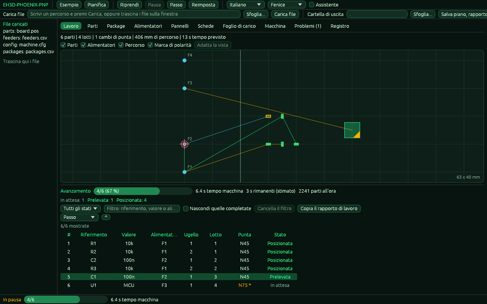

<p align="center">
  
</p>

# 📖 EH3D-PHOENIX-PNP

<p align="center"><a href="README.md">🇺🇸 English</a> | <a href="README_spa.md">🇪🇸 Español</a> | <a href="README_fra.md">🇫🇷 Français</a> | 🇮🇹 <b>Italiano</b> | <a href="README_deu.md">🇩🇪 Deutsch</a> | <a href="README_zho.md">🇨🇳 中文</a> | <a href="README_jpn.md">🇯🇵 日本語</a> | <a href="README_por.md">🇵🇹 Português</a></p>

### Assemblaggio pick and place: posizioni, alimentatori e ordine di posizionamento

<p align="center">
  
  
  
  
  
</p>

---

**Verifica di onestà - cosa funziona oggi:** una libreria Rust e un programma a riga di comando (`phoenix-pnp`) con 572 test che girano su un computer: legge il file delle posizioni di una scheda, assegna a ogni componente il suo alimentatore (con priorità, vassoi e strisce), legge le impostazioni della macchina da un file, pianifica l'ordine di posizionamento per una testa fino a sei ugelli (ranghi, punte degli ugelli, limiti d'angolo, tempo dei movimenti, pannelli), scrive un foglio di carico e, su una macchina simulata, esegue il piano passo dopo passo con guasti iniettati. Ha anche una finestra (compilata con `--features gui`) la cui logica è testata senza schermo; il disegno in sé non è coperto da test e, sebbene il programma acquisisca immagini della propria finestra (`--shot`), nessuna persona ha verificato il disegno su uno schermo. Non controlla nessuna macchina: non è stato provato su una macchina e non è stato verificato con una raccolta di file reali.

---

> **Stato di sicurezza:** questo programma non controlla alcuna macchina e non è un sistema di sicurezza. Ciò che produce deve essere controllato da una persona prima di eseguire qualsiasi cosa su una macchina; nulla di questo ha girato su hardware reale.


## 📋 In breve

| | |
|---|---|
| Versione | `0.0.7` |
| Maturità | Impalcatura |
| Test | 572 |
| Stack tecnologico | Rust |
| Su hardware reale | Non provato: nulla di questo ha girato su una macchina |

**Vai a:** [Panoramica](#-panoramica) · [Architettura](#-architettura) · [Avvio rapido](#-avvio-rapido) · [Test](#-test) · [Struttura](#-struttura-del-repository) · [Correlati](#-progetti-correlati)

## 🚦 Stato del progetto

Ogni riga è una parte di questo repository e il semaforo dice a che punto è oggi. È scritta in base a ciò che il repository può mostrare (test, compilazioni, esecuzioni), non a ciò che è previsto.

🟢 Fatto e verificato · 🟡 Funziona, con limiti noti · 🟠 Fatto a metà o non ancora verificato · 🔴 Non fatto o non funzionante

| Area | Stato | Cosa significa qui |
|---|---|---|
| Nucleo | 🟡 | legge il file delle posizioni di una scheda, assegna a ogni componente il suo alimentatore (priorità, vassoio, striscia), pianifica l'ordine di posizionamento per una testa fino a sei ugelli con ranghi, punte degli ugelli, limiti d'angolo e il tempo dei movimenti, pianifica pannelli e scrive il foglio di carico; provato su un computer con ingressi normali e danneggiati, non con una raccolta di file reali. |
| Riga di comando | 🟡 | `phoenix-pnp` esegue le stesse funzioni della libreria (`parts`, `check`, `plan`, `schedule`, `preflight`, `simulate`, `loadsheet`, `config-check`, `check-bottom`, `tables-check`, `recipe-check`, `import-centroid`, `vision-test`) e stampa il risultato; ogni errore torna come messaggio con il suo codice `PHOENIX-PNP-NNN` e un codice di uscita diverso da zero. |
| Test | 🟡 | 572 test passano (`cargo test`), con casi normali, casi limite, ingressi danneggiati e piccoli casi generati. |
| Configurazione della macchina | 🟡 | un file `chiave = valore` con versione, un validatore che nomina la riga e i limiti di sicurezza (corsa di Z, limiti di X e Y, nuovi tentativi, angoli dell'ugello); i valori non sono stati confrontati con una macchina reale. |
| Simulatore e lavoro | 🟡 | un orologio virtuale, guasti iniettati a caso (con un seme) o in un punto scelto, nuovi tentativi, le politiche allerta e rinvio, alimentatori che si spengono dopo guasti ripetuti, pausa, passo dopo passo e uno stato salvato da cui riprendere; simula soltanto, nulla ha mosso una macchina. |
| Sicurezza | 🟡 | Rust sicuro e semplice (`forbid(unsafe_code)`): nulla va in panico con i file ricevuti e un valore errato è un errore con il suo motivo; nessuna revisione indipendente. |
| Finestra | 🟠 | Una finestra egui (si compila con `--features gui`; `phoenix-pnp` senza comando la apre): schede di lavoro, parti, package, alimentatori, foglio di carico, macchina, problemi e registro, una mappa del tavolo di lavoro con il percorso della testa, marche di polarità e la parte successiva, una guida in cinque passi, problemi con correzioni che si possono annullare, un lavoro simulato che si può mettere in pausa, riprendere e avanzare passo dopo passo, e le otto lingue. La sua logica è testata senza schermo; il disegno non è coperto da test: il programma acquisisce immagini della propria finestra (`--shot`), ma nessuna persona ha verificato il disegno su uno schermo. Ha inoltre schede di pannelli (con i fiduciali e l'adattamento che sposta le parti) e di schede elettroniche, un selettore di file, tabelle di alimentatori e package modificabili con annulla, larghezze delle colonne memorizzate e un programma a sé (`phoenix-pnp-gui`) che si apre senza console su Windows. |
| Hardware reale | 🔴 | Non provato: nulla di questo è stato eseguito su una macchina. |
| Documentazione | 🟡 | README in otto lingue, il changelog e le due immagini disegnate da `docs/`. |

## 🎯 Panoramica

* **I componenti** (`src/parts.rs`): un file `.pos` di KiCad o un CSV (virgola o punto e virgola, virgolette, intestazione trovata per nome) con posizioni in mm, mil o pollici, gli angoli portati a 0-360, il lato superiore o inferiore, e ogni riga priva di senso è rifiutata con il suo numero; un riferimento ripetuto è un errore.
* **Componenti da non montare, le tabelle degli esempi e il rapporto di un lavoro** (`src/parts.rs`, `src/commands.rs`, `src/job.rs`): una colonna `dnp`, `do not place` o `fitted` in un CSV (o `--dnp R1,R2`) lascia componenti fuori dal piano, dal foglio di carico e dai controlli e li elenca nel rapporto; `tables-check` legge le tabelle (`--parts`, `--packages`, `--catalog`, `--feeders`, `--slots`) e indica il codice e la riga di ogni errore; `simulate --report-csv FILE` scrive le statistiche del lavoro come CSV la cui intestazione non cambia mai. `examples/` contiene una scheda con una colonna `dnp`, alimentatori di ogni tipo e una tabella di package comuni.
* **Gli alimentatori** (`src/feeders.rs`): un CSV di alimentatori (id, valore, contenitore, posizione di prelievo, pezzi rimasti); ogni componente riceve il primo alimentatore che contiene il suo valore e contenitore, senza distinguere le maiuscole; un componente senza alimentatore e un alimentatore che si esaurisce sono segnalati, e un secondo alimentatore dello stesso tipo subentra.
* **Il piano** (`src/plan.rs`): i posti si percorrono al più vicino e si tagliano in lotti da uno a sei ugelli, gli alimentatori di un lotto si visitano al più vicino, il lato inferiore è specchiato rispetto alla larghezza della scheda, e il piano dà il percorso e una stima del tempo; si scrive come lavoro JSON.
* **Le tabelle e le impostazioni** (`src/catalog.rs`, `src/config.rs`, `src/rotation.rs`): tabelle di parti e package i cui valori si ereditano (parte, poi package, poi i valori predefiniti), un file di configurazione della macchina nel formato `chiave = valore` (`examples/machine.cfg` documenta ogni chiave), più nomi per le colonne di un CSV di posizioni e correzioni della rotazione per package.
* **Gli alimentatori con più di un nastro** (`src/feeding.rs`): priorità, vassoi, strisce e alimentatori spenti; l'alimentatore di un componente si sceglie allo stesso modo qualunque sia l'ordine dei file.
* **Il pianificatore della macchina** (`src/planner.rs`, `src/motion.rs`): ranghi (blocchi posizionati uno dopo l'altro), strategie d'ordine, punte degli ugelli e i loro cambi, i limiti dell'angolo dell'ugello, il tempo dei movimenti con accelerazione e jerk, percorsi più corti (2-opt) e la correzione dell'origine di un componente.
* **Pannelli, foglio di carico ed esportazioni** (`src/panel.rs`, `src/loadsheet.rs`, `src/export.rs`): schede e pannelli dentro pannelli, lo slot di ogni tipo di nastro, un rapporto, l'elenco di ciò che manca e un G-code che sposta solo la testa.
* **Fiduciali di un pannello** (`src/fiducial.rs`): le posizioni misurate dei segni vengono adattate a quelle progettate (una similitudine con due segni, un adattamento affine con tre o più) e le parti del pannello vengono spostate e ruotate dall'adattamento; ogni segno ha il suo residuo, e un adattamento che manca un segno di più di `fiducial_max_residual_mm` viene rifiutato (`--fiducials FILE` con `--panel`, o la scheda Pannelli della finestra).
* **Schede segnate come difettose (X-out) e marche a due livelli** (`src/marks.rs`, `src/panel.rs`): un figlio del file del pannello con `"x_out": true`, o `--x-out A,B/C`, viene lasciato fuori con tutto ciò che contiene; il piano, il foglio di carico e i controlli non lo vedono, e un nome che nessuna scheda ha (`PHOENIX-PNP-042`) o un pannello con tutte le schede escluse (`PHOENIX-PNP-043`) è un errore. Un componente di una scheda il cui valore o package contiene una parola di `fiducial_words`, o il cui riferimento è un prefisso di `fiducial_refs` seguito da un numero (`FID1`), è una marca della sua scheda e non viene posizionato; il file di `--fiducials` può allora nominare le marche del pannello (`f1`) e delle schede (`A/FID1`): le marche di una scheda si adattano insieme e spostano solo i componenti di quella scheda, e i componenti delle schede senza marche misurate seguono l'adattamento del pannello. Simulato: nessuna scheda è mai stata misurata su una macchina; la finestra non usa ancora le marche delle schede.
* **Altro dal pianificatore e dal simulatore:** l'ordine in cui si svuotano le celle di un vassoio (righe, colonne o serpentina), una ricerca dell'ordine delle punte dell'ugello che conta il percorso e il viaggio al cambio punta (`tip_strategy = optimize`, limitata da `tip_opt_max_evals` e `tip_opt_time_limit_s`), probabilità di guasto per package e per alimentatore (`sim_part_fail`, `sim_feeder_fail`) con statistiche per package e per alimentatore e le parti all'ora, e `check-bottom`, che mostra l'angolo che dà ogni regola del lato inferiore.
* **Il passo di allineamento** (`src/job.rs`, `src/sim.rs`, `src/model.rs`): con `align = on` il lavoro guarda ogni componente con la telecamera dopo il prelievo e corregge il posizionamento in base a ciò che vede (la testa va al punto meno lo scostamento del componente, e l'ugello ruota meno della rotazione del componente); `pick_tolerance_mm` scarta un componente più fuori posto, che viene prelevato di nuovo come dice `error_policy`; `align_passes` (da 1 a 5) e `align_settle_s` fissano gli sguardi e l'attesa prima di ciascuno, che si sommano al tempo del piano; la telecamera simulata ha uno scostamento, un errore e guasti iniettabili (`sim_align_*`, `sim_camera_fail_rate`); e la correzione (media, massima, componenti scartati) compare nel testo, nel rapporto JSON e nelle righe `align` di `--report-csv`. Spento per impostazione predefinita: un lavoro è allora quello di sempre. Non provato su una macchina.
* **La catena di visione** (`src/vision.rs`, `src/sim.rs`, `examples/vision.cfg`): con `vision = pipeline` la telecamera simulata disegna in memoria un'immagine del componente (la sua dimensione, la sua rotazione e quanto è lontano dall'ugello, con un rumore tratto da `sim_seed`) e la misura con i passi di un file di impostazioni (`--vision FILE`): una maschera, un filtro mediano, una soglia fissa o di Otsu, un intervallo di area per la macchia e il rettangolo ruotato più piccolo, il cui centro e angolo sono lo scostamento che il passo di allineamento corregge. Un componente non trovato, una macchia di area sbagliata e più macchie sono osservazioni senza misura, ognuna con il suo codice (da `PHOENIX-PNP-037` a `PHOENIX-PNP-039`). `phoenix-pnp vision-test` disegna un componente con la dimensione, la rotazione, lo scostamento e il rumore che gli si danno e stampa quanto misurato con il suo errore. Disattivato per impostazione predefinita: un lavoro è allora quello di sempre. Non provato con una telecamera reale.
* **Il rapporto di lavoro** (`src/report.rs`, `src/job.rs`): dopo un lavoro simulato, `simulate` può scrivere il rapporto come testo nella lingua di `--lang` (`--report-text`), come pagina HTML che contiene tutto, senza script né nulla dall'esterno, e che non viene mai scritta sopra un file esistente (`--report-html`), come sezioni aggiunte dopo le righe del CSV (`--report-csv`, l'intestazione non cambia) e come `work` nel JSON (`--report`). Dice quanti componenti sono stati posizionati, messi da parte, saltati dalla persona, ancora in attesa o da non montare; dove è andato il tempo macchina (alimentare e prelevare, osservazioni della telecamera, posizionamenti, spostamenti della testa, cambi di punta); quanti prelievi sono riusciti al primo tentativo; lo stesso per package, alimentatore, ugello, punta e scheda di un pannello; gli errori avvenuti con i loro codici; gli avvisi prima del lavoro; e un istogramma di ciò che la telecamera ha corretto (X, Y e rotazione). Simulato: nulla di questo è stato misurato su una macchina.
* **La scheda Lavoro e le decisioni della persona** (`src/gui/jobtab.rs`, `src/gui/window.rs`, `src/job.rs`): la tabella mostra lo stato di ogni posizionamento (in attesa, prelevato, allineato, posizionato, messo da parte, saltato, fallito) e i componenti da non montare, una barra di avanzamento con il tempo macchina e una stima del tempo rimanente, e filtri per stato, per testo e per ciò che è fatto. Quando un errore ferma il lavoro, una finestra indica il passo fallito e offre quattro azioni eseguite sul lavoro simulato, che poi prosegue: riprovare, saltare il componente, metterlo da parte o spegnere l'alimentatore perché ne subentri un altro dello stesso tipo. Ogni decisione è contata nel rapporto. La logica non ha bisogno dello schermo ed è testata; nessuna persona ha verificato il disegno su uno schermo (le immagini di questa scheda in `images/screens/` sono acquisite dal programma stesso).
* **Il vuoto, gli attuatori e la finestra dei guasti di un alimentatore** (`src/sim.rs`, `src/job.rs`, `src/config.rs`): con `vacuum = on` la pompa simulata aspira per `vacuum_suck_s` secondi dopo ogni prelievo e si legge il livello dell'ugello (kilopascal); un livello sotto `vacuum_pick_min_kpa` significa che l'ugello non tiene alcun componente (`PHOENIX-PNP-044`, e il prelievo si ripete come dicono i tentativi) e, dopo il soffio di `vacuum_blow_s` secondi a ogni posizionamento, un livello sopra `vacuum_release_max_kpa` significa che il componente è ancora attaccato all'ugello (`PHOENIX-PNP-045`). Il sensore ha un generatore proprio (`sim_vacuum_noise_kpa`, `sim_vacuum_miss_rate`, `sim_vacuum_stuck_rate`) ed è spento per impostazione predefinita, quindi un lavoro senza di esso è esattamente quello che era. I dispositivi on/off si dichiarano con `actuator = NOME : RITARDO_S` e si commutano con `Job::set_actuator`, che aggiunge il loro ritardo all'orologio (`PHOENIX-PNP-046` per un nome che la macchina non ha). Con `fault_action = alert`, un alimentatore che raggiunge `fault_limit` guasti tra i suoi ultimi `fault_window` prelievi non si spegne più da solo: il lavoro si ferma (`PHOENIX-PNP-047`) e la finestra di dialogo della scheda Job offre di riprovare, escludere il componente, metterlo da parte o spegnere l'alimentatore.
* **Il modello della telecamera, le teste della macchina e le punte di un package** (`src/camera.rs`, `src/heads.rs`, `src/tips.rs`, `src/config.rs`): la telecamera è descritta da `camera_units_per_px` (0 è la dimensione per cui è regolata la visione), `camera_offset_x_mm` e `camera_offset_y_mm` (dove si trova l'asse dell'ugello nell'immagine), `camera_rotation_deg`, `camera_flip_x` e `camera_flip_y`, e dall'obiettivo (`camera_lens_scale`, `camera_lens_k1`); la telecamera simulata del passo di allineamento legge il componente attraverso di essa, con o senza immagine, e con i valori predefiniti un lavoro è esattamente quello che era. `head = NOME : UGELLI [: SCOST_X : SCOST_Y : CAM_X : CAM_Y : CAM_ROT : CAM_UNITÀ : CAM_OBIETTIVO]` dichiara fino a quattro teste, ciascuna con i suoi ugelli, il suo scostamento e la sua telecamera; con due o più teste `schedule` assegna ogni componente a una testa che lo raggiunge (`PHOENIX-PNP-048` se nessuna lo raggiunge), pianifica ogni testa e conta, sull'orologio della macchina, il tempo che una testa attende un alimentatore usato da un'altra. `tip_compat = MODELLO : PUNTA, PUNTA, ...` elenca le punte che un package accetta e `tip_compat_mode` (`fewest_changes` o `preferred`) sceglie una punta per ogni tipo di componente in modo che la macchina cambi punta il minor numero di volte possibile; una punta indicata nelle tabelle viene mantenuta.
* **Ricette** (`src/recipe.rs`, `src/job.rs`, `src/commands.rs`): un file di testo con una versione (`examples/job.recipe`) fissa i passi che un lavoro attraversa (`prepare`, `pick`, `align`, `place` e `check`, in questo ordine e nessuno due volte; il passo di allineamento e il controllo del vuoto sono attivi solo se la ricetta li ha) e i parametri che cambiano per un package, un alimentatore o una punta (`pick_retries`, `pick_tolerance_mm`, `vacuum_suck_s` e `vacuum_blow_s`; per ogni chiave vince la prima regola che corrisponde, prima quelle degli alimentatori, poi quelle dei package e infine quelle delle punte). `phoenix-pnp recipe-check FILE` la legge e la controlla, e `simulate ... --recipe FILE` esegue il lavoro con essa. I suoi errori hanno i codici da `PHOENIX-PNP-049` a `PHOENIX-PNP-052` (una riga non valida, passi in ordine sbagliato, un file oltre i suoi limiti, una versione troppo recente) e i limiti sono le chiavi `recipe_max_bytes` e `recipe_max_rules` di `machine.cfg`. Uno stato salvato ricorda anche l'alimentatore dell'ultimo prelievo e il prelievo che si è fermato, così un lavoro caricato in un'altra esecuzione offre alla persona le stesse decisioni (uno stato più vecchio si carica ancora).
* **Importazione di file di posizioni** (`src/import.rs`, `src/commands.rs`): `phoenix-pnp import-centroid FILE` legge un CSV di centroidi (`--map FILE` ne nomina le colonne, `examples/centroid.map`; `examples/centroid.csv` non ha bisogno di mappa), il testo di posizioni di EAGLE (`examples/board.mnt`: nome, x, y, rotazione `R90` o `MR90` per il lato inferiore, valore, package) o il `.pos` di KiCad (`--format auto|csv|eagle|kicad-pos`; `auto` li distingue dalla prima riga) e scrive la tabella dei componenti `ref,val,package,x,y,rot,side,dnp` in millimetri in `--out` (un file che esiste non viene mai sovrascritto: `PHOENIX-PNP-040`) o sullo standard output. Le unità sono mm, mil o pollici (nell'intestazione come `X (mil)`, nella cella come `0.5in`, in un commento come `## Unit = inch`, nella mappa o in `import_unit`); gli angoli escono da 0 a 360; la colonna del lato è facoltativa; una colonna `dnp` o `fitted` (o `--dnp R1-R5,C7` con intervalli di riferimenti) segna i componenti da non montare; `import_bottom_mirror_width_mm` specchia la X del lato inferiore e `bottom_rotation` ne ruota l'angolo. I tre lettori sono del programma (nessun altro repository ha un lettore utilizzabile senza aggiungere una dipendenza) e la disposizione del testo di EAGLE non è stata confrontata con un file scritto da un'installazione reale. Ogni errore ha un codice da `PHOENIX-PNP-053` a `PHOENIX-PNP-056` (una riga non valida, un'intestazione senza una colonna della mappa, un formato sconosciuto, un intervallo di riferimenti non valido) e il numero della riga.
* **Il simulatore e il lavoro** (`src/sim.rs`, `src/job.rs`, `src/preflight.rs`, `src/model.rs`): i controlli prima di un lavoro, una macchina con orologio virtuale e guasti iniettabili, e un lavoro che si può mettere in pausa, eseguire passo dopo passo, salvare e riprendere.
* **La finestra** (`src/gui.rs`, `src/gui/`): ciò che la finestra fa oltre a disegnare non ha bisogno di schermo (i file caricati, il piano e i suoi problemi con correzioni, il lavoro simulato, la geometria della mappa, le tabelle con selezione condivisa, la guida in cinque passi e i testi in otto lingue) ed è testato; solo `src/gui/window.rs`, compilato con `--features gui`, lo disegna con egui. La velocità della simulazione, il tema e la dimensione disegnata per una parte di package sconosciuto sono chiavi di `machine.cfg` (`gui_steps_per_s`, `gui_theme`, `gui_part_size_mm`).

## 🧩 Ruolo in EH3D

EH3D-PHOENIX-PNP è un programma della EH3D Fabrication Suite. Oggi funziona come libreria, riga di comando e finestra (compilata con `--features gui`); la finestra non ha ancora l'aspetto comune agli altri programmi della suite. Legge e scrive file semplici, quindi può essere usato da solo o tra gli altri programmi.

## 🏛️ Architettura

<p align="center">
  
</p>


Come si incastrano le parti di questo repository: chi lo usa, cosa contiene e da cosa dipende. L'immagine è disegnata da `docs/architecture.json` e verificata con il codice.

## ✨ Funzionalità

* **Libreria e riga di comando:** ogni comando di `phoenix-pnp` è una funzione della libreria, così un altro programma della suite può chiamarla senza avviare un processo.
* **Riga di comando rigorosa:** un'opzione scritta male (`--powr`) o una parola in più è un errore che la nomina, non qualcosa da ignorare; altrimenti il programma farebbe la sua uscita con i valori predefiniti.
* **Test con input danneggiati:** i test forniscono anche file vuoti, spazzatura, numeri enormi e file tagliati, e nessuno può andare in panico.
* **Nessuna ipotesi:** un valore privo di senso è un errore che dice quale e perché, mai un risultato che sembra solo giusto.
* **Nessun codice unsafe:** `#![forbid(unsafe_code)]` nella libreria e nel programma.
* **Un solo lettore per le due tabelle, e veloce su una scheda grande:** il file delle posizioni e quello degli alimentatori sono letti dallo stesso lettore (virgola o punto e virgola, campi tra virgolette con un delimitatore o un a capo), cinquantamila componenti sono controllati, assegnati e pianificati in un attimo, il piano non viene mai scritto su un file da cui è stato ricavato, un'opzione sconosciuta è un errore e `--origin-x` dice dove si trova il bordo sinistro della scheda quando si specchia il lato inferiore.

## 🔒 Sicurezza e protezione

| Minaccia | Difesa |
|---|---|
| Un file danneggiato, tagliato o vuoto | nessun panico: i test tagliano un input valido in ogni posizione e forniscono spazzatura |
| Un numero privo di senso (negativo, non finito, assurdamente grande) | rifiutato con un errore che nomina il valore; nulla viene arrotondato in qualcosa di plausibile |
| Uso non sicuro della memoria | Rust sicuro e semplice con `forbid(unsafe_code)` |

**Cosa non è difeso:** un risultato prodotto senza errori non è un risultato verificato. Nulla qui conosce i limiti di una macchina e il programma non ha avuto revisione indipendente. Segnalate una vulnerabilità in privato (vedi [SECURITY.md](SECURITY.md)).

## 🔌 Interfacce

La libreria è `eh3d_phoenix_pnp` (`use eh3d_phoenix_pnp::...`); la riga di comando è `phoenix-pnp`. I comandi sono questi; ciascuno stampa il risultato sull'output standard e segnala un errore sull'output di errore con un codice di uscita diverso da zero. Non c'è accesso alla rete.

```text
phoenix-pnp [gui [FILES...]]                             la finestra (compilata con --features gui)
phoenix-pnp parts PARTS                                  i componenti di un file di posizioni, in millimetri
phoenix-pnp check PARTS FEEDERS                          i componenti senza alimentatore e gli alimentatori che si esauriranno
phoenix-pnp plan PARTS FEEDERS OUT.json                  il piano semplice, come lavoro JSON
phoenix-pnp schedule PARTS FEEDERS OUT.json              il piano con tutta la configurazione, pannelli e fiduciali
phoenix-pnp preflight PARTS FEEDERS                      i controlli prima di un lavoro
phoenix-pnp simulate PARTS FEEDERS                       il lavoro su una macchina simulata, con i suoi rapporti
phoenix-pnp loadsheet PARTS SLOTS OUT.csv                il foglio di carico
phoenix-pnp config-check FILE                            se un file di configurazione è valido
phoenix-pnp check-bottom PARTS                           l'angolo che dà ogni regola della faccia inferiore
phoenix-pnp tables-check [--parts F] [--feeders F] ...   se ogni tabella è valida, con il codice e la riga
phoenix-pnp recipe-check FILE                            se una ricetta è valida, con il codice e la riga
phoenix-pnp import-centroid FILE [--map F] [--out F]     un file di posizioni di un CAD come tabella dei componenti
phoenix-pnp vision-test [--turn DEG] [--dx MM] ...       misura l'immagine di un componente creata in memoria
```

`phoenix-pnp help` elenca tutte le opzioni. Le opzioni comuni a `schedule`, `preflight`, `simulate` e `loadsheet` sono `--config`, `--packages`, `--catalog`, `--panel`, `--fiducials`, `--x-out`, `--dnp`, `--side`, `--board-width`, `--origin-x`, `--nozzles`, `--speed`, `--order` e `--lang`; `--shot` e le sue compagne acquisiscono un'immagine della finestra (vedi l'avvio rapido).

## ⚙️ Configurazione

La macchina e il pianificatore si configurano con un file di testo di righe `chiave = valore` (`--config FILE`), lo stesso formato degli altri programmi della suite; `examples/machine.cfg` elenca ogni chiave con il suo valore predefinito e ciò che fa. Una chiave mancante mantiene il valore predefinito; una chiave sconosciuta, scritta due volte o fuori dal suo intervallo è un errore che nomina la riga. Le opzioni della riga di comando (`--nozzles`, `--speed`, `--order`, `--side`) prevalgono sul file.

Anche le colonne che segnano un componente come da non montare e le parole che usano sono impostazioni: `header_dnp` e `header_fitted` aggiungono nomi della colonna, `dnp_yes_words` e `dnp_no_words` aggiungono parole per sì e no. Una colonna chiamata `dnp`, `do not place`, `do not populate`, `do not mount`, `do_not_place`, `not fitted` o `no montar` esclude il componente con un sì (`yes`, `y`, `true`, `1`, `x`); una chiamata `fitted`, `populate`, `populated`, `mount`, `mounted` o `montar` lo esclude con un no (`no`, `n`, `false`, `0`, `-`); una cella vuota monta il componente e qualsiasi altra parola è un errore che nomina la riga.

Anche i componenti che sono marche della loro scheda sono impostazioni: `fiducial_words` (predefinito `fiducial`) e `fiducial_refs` (predefinito `fid, fd`); una lista vuota disattiva la regola.

Le tabelle di package e parti (`--packages`, `--catalog`) sono file CSV in cui una cella vuota eredita; un pannello (`--panel`) è un file JSON; gli slot della macchina (`loadsheet`) sono un CSV con `id,x,y,max_width_mm`. Un file più grande di `max_file_bytes` viene rifiutato. Ogni errore ha un codice `PHOENIX-PNP-NNN`; il suo messaggio è scritto nella lingua della chiave `language` o di `--lang` (`en`, `es`, `de`, `fr`, `it`, `ja`, `zh` o `pt`):

| Codice | Significato |
|---|---|
| `PHOENIX-PNP-001` | Il file supera la dimensione consentita |
| `PHOENIX-PNP-002` | Ci sono più parti di quante ne consenta il limite |
| `PHOENIX-PNP-003` | Una riga della configurazione non è chiave = valore |
| `PHOENIX-PNP-004` | La configurazione contiene una chiave sconosciuta |
| `PHOENIX-PNP-005` | Un valore della configurazione non è valido |
| `PHOENIX-PNP-006` | Un valore della configurazione è fuori dal suo intervallo |
| `PHOENIX-PNP-007` | La configurazione è stata scritta per una versione più recente del programma |
| `PHOENIX-PNP-008` | Una chiave della configurazione è scritta due volte |
| `PHOENIX-PNP-009` | Un'impostazione supera i limiti di sicurezza |
| `PHOENIX-PNP-010` | Una riga della tabella di parti o package non è valida |
| `PHOENIX-PNP-011` | Una parte o un package è definito due volte |
| `PHOENIX-PNP-012` | Una regola di correzione della rotazione non è valida |
| `PHOENIX-PNP-013` | Una riga degli alimentatori non è valida |
| `PHOENIX-PNP-014` | Il file del pannello non è valido |
| `PHOENIX-PNP-015` | Il pannello è annidato troppo in profondità o ha troppe schede |
| `PHOENIX-PNP-016` | La tabella degli slot non è valida |
| `PHOENIX-PNP-017` | Un'impostazione del piano non è valida |
| `PHOENIX-PNP-018` | L'ugello non può ruotare a quell'angolo entro i suoi limiti |
| `PHOENIX-PNP-019` | L'ugello tiene già una parte: non può prenderne un'altra |
| `PHOENIX-PNP-020` | L'ugello non tiene nessuna parte da posizionare |
| `PHOENIX-PNP-021` | Nessun alimentatore è disponibile per la parte |
| `PHOENIX-PNP-022` | Non è stato possibile prelevare la parte dopo tutti i tentativi |
| `PHOENIX-PNP-023` | L'alimentatore non è riuscito ad avanzare dopo tutti i tentativi |
| `PHOENIX-PNP-024` | Non è stato possibile posizionare la parte dopo tutti i tentativi |
| `PHOENIX-PNP-025` | Lo stato salvato appartiene a un altro lavoro |
| `PHOENIX-PNP-026` | Lo stato salvato del lavoro non è valido |
| `PHOENIX-PNP-027` | Il lavoro è in pausa, terminato o fermato da un errore |
| `PHOENIX-PNP-028` | I controlli prima del lavoro hanno trovato errori |
| `PHOENIX-PNP-029` | Una lunghezza o un angolo non è valido |
| `PHOENIX-PNP-030` | Il driver non ha accettato il comando |
| `PHOENIX-PNP-031` | Il simulatore ha iniettato un guasto |
| `PHOENIX-PNP-032` | I fiduciali non sono validi o non danno una posizione |
| `PHOENIX-PNP-033` | Un segno di montaggio non è né sì né no, oppure un riferimento da escludere non è noto |
| `PHOENIX-PNP-034` | Il file delle posizioni non è valido |
| `PHOENIX-PNP-035` | La telecamera ha trovato il componente più spostato di quanto consenta la tolleranza |
| `PHOENIX-PNP-036` | La telecamera non ha fornito alcuna misura del componente |
| `PHOENIX-PNP-037` | La visione non ha trovato il componente nell'immagine |
| `PHOENIX-PNP-038` | La macchia trovata nell'immagine ha un'area fuori dall'intervallo consentito |
| `PHOENIX-PNP-039` | La visione ha trovato più di una macchia che potrebbe essere il componente |
| `PHOENIX-PNP-040` | Il file del rapporto esiste già e non viene sovrascritto |
| `PHOENIX-PNP-041` | L'azione non è adatta allo stato del lavoro |
| `PHOENIX-PNP-042` | Una scheda segnata come difettosa (X-out) non è nel pannello |
| `PHOENIX-PNP-043` | Tutte le schede del pannello sono segnate come difettose (X-out): non resta nulla da posizionare |
| `PHOENIX-PNP-044` | Il vuoto non mostra alcuna parte sull'ugello dopo il prelievo |
| `PHOENIX-PNP-045` | Il vuoto mostra che la parte è ancora sull'ugello dopo il posizionamento |
| `PHOENIX-PNP-046` | La macchina non ha nessun attuatore con quel nome |
| `PHOENIX-PNP-047` | Un alimentatore ha troppi errori tra gli ultimi prelievi: decide la persona |
| `PHOENIX-PNP-048` | Nessuna testa della macchina raggiunge il componente |
| `PHOENIX-PNP-049` | Una riga della ricetta non è valida |
| `PHOENIX-PNP-050` | I passi della ricetta non seguono l'ordine del lavoro |
| `PHOENIX-PNP-051` | La ricetta supera i limiti consentiti |
| `PHOENIX-PNP-052` | La ricetta è stata scritta per una versione più recente del programma |
| `PHOENIX-PNP-053` | Una riga del file delle posizioni non è valida |
| `PHOENIX-PNP-054` | La mappa delle colonne, o l'intestazione a cui si applica, non fornisce le colonne necessarie |
| `PHOENIX-PNP-055` | Il formato del file delle posizioni non è noto |
| `PHOENIX-PNP-056` | Un intervallo di riferimenti non è valido |

## 🚀 Avvio rapido

Serve una toolchain Rust stabile (1.95 o più recente).

```bash
cargo build --release
cargo test
cargo run --release -- plan examples/board.pos examples/feeders.csv examples/plan.json --nozzles 2
cargo run --release -- schedule examples/board.pos examples/feeders.csv examples/schedule.json --config examples/machine.cfg --packages examples/packages.csv --catalog examples/catalog.csv
cargo run --release -- simulate examples/board.pos examples/feeders.csv --config examples/machine.cfg --state examples/job_state.json --steps 5
cargo run --release -- loadsheet examples/board.pos examples/slots.csv examples/loadsheet.csv --packages examples/packages.csv
cargo run --release -- check-bottom examples/board.pos
cargo run --release -- schedule examples/board_dnp.csv examples/feeders.csv examples/schedule_dnp.json --config examples/machine.cfg --packages examples/packages.csv --catalog examples/catalog.csv
cargo run --release -- tables-check --parts examples/board_dnp.csv --packages examples/packages_common.csv --feeders examples/feeders_kinds.csv --slots examples/slots.csv --config examples/machine.cfg
cargo run --release -- simulate examples/board.pos examples/feeders.csv --config examples/machine.cfg --report-csv examples/job_report.csv
cargo run --release -- simulate examples/board.pos examples/feeders.csv --config examples/machine.cfg --report-text examples/job_report.txt --report-html examples/job_report.html
cargo run --release -- schedule examples/feeders.csv examples/schedule_panel.json --panel examples/panel.json --fiducials examples/marks.csv --config examples/machine.cfg
cargo run --release -- schedule examples/feeders.csv examples/schedule_xout.json --panel examples/panel.json --x-out B --config examples/machine.cfg
cargo run --release -- vision-test --vision examples/vision.cfg --turn 30 --dx 0.5 --dy -0.3
cargo run --release -- import-centroid examples/centroid_custom.csv --map examples/centroid.map --out examples/parts_from_centroid.csv
cargo run --release -- import-centroid examples/board.mnt --dnp R1-R2
cargo run --release --features gui -- --shot screen.png examples/board.pos examples/feeders.csv examples/machine.cfg   # a picture of the window
cargo run --release --features gui -- --shot job.png --window job --steps 9 examples/board.pos examples/feeders.csv examples/machine.cfg   # the Job tab with the job on its way
cargo run --release --features gui
```

Per fare un'immagine della finestra senza aprirla a mano, eseguila con `--shot FILE.png` (anche `--size WxH`, `--theme phoenix|light|contrast`, `--wait N`, `--window TAB`, `--steps N`, `--lang CODE`, `--open FILE`, `--replace`): si apre con quella dimensione, salva il PNG, non conserva impostazioni e si chiude da sola (codice di uscita 0 se il file è stato scritto, 1 se no, 2 per argomenti errati). `--window` sceglie la scheda dell'immagine (`job`, `parts`, `packages`, `feeders`, `panels`, `boards`, `loadsheet`, `machine`, `problems` o `log`) e `--steps N` esegue N passi del lavoro simulato prima di scattarla, così la scheda Lavoro mostra un lavoro in corso.

<p align="center">
  
</p>

L'ultima riga apre la finestra; lo fa anche `phoenix-pnp` senza comando se è stato compilato con `--features gui` (su Linux la finestra richiede i file di sviluppo di X11 o Wayland e di OpenGL). Con un comando il programma resta una riga di comando. Su Windows, `phoenix-pnp-gui` (compilato con la stessa feature) apre la finestra senza console; vedi `docs/windows-console.md`.

## 🧪 Test

La suite ha 572 test (`cargo test`, eseguiti su Windows e Linux nella CI). Verificano i casi normali, i casi limite e gli ingressi danneggiati: file vuoti, spazzatura e file tagliati non provocano mai un panic. Piccoli casi generati (da un seme fisso, quindi con gli stessi numeri a ogni esecuzione) verificano che il piano non dipenda dall'ordine dei file, che un percorso non si allunghi mai, che un lavoro salvato e ripreso in qualsiasi punto finisca come quello che non si è mai fermato, e che lunghezze e angoli si convertano avanti e indietro. La CI esegue anche `cargo fmt --check`, `cargo clippy` con gli avvisi come errori e `python -I tools/ci_validate.py`.

## 🏗️ Compilazione e rilascio

La versione sta in `Cargo.toml` e in `eh3d.project.json`; ogni versione ha la sua voce in [CHANGELOG.md](CHANGELOG.md). `build.bat` / `build.sh` compilano il programma, `test.bat` / `test.sh` eseguono i test e `run.bat` / `run.sh` lo eseguono con un esempio. Le versioni sono pubblicate su GitHub.

## 📂 Struttura del repository

<p align="center">
  
</p>

<details>
<summary>Versione testuale dell'albero</summary>

```text
EH3D-PHOENIX-PNP/
├── src/
│   ├── camera.rs                                il modello di una telecamera: dimensione del pixel, scostamenti, rotazione, specchio e obiettivo
│   ├── catalog.rs                               le tabelle di parti e package e l'ereditarietà delle loro proprietà
│   ├── cli_args.rs                              gli argomenti della riga di comando, rigorosi: un'opzione sconosciuta è un errore
│   ├── commands.rs                              i comandi con configurazione, tables-check e check-bottom
│   ├── config.rs                                il file di configurazione della macchina: chiavi, intervalli e limiti di sicurezza
│   ├── error.rs                                 i codici di errore PHOENIX-PNP-NNN e il loro significato in otto lingue
│   ├── export.rs                                il rapporto, l'elenco di ciò che manca e il G-code dei movimenti
│   ├── feeders.rs                               una parte della logica
│   ├── feeding.rs                               alimentatori con priorità, vassoi e strisce, e la scelta dell'alimentatore per un componente
│   ├── fiducial.rs                              fiduciali di un pannello: l'adattamento dei fiduciali misurati e la correzione delle parti
│   ├── gui.rs                                   la finestra: moduli senza schermo e il disegno in window.rs
│   ├── gui/app.rs                               lo stato della finestra: carica, pianifica, avvia, pausa, passo, correggi, salva
│   ├── gui/browse.rs                            il selettore di file: cartelle e file, su, percorsi digitati
│   ├── gui/jobtab.rs                            la scheda Lavoro senza finestra: stati, filtri, avanzamento, finestra d'errore
│   ├── gui/log.rs                               il registro con livelli e il testo della diagnostica da copiare
│   ├── gui/problems.rs                          i problemi di un lavoro e le correzioni che li risolvono
│   ├── gui/samples.rs                           esempi, dalla scheda piccola a quella grande
│   ├── gui/session.rs                           il lavoro simulato che si avvia, mette in pausa, riprende e avanza passo dopo passo
│   ├── gui/settings.rs                          ciò che la finestra ricorda: lingua, tema, livelli, cartelle e la larghezza delle colonne
│   ├── gui/shot.rs                              la modalità immagine della finestra (--shot): i suoi argomenti
│   ├── gui/tables.rs                            le righe, l'ordinamento e la selezione condivisa dalle tabelle
│   ├── gui/texts.rs                             ogni parola della finestra nelle otto lingue
│   ├── gui/theme.rs                             i colori: verde fenice, chiaro e alto contrasto
│   ├── gui/view.rs                              la geometria della mappa: corpi, marche di polarità, adattamento, zoom e selezione
│   ├── gui/window.rs                            il disegno con egui, compilato con la feature gui: schede, mappa e tabelle
│   ├── gui/wizard.rs                            la guida in cinque passi, da zero a un lavoro simulato
│   ├── gui/workspace.rs                         i file caricati, il piano e le modifiche, senza finestra
│   ├── gui_main.rs                              la finestra come programma a sé, senza console su Windows
│   ├── heads.rs                                 più teste: raggio d'azione, ripartizione dei componenti, attese di un alimentatore
│   ├── import.rs                                l'importazione di posizioni: CSV di centroidi con mappa delle colonne, testo di EAGLE, .pos di KiCad
│   ├── job.rs                                   il lavoro: passi, pausa, nuovi tentativi, politiche, statistiche e stato salvato
│   ├── lib.rs                                   la libreria: ciò che usa ogni comando
│   ├── loadsheet.rs                             il foglio di carico: lo slot di ogni tipo di nastro
│   ├── main.rs                                  la riga di comando e l'ingresso della finestra quando gira senza comando
│   ├── marks.rs                                 marche a due livelli: i componenti che sono marche e l'adattamento del pannello e di ogni scheda
│   ├── model.rs                                 le parti di una macchina come trait: macchina, ugello, alimentatore, attuatore, telecamera, driver
│   ├── motion.rs                                il tempo di un movimento, con accelerazione e jerk
│   ├── panel.rs                                 pannelli: schede e pannelli dentro pannelli, ciascuno al suo posto
│   ├── parts.rs                                 il file delle posizioni e le parti da non montare
│   ├── plan.rs                                  una parte della logica
│   ├── planner.rs                               il pianificatore che conosce la macchina: ranghi, ordine, punte e la loro ricerca, angoli e tempo
│   ├── preflight.rs                             i controlli prima di un lavoro, con una gravità e ciò a cui puntano
│   ├── recipe.rs                                la ricetta di un lavoro: il suo file, i suoi passi e i parametri per package, alimentatore e punta
│   ├── report.rs                                il rapporto di lavoro: fasi, prelievi, gruppi, errori; testo, HTML, CSV, JSON
│   ├── rotation.rs                              correzioni della rotazione per package, e come ruota un ugello limitato
│   ├── sim.rs                                   la macchina simulata: orologio virtuale e guasti iniettabili
│   ├── tips.rs                                  le punte che un package accetta e la scelta di una per ogni tipo di componente
│   ├── units.rs                                 lunghezze e posizioni che portano la loro unità
│   └── vision.rs                                la catena di visione: filtro, soglia, macchie, rettangolo ruotato minimo
├── tests/
│   ├── align.rs                                 test del passo di allineamento: telecamera, posizione corretta, tolleranza e tempo
│   ├── camera.rs                                test del modello della telecamera, delle telecamere delle teste e della telecamera del simulatore
│   ├── commands.rs                              test dei comandi che usano la configurazione
│   ├── feeding.rs                               test degli alimentatori: priorità, vassoi e strisce
│   ├── gui.rs                                   test della finestra senza schermo: stato, piano, lavoro, mappa, tabelle e guida
│   ├── heads.rs                                 test delle teste: righe della configurazione, raggio d'azione, ripartizione, l'orologio e schedule
│   ├── import.rs                                test dell'importazione: formati, unità, lato inferiore, DNP, intervalli, errori con la riga
│   ├── job.rs                                   test del lavoro: passi, nuovi tentativi e stato salvato
│   ├── jobtab.rs                                test della scheda Lavoro senza schermo: stati, filtri, avanzamento, finestra
│   ├── loadsheet.rs                             test del foglio di carico e delle esportazioni
│   ├── marks.rs                                 test delle schede segnate come difettose, dei componenti che sono marche e delle marche a due livelli
│   ├── model.rs                                 test del modello dei dati: codici, lunghezze, configurazione e tabelle
│   ├── more.rs                                  altri test della libreria e della riga di comando
│   ├── panel.rs                                 test dei pannelli e dei loro fiduciali
│   ├── planner.rs                               test del tempo dei movimenti e del pianificatore
│   ├── pnp.rs                                   test della libreria e della riga di comando
│   ├── preflight.rs                             test dei controlli prima di un lavoro
│   ├── readme.rs                                test che il README sia eseguibile e completo
│   ├── recipe.rs                                test della ricetta: il file, i limiti, i passi, le regole nel lavoro e lo stato salvato
│   ├── report.rs                                test del rapporto: fasi, prelievi, istogrammi, gruppi, decisioni, formati
│   ├── shot.rs                                  test della modalità immagine della finestra: i suoi argomenti, letti e verificati senza schermo
│   ├── sim.rs                                   test della macchina simulata
│   ├── strict.rs                                test della riga di comando: opzioni e parole che non conosce
│   ├── tables.rs                                test delle parti da non montare, di tables-check e del rapporto di un lavoro in CSV
│   ├── tips.rs                                  test delle punte che un package accetta: le regole, la scelta e il piano
│   ├── vacuum.rs                                test del vuoto, degli attuatori e della finestra dei guasti di un alimentatore
│   ├── vision.rs                                test della visione: immagini calcolate a mano, errori, impostazioni
│   └── vision_job.rs                            test della visione nel lavoro, vision-test: misure, errori, stato salvato
├── examples/
│   ├── board.mnt                                le posizioni di una scheda come le ha il testo di EAGLE
│   ├── board.pos                                un esempio per provare il programma
│   ├── board_dnp.csv                            una scheda con una colonna dnp: due delle sue parti non vanno montate
│   ├── catalog.csv                              una tabella di parti: rango e altezza
│   ├── centroid.csv                             un CSV di centroidi con una colonna di parti da non montare e un valore con una virgola
│   ├── centroid.map                             la mappa delle colonne di centroid_custom.csv
│   ├── centroid_custom.csv                      un CSV di centroidi con altri nomi di colonne, millesimi di pollice nelle intestazioni e parole per i lati
│   ├── feeders.csv                              un esempio per provare il programma
│   ├── feeders_kinds.csv                        alimentatori di ogni tipo: nastro, striscia, vassoio e uno spento
│   ├── job.recipe                               una ricetta con tutti i passi e regole per package, alimentatore e punta
│   ├── job_basic.recipe                         la ricetta più breve: preparare, prelevare e posizionare
│   ├── machine.cfg                              le impostazioni della macchina, ogni chiave spiegata
│   ├── marks.csv                                le posizioni misurate dei fiduciali del pannello
│   ├── packages.csv                             una tabella di package: altezza, punta, rango e nastro
│   ├── packages_common.csv                      una tabella di package comuni, dalle resistenze 0201 ai QFN, da adattare alle proprie parti
│   ├── panel.json                               un pannello di due schede
│   ├── slots.csv                                gli slot della macchina
│   └── vision.cfg                               le impostazioni della catena di visione, ogni chiave spiegata
├── docs/
│   ├── architecture.json                        dati dell'immagine di Architettura
│   ├── structure.json                           dati dell'immagine di Struttura
│   └── windows-console.md                       perché la finestra è un programma a sé su Windows
├── tools/                                       controllo della CI e del README e strumenti per le immagini
├── images/                                      banner, immagini di Architettura e Struttura, e immagini della finestra
├── .github/                                     workflow di CI e di rilascio, modelli di issue e pull request
├── eh3d.project.json                            manifesto: versione, ruolo, maturità e comando di compilazione
├── Cargo.toml Cargo.lock                        il workspace e le sue dipendenze bloccate
├── rust-toolchain.toml                          la toolchain Rust fissata
├── CHANGELOG.md                                 cosa è cambiato in ogni versione
├── SECURITY.md SUPPORT.md                       come segnalare una vulnerabilità e dove chiedere
└── CONTRIBUTING.md CODE_OF_CONDUCT.md LICENSE   come contribuire, codice di condotta e licenza
```

</details>

## 🗺️ Roadmap e limiti noti

**Limiti noti oggi**

* Nessuna persona ha verificato il disegno della finestra su uno schermo (le immagini in `images/screens/` sono acquisite dal programma stesso con `--shot`); la finestra non ha jog né telecamera reale e non usa ancora le marche che sono componenti di una scheda.
* Non è stato provato su una macchina né con una raccolta di file reali, e non ha avuto una revisione indipendente; tutto ciò che fa con una macchina è una simulazione.
* Non legge i file di altri programmi di posizionamento, e la regola dell'angolo della faccia inferiore di un CSV (`bottom_rotation`) non è stata confrontata con file reali di nessun programma CAD.
* La telecamera e la visione sono simulate: non ci sono telecamera reale, correzione del prelievo da un'immagine reale né driver di una macchina reale; il piano è un file JSON che un altro programma deve eseguire.

**Prossimi passi**

* Portare la finestra all'aspetto condiviso dai programmi della suite, e farle usare le marche che sono componenti di una scheda e mostrare le schede segnate come difettose.
* Provare la catena di visione con immagini di una telecamera reale e le marche a due livelli con un pannello reale; inviare un piano a una macchina solo dopo averlo provato su una vera.
* Provarlo con file reali e con gli altri programmi della suite.

## 🌍 Lingue

Il README e i testi esistono in inglese, spagnolo, francese, italiano, tedesco, cinese, giapponese e portoghese europeo.

## 🔗 Progetti correlati

* [EH3D-VISION-STUDIO](https://github.com/JuanenRac/EH3D-VISION-STUDIO): le telecamere, i fiduciali e l'ispezione
* [EH3D-MOTIONCNC](https://github.com/JuanenRac/EH3D-MOTIONCNC): il programma di controllo della macchina
* [EH3D-GERBERVIEWER](https://github.com/JuanenRac/EH3D-GERBERVIEWER): il visualizzatore dei livelli Gerber
* [EH3D-TOOL-MANAGER](https://github.com/JuanenRac/EH3D-TOOL-MANAGER): il magazzino utensili condiviso dai programmi CAM
* [EH3D-SUITE-LAUNCHER](https://github.com/JuanenRac/EH3D-SUITE-LAUNCHER): il centro che trova e avvia i programmi della suite

## 📚 Documentazione

* [Changelog](CHANGELOG.md)
* [Dati di architettura e struttura](docs/architecture.json): i dati da cui si disegnano le due immagini.
* [Perché la finestra è un programma a sé su Windows](docs/windows-console.md)

## 🤝 Contribuire e comunità

* Prima di una pull request eseguite `cargo fmt --check`, `cargo clippy --all-targets -- -D warnings`, `cargo test` e `python -I tools/ci_validate.py`: tutto deve passare. Vedi [CONTRIBUTING.md](CONTRIBUTING.md) e il [codice di condotta](CODE_OF_CONDUCT.md).
* Il README esiste in otto lingue: una modifica al testo si fa in tutti e otto i file, e le due immagini sono disegnate da `docs/architecture.json` e `docs/structure.json` con `tools/make_architecture.py` e `tools/make_structure.py`.
* Segnalate una vulnerabilità in privato: [SECURITY.md](SECURITY.md). Domande, idee e segnalazioni: electrohobby3d@gmail.com ([SUPPORT.md](SUPPORT.md)).

## 👤 AUTORE

**JuanenRac (Electro Hobby 3D)** · electrohobby3d@gmail.com

## 📜 LICENZA

Software: GPL-3.0-or-later. Vedi [LICENSE](LICENSE). I progetti hardware della suite usano la CERN OHL-S.
