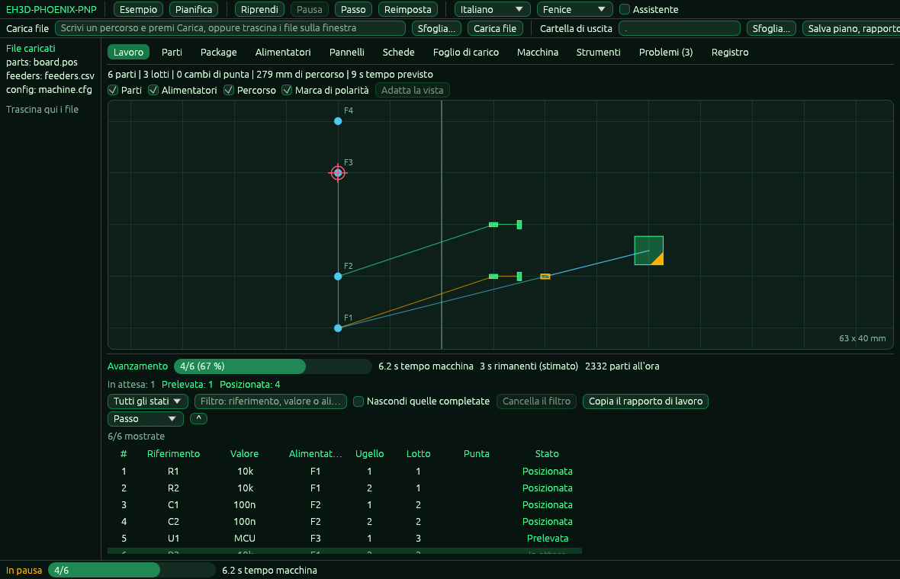
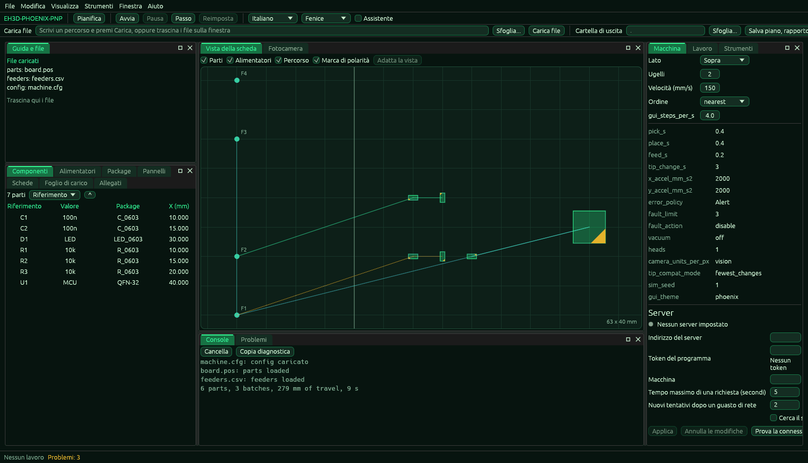

<p align="center">
  
</p>

# 📖 EH3D-PHOENIX-PNP

<p align="center"><a href="README.md">🇺🇸 English</a> | <a href="README_spa.md">🇪🇸 Español</a> | <a href="README_fra.md">🇫🇷 Français</a> | 🇮🇹 <b>Italiano</b> | <a href="README_deu.md">🇩🇪 Deutsch</a> | <a href="README_zho.md">🇨🇳 中文</a> | <a href="README_jpn.md">🇯🇵 日本語</a> | <a href="README_por.md">🇵🇹 Português</a></p>

### Assemblaggio pick and place: posizioni, alimentatori e ordine di posizionamento

<p align="center">
  
  
  
  
  
</p>

---

**Verifica di onestà - cosa funziona oggi:** una libreria Rust e un programma a riga di comando (`phoenix-pnp`) con 1969 test che girano su un computer: legge il file delle posizioni di una scheda, assegna a ogni componente il suo alimentatore (con priorità, vassoi e strisce), legge le impostazioni della macchina da un file, pianifica l'ordine di posizionamento per una testa fino a sei ugelli (ranghi, punte degli ugelli, limiti d'angolo, tempo dei movimenti, pannelli), scrive un foglio di carico e, su una macchina simulata, esegue il piano passo dopo passo con guasti iniettati. Ha anche una finestra (compilata con `--features gui`) la cui logica è testata senza schermo; il disegno in sé non è coperto da test e, sebbene il programma acquisisca immagini della propria finestra (`--shot`), nessuna persona ha verificato il disegno su uno schermo. Non controlla nessuna macchina: non è stato provato su una macchina e non è stato verificato con una raccolta di file reali.

---

> **Stato di sicurezza:** questo programma non controlla alcuna macchina e non è un sistema di sicurezza. Ciò che produce deve essere controllato da una persona prima di eseguire qualsiasi cosa su una macchina; nulla di questo ha girato su hardware reale.


## 📋 In breve

| | |
|---|---|
| Versione | `0.1.4` |
| Maturità | Impalcatura |
| Test | 1969 |
| Stack tecnologico | Rust |
| Su hardware reale | Non provato: nulla di questo ha girato su una macchina |

**Vai a:** [Panoramica](#-panoramica) · [Architettura](#-architettura) · [Avvio rapido](#-avvio-rapido) · [Test](#-test) · [Struttura](#-struttura-del-repository) · [Correlati](#-progetti-correlati)

## 🚦 Stato del progetto

Ogni riga è una parte di questo repository e il semaforo dice a che punto è oggi. È scritta in base a ciò che il repository può mostrare (test, compilazioni, esecuzioni), non a ciò che è previsto.

🟢 Fatto e verificato · 🟡 Funziona, con limiti noti · 🟠 Fatto a metà o non ancora verificato · 🔴 Non fatto o non funzionante

| Area | Stato | Cosa significa qui |
|---|---|---|
| Nucleo | 🟡 | legge il file delle posizioni di una scheda, assegna a ogni componente il suo alimentatore (priorità, vassoio, striscia), pianifica l'ordine di posizionamento per una testa fino a sei ugelli con ranghi, punte degli ugelli, limiti d'angolo e il tempo dei movimenti, pianifica pannelli e scrive il foglio di carico; provato su un computer con ingressi normali e danneggiati, non con una raccolta di file reali. |
| Riga di comando | 🟡 | `phoenix-pnp` esegue le stesse funzioni della libreria (`parts`, `check`, `plan`, `schedule`, `preflight`, `simulate`, `loadsheet`, `config-check`, `check-bottom`, `tables-check`, `recipe-check`, `import-centroid`, `vision-test`) e stampa il risultato; ogni errore torna come messaggio con il suo codice `PHOENIX-PNP-NNN` e un codice di uscita diverso da zero. |
| Test | 🟡 | 1969 test passano (`cargo test`), con casi normali, casi limite, ingressi danneggiati e piccoli casi generati. |
| Configurazione della macchina | 🟡 | un file `chiave = valore` con versione, un validatore che nomina la riga e i limiti di sicurezza (corsa di Z, limiti di X e Y, nuovi tentativi, angoli dell'ugello); i valori non sono stati confrontati con una macchina reale. |
| Simulatore e lavoro | 🟡 | un orologio virtuale, guasti iniettati a caso (con un seme) o in un punto scelto, nuovi tentativi, le politiche allerta e rinvio, alimentatori che si spengono dopo guasti ripetuti, pausa, passo dopo passo e uno stato salvato da cui riprendere; simula soltanto, nulla ha mosso una macchina. |
| Sicurezza | 🟡 | Rust sicuro e semplice (`forbid(unsafe_code)`): nulla va in panico con i file ricevuti e un valore errato è un errore con il suo motivo; nessuna revisione indipendente. |
| Finestra | 🟠 | Una finestra egui (si compila con `--features gui`; `phoenix-pnp` senza comando la apre): schede di lavoro, parti, package, alimentatori, foglio di carico, macchina, strumenti, problemi e registro, una mappa del tavolo di lavoro con il percorso della testa, marche di polarità e la parte successiva, una guida in cinque passi, problemi con correzioni che si possono annullare, un lavoro simulato che si può mettere in pausa, riprendere e avanzare passo dopo passo, e le otto lingue. La sua logica è testata senza schermo; il disegno non è coperto da test: il programma acquisisce immagini della propria finestra (`--shot`), ma nessuna persona ha verificato il disegno su uno schermo. Ha inoltre schede di pannelli (con i fiduciali e l'adattamento che sposta le parti) e di schede elettroniche, un selettore di file, tabelle di alimentatori e package modificabili con annulla, larghezze delle colonne memorizzate e un programma a sé (`phoenix-pnp-gui`) che si apre senza console su Windows. Le schede sono ora pannelli del telaio dei pannelli della suite (`eh3d-dock`): si possono spostare, far fluttuare, ripiegare e salvare in tre disposizioni, c'è una barra dei menu e quindici comandi hanno un pannello; questo è stato compilato ed eseguito senza finestra, non visto su uno schermo. |
| Hardware reale | 🔴 | Non provato: nulla di questo è stato eseguito su una macchina. |
| Documentazione | 🟡 | README in otto lingue, il changelog e le due immagini disegnate da `docs/`. |

## 🎯 Panoramica

* **I componenti** (`src/parts.rs`): un file `.pos` di KiCad o un CSV (virgola o punto e virgola, virgolette, intestazione trovata per nome) con posizioni in mm, mil o pollici, gli angoli portati a 0-360, il lato superiore o inferiore, e ogni riga priva di senso è rifiutata con il suo numero; un riferimento ripetuto è un errore.
* **Componenti da non montare, le tabelle degli esempi e il rapporto di un lavoro** (`src/parts.rs`, `src/commands.rs`, `src/job.rs`): una colonna `dnp`, `do not place` o `fitted` in un CSV (o `--dnp R1,R2`) lascia componenti fuori dal piano, dal foglio di carico e dai controlli e li elenca nel rapporto; `tables-check` legge le tabelle (`--parts`, `--packages`, `--catalog`, `--feeders`, `--slots`) e indica il codice e la riga di ogni errore; `simulate --report-csv FILE` scrive le statistiche del lavoro come CSV la cui intestazione non cambia mai. `examples/` contiene una scheda con una colonna `dnp`, alimentatori di ogni tipo e una tabella di package comuni.
* **Gli alimentatori** (`src/feeders.rs`): un CSV di alimentatori (id, valore, contenitore, posizione di prelievo, pezzi rimasti); ogni componente riceve il primo alimentatore che contiene il suo valore e contenitore, senza distinguere le maiuscole; un componente senza alimentatore e un alimentatore che si esaurisce sono segnalati, e un secondo alimentatore dello stesso tipo subentra.
* **Il piano** (`src/plan.rs`): i posti si percorrono al più vicino e si tagliano in lotti da uno a sei ugelli, gli alimentatori di un lotto si visitano al più vicino, il lato inferiore è specchiato rispetto alla larghezza della scheda, e il piano dà il percorso e una stima del tempo; si scrive come lavoro JSON.
* **Le tabelle e le impostazioni** (`src/catalog.rs`, `src/config.rs`, `src/rotation.rs`): tabelle di parti e package i cui valori si ereditano (parte, poi package, poi i valori predefiniti), un file di configurazione della macchina nel formato `chiave = valore` (`examples/machine.cfg` documenta ogni chiave), più nomi per le colonne di un CSV di posizioni e correzioni della rotazione per package.
* **Gli alimentatori con più di un nastro** (`src/feeding.rs`): priorità, vassoi, strisce e alimentatori spenti; l'alimentatore di un componente si sceglie allo stesso modo qualunque sia l'ordine dei file.
* **Il pianificatore della macchina** (`src/planner.rs`, `src/motion.rs`): ranghi (blocchi posizionati uno dopo l'altro), strategie d'ordine, punte degli ugelli e i loro cambi, i limiti dell'angolo dell'ugello, il tempo dei movimenti con accelerazione e jerk, percorsi più corti (2-opt) e la correzione dell'origine di un componente.
* **Pannelli, foglio di carico ed esportazioni** (`src/panel.rs`, `src/loadsheet.rs`, `src/export.rs`): schede e pannelli dentro pannelli, lo slot di ogni tipo di nastro, un rapporto, l'elenco di ciò che manca e un G-code che sposta solo la testa.
* **Fiduciali di un pannello** (`src/fiducial.rs`): le posizioni misurate dei segni vengono adattate a quelle progettate (una similitudine con due segni, un adattamento affine con tre o più) e le parti del pannello vengono spostate e ruotate dall'adattamento; ogni segno ha il suo residuo, e un adattamento che manca un segno di più di `fiducial_max_residual_mm` viene rifiutato (`--fiducials FILE` con `--panel`, o la scheda Pannelli della finestra).
* **Schede segnate come difettose (X-out) e marche a due livelli** (`src/marks.rs`, `src/panel.rs`): un figlio del file del pannello con `"x_out": true`, o `--x-out A,B/C`, viene lasciato fuori con tutto ciò che contiene; il piano, il foglio di carico e i controlli non lo vedono, e un nome che nessuna scheda ha (`PHOENIX-PNP-042`) o un pannello con tutte le schede escluse (`PHOENIX-PNP-043`) è un errore. Un componente di una scheda il cui valore o package contiene una parola di `fiducial_words`, o il cui riferimento è un prefisso di `fiducial_refs` seguito da un numero (`FID1`), è una marca della sua scheda e non viene posizionato; il file di `--fiducials` può allora nominare le marche del pannello (`f1`) e delle schede (`A/FID1`): le marche di una scheda si adattano insieme e spostano solo i componenti di quella scheda, e i componenti delle schede senza marche misurate seguono l'adattamento del pannello. Simulato: nessuna scheda è mai stata misurata su una macchina; la finestra non usa ancora le marche delle schede.
* **Altro dal pianificatore e dal simulatore:** l'ordine in cui si svuotano le celle di un vassoio (righe, colonne o serpentina), una ricerca dell'ordine delle punte dell'ugello che conta il percorso e il viaggio al cambio punta (`tip_strategy = optimize`, limitata da `tip_opt_max_evals` e `tip_opt_time_limit_s`), probabilità di guasto per package e per alimentatore (`sim_part_fail`, `sim_feeder_fail`) con statistiche per package e per alimentatore e le parti all'ora, e `check-bottom`, che mostra l'angolo che dà ogni regola del lato inferiore.
* **Il passo di allineamento** (`src/job.rs`, `src/sim.rs`, `src/model.rs`): con `align = on` il lavoro guarda ogni componente con la telecamera dopo il prelievo e corregge il posizionamento in base a ciò che vede (la testa va al punto meno lo scostamento del componente, e l'ugello ruota meno della rotazione del componente); `pick_tolerance_mm` scarta un componente più fuori posto, che viene prelevato di nuovo come dice `error_policy`; `align_passes` (da 1 a 5) e `align_settle_s` fissano gli sguardi e l'attesa prima di ciascuno, che si sommano al tempo del piano; la telecamera simulata ha uno scostamento, un errore e guasti iniettabili (`sim_align_*`, `sim_camera_fail_rate`); e la correzione (media, massima, componenti scartati) compare nel testo, nel rapporto JSON e nelle righe `align` di `--report-csv`. Spento per impostazione predefinita: un lavoro è allora quello di sempre. Non provato su una macchina. Con `align_rereads` maggiore di 0 (fino a 5, 0 per impostazione predefinita) la telecamera guarda di nuovo una parte il cui primo sguardo era fuori tolleranza prima di scartarla, uno sguardo entro la tolleranza vale come il primo, e il rapporto di lavoro conta per alimentatore gli sguardi fuori tolleranza, quelli extra, le parti che hanno salvato, quelle scartate e gli sguardi senza misura.
* **La catena di visione** (`src/vision.rs`, `src/sim.rs`, `examples/vision.cfg`): con `vision = pipeline` la telecamera simulata disegna in memoria un'immagine del componente (la sua dimensione, la sua rotazione e quanto è lontano dall'ugello, con un rumore tratto da `sim_seed`) e la misura con i passi di un file di impostazioni (`--vision FILE`): una maschera, un filtro mediano, una soglia fissa o di Otsu, un intervallo di area per la macchia e il rettangolo ruotato più piccolo, il cui centro e angolo sono lo scostamento che il passo di allineamento corregge. Un componente non trovato, una macchia di area sbagliata e più macchie sono osservazioni senza misura, ognuna con il suo codice (da `PHOENIX-PNP-037` a `PHOENIX-PNP-039`). `phoenix-pnp vision-test` disegna un componente con la dimensione, la rotazione, lo scostamento e il rumore che gli si danno e stampa quanto misurato con il suo errore. Disattivato per impostazione predefinita: un lavoro è allora quello di sempre. Non provato con una telecamera reale.
* **Il rapporto di lavoro** (`src/report.rs`, `src/job.rs`): dopo un lavoro simulato, `simulate` può scrivere il rapporto come testo nella lingua di `--lang` (`--report-text`), come pagina HTML che contiene tutto, senza script né nulla dall'esterno, e che non viene mai scritta sopra un file esistente (`--report-html`), come sezioni aggiunte dopo le righe del CSV (`--report-csv`, l'intestazione non cambia) e come `work` nel JSON (`--report`). Dice quanti componenti sono stati posizionati, messi da parte, saltati dalla persona, ancora in attesa o da non montare; dove è andato il tempo macchina (alimentare e prelevare, osservazioni della telecamera, posizionamenti, spostamenti della testa, cambi di punta); quanti prelievi sono riusciti al primo tentativo; lo stesso per package, alimentatore, ugello, punta e scheda di un pannello; gli errori avvenuti con i loro codici; gli avvisi prima del lavoro; e un istogramma di ciò che la telecamera ha corretto (X, Y e rotazione). Simulato: nulla di questo è stato misurato su una macchina.
* **La scheda Lavoro e le decisioni della persona** (`src/gui/jobtab.rs`, `src/gui/window.rs`, `src/job.rs`): la tabella mostra lo stato di ogni posizionamento (in attesa, prelevato, allineato, posizionato, messo da parte, saltato, fallito) e i componenti da non montare, una barra di avanzamento con il tempo macchina e una stima del tempo rimanente, e filtri per stato, per testo e per ciò che è fatto. Quando un errore ferma il lavoro, una finestra indica il passo fallito e offre quattro azioni eseguite sul lavoro simulato, che poi prosegue: riprovare, saltare il componente, metterlo da parte o spegnere l'alimentatore perché ne subentri un altro dello stesso tipo. Ogni decisione è contata nel rapporto. La logica non ha bisogno dello schermo ed è testata; nessuna persona ha verificato il disegno su uno schermo (le immagini di questa scheda in `images/screens/` sono acquisite dal programma stesso).
* **Il vuoto, gli attuatori e la finestra dei guasti di un alimentatore** (`src/sim.rs`, `src/job.rs`, `src/config.rs`): con `vacuum = on` la pompa simulata aspira per `vacuum_suck_s` secondi dopo ogni prelievo e si legge il livello dell'ugello (kilopascal); un livello sotto `vacuum_pick_min_kpa` significa che l'ugello non tiene alcun componente (`PHOENIX-PNP-044`, e il prelievo si ripete come dicono i tentativi) e, dopo il soffio di `vacuum_blow_s` secondi a ogni posizionamento, un livello sopra `vacuum_release_max_kpa` significa che il componente è ancora attaccato all'ugello (`PHOENIX-PNP-045`). Il sensore ha un generatore proprio (`sim_vacuum_noise_kpa`, `sim_vacuum_miss_rate`, `sim_vacuum_stuck_rate`) ed è spento per impostazione predefinita, quindi un lavoro senza di esso è esattamente quello che era. I dispositivi on/off si dichiarano con `actuator = NOME : RITARDO_S` e si commutano con `Job::set_actuator`, che aggiunge il loro ritardo all'orologio (`PHOENIX-PNP-046` per un nome che la macchina non ha). Con `fault_action = alert`, un alimentatore che raggiunge `fault_limit` guasti tra i suoi ultimi `fault_window` prelievi non si spegne più da solo: il lavoro si ferma (`PHOENIX-PNP-047`) e la finestra di dialogo della scheda Job offre di riprovare, escludere il componente, metterlo da parte o spegnere l'alimentatore.
* **Il modello della telecamera, le teste della macchina e le punte di un package** (`src/camera.rs`, `src/heads.rs`, `src/tips.rs`, `src/config.rs`): la telecamera è descritta da `camera_units_per_px` (0 è la dimensione per cui è regolata la visione), `camera_offset_x_mm` e `camera_offset_y_mm` (dove si trova l'asse dell'ugello nell'immagine), `camera_rotation_deg`, `camera_flip_x` e `camera_flip_y`, e dall'obiettivo (`camera_lens_scale`, `camera_lens_k1`); la telecamera simulata del passo di allineamento legge il componente attraverso di essa, con o senza immagine, e con i valori predefiniti un lavoro è esattamente quello che era. `head = NOME : UGELLI [: SCOST_X : SCOST_Y : CAM_X : CAM_Y : CAM_ROT : CAM_UNITÀ : CAM_OBIETTIVO]` dichiara fino a quattro teste, ciascuna con i suoi ugelli, il suo scostamento e la sua telecamera; con due o più teste `schedule` assegna ogni componente a una testa che lo raggiunge (`PHOENIX-PNP-048` se nessuna lo raggiunge), pianifica ogni testa e conta, sull'orologio della macchina, il tempo che una testa attende un alimentatore usato da un'altra. `tip_compat = MODELLO : PUNTA, PUNTA, ...` elenca le punte che un package accetta e `tip_compat_mode` (`fewest_changes` o `preferred`) sceglie una punta per ogni tipo di componente in modo che la macchina cambi punta il minor numero di volte possibile; una punta indicata nelle tabelle viene mantenuta.
* **Ricette** (`src/recipe.rs`, `src/job.rs`, `src/commands.rs`): un file di testo con una versione (`examples/job.recipe`) fissa i passi che un lavoro attraversa (`prepare`, `pick`, `align`, `place` e `check`, in questo ordine e nessuno due volte; il passo di allineamento e il controllo del vuoto sono attivi solo se la ricetta li ha) e i parametri che cambiano per un package, un alimentatore o una punta (`pick_retries`, `pick_tolerance_mm`, `vacuum_suck_s` e `vacuum_blow_s`; per ogni chiave vince la prima regola che corrisponde, prima quelle degli alimentatori, poi quelle dei package e infine quelle delle punte). `phoenix-pnp recipe-check FILE` la legge e la controlla, e `simulate ... --recipe FILE` esegue il lavoro con essa. I suoi errori hanno i codici da `PHOENIX-PNP-049` a `PHOENIX-PNP-052` (una riga non valida, passi in ordine sbagliato, un file oltre i suoi limiti, una versione troppo recente) e i limiti sono le chiavi `recipe_max_bytes` e `recipe_max_rules` di `machine.cfg`. Uno stato salvato ricorda anche l'alimentatore dell'ultimo prelievo e il prelievo che si è fermato, così un lavoro caricato in un'altra esecuzione offre alla persona le stesse decisioni (uno stato più vecchio si carica ancora).
* **Importazione di file di posizioni** (`src/import.rs`, `src/commands.rs`): `phoenix-pnp import-centroid FILE` legge un CSV di centroidi (`--map FILE` ne nomina le colonne, `examples/centroid.map`; `examples/centroid.csv` non ha bisogno di mappa), il testo di posizioni di EAGLE (`examples/board.mnt`: nome, x, y, rotazione `R90` o `MR90` per il lato inferiore, valore, package) o il `.pos` di KiCad (`--format auto|csv|eagle|kicad-pos`; `auto` li distingue dalla prima riga) e scrive la tabella dei componenti `ref,val,package,x,y,rot,side,dnp` in millimetri in `--out` (un file che esiste non viene mai sovrascritto: `PHOENIX-PNP-040`) o sullo standard output. Le unità sono mm, mil o pollici (nell'intestazione come `X (mil)`, nella cella come `0.5in`, in un commento come `## Unit = inch`, nella mappa o in `import_unit`); gli angoli escono da 0 a 360; la colonna del lato è facoltativa; una colonna `dnp` o `fitted` (o `--dnp R1-R5,C7` con intervalli di riferimenti) segna i componenti da non montare; `import_bottom_mirror_width_mm` specchia la X del lato inferiore e `bottom_rotation` ne ruota l'angolo. I tre lettori sono del programma (nessun altro repository ha un lettore utilizzabile senza aggiungere una dipendenza) e la disposizione del testo di EAGLE non è stata confrontata con un file scritto da un'installazione reale. Ogni errore ha un codice da `PHOENIX-PNP-053` a `PHOENIX-PNP-056` (una riga non valida, un'intestazione senza una colonna della mappa, un formato sconosciuto, un intervallo di riferimenti non valido) e il numero della riga.
* **Distinta base** (`src/bom.rs`, `src/cmd_tools.rs`): `phoenix-pnp bom-check COMPONENTI BOM` legge una distinta base (`examples/bom.csv`: i riferimenti in una cella, come intervallo o uno per riga, e valore, package, quantità e codice del produttore se presenti) e dice quali riferimenti ha solo uno dei due lati, quali compaiono due volte, quali valori o package differiscono e quali quantità non tornano; un componente segnato come da non montare può stare o no nella distinta. Un errore del file ha il codice `PHOENIX-PNP-057` e la sua riga.
* **Scorte per una produzione** (`src/stock.rs`): `phoenix-pnp stock PARTI FEEDER --boards N` somma le schede e dice, tipo di parte per tipo, quante parti servono per N schede rispetto a quelle dei feeder accesi, quali tipi non bastano, di quanto e dopo quante schede finisce la prima bobina; esce con 2 se manca qualcosa e scrive la tabella con `--out`. `bom-order --have FEEDER` toglie dalla lista da acquistare ciò che i feeder contengono già e dà le colonne `on_hand` e `to_buy`.
* **Calibrazione della telecamera** (`src/calibrate.rs`): `phoenix-pnp camera-calibrate FILE` adatta il modello della telecamera (dimensione del pixel, rotazione, specchio e posizione dell'asse dell'ugello nell'immagine) ad avvistamenti di un segno in posizioni note della testa (`px,py,x_mm,y_mm` [vedi `examples/camera_points.csv`], almeno tre) e stampa la qualità dell'adattamento e le righe `camera_*` per la configurazione; l'obiettivo non viene adattato. Il suo errore è il codice `PHOENIX-PNP-058`.
* **Eccentricità dell'ugello** (`src/calibrate.rs`, `src/export.rs`): `phoenix-pnp nozzle-calibrate FILE` adatta un cerchio a letture della punta dell'ugello a più angoli (`angle_deg,x_mm,y_mm` [vedi `examples/nozzle_readings.csv`]) e stampa `nozzle_runout_mm` e `nozzle_runout_deg`; con l'eccentricità sopra 0 il G-code di `schedule --gcode` sposta ogni posizione dell'opposto dell'eccentricità all'angolo del componente.
* **Pannello da una griglia di schede** (`src/panel.rs`, `src/cmd_tools.rs`): `phoenix-pnp panelize SCHEDA --cols N --rows N --pitch-x MM --pitch-y MM` scrive il file di pannello per una griglia di copie di una scheda, tutte con la stessa rotazione, con tre fiduciali a un margine (`--fiducials MM`, attorno alla dimensione reale della scheda data da `--board-size W,H`) e schede segnate come difettose dai nomi `P1`, `P2`, ... (`--x-out P2,P5`); un file esistente non viene mai sovrascritto.
* **Foglio dei componenti con un verso** (`src/polarity.rs`): `phoenix-pnp polarity-sheet COMPONENTI` elenca i componenti il cui riferimento corrisponde a `polarity_refs` o il cui package corrisponde a `polarity_packages` (per default diodi, LED, circuiti integrati, transistor, condensatori polarizzati e connettori) con posizione e rotazione e una colonna vuota da spuntare, per il controllo dopo un lavoro; `--side` tiene un solo lato.
* **Gioco degli assi** (`src/sim.rs`, `src/motion.rs`): `backlash_x_mm`, `backlash_y_mm` e `backlash_mode` fanno sì che la macchina simulata termini corto del gioco un movimento che inverte un asse (`off`, contato da `simulate`) o superi la posizione e torni dal lato positivo (`approach`, che richiede più tempo e non lascia errore); con gioco 0 non cambia nulla.
* **Elenco dei componenti da acquistare** (`src/bom.rs`): `phoenix-pnp bom-order BOM --boards N` somma le righe di una distinta base che sono lo stesso componente e dà a ogni riga i componenti per N schede più una scorta (`order_spare_percent` per cento o `order_spare_min`, il maggiore; prevalgono `--spare-percent` e `--spare-min`), senza i componenti che `--parts COMPONENTI` segna come da non montare; scrive un CSV ordinato per package e valore.
* **Apprendimento dei feeder** (`src/calibrate.rs`): `phoenix-pnp feeder-teach strip` dà il passo e l'angolo di una striscia dalle posizioni del primo e dell'ultimo componente, e `feeder-teach tray` i due passi e l'angolo di un vassoio da tre sue celle, con lo scostamento dalla squadra; entrambi stampano le colonne del file dei feeder che impostano. `feeder-teach --measures FILE` legge le posizioni di più feeder da un file e stampa per ciascuno una riga e una riga del file dei feeder (`examples/feeder_measures.csv`).
* **Il simulatore e il lavoro** (`src/sim.rs`, `src/job.rs`, `src/preflight.rs`, `src/model.rs`): i controlli prima di un lavoro, una macchina con orologio virtuale e guasti iniettabili, e un lavoro che si può mettere in pausa, eseguire passo dopo passo, salvare e riprendere.
* **La finestra** (`src/gui.rs`, `src/gui/`): ciò che la finestra fa oltre a disegnare non ha bisogno di schermo (i file caricati, il piano e i suoi problemi con correzioni, il lavoro simulato, la geometria della mappa, le tabelle con selezione condivisa, la guida in cinque passi e i testi in otto lingue) ed è testato; solo `src/gui/window.rs`, compilato con `--features gui`, lo disegna con egui. La velocità della simulazione, il tema e la dimensione disegnata per una parte di package sconosciuto sono chiavi di `machine.cfg` (`gui_steps_per_s`, `gui_theme`, `gui_part_size_mm`).
* **Interblocchi degli assi** (`src/interlock.rs`, `src/driver.rs`, `src/gcodedriver.rs`, `examples/driver_marlin.cfg`): una riga `interlock = SEGNALE | on|off | xy|z|rot|all` di un profilo di driver dice che gli assi nominati possono muoversi solo finché il segnale è nello stato nominato (l'esempio tiene fermo il carrello in X e Y finché la valvola di soffiaggio è attiva). I segnali sono i nomi degli attuatori del profilo, che la sessione conosce da ciò che ha commutato per ultimo, e i nomi dati a un sensore con `Session::set_signal` (una porta, gli ugelli sollevati); un segnale che nessuno ha riferito è sconosciuto e non soddisfa una regola, quindi il movimento è rifiutato. Un movimento rifiutato è un guasto di sicurezza come uno fuori dai limiti: le righe di `safe_stop` sono inviate, le regole di sicurezza rallentano la macchina e non si invia altro fino a una nuova sessione. Il rifiuto è detto nelle otto lingue. Tutto è un calcolo su nomi e numeri, provato contro il controllore simulato con movimenti casuali su un seme fisso, su cui sessione e calcolo devono concordare; non è stato letto alcun sensore di una macchina reale.
* **Il processo di una scheda e la modalità manuale guidata per fasi** (`src/process.rs`, `src/cmd_import.rs`): un processo è un elenco di fasi (`phase = NOME | compito, compito`, con i compiti `load`, `place top`, `place bottom by hand`, `reflow`, `solder by hand`, `glue`, `through-hole` e `inspect`) o uno di due preimpostazioni, `pnp` (la macchina posiziona ogni lato) e `manual` (una persona posiziona ogni lato a mano); una fase inizia solo quando le precedenti sono fatte e nessuna è in corso, finisce solo quando è in corso, il suo carico (gli alimentatori caricati per essa) si può cambiare solo finché è da fare, e lo stato si può salvare e riprendere. `phoenix-pnp assist COMPONENTI --process pnp|manual|FILE` lo percorre: i componenti di un lato posizionato a mano si chiedono uno alla volta, gli altri compiti sono detti nella lingua della persona e aspettano `done`, un lato posizionato dalla macchina è segnalato e le fasi di un lato senza componenti sono omesse. I rifiuti sono detti nelle otto lingue. Non si muove nulla: il lavoro lo fa una persona.
* **La finestra sul telaio dei pannelli della suite** (`src/gui/docking.rs`, `src/gui/cmdpanel.rs`, `src/gui/window.rs`, `Cargo.toml`): le schede della finestra sono pannelli di `eh3d-dock` di EH3D-COMMON (la compilazione prende `EH3D-COMMON` alla versione 0.3.4): ciascuno si può togliere, rimettere dal menu Visualizza, spostare trascinando la sua scheda al centro o su un lato di un altro gruppo, far fluttuare sopra la finestra, ripiegare su un bordo, ingrandire e bloccare. La finestra parte in una di tre disposizioni, Configura, Esegui e Compatto, con la vista della scheda, i componenti, gli alimentatori, il lavoro, la fotocamera, la macchina e la console del settore del pick and place e, inoltre, la guida, i package, i pannelli, le schede, il foglio di carico, gli strumenti e i problemi; la barra dei menu ha File (con gli esempi e i file recenti), Modifica, Visualizza, Strumenti (pianifica, avvia, pausa, passo, azzera e i pannelli dei comandi), Finestra (le disposizioni e quelle che la persona salva con un nome) e Aiuto, con da F5 a F8 e le scorciatoie usuali; una voce non utilizzabile è spenta anche per la sua scorciatoia. Ciò che la persona ha disposto è conservato in `window.cfg` con le chiavi `dock.` e ritorna al successivo avvio; una disposizione danneggiata o di un'altra versione è sostituita da quella di fabbrica, con un avviso. Undici comandi (`driver-check`, `driver-test`, `driver-run`, `safety-replay`, `homing-repeat`, `bringup`, `import-openpnp`, `assist`, `align-iterate`, `vacuum-calibrate` e `test-board-gen`) hanno un pannello ciascuno, nascosto all'inizio (i menu Visualizza e Strumenti lo mostrano): un pannello esegue `phoenix-pnp` accanto alla finestra con gli argomenti digitati (separati da spazi e virgolette, limitati, letti da nessuna shell), senza finestra di console e senza nulla da leggere dalla tastiera, per al massimo `command_timeout_s` secondi (da 5 a 600, 60 per impostazione predefinita, in `window.cfg`), e mostra ciò che ha stampato, così un pannello e il suo comando non possono divergere. I pannelli e i menu sono dati e si provano senza schermo; il disegno con il telaio è stato solo compilato ed eseguito in un contesto senza finestra, e nessuna persona ha visto le disposizioni su uno schermo.
* **Lo sguardo al componente sull'ugello** (`src/inspect.rs`, `src/cmd_vis.rs`): `phoenix-pnp part-inspect LETTURE --sizes DIMENSIONI` (o `--packages PACKAGE`) confronta ciò che la telecamera ha misurato di ogni componente (i due lati, dove pende rispetto all'asse e di quanto è ruotato) con la dimensione del suo package e dice perché viene rifiutato (`part_size_tol_mm`, `part_angle_tol_deg`, `part_offset_max_mm`); la dimensione viene da una tabella di dimensioni o dalle colonne `body_long_mm` e `body_short_mm` della tabella dei package (`examples/packages_bodies.csv`), e il comando esce con 2 finché un componente è rifiutato o non ha dimensione.
* **Stecche e alimentatori alla rinfusa** (`src/feeding.rs`, `src/feedlib.rs`): oltre a un nastro, un vassoio e una striscia, la colonna `kind` della tabella degli alimentatori accetta `tube` (una stecca o una guida i cui componenti scivolano fino a un fermo) e `bulk` (componenti sfusi in una vaschetta o una ciotola, che non arrivano in una direzione fissa); entrambi prelevano dall'unico punto `x`, `y`, come un nastro, prendono l'angolo dei componenti da `rotation`, si svuotano in base al conteggio e sono controllati da `feeder-check`; la scheda Alimentatori della finestra offre tutti e cinque i tipi nelle otto lingue (`examples/feeders_tubes.csv`).
* **Componenti posizionati e tempo per alimentatore** (`src/job.rs`, `src/feedrep.rs`, `src/report.rs`): il lavoro annota da quale alimentatore ogni ugello ha preso il suo componente (anche quando un altro alimentatore del tipo ha preso il suo posto) e conta il componente come posizionato da quell'alimentatore, e somma il tempo dei passi che hanno prelevato da ogni alimentatore (il percorso fino a lui, l'avanzamento, il prelievo e lo sguardo); il rapporto di lavoro, il suo JSON e `simulate --report-feeders` (le colonne `placed` e `busy_s` in fondo) li mostrano, e un lavoro salvato li conserva.
* **Vita delle punte degli ugelli** (`src/nozzlelife.rs`, `src/cmd_tools.rs`, `src/commands.rs`): `simulate --nozzle-life FILE` aggiunge ciò che un lavoro arrivato in fondo ha fatto con ogni punta (i componenti posizionati e i montaggi) a un piccolo CSV che la persona tiene accanto alla configurazione; un lavoro è contato una sola volta, un file che non è un registro delle punte non viene mai sovrascritto, il file sostituito resta come `FILE.prev` e i conteggi scendono solo quando `nozzle-life FILE --reset PUNTA` annota che una punta è stata sostituita. `nozzle_life_warn` (predefinito 500000, 0 non avvisa) è il numero di componenti oltre il quale si dice alla persona di controllare una punta, con `simulate` e `nozzle-life`. Nuovo codice di errore `PHOENIX-PNP-059`.
* **Quale ordine è il più veloce** (`src/compare.rs`, `src/commands.rs`): `phoenix-pnp order-compare COMPONENTI ALIMENTATORI` pianifica la stessa scheda con ogni `order` dei posti (nearest, part, height_part, pick, tips, none) e ogni `tip_strategy` (minimize, as_planned, optimize), e li mostra affiancati con i lotti, i cambi di punta, il percorso della testa e i secondi, con la più veloce di ogni elenco segnata, quella della configurazione segnata e una riga che dice quanti secondi farebbe risparmiare l'impostazione migliore; prende le opzioni di `schedule` e non cambia nulla.
* **Un'immagine del piano** (`src/preview.rs`, `src/commands.rs`): `phoenix-pnp schedule COMPONENTI ALIMENTATORI USCITA.json --svg USCITA.svg` scrive anche il piano come un file SVG da guardare prima che la macchina si muova, da stampare o da tenere con il lavoro: gli alimentatori, il posto di ogni componente con il numero del suo turno e il colore del suo ugello, la linea che ogni componente segue dal suo alimentatore, il percorso tratteggiato della testa su tutto il lavoro e i totali; non ha script né nulla dall'esterno, ciò che è scritto in un riferimento o in un id viene protetto, e un'immagine che esiste non viene mai sovrascritta.
* **Calibrazione della telecamera con un motivo** (`src/pattern.rs`, `src/cmd_tools.rs`): `phoenix-pnp camera-pattern FILE [--pitch MM]` legge i punti di una griglia (gli angoli interni di una scacchiera o i centri di punti) come `col,row,px,py` (`examples/camera_pattern.csv`) e adatta la dimensione di un pixel (`camera_units_per_px`) e la distorsione radiale dell'obiettivo (`camera_lens_k1`) insieme a rotazione, spostamento e specchio del foglio nell'immagine, poi dice quanto i punti si discostano dal modello con e senza la distorsione e quale punto è il più lontano; le righe per la configurazione vengono stampate e il codice di uscita è 2 quando un punto supera `camera_pattern_max_residual_mm`. I punti distano `camera_pattern_pitch_mm`. La rotazione e lo scostamento della telecamera continuano a venire da `camera-calibrate`, che muove la testa. La scheda Strumenti ha la stessa calibrazione e rifiuta di mettere nella macchina un adattamento oltre il limite.
* **Quale fiduciale è fuori** (`src/fidcheck.rs`, `src/gui/workspace.rs`, `src/gui/tables.rs`): quando si usano i segni misurati di un pannello, la finestra calcola il residuo di ogni segno (anche quando l'adattamento è rifiutato, così si vede perché), l'unico segno che, tolto, riporta tutti gli altri entro `fiducial_max_residual_mm`, e la rotazione, le scale e l'inclinazione rispetto ai loro limiti. La tabella dei fiduciali segna con `!` un segno oltre il limite e con `?` quello che non concorda, e il pannello elenca gli avvisi a parole (anche nel registro); `fidcheck::analyze_marks`, `fidcheck::warnings` e `fidcheck::residual_table` danno lo stesso al comando `fiducial-check` e allo strumento di controllo dei fiduciali.
* **Coda di lavori** (`src/queue.rs`, `src/cmd_queue.rs`): più schede o pannelli uno dopo l'altro. `phoenix-pnp queue-add CODA NOME ORIGINE FEEDER [--panel] [--boards N]` mette un lavoro in un piccolo CSV che sopravvive all'arresto del programma (viene scritto in un file temporaneo e spostato al suo posto, il file sostituito è conservato come `PERCORSO.prev` e l'ultima riga porta una somma di controllo, così un file tagliato o modificato a mano viene rifiutato); `queue-status [--check]` elenca i lavori e che cosa ne è stato di ciascuno (pending, running, done, failed, skipped) e con `--check` pianifica quelli ancora da fare; `queue-edit` salta, azzera, revoca la conferma di un lavoro o lo toglie; `queue-run` esegue i lavori scheda per scheda sulla macchina simulata e scrive la coda dopo ogni scheda. Nulla viene eseguito senza conferma: con `queue_confirm` attivo (predefinito) un lavoro parte solo dopo che `queue-confirm` ha registrato l'identità del suo piano (il piano e il testo dei file da cui è stato fatto), e una modifica a un file la annulla; `queue_stop_on_failure` (predefinito attivo) ferma la coda al primo lavoro che fallisce. Un secondo `queue-run` sulla stessa coda viene rifiutato finché esiste un file `.lock`. Lo strumento Coda della scheda Strumenti fa tutto questo con i pulsanti. Nuovo codice di errore `PHOENIX-PNP-060`.
* **Testo in UTF-16** (`src/parts.rs`): ogni tabella e file di impostazioni che i comandi e la finestra leggono (posizioni, feeder, package, distinte base, pannelli, segni misurati) può essere in UTF-16 con segno di ordine dei byte, come i programmi Windows e i fogli di calcolo salvano il "testo Unicode"; viene letto come UTF-8. Il testo che non è nessuno dei due viene letto come Latin-1 con una nota, e uno strumento della scheda Strumenti che legge un file lo rifiuta.
* **Correggere l'obiettivo** (`src/camera.rs`, `src/sim.rs`): con `camera_correct_lens = on` la telecamera toglie da ciò che vede la distorsione dell'obiettivo (`camera_lens_k1`, come la trova `camera-pattern`), così le letture del passo di allineamento sono quelle di un obiettivo che non distorce nulla; `CameraModel::to_machine_corrected` e `read_corrected` lo fanno invertendo `d * (1 + k1 * d * d)`. Disattivato (predefinito) lascia la distorsione nelle letture. `camera_units_per_px` dovrebbe allora essere la vera dimensione di un pixel, come la dà `camera-pattern`.
* **Percorsi della coda dalla sua cartella** (`src/queue.rs`, `src/cmd_queue.rs`): con `queue_relative_paths = on` (o `queue-add --relative`) i file di un lavoro che stanno nella cartella del file della coda, o sotto, sono tenuti come percorsi da quella cartella, così la cartella si può spostare o condividere; `queue-status`, `queue-confirm` e `queue-run` li riprendono dalla cartella della coda, da qualunque cartella vengano eseguiti. Spento (il predefinito) tiene percorsi assoluti; entrambi funzionano allo stesso modo e danno la stessa identità del piano.
* **La coda con i pulsanti** (`src/gui/queuetab.rs`, `src/gui/window.rs`): lo strumento Coda della scheda Strumenti legge un file di coda come elenco di lavori e ha pulsanti per aggiungere un lavoro (un modulo controllato nella lingua della finestra), controllare i piani, confermare il piano del lavoro scelto, revocare la conferma, saltare, reimpostare, rimuovere ed eseguire. Ogni pulsante esegue il comando con lo stesso nome come il programma accanto alla finestra, così finestra e riga di comando pianificano, confermano ed eseguono in un solo modo (stessa identità del piano, stesso blocco). La prima pressione di Esegui chiede soltanto (`queue_gui_ask_run`, attivo per impostazione predefinita); la seconda avvia l'esecuzione sulla macchina simulata, in secondo piano, con un pulsante Ferma.
* **Una telecamera simulata che si può peggiorare** (`src/vision.rs`): `vision.cfg` aggiunge `sim_blur_px` (telecamera sfocata), `sim_salt_pepper` (pixel che diventano neri o bianchi), `sim_gradient_levels` (luce disuguale), `sim_failure_rate` e `sim_failure_kind` (una parte delle immagini rovinata: il componente non c'è, la luce è spenta o tutto saturo); tutto è spento per impostazione predefinita e il rumore di un lavoro che non li usa non si sposta. `vision-test` e `simulate --vision` li usano come il rumore che c'era già.
* **Letture per provare i controlli** (`src/visionsim.rs`, `src/cmd_vis.rs`): `phoenix-pnp vision-readings PARTS --sizes F` disegna l'immagine che la telecamera simulata dà di ogni componente di un file di posizioni (appeso un po' fuori asse e ruotato, entro `--spread` e `--turn`; `--wrong-every N` fa di ogni N-esimo componente uno di un'altra dimensione) e scrive le letture nel file che legge `part-inspect`; `phoenix-pnp vision-marks DESIGN --shift X,Y --turn DEG --scale S` guarda ogni segno di un pannello che sta come detto e scrive i segni misurati che legge `fiducial-check`. Sfocatura, rumore e guasti vengono da `--vision`; un'immagine in cui non si trova nulla non dà lettura ed è segnalata con il motivo; lo stesso `--seed` dà le stesse letture.
* **Un rapporto di lavoro da conservare** (`src/report.rs`): `simulate --report-html FILE` (una pagina senza script e senza nulla dall'esterno), `--report-text`, `--report` (JSON) e `--report-csv` dicono ora anche, per alimentatore, quanti componenti sono stati prelevati, posizionati, messi da parte e saltati, e, per punta dell'ugello, quanto il lavoro ha aggiunto alla sua vita (`--nozzle-life` dà il registro precedente al lavoro), gli usi prima e dopo e un avviso quando una punta raggiunge `nozzle_life_warn`; i tempi, i rilievi dei controlli e gli errori con i loro codici c'erano già.
* **Un tempo più fedele per il piano** (`src/planner.rs`): con `backlash_mode = approach` la macchina supera un punto del gioco di un asse e torna indietro, il che richiede tempo; il piano lo tralasciava e ora lo conta tratto per tratto (solo dove c'è spazio prima del limite), così i suoi secondi sono quelli del lavoro simulato, e `AdvancedPlan::approach_s`, il rapporto del piano e il suo JSON dicono quanti secondi vanno alle seconde passate. Le punte restano raggruppate in lotti e gli alimentatori di un lotto sono visitati dal più vicino; senza approach non cambia nulla.
* **Dimensioni dei package comuni** (`src/pkggen.rs`, `src/cmd_tools.rs`): `phoenix-pnp package-gen 0603 SOT-23-5 SOIC-8 QFN-32-5x5 LQFP-48` (o `--from PARTS` per i package di un file di posizioni) scrive le righe di una tabella di package (`package,height_mm,tape_mm,body_long_mm,body_short_mm`) dalle dimensioni nominali dei chip dei codici EIA, SOT, SOD, SOIC (stretto e largo), TSSOP, QFN, DFN e QFP, con la larghezza del nastro che tiene il corpo; `--packages` di `part-inspect` e il catalogo leggono il risultato. Un nome sconosciuto è un errore con il suo motivo, mai un'ipotesi. `phoenix-pnp package-kicad PERCORSO...` fa lo stesso con file di impronta di KiCad (`src/kicadmod.rs`, `examples/chip_0603.kicad_mod`): il corpo è il riquadro del disegno sullo strato di fabbricazione (l'area di ingombro, con una nota, se manca), l'altezza è quella del package se il nome è noto, oppure `--height`; la lettura è limitata in dimensione, profondità ed elementi, e un file non compreso è nominato con il suo motivo.
* **Scostamenti di posizionamento appresi** (`src/learn.rs`, `src/cmd_tools.rs`, `src/job.rs`): `phoenix-pnp place-learn READINGS --state F` prende righe `package,dx_mm,dy_mm` (quanto una parte è finita lontana dal suo posto) e tiene lo scostamento medio di ogni package in un file con un numero di controllo. Una misura lontana dalle altre del suo package viene lasciata fuori, un package con poche misure non viene toccato, lo scostamento noto conta al più per `place_learn_memory` misure così da seguire una macchina che deriva, e nessuno scostamento supera `place_learn_cap_mm`; `--residual` è per misure prese con gli scostamenti già applicati, `--dry-run` non scrive nulla, `--show` e `--forget` leggono e sfoltiscono il file. L'apprendimento è spento finché `place_learn` non è attivo, e `simulate --place-offsets FILE` porta la testa a ogni posto meno lo scostamento del suo package solo se `place_learn_apply` è attivo; un file tagliato o modificato a mano viene rifiutato.
* **Un lavoro in un file per altri programmi** (`src/exchange.rs`, `src/commands.rs`, `src/cmd_tools.rs`): `phoenix-pnp job-export PARTS FEEDERS OUT [--state F]` scrive il piano (il documento di `schedule`), lo stato di ogni parte (`pending`, `placed`, `deferred` con il suo motivo, `skipped`) e la fase del lavoro (pronto, in pausa, fermato, terminato) in un file JSON con una versione e un genere; con lo stato salvato di `simulate` dice a che punto è quel lavoro. `phoenix-pnp job-import FILE [--csv F]` legge un file così con tutti i controlli (limite di dimensione e di posizionamenti, numeri finiti entro 100000 mm, nomi e motivi di una lunghezza data e senza caratteri di controllo, ogni riferimento una volta, lotti e ugelli contati, una riga di stato per ogni posizionamento che nomina lo stesso riferimento e una fase coerente con gli stati), dice cosa contiene e può scrivere i posizionamenti con il loro stato come tabella. Nulla viene eseguito da esso e nulla viene applicato a una macchina.
* **Hook, spenti per impostazione predefinita** (`src/hooks.rs`, `src/commands.rs`, `examples/hooks.csv`): `simulate --hooks FILE` esegue un programma dell'operatore per un evento del lavoro (`job-finished`, `job-paused`, `job-stopped`, `part-aside`, `feeder-off`), per accendere una luce, riprodurre un suono o inviare un messaggio. Eseguire un programma è la cosa più rischiosa che fa la libreria, quindi è spento finché `hooks` non è attivo (`--hooks-dry-run` elenca soltanto ciò che verrebbe eseguito). Il file delle regole (`event,program,argument...`) è l'elenco di ciò che si può eseguire: un programma è un file nella cartella delle regole, con nome di lettere, cifre, `.`, `_` e `-`, mai un percorso, una ricerca nel sistema, una shell o un collegamento fuori dalla cartella (un file batch, `.bat` o `.cmd`, è ammesso, e ognuno che le regole nominano viene segnalato prima che il lavoro giri, perché esegue comandi del sistema); gli argomenti sono passati uno a uno con i dati dell'evento in `{event}`, `{reference}`, `{feeder}`, `{reason}`, `{phase}`, `{placed}` e `{total}`. Un file di regole ha un limite di dimensione e al più 50 regole, per ogni lavoro si eseguono al più `hooks_max_runs` programmi, ognuno ha `hooks_timeout_s` secondi e ciò che stampa è tagliato a 4096 byte; un hook che fallisce non cambia nulla del lavoro.
* **Un diario del lavoro simulato** (`src/journal.rs`, `src/commands.rs`): `simulate --journal FILE` scrive una riga per ogni passo del lavoro: il componente, il feeder da cui il piano lo prende, l'ugello, il secondo dell'orologio della macchina, quanto è durato il passo e come è finito (`ok`, o il codice dell'errore che ha fermato il lavoro). Il lavoro fa gli stessi passi di uno non registrato; se un errore lo ferma, il diario resta comunque, con il passo fallito come ultima riga, e un file che esiste non viene mai sovrascritto.
* **Che cosa è cambiato tra due tabelle di parti** (`src/partsdiff.rs`, `src/cmd_more.rs`): `phoenix-pnp parts-diff FIRST SECOND [--tol MM] [--rot-tol DEG] [--out F]` confronta due file di posizioni per riferimento e dice, parte per parte, quali sono state aggiunte o tolte, spostate, ruotate, hanno un altro valore o un altro package o sono passate sull'altro lato; un posto entro `--tol` e una rotazione entro `--rot-tol` (misurata per la via breve) sono uguali, un valore o un package che differisce solo per le maiuscole è lo stesso, e `--out` scrive le modifiche come CSV. Esce con 2 se le tabelle differiscono.
* **Che cosa è cambiato tra due configurazioni** (`src/configdiff.rs`, `src/cmd_more.rs`): `phoenix-pnp config-diff FIRST SECOND` elenca le impostazioni che due file di configurazione danno in modo diverso nel significato, non nel modo in cui sono scritte: `yes` e `on`, `5` e `5.0`, e una riga che dà il valore predefinito equivalgono a nessuna riga. Un'impostazione che un file non dà compare come `(default)`, e un file non valido viene nominato con il suo codice. Esce con 2 se le macchine differiscono.
* **Che cosa contiene una tabella di parti** (`src/boardstats.rs`, `src/cmd_more.rs`): `phoenix-pnp board-stats PARTS [--near MM] [--limit N]` conta le parti di ogni lato, i tipi (valore e package), ogni package e il riquadro che contiene i centri; con `--near` trova, con una griglia e non confrontando ogni coppia, le parti di un lato i cui centri sono più vicini di quella distanza (una parte copiata due volte, due impronte nella stessa origine), da 0,01 a 50 mm. Esce con 2 se trova una coppia.
* **Se i feeder bastano per una coda** (`src/queuestock.rs`, `src/cmd_more.rs`): `phoenix-pnp queue-stock QUEUE [--out F]` somma quello che i lavori ancora da fare prendono dai feeder, uno dopo l'altro, e dice per ogni tipo di parte quante ne tengono i feeder, quante mancano e in quale lavoro la bobina finisce. I lavori che condividono una tabella di feeder ne condividono le bobine; un feeder spento e un pannello non vengono contati. Esce con 2 se una bobina non basta.
* **La tabella dei feeder dopo un lavoro** (`src/deplete.rs`, `src/cmd_more.rs`): `phoenix-pnp feeder-deplete FEEDERS --state F [--out F]` legge lo stato salvato di `simulate --state` e scrive la tabella com'è adesso: il conteggio di ogni feeder è quello che resta, il posto successivo di una striscia avanza delle parti prese, un vassoio mantiene il suo posto (la cella successiva viene dal conteggio) e le altre colonne si conservano. Dice quali feeder sono bassi o vuoti (sotto `warn_below`); uno stato di un'altra tabella viene rifiutato. Esce con 2 se un feeder è basso.
* **La tabella dei feeder dopo il cambio delle bobine** (`src/refill.rs`, `src/cmd_more.rs`): `phoenix-pnp feeder-refill FEEDERS REFILLS [--out F]` legge una tabella `id,count[,x,y]` con una riga per ogni feeder che ha ricevuto una bobina nuova e scrive la tabella dei feeder con i nuovi conteggi; una striscia ricomincia in `x,y` (mantiene il suo posto se non è dato), un vassoio non può contenere più parti che celle, e un feeder che non è nella tabella, un conteggio di 0, un posto per un feeder che non è una striscia e un feeder nominato due volte vengono rifiutati con il codice `PHOENIX-PNP-013`, senza cambiare nulla. Le altre colonne e il delimitatore si conservano.
* **Le parti che restano a una persona** (`src/asidesheet.rs`, `src/commands.rs`): `phoenix-pnp aside-sheet PARTS FEEDERS --state F [--pending] [--out F]` elenca, dopo il lavoro di uno stato salvato, le parti messe da parte e quelle escluse (con `--pending` anche quelle a cui il lavoro non è arrivato), ordinate per valore e package perché una bobina si prenda una volta sola, con il posto e la rotazione della tabella, perché ognuna è rimasta indietro e il feeder da cui doveva venire. Esce con 2 se c'è una parte nel foglio.
* **Cosa differisce tra due lavori** (`src/jobdiff.rs`, `src/cmd_more.rs`): `phoenix-pnp job-diff FIRST SECOND [--out F]` confronta due file di `job-export`: le parti che entrano e escono, il feeder, l'ugello, il lotto, la punta, dove ogni parte viene prelevata e posizionata (un posto entro un millesimo di millimetro e una rotazione entro un centesimo di grado sono uguali), cosa ne è stato, l'ordine delle parti e il piano nel suo insieme (lotti, cambi di punta, percorso, secondi, fase). Esce con 2 se i lavori differiscono.
* **Dove mettere i feeder** (`src/slots.rs`, `src/commands.rs`): `phoenix-pnp feeder-slots PARTS FEEDERS [--max-plans N] [--out F]` scambia i posti di due feeder dello stesso tipo (nastro, tubo o sfuso, attivi) finché il piano accelera, pianificando di nuovo la scheda a ogni scambio (al massimo N piani, 5000 per impostazione predefinita), e dice quali feeder si spostano, con i nomi degli slot, e quanto fa risparmiare in secondi e percorso; `--out` scrive la tabella con i posti nuovi. I feeder si limitano a scambiarsi i posti, e controllare che un nastro entri nello slot in cui va resta alla persona. Esce con 2 se esiste un modo migliore.
* **Lo stesso lavoro molte volte** (`src/runs.rs`, `src/commands.rs`): `phoenix-pnp simulate-runs PARTS FEEDERS [--runs N] [--seed S] [--out F]` esegue il piano N volte (20 per impostazione predefinita) sulla macchina simulata, ognuna da un altro seme, e dice quante esecuzioni hanno posizionato tutte le parti, quante sono state fermate da un errore e quale, le parti posizionate e messe da parte e il tempo minimo, mediano e massimo; `--out` scrive una riga per esecuzione e lo stesso primo seme dà la stessa tabella. Misura il piano e le impostazioni su una macchina simulata, non una macchina. Esce con 2 se un'esecuzione non ha posizionato tutte le parti.
* **Quante schede dura una bobina** (`src/runway.rs`, `src/commands.rs`): `phoenix-pnp reel-runway PARTS FEEDERS [--boards N] [--out F]` prende quello che il piano toglie da ogni feeder acceso per una scheda e dice quante schede intere dura la sua bobina, quante parti avanzano dopo e quale bobina finisce per prima; un feeder da cui nessuna parte viene prelevata dura per sempre ed è elencato per ultimo, un feeder spento non è elencato. `stock` risponde per un numero di schede richiesto; questo risponde al contrario. Esce con 2 se una bobina dura meno di N schede (1 se non è dato).
* **Quante nozzle valgono la pena** (`src/nozzles.rs`, `src/commands.rs`): `phoenix-pnp nozzle-compare PARTS FEEDERS [--max N] [--out F]` pianifica la stessa scheda con una nozzle sulla testa, poi due, fino a N (6 per impostazione predefinita), e mostra i lotti, i cambi di punta, il percorso e i secondi di ciascuna, la più veloce segnata (quella con meno nozzle a parità), quanto toglie ogni nozzle a quella prima e quanto risparmierebbe la più veloce rispetto alla configurazione. Le teste che la configurazione dichiara sono escluse (si pianifica una testa con ogni numero) e un numero con cui non si può fare il piano dice perché. Nelle impostazioni non cambia nulla. Esce con 2 se nessun numero di nozzle dà un piano.
* **Quali feeder danno problemi** (`src/hotspots.rs`, `src/commands.rs`): `phoenix-pnp simulate-hotspots PARTS FEEDERS [--runs N] [--seed S] [--out F]` esegue il piano sulla macchina simulata come `simulate-runs` (N è `simulate_runs_count` se non è dato) e somma per ogni feeder le parti prelevate, i prelievi falliti (anche quelli che un nuovo tentativo ha sistemato) e la loro quota dei tentativi, le esecuzioni in cui il feeder è stato spento e le sue parti messe da parte, il peggiore per primo; `--out` scrive una riga per feeder e lo stesso primo seme dà la stessa tabella. Misura il piano e le impostazioni su una macchina simulata, non una macchina. Esce con 2 se un feeder ha dato problemi in qualche esecuzione.
* **Cosa cambiare tra i lavori di una coda** (`src/changeover.rs`, `src/cmd_more.rs`): `phoenix-pnp queue-changeover QUEUE [--out F]` prende i lavori ancora da fare nell'ordine della coda e confronta la tabella dei feeder di ciascuno con quella del lavoro precedente (un feeder si trova dal suo id, e contano solo quelli accesi): un feeder che tiene un altro tipo di parte è una bobina da cambiare, uno acceso solo per il lavoro successivo è una bobina da inserire, uno che il successivo non accende è una bobina che può restare, e il resto resta com'è; i lavori che condividono una tabella si seguono senza nulla da cambiare. `--out` scrive una riga per feeder di ogni cambio. Esce con 2 se una bobina va cambiata o inserita.
* **I nuovi comandi come pannelli della scheda degli strumenti** (`src/gui/toolmore.rs`, `src/gui/toolbox.rs`): Differenze delle parti, Differenze delle impostazioni, Statistiche della scheda, Scorte della coda, Alimentatori dopo il lavoro, Diario del lavoro, Bobine cambiate, Parti a mano, Differenze dei lavori, Posti degli alimentatori e Molte esecuzioni usano le stesse funzioni della libreria di `parts-diff`, `config-diff`, `board-stats`, `queue-stock`, `feeder-deplete`, `simulate --journal`, `feeder-refill`, `aside-sheet`, `job-diff`, `feeder-slots` e `simulate-runs`, nelle otto lingue e con gli stessi rifiuti e codici di errore. Alcuni leggono un secondo testo da un file a parte, lo strumento che ha bisogno di uno stato salvato prende quello del lavoro in corso della scheda Lavoro se non ne viene dato nessuno, e ognuno scrive il risultato nella cartella di uscita con il proprio nome (`parts_diff.csv`, `journal.csv`, `runs.csv` e così via), mai sopra un file che esiste né sopra un file letto.
* **Altri quattro pannelli della scheda degli strumenti** (`src/gui/toolmore.rs`, `src/gui/toolbox.rs`): Autonomia delle bobine, Confronto delle nozzle, Punti critici e Cambi della coda usano le stesse funzioni della libreria di `reel-runway`, `nozzle-compare`, `simulate-hotspots` e `queue-changeover`, nelle otto lingue e con gli stessi rifiuti e codici di errore; il primo chiede le schede volute (le bobine che durano meno sono segnate), il secondo il massimo di nozzle, il terzo usa le esecuzioni e il primo seme del pannello delle esecuzioni, il quarto il file di coda degli strumenti della coda, e ognuno scrive il risultato con il proprio nome (`reel_runway.csv`, `nozzle_compare.csv`, `hotspots.csv`, `queue_changeover.csv`), mai sopra un file esistente o letto.
* **I valori dei moduli sono impostazioni** (`src/toolvalues.rs`, `src/config.rs`, `examples/machine.cfg`): le tolleranze di `parts-diff` (`parts_diff_tol_mm`, da 0 a 100, e `parts_diff_rot_tol_deg`, da 0 a 180), la distanza e le coppie di `board-stats` (`board_stats_near_mm`, da 0,01 a 50, con 0 la ricerca è spenta, e `board_stats_limit`, da 1 a 1000), il massimo di piani di `feeder-slots` (`feeder_slots_max_plans`, da 1 a 1000000), le esecuzioni di `simulate-runs` e `simulate-hotspots` (`simulate_runs_count`, da 1 a 10000) e i passi del pannello del diario (`journal_steps`, da 0 a 1000000, con 0 il lavoro va fino in fondo) sono chiavi di `machine.cfg`, ognuna con il suo intervallo (un valore fuori è rifiutato con `PHOENIX-PNP-006`) e con, come predefinito, il valore che il programma aveva prima. Un comando le prende quando la sua opzione non è data, e l'opzione vince; i pannelli della scheda degli strumenti partono da esse e hanno un pulsante che salva quanto digitato nel file caricato per ultimo: cambiano solo le righe di queste chiavi (o vengono aggiunte in fondo), i commenti, le altre righe e i fine riga restano come sono, il file viene scritto accanto a sé stesso e spostato al suo posto, e un valore che il file rifiuterebbe lo lascia com'era.
* **Il server EH3D** (`src/server.rs`, `src/cmd_server.rs`, `examples/machine.cfg`): con `mode = server` e `server_address`, `server_token` e `server_machine` nelle impostazioni (`server_timeout_s` da 0,5 a 120, `server_poll_ms` da 50 a 60000, `server_attempts` da 1 a 10; `mode` è `local` per difetto e allora nulla parla con un server), `phoenix-pnp server-send PARTS FEEDERS` invia la tabella degli alimentatori e i posizionamenti alla macchina `pnp` del server EH3D come lavori della sua coda; `--start` avvia il lavoro e `--follow` lo segue fino alla fine. `server-status` mostra la macchina e i suoi alimentatori, `server-job ID --pause|--resume|--cancel` ferma o interrompe un lavoro e `server-request` scrive le due richieste come file JSON per altri programmi. `--sim` lo fa contro un server in memoria che rispetta le regole del plugin, e il token non viene mai stampato (`config-diff` mostra `(set)`). È stato provato contro quel server e uno piccolo fatto nei test, non contro una macchina reale: la macchina, i suoi alimentatori e la testa sono del server. Un lavoro del server si autorizza con l'impronta che il server stesso ne ha fatto: `server-status JOB` mostra `toolpath_sha256` e se è autorizzato, `server-job JOB --authorize HASH` richiede di nuovo il lavoro e lo autorizza solo se è ancora quello (altrimenti `stale_authorization`), e `server-job JOB --start --hash HASH` la nomina all'avvio. Con `work_require_authorization` attivo sul server, un avvio senza autorizzazione è rifiutato (`authorization_required`) e il messaggio dà i comandi, anche per il caricamento degli alimentatori e le calibrazioni. Il token deve avere l'ambito `jobs:authorize`, che un token di programma del modello `phoenix` non ha mai. La finestra non autorizza ancora, e nulla di questo è stato provato contro un server reale.
* **Il server EH3D tramite il client comune** (`src/server.rs`, `src/cmd_server.rs`, `Cargo.toml`): il collegamento è `eh3d-serverclient` di EH3D-COMMON (per compilare serve una cartella accanto): una richiesta che fallisce sulla rete viene ripetuta con pause crescenti (`server_retries`, da 0 a 5, 2 per impostazione; un `POST` non è mai inviato due volte), i rifiuti del server sono detti con il loro codice nella lingua del comando, e `server_mdns` (spento) è l'unico modo in cui il collegamento può cercare il server sulla rete. `phoenix-pnp server-feeders [list | set SLOT PART COUNT | clear SLOT] [--sim] [--out F]` legge e cambia i feeder della macchina del server senza alcun lavoro, `server-calibrate feeder|nozzle|camera TARGET [--offset X,Y]` fa un lavoro di calibrazione (fino a 5 mm per asse; la macchina del server oggi non misura nulla) e `server-send --dry-run` chiede al server di percorrere il lavoro senza prelevare nessuna parte da un feeder. Il pannello Macchina del server della scheda degli strumenti fa lo stesso, una riga per ogni cosa (`list`, `set`, `clear`, `calibrate`, `load`, `dry-run`). Provato contro il server in memoria e uno piccolo fatto nei test, non contro una macchina reale.
* **Tabelle esportate e fogli di calcolo** (`src/parts.rs`, `tests/csvguard.rs`): nelle tabelle CSV che il programma scrive, un testo che comincia con `=`, `+`, `-`, `@`, una tabulazione o un ritorno riceve davanti un apice, così che un foglio di calcolo lo mostri e non lo esegua; i numeri, anche negativi, non si toccano. L'apice viene tolto quando il programma rilegge una tabella, quindi i testi tornano com'erano. Un altro programma che legge quella tabella vede l'apice come parte del testo.
* **Una calibrazione di telecamera provata su una telecamera inventata** (`src/calibsim.rs`, `src/cmd_flow.rs`): `phoenix-pnp camera-selftest [--points N] [--noise PX] [--field PX] [--seed S] [--tol MM] [--out F]` inventa la telecamera delle impostazioni (le chiavi `camera_*`), osserva un segno in posizioni scelte a caso dal seme, aggiunge il rumore di una lettura, adatta la telecamera come `camera-calibrate` e dice quanto la telecamera trovata dista da quella inventata su una griglia dell'immagine. Dice quanti rilevamenti e quanto poco rumore servono a una calibrazione prima che esista una macchina; `--out` scrive i rilevamenti per `camera-calibrate`. Il codice di uscita è 2 quando l'errore supera `--tol` (0,05 mm per difetto). Prova l'adattamento su una telecamera simulata, non su una reale.
* **Punti di partenza per le impostazioni** (`src/template.rs`, `src/cmd_flow.rs`): `phoenix-pnp machine-template [NAME] [--out F]` elenca, stampa o scrive brevi file di impostazioni da cui partire (`desktop-1`, `desktop-2`, `dual-head`, `production-4`, `simulation`, `server` e `full`, che è il `examples/machine.cfg` documentato): ciascuno dice solo ciò che differisce dai valori predefiniti, con un commento che spiega perché. Sono letti dallo stesso lettore di qualsiasi file di impostazioni (un test li legge tutti) e i numeri sono punti di partenza da regolare sulla macchina, non misure. Un file che esiste non viene mai sovrascritto.
* **Da quale lotto viene ogni parte** (`src/lottrace.rs`, `src/cmd_flow.rs`): `phoenix-pnp lot-trace PARTS FEEDERS LOTS [--serial S] [--out F]` unisce l'alimentatore da cui si preleva ogni parte a una tabella `feeder,lot[,reel][,date_code][,supplier]` di ciò che c'è negli alimentatori (`examples/lots.csv`): una riga per ogni lotto con le sue parti, un CSV con una riga per parte (il numero di serie della scheda nella prima colonna), gli alimentatori che danno parti e non hanno lotto, le parti che nessun alimentatore contiene e i lotti che nominano un alimentatore non presente nella tabella. Il codice di uscita è 2 quando una parte non ha alimentatore o un alimentatore che dà parti non ha lotto. Non legge le bobine: la tabella dice ciò che l'operatore ha messo.
* **Le parti per un assemblatore** (`src/asmexport.rs`, `src/cmd_flow.rs`): `phoenix-pnp export-assembler PARTS [--format cpl|kicad-pos|generic] [--side all|top|bottom] [--unit mm|inch] [--out F]` scrive la tabella delle parti nella forma richiesta da un assemblatore o da un altro programma: la lista di posizionamento (designatore, valore, package, mid x, mid y, rotazione, lato, le posizioni con la loro unità), il file di testo a colonne che KiCad scrive e che `parts` rilegge, o un CSV semplice con l'unità nel nome delle colonne. Le parti vengono nell'ordine dei loro riferimenti, la rotazione è sempre da 0 a meno di 360 e ciò che si scrive si rilegge fino alle cifre scritte (un test lo fa con schede fatte a caso).
* **Una scheda per più macchine** (`src/splitjob.rs`, `src/cmd_flow.rs`): `phoenix-pnp split-job PARTS FEEDERS --machines N [--out F]` dà alimentatori interi a N macchine (fino a 16) perché ognuna abbia più o meno lo stesso lavoro: una bobina sta su una macchina, quindi le parti di un alimentatore vanno insieme, gli alimentatori con più parti vengono per primi, ciascuno alla macchina che finora ne ha meno, e la stessa scheda con le stesse tabelle dà sempre la stessa divisione. Il lavoro è il tempo di un prelievo e di un posizionamento delle impostazioni; i movimenti della testa non contano, quindi i tempi servono a confrontare le macchine e non a pianificare. `--out` scrive una riga `machine,feeder,reference` per parte. Il codice di uscita è 2 quando una parte non ha alimentatore.
* **La probabilità di una scheda buona** (`src/failodds.rs`, `src/cmd_flow.rs`): `phoenix-pnp failure-odds PARTS FEEDERS [--rules F] [--min-ok PERCENT] [--out F]` dice, con l'aritmetica e senza caso, quanto è probabile che una scheda passi senza parti in errore con i tentativi ammessi: una fase che fallisce con probabilità `p` e può essere tentata `r + 1` volte finisce in errore con probabilità `p^(r+1)`, usando `sim_feed_fail_rate`, `sim_pick_fail_rate`, `sim_place_fail_rate`, `sim_part_fail` e `sim_feeder_fail`. Dà i fallimenti e i tentativi attesi per package, i secondi dei tentativi e la probabilità di una scheda buona. Un file di regole `pattern,feed_retries,pick_retries,place_retries` (`examples/failure_rules.csv`) dà altri tentativi ai package che corrispondono, per confrontare quelli di una parte piccola e di una grande (il lavoro stesso usa i tentativi delle impostazioni). Il codice di uscita è 2 quando la probabilità è sotto `--min-ok` (0 per difetto: mai). Le probabilità sono quelle della macchina simulata, non di una reale.
* **Una tabella di parti ruotata o ribaltata** (`src/reorient.rs`, `src/cmd_flow.rs`): `phoenix-pnp pos-transform PARTS [--rotate DEG] [--flip] [--shift X,Y] [--zero] [--format F] [--unit U] [--out F]` ruota l'intera tabella in senso antiorario attorno all'origine, la ribalta da sinistra a destra (i lati si scambiano e gli angoli si specchiano), la sposta e, con `--zero`, la sposta perché il suo angolo in basso a sinistra sia l'origine, in quest'ordine, per una scheda che sta ruotata sulla macchina o si monta dall'altro lato. Scrive una qualsiasi delle forme di `export-assembler` (`kicad-pos` per difetto). Le distanze tra le parti non cambiano, una rotazione e la sua opposta o due ribaltamenti restituiscono la tabella, e una tabella che andasse oltre un milione di millimetri viene rifiutata.
* **L'altezza delle nozzle** (`src/nozzlez.rs`, `src/cmd_flow.rs`, `examples/z_probe.csv`): `phoenix-pnp nozzle-zcal [FILE | --simulate] [--nozzles N] [--probes N] [--noise MM] [--seed S] [--tol MM] [--out F]` prende più tastaggi del piano con ogni nozzle (`nozzle,z_mm`) e dà l'altezza media di ciascuna, quanto differiscono i suoi tastaggi, il suo scarto dalla media delle nozzle e la correzione, segnalando le nozzle fuori linea (oltre `nozzle_z_tol_mm`), rumorose o tastate una sola volta. Con `--simulate` le altezze e i tastaggi sono inventati da un seme e gli scarti sono confrontati con le altezze inventate. Esce con 2 se una nozzle richiede un controllo. Prova l'aritmetica su una testa simulata, non su una vera.
* **I fiduciali di ogni scheda di un pannello** (`src/panelfids.rs`, `src/cmd_flow.rs`, `examples/panel_marks.json`): `phoenix-pnp panel-fids PANEL [--x-out P2,P5] [--min-sep MM] [--out F]` elenca i fiduciali di ogni scheda (le parti del suo file che sono fiduciali, come `FID1`) nelle coordinate del pannello, con il posto e la rotazione della scheda già contati, e dice quali schede non si possono allineare con i propri fiduciali: nessuno, uno solo, o i due più lontani a meno di `panel_fid_min_sep_mm`. Una scheda segnata come scartata è lasciata fuori. Esce con 2 se una scheda non si può allineare.
* **I nastri, passo dopo passo** (`src/tapesteps.rs`, `src/commands.rs`): `phoenix-pnp tape-steps PARTS FEEDERS [--out F]` percorre il piano e, a ogni prelievo, dice quale parte della bobina è, quante ne restano, il posto di prelievo e quanto dista dal prelievo precedente dello stesso feeder (una striscia deve avanzare del suo passo, entro `tape_pitch_tol_mm`), e segna i passi `low` (il primo sotto l'avviso del feeder), `last`, `empty`, con `pitch` sbagliato, fuori portata (`reach`) della macchina o di un feeder che la tabella non ha. Esce con 2 se un passo è un errore.
* **L'efficacia di un turno** (`src/shiftoee.rs`, `src/commands.rs`): `phoenix-pnp shift-oee PARTS FEEDERS [--runs N] [--seed S] [--shift MINUTES] [--reel-change SECONDS] [--min-oee PERCENT] [--out F]` esegue il piano molte volte sulla macchina simulata e dà la disponibilità (il turno meno i cambi di bobina che le sue schede richiedono, `shift_minutes` e `reel_change_s`), la prestazione (il tempo ideale del piano rispetto al tempo medio delle esecuzioni), la qualità (le esecuzioni che hanno posizionato ogni parte), le schede che stanno nel turno e l'efficacia, il prodotto dei tre. Esce con 2 se è sotto `--min-oee`. È una cifra per il piano e le impostazioni su una macchina simulata, non per un turno reale.
* **File di posizioni degli assemblatori** (`src/asmimport.rs`, `src/cmd_flow.rs`, `examples/altium_pnp.csv`): `phoenix-pnp import-assembler FILE [--format cpl|kicad-pos|generic] [--unit mm|inch] [--out F]` legge i file di posizioni che scrivono gli assemblatori e altri programmi (una colonna di designatori, il centro della parte come `Mid X` o `Center-X(mil)`, il lato come `Top`, `T` o `TopLayer`, numeri con la loro unità come `12.5mm` o `490mil`), dice quale forma ha trovato e dà le parti in millimetri in una forma che ogni comando legge. Quello che scrive `export-assembler` viene riletto; una riga illeggibile è un errore con il suo numero.
* **Più distinte base in un'unica lista** (`src/bommerge.rs`, `src/cmd_flow.rs`, `examples/bom_b.csv`): `phoenix-pnp bom-merge FILE[:BOARDS]... [--out F]` somma le distinte base di più schede, ciascuna per il numero di schede voluto, unisce le righe che sono la stessa parte (il valore scritto uguale, il package, il codice) e dice per quale distinta è ogni parte.
* **Il pannello del server e la ricerca dei server** (`src/gui/serverui.rs`, `src/server.rs`, `Cargo.toml`): la scheda Macchina della finestra termina con il pannello di `eh3d-view` di EH3D-COMMON: le impostazioni del server, lo stato del collegamento, la prova di connessione e l'accesso e l'uscita di una persona (il programma è `phoenix-pnp` per il server e la password viene cancellata appena inviata). Ciò che si applica passa nella configurazione, `mode` segue l'indirizzo e le chiavi vengono salvate nel file di impostazioni caricato, mai il token. `phoenix-pnp server-discover [--sim]` elenca i server della rete locale: non chiede nulla alla rete se non con `server_mdns = on` e una build con `--features mdns`. `server_attempts` è letto come vecchio nome di `server_retries`, con una nota.
* **Sei pannelli in più nella scheda Strumenti** (`src/gui/toolbox.rs`, `src/gui/toolmore.rs`): le altezze delle nozzle (`nozzle-zcal`), i marker del pannello (`panel-fids`), i nastri passo per passo (`tape-steps`), l'efficacia di un turno (`shift-oee`), il file delle posizioni di un assemblatore (`import-assembler`) e più distinte base (`bom-merge`), ciascuno con lo stesso testo del suo comando, le sue parole nelle otto lingue e la sua tabella scritta una volta nella cartella di uscita, mai sopra un file.
* **Il registro di una scheda per numero di serie** (`src/serialsig.rs`, `src/sha256.rs`, `src/cmd_shop.rs`, `examples/lots.csv`): `phoenix-pnp serial-sign PARTS FEEDERS --serial S [--lots F] [--prev SIG] [--key-file F] [--out F]` scrive il numero di serie, le impronte delle tabelle (le stampa `job-fingerprint`), ogni riferimento posizionato con il suo alimentatore e il lotto della sua bobina, e una firma (SHA-256, o HMAC-SHA-256 con una chiave presa da un file, mai stampata); `--prev` concatena il registro alla scheda precedente. `phoenix-pnp serial-verify FILE [--key-file F] [--prev SIG]` dice se un registro è integro: un byte cambiato, una riga tolta, la chiave sbagliata o una catena spezzata vengono trovati.
* **Un turno e più teste** (`src/shiftplan.rs`, `src/headsplit.rs`, `src/cmd_shop.rs`): `phoenix-pnp shift-plan PARTS FEEDERS [--boards N] [--shift MINUTES] [--reel-change SECONDS]` percorre il turno scheda per scheda e dice a quale scheda e a quale minuto va cambiata ogni bobina, quante schede ci stanno e le schede all'ora; `phoenix-pnp head-split PARTS FEEDERS [--heads N]` simula la scheda su una macchina con fino a 8 teste che prelevano dagli stessi alimentatori (una bobina è servita da una testa alla volta), con la scheda tagliata in fasce contro alimentatori interi per testa: il tempo di ogni testa, le attese e il modo più rapido.
* **Package e spazi** (`src/footcheck.rs`, `src/clearance.rs`, `src/cmd_shop.rs`): `phoenix-pnp footprint-check PARTS [--packages F]` dice come sta ogni package della scheda rispetto alla tabella dei package (noto, un alias come `R_0603_1608Metric` per `R_0603`, generato dal nome, a un errore di distanza o sconosciuto); `phoenix-pnp clearance PARTS --packages F [--min MM]` trova le coppie di parti di una faccia i cui corpi, ruotati con la parte, sono più vicini del minimo (`clearance_min_mm`) o si sovrappongono.
* **File per i fornitori che assemblano una scheda** (`src/jlcpcb.rs`, `src/designators.rs`, `src/cmd_fab.rs`): `phoenix-pnp export-fab PARTS [--bom BOM] [--side all|top|bottom] [--mount] [--dnp-mode column|omit] [--cpl-out F] [--bom-out F]` scrive la lista di piazzamento richiesta dai fornitori di assemblaggio (`Designator`, `Mid X`, `Mid Y`, `Layer`, `Rotation`: un componente per riga con le posizioni in due colonne, i componenti saldati in superficie e quelli che attraversano la scheda, e i componenti da non montare segnati in una colonna il cui nome è `fab_dnp_column`, `Customer Supply` per impostazione predefinita, oppure omessi con `fab_dnp_mode = omit`) e la distinta base (`MPN`, `Designator`, `Quantity`, `Description`, `Footprint`, con i codici componente della distinta del programma CAD e i designatori in ordine naturale, `R2` prima di `R10`). Le parole che dicono che un componente attraversa la scheda sono l'impostazione `fab_tht_words`. `phoenix-pnp fab-check FILE` legge una lista di piazzamento e nomina ogni riga che un fornitore rifiuterebbe (un elenco o un intervallo nella cella di un designatore, un designatore due volte, un lato che non è `Top` né `Bottom`, una posizione che non è un numero). La forma è quella pubblica di queste liste e non è stata inviata a nessun fornitore.
* **File di posizioni di KiCad, Altium, EAGLE e fornitori di assemblaggio** (`src/cplconv.rs`, `src/cmd_fab.rs`): `phoenix-pnp convert-cpl FILE [--from kicad|altium|eagle|jlcpcb|generic] [--to jlcpcb|cpl|kicad-pos|generic] [--origin X,Y] [--flip-y] [--cw] [--rot-offset DEG] [--bottom keep|mirror|half_turn] [--out F]` riconosce il dialetto di un file dall'intestazione (o prende `--from`), lo legge in millimetri e gradi e sposta l'origine, inverte l'asse Y (il che inverte anche la rotazione), cambia il verso in cui si conta la rotazione, aggiunge un giro e applica la regola del lato inferiore, in quest'ordine; i valori predefiniti sono le impostazioni `cpl_*` e una conversione si può annullare (`cplconv::undo`). Non è stata confrontata con file scritti da installazioni reali di quei programmi.
* **Nomi delle impronte secondo IPC-7351B e ricerca per nome** (`src/ipcname.rs`, `src/fpsearch.rs`, `src/cmd_fab.rs`): `phoenix-pnp ipc-name NAME... [--density L|N|M]` scompone un nome della convenzione pubblica (`RESC1608X55N`: la famiglia, il corpo in decimi, l'altezza in centesimi e la densità; `SOIC127P600X175-8N` e `QFP50P1000X1000X160-48N` per componenti con terminali), lo scrive in un solo modo, o nomina secondo la convenzione un package chip della tabella (`R_0603`); `ipc-name --make FAMILY --pitch ... --height ...` fa un nome dalle misure. `phoenix-pnp footprint-find QUERY... [--packages F]` cerca un nome nella tabella dei package: lo stesso testo, un altro nome della stessa impronta (`R_0603`, `Resistor_SMD:R_0603_1608Metric` e `RESC1608X55N` sono uno), i nomi che contengono le parole e i nomi a poche lettere (`ipc_density`, `ipc_search_limit` e `ipc_search_distance` sono impostazioni). Si usa solo la convenzione dei nomi: non c'è nessuna tabella di land pattern e le loro misure non si calcolano.
* **Controlli di assemblaggio e stencil per pasta** (`src/dfm.rs`, `src/stencil.rs`, `src/cmd_fab.rs`, `examples/features.csv`): `phoenix-pnp dfm-check PARTS FEATURES [--packages F] [--out F]` giudica una scheda per l'assemblaggio nella lingua di `--lang` (le otto della suite): passo fine, lo spazio tra i pad di due componenti, lo spazio tra i corpi dei componenti di superficie, un foro dentro un pad che si salda, una pista che finisce al centro di un pad, la misura, il bordo e l'anello libero dei fiduciali, i fori di riferimento e i componenti vicini al loro bordo, e la larghezza delle linguette. `FEATURES` è una tabella `kind,id,x_mm,y_mm,w_mm,h_mm,side`. Ogni limite è un'impostazione (`dfm_*`, con le cifre pubbliche delle guide dei fornitori come valori predefiniti) e il rapporto dice che non sono verificati finché `dfm_verified` è spento. `phoenix-pnp stencil-apertures FEATURES [--out F]` fa le aperture dello stencil per pasta dai pad (ogni lato più piccolo di `stencil_reduction_percent`, di più per il passo fine, il pad termico diviso in finestre che ne coprono `stencil_thermal_percent`) e avvisa quando lo spessore, le riduzioni, la copertura, il ponte tra le finestre o il rapporto d'area di un'apertura (`L*W / (2*(L+W)*T)`, almeno `stencil_area_ratio_min`) sono fuori dai loro intervalli. Il codice di uscita è 2 se c'è un avviso o un errore.
* **Due viste di un lavoro simulato** (`src/busy.rs`, `src/tower.rs`, `src/cmd_fab.rs`, `examples/journal.csv`): dal diario che scrive `simulate --journal`, `phoenix-pnp sim-busy JOURNAL` dice quanto è stato occupato ogni ugello e ogni alimentatore (secondi, passi e quota del lavoro) e dove la macchina ha atteso (le `busy_gaps_listed` attese più lunghe), e `phoenix-pnp sim-tower JOURNAL` dice quale luce mostrerebbe una torretta di segnalazione a ogni secondo: rosso durante un passo fallito, giallo durante un passo più lento di `tower_slow_factor` volte la mediana del suo genere e durante un'attesa oltre `tower_idle_gap_s`, verde il resto. Non si pilota nulla: leggono un file.
* **Test dei file di assemblaggio** (`tests/fab.rs`, `tests/ipc.rs`, `tests/dfm.rs`, `tests/simviews.rs`, `tests/fabcli.rs`, `tests/fabfuzz.rs`): i file di esempio danneggiati con seme fisso per ogni nuovo lettore, schede e nomi fatti a caso (ciò che si scrive si rilegge, una conversione si annulla, un nome si scrive uguale dopo averlo letto, l'ordine dei designatori è un ordine totale), ogni regola dei controlli nelle otto lingue, i comandi come li esegue una persona e le nuove impostazioni con i loro intervalli.
* **Il driver G-code, provato solo su un simulatore** (`src/gcodedriver.rs`, `src/gcodesim.rs`, `src/driver.rs`, `src/drivertest.rs`, `src/textmatch.rs`, `src/cmd_drive.rs`, `examples/driver_marlin.cfg`, `examples/driver_klipper.cfg`): il primo driver è un profilo in un file, per Marlin su linea seriale e per Klipper tramite Moonraker: le righe che collegano, fanno l'homing e lasciano la macchina in sicurezza, il modello di un movimento (sempre seguito dalla riga che lo attende), i pin e le pompe che commutano, i modelli di una risposta (`ok`, un errore, `busy`, una posizione con l'asse `E`), gli avanzamenti, le altezze e i limiti, i tempi e i tentativi. `phoenix-pnp driver-check PROFILE` lo legge e lo verifica (ogni chiave ha il suo intervallo; un avanzamento sopra il massimo, un punto fuori dai limiti o un modello che non si compila è un errore con la sua riga, nelle otto lingue); `driver-test PROFILE TRANSCRIPT` prova risposte registrate contro i modelli (`examples/marlin_answers.txt`, `examples/klipper_answers.txt`); `driver-run PARTS FEEDERS PROFILE [--fault ...]` pianifica la scheda e la invia, come righe del profilo, a un Marlin o Klipper simulato a cui si possono dare guasti (un errore a una riga, nessuna risposta, un controllore fermo, righe `busy`, una posizione che non è quella vera): una domanda o una commutazione viene richiesta di nuovo, un movimento non viene inviato due volte (un'attesa che scade si risolve chiedendo dove è la testa), e un errore, un tentativo che non basta o una posizione che non è quella chiesta lo fermano dopo le righe di `safe_stop`, poi non si invia altro. `homing-repeat` (la dispersione dei punti dopo N homing) e `bringup` (i passi di una prima messa in funzione con PASS o FAIL) girano sullo stesso simulatore. Nessuna porta viene aperta e nessuna macchina è stata mossa con esso: dice `evidence=simulator`.
* **Regole che rendono la macchina solo più sicura** (`src/safety.rs`, `examples/safety_events.txt`): dopo un tentativo, un tempo scaduto o un movimento rifiutato l'avanzamento viene ridotto (`safety_careful_speed_pct`, poi `safety_slow_speed_pct`) e poi la macchina viene trattenuta; una posizione che non è quella chiesta o un vuoto perso la trattengono subito e un errore del controllore la ferma. Una buona risposta non restituisce nulla, e solo una persona rimette in marcia una macchina trattenuta, a lento e mai a normale. `phoenix-pnp safety-replay EVENTS` ripercorre un file di eventi ed esce con 2 se la macchina finisce trattenuta o ferma. I test provano ogni sequenza fino a cinque eventi e 500 esecuzioni lunghe a caso, e falliscono se una modifica lascia che un problema acceleri la macchina.
* **Guarda, muovi, guarda ancora, il vuoto e schede inventate** (`src/lookmove.rs`, `src/vacuumcal.rs`, `src/testboard.rs`, `src/cmd_import.rs`, `examples/vacuum_readings.csv`): `phoenix-pnp align-iterate` porta la testa a un segno a piccoli passi contro una camera inventata (nessun passo oltre `lml_max_step_mm`; uno sguardo che peggiora dimezza passo e guadagno per sempre, due di seguito lo fermano, e uno sguardo illeggibile lo ferma senza muovere); `phoenix-pnp vacuum-calibrate READINGS` propone `vacuum_pick_min_kpa` e `vacuum_release_max_kpa` con un margine dentro lo scarto tra le letture con e senza componente e dice quando si sovrappongono; `phoenix-pnp test-board-gen grid|mixed|dense` scrive una scheda e i suoi alimentatori inventati da un seme, per confrontare macchine e impostazioni.
* **Importare i file di un altro programma** (`src/xmlmini.rs`, `src/openpnp.rs`, `src/cmd_import.rs`, `examples/openpnp_machine.xml`, `examples/openpnp_package.xml`, `examples/openpnp_parts.xml`): `phoenix-pnp import-openpnp [--machine F] [--packages F] [--parts F] [--out-dir D]` legge, senza mai scrivervi, i package, i componenti e gli alimentatori di OpenPnP in una tabella di package, una di componenti e una di alimentatori, con le unità portate in millimetri. Il lettore XML è limitato (8 MiB, 32 livelli, 200000 elementi; un tipo di documento viene rifiutato perché nulla venga espanso) e non va mai in panico; ciò che non si può convertire (un'unità sconosciuta, un valore che non è un numero, un campo mancante, un nome doppio, le teste, le camere e gli attuatori) viene detto con il suo file e la sua riga nelle otto lingue, e una riga inutilizzabile viene lasciata fuori. I file di esempio sono scritti per i test.
* **Progetti della suite** (`src/eh3dfile.rs`, `src/cmd_project.rs`, `docs/eh3d-project.md`, `tests/eh3dfile.rs`): `phoenix-pnp project list|save|import|open|take|extract` tiene il lavoro nel ramo `pnp/` di un progetto `.eh3d`, un solo file con un ramo per ogni programma: `save` vi mette la tabella dei componenti, la distinta base, la tabella dei feeder e la configurazione; `import` conserva byte per byte un file di posizioni, una distinta base o una tabella dei feeder con un rapporto di ciò che è stato letto; `take` copia un file da un altro ramo, come `pcb/`, con l'hash e il formato della sorgente, e `list` e `open` dicono quando è superato (codice di uscita 2). Viene scritto solo `pnp/`: gli altri rami, noti o no, conservano i loro byte. È stato provato solo con progetti inventati.
* **Allegati del progetto** (pannello «Allegati», il crate `eh3d-attachpanel` di EH3D-COMMON): *File > Progetto della suite (.eh3d)* apre un progetto (o il pulsante del pannello); la finestra non vi salva lavoro e scrive solo gli allegati. Le schede tecniche, i manuali e ogni altro file conservato nel progetto `.eh3d` sono elencati, allegati (un file o solo un collegamento), collegati a un componente, estratti e rimossi dopo una domanda, e mostrati accanto all’elenco (pagine PDF, immagini, testo e testo dei documenti da ufficio). Programmi, script, file con macro, archivi compressi, HTML, SVG e tipi sconosciuti chiedono conferma prima di lasciare il progetto; un programma o uno script non viene mai aperto, nulla viene scaricato e un file di impostazioni con il token del server non viene allegato. Il pacchetto contiene la libreria PDF (PDFium) con le sue licenze. Nessuna persona lo ha provato su uno schermo. Si può rilasciare un file sul pannello, e i suoi limiti si leggono dal file di impostazioni della finestra, `window.cfg` (`attachments.max_mb`, `viewer.max_*_mb`).
* **Una modalità manuale guidata** (`src/assist.rs`, `src/cmd_import.rs`, `examples/assist_answers.txt`): `phoenix-pnp assist PARTS [--feeders F] [--order reel|reference] [--out F] [--resume F]` guida una persona lungo una scheda senza macchina: una bobina alla volta, il lato superiore prima dell'inferiore, ogni componente con la sua bobina, il suo punto, la sua rotazione e l'eventuale verso; la persona digita il riferimento quando è posizionato e il percorso prosegue solo se è quello giusto (`skip`, `back` e `quit` fanno ciò che dicono, e un elenco di controllo si può salvare e rileggere).
* **Test del driver e dell'importazione** (`tests/textmatch.rs`, `tests/driver.rs`, `tests/safety.rs`, `tests/drivercli.rs`, `tests/lookmove.rs`, `tests/vacuumcal.rs`, `tests/openpnp.rs`, `tests/assist.rs`, `tests/importcli.rs`, `tests/textvalues.rs`): il profilo e i suoi errori nelle otto lingue, le righe che scrive, le risposte che legge, una sessione con ogni guasto, le regole di sicurezza su ogni breve sequenza di eventi, l'importazione tagliata in ogni punto e danneggiata con un seme fisso, ogni nuovo comando come lo esegue una persona, e che un valore che sembra un numero resti testo in ogni tabella.
* **Scarti e tentativi per parte** (`src/rejects.rs`, `src/retrypolicy.rs`, `src/cmd_shop.rs`, `examples/rejects.csv`, `examples/retry_rules.csv`): `phoenix-pnp reject-report PARTS FEEDERS REJECTS [--boards N] [--max-rate PERCENT]` dà i pezzi scartati di un lotto per motivo (nell'ordine di un diagramma di Pareto), package, alimentatore e riferimento; `phoenix-pnp retry-policy PARTS FEEDERS RULES` dà a ogni parte i tentativi della prima regola che si adatta al suo riferimento, valore, package o alimentatore, calcola la probabilità di una scheda buona e segnala le regole che non si adattano a nulla o non agiscono mai.
* **Il costo di un lotto e l'età delle bobine** (`src/bomcost.rs`, `src/lotage.rs`, `src/cmd_shop.rs`, `examples/prices.csv`): `phoenix-pnp bom-cost BOM PRICES [--boards N] [--spare PERCENT]` calcola il costo di un lotto da una tabella di prezzi a scaglioni (si compra la quantità minima in vendita quando ne servono meno); `phoenix-pnp lot-age PARTS FEEDERS LOTS --week YYWW [--max-weeks N]` dice l'età del lotto in ogni alimentatore dal suo codice data, rispetto alla settimana data e a `lot_max_weeks`.
* **Test con il caso, di ogni chiave e di ogni comando** (`tests/fuzz.rs`, `tests/keys.rs`, `tests/cli_all.rs`): i file di esempio danneggiati in molti modi e byte fatti a caso (a seme fisso, quindi ripetibili) vengono dati a ogni lettore di file e nessuno deve andare in panic; le schede fatte a caso mantengono le proprietà promesse dagli strumenti (ciò che si scrive si rilegge, una trasformazione conserva le distanze e si annulla, una divisione dà ogni parte una volta, le probabilità restano tra 0 e 1, una richiesta fatta viene accettata dal server in memoria); ogni chiave delle impostazioni è verificata contro l'esempio, il suo controllo e i duplicati; e ogni comando dell'aiuto viene eseguito senza nulla, con un'opzione sbagliata e con file inesistenti, e deve rispondere con una riga d'errore e mai un panic.
* **Più test casuali e di ogni nuovo comando** (`tests/flow2.rs`, `tests/server.rs`): schede fatte a caso su un seme fisso verificano che quello che scrive `export-assembler` sia riletto da `import-assembler` (in mm e in pollici), che gli scarti delle nozzle ritrovino le altezze inventate, che l'efficacia di un turno sia il prodotto delle sue tre parti e che i nuovi lettori non vadano mai in panico con file danneggiati; il collegamento con il server è provato con un trasporto che fallisce le prime volte e con il server in memoria.
* **Calibrazione combinata della telecamera** (`src/combined.rs`, `src/cmd_tools.rs`, `src/gui/toolbox.rs`): `phoenix-pnp camera-combined FILE` legge `head_x,head_y,col,row,px,py` (`examples/camera_combined.csv`: un foglio fissato al piano, la testa spostata in più posti) e, con la posizione del foglio (`camera_pattern_origin_x_mm`, `camera_pattern_origin_y_mm`) e il suo passo, trova in un solo adattamento la dimensione del pixel, la rotazione, lo specchio, lo scostamento dell'ugello, la distorsione dell'obiettivo e di quanto è ruotato il foglio sul piano; la telecamera di `camera-calibrate` e l'obiettivo di `camera-pattern` in un colpo solo. È spenta per impostazione predefinita (`camera_combined = off`; i due comandi separati non ne dipendono), la testa deve stare in due o più posti e lo scostamento è buono quanto la misura dell'origine. La scheda Strumenti ha la stessa calibrazione; applicarla alla macchina non attiva `camera_correct_lens`. Con `camera_combined_touch = on` (o `--touch`) la posizione del foglio è presa da una riga `origin,X,Y` del file, dove l'ugello ha toccato il punto 0,0, invece che dalle impostazioni; spento per impostazione predefinita.
* **Più pannelli nella scheda Strumenti** (`src/gui/toolbox.rs`): l'uso delle punte degli ugelli (il registro che tiene `nozzle-life`, con le punte arrivate a `nozzle_life_warn` segnate), l'ispezione dei componenti sull'ugello rispetto alle dimensioni dei package caricati, il controllo dei fiduciali (il residuo di ogni marca, la marca che non concorda e un avviso per una marca oltre `fiducial_max_residual_mm`), il controllo della tabella dei feeder, il confronto degli ordini e dei cambi di punta (quanto farebbe risparmiare il più rapido) e il disegno del piano come SVG; ognuno scrive il risultato nella cartella di uscita con il proprio nome senza sovrascrivere un file esistente. Il foglio di preparazione della scheda legge il registro delle punte quando ne viene digitato o letto uno, e dice allora quale punta è usurata.
* **Il foglio di preparazione** (`src/setup.rs`, `src/commands.rs`, `src/gui/toolbox.rs`): `phoenix-pnp setup-sheet COMPONENTI ALIMENTATORI --boards N` riunisce in una pagina, nelle otto lingue, gli alimentatori da caricare nell'ordine dei loro alloggiamenti (tipo, componente, nastro, punta, componenti contenuti, posizione), i componenti mancanti per N schede, le punte degli ugelli della produzione con la loro usura rispetto a `nozzle_life_warn` (`--life` legge il registro di `simulate --nozzle-life`), le calibrazioni da cui dipende il lavoro e se ciascuna è impostata (telecamera, eccentricità dell'ugello, gioco degli assi, posizione del cambio punte, fiduciali di un pannello) e gli avvisi (un alimentatore spento che contiene un componente necessario alla scheda, un alimentatore alla rinfusa che contiene un componente con una direzione); `--out` scrive gli alimentatori come CSV e il comando esce con 2 finché mancano componenti. La scheda Strumenti ha lo stesso foglio da stampare come `setup_sheet.txt`.
* **Scheda degli strumenti** (`src/gui/toolbox.rs`): il gioco degli assi, l'eccentricità dell'ugello, la calibrazione della telecamera, l'apprendimento dei feeder, il foglio delle parti con un verso, il controllo e l'ordine di una distinta base, le scorte per una produzione e il pannello di una griglia di schede, ognuno con le funzioni della libreria del suo comando, un testo digitato o letto da un file, il risultato a schermo e, dove fa un file, un pulsante che lo scrive nella cartella di uscita senza sovrascrivere un file esistente; la telecamera e l'eccentricità si possono mettere nella macchina. I valori con cui partono i moduli sono chiavi di `machine.cfg` (`order_boards`, `panel_cols`, `panel_rows`, `panel_pitch_x_mm`, `panel_pitch_y_mm`, `panel_fiducial_mm`, `panel_board_width_mm`, `panel_board_height_mm`).
* **Gli slot dei banchi di feeder** (`src/slotbank.rs`, `src/cmd_nodes.rs`, `examples/slot_bank.csv`): `phoenix-pnp slot-bank TABELLA [--tape MM]` legge quale feeder sta in quali slot del banco sinistro e del destro (`id,bank,first_slot,tape_mm,state,chain`) e disegna ogni banco, una lettera per slot. Un nastro occupa tanti slot quanti ne chiedono la larghezza e il gioco (`slot_pitch_mm`, `slot_gap_mm`: un nastro da 8 mm occupa tre slot da 4 mm, quindi un banco di `slot_bank_slots` = 60 ne tiene venti), due feeder non possono condividere uno slot e nessuno può finire più lontano dal bordo del banco di quanto arrivi la testa (`slot_reach_mm`). Ciò che sta in uno slot è libero, occupato, esaurito o inceppato, e i passaggi dall'uno all'altro (si carica una bobina, finisce, si inceppa, si libera o si ricarica, o viene tolta) sono una tabella che un test percorre per intero. Il codice di uscita è 2 quando un feeder è esaurito o inceppato.
* **Il collegamento con i nodi dei feeder e della testa** (`src/nodelink.rs`, `src/nodesim.rs`, `src/cmd_nodes.rs`): il nodo della testa e quello dei feeder rispondono via HTTP come dicono i loro contratti, e questo programma interroga tramite il client comune della suite. Un nodo testa e uno feeder su computer parlano lo stesso contratto, con silenzio, token rifiutato e rifiuto estratti da un seme fisso (`phoenix-pnp node-sim [--seed S] [--silence PM]`). Dopo `node_silence_limit` domande di fila senza risposta, o quando un nodo dice di essere in stato sicuro, il nodo viene bloccato e non gli si chiede nulla che muova finché una persona non conferma. L'interblocco degli assi legge `xy_clear` dalla testa: la macchina si muove in X e Y solo mentre la testa ha appena detto che tutti gli ugelli sono alzati, e una testa che non si sente non è mai data per libera. Lo stato di un feeder della catena muove lo stato del suo slot. Con il client comune non si vede il motivo di un rifiuto che un nodo dà come `why`. Nulla ha parlato con un nodo reale.
* **Pannelli degli slot e dei nodi** (`src/gui/nodeview.rs`, `src/gui/docking.rs`, `src/gui/window.rs`): due pannelli, nascosti all'inizio e aperti dal menu Visualizza o Strumenti, disegnano i banchi (un quadrato per slot, colorato secondo lo stato) e mostrano se la testa e il nodo dei feeder rispondono, se sono bloccati e se la macchina può muoversi; nella simulazione si può abbassare un ugello, interrompere il collegamento e inceppare un feeder per vedere le regole all'opera, e i pannelli dicono che i nodi sono simulati. Una disposizione salvata prima dei pannelli si carica ancora, con i due nuovi pannelli nascosti. I testi sono in otto lingue.
* **La composizione di un pannello** (`src/panelcomp.rs`, `src/cmd_nodes.rs`, `examples/panel_compose.json`): `phoenix-pnp panel-compose SPEC [--clearance MM] [--out F]` prende la dimensione del foglio, la larghezza dei suoi quattro binari, il contorno di ogni scheda e le unità (quale scheda, dove va la sua origine e di quanti gradi è ruotata), verifica che ogni unità stia tra i binari, che due non si sovrappongano e che nessuna sia più vicina a un'altra di `panel_clearance_mm`, e scrive il file di pannello che leggono gli altri comandi, con le unità ordinate per nome e i numeri scritti in un solo modo, così la stessa composizione dà lo stesso file. Ogni unità può essere di un'altra scheda. Se non ci sta non si scrive nulla e il codice di uscita è 2.
* **L'aiuto insegna ciò che funziona e piccole guardie** (`tests/helpdemo.rs`, `tests/textkeep.rs`, `src/revision.rs`): ogni esempio dell'aiuto (`example: phoenix-pnp ...`) è eseguito da un test, e l'aiuto elenca i codici di uscita (0, 1 e 2). Un valore che sembra un numero (`0402`, `007`) resta testo in ogni lettore di tabelle. `phoenix-pnp table-revision FILE` dà la revisione di una tabella, e `feeder-refill ... --out FILE --revision TOKEN` sostituisce il file solo se è ancora com'era alla revisione.
* **Codici di uscita e scritture legate a una revisione** (`tests/exitcodes.rs`, `src/cmd_nodes.rs`, `src/revision.rs`): ogni comando che verifica qualcosa termina con 0 se tutto va bene, con 2 se il suo controllo non è superato (i feeder non coprono la scheda, una tabella o un piano non è valido, due file differiscono, qualcosa non basta) e con 1 se non è stato possibile eseguirlo (un file che non c'è, un'opzione sbagliata); la guida dice i tre codici e un test esegue ogni comando per vederli. `--revision TOKEN` (il token che dà `table-revision`) permette a `slot-bank --event ID=EVENTO --out FILE`, `import-centroid --out FILE`, `queue-add`, `queue-confirm` e `queue-edit` di sostituire il file letto, ma solo finché è com'era quando è stato letto; la finestra fa lo stesso quando legge una tabella dei banchi da un file (da trascinare sulla finestra), lascia cambiare lo stato di un feeder e la salva di nuovo.
* **Hook mentre il lavoro procede e cosa fa ogni ugello** (`src/hooks.rs`, `src/journal.rs`, `src/commands.rs`): oltre agli eventi di fine lavoro, una regola può nominare `nozzle-before-pick`, `nozzle-after-pick`, `nozzle-before-place`, `nozzle-after-place` e `placement-complete`, che `simulate --hooks` comunica a ogni passo mentre il lavoro procede (lo stesso seme dà lo stesso elenco; i limiti degli hook valgono per tutto il lavoro). `{nozzle}`, `{step}` e `{nozzle_state}` si aggiungono ai dati degli argomenti, e gli stessi dati arrivano al programma come una riga di JSON di al massimo 1024 byte sul suo ingresso. Il giornale ha una colonna `nozzle_state` (`idle`, `picking`, `carrying`, `placing`) che dice cosa fa l'ugello dopo ogni passo.
* **Ordine, cablaggio e percorsi** (`src/placeorder.rs`, `src/wiring.rs`, `src/pathid.rs`): `placement_order = unit, height:desc, quantity:desc` ordina i posizionamenti con un elenco di chiavi (unità di un pannello, feeder, componente, altezza, area, quantità), ciascuna crescente o decrescente, al posto dell'unico `order`. `phoenix-pnp wiring-sheet PROFILO [--out F] [--svg F]` legge un profilo del driver e scrive cosa va a quale pin (gli assi, la pompa, la valvola di soffiaggio e se la riga che mette in sicurezza la macchina rilascia ciascuno) e un disegno della pneumatica; il codice di uscita è 2 se un pin non si può leggere, manca la pompa o la valvola o due attuatori condividono un pin. Un percorso è salvato in una coda con `/` tra i nomi, senza il prefisso di Windows e senza `..`, e due scritture di un file sono riconosciute come lo stesso. Ciò che questo programma chiede al client comune è in `docs/COMMON_REQUESTS.md`.
* **Homing senza finecorsa, dump di firmware, scheda della macchina e stato di ogni ugello** (`src/gcodedriver.rs`, `src/fwdiff.rs`, `src/machsheet.rs`, `src/tower.rs`, `src/gui/jobtab.rs`, `examples/firmware_old.txt`): un profilo del driver dice `homing_mode = sensorless` con una sensibilità per X e una per Y (`homing_sensitivity_x` e `homing_sensitivity_y`, da -64 a 255) e la riga che la imposta; vanno prima delle righe di `home`, e `homing-repeat` le nomina e mostra quanto distanti atterra la macchina. `phoenix-pnp fw-config-diff FIRST SECOND` confronta due dump della configurazione di un firmware (la risposta a `M503`) valore per valore, considera uguali `80` e `80.00` e avvisa di reimpostare l'EEPROM quando il firmware non è lo stesso in entrambi (codice di uscita 2 se i valori differiscono). `phoenix-pnp machine-sheet` stampa il tavolo, la macchina, l'area di lavoro, la parte più piccola provata e la velocità massima date dalle cinque righe `spec_` delle impostazioni; ciò che nessuno ha scritto dice "non misurato" nelle otto lingue, nessuna cifra è inventata e il rapporto di un lavoro porta la scheda. La scheda Lavoro mostra cosa fa ogni ugello (libero o con una parte) e `sim-tower` nomina l'ugello e il suo stato accanto a ogni luce che non è verde. Tramite il client comune, il collegamento con un nodo dà il `why` di un rifiuto come l'ha scritto il nodo e mantiene un token fisso. Tutto è stato provato solo su simulatori.
* **L'impronta di un lavoro, un file Klipper, una scheda imbarcata, componenti equivalenti, feeder a trascinamento e l'ordine della coda** (`src/toolpath.rs`, `src/heightmap.rs`, `src/equivalents.rs`, `src/drag.rs`, `src/cmd_extra.rs`, `src/fwdiff.rs`, `src/queue.rs`): `phoenix-pnp toolpath-hash PARTS FEEDERS PROFILE` scrive le righe che il profilo di driver dà per tutto il lavoro e ne stampa lo SHA-256 (lo stesso piano dà sempre la stessa, un punto spostato di un millesimo di millimetro ne dà un'altra) e `--expect HASH` esce con 2 quando le righe non sono quelle viste; è solo un controllo locale e stampa `lines_sha256`: non autorizza mai un lavoro del server. `fw-config-diff` legge anche la configurazione di un controllore Klipper (righe `[sezione]` e `chiave: valore`, una macro come un solo valore, i valori salvati da `SAVE_CONFIG` prevalgono sul file sopra) e non la confronta mai con un dump Marlin. `phoenix-pnp height-map GRID --parts PARTS` legge altezze misurate su una griglia completa, dice quanto si imbarca la scheda (`heightmap_max_warp_mm`) e la variazione di altezza di ogni posizionamento per interpolazione bilineare; un punto fuori dalla griglia non ha correzione. `phoenix-pnp equivalents PARTS FEEDERS GROUPS` mette i componenti senza feeder sul feeder con un componente equivalente e più pezzi rimasti e dice quante bobine si risparmiano. `phoenix-pnp drag-plan FEEDERS` dà per ogni striscia la corsa più corta fatta di fori interi (`drag_hole_pitch_mm`) e tasche intere, i prelievi serviti (al massimo `drag_max_picks_per_stroke`) e le corse del nastro. `queue-edit CODA NOME up|down|top|bottom` sposta un lavoro nell'ordine mentre ciò che gira o è fatto conserva il posto, con due pulsanti nella finestra, e i quattro nuovi comandi hanno un pannello ciascuno (quindici in tutto). Provato su file scritti a mano e su un controllore simulato, mai su una macchina.

## 🧩 Ruolo in EH3D

EH3D-PHOENIX-PNP è un programma della EH3D Fabrication Suite. Oggi funziona come libreria, riga di comando e finestra (compilata con `--features gui`); la finestra non ha ancora l'aspetto comune agli altri programmi della suite. Legge e scrive file semplici, quindi può essere usato da solo o tra gli altri programmi.

## 🏛️ Architettura

<p align="center">
  
</p>


Come si incastrano le parti di questo repository: chi lo usa, cosa contiene e da cosa dipende. L'immagine è disegnata da `docs/architecture.json` e verificata con il codice.

## ✨ Funzionalità

* **Libreria e riga di comando:** ogni comando di `phoenix-pnp` è una funzione della libreria, così un altro programma della suite può chiamarla senza avviare un processo.
* **Riga di comando rigorosa:** un'opzione scritta male (`--powr`) o una parola in più è un errore che la nomina, non qualcosa da ignorare; altrimenti il programma farebbe la sua uscita con i valori predefiniti.
* **Test con input danneggiati:** i test forniscono anche file vuoti, spazzatura, numeri enormi e file tagliati, e nessuno può andare in panico.
* **Nessuna ipotesi:** un valore privo di senso è un errore che dice quale e perché, mai un risultato che sembra solo giusto.
* **Nessun codice unsafe:** `#![forbid(unsafe_code)]` nella libreria e nel programma.
* **Un solo lettore per le due tabelle, e veloce su una scheda grande:** il file delle posizioni e quello degli alimentatori sono letti dallo stesso lettore (virgola o punto e virgola, campi tra virgolette con un delimitatore o un a capo), cinquantamila componenti sono controllati, assegnati e pianificati in un attimo, il piano non viene mai scritto su un file da cui è stato ricavato, un'opzione sconosciuta è un errore e `--origin-x` dice dove si trova il bordo sinistro della scheda quando si specchia il lato inferiore.

## 🔒 Sicurezza e protezione

| Minaccia | Difesa |
|---|---|
| Un file danneggiato, tagliato o vuoto | nessun panico: i test tagliano un input valido in ogni posizione e forniscono spazzatura |
| Un numero privo di senso (negativo, non finito, assurdamente grande) | rifiutato con un errore che nomina il valore; nulla viene arrotondato in qualcosa di plausibile |
| Uso non sicuro della memoria | Rust sicuro e semplice con `forbid(unsafe_code)` |

**Cosa non è difeso:** un risultato prodotto senza errori non è un risultato verificato. Nulla qui conosce i limiti di una macchina e il programma non ha avuto revisione indipendente. Segnalate una vulnerabilità in privato (vedi [SECURITY.md](SECURITY.md)).

## 🔌 Interfacce

La libreria è `eh3d_phoenix_pnp` (`use eh3d_phoenix_pnp::...`); la riga di comando è `phoenix-pnp`. I comandi sono questi; ciascuno stampa il risultato sull'output standard e segnala un errore sull'output di errore con un codice di uscita diverso da zero. Non c'è accesso alla rete.

```text
phoenix-pnp [gui [FILES...]]                             la finestra (compilata con --features gui)
phoenix-pnp parts PARTS                                  i componenti di un file di posizioni, in millimetri
phoenix-pnp check PARTS FEEDERS                          i componenti senza alimentatore e gli alimentatori che si esauriranno
phoenix-pnp plan PARTS FEEDERS OUT.json                  il piano semplice, come lavoro JSON
phoenix-pnp schedule PARTS FEEDERS OUT.json              il piano con tutta la configurazione, pannelli e fiduciali
phoenix-pnp preflight PARTS FEEDERS                      i controlli prima di un lavoro
phoenix-pnp simulate PARTS FEEDERS                       il lavoro su una macchina simulata, con i suoi rapporti
phoenix-pnp loadsheet PARTS SLOTS OUT.csv                il foglio di carico
phoenix-pnp config-check FILE                            se un file di configurazione è valido
phoenix-pnp check-bottom PARTS                           l'angolo che dà ogni regola della faccia inferiore
phoenix-pnp tables-check [--parts F] [--feeders F] ...   se ogni tabella è valida, con il codice e la riga
phoenix-pnp recipe-check FILE                            se una ricetta è valida, con il codice e la riga
phoenix-pnp import-centroid FILE [--map F] [--out F]     un file di posizioni di un CAD come tabella dei componenti
phoenix-pnp bom-check PARTS BOM [--config F]              se la distinta base e la tabella dei componenti coincidono
phoenix-pnp camera-calibrate FILE [--config F]            le impostazioni della telecamera da avvistamenti di un segno, con la qualità dell'adattamento
phoenix-pnp nozzle-calibrate FILE [--config F]            l'eccentricità della punta dell'ugello da letture a più angoli
phoenix-pnp panelize BOARD --cols N --rows N --pitch-x MM --pitch-y MM [--out F] un file di pannello per una griglia di copie di una scheda
phoenix-pnp slot-bank TABELLA [--tape MM] [--out F]  i banchi di feeder: slot occupati, liberi, esauriti o inceppati, e dove sta un nastro (esce con 2 se un feeder è esaurito o inceppato)
phoenix-pnp panel-compose SPEC [--clearance MM] [--out F]  verifica un pannello di schede posizionate e ruotate su un foglio con binari e scrive il file di pannello (esce con 2 senza scrivere se non ci sta)
phoenix-pnp node-sim [--steps N] [--seed S] [--silence PM]  un lavoro su un nodo testa e uno feeder simulati, con guasti estratti dal seme (esce con 2 se il collegamento è stato bloccato)
phoenix-pnp table-revision FILE                    la revisione di una tabella; feeder-refill --out F --revision TOKEN sostituisce F solo se ce l'ha ancora
phoenix-pnp polarity-sheet PARTS [--side top|bottom] [--out F] i componenti con un verso, come CSV per il controllo dopo un lavoro
phoenix-pnp bom-order BOM [--boards N] [--spare-percent P] [--out F] i componenti da acquistare per N schede, con una scorta
phoenix-pnp feeder-teach strip|tray [places and counts] | --measures FILE   il passo e l'angolo di una striscia o di un vassoio da posizioni misurate sulla macchina
phoenix-pnp stock PARTS FEEDERS [--boards N] [--side top|bottom] [--out F] se i feeder contengono parti sufficienti per N schede, tipo per tipo (esce con 2 se no)
phoenix-pnp part-inspect READINGS [--sizes F] [--packages F] [--out F] i componenti sull'ugello rispetto alla dimensione del loro package (esce con 2 se uno è rifiutato)
phoenix-pnp fiducial-check DESIGN MEASURED [--config F] la rotazione, la scala, la deformazione e lo spostamento che i fiduciali misurati danno al pannello, rispetto ai limiti
phoenix-pnp feeder-check FEEDERS [--packages F] [--catalog F] se la tabella dei feeder è coerente con se stessa (alloggiamenti, passi, celle, posizioni in conflitto)
phoenix-pnp nozzle-life FILE [--warn N] [--reset TIP] i componenti che ogni punta di ugello ha posizionato, da un file accanto alla configurazione (esce con 2 se una punta raggiunge il livello di avviso)
phoenix-pnp setup-sheet PARTS FEEDERS [--boards N] [--life F] [--out F] cosa caricare in quale alloggiamento, i componenti mancanti per N schede, le punte degli ugelli e la loro usura, le calibrazioni da cui dipende il lavoro (nella lingua di --lang; esce con 2 se mancano componenti)
phoenix-pnp order-compare PARTS FEEDERS [OPTIONS] la scheda pianificata con ogni ordine dei posti e ogni modo di cambiare le punte, affiancati, con la più veloce segnata
phoenix-pnp camera-pattern FILE [--pitch MM]             la dimensione di un pixel e la distorsione dell'obiettivo dai punti di un motivo su una griglia
phoenix-pnp queue-add QUEUE NAME SOURCE FEEDERS          mette un lavoro (schede o un pannello) in fondo a una coda di lavori
phoenix-pnp queue-status QUEUE [--check]                 i lavori della coda e che cosa ne è stato di ciascuno; --check pianifica quelli ancora da fare
phoenix-pnp queue-confirm QUEUE NAME                     registra che il piano di un lavoro, così com'è ora, può essere eseguito
phoenix-pnp queue-edit QUEUE NAME skip|reset|revoke|remove|up|down|top|bottom   salta un lavoro, lo ricomincia, ne revoca la conferma, lo toglie o lo sposta nell'ordine
phoenix-pnp queue-run QUEUE [--only NAME]                esegue i lavori confermati scheda per scheda sulla macchina simulata
phoenix-pnp camera-combined FILE [--pitch MM] [--origin X,Y] [--touch]   la telecamera, la rotazione del foglio e la distorsione dell'obiettivo con un motivo fissato al piano mentre la testa si sposta (richiede camera_combined = on)
phoenix-pnp vision-readings PARTS --sizes F [--seed N]   le letture che la telecamera simulata dà dei componenti, nel file che legge part-inspect
phoenix-pnp vision-marks DESIGN [--shift X,Y] [--turn DEG]   i segni misurati di un pannello che sta come detto, come li legge la telecamera simulata, per fiducial-check
phoenix-pnp package-gen [NAME...] [--from PARTS]          le righe di una tabella di package (corpo, altezza, nastro) da nomi standard come 0603, SOT-23, SOIC-8, QFN-32
phoenix-pnp package-kicad PATH... [--height MM]            le righe di una tabella di package (corpo, altezza, nastro) da file di impronta di KiCad (.kicad_mod) o da una cartella di essi
phoenix-pnp place-learn READINGS --state F                lo scostamento medio del posizionamento di ogni package, appreso da misure (package,dx_mm,dy_mm), senza i valori anomali e con un limite (richiede place_learn = on)
phoenix-pnp job-export PARTS FEEDERS OUT [--state F]       il piano e lo stato di ogni parte in un file JSON per altri programmi
phoenix-pnp job-import FILE [--csv F]                      legge e controlla un file così, dice cosa contiene e può scrivere i posizionamenti con il loro stato come tabella
phoenix-pnp parts-diff FIRST SECOND [--tol MM] [--rot-tol DEG] [--out F] che cosa è cambiato tra due tabelle di parti, parte per parte: aggiunta, tolta, spostata, ruotata, valore, package, lato (esce con 2 se differiscono)
phoenix-pnp config-diff FIRST SECOND                       le impostazioni che due file di configurazione danno in modo diverso nel significato (yes e on, 5 e 5.0 sono uguali; esce con 2 se le macchine differiscono)
phoenix-pnp fw-config-diff FIRST SECOND                    i valori che due dump della configurazione di un firmware (risposta a M503) danno in modo diverso; avvisa di reimpostare l'EEPROM se il firmware è cambiato (esce con 2 se i valori differiscono)
phoenix-pnp machine-sheet [--config F]                     la scheda della macchina dalle impostazioni; ciò che nessuno ha misurato lo dice
phoenix-pnp toolpath-hash PARTS FEEDERS PROFILE [--expect HASH] lo SHA-256 (lines_sha256) delle righe che un profilo di driver scrive per tutto il lavoro, un controllo locale che non autorizza nulla; con --expect esce con 2 se non sono le righe viste
phoenix-pnp height-map GRID [--parts PARTS] [--zero X,Y] [--out F] quanto si imbarca una scheda da una griglia di altezze misurate e la variazione di altezza di ogni posizionamento (esce con 2 se si imbarca troppo o un componente è fuori griglia)
phoenix-pnp equivalents PARTS FEEDERS GROUPS [--out F]     i componenti senza feeder, messi su un feeder con un componente equivalente e pezzi rimasti, e le bobine risparmiate (esce con 2 se un componente non ha feeder)
phoenix-pnp drag-plan FEEDERS [--out F]                    la corsa di un feeder a trascinamento per ogni striscia: fori e tasche interi, i prelievi serviti, le corse di un nastro (esce con 2 se una non si può trascinare)
phoenix-pnp board-stats PARTS [--near MM] [--limit N]      che cosa contiene una tabella di parti (lati, tipi, package, il riquadro dei centri) e, con --near, le coppie di parti più vicine di MM (esce con 2 se ne trova)
phoenix-pnp queue-stock QUEUE [--out F]                    se i feeder bastano per tutti i lavori di una coda ancora da fare, e in quale lavoro finisce ogni bobina (esce con 2 se una non basta)
phoenix-pnp feeder-deplete FEEDERS --state F [--out F]     la tabella dei feeder dopo il lavoro di uno stato salvato: le parti rimaste e il posto successivo delle strisce (esce con 2 se un feeder è basso o vuoto)
phoenix-pnp feeder-refill FEEDERS REFILLS [--out F]        la tabella dei feeder dopo il cambio delle bobine: i nuovi conteggi e dove ricomincia una striscia
phoenix-pnp aside-sheet PARTS FEEDERS --state F [--pending] [--out F]  le parti da posizionare a mano dopo il lavoro di uno stato salvato: messe da parte, escluse, con --pending non ancora posizionate (esce con 2 se ce ne sono)
phoenix-pnp job-diff FIRST SECOND [--out F]                cosa differisce tra due file di job-export, parte per parte e nel piano nel suo insieme (esce con 2 se i lavori differiscono)
phoenix-pnp feeder-slots PARTS FEEDERS [--max-plans N] [--out F]  scambia i posti di feeder dello stesso tipo finché il piano accelera, e dice quanto risparmia (esce con 2 se esiste di meglio)
phoenix-pnp simulate-runs PARTS FEEDERS [--runs N] [--seed S] [--out F]  esegue il lavoro N volte sulla macchina simulata con altri semi: esecuzioni che hanno posizionato tutto, errori, parti messe da parte, tempi (esce con 2 se una non ha posizionato tutte le parti)
phoenix-pnp reel-runway PARTS FEEDERS [--boards N] [--out F]  quante schede intere dura ogni bobina e quale finisce per prima (esce con 2 se una bobina dura meno di N schede)
phoenix-pnp nozzle-compare PARTS FEEDERS [--max N] [--out F]  la scheda pianificata con da una a sei nozzle sulla testa: lotti, punte, percorso, secondi, guadagno di ogni nozzle (esce con 2 se non c'è piano)
phoenix-pnp simulate-hotspots PARTS FEEDERS [--runs N] [--seed S] [--out F]  i feeder che danno problemi in molte esecuzioni simulate: prelievi falliti, spenti, messe da parte (esce con 2 se uno lo fa)
phoenix-pnp queue-changeover QUEUE [--out F]  cosa cambiare sui feeder tra i lavori di una coda: bobine da cambiare, da inserire, che possono restare (esce con 2 se una va cambiata)
phoenix-pnp server-send PARTS FEEDERS [--start] [--follow] [--dry-run] [--sim]  con mode = server, invia alimentatori e posizionamenti al server EH3D come lavori; --follow legge il lavoro (esce con 2 se non è finito bene)
phoenix-pnp server-status [JOB]  la macchina del server (stato e alimentatori) o come procede un lavoro, la sua impronta e se è autorizzato
phoenix-pnp server-job ID --authorize HASH|--start [--hash HASH]|--pause|--resume|--cancel  autorizza un lavoro con l'impronta del server, o gli dice cosa fare, e come sta
phoenix-pnp server-feeders [list | set SLOT PART COUNT | clear SLOT]  i feeder della macchina del server, o un posto dichiarato, riempito o svuotato in una volta (esce con 2 se un feeder non ha parti)
phoenix-pnp server-calibrate feeder|nozzle|camera TARGET [--offset X,Y]  un lavoro di calibrazione sulla macchina del server, avviato e seguito (esce con 2 se non è finito bene)
phoenix-pnp server-request PARTS FEEDERS --out DIR  scrive le due richieste di server-send (feeders.json, place.json) per altri programmi
phoenix-pnp camera-selftest [--points N] [--noise PX] [--seed S] [--tol MM]  una telecamera inventata, osservata a caso e adattata come camera-calibrate: quanto l'adattamento dista dal vero (esce con 2 oltre MM)
phoenix-pnp machine-template [NAME] [--out F]  i punti di partenza per le impostazioni di una macchina (desktop-1, desktop-2, dual-head, production-4, simulation, server, full), stampati o scritti
phoenix-pnp lot-trace PARTS FEEDERS LOTS [--serial S] [--out F]  il lotto e la bobina di ogni parte posizionata, da una tabella di ciò che c'è negli alimentatori (esce con 2 se una parte non ha lotto)
phoenix-pnp export-assembler PARTS [--format cpl|kicad-pos|generic] [--side S] [--unit mm|inch] [--out F]  le parti nella forma richiesta da un assemblatore o da un altro programma: lista di posizionamento, .pos di KiCad o CSV semplice
phoenix-pnp split-job PARTS FEEDERS --machines N [--out F]  alimentatori interi divisi tra N macchine perché ognuna abbia più o meno lo stesso lavoro (esce con 2 se una parte non ha alimentatore)
phoenix-pnp failure-odds PARTS FEEDERS [--rules F] [--min-ok PERCENT] [--out F]  la probabilità che una scheda passi senza parti in errore con i tentativi ammessi (esce con 2 sotto PERCENT)
phoenix-pnp pos-transform PARTS [--rotate DEG] [--flip] [--shift X,Y] [--zero] [--out F]  l'intera tabella delle parti ruotata, ribaltata da sinistra a destra (i lati si scambiano), spostata o portata all'origine; le distanze non cambiano
phoenix-pnp nozzle-zcal [FILE | --simulate] [--tol MM] [--out F]  l'altezza di ogni nozzle dai tastaggi: media, dispersione, scarto e correzione (esce con 2 se una richiede un controllo)
phoenix-pnp panel-fids PANEL [--min-sep MM] [--out F]  i fiduciali di ogni scheda di un pannello in coordinate del pannello, e le schede non allineabili (esce con 2 se ce n'è una)
phoenix-pnp tape-steps PARTS FEEDERS [--out F]  i nastri a ogni passo del piano: parti rimaste, passo, portata (esce con 2 se un passo è un errore)
phoenix-pnp shift-oee PARTS FEEDERS [--runs N] [--shift MINUTES] [--min-oee PERCENT]  disponibilità, prestazione e qualità di un turno sulla macchina simulata
phoenix-pnp import-assembler FILE [--format F] [--unit U] [--out F]  un file di posizioni di un assemblatore letto come componenti in millimetri
phoenix-pnp bom-merge FILE[:BOARDS]... [--out F]  le distinte base di più schede sommate in un'unica lista d'acquisto
phoenix-pnp job-fingerprint FILE...  lo SHA-256 di ogni tabella con i fine riga resi uguali, e uno per l'insieme
phoenix-pnp serial-sign PARTS FEEDERS --serial S [--lots F] [--key-file F] [--out F]  il registro di una scheda per numero di serie, firmato con un hash (o una chiave) e concatenato alla precedente
phoenix-pnp serial-verify FILE [--key-file F] [--prev SIG]  se un registro è integro (esce con 2 se non lo è)
phoenix-pnp shift-plan PARTS FEEDERS [--boards N] [--shift MINUTES] [--out F]  il turno scheda per scheda: dove si cambiano le bobine e quante schede ci stanno
phoenix-pnp head-split PARTS FEEDERS [--heads N] [--out F]  più teste sugli stessi alimentatori: fasce contro alimentatori interi, attese e il modo più rapido
phoenix-pnp footprint-check PARTS [--packages F] [--out F]  i package della scheda rispetto alla tabella dei package (esce con 2 se uno richiede un controllo)
phoenix-pnp reject-report PARTS FEEDERS REJECTS [--boards N] [--max-rate PERCENT] [--out F]  i pezzi scartati di un lotto per motivo, package, alimentatore e riferimento
phoenix-pnp retry-policy PARTS FEEDERS RULES [--out F]  i tentativi di ogni parte secondo regole; le regole che non si adattano a nulla (esce con 2)
phoenix-pnp clearance PARTS --packages F [--min MM] [--out F]  le parti i cui corpi sono troppo vicini o si sovrappongono (esce con 2 se ce n'è una)
phoenix-pnp bom-cost BOM PRICES [--boards N] [--spare PERCENT] [--out F]  il costo di un lotto con scaglioni di prezzo (esce con 2 se una parte non ha prezzo)
phoenix-pnp lot-age PARTS FEEDERS LOTS --week YYWW [--max-weeks N] [--out F]  l'età del lotto di ogni alimentatore (esce con 2 se uno è vecchio)
phoenix-pnp export-fab PARTS [--bom BOM] [--cpl-out F] [--bom-out F]  la lista di piazzamento e la distinta base nella forma richiesta dai fornitori di assemblaggio
phoenix-pnp fab-check FILE  ciò che un fornitore rifiuterebbe in una lista di piazzamento (esce con 2 se c'è una riga)
phoenix-pnp convert-cpl FILE [--from D] [--to F] [--origin X,Y] [--flip-y] [--cw] [--rot-offset DEG] [--out F]  un file di posizioni di KiCad, Altium, EAGLE o di un fornitore portato a un'altra origine e rotazione
phoenix-pnp ipc-name NAME... [--density L|N|M] | --make FAMILY ...  nomi delle impronte secondo la convenzione di IPC-7351B
phoenix-pnp footprint-find QUERY... [--packages F]  i nomi della tabella dei package che sono la richiesta o un altro nome per essa (esce con 2 se una non trova nulla)
phoenix-pnp dfm-check PARTS FEATURES [--packages F] [--out F]  i controlli della scheda per l'assemblaggio nelle otto lingue (esce con 2 su un avviso o un errore)
phoenix-pnp stencil-apertures FEATURES [--out F]  le aperture dello stencil per pasta e gli avvisi (esce con 2 su un avviso)
phoenix-pnp sim-busy JOURNAL [--out F]  quanto è stato occupato ogni ugello e alimentatore in un lavoro simulato e dove ha atteso (esce con 2 se un passo è fallito)
phoenix-pnp sim-tower JOURNAL [--out F]  la luce di una torretta di segnalazione a ogni secondo di un lavoro simulato (esce con 2 se è stata rossa)
phoenix-pnp driver-check PROFILE  legge e verifica un profilo di driver G-code (Marlin su linea seriale, Klipper tramite Moonraker)
phoenix-pnp driver-test PROFILE TRANSCRIPT  prova risposte registrate contro i modelli di un profilo (esce con 2 se una è letta diversamente)
phoenix-pnp driver-run PARTS FEEDERS PROFILE [--fault ...] [--script-out F] [--log-out F]  pianifica la scheda e la invia a un controllore SIMULATO (non apre nessuna porta)
phoenix-pnp safety-replay EVENTS [--profile F]  ripercorre eventi contro le regole che rallentano solo la macchina (esce con 2 se finisce trattenuta o ferma)
phoenix-pnp homing-repeat PROFILE [--runs N] [--jitter MM] [--max-spread MM]  quanto distano i punti di una macchina simulata dopo N homing (esce con 2 oltre il limite)
phoenix-pnp bringup PROFILE [--fault ...]  i passi di una prima messa in funzione su un controllore simulato, PASS o FAIL ciascuno (esce con 2 su un FAIL)
phoenix-pnp import-openpnp [--machine F] [--packages F] [--parts F] [--out-dir D]  legge i file di OpenPnP nelle tabelle di questo programma, senza mai scrivervi
phoenix-pnp assist PARTS [--feeders F] [--process pnp|manual|FILE] [--answers F] [--resume F] [--out F]  la modalità manuale guidata: i componenti uno dopo l'altro, verificati per riferimento
phoenix-pnp align-iterate [--error X,Y] [--noise MM] [--scale K] [--seed S]  guarda, muove una parte di ciò che ha visto e guarda ancora contro una camera inventata (esce con 2 se non si allinea)
phoenix-pnp vacuum-calibrate READINGS [--out F]  le soglie del vuoto da letture stato,kpa (esce con 2 se le letture si sovrappongono)
phoenix-pnp test-board-gen grid|mixed|dense PARTS_OUT FEEDERS_OUT [--seed S] [--count N]  una scheda inventata da un seme, con i suoi alimentatori
phoenix-pnp server-discover [--sim]  i server della rete locale (richiede server_mdns = on e --features mdns)
phoenix-pnp vision-test [--turn DEG] [--dx MM] ...       misura l'immagine di un componente creata in memoria
```

`phoenix-pnp help` elenca tutte le opzioni. Le opzioni comuni a `schedule`, `preflight`, `simulate` e `loadsheet` sono `--config`, `--packages`, `--catalog`, `--panel`, `--fiducials`, `--x-out`, `--dnp`, `--side`, `--board-width`, `--origin-x`, `--nozzles`, `--speed`, `--order` e `--lang`; `--shot` e le sue compagne acquisiscono un'immagine della finestra (vedi l'avvio rapido).

## ⚙️ Configurazione

La macchina e il pianificatore si configurano con un file di testo di righe `chiave = valore` (`--config FILE`), lo stesso formato degli altri programmi della suite; `examples/machine.cfg` elenca ogni chiave con il suo valore predefinito e ciò che fa. Una chiave mancante mantiene il valore predefinito; una chiave sconosciuta, scritta due volte o fuori dal suo intervallo è un errore che nomina la riga. Le opzioni della riga di comando (`--nozzles`, `--speed`, `--order`, `--side`) prevalgono sul file.

Anche le colonne che segnano un componente come da non montare e le parole che usano sono impostazioni: `header_dnp` e `header_fitted` aggiungono nomi della colonna, `dnp_yes_words` e `dnp_no_words` aggiungono parole per sì e no. Una colonna chiamata `dnp`, `do not place`, `do not populate`, `do not mount`, `do_not_place`, `not fitted` o `no montar` esclude il componente con un sì (`yes`, `y`, `true`, `1`, `x`); una chiamata `fitted`, `populate`, `populated`, `mount`, `mounted` o `montar` lo esclude con un no (`no`, `n`, `false`, `0`, `-`); una cella vuota monta il componente e qualsiasi altra parola è un errore che nomina la riga.

Anche i componenti che sono marche della loro scheda sono impostazioni: `fiducial_words` (predefinito `fiducial`) e `fiducial_refs` (predefinito `fid, fd`); una lista vuota disattiva la regola.

Le tabelle di package e parti (`--packages`, `--catalog`) sono file CSV in cui una cella vuota eredita; un pannello (`--panel`) è un file JSON; gli slot della macchina (`loadsheet`) sono un CSV con `id,x,y,max_width_mm`. Un file più grande di `max_file_bytes` viene rifiutato. Ogni errore ha un codice `PHOENIX-PNP-NNN`; il suo messaggio è scritto nella lingua della chiave `language` o di `--lang` (`en`, `es`, `de`, `fr`, `it`, `ja`, `zh` o `pt`):

| Codice | Significato |
|---|---|
| `PHOENIX-PNP-001` | Il file supera la dimensione consentita |
| `PHOENIX-PNP-002` | Ci sono più parti di quante ne consenta il limite |
| `PHOENIX-PNP-003` | Una riga della configurazione non è chiave = valore |
| `PHOENIX-PNP-004` | La configurazione contiene una chiave sconosciuta |
| `PHOENIX-PNP-005` | Un valore della configurazione non è valido |
| `PHOENIX-PNP-006` | Un valore della configurazione è fuori dal suo intervallo |
| `PHOENIX-PNP-007` | La configurazione è stata scritta per una versione più recente del programma |
| `PHOENIX-PNP-008` | Una chiave della configurazione è scritta due volte |
| `PHOENIX-PNP-009` | Un'impostazione supera i limiti di sicurezza |
| `PHOENIX-PNP-010` | Una riga della tabella di parti o package non è valida |
| `PHOENIX-PNP-011` | Una parte o un package è definito due volte |
| `PHOENIX-PNP-012` | Una regola di correzione della rotazione non è valida |
| `PHOENIX-PNP-013` | Una riga degli alimentatori non è valida |
| `PHOENIX-PNP-014` | Il file del pannello non è valido |
| `PHOENIX-PNP-015` | Il pannello è annidato troppo in profondità o ha troppe schede |
| `PHOENIX-PNP-016` | La tabella degli slot non è valida |
| `PHOENIX-PNP-017` | Un'impostazione del piano non è valida |
| `PHOENIX-PNP-018` | L'ugello non può ruotare a quell'angolo entro i suoi limiti |
| `PHOENIX-PNP-019` | L'ugello tiene già una parte: non può prenderne un'altra |
| `PHOENIX-PNP-020` | L'ugello non tiene nessuna parte da posizionare |
| `PHOENIX-PNP-021` | Nessun alimentatore è disponibile per la parte |
| `PHOENIX-PNP-022` | Non è stato possibile prelevare la parte dopo tutti i tentativi |
| `PHOENIX-PNP-023` | L'alimentatore non è riuscito ad avanzare dopo tutti i tentativi |
| `PHOENIX-PNP-024` | Non è stato possibile posizionare la parte dopo tutti i tentativi |
| `PHOENIX-PNP-025` | Lo stato salvato appartiene a un altro lavoro |
| `PHOENIX-PNP-026` | Lo stato salvato del lavoro non è valido |
| `PHOENIX-PNP-027` | Il lavoro è in pausa, terminato o fermato da un errore |
| `PHOENIX-PNP-028` | I controlli prima del lavoro hanno trovato errori |
| `PHOENIX-PNP-029` | Una lunghezza o un angolo non è valido |
| `PHOENIX-PNP-030` | Il driver non ha accettato il comando |
| `PHOENIX-PNP-031` | Il simulatore ha iniettato un guasto |
| `PHOENIX-PNP-032` | I fiduciali non sono validi o non danno una posizione |
| `PHOENIX-PNP-033` | Un segno di montaggio non è né sì né no, oppure un riferimento da escludere non è noto |
| `PHOENIX-PNP-034` | Il file delle posizioni non è valido |
| `PHOENIX-PNP-035` | La telecamera ha trovato il componente più spostato di quanto consenta la tolleranza |
| `PHOENIX-PNP-036` | La telecamera non ha fornito alcuna misura del componente |
| `PHOENIX-PNP-037` | La visione non ha trovato il componente nell'immagine |
| `PHOENIX-PNP-038` | La macchia trovata nell'immagine ha un'area fuori dall'intervallo consentito |
| `PHOENIX-PNP-039` | La visione ha trovato più di una macchia che potrebbe essere il componente |
| `PHOENIX-PNP-040` | Il file del rapporto esiste già e non viene sovrascritto |
| `PHOENIX-PNP-041` | L'azione non è adatta allo stato del lavoro |
| `PHOENIX-PNP-042` | Una scheda segnata come difettosa (X-out) non è nel pannello |
| `PHOENIX-PNP-043` | Tutte le schede del pannello sono segnate come difettose (X-out): non resta nulla da posizionare |
| `PHOENIX-PNP-044` | Il vuoto non mostra alcuna parte sull'ugello dopo il prelievo |
| `PHOENIX-PNP-045` | Il vuoto mostra che la parte è ancora sull'ugello dopo il posizionamento |
| `PHOENIX-PNP-046` | La macchina non ha nessun attuatore con quel nome |
| `PHOENIX-PNP-047` | Un alimentatore ha troppi errori tra gli ultimi prelievi: decide la persona |
| `PHOENIX-PNP-048` | Nessuna testa della macchina raggiunge il componente |
| `PHOENIX-PNP-049` | Una riga della ricetta non è valida |
| `PHOENIX-PNP-050` | I passi della ricetta non seguono l'ordine del lavoro |
| `PHOENIX-PNP-051` | La ricetta supera i limiti consentiti |
| `PHOENIX-PNP-052` | La ricetta è stata scritta per una versione più recente del programma |
| `PHOENIX-PNP-053` | Una riga del file delle posizioni non è valida |
| `PHOENIX-PNP-054` | La mappa delle colonne, o l'intestazione a cui si applica, non fornisce le colonne necessarie |
| `PHOENIX-PNP-055` | Il formato del file delle posizioni non è noto |
| `PHOENIX-PNP-056` | Un intervallo di riferimenti non è valido |
| `PHOENIX-PNP-057` | Una riga della distinta base non è valida |
| `PHOENIX-PNP-058` | I punti di calibrazione non sono validi o non danno un risultato |
| `PHOENIX-PNP-059` | Il file dell'uso delle punte degli ugelli non è valido |
| `PHOENIX-PNP-060` | La coda dei lavori non è valida, oppure è stata tagliata o modificata a mano |

## 🚀 Avvio rapido

Serve una toolchain Rust stabile (1.95 o più recente).

```bash
cargo build --release
cargo test
cargo run --release -- plan examples/board.pos examples/feeders.csv examples/plan.json --nozzles 2
cargo run --release -- schedule examples/board.pos examples/feeders.csv examples/schedule.json --config examples/machine.cfg --packages examples/packages.csv --catalog examples/catalog.csv
cargo run --release -- simulate examples/board.pos examples/feeders.csv --config examples/machine.cfg --state examples/job_state.json --steps 5
cargo run --release -- loadsheet examples/board.pos examples/slots.csv examples/loadsheet.csv --packages examples/packages.csv
cargo run --release -- check-bottom examples/board.pos
cargo run --release -- schedule examples/board_dnp.csv examples/feeders.csv examples/schedule_dnp.json --config examples/machine.cfg --packages examples/packages.csv --catalog examples/catalog.csv
cargo run --release -- tables-check --parts examples/board_dnp.csv --packages examples/packages_common.csv --feeders examples/feeders_kinds.csv --slots examples/slots.csv --config examples/machine.cfg
cargo run --release -- simulate examples/board.pos examples/feeders.csv --config examples/machine.cfg --report-csv examples/job_report.csv
cargo run --release -- simulate examples/board.pos examples/feeders.csv --config examples/machine.cfg --report-text examples/job_report.txt --report-html examples/job_report.html
cargo run --release -- schedule examples/feeders.csv examples/schedule_panel.json --panel examples/panel.json --fiducials examples/marks.csv --config examples/machine.cfg
cargo run --release -- schedule examples/feeders.csv examples/schedule_xout.json --panel examples/panel.json --x-out B --config examples/machine.cfg
cargo run --release -- vision-test --vision examples/vision.cfg --turn 30 --dx 0.5 --dy -0.3
cargo run --release -- import-centroid examples/centroid_custom.csv --map examples/centroid.map --out examples/parts_from_centroid.csv
cargo run --release -- import-centroid examples/board.mnt --dnp R1-R2
cargo run --release --features gui -- --shot screen.png examples/board.pos examples/feeders.csv examples/machine.cfg   # a picture of the window
cargo run --release --features gui -- --shot job.png --window job --steps 9 examples/board.pos examples/feeders.csv examples/machine.cfg   # the Job tab with the job on its way
cargo run --release --features gui
```

Per fare un'immagine della finestra senza aprirla a mano, eseguila con `--shot FILE.png` (anche `--size WxH`, `--theme phoenix|light|contrast`, `--wait N`, `--window TAB`, `--steps N`, `--lang CODE`, `--open FILE`, `--replace`): si apre con quella dimensione, salva il PNG, non conserva impostazioni e si chiude da sola (codice di uscita 0 se il file è stato scritto, 1 se no, 2 per argomenti errati). `--window` sceglie la scheda dell'immagine (`job`, `parts`, `packages`, `feeders`, `panels`, `boards`, `loadsheet`, `machine`, `problems` o `log`) e `--steps N` esegue N passi del lavoro simulato prima di scattarla, così la scheda Lavoro mostra un lavoro in corso.

<p align="center">
  
  
</p>

L'ultima riga apre la finestra; lo fa anche `phoenix-pnp` senza comando se è stato compilato con `--features gui` (su Linux la finestra richiede i file di sviluppo di X11 o Wayland e di OpenGL). Con un comando il programma resta una riga di comando. Su Windows, `phoenix-pnp-gui` (compilato con la stessa feature) apre la finestra senza console; vedi `docs/windows-console.md`.

## 🧪 Test

La suite ha 1969 test (`cargo test`, eseguiti su Windows e Linux nella CI). Verificano i casi normali, i casi limite e gli ingressi danneggiati: file vuoti, spazzatura e file tagliati non provocano mai un panic. Piccoli casi generati (da un seme fisso, quindi con gli stessi numeri a ogni esecuzione) verificano che il piano non dipenda dall'ordine dei file, che un percorso non si allunghi mai, che un lavoro salvato e ripreso in qualsiasi punto finisca come quello che non si è mai fermato, e che lunghezze e angoli si convertano avanti e indietro. La CI esegue anche `cargo fmt --check`, `cargo clippy` con gli avvisi come errori e `python -I tools/ci_validate.py`.

## 🏗️ Compilazione e rilascio

La versione sta in `Cargo.toml` e in `eh3d.project.json`; ogni versione ha la sua voce in [CHANGELOG.md](CHANGELOG.md). `build.bat` / `build.sh` compilano il programma, `test.bat` / `test.sh` eseguono i test e `run.bat` / `run.sh` lo eseguono con un esempio. Le versioni sono pubblicate su GitHub.

## 📂 Struttura del repository

<p align="center">
  
</p>

<details>
<summary>Versione testuale dell'albero</summary>

```text
EH3D-PHOENIX-PNP/
├── src/
│   ├── asidesheet.rs                            il foglio delle parti che una persona posiziona a mano dopo un lavoro: messe da parte, escluse, non ancora posizionate
│   ├── asmexport.rs                             le parti scritte per gli assemblatori: lista di posizionamento, .pos di KiCad, CSV semplice, mm o pollici
│   ├── asmimport.rs                             i file di posizioni degli assemblatori letti come componenti: Mid X, mil, TopLayer
│   ├── assist.rs                                la modalità manuale guidata: componenti uno dopo l'altro, verificati per riferimento
│   ├── boardstats.rs                            i conteggi di una tabella di parti e le coppie di parti troppo vicine
│   ├── bom.rs                                   la distinta base: lettura, controllo con la scheda, ordine
│   ├── bomcost.rs                               il costo di un lotto dalla distinta base e da una tabella di prezzi a scaglioni
│   ├── bommerge.rs                              le distinte base di più schede sommate in un'unica lista d'acquisto
│   ├── busy.rs                                  occupazione di ogni ugello e alimentatore in un lavoro simulato, e le attese, dal diario
│   ├── calibrate.rs                             le calibrazioni della telecamera e della punta dell'ugello, e l'apprendimento dei feeder
│   ├── calibsim.rs                              una calibrazione di telecamera provata su una telecamera inventata: rilevamenti, adattamento, errore
│   ├── camera.rs                                il modello di una telecamera: dimensione del pixel, scostamenti, rotazione, specchio e obiettivo
│   ├── catalog.rs                               le tabelle di parti e package e l'ereditarietà delle loro proprietà
│   ├── changeover.rs                            cosa cambiare sugli alimentatori tra i lavori di una coda: bobine da cambiare, mettere, lasciare
│   ├── clearance.rs                             lo spazio tra i corpi delle parti di una scheda: coppie troppo vicine o sovrapposte
│   ├── cli_args.rs                              gli argomenti della riga di comando, rigorosi: un'opzione sconosciuta è un errore
│   ├── cmd_drive.rs                             i comandi del driver G-code: driver-check, driver-test, driver-run, bringup
│   ├── cmd_extra.rs                             i comandi toolpath-hash, height-map, equivalents e drag-plan
│   ├── cmd_fab.rs                               i comandi dei file di assemblaggio, dei controlli, dello stencil e delle viste del diario
│   ├── cmd_flow.rs                              comandi del flusso senza macchina: lotti, ripartizione, rischi, altezze, fiduciali, import, liste
│   ├── cmd_import.rs                            i comandi import-openpnp, assist, align-iterate, vacuum-calibrate, test-board-gen
│   ├── cmd_more.rs                              i comandi parts-diff, config-diff, board-stats, queue-stock, feeder-deplete, feeder-refill e job-diff
│   ├── cmd_nodes.rs                             i comandi slot-bank, panel-compose, node-sim e table-revision; codice di uscita 2
│   ├── cmd_project.rs                           il comando project: il lavoro in un progetto .eh3d
│   ├── cmd_queue.rs                             i comandi della coda di lavori: aggiungi, stato, conferma, modifica, esegui
│   ├── cmd_server.rs                            i comandi che parlano con il server EH3D: invio, richiesta, stato, lavoro, feeder, calibrazione
│   ├── cmd_shop.rs                              i comandi del reparto: registri, turni, teste, impronte, scarti, costi, lotti
│   ├── cmd_tools.rs                             i comandi che controllano, calibrano e creano file: distinta, calibrazione, pannello
│   ├── cmd_vis.rs                               i comandi part-inspect, fiducial-check e feeder-check
│   ├── combined.rs                              la calibrazione della telecamera con un motivo fisso mentre la testa si sposta
│   ├── commands.rs                              i comandi con configurazione, tables-check, check-bottom, tape-steps, shift-oee
│   ├── compare.rs                               la scheda pianificata con ogni ordine e strategia di punte, affiancati
│   ├── config.rs                                il file di configurazione della macchina: chiavi, intervalli e limiti di sicurezza
│   ├── configdiff.rs                            ciò che due file di configurazione danno in modo diverso, nel significato
│   ├── cplconv.rs                               file di posizioni di KiCad, Altium, EAGLE e fornitori: origine e rotazione unificate
│   ├── deplete.rs                               la tabella dei feeder dopo un lavoro: le parti rimaste e il posto successivo delle strisce
│   ├── designators.rs                           l'ordine naturale dei designatori (R2 prima di R10) e la loro scrittura in elenchi
│   ├── dfm.rs                                   i controlli di una scheda per l'assemblaggio, limiti nelle impostazioni, in otto lingue
│   ├── drag.rs                                  un feeder che trascina il nastro dai fori: la corsa, i prelievi serviti e le corse di un nastro
│   ├── driver.rs                                una sessione del driver: tempi, tentativi, un arresto sicuro, più lento dopo i problemi
│   ├── drivertest.rs                            risposte registrate di un controllore, provate contro i modelli di un profilo
│   ├── eh3dfile.rs                              il ramo pnp di un progetto .eh3d: salvare, importare, prendere, aprire
│   ├── equivalents.rs                           componenti che un altro già su un feeder può sostituire, con le bobine che si risparmiano
│   ├── error.rs                                 i codici di errore PHOENIX-PNP-NNN e il loro significato in otto lingue
│   ├── exchange.rs                              un lavoro in un file JSON per altri programmi: il piano e lo stato di ogni parte
│   ├── export.rs                                il rapporto, l'elenco di ciò che manca e il G-code dei movimenti
│   ├── failodds.rs                              la probabilità che una scheda passi senza errori con i tentativi ammessi, per package
│   ├── feeders.rs                               una parte della logica
│   ├── feeding.rs                               alimentatori con priorità, vassoi e strisce, e la scelta dell'alimentatore per un componente
│   ├── feedlib.rs                               se la libreria di alimentatori è coerente
│   ├── feedrep.rs                               i prelievi di ogni alimentatore in un lavoro
│   ├── fidcheck.rs                              cosa dice l'adattamento dei fiduciali: rotazione, scala, taglio, spostamento, il segno discordante
│   ├── fiducial.rs                              fiduciali di un pannello: l'adattamento dei fiduciali misurati e la correzione delle parti
│   ├── footcheck.rs                             i package di una scheda rispetto alla tabella dei package: noto, alias, generato, simile
│   ├── fpsearch.rs                              i nomi delle impronte portati a una forma e una ricerca in una libreria
│   ├── fwdiff.rs                                ciò che due dump della configurazione di un firmware danno in modo diverso
│   ├── gcodedriver.rs                           il profilo di un driver G-code in un file: righe, modelli, tempi, richieste Moonraker
│   ├── gcodesim.rs                              un controllore Marlin e Klipper simulato con guasti, e i collegamenti ad esso
│   ├── gui.rs                                   la finestra: moduli senza schermo e il disegno in window.rs
│   ├── gui/app.rs                               lo stato della finestra: carica, pianifica, avvia, pausa, passo, correggi, salva
│   ├── gui/browse.rs                            il selettore di file: cartelle e file, su, percorsi digitati
│   ├── gui/cmdpanel.rs                          i pannelli dei quindici comandi di driver e assistenti: esegui, limite, output
│   ├── gui/docking.rs                           i pannelli, le tre disposizioni e la barra dei menu date al telaio dei pannelli
│   ├── gui/jobtab.rs                            la scheda Lavoro senza finestra: stati, filtri, avanzamento, finestra d'errore
│   ├── gui/log.rs                               il registro con livelli e il testo della diagnostica da copiare
│   ├── gui/nodeview.rs                          ciò che mostrano i pannelli di slot e nodi: il banco, le luci, le celle
│   ├── gui/problems.rs                          i problemi di un lavoro e le correzioni che li risolvono
│   ├── gui/queuetab.rs                          lo strumento Coda senza la finestra: l'elenco dei lavori, il modulo e i pulsanti
│   ├── gui/samples.rs                           esempi, dalla scheda piccola a quella grande
│   ├── gui/serverui.rs                          il pannello del server della finestra: impostazioni, collegamento, accesso; salvati senza token
│   ├── gui/session.rs                           il lavoro simulato che si avvia, mette in pausa, riprende e avanza passo dopo passo
│   ├── gui/settings.rs                          ciò che la finestra ricorda: lingua, tema, livelli, cartelle e la larghezza delle colonne
│   ├── gui/shot.rs                              la modalità immagine della finestra (--shot): i suoi argomenti
│   ├── gui/tables.rs                            le righe, l'ordinamento e la selezione condivisa dalle tabelle
│   ├── gui/texts.rs                             ogni parola della finestra nelle otto lingue
│   ├── gui/theme.rs                             i colori: verde fenice, chiaro e alto contrasto
│   ├── gui/toolbox.rs                           la scheda degli strumenti senza la finestra: gli strumenti, i loro moduli e ciò che scrivono
│   ├── gui/toolmore.rs                          i pannelli della scheda degli strumenti che confrontano e contano, senza la finestra: differenze, statistiche, scorte, diario, esecuzioni
│   ├── gui/view.rs                              la geometria della mappa: corpi, marche di polarità, adattamento, zoom e selezione
│   ├── gui/window.rs                            il disegno con egui, compilato con la feature gui: schede, mappa e tabelle
│   ├── gui/wizard.rs                            la guida in cinque passi, da zero a un lavoro simulato
│   ├── gui/workspace.rs                         i file caricati, il piano e le modifiche, senza finestra
│   ├── gui_main.rs                              la finestra come programma a sé, senza console su Windows
│   ├── heads.rs                                 più teste: raggio d'azione, ripartizione dei componenti, attese di un alimentatore
│   ├── headsplit.rs                             più teste su una scheda e una fila di alimentatori: fasce o alimentatori interi, attese
│   ├── heightmap.rs                             l'altezza di una scheda imbarcata da una griglia di punti misurati, e la variazione di altezza di ogni posizionamento
│   ├── hooks.rs                                 programmi eseguiti per gli eventi di un lavoro, spenti per impostazione predefinita, con elenco e tempo limitati
│   ├── hotspots.rs                              quali alimentatori danno problemi in molte esecuzioni simulate: prelievi falliti, spenti
│   ├── import.rs                                l'importazione di posizioni: CSV di centroidi con mappa delle colonne, testo di EAGLE, .pos di KiCad
│   ├── inspect.rs                               lo sguardo al componente sull'ugello: dimensione, rotazione e posizione
│   ├── interlock.rs                             le regole che impediscono di muovere un asse finché un segnale non è come deve
│   ├── ipcname.rs                               i nomi delle impronte secondo la convenzione pubblica IPC-7351B, scritti e letti
│   ├── jlcpcb.rs                                la lista di piazzamento e la distinta base nella forma richiesta dai fornitori
│   ├── job.rs                                   il lavoro: passi, pausa, nuovi tentativi, politiche, statistiche e stato salvato
│   ├── jobdiff.rs                               cosa differisce tra due lavori in file, parte per parte e nel piano nel suo insieme
│   ├── journal.rs                               il diario di un lavoro simulato: una riga per ogni passo, con come è finito
│   ├── kicadmod.rs                              la dimensione del corpo di un package, letta da un file di impronta di KiCad
│   ├── learn.rs                                 lo scostamento di posizionamento di ogni package, appreso da misure
│   ├── lib.rs                                   la libreria: ciò che usa ogni comando
│   ├── loadsheet.rs                             il foglio di carico: lo slot di ogni tipo di nastro
│   ├── lookmove.rs                              guarda, muovi, guarda ancora: passi con tetto verso un segno, solo più piccoli se peggiora
│   ├── lotage.rs                                l'età del lotto di ogni bobina, dal codice data, rispetto a una settimana e a un limite
│   ├── lottrace.rs                              il lotto e la bobina da cui viene ogni parte posizionata, e ciò che manca
│   ├── machsheet.rs                             la scheda della macchina; ciò che non è misurato lo dice
│   ├── main.rs                                  la riga di comando e l'ingresso della finestra quando gira senza comando
│   ├── marks.rs                                 marche a due livelli: i componenti che sono marche e l'adattamento del pannello e di ogni scheda
│   ├── model.rs                                 le parti di una macchina come trait: macchina, ugello, alimentatore, attuatore, telecamera, driver
│   ├── motion.rs                                il tempo di un movimento, con accelerazione e jerk
│   ├── msg8.rs                                  testi nelle otto lingue: una riga di otto stringhe con segnaposto da riempire
│   ├── nodelink.rs                              collegamento con il nodo della testa e quello dei feeder: stati, ordini, rifiuti, blocco
│   ├── nodesim.rs                               un nodo testa e uno feeder su computer, con guasti estratti da un seme
│   ├── nozzlelife.rs                            l'uso delle punte degli ugelli: componenti posizionati, montaggi, sostituzioni, il livello di avviso
│   ├── nozzles.rs                               la scheda pianificata con da una a sei nozzle: lotti, punte, percorso, secondi e guadagno
│   ├── nozzlez.rs                               l'altezza di ogni nozzle dai tastaggi: media, dispersione, scarto, correzione, simulata
│   ├── openpnp.rs                               l'importazione in sola lettura di package, componenti e alimentatori di OpenPnP, con unità
│   ├── panel.rs                                 pannelli: schede e pannelli dentro pannelli, ciascuno al suo posto
│   ├── panelcomp.rs                             composizione di un pannello: foglio, binari, contorni, unità posizionate e ruotate
│   ├── panelfids.rs                             i fiduciali di ogni scheda di un pannello, in coordinate del pannello, e quali non si allineano
│   ├── parts.rs                                 il file delle posizioni e le parti da non montare
│   ├── partsdiff.rs                             che cosa è cambiato tra due tabelle di parti, parte per parte
│   ├── pathid.rs                                percorsi portabili: come si salva un percorso e quando due sono lo stesso file
│   ├── pattern.rs                               la calibrazione della telecamera con un motivo: dimensione del pixel, distorsione, residuo
│   ├── pkggen.rs                                le dimensioni dei package comuni dai loro nomi
│   ├── placeorder.rs                            l'ordine composto dei posizionamenti: un elenco di chiavi, crescenti o decrescenti
│   ├── plan.rs                                  una parte della logica
│   ├── planner.rs                               il pianificatore che conosce la macchina: ranghi, ordine, punte e la loro ricerca, angoli e tempo
│   ├── polarity.rs                              il foglio dei componenti con un verso
│   ├── preflight.rs                             i controlli prima di un lavoro, con una gravità e ciò a cui puntano
│   ├── preview.rs                               un'immagine del piano: alimentatori, posti, percorso della testa
│   ├── process.rs                               le fasi di una scheda (carica, posa, forno, saldatura, controllo), il loro ordine e il carico
│   ├── queue.rs                                 la coda di lavori: il file con la somma di controllo, stati, il cancello della conferma
│   ├── queuestock.rs                            se i feeder bastano per i lavori di una coda, e dove finisce una bobina
│   ├── recipe.rs                                la ricetta di un lavoro: il suo file, i suoi passi e i parametri per package, alimentatore e punta
│   ├── refill.rs                                la tabella dei feeder dopo il cambio delle bobine: il nuovo conteggio e il primo posto di una striscia
│   ├── rejects.rs                               i pezzi scartati di un lotto per motivo, package, alimentatore e riferimento, in ordine di Pareto
│   ├── reorient.rs                              una tabella di parti ruotata, ribaltata o spostata in blocco, distanze conservate
│   ├── report.rs                                il rapporto di lavoro: fasi, prelievi, gruppi, errori; testo, HTML, CSV, JSON
│   ├── retrypolicy.rs                           i tentativi di ogni parte secondo regole su riferimento, valore, package o alimentatore
│   ├── revision.rs                              revisione di una tabella condivisa: la scrittura è rifiutata se il file è cambiato
│   ├── rotation.rs                              correzioni della rotazione per package, e come ruota un ugello limitato
│   ├── runs.rs                                  lo stesso lavoro eseguito molte volte sulla macchina simulata, ogni volta da un altro seme
│   ├── runway.rs                                quante schede intere dura ogni bobina, quale finisce per prima, le parti che avanzano
│   ├── safety.rs                                le regole che rallentano la macchina dopo un problema e non restituiscono mai velocità
│   ├── serialsig.rs                             il registro di una scheda per numero di serie, firmato con un hash e concatenato alla precedente
│   ├── server.rs                                il percorso verso il server EH3D: richieste, lavori, il client comune e un server in memoria
│   ├── setup.rs                                 il foglio di preparazione: alimentatori, componenti, punte, calibrazioni
│   ├── sha256.rs                                SHA-256 e HMAC-SHA-256, verificati con i vettori di prova pubblicati
│   ├── shiftoee.rs                              l'efficacia di un turno: disponibilità, prestazione, qualità, schede possibili, simulata
│   ├── shiftplan.rs                             un turno scheda per scheda: dove si cambiano le bobine e quante schede ci stanno
│   ├── sim.rs                                   la macchina simulata: orologio virtuale e guasti iniettabili
│   ├── slotbank.rs                              slot dei banchi di feeder: quanti ne occupa un nastro, sovrapposizioni, portata, stati
│   ├── slots.rs                                 dove mettere i feeder perché il piano sia il più veloce: scambi di posti tra feeder dello stesso tipo
│   ├── splitjob.rs                              una scheda divisa tra macchine: alimentatori interi a ciascuna, lavoro bilanciato
│   ├── stencil.rs                               le aperture dello stencil dai pad: riduzione, finestre termiche, rapporto d'area
│   ├── stock.rs                                 le parti dei feeder rispetto a quelle che servono a una produzione di schede
│   ├── tapesteps.rs                             i nastri verificati a ogni passo: parti rimaste, passo, portata, basso, ultimo, vuoto
│   ├── template.rs                              punti di partenza per le impostazioni di una macchina, ognuno letto dal lettore delle impostazioni
│   ├── testboard.rs                             schede inventate da un seme: griglia, mix su due lati, densa, con i loro alimentatori
│   ├── textmatch.rs                             un piccolo motore di modelli con tempo limitato per le righe di un controllore
│   ├── tips.rs                                  le punte che un package accetta e la scelta di una per ogni tipo di componente
│   ├── toolpath.rs                              le righe che un profilo di driver scrive per un lavoro e la loro impronta SHA-256
│   ├── toolvalues.rs                            i valori dei moduli degli strumenti come impostazioni del file, e il loro salvataggio
│   ├── tower.rs                                 la torretta di segnalazione di un lavoro simulato: la luce a ogni secondo, dal diario
│   ├── units.rs                                 lunghezze e posizioni che portano la loro unità
│   ├── vacuumcal.rs                             le soglie del vuoto da letture, con un margine dentro lo scarto
│   ├── vision.rs                                la catena di visione: filtro, soglia, macchie, rettangolo ruotato minimo
│   ├── visionsim.rs                             le letture della telecamera simulata per part-inspect e fiducial-check
│   ├── wiring.rs                                il foglio di cablaggio e il disegno pneumatico, letti da un profilo del driver
│   └── xmlmini.rs                               un lettore XML limitato per i file di altri programmi: limiti, senza entità
├── tests/
│   ├── align.rs                                 test del passo di allineamento: telecamera, posizione corretta, tolleranza e tempo
│   ├── approach.rs                              test del tempo del piano con approach: le seconde passate e i secondi del lavoro
│   ├── asidesheet.rs                            test del foglio delle parti a mano: messe da parte, escluse, in attesa, l'ordine, il comando
│   ├── asmexport.rs                             test dei file per assemblatori: colonne, unità, lati, rilettura, comando
│   ├── assist.rs                                test della modalità guidata: ordine, verifica, salta, indietro, elenco, ripresa, testi
│   ├── backlash.rs                              test del gioco degli assi della macchina simulata
│   ├── boardstats.rs                            test dei conteggi e delle parti troppo vicine: la griglia contro ogni coppia
│   ├── bom.rs                                   test della distinta base: lettura, controllo, codice, bom-check
│   ├── bom_order.rs                             test dell'elenco dei componenti da acquistare
│   ├── calibrate.rs                             test delle calibrazioni: adattamenti, file, righe di configurazione, G-code
│   ├── calibsim.rs                              test della calibrazione su una telecamera inventata: adattamento, specchio, rumore, comando
│   ├── camera.rs                                test del modello della telecamera, delle telecamere delle teste e della telecamera del simulatore
│   ├── changeover.rs                            test dei cambi tra lavori: i tipi, le bobine da cambiare e inserire, la coda, il comando
│   ├── cli_all.rs                               test che ogni comando risponda con una riga d'errore, mai un panic, e che l'aiuto li nomini tutti
│   ├── cmdpanel.rs                              test dei pannelli dei comandi: argomenti, esecuzione, limite di tempo e output tagliato
│   ├── combined.rs                              test della calibrazione combinata: il file, l'adattamento, la modalità, il comando, lo strumento
│   ├── commands.rs                              test dei comandi che usano la configurazione
│   ├── compare.rs                               test del confronto degli ordini: il più veloce, il testo, il consiglio, il comando
│   ├── configdiff.rs                            test della differenza tra configurazioni: stesso significato, valore predefinito, liste
│   ├── deplete.rs                               test della tabella dei feeder dopo un lavoro: conteggi, striscia, vassoio, comando
│   ├── csvguard.rs                              test delle tabelle esportate contro le formule: testi ostili andata e ritorno, numeri intatti
│   ├── dfm.rs                                   test dei controlli di assemblaggio e dello stencil per pasta: ogni regola, otto lingue
│   ├── docking.rs                               test del telaio dei pannelli: pannelli, disposizioni, menu, disposizione salvata, scorciatoie
│   ├── drag.rs                                  test del feeder a trascinamento: la corsa, i prelievi di una corsa, passi rifiutati, passi da un seme fisso, il comando
│   ├── driver.rs                                test del driver: profilo, righe, risposte, Moonraker, controllore simulato, sessione
│   ├── drivercli.rs                             test di driver-check, driver-test, driver-run, safety-replay, homing-repeat, bringup
│   ├── encoding.rs                              test della codifica dei file: UTF-8, UTF-16 e Latin-1
│   ├── eh3dfile.rs                              test del ramo pnp: byte conservati, superato, importazioni, danni
│   ├── equivalent.rs                            test dei componenti equivalenti: gli scambi, i pezzi rimasti, l'ordine dei feeder, tabelle rifiutate, il comando
│   ├── exchange.rs                              test del file di scambio di un lavoro: scrittura, lettura, ogni rifiuto, i comandi
│   ├── exitcodes.rs                             test del codice di uscita 2 per un controllo non superato, comando per comando
│   ├── fab.rs                                   test dei file per i fornitori di assemblaggio e della conversione dei file di posizioni
│   ├── fabcli.rs                                test dei comandi dei file di assemblaggio, con i file di esempio
│   ├── fabfuzz.rs                               test casuali con seme fisso dei lettori e scrittori dei file di assemblaggio
│   ├── failodds.rs                              test della probabilità di una scheda buona: tentativi, regole, file di regole, comando
│   ├── feeding.rs                               test degli alimentatori: priorità, vassoi e strisce
│   ├── feedlib.rs                               test del controllo della libreria di alimentatori
│   ├── feedrep.rs                               test dei prelievi di ogni alimentatore
│   ├── fidcheck.rs                              test del controllo dell'adattamento dei fiduciali
│   ├── flow2.rs                                 test di altezze nozzle, fiduciali di pannello, nastri, turno, file degli assemblatori, distinte
│   ├── flow3.rs                                 casualità con seme fisso per i nuovi lettori, registri, turni, corpi, costi e scarti
│   ├── fuzz.rs                                  test con il caso a seme fisso: i file danneggiati non vanno in panic, ciò che si scrive si rilegge
│   ├── fwdiff.rs                                test della differenza tra dump di firmware e dell'avviso EEPROM
│   ├── gui.rs                                   test della finestra senza schermo: stato, piano, lavoro, mappa, tabelle e guida
│   ├── heads.rs                                 test delle teste: righe della configurazione, raggio d'azione, ripartizione, l'orologio e schedule
│   ├── heightmap.rs                             test dell'altezza di una scheda imbarcata: altezze bilineari, un piano su seme fisso, punti fuori, griglie rifiutate, il comando
│   ├── helpdemo.rs                              test che eseguono ogni esempio dell'aiuto e verificano i codici di uscita
│   ├── homingmode.rs                            test dell'homing senza finecorsa: la modalità, le sensibilità, l'ordine delle righe
│   ├── hooks.rs                                 test degli hook: spenti per impostazione predefinita, regole, eventi, chiamate, esecuzione, simulate --hooks
│   ├── hotspots.rs                              test dei punti critici delle esecuzioni: prelievi, fallimenti, spenti, messe da parte, ordine, comando
│   ├── import.rs                                test dell'importazione: formati, unità, lato inferiore, DNP, intervalli, errori con la riga
│   ├── importcli.rs                             test di import-openpnp, assist, align-iterate, vacuum-calibrate e test-board-gen
│   ├── inspect.rs                               test dello sguardo al componente sull'ugello
│   ├── interlock.rs                             test degli interblocchi: le regole, il rifiuto, l'arresto e movimenti casuali
│   ├── ipc.rs                                   test dei nomi delle impronte IPC-7351B e della ricerca in una libreria
│   ├── job.rs                                   test del lavoro: passi, nuovi tentativi e stato salvato
│   ├── jobdiff.rs                               test di ciò che differisce tra due lavori: ogni tipo di modifica, le tolleranze, l'ordine, il comando
│   ├── jobreport.rs                             test del rapporto di lavoro: i componenti persi per alimentatore, la vita delle punte, i file
│   ├── jobtab.rs                                test della scheda Lavoro senza schermo: stati, filtri, avanzamento, finestra
│   ├── journal.rs                               test del diario di un lavoro: una riga per passo, l'errore che lo ferma, il comando
│   ├── keys.rs                                  test di ogni chiave delle impostazioni: l'elenco, l'esempio, i controlli, i duplicati
│   ├── kicadmod.rs                              test delle impronte di KiCad: il corpo, l'area di ingombro, file danneggiati, la riga, il comando
│   ├── klippercfg.rs                            test del confronto della configurazione di un controllore Klipper: sezioni, il blocco salvato, macro, un dump Marlin a parte
│   ├── learn.rs                                 test degli scostamenti appresi: misure, anomali, limite, file, lavoro, comando
│   ├── loadsheet.rs                             test del foglio di carico e delle esportazioni
│   ├── lookmove.rs                              test di guarda, muovi, guarda ancora: convergenza, tetto, solo passi minori, impostazioni
│   ├── looks.rs                                 test degli sguardi extra della telecamera e di quelli contati per alimentatore nel rapporto
│   ├── lottrace.rs                              test della tracciabilità per lotto: il lotto di ogni parte, ciò che manca, la tabella dei lotti, comando
│   ├── machsheet.rs                             test della scheda della macchina: il dato, il non misurato in otto lingue, nel rapporto
│   ├── marks.rs                                 test delle schede segnate come difettose, dei componenti che sono marche e delle marche a due livelli
│   ├── model.rs                                 test del modello dei dati: codici, lunghezze, configurazione e tabelle
│   ├── more.rs                                  altri test della libreria e della riga di comando
│   ├── names.rs                                 test dei nomi dei file: nessuno che differisca solo per le maiuscole, nessuno che Windows non accetti
│   ├── nodedock.rs                              test dei pannelli di slot e nodi: nel telaio, nascosti, disposizioni salvate, il banco
│   ├── nodelink.rs                              test del collegamento ai nodi: ordini, rifiuti, silenzio, blocchi, guasti, interblocco
│   ├── nodereason.rs                            test del motivo di un rifiuto e del token fisso
│   ├── nozzlelife.rs                            test dell'uso delle punte degli ugelli: il file, ciò che aggiunge un lavoro, i comandi
│   ├── nozzles.rs                               test del confronto delle nozzle: le righe, la più veloce, il guadagno, le teste escluse, il comando
│   ├── nozzleview.rs                            test dello stato di ogni ugello nel registro, nella torretta e nella scheda Lavoro
│   ├── openpnp.rs                               test del lettore XML e dell'importazione OpenPnP: limiti, unità, segnalazioni, file danneggiati
│   ├── panel.rs                                 test dei pannelli e dei loro fiduciali
│   ├── panelcomp.rs                             test della composizione di un pannello: binari, sovrapposizioni, distanze, file stabile
│   ├── panelize.rs                              test del pannello di una griglia di schede e di panelize
│   ├── partsdiff.rs                             test di ciò che è cambiato tra due tabelle di parti: ogni tipo, tolleranze, comando
│   ├── pathid.rs                                test dei percorsi portabili e dell'identità di due percorsi
│   ├── pattern.rs                               test della calibrazione con un motivo: il file, l'adattamento, il limite, il comando e lo strumento
│   ├── pkggen.rs                                test delle dimensioni dei package: le famiglie, gli errori, la tabella, il comando
│   ├── placeorder.rs                            test dell'ordine composto dei posizionamenti e della sua impostazione
│   ├── planner.rs                               test del tempo dei movimenti e del pianificatore
│   ├── pnp.rs                                   test della libreria e della riga di comando
│   ├── polarity.rs                              test del foglio dei componenti con un verso
│   ├── preflight.rs                             test dei controlli prima di un lavoro
│   ├── preview.rs                               test dell'immagine del piano: le parti, la protezione, la dimensione e --svg
│   ├── process.rs                               test del processo: fasi, ordine, carico, stato salvato e percorso della modalità guidata
│   ├── queue.rs                                 test della coda di lavori: il file, la somma di controllo, il cancello, i comandi e lo strumento
│   ├── queuemove.rs                             test dell'ordine della coda: su, giù, primo, ultimo, ciò che è fisso resta al suo posto, spostamenti su seme fisso, il comando
│   ├── queuestock.rs                            test dei feeder rispetto a una coda: totale progressivo, dove finisce una bobina, comando
│   ├── readme.rs                                test che il README sia eseguibile e completo
│   ├── recipe.rs                                test della ricetta: il file, i limiti, i passi, le regole nel lavoro e lo stato salvato
│   ├── refill.rs                                test della tabella dei feeder dopo il cambio delle bobine: i conteggi, la striscia, il vassoio, ogni rifiuto, il comando
│   ├── reorient.rs                              test della tabella mossa in blocco: rotazione, ribaltamento, spostamento, distanze, comando
│   ├── report.rs                                test del rapporto: fasi, prelievi, istogrammi, gruppi, decisioni, formati
│   ├── reqs.rs                                  test del registro dei requisiti: ognuno nomina un test esistente e uno stato coerente
│   ├── revision.rs                              test della revisione di una tabella: token, scritture obsolete rifiutate, nessun file a metà
│   ├── runs.rs                                  test delle molte esecuzioni di un lavoro: i semi, quelle che hanno posizionato tutto, gli errori, i tempi, il comando
│   ├── runway.rs                                test delle schede che dura una bobina: il conteggio, l'ordine, alimentatori spenti e inutilizzati, il comando
│   ├── safety.rs                                test che falliscono se una modifica accelera la macchina dopo un problema o sblocca un fermo
│   ├── samples.rs                               test degli esempi delle calibrazioni e del file di misure dei feeder
│   ├── server.rs                                test del percorso verso il server: impostazioni, tentativi, rotte, server in memoria, comandi
│   ├── serverui.rs                              il pannello del server della finestra su un server in memoria: impostazioni, accesso, file, senza token
│   ├── setup.rs                                 test del foglio di preparazione: elenchi, lingue, comando e strumento
│   ├── shop.rs                                  i comandi del reparto eseguiti come li esegue una persona, con i file di esempio
│   ├── shot.rs                                  test della modalità immagine della finestra: i suoi argomenti, letti e verificati senza schermo
│   ├── sim.rs                                   test della macchina simulata
│   ├── simviews.rs                              test dell'uso di ugelli e alimentatori, delle attese e della torretta, da un diario
│   ├── slotbank.rs                              test degli slot dei banchi: larghezze, sovrapposizioni, portata, stati, catena
│   ├── slots.rs                                 test dei posti dei feeder: gli scambi, quanto fanno risparmiare, ciò che non si muove mai, i nomi degli slot, il limite, il comando
│   ├── splitjob.rs                              test della scheda divisa tra macchine: alimentatori interi, bilanciamento, comando
│   ├── stock.rs                                 test delle scorte di una produzione e degli acquisti
│   ├── strict.rs                                test della riga di comando: opzioni e parole che non conosce
│   ├── tables.rs                                test delle parti da non montare, di tables-check e del rapporto di un lavoro in CSV
│   ├── teach.rs                                 test dell'apprendimento di strisce e vassoi
│   ├── template.rs                              test dei punti di partenza delle impostazioni: validi, cosa cambia ciascuno, comando
│   ├── textkeep.rs                              test che un valore simile a un numero resti testo in ogni lettore
│   ├── textmatch.rs                             test del motore di modelli: sintassi, rifiuti, tempo limitato, testo casuale
│   ├── tips.rs                                  test delle punte che un package accetta: le regole, la scelta e il piano
│   ├── toolbox.rs                               test della scheda degli strumenti: le sue impostazioni, ogni strumento sugli esempi, ciò che applica e scrive
│   ├── toolflow.rs                              test dei pannelli di bobine, nozzle, punti critici e cambi, e del salvataggio dei valori dei moduli
│   ├── toolmore.rs                              test dei pannelli di confronto e conteggio della scheda degli strumenti: ognuno rispetto al suo comando, i rifiuti, i file
│   ├── toolpanels.rs                            test dei pannelli per bobine, parti a mano, differenze dei lavori, posti dei feeder e molte esecuzioni, e delle parole della scheda
│   ├── toolpath.rs                              test dell'impronta delle righe di un lavoro: un valore noto, --expect, un punto spostato, schede su seme fisso
│   ├── toolshop.rs                              i sei nuovi pannelli della scheda Strumenti: ciò che dice il comando, le parole, le tabelle
│   ├── toolvalues.rs                            test dei valori dei moduli come impostazioni: intervalli, predefiniti, comandi, salvataggio nel file
│   ├── vacuum.rs                                test del vuoto, degli attuatori e della finestra dei guasti di un alimentatore
│   ├── vacuumcal.rs                             test delle soglie del vuoto e delle schede inventate da un seme
│   ├── vis_cli.rs                               test dei comandi part-inspect, fiducial-check, feeder-check e --report-feeders
│   ├── vision.rs                                test della visione: immagini calcolate a mano, errori, impostazioni
│   ├── vision_job.rs                            test della visione nel lavoro, vision-test: misure, errori, stato salvato
│   ├── visionsim.rs                             test della telecamera peggiorata e delle letture che dà ai due controlli
│   └── wiring.rs                                test del foglio di cablaggio e del disegno pneumatico
├── examples/
│   ├── altium_pnp.csv                           un file di posizioni nel formato Altium, in mil, per import-assembler
│   ├── assist_answers.txt                       le risposte di una persona che percorre la scheda di esempio in modalità guidata
│   ├── board.mnt                                le posizioni di una scheda come le ha il testo di EAGLE
│   ├── board.pos                                un esempio per provare il programma
│   ├── board_dnp.csv                            una scheda con una colonna dnp: due delle sue parti non vanno montate
│   ├── board_equiv.pos                          una piccola scheda i cui componenti non hanno un feeder proprio, per equivalents
│   ├── board_marks.pos                          la scheda di esempio con due fiduciali, per panel-fids
│   ├── bom.csv                                  una distinta base che coincide con board.pos
│   ├── bom_b.csv                                la distinta base di una seconda scheda, per bom-merge
│   ├── camera_combined.csv                      osservazioni di un motivo fisso da quattro posizioni della testa per camera-combined
│   ├── camera_pattern.csv                       punti di un motivo su una griglia per camera-pattern
│   ├── camera_points.csv                        rilevazioni di un segno per camera-calibrate
│   ├── catalog.csv                              una tabella di parti: rango e altezza
│   ├── centroid.csv                             un CSV di centroidi con una colonna di parti da non montare e un valore con una virgola
│   ├── centroid.map                             la mappa delle colonne di centroid_custom.csv
│   ├── centroid_custom.csv                      un CSV di centroidi con altri nomi di colonne, millesimi di pollice nelle intestazioni e parole per i lati
│   ├── chip_0603.kicad_mod                      un'impronta di KiCad di un chip 0603, per package-kicad
│   ├── driver_klipper.cfg                       un profilo del driver per Klipper tramite Moonraker, ogni chiave spiegata
│   ├── driver_marlin.cfg                        un profilo del driver per Marlin su linea seriale, ogni chiave spiegata
│   ├── equivalents.csv                          gruppi di componenti che possono sostituirsi a vicenda (group,value,package)
│   ├── failure_rules.csv                        tentativi per package per failure-odds
│   ├── features.csv                             contorno, pad, foro, fiduciali, foro di riferimento e linguetta, per dfm-check e stencil-apertures
│   ├── feeder_measures.csv                      posizioni misurate di una striscia e di un vassoio per feeder-teach
│   ├── feeders.csv                              un esempio per provare il programma
│   ├── feeders_drag.csv                         una tabella di feeder con strisce da 2, 3 e 4 mm e un vassoio, per drag-plan e equivalents
│   ├── feeders_kinds.csv                        alimentatori di ogni tipo: nastro, striscia, vassoio e uno spento
│   ├── feeders_tubes.csv                        una tabella di alimentatori con una stecca e uno alla rinfusa oltre a un nastro
│   ├── fid_design.csv                           le posizioni di progetto di quattro fiduciali
│   ├── fid_measured.csv                         gli stessi quattro fiduciali misurati sulla macchina
│   ├── firmware_new.txt                         la stessa macchina dopo un nuovo firmware: altri valori, una riga in meno, una in più
│   ├── firmware_old.txt                         un dump della configurazione di un firmware (risposta a M503), per fw-config-diff
│   ├── height_grid.csv                          altezze di una scheda misurate su una griglia di tre per tre punti, per height-map
│   ├── hooks.csv                                regole degli hook per simulate --hooks: un evento e un programma ciascuna
│   ├── job.recipe                               una ricetta con tutti i passi e regole per package, alimentatore e punta
│   ├── job_basic.recipe                         la ricetta più breve: preparare, prelevare e posizionare
│   ├── journal.csv                              il diario di un lavoro simulato con un passo lento, un'attesa e un guasto, per sim-busy
│   ├── klipper_answers.txt                      risposte di Klipper tramite il collegamento, scritte a mano
│   ├── klipper_new.cfg                          la stessa macchina Klipper dopo la messa a punto dei valori, con un blocco salvato e una nuova macro
│   ├── klipper_old.cfg                          la configurazione di una macchina pick and place con un controllore Klipper, per fw-config-diff
│   ├── lots.csv                                 il lotto e la bobina di ogni alimentatore, per lot-trace
│   ├── machine.cfg                              le impostazioni della macchina, ogni chiave spiegata
│   ├── marks.csv                                le posizioni misurate dei fiduciali del pannello
│   ├── marlin_answers.txt                       risposte di Marlin scritte a mano, da provare contro il profilo
│   ├── nozzle_life.csv                          l'uso di due punte di ugello, una delle quali oltre il livello di avviso
│   ├── nozzle_readings.csv                      letture della punta dell'ugello a più angoli per nozzle-calibrate
│   ├── nozzle_reads.csv                         letture di componenti sull'ugello per part-inspect
│   ├── openpnp_machine.xml                      un file di macchina con alimentatori nella forma di OpenPnP, scritto per i test
│   ├── openpnp_package.xml                      un file di package nella forma di OpenPnP, scritto per i test
│   ├── openpnp_parts.xml                        un file di componenti nella forma di OpenPnP, scritto per i test
│   ├── package_sizes.csv                        la dimensione del corpo di ogni package
│   ├── packages.csv                             una tabella di package: altezza, punta, rango e nastro
│   ├── packages_bodies.csv                      una tabella di package con la dimensione del corpo di ciascuno, per part-inspect
│   ├── packages_common.csv                      una tabella di package comuni, dalle resistenze 0201 ai QFN, da adattare alle proprie parti
│   ├── panel.json                               un pannello di due schede
│   ├── panel_compose.json                       un pannello di quattro unità di due schede, posizionate e ruotate, per panel-compose
│   ├── panel_marks.json                         un pannello di schede con fiduciali, una ruotata, una scartata, per panel-fids
│   ├── prices.csv                               una tabella di prezzi a scaglioni, per bom-cost
│   ├── rejects.csv                              i pezzi scartati in un lotto, con motivo e scheda, per reject-report
│   ├── retry_rules.csv                          regole per i tentativi di una parte per riferimento, valore, package o alimentatore, per retry-policy
│   ├── safety_events.txt                        eventi di un'esecuzione per safety-replay
│   ├── slot_bank.csv                            i banchi di feeder: quale nastro sta in quali slot, per slot-bank
│   ├── slots.csv                                gli slot della macchina
│   ├── vacuum_readings.csv                      letture del sensore del vuoto con componente trattenuto, libero e rilasciato
│   ├── vision.cfg                               le impostazioni della catena di visione, ogni chiave spiegata
│   └── z_probe.csv                              tastaggi di due nozzle, per nozzle-zcal
├── docs/
│   ├── architecture.json                        dati dell'immagine di Architettura
│   ├── COMMON_REQUESTS.md                       ciò che questo programma ha chiesto al client comune e a che punto è
│   ├── NOT_YET.md                               buone idee fuori da questa versione, con il perché e il quando
│   ├── REQUIREMENTS.md                          il registro dei requisiti: stato, evidenza e test di ciascuno
│   ├── SCOPE.md                                 a cosa serve, cosa non farà e cosa non decide mai
│   ├── STATUS.md                                cosa esiste, cosa manca e cosa è ancora aperto
│   ├── structure.json                           dati dell'immagine di Struttura
│   ├── eh3d-project.md                          il progetto .eh3d e il ramo pnp
│   └── windows-console.md                       perché la finestra è un programma a sé su Windows
├── tools/                                       controllo della CI e del README e strumenti per le immagini
├── images/                                      banner, immagini di Architettura e Struttura, e immagini della finestra
├── .github/                                     workflow di CI e di rilascio, modelli di issue e pull request
├── eh3d.project.json                            manifesto: versione, ruolo, maturità e comando di compilazione
├── Cargo.toml Cargo.lock                        il workspace e le sue dipendenze bloccate
├── rust-toolchain.toml                          la toolchain Rust fissata
├── CHANGELOG.md                                 cosa è cambiato in ogni versione
├── AGENTS.md                                    le regole per chi modifica il repository
├── SECURITY.md SUPPORT.md                       come segnalare una vulnerabilità e dove chiedere
└── CONTRIBUTING.md CODE_OF_CONDUCT.md LICENSE   come contribuire, codice di condotta e licenza
```

</details>

## 🗺️ Roadmap e limiti noti

**Limiti noti oggi**

* Nessuna persona ha verificato il disegno della finestra su uno schermo (le immagini in `images/screens/` sono acquisite dal programma stesso con `--shot`); la finestra non ha jog né telecamera reale e non usa ancora le marche che sono componenti di una scheda.
* Non è stato provato su una macchina né con una raccolta di file reali, e non ha avuto una revisione indipendente; tutto ciò che fa con una macchina è una simulazione.
* I lettori dei file di posizioni di KiCad, Altium, EAGLE e fornitori di assemblaggio, i file scritti per i fornitori, i nomi secondo IPC-7351B e le cifre dei controlli di assemblaggio e dello stencil non sono stati confrontati con file reali, con la norma né con le regole di un fornitore; la regola dell'angolo del lato inferiore di un CSV (`bottom_rotation`, `cpl_bottom_rotation`) non è stata confrontata con file reali di nessun programma CAD.
* Il driver è stato provato solo contro un Marlin e un Klipper simulati: nessuna porta viene aperta, nessuna macchina è stata mossa e le risposte degli esempi sono scritte a mano, non catturate da un controllore reale; l'importazione dei file di OpenPnP non è stata provata con file reali; la modalità guidata e la camera inventata non sono una macchina.
* La telecamera e la visione sono simulate: non ci sono telecamera reale, correzione del prelievo da un'immagine reale né driver di una macchina reale; il piano è un file JSON che un altro programma deve eseguire.

**Prossimi passi**

* Portare la finestra all'aspetto condiviso dai programmi della suite, e farle usare le marche che sono componenti di una scheda e mostrare le schede segnate come difettose.
* Provare la catena di visione con immagini di una telecamera reale e le marche a due livelli con un pannello reale; inviare un piano a una macchina solo dopo averlo provato su una vera.
* Provarlo con file reali e con gli altri programmi della suite.

## 🌍 Lingue

Il README e i testi esistono in inglese, spagnolo, francese, italiano, tedesco, cinese, giapponese e portoghese europeo.

## 🔗 Progetti correlati

* [EH3D-VISION-STUDIO](https://github.com/JuanenRac/EH3D-VISION-STUDIO): le telecamere, i fiduciali e l'ispezione
* [EH3D-MOTIONCNC](https://github.com/JuanenRac/EH3D-MOTIONCNC): il programma di controllo della macchina
* [EH3D-GERBERVIEWER](https://github.com/JuanenRac/EH3D-GERBERVIEWER): il visualizzatore dei livelli Gerber
* [EH3D-TOOL-MANAGER](https://github.com/JuanenRac/EH3D-TOOL-MANAGER): il magazzino utensili condiviso dai programmi CAM
* [EH3D-SUITE-LAUNCHER](https://github.com/JuanenRac/EH3D-SUITE-LAUNCHER): il centro che trova e avvia i programmi della suite

## 📚 Documentazione

* [Changelog](CHANGELOG.md)
* [Ambito](docs/SCOPE.md): a cosa serve il programma, cosa non farà e cosa non decide mai.
* [Requisiti](docs/REQUIREMENTS.md): il registro delle capacità, lo stato di ciascuna e il test che la mostra.
* [Stato](docs/STATUS.md): cosa esiste, cosa manca e cosa è ancora aperto.
* [Non ancora](docs/NOT_YET.md): buone idee lasciate fuori da questa versione.
* [Regole per modificare il repository](AGENTS.md): le regole per chi modifica il repository.
* [Dati di architettura e struttura](docs/architecture.json): i dati da cui si disegnano le due immagini.
* [Perché la finestra è un programma a sé su Windows](docs/windows-console.md)

## 🤝 Contribuire e comunità

* Prima di una pull request eseguite `cargo fmt --check`, `cargo clippy --all-targets -- -D warnings`, `cargo test` e `python -I tools/ci_validate.py`: tutto deve passare. Vedi [CONTRIBUTING.md](CONTRIBUTING.md) e il [codice di condotta](CODE_OF_CONDUCT.md).
* Il README esiste in otto lingue: una modifica al testo si fa in tutti e otto i file, e le due immagini sono disegnate da `docs/architecture.json` e `docs/structure.json` con `tools/make_architecture.py` e `tools/make_structure.py`.
* Segnalate una vulnerabilità in privato: [SECURITY.md](SECURITY.md). Domande, idee e segnalazioni: electrohobby3d@gmail.com ([SUPPORT.md](SUPPORT.md)).

## 👤 AUTORE

**JuanenRac (Electro Hobby 3D)** · electrohobby3d@gmail.com

## 📜 LICENZA

Software: GPL-3.0-or-later. Vedi [LICENSE](LICENSE). I progetti hardware della suite usano la CERN OHL-S.
