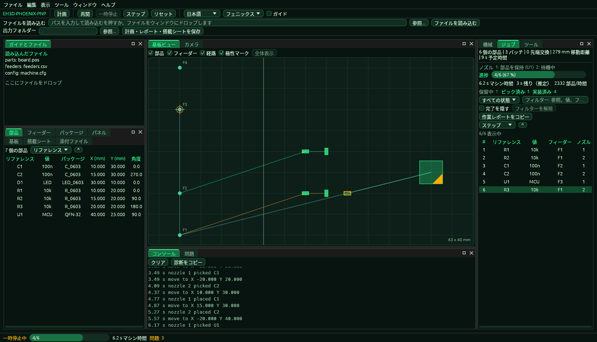

<p align="center">
  
</p>

# 📖 EH3D-PHOENIX-PNP

<p align="center"><a href="README.md">🇺🇸 English</a> | <a href="README_spa.md">🇪🇸 Español</a> | <a href="README_fra.md">🇫🇷 Français</a> | <a href="README_ita.md">🇮🇹 Italiano</a> | <a href="README_deu.md">🇩🇪 Deutsch</a> | <a href="README_zho.md">🇨🇳 中文</a> | 🇯🇵 <b>日本語</b> | <a href="README_por.md">🇵🇹 Português</a></p>

### ピック＆プレース実装：位置、フィーダー、実装順序

<p align="center">
  
  
  
  
  
</p>

---

**正直さの確認 - 現在実際に動くもの：** Rust のライブラリとコマンドラインプログラム（`phoenix-pnp`）で、コンピューター上で動く 1240 個のテストがあります。基板の位置ファイルを読み、各部品にフィーダーを割り当て（優先度、トレイ、ストリップに対応）、機械の設定をファイルから読み、最大6本のノズルを持つヘッドの配置順を計画し（ランク、ノズルチップ、角度の制限、移動時間、パネル）、搭載シートを書き出し、模擬機械で故障を注入しながら計画を一手ずつ実行します。ウィンドウ（`--features gui` でビルド）もあり、そのロジックは画面なしでテストされていますが、描画そのものはテストの対象外で、プログラム自身が自分のウィンドウの画像（`--shot`）を撮りますが、人が画面で描画を確認してはいません。機械は制御しません。実機では試しておらず、実際のファイル群での確認もしていません。

---

> **安全とセキュリティの状況：** このプログラムは機械を制御せず、安全システムでもありません。出力は、機械で何かを実行する前に人が確認する必要があります。ここにあるものは実機で動かしたことがありません。


## 📋 ひと目で

| | |
|---|---|
| バージョン | `0.1.1` |
| 成熟度 | 足場 |
| テスト | 1240 |
| 技術スタック | Rust |
| 実機での動作 | 未試験：ここにあるものは機械で動かしたことがありません |

**移動先：** [概要](#-概要) · [アーキテクチャ](#-アーキテクチャ) · [クイックスタート](#-クイックスタート) · [テスト](#-テスト) · [構成](#-リポジトリの構成) · [関連](#-関連プロジェクト)

## 🚦 プロジェクトの状況

各行はこのリポジトリの一部分で、信号は今日どこまで進んでいるかを示します。計画ではなく、リポジトリが示せるもの（テスト、ビルド、実行）に基づいて書かれています。

🟢 完了・検証済み · 🟡 動作する（既知の制限あり） · 🟠 一部のみ、または未検証 · 🔴 未実装または動作しない

| 領域 | 状態 | ここでの意味 |
|---|---|---|
| コア | 🟡 | 基板の位置ファイルを読み、各部品にフィーダーを割り当て（優先度、トレイ、ストリップ）、最大6本のノズルを持つヘッドの配置順をランク、ノズルチップ、角度の制限、移動時間とともに計画し、パネルを計画し、搭載シートを書き出します。通常の入力と壊れた入力でコンピューター上でテスト済みですが、実際のファイル群ではありません。 |
| コマンドライン | 🟡 | `phoenix-pnp` はライブラリと同じ関数（`parts`、`check`、`plan`、`schedule`、`preflight`、`simulate`、`loadsheet`、`config-check`, `check-bottom`, `tables-check`, `recipe-check`, `import-centroid`, `vision-test`）を実行して結果を表示します。エラーはすべて `PHOENIX-PNP-NNN` のコード付きメッセージと0以外の終了コードで返ります。 |
| テスト | 🟡 | 1240 個のテストが通ります（`cargo test`）。通常のケース、境界のケース、壊れた入力、小さな生成ケースを含みます。 |
| 機械の設定 | 🟡 | バージョン付きの `キー = 値` ファイル、行を示す検証、安全限界（Z の行程、X と Y の限界、再試行、ノズルの角度）。値は実機とは比較していません。 |
| シミュレーターとジョブ | 🟡 | 仮想時計、確率（シード付き）または指定した場所で注入する故障、再試行、警告と保留の方針、故障が続くと止まるフィーダー、一時停止、一手ずつの実行、再開用に保存する状態。模擬のみで、実機は動かしていません。 |
| セキュリティ | 🟡 | 安全な Rust のみ（`forbid(unsafe_code)`）。受け取ったファイルでパニックせず、不正な値は理由付きのエラーになります。独立したレビューはありません。 |
| ウィンドウ | 🟠 | egui のウィンドウ（`--features gui` でビルド。コマンドなしの `phoenix-pnp` で開きます）：ジョブ、部品、パッケージ、フィーダー、搭載シート、マシン、ツール、問題、ログのタブ、ヘッドの経路・極性マーク・次の部品を示す作業テーブルの地図、5ステップのガイド、元に戻せる修正つきの問題一覧、一時停止・再開・ステップができる模擬ジョブ、8言語に対応。ロジックは画面なしでテスト済みですが、描画はテストの対象外で、プログラム自身が自分のウィンドウの画像（`--shot`）を撮りますが、人が画面で描画を確認してはいません。さらに、パネル（フィデューシャルと部品を動かす補正付き）と基板のタブ、ファイル選択、元に戻せるフィーダーとパッケージの表の編集、記憶される列の幅、Windows でコンソールなしで開く専用プログラム（`phoenix-pnp-gui`）があります。 |
| 実機 | 🔴 | 未試験：ここにあるものは機械で実行したことがありません。 |
| ドキュメント | 🟡 | 8 言語の README、変更履歴、`docs/` から描いた 2 枚の図。 |

## 🎯 概要

* **部品**（`src/parts.rs`）：KiCad の `.pos` ファイルまたは CSV（カンマまたはセミコロン、引用符、名前で見つけるヘッダー）。位置は mm、mil、インチ、角度は 0〜360、面は上か下。意味のない行は行番号付きで拒否され、同じ参照の重複はエラーです。
* **実装しない部品、例の表、ジョブのレポート**（`src/parts.rs`、`src/commands.rs`、`src/job.rs`）：CSV の列 `dnp`、`do not place`、`fitted`（または `--dnp R1,R2`）で指定した部品は、計画・搭載シート・確認から外れ、レポートに一覧されます。`tables-check` は表（`--parts`、`--packages`、`--catalog`、`--feeders`、`--slots`）を読み、エラーごとにコードと行番号を示します。`simulate --report-csv FILE` はジョブの統計を、見出しが変わらない CSV で書き出します。`examples/` には `dnp` 列のある基板、あらゆる種類のフィーダー、一般的なパッケージの表があります。
* **フィーダー**（`src/feeders.rs`）：フィーダーの CSV（ID、値、パッケージ、ピック位置、残数）。各部品には、大文字小文字を区別せず値とパッケージが一致する最初のフィーダーが割り当てられます。フィーダーのない部品と枯渇するフィーダーは報告され、同種の 2 つ目のフィーダーが引き継ぎます。
* **計画**（`src/plan.rs`）：実装位置を近い順に巡り、1〜6 ノズルのバッチに分け、バッチ内のフィーダーも近い順に訪れ、下面は基板幅で鏡像にし、移動距離と所要時間の見積りを出し、JSON のジョブとして書き出します。
* **表と設定**（`src/catalog.rs`、`src/config.rs`、`src/rotation.rs`）：値が継承される部品とパッケージの表（部品、次にパッケージ、次に既定値）、`キー = 値` 形式の機械設定ファイル（`examples/machine.cfg` がすべてのキーを説明）、CSV 位置ファイルの列名の追加、パッケージ別の回転補正。
* **テープ以外も扱うフィーダー**（`src/feeding.rs`）：優先度、トレイ、ストリップ、停止したフィーダー。部品のフィーダーはファイルの順序によらず同じように選ばれます。
* **機械のプランナー**（`src/planner.rs`、`src/motion.rs`）：ランク（順に搭載するブロック）、順序の戦略、ノズルチップとその交換、ノズル角度の制限、加速度とジャークを含む移動時間、より短い経路（2-opt）、部品の原点の補正。
* **パネル、搭載シート、出力**（`src/panel.rs`、`src/loadsheet.rs`、`src/export.rs`）：パネルの中の基板とパネル、各テープのスロット、レポート、不足の一覧、ヘッドだけを動かす G コード。
* **パネルのフィデューシャル**（`src/fiducial.rs`）：マークの実測位置を設計位置に合わせ込み（マーク2個なら相似変換、3個以上ならアフィン変換）、パネルの部品をその補正で移動・回転します。マークごとに残差があり、マークが `fiducial_max_residual_mm` を超えて外れる補正は拒否されます（`--panel` と一緒に `--fiducials ファイル`、またはウィンドウのパネルタブ）。
* **不良としてマークされた基板（X-out）と 2 階層のマーク** (`src/marks.rs`, `src/panel.rs`)：パネルファイルの子要素に `"x_out": true` を付けるか `--x-out A,B/C` を指定すると、その中身ごと除外されます。計画・搭載シート・チェックには現れず、どの基板にもない名前（`PHOENIX-PNP-042`）や、すべての基板が除外されたパネル（`PHOENIX-PNP-043`）はエラーです。値またはパッケージに `fiducial_words` の語を含む、または参照が `fiducial_refs` の接頭辞に数字を付けたもの（`FID1`）である基板の部品は、その基板のマークであり、搭載されません。`--fiducials` のファイルでは、パネルのマーク（`f1`）と基板のマーク（`A/FID1`）を指定でき、基板のマークはまとめてフィットされてその基板の部品だけを動かし、測定されたマークのない基板の部品はパネルのフィットに従います。シミュレーションのみ：実機で基板を測定したことはなく、ウィンドウは基板のマークをまだ使いません。
* **プランナーとシミュレーターの追加機能：** トレイのセルを空にする順序（行、列、蛇行）、移動距離とチップ交換場所への往復を数えるノズルチップの順序探索（`tip_strategy = optimize`、`tip_opt_max_evals` と `tip_opt_time_limit_s` で制限）、パッケージごと・フィーダーごとの故障確率（`sim_part_fail`、`sim_feeder_fail`）とそれらの統計および1時間あたりの部品数、そして裏面の各規則が与える角度を表示する `check-bottom`。
* **アライメント工程** (`src/job.rs`, `src/sim.rs`, `src/model.rs`)：`align = on` のとき、ジョブは部品を吸着した後にカメラで確認し、見えたとおりに配置を補正します（ヘッドは部品のずれの分だけ手前の位置へ行き、ノズルは部品の回転の分だけ回転を減らします）。`pick_tolerance_mm` を超えてずれた部品は捨てられ、`error_policy` に従って吸着し直します。`align_passes`（1〜5）と `align_settle_s` は確認の回数と各回の前の待ち時間を決め、プランの時間に加算されます。模擬カメラには、ずれ、誤差、注入できる故障があります (`sim_align_*`, `sim_camera_fail_rate`)。補正量（平均、最大、捨てた部品）は、テキスト、JSON レポート、`--report-csv` の `align` 行に出ます。既定ではオフで、その場合ジョブは従来どおりです。実機では試していません。 `align_rereads` を 0 より大きく（最大 5、既定は 0）すると、最初の確認が許容差を超えた部品を破棄する前にカメラがもう一度見ます。許容差内の確認が最初の確認として扱われ、作業レポートはフィーダーごとに、許容差超過の確認、追加確認、それで救われた部品、破棄した部品、測定値のない確認を数えます。
* **画像処理パイプライン**（`src/vision.rs`、`src/sim.rs`、`examples/vision.cfg`）：`vision = pipeline` のとき、模擬カメラは部品の画像をメモリ上に描き（大きさ、回転、ノズルからのずれ、`sim_seed` から得たノイズ付き）、設定ファイル（`--vision FILE`）の手順で測定します：マスク、メディアンフィルタ、固定またはOtsuのしきい値、領域の面積範囲、最小の回転した矩形。その中心と角度が、アライメント工程が補正するずれになります。部品が見つからない、領域の面積が不適切、領域が複数ある場合は、測定値のない確認となり、それぞれ固有のコード（`PHOENIX-PNP-037` から `PHOENIX-PNP-039`）が付きます。`phoenix-pnp vision-test` は、与えた大きさ・回転・ずれ・ノイズで部品を描き、測定値とその誤差を表示します。既定ではオフで、その場合ジョブは従来どおりです。実際のカメラでは試していません。
* **作業レポート** (`src/report.rs`, `src/job.rs`)：ジョブを模擬実行したあと、`simulate` はレポートを、`--lang` の言語のテキスト (`--report-text`)、すべてを含みスクリプトも外部のものも使わず既存のファイルには決して上書きしない HTML ページ (`--report-html`)、CSV の行の後ろに追加するセクション (`--report-csv`、ヘッダーは変わりません)、JSON の `work` (`--report`) として書き出せます。搭載した部品、保留した部品、オペレーターがスキップした部品、未処理の部品、実装しない部品の数、マシン時間の内訳（供給とピック、カメラの確認、搭載、ヘッドの移動、ノズル交換）、初回のピックで成功した数、パッケージ・フィーダー・ノズル・ノズル先端・パネルの基板ごとの同じ集計、発生したエラーとそのコード、ジョブ前の指摘、カメラが補正した量（X、Y、回転）のヒストグラムを示します。シミュレーションであり、実機で測定した値ではありません。
* **ジョブタブとオペレーターの判断** (`src/gui/jobtab.rs`, `src/gui/window.rs`, `src/job.rs`)：表には、各配置の状態（待機、ピック済み、整列済み、搭載済み、保留、スキップ、失敗）と実装しない部品、マシン時間と残り時間の見積もり付きの進捗バー、状態・テキスト・完了済みによるフィルターが表示されます。エラーでジョブが止まると、ダイアログが失敗した工程を示し、模擬ジョブに対して実行される 4 つの操作を提示し、その後ジョブは続行します：再試行、部品をスキップ、保留、または同種の別のフィーダーに引き継がせるためにフィーダーを停止。判断はレポートで集計されます。ロジックは画面なしでテストされており、人が画面で描画を確認してはいません（`images/screens/` にあるこのタブの画像はプログラム自身が撮ったものです）。
* **真空、アクチュエーター、フィーダーの故障ウィンドウ** (`src/sim.rs`, `src/job.rs`, `src/config.rs`)：`vacuum = on` のとき、シミュレートされたポンプは各ピックの後に `vacuum_suck_s` 秒吸引し、ノズルのレベル（キロパスカル）を読み取ります。`vacuum_pick_min_kpa` を下回るレベルはノズルが部品を保持していないことを意味し（`PHOENIX-PNP-044`、ピックは再試行の設定どおりにやり直されます）、各配置で `vacuum_blow_s` 秒のブローの後に `vacuum_release_max_kpa` を上回るレベルは部品がまだノズルに付いていることを意味します（`PHOENIX-PNP-045`）。センサーは専用の乱数生成器（`sim_vacuum_noise_kpa`, `sim_vacuum_miss_rate`, `sim_vacuum_stuck_rate`）を持ち、既定ではオフなので、使わないジョブは従来と全く同じです。オン/オフのデバイスは `actuator = 名前 : 遅延秒` で宣言し、`Job::set_actuator` で切り替えます（遅延は時計に加算され、マシンにない名前は `PHOENIX-PNP-046`）。`fault_action = alert` のとき、直近 `fault_window` 回のピックのうち `fault_limit` 回失敗したフィーダーは自動ではオフになりません。ジョブが停止し（`PHOENIX-PNP-047`）、Job タブのダイアログで再試行、部品の除外、脇に置く、フィーダーをオフにする、のいずれかを選べます。
* **カメラモデル、マシンのヘッド、パッケージが受け付けるノズルチップ** (`src/camera.rs`, `src/heads.rs`, `src/tips.rs`, `src/config.rs`): カメラは `camera_units_per_px`（0 はビジョンパイプラインの設定サイズ）、`camera_offset_x_mm` と `camera_offset_y_mm`（画像内のノズル軸の位置）、`camera_rotation_deg`、`camera_flip_x` と `camera_flip_y`、およびレンズ（`camera_lens_scale`、`camera_lens_k1`）で記述されます。位置合わせステップのシミュレートされたカメラは、画像の有無にかかわらずこのモデルを通して部品を読み取り、既定値ではジョブは従来と全く同じです。`head = 名前 : ノズル数 [: オフセットX : オフセットY : カメラX : カメラY : カメラ回転 : カメラ単位 : カメラレンズ]` は最大4つのヘッドを宣言し、それぞれがノズル、オフセット、カメラを持ちます。ヘッドが2つ以上のとき `schedule` は各部品を届くヘッドに割り当て（どれも届かなければ `PHOENIX-PNP-048`）、各ヘッドを計画し、別のヘッドが使っているフィーダーをヘッドが待つ時間をマシンの時計で数えます。`tip_compat = パターン : チップ, チップ, ...` はパッケージが受け付けるチップを列挙し、`tip_compat_mode`（`fewest_changes` または `preferred`）は部品の種類ごとにチップを1つ選び、マシンのチップ交換をできるだけ少なくします。表で指定されたチップはそのまま使われます。
* **レシピ** (`src/recipe.rs`, `src/job.rs`, `src/commands.rs`)：バージョン付きのテキストファイル（`examples/job.recipe`）が、ジョブの手順（`prepare`、`pick`、`align`、`place`、`check`。この順序で、重複なし。位置合わせの手順と真空チェックは、レシピに書かれているときだけ有効）と、パッケージ・フィーダー・ノズルチップごとに変わるパラメーター（`pick_retries`、`pick_tolerance_mm`、`vacuum_suck_s`、`vacuum_blow_s`。各キーでは最初に一致したルールが優先され、フィーダー、パッケージ、チップの順に見ます）を定めます。`phoenix-pnp recipe-check FILE` で読み込んで検査し、`simulate ... --recipe FILE` でそのレシピに従ってジョブを実行します。エラーのコードは `PHOENIX-PNP-049` から `PHOENIX-PNP-052`（無効な行、順序の誤った手順、上限を超えたファイル、新しすぎるバージョン）で、上限は `machine.cfg` のキー `recipe_max_bytes` と `recipe_max_rules` です。保存した状態は直前のピックのフィーダーと停止したピックも覚えているため、別の実行で読み込んだジョブでも担当者に同じ判断が提示されます（古い状態も引き続き読み込めます）。
* **位置ファイルの取り込み** (`src/import.rs`, `src/commands.rs`)：`phoenix-pnp import-centroid FILE` は、セントロイド CSV（`--map FILE` で列を指定。`examples/centroid.map`。`examples/centroid.csv` はマップ不要）、EAGLE の位置テキスト（`examples/board.mnt`：名前、x、y、回転（底面は `R90` または `MR90`）、値、パッケージ）、KiCad の `.pos` のいずれかを読み込み（`--format auto|csv|eagle|kicad-pos`。`auto` は最初の行で判別）、部品表 `ref,val,package,x,y,rot,side,dnp` をミリメートルで `--out`（既存のファイルは上書きしません：`PHOENIX-PNP-040`）または標準出力に書き出します。単位は mm、mil、inch です（見出しの `X (mil)`、セルの `0.5in`、コメントの `## Unit = inch`、マップ、または `import_unit` で指定）。角度は 0 以上 360 未満になり、面の列は省略できます。列 `dnp` または `fitted`（または参照番号の範囲を使う `--dnp R1-R5,C7`）で実装しない部品を示し、`import_bottom_mirror_width_mm` は底面の X を反転し、`bottom_rotation` は底面の角度を回します。3 つの読み取り処理はこのプログラム自身のもので（依存関係を増やさずに使える他のリポジトリの読み取り処理はありません）、EAGLE のテキストの並びは実際の環境が書いたファイルとは比較していません。すべてのエラーには `PHOENIX-PNP-053` から `PHOENIX-PNP-056`（無効な行、マップの列がない見出し、未知の形式、無効な参照番号の範囲）のコードと行番号が付きます。
* **部品表**（`src/bom.rs`、`src/cmd_tools.rs`）：`phoenix-pnp bom-check 部品 BOM` は部品表（`examples/bom.csv`：1 つのセルに範囲または 1 行ごとのリファレンスと、あれば値、パッケージ、数量、型番）を読み、片側にしかないリファレンス、2 回載っているもの、値やパッケージの違い、数量が合わない行を示します。実装しない印の付いた部品は部品表にあってもなくても構いません。ファイルのエラーにはコード `PHOENIX-PNP-057` と行番号が付きます。
* **生産ロットの在庫**（`src/stock.rs`）：`phoenix-pnp stock 部品 フィーダー --boards N` は基板数を合算し、部品の種類ごとに、N 枚に必要な数と有効なフィーダーにある数を比べ、不足する種類、不足数、最初のリールが空になるまでの枚数を示します。不足があれば 1 で終了し、`--out` で表を書き出します。`bom-order --have フィーダー` は、フィーダーにすでにある分を購入リストから差し引き、`on_hand` と `to_buy` の列を出します。
* **カメラの校正**（`src/calibrate.rs`）：`phoenix-pnp camera-calibrate ファイル` は、ヘッドの既知の位置でのマークの観測（`px,py,x_mm,y_mm` [例： `examples/camera_points.csv`]、3 点以上）にカメラのモデル（1 画素の大きさ、回転、反転、画像内のノズル軸の位置）を当てはめ、当てはまり具合と設定用の `camera_*` 行を出力します。レンズは当てはめません。エラーはコード `PHOENIX-PNP-058` です。
* **ノズルの振れ**（`src/calibrate.rs`、`src/export.rs`）：`phoenix-pnp nozzle-calibrate ファイル` は複数の角度でのノズル先端の読み取り（`angle_deg,x_mm,y_mm` [例： `examples/nozzle_readings.csv`]）に円を当てはめ、`nozzle_runout_mm` と `nozzle_runout_deg` を出力します。振れが 0 より大きいとき、`schedule --gcode` の G コードは各実装位置を部品の角度での振れと逆向きに動かします。
* **基板を格子状に並べたパネル**（`src/panel.rs`、`src/cmd_tools.rs`）：`phoenix-pnp panelize 基板 --cols N --rows N --pitch-x MM --pitch-y MM` は、1 枚の基板のコピーを同じ回転で格子状に並べたパネルファイルを書き出します。余白を置いた 3 つのフィデューシャル（`--fiducials MM`、基板の実寸は `--board-size W,H` で指定）と、名前 `P1`、`P2`、… で不良の印を付けた基板（`--x-out P2,P5`）に対応します。既存のファイルは上書きしません。
* **向きのある部品のシート**（`src/polarity.rs`）：`phoenix-pnp polarity-sheet 部品` は、リファレンスが `polarity_refs` に、またはパッケージが `polarity_packages` に一致する部品（既定ではダイオード、LED、IC、トランジスタ、有極性コンデンサ、コネクタ）を、位置・回転・チェック用の空欄とともに一覧にします。作業後の目視確認用で、`--side` で片面に絞れます。
* **軸のバックラッシュ**（`src/sim.rs`、`src/motion.rs`）：`backlash_x_mm`、`backlash_y_mm`、`backlash_mode` により、シミュレートした機械は、軸が反転する移動をバックラッシュ分だけ手前で終える（`off`、`simulate` が数える）か、位置を通り過ぎて正の側から戻ります（`approach`、時間は増えますが誤差は残りません）。バックラッシュが 0 なら何も変わりません。
* **購入部品リスト**（`src/bom.rs`）：`phoenix-pnp bom-order BOM --boards N` は、部品表の同じ部品の行を合算し、各行に N 枚分の部品と予備（`order_spare_percent` パーセントまたは `order_spare_min` の大きい方。`--spare-percent` と `--spare-min` が優先）を付けます。`--parts 部品` で実装しない印の付いた部品は除き、パッケージと値で並べた CSV を書き出します。
* **フィーダーの教示**（`src/calibrate.rs`）：`phoenix-pnp feeder-teach strip` は最初と最後の部品の位置からテープのピッチと角度を、`feeder-teach tray` はトレイの 3 つのセルから 2 つのピッチと角度を（列の直角からのずれとともに）求め、どちらもフィーダーファイルで設定される列を出力します。`feeder-teach --measures FILE` は 1 つのファイルから複数のフィーダーの位置を読み、それぞれについて 1 行とフィーダーファイルの 1 行を出力します（`examples/feeder_measures.csv`）。
* **シミュレーターとジョブ**（`src/sim.rs`、`src/job.rs`、`src/preflight.rs`、`src/model.rs`）：ジョブ前の確認、仮想時計と注入できる故障を持つ機械、一時停止・一手ずつの実行・保存・再開ができるジョブ。
* **ウィンドウ**（`src/gui.rs`、`src/gui/`）：描画以外の処理は画面を必要とせず（読み込んだファイル、計画とその問題・修正、模擬ジョブ、地図の幾何、選択を共有する表、5ステップのガイド、8言語の文言）、テストされています。`--features gui` でビルドする `src/gui/window.rs` だけが egui で描画します。シミュレーションの速さ、テーマ、未知のパッケージの部品に描くサイズは `machine.cfg` のキー（`gui_steps_per_s`、`gui_theme`、`gui_part_size_mm`）です。
* **ノズル上の部品の確認**（`src/inspect.rs`、`src/cmd_vis.rs`）：`phoenix-pnp part-inspect 測定値 --sizes 寸法表`（または `--packages パッケージ表`）は、カメラが測った各部品（2 辺、軸からの垂れ位置、回転量）をパッケージの大きさと比べ、不合格の理由を示します（`part_size_tol_mm`、`part_angle_tol_deg`、`part_offset_max_mm`）。大きさは寸法表、またはパッケージ表の列 `body_long_mm` と `body_short_mm`（`examples/packages_bodies.csv`）から取り、不合格または寸法なしの部品がある間は 1 で終了します。
* **チューブとバルクのフィーダー**（`src/feeding.rs`、`src/feedlib.rs`）：テープ、トレイ、ストリップに加えて、フィーダー表の `kind` 列は `tube`（部品がストッパーまで滑るスティックやレール）と `bulk`（容器やボウルに入った、決まった向きでは来ないばら部品）を受け付けます。どちらもテープと同じく 1 か所 `x`、`y` からピックし、部品の角度は `rotation` から取り、個数で空になり、`feeder-check` で検査されます。ウィンドウのフィーダータブは 8 言語で 5 種類すべてを選べます（`examples/feeders_tubes.csv`）。
* **フィーダー別の搭載数と時間**（`src/job.rs`、`src/feedrep.rs`、`src/report.rs`）：ジョブは各ノズルがどのフィーダーから部品を取ったかを記録し（同じ種類の別のフィーダーが引き継いだ場合も）、その部品をそのフィーダー由来の搭載として数え、各フィーダーからピックした工程（そこまでの移動、送り、ピック、確認）の時間を加算します。作業レポート、その JSON、`simulate --report-feeders`（末尾の列 `placed` と `busy_s`）に表示され、保存したジョブにも保持されます。
* **ノズルチップの寿命**（`src/nozzlelife.rs`、`src/cmd_tools.rs`、`src/commands.rs`）：`simulate --nozzle-life ファイル` は、最後まで実行されたジョブが各チップで行ったこと（搭載数と装着回数）を、設定の隣に置く小さな CSV に加算します。ジョブは 1 回だけ数えられ、チップの記録ではないファイルは上書きされず、置き換えられるファイルは `ファイル.prev` として残り、`nozzle-life ファイル --reset チップ` でチップの交換を記録したときだけ数が減ります。`nozzle_life_warn`（既定 500000、0 は警告なし）は、チップを確認するよう知らせる搭載数で、`simulate` と `nozzle-life` が知らせます。新しいエラーコード `PHOENIX-PNP-059`。
* **どの順序が最速か**（`src/compare.rs`、`src/commands.rs`）：`phoenix-pnp order-compare 部品 フィーダー` は、同じ基板を搭載位置のすべての `order`（nearest、part、height_part、pick、tips、none）とすべての `tip_strategy`（minimize、as_planned、optimize）で計画し、バッチ数、チップ交換、ヘッドの移動距離、秒数を並べて表示します。各一覧の最速と設定中のものに印を付け、より良い設定で何秒短縮できるかを 1 行で示します。`schedule` のオプションを受け付け、何も変更しません。
* **計画の図**（`src/preview.rs`、`src/commands.rs`）：`phoenix-pnp schedule 部品 フィーダー 出力.json --svg 出力.svg` は、計画を 1 つの SVG ファイルとしても書き出します。機械が動く前に見たり、印刷したり、ジョブと一緒に保管したりできます。フィーダー、各部品の位置（順番の番号とノズルの色付き）、各部品がフィーダーから通る線、ヘッドがジョブ全体を移動する破線の経路、合計を描きます。スクリプトも外部の参照も含まず、参照名や ID に入力された文字はエスケープされ、既存の図は上書きされません。
* **パターンによるカメラ校正** (`src/pattern.rs`, `src/cmd_tools.rs`)：`phoenix-pnp camera-pattern FILE [--pitch MM]` は格子の点（チェッカーボードの内側の角、またはドットの中心）を `col,row,px,py` 形式で読み込み（`examples/camera_pattern.csv`）、1 ピクセルの大きさ（`camera_units_per_px`）とレンズの放射状の歪み（`camera_lens_k1`）を、画像内のシートの回転・移動・鏡像とともにあてはめます。続いて、歪みを含める場合と含めない場合のモデルからの点のずれと、最も離れた点を示します。設定用の行を出力し、点が `camera_pattern_max_residual_mm` を超えると終了コードは 1 になります。点の間隔は `camera_pattern_pitch_mm` です。カメラの回転とオフセットは、ヘッドを動かす `camera-calibrate` から得ます。ツールタブにも同じ校正があり、上限を超えたあてはめはマシンに反映されません。
* **どのフィデューシャルがずれているか** (`src/fidcheck.rs`, `src/gui/workspace.rs`, `src/gui/tables.rs`)：パネルの測定マークを使うと、ウィンドウは各マークの残差（あてはめが拒否された場合も、理由が分かるように計算します）、除くと他のすべてのマークが `fiducial_max_residual_mm` 以内になる唯一のマーク、そして回転・倍率・せん断を上限と照らして求めます。フィデューシャルの表は、上限を超えたマークに `!`、合わないマークに `?` を付け、パネルは警告を文章で（ログにも）表示します。`fidcheck::analyze_marks`、`fidcheck::warnings`、`fidcheck::residual_table` は同じ内容を `fiducial-check` コマンドとフィデューシャル確認ツールに提供します。
* **ジョブのキュー** (`src/queue.rs`, `src/cmd_queue.rs`)：複数の基板またはパネルを順に処理します。`phoenix-pnp queue-add キュー 名前 ソース フィーダー [--panel] [--boards N]` は、プログラムが止まっても残る小さな CSV にジョブを追加します（一時ファイルに書いてから所定の場所へ移し、置き換えたファイルは `パス.prev` として残し、最終行にチェックサムを持つため、途中で切れたファイルや手で変更されたファイルは拒否されます）。`queue-status [--check]` はジョブとそれぞれの状態（pending, running, done, failed, skipped）を一覧し、`--check` でこれから行うジョブの計画を立てます。`queue-edit` はジョブのスキップ、リセット、確認の取り消し、削除を行い、`queue-run` はシミュレーション機で基板 1 枚ずつジョブを処理し、1 枚ごとにキューを書き込みます。確認なしには何も実行されません。`queue_confirm` が有効（既定）なら、`queue-confirm` が計画の識別情報（計画とその元のファイルの内容）を記録した後でのみジョブが実行され、ファイルが変わると無効になります。`queue_stop_on_failure`（既定は有効）は最初に失敗したジョブでキューを止めます。`.lock` ファイルがある間は同じキューへの 2 つ目の `queue-run` は拒否されます。ツールタブのキューツールはこれらすべてをボタンで行います。新しいエラーコード `PHOENIX-PNP-060`。
* **UTF-16 のテキスト** (`src/parts.rs`)：コマンドとウィンドウが読み込むすべての表と設定ファイル（位置、フィーダー、パッケージ、部品表、パネル、測定マーク）は、Windows のプログラムや表計算ソフトが「Unicode テキスト」として保存する、バイトオーダーマーク付きの UTF-16 でもかまいません。UTF-8 と同様に読み込まれます。どちらでもないテキストは注記付きで Latin-1 として読み込まれ、ファイルを読み込むツールタブのツールはそれを拒否します。
* **レンズの補正** (`src/camera.rs`, `src/sim.rs`)：`camera_correct_lens = on` にすると、カメラは見えたものからレンズの歪み（`camera-pattern` が求める `camera_lens_k1`）を取り除くため、アライン工程の読み取り値は歪みのないレンズのものになります。`CameraModel::to_machine_corrected` と `read_corrected` は `d * (1 + k1 * d * d)` を逆算して行います。オフ（既定）では歪みが読み取り値に残ります。このとき `camera_units_per_px` は、`camera-pattern` が求める 1 ピクセルの実際の大きさにしてください。
* **キューのフォルダーからの相対パス** (`src/queue.rs`, `src/cmd_queue.rs`)：`queue_relative_paths = on`（または `queue-add --relative`）では、キューファイルのフォルダー内（またはその下）にあるジョブのファイルをそのフォルダーからのパスとして保存するため、フォルダーを移動・共有できます。`queue-status`、`queue-confirm`、`queue-run` はどのフォルダーから実行してもキューのフォルダーを基準に解決します。オフ（既定）は絶対パスを保存し、どちらも同じように動作し、計画の識別子も同じです。
* **ボタン付きのキュー** (`src/gui/queuetab.rs`, `src/gui/window.rs`)：ツールタブのキューツールはキューファイルをジョブの一覧として読み込み、ジョブの追加（ウィンドウの言語で検証されるフォーム）、計画の確認、選択したジョブの計画の確定、確定の取り消し、スキップ、リセット、削除、実行のボタンを備えます。各ボタンはウィンドウの隣にあるプログラムで同名のコマンドを実行するため、ウィンドウとコマンドラインは同じ方法で計画・確定・実行します（計画の識別子もロックも同じ）。実行ボタンの最初の押下は確認だけ（`queue_gui_ask_run`、既定でオン）で、2 回目がシミュレートされた機械での実行をバックグラウンドで開始し、停止ボタンもあります。
* **悪化させられるシミュレートカメラ** (`src/vision.rs`)：`vision.cfg` に `sim_blur_px`（ピンぼけ）、`sim_salt_pepper`（白黒に変わる画素）、`sim_gradient_levels`（ムラのある照明）、`sim_failure_rate` と `sim_failure_kind`（一部の画像が壊れる：部品がない、照明が消えている、全体が飽和）が加わりました。すべて既定ではオフで、これらを使わないジョブのノイズは変わりません。`vision-test` と `simulate --vision` は、これまでのノイズと同じように使えます。
* **チェックを試すための読み取り値** (`src/visionsim.rs`, `src/cmd_vis.rs`)：`phoenix-pnp vision-readings PARTS --sizes F` は、位置ファイルの各部品についてシミュレートカメラが撮る画像（軸から少しずれて回転し、`--spread` と `--turn` の範囲内。`--wrong-every N` で N 個ごとに別サイズの部品にする）を描き、`part-inspect` が読むファイルに読み取り値を書きます。`phoenix-pnp vision-marks DESIGN --shift X,Y --turn DEG --scale S` は、指定どおりに置かれたパネルの各マークを見て、`fiducial-check` が読む測定済みマークを書きます。ぼけ、ノイズ、故障は `--vision` から、何も見つからない画像は読み取り値なしで理由付きで報告され、同じ `--seed` は同じ読み取り値になります。
* **保存できる作業レポート** (`src/report.rs`)：`simulate --report-html FILE`（スクリプトも外部参照もない 1 ページ）、`--report-text`、`--report`（JSON）、`--report-csv` は、フィーダーごとにピック数・搭載数・保留数・スキップ数を、ノズルチップごとにこのジョブが寿命へ加えた数（`--nozzle-life` がジョブ前の記録を渡す）、使用前後の回数、`nozzle_life_warn` に達したときの警告も示すようになりました。時間、チェックの指摘、コード付きのエラーは以前からあります。
* **より正確な計画時間** (`src/planner.rs`)：`backlash_mode = approach` では機械が軸のバックラッシュ分だけ位置を通り過ぎて戻るため時間がかかります。計画はこれを省いていましたが、区間ごとに数えるようになり（軸の限界の手前に余裕がある場合のみ）、計画の秒数はシミュレートされたジョブの秒数と一致します。`AdvancedPlan::approach_s`、計画のレポートとその JSON が、2 回目の動きに充てた秒数を示します。チップは引き続きバッチにまとめられ、バッチのフィーダーは近い順に巡回します。approach 以外では何も変わりません。
* **一般的なパッケージの寸法** (`src/pkggen.rs`, `src/cmd_tools.rs`)：`phoenix-pnp package-gen 0603 SOT-23-5 SOIC-8 QFN-32-5x5 LQFP-48`（位置ファイルのパッケージなら `--from PARTS`）は、EIA コードのチップ、SOT、SOD、SOIC（狭幅・広幅）、TSSOP、QFN、DFN、QFP の公称寸法から、本体を保持するテープ幅付きでパッケージ表の行（`package,height_mm,tape_mm,body_long_mm,body_short_mm`）を書き出します。`part-inspect` の `--packages` とカタログがその結果を読みます。未知の名前は、推測せず理由付きのエラーになります。 `phoenix-pnp package-kicad PATH...` は KiCad のフットプリントファイルから同じ表を作ります（`src/kicadmod.rs`、`examples/chip_0603.kicad_mod`）。本体は製造レイヤーの図形を囲む箱で（なければ注記つきでコートヤード）、高さは名前が既知ならそのパッケージの値、そうでなければ `--height` です。読み取りはサイズ・深さ・要素数が制限され、理解できないファイルは理由つきで示されます。
* **学習した搭載ずれ** (`src/learn.rs`, `src/cmd_tools.rs`, `src/job.rs`)：`phoenix-pnp place-learn READINGS --state F` は `package,dx_mm,dy_mm`（部品が本来の位置からどれだけずれたか）の行を読み、パッケージごとの平均ずれをチェック番号つきのファイルに保存します。同じパッケージの他の測定値から大きく離れた測定値は除外され、測定値が少なすぎるパッケージは変更されず、既知のずれは最大 `place_learn_memory` 件分として数えるので、ずれていく機械にも追従でき、どのずれも `place_learn_cap_mm` を超えません。`--residual` はずれを適用済みで取った測定値用、`--dry-run` は何も書かず、`--show` と `--forget` はファイルを読み、整理します。学習は `place_learn` がオンになるまでオフで、`simulate --place-offsets FILE` は `place_learn_apply` がオンのときだけヘッドを各位置からそのパッケージのずれ分引いた場所へ送ります。途中で切れたファイルや手で変更したファイルは拒否されます。
* **他のプログラム向けのジョブのファイル** (`src/exchange.rs`, `src/commands.rs`, `src/cmd_tools.rs`)：`phoenix-pnp job-export PARTS FEEDERS OUT [--state F]` は、計画（`schedule` と同じ文書）、各部品の状態（`pending`、`placed`、理由つきの `deferred`、`skipped`）、ジョブの段階（準備完了、一時停止、停止、完了）を、バージョンと種別つきの 1 つの JSON ファイルに書き出します。`simulate` の保存状態を渡すと、そのジョブの現在位置を示します。`phoenix-pnp job-import FILE [--csv F]` はそのようなファイルをすべての検査つきで読みます（サイズと搭載数の上限、100000 mm 以内の有限の数値、長さが制限され制御文字のない名前と理由、参照は 1 回だけ、バッチとノズルの数え上げ、各搭載に同じ参照を名指す状態の行、状態と合う段階）。中身を説明し、搭載を状態つきの表として書き出せます。ここから何かが実行されることも、機械に何かが適用されることもありません。
* **フック（既定ではオフ）** (`src/hooks.rs`, `src/commands.rs`, `examples/hooks.csv`)：`simulate --hooks FILE` は、ジョブの出来事（`job-finished`、`job-paused`、`job-stopped`、`part-aside`、`feeder-off`）に応じてオペレーターのプログラムを実行し、ランプの点灯、音、メッセージの送信などに使えます。プログラムの実行はこのライブラリで最も危険な操作なので、`hooks` をオンにするまでオフです（`--hooks-dry-run` は実行されるものを一覧するだけ）。規則ファイル（`event,program,argument...`）は実行してよいものの一覧です。プログラムは規則ファイルと同じフォルダーにあるファイルで、名前は英数字と `.`、`_`、`-` のみ。パス、システムの検索、シェル、フォルダー外へのリンクは決して使えません（バッチファイル、つまり `.bat` や `.cmd` は使えますが、システムのコマンドを実行するため、規則に書かれたものはジョブの実行前に警告されます）。引数は 1 つずつ渡され、出来事のデータは `{event}`、`{reference}`、`{feeder}`、`{reason}`、`{phase}`、`{placed}`、`{total}` で入ります。規則ファイルにはサイズの上限と最大 50 件の規則があり、1 つのジョブで実行されるのは最大 `hooks_max_runs` 個、各プログラムの持ち時間は `hooks_timeout_s` 秒、出力は 4096 バイトで切られます。失敗したフックはジョブに何も影響しません。
* **模擬ジョブのジャーナル** (`src/journal.rs`, `src/commands.rs`)：`simulate --journal FILE` は、ジョブの各ステップを 1 行ずつ書き出します。部品、計画がその部品を取るフィーダー、ノズル、機械の時計での秒、ステップにかかった時間、結果（`ok`、またはジョブを止めたエラーのコード）です。記録するジョブも記録しないジョブと同じステップを踏みます。エラーで止まったジョブでもジャーナルは残り、失敗したステップが最後の行になります。既存のファイルは上書きしません。
* **2つの部品テーブルの差分** (`src/partsdiff.rs`, `src/cmd_more.rs`)：`phoenix-pnp parts-diff FIRST SECOND [--tol MM] [--rot-tol DEG] [--out F]` は、2つの位置ファイルをリファレンスで突き合わせ、部品ごとに、追加または削除された部品、移動した部品、回転した部品、値やパッケージが変わった部品、反対の面に移った部品を示します。`--tol` 以内の位置と `--rot-tol` 以内の回転（近い方向で測定）は同じとみなし、大文字小文字だけが違う値やパッケージも同じとみなします。`--out` は変更を CSV で書き出します。テーブルが異なるときは終了コード 1 です。
* **2つの設定の差分** (`src/configdiff.rs`, `src/cmd_more.rs`)：`phoenix-pnp config-diff FIRST SECOND` は、2つの設定ファイルが、書き方ではなく意味として異なる値にしている項目を一覧にします。`yes` と `on`、`5` と `5.0`、既定値を書いた行と行がないことは同じ扱いです。ファイルが設定していない項目は `(default)` と表示され、無効なファイルはコードとともに示されます。機械が異なるときは終了コード 1 です。
* **部品テーブルの中身** (`src/boardstats.rs`, `src/cmd_more.rs`)：`phoenix-pnp board-stats PARTS [--near MM] [--limit N]` は、各面の部品数、種類（値とパッケージ）、各パッケージ、中心を囲む範囲を数えます。`--near` を付けると、すべての組を比べるのではなくグリッドを使って、同じ面で中心がその距離（0.01〜50 mm）より近い部品（2回コピーされた部品、同じ原点にある2つのフットプリント）を見つけます。組が見つかったときは終了コード 1 です。
* **フィーダーでキューの分が足りるか** (`src/queuestock.rs`, `src/cmd_more.rs`)：`phoenix-pnp queue-stock QUEUE [--out F]` は、これから行うジョブが順にフィーダーから取る部品を合算し、部品の種類ごとに、フィーダーにある数、不足する数、リールが尽きるジョブを示します。同じフィーダー表を使うジョブはそのリールを共有します。オフのフィーダーとパネルは数えません。リールが足りないときは終了コード 1 です。
* **ジョブ後のフィーダー表** (`src/deplete.rs`, `src/cmd_more.rs`)：`phoenix-pnp feeder-deplete FEEDERS --state F [--out F]` は、`simulate --state` が保存した状態を読み、いまの状態の表を書き出します。各フィーダーの個数は残りの数になり、ストリップの次の位置は取った部品の分だけ進み、トレイは位置を保ち（次のセルは個数から決まります）、ほかの列はそのまま残ります。少なくなった、または空のフィーダー（`warn_below` 未満）を知らせ、別の表の状態は拒否します。フィーダーが少ないときは終了コード 1 です。
* **リール交換後のフィーダー表** (`src/refill.rs`, `src/cmd_more.rs`)：`phoenix-pnp feeder-refill FEEDERS REFILLS [--out F]` は、新しいリールを入れたフィーダーごとに1行の表 `id,count[,x,y]` を読み、新しい個数を反映したフィーダー表を書き出します。ストリップは `x,y` から再び始まり（指定がなければ位置はそのまま）、トレイはセル数より多くの部品を持てません。表にないフィーダー、個数 0、ストリップでないフィーダーへの位置、2回指定されたフィーダーは、何も変えずにコード `PHOENIX-PNP-013` で拒否します。ほかの列と区切り文字はそのまま残ります。
* **人に残る部品** (`src/asidesheet.rs`, `src/commands.rs`)：`phoenix-pnp aside-sheet PARTS FEEDERS --state F [--pending] [--out F]` は、保存した状態のジョブの後に、取り置いた部品とスキップした部品（`--pending` ならジョブがまだ届いていない部品も）を、リールを一度だけ取れるよう値とパッケージの順に並べ、表の位置と回転、残った理由、取るはずだったフィーダーとともに一覧にします。シートに部品があれば終了コード 1 です。
* **2つのジョブの違い** (`src/jobdiff.rs`, `src/cmd_more.rs`)：`phoenix-pnp job-diff FIRST SECOND [--out F]` は `job-export` のファイルを2つ比べ、増えた部品と減った部品、フィーダー、ノズル、バッチ、先端、各部品を取る位置と置く位置（1000分の1ミリ以内の位置と100分の1度以内の回転は同じとみなします）、その結果、部品の順序、計画全体（バッチ、先端の交換、移動距離、秒数、フェーズ）を示します。ジョブが異なれば終了コード 1 です。
* **フィーダーを置く場所** (`src/slots.rs`, `src/commands.rs`)：`phoenix-pnp feeder-slots PARTS FEEDERS [--max-plans N] [--out F]` は、計画が速くなる限り、同じ種類（テープ、チューブ、バルク。有効なもの）の2台の位置を入れ替え、入れ替えごとに基板を計画し直します（最大 N 回、既定は 5000）。動くフィーダーをスロット名とともに示し、秒数と移動距離の節約量を示します。`--out` は新しい位置の表を書きます。フィーダーは位置を交換するだけで、移動先のスロットにテープが収まるかは人が確認します。より良い配置があれば終了コード 1 です。
* **同じジョブを何度も** (`src/runs.rs`, `src/commands.rs`)：`phoenix-pnp simulate-runs PARTS FEEDERS [--runs N] [--seed S] [--out F]` は、計画をシミュレーション機で N 回（既定は 20）、毎回別のシードで実行し、全部品を置けた回数、エラーで止まった回数とその種類、置いた部品と取り置いた部品、最短・中央・最長の時間を示します。`--out` は実行ごとに1行を書き、同じ最初のシードなら同じ表になります。測るのは実機ではなく、シミュレーション上の計画と設定です。置き切れない実行があれば終了コード 1 です。
* **リール1本で基板何枚か** (`src/runway.rs`, `src/commands.rs`)：`phoenix-pnp reel-runway PARTS FEEDERS [--boards N] [--out F]` は、計画が基板1枚で有効な各フィーダーから取る数を求め、そのリールが基板何枚分もつか、その後に何個残るか、どのリールが最初に尽きるかを示します。どの部品も取らないフィーダーは無限にもつので最後に載り、オフのフィーダーは載りません。`stock` は指定した枚数について答え、これは逆向きに答えます。リールが N 枚分もたないとき終了コード 1 です（指定なしは 1）。
* **ノズルは何本が得か** (`src/nozzles.rs`, `src/commands.rs`)：`phoenix-pnp nozzle-compare PARTS FEEDERS [--max N] [--out F]` は、同じ基板をヘッドのノズル1本から N 本まで（既定は 6）で計画し、それぞれのバッチ数、チップ交換、移動距離、秒数、最速に印（同じなら本数の少ないほう）、ノズルを1本増やすごとの短縮時間、最速が設定に比べて何秒縮むかを示します。設定で宣言したヘッドは除外され（各本数で1つのヘッドを計画）、計画できない本数はその理由を示します。設定は何も変更しません。どの本数でも計画できないとき終了コード 1 です。
* **問題を起こすフィーダー** (`src/hotspots.rs`, `src/commands.rs`)：`phoenix-pnp simulate-hotspots PARTS FEEDERS [--runs N] [--seed S] [--out F]` は `simulate-runs` と同じように計画をシミュレーション機で実行し（N は指定がなければ `simulate_runs_count`）、フィーダーごとに、ピックできた部品、失敗したピック（再試行で成功したものも含む）とその割合、停止された実行数、取り置かれた部品を、悪い順に合計します。`--out` はフィーダーごとに1行を書き、同じ最初のシードなら同じ表になります。測るのは実機ではなく、シミュレーション上の計画と設定です。いずれかの実行でフィーダーが問題を起こしたとき終了コード 1 です。
* **キューのジョブの間で何を変えるか** (`src/changeover.rs`, `src/cmd_more.rs`)：`phoenix-pnp queue-changeover QUEUE [--out F]` は、これから行うジョブをキューの順に取り、各ジョブのフィーダー表を直前のジョブのものと比べます（フィーダーは id で対応づけ、有効なものだけを数えます）。別の種類の部品を持つフィーダーは交換するリール、次のジョブでだけ有効なものは装着するリール、次のジョブで有効にならないものはそのままでよいリール、残りはそのままです。表を共有するジョブは変更なしで続きます。`--out` は各変更のフィーダーごとに1行を書きます。リールの交換や装着が必要なとき終了コード 1 です。
* **新しいコマンドをツールタブのパネルに** (`src/gui/toolmore.rs`, `src/gui/toolbox.rs`)：部品の差分、設定の差分、基板の統計、キューの在庫、ジョブ後のフィーダー、ジョブの記録、リール交換、手作業の部品、ジョブの差分、フィーダーの配置、多数回の実行は、`parts-diff`、`config-diff`、`board-stats`、`queue-stock`、`feeder-deplete`、`simulate --journal`、`feeder-refill`、`aside-sheet`、`job-diff`、`feeder-slots`、`simulate-runs` と同じライブラリ関数を、8言語で、同じ拒否と同じエラーコードで使います。2つのテキストを別々のファイルから読むものがあり、保存状態が必要なツールは指定がなければジョブタブで進行中のジョブの状態を使い、結果はそれぞれ固有の名前（`parts_diff.csv`、`journal.csv`、`runs.csv` など）で出力フォルダに書き、既存のファイルや読み込んだファイルを上書きすることはありません。
* **ツールタブのパネルを4つ追加** (`src/gui/toolmore.rs`, `src/gui/toolbox.rs`)：リールの持ち枚数、ノズル数の比較、問題のあるフィーダー、キューの段取り替えは、`reel-runway`、`nozzle-compare`、`simulate-hotspots`、`queue-changeover` と同じライブラリ関数を、8言語で、同じ拒否と同じエラーコードで使います。1つ目は必要な枚数を入力し（それより少ないリールに印）、2つ目は最大ノズル数、3つ目は実行回数パネルの回数と最初のシード、4つ目はキューのツールのキューファイルを使い、結果はそれぞれ固有の名前（`reel_runway.csv`、`nozzle_compare.csv`、`hotspots.csv`、`queue_changeover.csv`）で書き、既存のファイルや読み込んだファイルを上書きすることはありません。
* **フォームの値は設定です** (`src/toolvalues.rs`, `src/config.rs`, `examples/machine.cfg`)：`parts-diff` の許容差（`parts_diff_tol_mm`：0〜100、`parts_diff_rot_tol_deg`：0〜180）、`board-stats` の距離と組数（`board_stats_near_mm`：0.01〜50、0 なら探索しない、`board_stats_limit`：1〜1000）、`feeder-slots` の計画数の上限（`feeder_slots_max_plans`：1〜1000000）、`simulate-runs` と `simulate-hotspots` の実行回数（`simulate_runs_count`：1〜10000）、記録パネルのステップ数（`journal_steps`：0〜1000000、0 ならジョブを最後まで実行）は `machine.cfg` のキーで、それぞれに範囲があり（範囲外の値は `PHOENIX-PNP-006` で拒否されます）、既定値はこれまでプログラムが持っていた値です。コマンドはオプションが無いときにこれらを使い、オプションのほうが優先されます。ツールタブのパネルはこれらの値で始まり、入力した値を最後に読み込んだファイルに保存するボタンがあります。変わるのはこれらのキーの行だけ（なければ末尾に追加）で、コメント、ほかの行、改行はそのまま、ファイルは隣に書いてから所定の場所へ移され、ファイルが拒否する値のときはファイルに触れません。
* **EH3D サーバー** (`src/server.rs`, `src/cmd_server.rs`, `examples/machine.cfg`)：設定に `mode = server` と `server_address`、`server_token`、`server_machine` を書く（`server_timeout_s` 0.5〜120、`server_poll_ms` 50〜60000、`server_attempts` 1〜10。`mode` の既定は `local` で、そのときはサーバーと一切通信しません）と、`phoenix-pnp server-send PARTS FEEDERS` がフィーダー表と配置を EH3D サーバーの `pnp` 機械へそのキューのジョブとして送ります。`--start` でジョブを開始し、`--follow` で終わるまで追います。`server-status` は機械とそのフィーダーを表示し、`server-job ID --pause|--resume|--cancel` でジョブを保留・停止し、`server-request` は2つのリクエストを他のプログラム用の JSON ファイルとして書き出します。`--sim` はプラグインの規則を守るメモリ上のサーバーに対して実行し、トークンは決して表示されません（`config-diff` は `(set)` と表示）。試したのはそのサーバーとテスト内の小さなサーバーであり、実機ではありません：機械、フィーダー、ヘッドはサーバー側のものです。
* **架空のカメラで試すカメラ校正** (`src/calibsim.rs`, `src/cmd_flow.rs`)：`phoenix-pnp camera-selftest [--points N] [--noise PX] [--field PX] [--seed S] [--tol MM] [--out F]` は設定のカメラ（`camera_*` キー）を仮想的に作り、シードから無作為に選んだ位置でマークを観測し、読み取りのノイズを加え、`camera-calibrate` と同じ方法でカメラをフィットして、見つかったカメラが作ったカメラから画像の格子上でどれだけずれているかを示します。機械がなくても、校正にどれだけの観測数とどれだけ小さいノイズが要るかが分かります。`--out` は `camera-calibrate` 用の観測を書き出します。誤差が `--tol`（既定 0.05 mm）を超えると終了コード 1 です。試すのはシミュレートしたカメラへのフィットで、実機ではありません。
* **設定の出発点** (`src/template.rs`, `src/cmd_flow.rs`)：`phoenix-pnp machine-template [NAME] [--out F]` は、出発点となる短い設定ファイル（`desktop-1`、`desktop-2`、`dual-head`、`production-4`、`simulation`、`server`、そして文書化された `examples/machine.cfg` である `full`）を一覧・表示・書き出しします。どれも既定値と違う点だけを理由のコメント付きで示します。他の設定ファイルと同じリーダーで読み込まれ（テストが全部を読みます）、数値は実測ではなく、機械で調整するための出発点です。既存のファイルは上書きしません。
* **各部品がどのロットから来たか** (`src/lottrace.rs`, `src/cmd_flow.rs`)：`phoenix-pnp lot-trace PARTS FEEDERS LOTS [--serial S] [--out F]` は、各部品を取るフィーダーと、フィーダーの中身を示す表 `feeder,lot[,reel][,date_code][,supplier]`（`examples/lots.csv`）を結び付けます。ロットごとに部品を並べた行、部品ごとの行を持つ CSV（先頭列に基板のシリアル）、部品を出すのにロットがないフィーダー、フィーダーを持たない部品、表にないフィーダーを挙げるロットを示します。部品にフィーダーがない、または部品を出すフィーダーにロットがないと終了コード 1 です。リールを読み取るわけではなく、表は作業者が入れたものを示します。
* **組立業者向けの部品出力** (`src/asmexport.rs`, `src/cmd_flow.rs`)：`phoenix-pnp export-assembler PARTS [--format cpl|kicad-pos|generic] [--side all|top|bottom] [--unit mm|inch] [--out F]` は、組立業者や他のプログラムが求める形で部品表を書き出します：実装リスト（デジグネータ、値、パッケージ、中心 X、中心 Y、回転、面。位置には単位付き）、KiCad が書き出して `parts` が読み戻せる列形式のテキスト、または列名に単位を含む単純な CSV。部品は参照名の順に並び、回転は常に 0 以上 360 未満で、書いた内容は書かれた桁まで読み戻せます（無作為の基板でテストしています）。
* **1枚の基板を複数の機械で** (`src/splitjob.rs`, `src/cmd_flow.rs`)：`phoenix-pnp split-job PARTS FEEDERS --machines N [--out F]` は、各機械の作業量がほぼ等しくなるよう、フィーダー単位で N 台（最大16台）に割り当てます。リールは1台の機械にあるので、同じフィーダーの部品はまとまります。部品数の多いフィーダーから順に、その時点で作業が最も少ない機械へ割り当て、同じ基板と表なら常に同じ分担になります。作業量は設定の吸着と配置の時間で、ヘッドの移動は含まないため、時間は機械どうしの比較用で計画用ではありません。`--out` は部品ごとに `machine,feeder,reference` の行を書き出します。部品にフィーダーがないと終了コード 1 です。
* **良品基板の確率** (`src/failodds.rs`, `src/cmd_flow.rs`)：`phoenix-pnp failure-odds PARTS FEEDERS [--rules F] [--min-ok PERCENT] [--out F]` は、許可した再試行のもとで、エラーの部品なしに基板が通る確率を、乱数を使わず計算で示します。確率 `p` で失敗し `r + 1` 回まで試せる段階は確率 `p^(r+1)` でエラーに終わるとして、`sim_feed_fail_rate`、`sim_pick_fail_rate`、`sim_place_fail_rate`、`sim_part_fail`、`sim_feeder_fail` を使います。パッケージごとの想定失敗数と再試行数、再試行にかかる秒数、良品基板の確率を出力します。ルールファイル `pattern,feed_retries,pick_retries,place_retries`（`examples/failure_rules.csv`）で、一致するパッケージに別の再試行を与え、小さい部品と大きい部品の再試行を比較できます（ジョブ自体は設定の再試行を使います）。確率が `--min-ok`（既定 0：判定しない）を下回ると終了コード 1 です。確率はシミュレート機のもので、実機のものではありません。
* **回転・反転した部品表** (`src/reorient.rs`, `src/cmd_flow.rs`)：`phoenix-pnp pos-transform PARTS [--rotate DEG] [--flip] [--shift X,Y] [--zero] [--format F] [--unit U] [--out F]` は、機械上で回転して置かれた基板や反対側から実装する基板のために、表全体を原点まわりに反時計回りに回転し、左右に反転し（面が入れ替わり角度が鏡映されます）、移動し、`--zero` ではさらに左下の角が原点になるように移動します。この順序で処理します。出力は `export-assembler` のどの形式でも可能です（既定は `kicad-pos`）。部品間の距離は変わらず、回転とその逆、または2回の反転で元の表に戻り、100万ミリを超える表は拒否されます。
* **無作為のテストと、全キー・全コマンドのテスト** (`tests/fuzz.rs`, `tests/keys.rs`, `tests/cli_all.rs`)：さまざまに壊した例ファイルと無作為のバイト列（固定シードなので再現できます）をすべてのファイルリーダーに与え、パニックしてはなりません。無作為の基板は、ツールが約束する性質を保ちます（書いた内容は読み戻せる、変換は距離を保ち元に戻せる、分担は各部品をちょうど1回割り当てる、確率は 0〜1 に収まる、作ったリクエストはメモリ上のサーバーが受け付ける）。設定の全キーは、例、検証、重複について確かめ、ヘルプにある全コマンドは、引数なし、誤ったオプション、存在しないファイルで実行され、パニックではなくエラー行で答えなければなりません。
* **カメラの統合校正** (`src/combined.rs`, `src/cmd_tools.rs`, `src/gui/toolbox.rs`)：`phoenix-pnp camera-combined FILE` は `head_x,head_y,col,row,px,py`（`examples/camera_combined.csv`：テーブルに固定したシートとヘッドを複数の位置へ動かした観測）を読み、シートの位置（`camera_pattern_origin_x_mm`、`camera_pattern_origin_y_mm`）とピッチから、1 ピクセルの大きさ、回転、ミラー、ノズルのオフセット、レンズの歪み、テーブル上でのシートの回転を 1 回のあてはめで求めます。`camera-calibrate` のカメラと `camera-pattern` のレンズを一度に求めるものです。既定ではオフ（`camera_combined = off`、別々の 2 つのコマンドはこれに依存しません）で、ヘッドは 2 か所以上に置く必要があり、オフセットの精度は原点の測定精度までです。ツールタブにも同じ校正があり、機械へ反映しても `camera_correct_lens` はオンになりません。 `camera_combined_touch = on`（または `--touch`）にすると、シートの位置は設定ではなく、ノズルが点 0,0 に触れた場所を書いたファイルの `origin,X,Y` 行から取ります。既定ではオフです。
* **ツールタブのパネルを追加** (`src/gui/toolbox.rs`)：ノズル先端の使用状況（`nozzle-life` が保持する記録。`nozzle_life_warn` に達した先端に印）、ノズル上の部品と読み込んだパッケージの寸法との照合、フィデューシャルの確認（各マークの残差、合わないマーク、`fiducial_max_residual_mm` を超えるマークの警告）、フィーダー表の確認、順序と先端交換の比較（最速のものでどれだけ短縮できるか）、計画の SVG 図。いずれも結果を固有の名前で出力フォルダーに書き込み、既存のファイルは上書きしません。タブの段取りシートは、ノズル先端の記録を入力または読み込むとそれを読み、どの先端が摩耗しているかを表示します。
* **段取りシート**（`src/setup.rs`、`src/commands.rs`、`src/gui/toolbox.rs`）：`phoenix-pnp setup-sheet 部品 フィーダー --boards N` は、セットするフィーダーをスロット順に（種類、部品、テープ、チップ、保持数、位置）、N 枚分の不足部品、ロットのノズルチップと `nozzle_life_warn` に対する摩耗（`--life` は `simulate --nozzle-life` の記録を読む）、ジョブが依存する校正とその設定状況（カメラ、ノズルの振れ、軸のバックラッシュ、チップチェンジャーの位置、パネルのフィデューシャル）、警告（基板に必要な部品を持つ停止中のフィーダー、向きのある部品を持つバルクのフィーダー）を 8 言語で 1 ページにまとめます。`--out` はフィーダーを CSV で書き、部品が足りない間は 1 で終了します。ツールタブには印刷用に `setup_sheet.txt` として書き出せる同じシートがあります。
* **ツールタブ**（`src/gui/toolbox.rs`）：軸のバックラッシュ、ノズルの振れ、カメラの校正、フィーダーの教示、向きのある部品のシート、部品表の照合と発注、ロットの在庫、基板のグリッドのパネルを、それぞれのコマンドと同じライブラリ関数で扱います。入力したテキストまたはファイルから読んだテキストを使い、結果を画面に表示し、ファイルを作るものは既存のファイルを上書きせずに出力フォルダーへ書き込むボタンがあります。カメラと振れはマシンに反映できます。フォームの初期値は `machine.cfg` のキー（`order_boards`、`panel_cols`、`panel_rows`、`panel_pitch_x_mm`、`panel_pitch_y_mm`、`panel_fiducial_mm`、`panel_board_width_mm`、`panel_board_height_mm`）です。

## 🧩 EH3D での役割

EH3D-PHOENIX-PNP は EH3D Fabrication Suite のプログラムの一つです。現在はライブラリ、コマンドライン、ウィンドウ（`--features gui` でビルド）として動作します。ウィンドウはまだスイートの他のプログラムと共通の外観になっていません。単純なファイルを読み書きするため、単独でも他のプログラムの間でも使えます。

## 🏛️ アーキテクチャ

<p align="center">
  
</p>


このリポジトリの各部分の関係：誰が使い、何を持ち、何に依存するか。図は `docs/architecture.json` から描かれ、コードと照合されます。

## ✨ 機能

* **ライブラリとコマンドライン：** `phoenix-pnp` の各コマンドはライブラリの関数なので、スイートの他のプログラムがプロセスを起動せずに呼び出せます。
* **厳密なコマンドライン：** 書き間違えたオプション（`--powr`）や余分な語は無視されず、それを名指しするエラーになります。そうでないと、プログラムは既定値で出力を作ってしまいます。
* **破損入力のテスト：** 空のファイル、ゴミデータ、巨大な数値、途中で切れたファイルも与え、どれもパニックしてはいけません。
* **推測しない：** 意味のない値は、どの値かと理由を示すエラーになり、見かけだけ正しい結果にはなりません。
* **unsafe コードなし：** ライブラリとプログラムに `#![forbid(unsafe_code)]`。
* **2 つの表を 1 つのリーダーで読み、大きな基板でも速い：** 位置ファイルとフィーダーファイルは同じリーダーで読み（カンマまたはセミコロン、区切り文字や改行を含む引用符付きフィールド）、5 万点の部品の確認・割り当て・計画が一瞬で終わり、計画は元にしたファイルを上書きせず、未知のオプションはエラーになり、`--origin-x` は下面を鏡像にするときの基板の左端の位置を指定します。

## 🔒 セキュリティと安全

| 脅威 | 対策 |
|---|---|
| 破損・途中切れ・空のファイル | パニックなし：テストは有効な入力をあらゆる位置で切り、ゴミデータも与えます |
| 意味のない数値（負、無限、極端に大きい） | 値を示すエラーで拒否され、もっともらしい値に丸められることはありません |
| 安全でないメモリ使用 | `forbid(unsafe_code)` の安全な Rust のみ |

**防御していないこと：** エラーなく作られた結果は、検証された結果ではありません。ここには機械の限界を知るものはなく、プログラムは独立したレビューを受けていません。脆弱性は非公開で報告してください（[SECURITY.md](SECURITY.md) 参照）。

## 🔌 インターフェース

ライブラリは `eh3d_phoenix_pnp`（`use eh3d_phoenix_pnp::...`）、コマンドラインは `phoenix-pnp` です。コマンドは次のとおりで、結果は標準出力に表示され、エラーは標準エラー出力に 0 以外の終了コードで報告されます。ネットワークアクセスはありません。

```text
phoenix-pnp [gui [FILES...]]                             ウィンドウ（`--features gui` でビルド）
phoenix-pnp parts PARTS                                  位置ファイルの部品（ミリメートル）
phoenix-pnp check PARTS FEEDERS                          フィーダーのない部品と、なくなるフィーダー
phoenix-pnp plan PARTS FEEDERS OUT.json                  単純な計画（JSON ジョブ）
phoenix-pnp schedule PARTS FEEDERS OUT.json              設定すべて、パネル、フィデューシャルを使った計画
phoenix-pnp preflight PARTS FEEDERS                      ジョブ前のチェック
phoenix-pnp simulate PARTS FEEDERS                       模擬機械でのジョブとそのレポート
phoenix-pnp loadsheet PARTS SLOTS OUT.csv                搭載シート
phoenix-pnp config-check FILE                            設定ファイルが有効かどうか
phoenix-pnp check-bottom PARTS                           下面の各規則が与える角度
phoenix-pnp tables-check [--parts F] [--feeders F] ...   各表が有効かどうか（コードと行つき）
phoenix-pnp recipe-check FILE                            レシピが有効かどうか（コードと行つき）
phoenix-pnp import-centroid FILE [--map F] [--out F]     CAD の位置ファイルを部品表として取り込む
phoenix-pnp bom-check PARTS BOM [--config F]              部品表と部品テーブルが一致するか
phoenix-pnp camera-calibrate FILE [--config F]            マークの観測からのカメラ設定と、その当てはまり具合
phoenix-pnp nozzle-calibrate FILE [--config F]            複数の角度での読み取りからノズル先端の振れを求める
phoenix-pnp panelize BOARD --cols N --rows N --pitch-x MM --pitch-y MM [--out F] 1 枚の基板のコピーを格子状に並べたパネルファイル
phoenix-pnp polarity-sheet PARTS [--side top|bottom] [--out F] 向きのある部品を、作業後の目視確認用に CSV で出力
phoenix-pnp bom-order BOM [--boards N] [--spare-percent P] [--out F] N 枚分の購入部品を予備付きで一覧にする
phoenix-pnp feeder-teach strip|tray [places and counts] | --measures FILE   機械で測った位置からテープまたはトレイのピッチと角度を求める
phoenix-pnp stock PARTS FEEDERS [--boards N] [--side top|bottom] [--out F] N 枚分の部品がフィーダーに足りているか、種類ごとに確認（足りなければ 1 で終了）
phoenix-pnp part-inspect READINGS [--sizes F] [--packages F] [--out F] ノズル上の部品をパッケージの大きさと照合（不合格があれば 1 で終了）
phoenix-pnp fiducial-check DESIGN MEASURED [--config F] 測定したマークがパネルに与える回転・倍率・せん断・ずれを制限値と照合
phoenix-pnp feeder-check FEEDERS [--packages F] [--catalog F] フィーダー表が自己矛盾していないか確認（スロット、ピッチ、セル、衝突する位置）
phoenix-pnp nozzle-life FILE [--warn N] [--reset TIP] 設定の隣に置いたファイルから各ノズルチップの搭載数を表示（警告レベルに達したチップがあれば 1 で終了）
phoenix-pnp setup-sheet PARTS FEEDERS [--boards N] [--life F] [--out F] どのスロットに何をセットするか、N 枚分の不足部品、ノズルチップとその摩耗、ジョブが依存する校正を --lang の言語で表示（部品が足りなければ 1 で終了）
phoenix-pnp order-compare PARTS FEEDERS [OPTIONS] 搭載位置のすべての順序とチップ交換のすべての方法で基板を計画し、並べて表示（最速に印）
phoenix-pnp camera-pattern FILE [--pitch MM]             格子上のパターンの点からの 1 ピクセルの大きさとレンズの歪み
phoenix-pnp queue-add QUEUE NAME SOURCE FEEDERS          ジョブ（基板またはパネル）をキューの末尾に追加
phoenix-pnp queue-status QUEUE [--check]                 キューのジョブとそれぞれの状態。--check はこれから行うジョブの計画を立てる
phoenix-pnp queue-confirm QUEUE NAME                     ジョブの現在の計画を実行してよいと記録
phoenix-pnp queue-edit QUEUE NAME skip|reset|revoke|remove   ジョブのスキップ、やり直し、確認の取り消し、削除
phoenix-pnp queue-run QUEUE [--only NAME]                確認済みのジョブをシミュレーション機で基板 1 枚ずつ処理
phoenix-pnp camera-combined FILE [--pitch MM] [--origin X,Y] [--touch]   テーブルに固定したパターンとヘッドの移動から、カメラ、シートの回転、レンズの歪みを求める（camera_combined = on が必要）
phoenix-pnp vision-readings PARTS --sizes F [--seed N]   シミュレートカメラによる部品の読み取り値を part-inspect が読む形式で出力
phoenix-pnp vision-marks DESIGN [--shift X,Y] [--turn DEG]   指定どおりに置かれたパネルのマークをシミュレートカメラが読んだ値を fiducial-check 用に出力
phoenix-pnp package-gen [NAME...] [--from PARTS]          0603、SOT-23、SOIC-8、QFN-32 などの標準名からパッケージ表の行（本体、高さ、テープ）を出力
phoenix-pnp package-kicad PATH... [--height MM]            KiCad のフットプリントファイル（.kicad_mod）またはそのフォルダからパッケージ表の行（本体、高さ、テープ）を作る
phoenix-pnp place-learn READINGS --state F                測定値（package,dx_mm,dy_mm）からパッケージごとの搭載の平均ずれを学習する。外れ値は除き、上限で抑える（place_learn = on が必要）
phoenix-pnp job-export PARTS FEEDERS OUT [--state F]       計画と各部品の状態を、他のプログラム向けの 1 つの JSON ファイルに書く
phoenix-pnp job-import FILE [--csv F]                      そのようなファイルを読んで検査し、中身を説明し、搭載を状態つきの表として書き出せる
phoenix-pnp parts-diff FIRST SECOND [--tol MM] [--rot-tol DEG] [--out F] 2つの部品テーブルの差分を部品ごとに表示：追加、削除、移動、回転、値、パッケージ、面（差があれば 1 で終了）
phoenix-pnp config-diff FIRST SECOND                       2つの設定ファイルで意味が異なる項目（yes と on、5 と 5.0 は同じ。機械が異なれば 1 で終了）
phoenix-pnp board-stats PARTS [--near MM] [--limit N]      部品テーブルの中身（面、種類、パッケージ、中心の範囲）と、--near で MM より近い部品の組（見つかれば 1 で終了）
phoenix-pnp queue-stock QUEUE [--out F]                    キューのこれから行う全ジョブにフィーダーの部品が足りるか、各リールがどのジョブで尽きるか（足りなければ 1 で終了）
phoenix-pnp feeder-deplete FEEDERS --state F [--out F]     保存した状態のジョブのあとのフィーダー表：残りの部品とストリップの次の位置（少ない、または空のフィーダーがあれば 1 で終了）
phoenix-pnp feeder-refill FEEDERS REFILLS [--out F]        リール交換後のフィーダー表：新しい個数と、ストリップが最初から始まる位置
phoenix-pnp aside-sheet PARTS FEEDERS --state F [--pending] [--out F]  保存した状態のジョブの後に手で置く部品：取り置き、スキップ、--pending で未配置も（あれば 1 で終了）
phoenix-pnp job-diff FIRST SECOND [--out F]                job-export の2つのファイルの違い：部品ごとと計画全体（ジョブが異なれば 1 で終了）
phoenix-pnp feeder-slots PARTS FEEDERS [--max-plans N] [--out F]  同じ種類のフィーダーの位置を、計画が速くなる限り入れ替え、節約量を示します（より良い配置があれば 1 で終了）
phoenix-pnp simulate-runs PARTS FEEDERS [--runs N] [--seed S] [--out F]  ジョブをシミュレーション機で別のシードにより N 回実行：全部品を置けた回、エラー、取り置き、時間（置き切れない回があれば 1 で終了）
phoenix-pnp reel-runway PARTS FEEDERS [--boards N] [--out F]  各リールが基板何枚分もつか、どれが最初に尽きるか（N 枚もたないリールがあれば終了コード 1）
phoenix-pnp nozzle-compare PARTS FEEDERS [--max N] [--out F]  ヘッドのノズル1〜6本で計画した基板：バッチ、チップ、移動、秒数、各ノズルの短縮（計画できなければ終了コード 1）
phoenix-pnp simulate-hotspots PARTS FEEDERS [--runs N] [--seed S] [--out F]  多数回のシミュレーションで問題を起こすフィーダー：ピック失敗、停止、取り置き（あれば終了コード 1）
phoenix-pnp queue-changeover QUEUE [--out F]  キューのジョブの間でフィーダーに必要な変更：交換、装着、そのままのリール（交換が必要なら終了コード 1）
phoenix-pnp server-send PARTS FEEDERS [--start] [--follow] [--sim]  mode = server のとき、フィーダーと配置をジョブとして EH3D サーバーに送ります。--follow でジョブを追います（完了しなければ終了コード 1）
phoenix-pnp server-status [JOB]  サーバー上の機械（状態と保持しているフィーダー）、またはジョブの進み具合
phoenix-pnp server-job ID --start|--pause|--resume|--cancel  サーバーのジョブに操作を指示し、その状態を表示
phoenix-pnp server-request PARTS FEEDERS --out DIR  server-send が送る2つのリクエスト（feeders.json、place.json）を他のプログラム用に書き出す
phoenix-pnp camera-selftest [--points N] [--noise PX] [--seed S] [--tol MM]  架空のカメラを無作為に観測し camera-calibrate と同じ方法でフィット：真値からのずれ（MM を超えると終了コード 1）
phoenix-pnp machine-template [NAME] [--out F]  機械設定の出発点（desktop-1、desktop-2、dual-head、production-4、simulation、server、full）を表示または書き出し
phoenix-pnp lot-trace PARTS FEEDERS LOTS [--serial S] [--out F]  配置した各部品のロットとリール（フィーダーの内容表から）。ロットがない部品があると終了コード 1
phoenix-pnp export-assembler PARTS [--format cpl|kicad-pos|generic] [--side S] [--unit mm|inch] [--out F]  組立業者や他のプログラムが求める形で部品を出力：実装リスト、KiCad .pos、単純な CSV
phoenix-pnp split-job PARTS FEEDERS --machines N [--out F]  各機械の作業量がほぼ等しくなるよう、フィーダー単位で N 台に割り当て（フィーダーのない部品があると終了コード 1）
phoenix-pnp failure-odds PARTS FEEDERS [--rules F] [--min-ok PERCENT] [--out F]  許可した再試行で、エラーの部品なしに基板が通る確率（PERCENT 未満なら終了コード 1）
phoenix-pnp pos-transform PARTS [--rotate DEG] [--flip] [--shift X,Y] [--zero] [--out F]  部品表全体を回転、左右反転（面が入れ替わる）、移動、または原点へ移動します。距離は変わりません
phoenix-pnp vision-test [--turn DEG] [--dx MM] ...       メモリ内に作った部品の画像を測定
```

`phoenix-pnp help` で全オプションを一覧できます。`schedule`、`preflight`、`simulate`、`loadsheet` に共通のオプションは `--config`, `--packages`, `--catalog`, `--panel`, `--fiducials`, `--x-out`, `--dnp`, `--side`, `--board-width`, `--origin-x`, `--nozzles`, `--speed`, `--order` と `--lang` です。`--shot` とその関連オプションはウィンドウの画像を撮ります（クイックスタート参照）。

## ⚙️ 設定

機械とプランナーは `キー = 値` の行からなるテキストファイル（`--config ファイル`）で設定します。形式はスイートの他のプログラムと同じです。`examples/machine.cfg` がすべてのキーを既定値と働きとともに載せています。ないキーは既定値のままで、未知のキー、二重に書かれたキー、範囲外のキーは行を示すエラーになります。コマンドラインのオプション（`--nozzles`、`--speed`、`--order`、`--side`）はファイルより優先されます。

部品を「実装しない」と示す列とその語も設定です。`header_dnp` と `header_fitted` は列の名前を、`dnp_yes_words` と `dnp_no_words` は「はい」「いいえ」の語を追加します。`dnp`、`do not place`、`do not populate`、`do not mount`、`do_not_place`、`not fitted`、`no montar` という名前の列は「はい」（`yes`、`y`、`true`、`1`、`x`）で部品を外し、`fitted`、`populate`、`populated`、`mount`、`mounted`、`montar` という名前の列は「いいえ」（`no`、`n`、`false`、`0`、`-`）で部品を外します。空のセルは部品を実装し、それ以外の語は行番号付きのエラーです。

基板のマークとなる部品も設定です：`fiducial_words`（既定値 `fiducial`）と `fiducial_refs`（既定値 `fid, fd`）。空のリストにすると規則は無効になります。

パッケージと部品の表（`--packages`、`--catalog`）は空のセルが継承される CSV ファイル、パネル（`--panel`）は JSON ファイル、機械のスロット（`loadsheet`）は `id,x,y,max_width_mm` の CSV です。`max_file_bytes` より大きなファイルは拒否されます。すべてのエラーにはコード `PHOENIX-PNP-NNN` があり、メッセージはキー `language` または `--lang` の言語（`en`、`es`、`de`、`fr`、`it`、`ja`、`zh`、`pt`）で書かれます。

| コード | 意味 |
|---|---|
| `PHOENIX-PNP-001` | ファイルが許容サイズを超えています |
| `PHOENIX-PNP-002` | 部品数が上限を超えています |
| `PHOENIX-PNP-003` | 設定の行が「キー = 値」の形式ではありません |
| `PHOENIX-PNP-004` | 設定に未知のキーがあります |
| `PHOENIX-PNP-005` | 設定の値が無効です |
| `PHOENIX-PNP-006` | 設定の値が範囲外です |
| `PHOENIX-PNP-007` | この設定は新しいバージョンのプログラム用です |
| `PHOENIX-PNP-008` | 設定のキーが重複しています |
| `PHOENIX-PNP-009` | 設定が安全限界を超えています |
| `PHOENIX-PNP-010` | 部品またはパッケージ表の行が無効です |
| `PHOENIX-PNP-011` | 部品またはパッケージが二重に定義されています |
| `PHOENIX-PNP-012` | 回転補正の規則が無効です |
| `PHOENIX-PNP-013` | フィーダーの行が無効です |
| `PHOENIX-PNP-014` | パネルファイルが無効です |
| `PHOENIX-PNP-015` | パネルの入れ子が深すぎるか基板が多すぎます |
| `PHOENIX-PNP-016` | スロット表が無効です |
| `PHOENIX-PNP-017` | 計画の設定が無効です |
| `PHOENIX-PNP-018` | ノズルは制限内でその角度に回転できません |
| `PHOENIX-PNP-019` | ノズルは既に部品を保持しており、別の部品は取れません |
| `PHOENIX-PNP-020` | ノズルに配置する部品がありません |
| `PHOENIX-PNP-021` | この部品に使えるフィーダーがありません |
| `PHOENIX-PNP-022` | すべての試行後も部品を取れませんでした |
| `PHOENIX-PNP-023` | すべての試行後もフィーダーが送れませんでした |
| `PHOENIX-PNP-024` | すべての試行後も部品を配置できませんでした |
| `PHOENIX-PNP-025` | 保存された状態は別のジョブのものです |
| `PHOENIX-PNP-026` | 保存されたジョブの状態が無効です |
| `PHOENIX-PNP-027` | ジョブは一時停止中、完了、またはエラーで停止しています |
| `PHOENIX-PNP-028` | ジョブ前の確認でエラーが見つかりました |
| `PHOENIX-PNP-029` | 長さまたは角度が無効です |
| `PHOENIX-PNP-030` | ドライバーがコマンドを受け付けませんでした |
| `PHOENIX-PNP-031` | シミュレーターが障害を注入しました |
| `PHOENIX-PNP-032` | フィデューシャルが無効か、位置を決められません |
| `PHOENIX-PNP-033` | 実装の印が「はい」でも「いいえ」でもないか、除外する参照が不明です |
| `PHOENIX-PNP-034` | 位置ファイルが無効です |
| `PHOENIX-PNP-035` | カメラが検出した部品のずれが許容差を超えています |
| `PHOENIX-PNP-036` | カメラが部品の測定値を返しませんでした |
| `PHOENIX-PNP-037` | 画像の中に部品が見つかりませんでした |
| `PHOENIX-PNP-038` | 画像で見つかった領域の面積が許容範囲外です |
| `PHOENIX-PNP-039` | 部品の可能性がある領域が複数見つかりました |
| `PHOENIX-PNP-040` | レポートのファイルは既に存在するため、上書きしません |
| `PHOENIX-PNP-041` | この操作はジョブの状態に合いません |
| `PHOENIX-PNP-042` | 不良としてマークされた基板（X-out）がパネルにありません |
| `PHOENIX-PNP-043` | パネルのすべての基板が不良（X-out）としてマークされています。実装するものが残っていません |
| `PHOENIX-PNP-044` | ピック後、真空はノズルに部品がないことを示しています |
| `PHOENIX-PNP-045` | 配置後も、真空は部品がノズルに残っていることを示しています |
| `PHOENIX-PNP-046` | その名前のアクチュエータはマシンにありません |
| `PHOENIX-PNP-047` | フィーダーの直近のピックで失敗が多すぎます。担当者が判断します |
| `PHOENIX-PNP-048` | マシンのどのヘッドも部品に届きません |
| `PHOENIX-PNP-049` | レシピの行が無効です |
| `PHOENIX-PNP-050` | レシピの手順がジョブの順序と一致しません |
| `PHOENIX-PNP-051` | レシピが許容される上限を超えています |
| `PHOENIX-PNP-052` | このレシピは新しいバージョンのプログラム用です |
| `PHOENIX-PNP-053` | 位置ファイルの行が無効です |
| `PHOENIX-PNP-054` | 列マップ、またはそれを適用するヘッダーに、必要な列がありません |
| `PHOENIX-PNP-055` | 位置ファイルの形式が不明です |
| `PHOENIX-PNP-056` | 参照の範囲が無効です |
| `PHOENIX-PNP-057` | 部品表の行が無効です |
| `PHOENIX-PNP-058` | 校正点が無効か、結果が得られません |
| `PHOENIX-PNP-059` | ノズルチップの使用回数ファイルが無効です |
| `PHOENIX-PNP-060` | ジョブのキューが無効、または途中で切れたか手で変更されています |

## 🚀 クイックスタート

安定版の Rust ツールチェーン（1.95 以降）が必要です。

```bash
cargo build --release
cargo test
cargo run --release -- plan examples/board.pos examples/feeders.csv examples/plan.json --nozzles 2
cargo run --release -- schedule examples/board.pos examples/feeders.csv examples/schedule.json --config examples/machine.cfg --packages examples/packages.csv --catalog examples/catalog.csv
cargo run --release -- simulate examples/board.pos examples/feeders.csv --config examples/machine.cfg --state examples/job_state.json --steps 5
cargo run --release -- loadsheet examples/board.pos examples/slots.csv examples/loadsheet.csv --packages examples/packages.csv
cargo run --release -- check-bottom examples/board.pos
cargo run --release -- schedule examples/board_dnp.csv examples/feeders.csv examples/schedule_dnp.json --config examples/machine.cfg --packages examples/packages.csv --catalog examples/catalog.csv
cargo run --release -- tables-check --parts examples/board_dnp.csv --packages examples/packages_common.csv --feeders examples/feeders_kinds.csv --slots examples/slots.csv --config examples/machine.cfg
cargo run --release -- simulate examples/board.pos examples/feeders.csv --config examples/machine.cfg --report-csv examples/job_report.csv
cargo run --release -- simulate examples/board.pos examples/feeders.csv --config examples/machine.cfg --report-text examples/job_report.txt --report-html examples/job_report.html
cargo run --release -- schedule examples/feeders.csv examples/schedule_panel.json --panel examples/panel.json --fiducials examples/marks.csv --config examples/machine.cfg
cargo run --release -- schedule examples/feeders.csv examples/schedule_xout.json --panel examples/panel.json --x-out B --config examples/machine.cfg
cargo run --release -- vision-test --vision examples/vision.cfg --turn 30 --dx 0.5 --dy -0.3
cargo run --release -- import-centroid examples/centroid_custom.csv --map examples/centroid.map --out examples/parts_from_centroid.csv
cargo run --release -- import-centroid examples/board.mnt --dnp R1-R2
cargo run --release --features gui -- --shot screen.png examples/board.pos examples/feeders.csv examples/machine.cfg   # a picture of the window
cargo run --release --features gui -- --shot job.png --window job --steps 9 examples/board.pos examples/feeders.csv examples/machine.cfg   # the Job tab with the job on its way
cargo run --release --features gui
```

手動で開かずにウィンドウの画像を撮るには、`--shot FILE.png` を付けて実行します（`--size WxH`, `--theme phoenix|light|contrast`, `--wait N`, `--window TAB`, `--steps N`, `--lang CODE`, `--open FILE`, `--replace` も使えます）。指定のサイズで開き、PNG を保存し、設定は保持せず、自動で閉じます（終了コードは、ファイルを書き込めたら 0、書けなければ 1、引数が誤りなら 2）。`--window` で画像のタブ（`job`, `parts`, `packages`, `feeders`, `panels`, `boards`, `loadsheet`, `machine`, `problems`, `log`）を選び、`--steps N` で撮影前に模擬ジョブを N ステップ進めるので、ジョブタブには進行中のジョブが表示されます。

<p align="center">
  
</p>

最後の行はウィンドウを開きます。`--features gui` でビルドした場合は、コマンドなしの `phoenix-pnp` でも開きます（Linux では X11 または Wayland と OpenGL の開発ファイルが必要です）。コマンドを付けると、プログラムはコマンドラインのままです。Windows では `phoenix-pnp-gui`（同じフィーチャーでビルド）がコンソールなしでウィンドウを開きます。`docs/windows-console.md` を参照してください。

## 🧪 テスト

テストは 1240 個あります（`cargo test`、CI の Windows と Linux で実行）。通常のケース、境界のケース、壊れた入力を確認します。空のファイル、ゴミ、途中で切れたファイルでパニックは起きません。固定シードから作る小さな生成ケース（実行のたびに同じ数値になります）で、計画がファイルの順序に依存しないこと、経路が決して長くならないこと、どこで保存して再開してもまったく止まらなかったジョブと同じ結果になること、長さと角度が行き来して変換できることを確認します。CI は `cargo fmt --check`、警告をエラーとする `cargo clippy`、`python -I tools/ci_validate.py` も実行します。

## 🏗️ ビルドとリリース

バージョンは `Cargo.toml` と `eh3d.project.json` にあり、各バージョンは [CHANGELOG.md](CHANGELOG.md) に項目があります。`build.bat` / `build.sh` でビルド、`test.bat` / `test.sh` でテスト、`run.bat` / `run.sh` でサンプル実行します。リリースは GitHub で公開されます。

## 📂 リポジトリの構成

<p align="center">
  
</p>

<details>
<summary>ツリーのテキスト版</summary>

```text
EH3D-PHOENIX-PNP/
├── src/
│   ├── asidesheet.rs                            ジョブの後に人が手で置く部品のシート：取り置き、スキップ、未配置
│   ├── asmexport.rs                             組立業者向けに部品を書き出す：実装リスト、KiCad .pos、単純なCSV、mmまたはインチ
│   ├── boardstats.rs                            部品テーブルの集計と、近すぎる部品の組
│   ├── bom.rs                                   部品表：読み込み、基板との照合、発注
│   ├── calibrate.rs                             カメラとノズル先端の校正、フィーダーの教示
│   ├── calibsim.rs                              架空のカメラで試すカメラ校正：観測、フィット、誤差
│   ├── camera.rs                                カメラのモデル：ピクセルサイズ、オフセット、回転、ミラー、レンズ
│   ├── catalog.rs                               部品とパッケージの表、およびその属性の継承
│   ├── changeover.rs                            キューのジョブ間でフィーダーに必要な変更：交換、装着、そのまま
│   ├── cli_args.rs                              コマンドライン引数（厳格：未知のオプションはエラー）
│   ├── cmd_flow.rs                              機械なしでジョブの流れを扱うコマンド：自己試験、テンプレート、ロット、分割、失敗確率
│   ├── cmd_more.rs                              コマンド parts-diff、config-diff、board-stats、queue-stock、feeder-deplete、feeder-refill、job-diff
│   ├── cmd_queue.rs                             ジョブキューのコマンド：追加、状態、確認、編集、実行
│   ├── cmd_server.rs                            EH3Dサーバーと通信するコマンド：送信、リクエスト、状態、ジョブ
│   ├── cmd_tools.rs                             確認・校正・ファイル作成のコマンド：部品表、校正、パネル
│   ├── cmd_vis.rs                               コマンド part-inspect、fiducial-check、feeder-check
│   ├── combined.rs                              固定パターンとヘッド移動によるカメラ校正
│   ├── commands.rs                              設定を使うコマンド、tables-check、check-bottom
│   ├── compare.rs                               すべての順序とチップ戦略で計画した基板を並べて比較
│   ├── config.rs                                機械の設定ファイル：キー、範囲、安全限界
│   ├── configdiff.rs                            2つの設定ファイルで意味が異なる項目
│   ├── deplete.rs                               ジョブ後のフィーダー表：残りの部品とストリップの次の位置
│   ├── error.rs                                 エラーコード PHOENIX-PNP-NNN と8言語での意味
│   ├── exchange.rs                              他のプログラム向けのジョブ JSON ファイル：計画と各部品の状態
│   ├── export.rs                                レポート、不足の一覧、移動の G コード
│   ├── failodds.rs                              許可した再試行で基板がエラーなく通る確率（パッケージ別）
│   ├── feeders.rs                               ロジックの一部
│   ├── feeding.rs                               優先度・トレイ・ストリップ付きのフィーダーと、部品のフィーダーの選択
│   ├── feedlib.rs                               フィーダーのライブラリに矛盾がないかの確認
│   ├── feedrep.rs                               作業でのフィーダーごとのピック
│   ├── fidcheck.rs                              フィデューシャル適合の判定：回転・倍率・せん断・移動・外れた印
│   ├── fiducial.rs                              パネルのフィデューシャル：実測マークの補正計算と部品の位置補正
│   ├── gui.rs                                   ウィンドウ：画面不要のモジュールと window.rs の描画
│   ├── gui/app.rs                               ウィンドウの状態：読み込み、計画、開始、一時停止、ステップ、修正、保存
│   ├── gui/browse.rs                            ファイル選択：フォルダーとファイル、上へ、入力したパス
│   ├── gui/jobtab.rs                            ウィンドウなしのジョブタブ：状態、フィルター、進捗、エラーダイアログ
│   ├── gui/log.rs                               レベル付きのログと、コピーできる診断テキスト
│   ├── gui/problems.rs                          ジョブの問題と、それを直す修正
│   ├── gui/queuetab.rs                          ウィンドウなしのキューツール：ジョブ一覧、フォーム、ボタン
│   ├── gui/samples.rs                           小さな基板から大きな基板までのサンプル
│   ├── gui/session.rs                           開始・一時停止・再開・ステップができる模擬ジョブ
│   ├── gui/settings.rs                          ウィンドウが記憶するもの：言語、テーマ、レイヤー、フォルダー、列の幅
│   ├── gui/shot.rs                              ウィンドウの画像モード（--shot）：その引数
│   ├── gui/tables.rs                            表の行、並べ替え、表で共有される選択
│   ├── gui/texts.rs                             ウィンドウのすべての文言（8言語）
│   ├── gui/theme.rs                             配色：フェニックスグリーン、ライト、ハイコントラスト
│   ├── gui/toolbox.rs                           ウィンドウなしのツールタブ：ツール、フォーム、書き出すもの
│   ├── gui/toolmore.rs                          比較と集計を行うツールタブのパネル（ウィンドウなし）：差分、統計、在庫、記録、複数回実行
│   ├── gui/view.rs                              地図の幾何：部品の形、極性マーク、フィット、ズーム、選択
│   ├── gui/window.rs                            egui による描画（gui フィーチャーでビルド）：タブ、地図、表
│   ├── gui/wizard.rs                            何もない状態から模擬ジョブまでの5ステップのガイド
│   ├── gui/workspace.rs                         読み込んだファイル、計画、編集（ウィンドウなし）
│   ├── gui_main.rs                              独立したウィンドウ用プログラム（Windows ではコンソールなし）
│   ├── heads.rs                                 複数ヘッド：到達範囲、部品の割り当て、フィーダー待ち
│   ├── hooks.rs                                 ジョブの出来事で実行するプログラム。既定ではオフで、一覧と時間に上限がある
│   ├── hotspots.rs                              多数回のシミュレーションで問題を起こすフィーダー：ピック失敗、停止、取り置き
│   ├── import.rs                                位置ファイルの取り込み：列マップ付きセントロイド CSV、EAGLE のテキスト、KiCad の .pos
│   ├── inspect.rs                               ノズル上の部品の確認：大きさ・回転・位置
│   ├── job.rs                                   ジョブ：ステップ、一時停止、再試行、方針、統計、保存状態
│   ├── jobdiff.rs                               ファイルにした2つのジョブの違い：部品ごと、および計画全体
│   ├── journal.rs                               模擬ジョブのジャーナル：各ステップの行と、その結果
│   ├── kicadmod.rs                              KiCad のフットプリントファイルから読むパッケージ本体の大きさ
│   ├── learn.rs                                 測定値から学習するパッケージごとの搭載ずれ
│   ├── lib.rs                                   ライブラリ：各コマンドが使うもの
│   ├── loadsheet.rs                             搭載シート：各テープのスロット
│   ├── lottrace.rs                              配置した各部品のロットとリール、不足しているもの
│   ├── main.rs                                  コマンドラインと、コマンドなしで実行したときのウィンドウの入口
│   ├── marks.rs                                 2階層のマーク：マークである部品と、パネルと各基板のフィット
│   ├── model.rs                                 機械の部品をトレイトで表現：機械、ノズル、フィーダー、アクチュエーター、カメラ、ドライバー
│   ├── motion.rs                                加速度とジャークを含む移動時間
│   ├── nozzlelife.rs                            ノズルチップの使用状況：搭載数、装着回数、交換回数、警告レベル
│   ├── nozzles.rs                               ノズル1〜6本での計画：バッチ、チップ、移動、秒数、各本数の短縮時間
│   ├── panel.rs                                 パネル：パネルの中の基板とパネル、それぞれの位置
│   ├── parts.rs                                 位置ファイルと実装しない部品
│   ├── partsdiff.rs                             2つの部品テーブルの差分を部品ごとに
│   ├── pattern.rs                               パターンによるカメラ校正：ピクセルの大きさ、レンズの歪み、残差
│   ├── pkggen.rs                                一般的なパッケージの名前からの寸法
│   ├── plan.rs                                  ロジックの一部
│   ├── planner.rs                               機械を知るプランナー：ランク、順序、チップとその探索、角度、時間
│   ├── polarity.rs                              向きのある部品のシート
│   ├── preflight.rs                             ジョブ前の確認（重大度と対象つき）
│   ├── preview.rs                               計画の図：フィーダー、位置、ヘッドの経路
│   ├── queue.rs                                 ジョブのキュー：チェックサム付きファイル、状態、確認のゲート
│   ├── queuestock.rs                            キューのジョブ分のフィーダーが足りるか、どこでリールが尽きるか
│   ├── recipe.rs                                ジョブのレシピ：ファイル、手順、パッケージ・フィーダー・チップ別のパラメーター
│   ├── refill.rs                                リール交換後のフィーダー表：新しい個数とストリップの最初の位置
│   ├── reorient.rs                              部品表全体を回転・反転・移動する（距離は不変）
│   ├── report.rs                                ジョブのレポート：工程、ピック、グループ、エラー（テキスト・HTML・CSV・JSON）
│   ├── rotation.rs                              パッケージ別の回転補正と、制限付きノズルの回し方
│   ├── runs.rs                                  同じジョブをシミュレーション機で、毎回別のシードで何度も実行
│   ├── runway.rs                                各リールが基板何枚分もつか、最初に尽きるリール、残る部品
│   ├── server.rs                                EH3Dサーバーへの経路：リクエスト、ジョブ、素のHTTP、メモリ上のサーバー
│   ├── setup.rs                                 段取りシート：フィーダー、不足部品、チップ、校正
│   ├── sim.rs                                   模擬機械：仮想時計と注入できる故障
│   ├── slots.rs                                 計画が最も速くなるフィーダーの配置：同じ種類のフィーダー同士の位置の入れ替え
│   ├── splitjob.rs                              基板を複数の機械で分担：フィーダー単位で割り当て、作業量を均等化
│   ├── stock.rs                                 フィーダーにある部品と基板ロットに必要な部品の比較
│   ├── template.rs                              機械設定の出発点。どれも設定リーダーで読み込まれる
│   ├── tips.rs                                  パッケージが受け付けるノズルチップと、部品の種類ごとの選択
│   ├── toolvalues.rs                            ツールのフォーム値を設定ファイルの項目として扱い、そこへ保存する
│   ├── units.rs                                 単位を持つ長さと位置
│   ├── vision.rs                                画像処理：フィルタ、しきい値、領域、最小の回転矩形
│   └── visionsim.rs                             part-inspect と fiducial-check 用のシミュレートカメラの読み取り値
├── tests/
│   ├── align.rs                                 アライメント工程のテスト：カメラ、補正した位置、許容差、時間
│   ├── approach.rs                              approach 時の計画時間のテスト：2 回目の動きとジョブの秒数
│   ├── asidesheet.rs                            手作業の部品シートのテスト：取り置き、スキップ、未配置、順序、コマンド
│   ├── asmexport.rs                             組立業者向けファイルのテスト：列、単位、面、読み戻し、コマンド
│   ├── backlash.rs                              シミュレート機械の軸バックラッシュのテスト
│   ├── boardstats.rs                            集計と近すぎる部品のテスト：グリッドと全組の比較
│   ├── bom.rs                                   部品表のテスト：読み込み、照合、コード、bom-check
│   ├── bom_order.rs                             購入部品リストのテスト
│   ├── calibrate.rs                             校正のテスト：当てはめ、ファイル、設定行、G コード
│   ├── calibsim.rs                              架空カメラでの校正テスト：フィット、ミラー、ノイズ、コマンド
│   ├── camera.rs                                カメラモデル、ヘッドのカメラ、シミュレーターのカメラのテスト
│   ├── changeover.rs                            ジョブ間の変更のテスト：種類、交換と装着のリール、キュー、コマンド
│   ├── cli_all.rs                               全コマンドがパニックせずエラー行を返し、ヘルプが全てを挙げることのテスト
│   ├── combined.rs                              統合校正のテスト：ファイル、あてはめ、モード、コマンド、ツール
│   ├── commands.rs                              設定を使うコマンドのテスト
│   ├── compare.rs                               順序比較のテスト：最速、テキスト、助言、コマンド
│   ├── configdiff.rs                            設定の差分のテスト：同じ意味、既定値、リスト
│   ├── deplete.rs                               ジョブ後のフィーダー表のテスト：個数、ストリップ、トレイ、コマンド
│   ├── encoding.rs                              ファイルの文字コードのテスト：UTF-8、UTF-16、Latin-1
│   ├── exchange.rs                              ジョブ交換ファイルのテスト：書き出し、読み込み、各拒否、コマンド
│   ├── failodds.rs                              良品基板の確率のテスト：再試行、ルール、ルールファイル、コマンド
│   ├── feeding.rs                               フィーダーのテスト：優先度、トレイ、ストリップ
│   ├── feedlib.rs                               フィーダーライブラリ確認のテスト
│   ├── feedrep.rs                               フィーダーごとのピックのテスト
│   ├── fidcheck.rs                              フィデューシャル適合の確認のテスト
│   ├── fuzz.rs                                  固定シードの乱数テスト：壊れたファイルでパニックせず、書いたものは読み戻せる
│   ├── gui.rs                                   画面なしのウィンドウのテスト：状態、計画、ジョブ、地図、表、ガイド
│   ├── heads.rs                                 ヘッドのテスト：設定の行、到達範囲、割り当て、時計、schedule
│   ├── hooks.rs                                 フックのテスト：既定オフ、規則、出来事、呼び出し、実行、simulate --hooks
│   ├── hotspots.rs                              実行の問題箇所のテスト：ピック、失敗、停止、取り置き、順序、コマンド
│   ├── import.rs                                取り込みのテスト：形式、単位、底面、DNP、範囲、行つきのエラー
│   ├── inspect.rs                               ノズル上の部品の確認のテスト
│   ├── job.rs                                   ジョブのテスト：ステップ、再試行、保存状態
│   ├── jobdiff.rs                               2つのジョブの差分のテスト：変更の種類ごと、許容差、順序、コマンド
│   ├── jobreport.rs                             作業レポートのテスト：フィーダー別の損失、チップの寿命、ファイル
│   ├── jobtab.rs                                画面なしのジョブタブのテスト：状態、フィルター、進捗、ダイアログ
│   ├── journal.rs                               ジョブのジャーナルのテスト：各ステップの行、止めるエラー、コマンド
│   ├── keys.rs                                  設定の全キーのテスト：一覧、例、検証、重複
│   ├── kicadmod.rs                              KiCad フットプリントのテスト：本体、コートヤード、壊れたファイル、行、コマンド
│   ├── learn.rs                                 学習したずれのテスト：測定値、外れ値、上限、ファイル、ジョブ、コマンド
│   ├── loadsheet.rs                             搭載シートと出力のテスト
│   ├── looks.rs                                 カメラの追加確認と、レポートでフィーダーごとに数える確認のテスト
│   ├── lottrace.rs                              ロット追跡のテスト：各部品のロット、不足、ロット表、コマンド
│   ├── marks.rs                                 不良としてマークされた基板、マークである部品、2階層のマークのテスト
│   ├── model.rs                                 データモデルのテスト：コード、長さ、設定、表
│   ├── more.rs                                  ライブラリとコマンドラインの追加テスト
│   ├── names.rs                                 ファイル名のテスト：大文字小文字だけが違う名前や Windows で使えない名前がない
│   ├── nozzlelife.rs                            ノズルチップの使用状況のテスト：ファイル、ジョブが加えるもの、コマンド
│   ├── nozzles.rs                               ノズル比較のテスト：行、最速、短縮時間、除外されるヘッド、コマンド
│   ├── panel.rs                                 パネルとそのフィデューシャルのテスト
│   ├── panelize.rs                              基板の格子パネルと panelize のテスト
│   ├── partsdiff.rs                             2つの部品テーブルの差分のテスト：各種類、許容値、コマンド
│   ├── pattern.rs                               パターン校正のテスト：ファイル、あてはめ、上限、コマンド、ツール
│   ├── pkggen.rs                                パッケージ寸法のテスト：種類、エラー、表、コマンド
│   ├── planner.rs                               移動時間とプランナーのテスト
│   ├── pnp.rs                                   ライブラリとコマンドラインのテスト
│   ├── polarity.rs                              向きのある部品のシートのテスト
│   ├── preflight.rs                             ジョブ前の確認のテスト
│   ├── preview.rs                               計画図のテスト：要素、エスケープ、サイズ、--svg
│   ├── queue.rs                                 ジョブキューのテスト：ファイル、チェックサム、ゲート、コマンド、ツール
│   ├── queuestock.rs                            キューに対するフィーダーのテスト：累計、リールが尽きる所、コマンド
│   ├── readme.rs                                README が実行でき、漏れがないことのテスト
│   ├── recipe.rs                                レシピのテスト：ファイル、上限、手順、ジョブ内のルール、保存した状態
│   ├── refill.rs                                リール交換後のフィーダー表のテスト：個数、ストリップ、トレイ、各拒否、コマンド
│   ├── reorient.rs                              表全体の移動のテスト：回転、反転、シフト、距離の保持、コマンド
│   ├── report.rs                                レポートのテスト：工程、ピック、ヒストグラム、グループ、判断、形式
│   ├── runs.rs                                  ジョブの複数回実行のテスト：シード、全部品を置けた回、エラー、時間、コマンド
│   ├── runway.rs                                リールの持ち枚数のテスト：数え方、順序、無効・未使用のフィーダー、表、コマンド
│   ├── samples.rs                               校正の例とフィーダー測定ファイルのテスト
│   ├── server.rs                                サーバーへの経路のテスト：設定、リクエスト、メモリ上のサーバー、HTTP、コマンド
│   ├── setup.rs                                 段取りシートのテスト：一覧、言語、コマンド、ツール
│   ├── shot.rs                                  ウィンドウの画像モードのテスト：画面なしで読み取り・確認される引数
│   ├── sim.rs                                   模擬機械のテスト
│   ├── slots.rs                                 フィーダー配置のテスト：入れ替え、節約量、動かないもの、スロット名、上限、コマンド
│   ├── splitjob.rs                              機械間の分担テスト：フィーダー単位、均等化、コマンド
│   ├── stock.rs                                 ロットの在庫と購入部品のテスト
│   ├── strict.rs                                コマンドラインのテスト：知らないオプションと語
│   ├── tables.rs                                実装しない部品、tables-check、ジョブのCSVレポートのテスト
│   ├── teach.rs                                 テープとトレイの教示のテスト
│   ├── template.rs                              設定の出発点のテスト：有効性、各テンプレートの変更点、コマンド
│   ├── tips.rs                                  パッケージが受け付けるチップのテスト：ルール、選択、計画
│   ├── toolbox.rs                               ツールタブのテスト：設定、例に対する各ツール、反映と書き出し
│   ├── toolflow.rs                              リール、ノズル、問題箇所、段取り替えのパネルとフォーム値の保存のテスト
│   ├── toolmore.rs                              ツールタブの比較・集計パネルのテスト：各パネルとそのコマンド、拒否、ファイル
│   ├── toolpanels.rs                            リール、手作業の部品、ジョブの差分、フィーダー配置、複数回実行のパネルとタブの語句のテスト
│   ├── toolvalues.rs                            フォーム値の設定項目のテスト：範囲、既定値、コマンド、ファイルへの保存
│   ├── vacuum.rs                                真空、アクチュエーター、フィーダーの故障ウィンドウのテスト
│   ├── vis_cli.rs                               コマンド part-inspect、fiducial-check、feeder-check、--report-feeders のテスト
│   ├── vision.rs                                画像処理のテスト：手計算の画像、失敗、設定
│   ├── vision_job.rs                            ジョブと vision-test の画像処理テスト：測定値、失敗、保存状態
│   └── visionsim.rs                             劣化カメラと、2 つのチェックへの読み取り値のテスト
├── examples/
│   ├── board.mnt                                EAGLE のテキスト形式の基板の位置
│   ├── board.pos                                試すためのサンプル
│   ├── board_dnp.csv                            dnp 列を持つ基板：2つの部品は実装しない
│   ├── bom.csv                                  board.pos と一致する部品表
│   ├── camera_combined.csv                      camera-combined 用の、ヘッド 4 か所から見た固定パターンの観測
│   ├── camera_points.csv                        camera-calibrate 用のマークの観測
│   ├── camera_pattern.csv                       camera-pattern 用の格子上のパターンの点
│   ├── catalog.csv                              部品の表：ランクと高さ
│   ├── centroid.csv                             実装しない部品の列とカンマを含む値を持つセントロイド CSV
│   ├── centroid.map                             centroid_custom.csv の列マップ
│   ├── centroid_custom.csv                      別の列名、見出しにミル単位、面を表す語を持つセントロイド CSV
│   ├── chip_0603.kicad_mod                      package-kicad 用の、0603 チップの KiCad フットプリント
│   ├── failure_rules.csv                        failure-odds用のパッケージ別再試行
│   ├── feeder_measures.csv                      feeder-teach 用のテープとトレイの測定位置
│   ├── feeders.csv                              試すためのサンプル
│   ├── feeders_kinds.csv                        あらゆる種類のフィーダー：テープ、ストリップ、トレイ、オフのもの
│   ├── feeders_tubes.csv                        テープに加えてチューブとバルクのフィーダーを含むフィーダー表
│   ├── hooks.csv                                simulate --hooks 用のフック規則：出来事とプログラムを 1 組ずつ
│   ├── fid_design.csv                           4つのフィデューシャルの設計位置
│   ├── fid_measured.csv                         機械で測定した同じ4つのフィデューシャル
│   ├── job.recipe                               全手順と、パッケージ・フィーダー・チップ別ルールを持つレシピ
│   ├── job_basic.recipe                         最短のレシピ：準備、ピック、配置
│   ├── lots.csv                                 lot-trace用の各フィーダーのロットとリール
│   ├── machine.cfg                              機械の設定（すべてのキーを説明）
│   ├── marks.csv                                パネルのフィデューシャルの実測位置
│   ├── nozzle_life.csv                          2 本のノズルチップの使用状況（1 本は警告レベル超え）
│   ├── nozzle_readings.csv                      nozzle-calibrate 用の複数角度でのノズル先端の読み取り
│   ├── nozzle_reads.csv                         part-inspect 用のノズル上の部品の測定値
│   ├── package_sizes.csv                        各パッケージ本体の大きさ
│   ├── packages.csv                             パッケージの表：高さ、チップ、ランク、テープ
│   ├── packages_bodies.csv                      各パッケージ本体の大きさを含むパッケージの表（part-inspect 用）
│   ├── packages_common.csv                      一般的なパッケージの表（0201抵抗からQFNまで）。自分の部品に合わせて調整する
│   ├── panel.json                               2枚の基板のパネル
│   ├── slots.csv                                機械のスロット
│   └── vision.cfg                               画像処理の設定（すべてのキーを説明）
├── docs/
│   ├── architecture.json                        アーキテクチャ図のデータ
│   ├── structure.json                           構成図のデータ
│   └── windows-console.md                       Windows でウィンドウが独立したプログラムである理由
├── tools/                                       CI と README のチェック、図のツール
├── images/                                      バナー、アーキテクチャ・構成の図、ウィンドウの画像
├── .github/                                     CI とリリースのワークフロー、Issue と PR のテンプレート
├── eh3d.project.json                            マニフェスト：バージョン、役割、成熟度、ビルドコマンド
├── Cargo.toml Cargo.lock                        ワークスペースと固定された依存関係
├── rust-toolchain.toml                          固定されたRustツールチェーン
├── CHANGELOG.md                                 各バージョンの変更点
├── SECURITY.md SUPPORT.md                       脆弱性の報告方法と問い合わせ先
└── CONTRIBUTING.md CODE_OF_CONDUCT.md LICENSE   貢献方法、行動規範、ライセンス
```

</details>

## 🗺️ ロードマップと既知の制限

**現時点で分かっている制限**

* ウィンドウの描画は人が画面で確認していません（`images/screens/` の画像は `--shot` でプログラム自身が撮ったものです）。ジョグも実際のカメラもなく、基板の部品であるマークはまだ使いません。
* 実機でも実際のファイル群でも試しておらず、独立したレビューも受けていません。機械に関することはすべてシミュレーションです。
* 他の実装プログラムのファイルは読みません。CSV の下面の角度の規則（`bottom_rotation`）は、どの CAD プログラムの実ファイルとも比較していません。
* カメラと視覚はシミュレーションです。実際のカメラ、実画像によるピックの補正、実機のドライバーはありません。計画は別のプログラムが実行する JSON ファイルです。

**次のステップ**

* ウィンドウをスイートのプログラムに共通する見た目に近づけ、基板の部品であるマークを使い、不良としてマークされた基板を表示できるようにする。
* 視覚パイプラインを実際のカメラの画像で、2 階層のマークを実際のパネルで試す。計画を機械に送るのは、実機で試してからにする。
* 実際のファイルとスイートの他のプログラムで試す。

## 🌍 言語

README とテキストは、英語、スペイン語、フランス語、イタリア語、ドイツ語、中国語、日本語、ヨーロッパポルトガル語で提供されています。

## 🔗 関連プロジェクト

* [EH3D-VISION-STUDIO](https://github.com/JuanenRac/EH3D-VISION-STUDIO): カメラ、基準マーク、検査
* [EH3D-MOTIONCNC](https://github.com/JuanenRac/EH3D-MOTIONCNC): 機械制御プログラム
* [EH3D-GERBERVIEWER](https://github.com/JuanenRac/EH3D-GERBERVIEWER): Gerber レイヤー ビューアー
* [EH3D-TOOL-MANAGER](https://github.com/JuanenRac/EH3D-TOOL-MANAGER): CAM プログラム共通の工具庫
* [EH3D-SUITE-LAUNCHER](https://github.com/JuanenRac/EH3D-SUITE-LAUNCHER): スイートのプログラムを見つけて起動するハブ

## 📚 ドキュメント

* [変更履歴](CHANGELOG.md)
* [アーキテクチャと構成のデータ](docs/architecture.json)：2 枚の図を描くためのデータ。
* [Windows でウィンドウが専用プログラムである理由](docs/windows-console.md)

## 🤝 コントリビュートとコミュニティ

* プルリクエストの前に `cargo fmt --check`、`cargo clippy --all-targets -- -D warnings`、`cargo test`、`python -I tools/ci_validate.py` を実行し、すべて通してください。[CONTRIBUTING.md](CONTRIBUTING.md) と[行動規範](CODE_OF_CONDUCT.md)を参照。
* README は 8 言語あります。文章の変更は 8 ファイルすべてで行い、2 枚の図は `tools/make_architecture.py` と `tools/make_structure.py` が `docs/architecture.json` と `docs/structure.json` から描きます。
* 脆弱性は非公開で報告してください：[SECURITY.md](SECURITY.md)。質問・提案・報告：electrohobby3d@gmail.com（[SUPPORT.md](SUPPORT.md)）。

## 👤 作者

**JuanenRac (Electro Hobby 3D)** · electrohobby3d@gmail.com

## 📜 ライセンス

ソフトウェア：GPL-3.0-or-later。[LICENSE](LICENSE) を参照。スイートのハードウェア設計には CERN OHL-S を使います。
