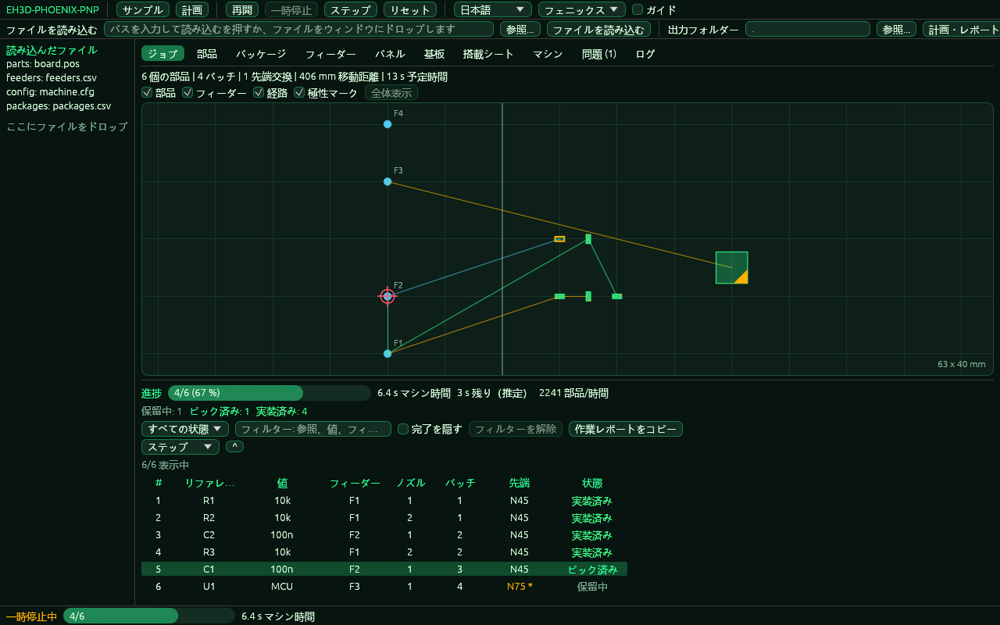

<p align="center">
  
</p>

# 📖 EH3D-PHOENIX-PNP

<p align="center"><a href="README.md">🇺🇸 English</a> | <a href="README_spa.md">🇪🇸 Español</a> | <a href="README_fra.md">🇫🇷 Français</a> | <a href="README_ita.md">🇮🇹 Italiano</a> | <a href="README_deu.md">🇩🇪 Deutsch</a> | <a href="README_zho.md">🇨🇳 中文</a> | 🇯🇵 <b>日本語</b> | <a href="README_por.md">🇵🇹 Português</a></p>

### ピック＆プレース実装：位置、フィーダー、実装順序

<p align="center">
  
  
  
  
  
</p>

---

**正直さの確認 - 現在実際に動くもの：** Rust のライブラリとコマンドラインプログラム（`phoenix-pnp`）で、コンピューター上で動く 536 個のテストがあります。基板の位置ファイルを読み、各部品にフィーダーを割り当て（優先度、トレイ、ストリップに対応）、機械の設定をファイルから読み、最大6本のノズルを持つヘッドの配置順を計画し（ランク、ノズルチップ、角度の制限、移動時間、パネル）、搭載シートを書き出し、模擬機械で故障を注入しながら計画を一手ずつ実行します。ウィンドウ（`--features gui` でビルド）もあり、そのロジックは画面なしでテストされていますが、描画そのものはテストの対象外で、プログラム自身が自分のウィンドウの画像（`--shot`）を撮りますが、人が画面で描画を確認してはいません。機械は制御しません。実機では試しておらず、実際のファイル群での確認もしていません。

---

> **安全とセキュリティの状況：** このプログラムは機械を制御せず、安全システムでもありません。出力は、機械で何かを実行する前に人が確認する必要があります。ここにあるものは実機で動かしたことがありません。


## 📋 ひと目で

| | |
|---|---|
| バージョン | `0.0.6` |
| 成熟度 | 足場 |
| テスト | 536 |
| 技術スタック | Rust |
| 実機での動作 | 未試験：ここにあるものは機械で動かしたことがありません |

**移動先：** [概要](#-概要) · [アーキテクチャ](#-アーキテクチャ) · [クイックスタート](#-クイックスタート) · [テスト](#-テスト) · [構成](#-リポジトリの構成) · [関連](#-関連プロジェクト)

## 🚦 プロジェクトの状況

各行はこのリポジトリの一部分で、信号は今日どこまで進んでいるかを示します。計画ではなく、リポジトリが示せるもの（テスト、ビルド、実行）に基づいて書かれています。

🟢 完了・検証済み · 🟡 動作する（既知の制限あり） · 🟠 一部のみ、または未検証 · 🔴 未実装または動作しない

| 領域 | 状態 | ここでの意味 |
|---|---|---|
| コア | 🟡 | 基板の位置ファイルを読み、各部品にフィーダーを割り当て（優先度、トレイ、ストリップ）、最大6本のノズルを持つヘッドの配置順をランク、ノズルチップ、角度の制限、移動時間とともに計画し、パネルを計画し、搭載シートを書き出します。通常の入力と壊れた入力でコンピューター上でテスト済みですが、実際のファイル群ではありません。 |
| コマンドライン | 🟡 | `phoenix-pnp` はライブラリと同じ関数（`parts`、`check`、`plan`、`schedule`、`preflight`、`simulate`、`loadsheet`、`config-check`, `check-bottom`, `tables-check`, `recipe-check`, `vision-test`）を実行して結果を表示します。エラーはすべて `PHOENIX-PNP-NNN` のコード付きメッセージと0以外の終了コードで返ります。 |
| テスト | 🟡 | 536 個のテストが通ります（`cargo test`）。通常のケース、境界のケース、壊れた入力、小さな生成ケースを含みます。 |
| 機械の設定 | 🟡 | バージョン付きの `キー = 値` ファイル、行を示す検証、安全限界（Z の行程、X と Y の限界、再試行、ノズルの角度）。値は実機とは比較していません。 |
| シミュレーターとジョブ | 🟡 | 仮想時計、確率（シード付き）または指定した場所で注入する故障、再試行、警告と保留の方針、故障が続くと止まるフィーダー、一時停止、一手ずつの実行、再開用に保存する状態。模擬のみで、実機は動かしていません。 |
| セキュリティ | 🟡 | 安全な Rust のみ（`forbid(unsafe_code)`）。受け取ったファイルでパニックせず、不正な値は理由付きのエラーになります。独立したレビューはありません。 |
| ウィンドウ | 🟠 | egui のウィンドウ（`--features gui` でビルド。コマンドなしの `phoenix-pnp` で開きます）：ジョブ、部品、パッケージ、フィーダー、搭載シート、マシン、問題、ログのタブ、ヘッドの経路・極性マーク・次の部品を示す作業テーブルの地図、5ステップのガイド、元に戻せる修正つきの問題一覧、一時停止・再開・ステップができる模擬ジョブ、8言語に対応。ロジックは画面なしでテスト済みですが、描画はテストの対象外で、プログラム自身が自分のウィンドウの画像（`--shot`）を撮りますが、人が画面で描画を確認してはいません。さらに、パネル（フィデューシャルと部品を動かす補正付き）と基板のタブ、ファイル選択、元に戻せるフィーダーとパッケージの表の編集、記憶される列の幅、Windows でコンソールなしで開く専用プログラム（`phoenix-pnp-gui`）があります。 |
| 実機 | 🔴 | 未試験：ここにあるものは機械で実行したことがありません。 |
| ドキュメント | 🟡 | 8 言語の README、変更履歴、`docs/` から描いた 2 枚の図。 |

## 🎯 概要

* **部品**（`src/parts.rs`）：KiCad の `.pos` ファイルまたは CSV（カンマまたはセミコロン、引用符、名前で見つけるヘッダー）。位置は mm、mil、インチ、角度は 0〜360、面は上か下。意味のない行は行番号付きで拒否され、同じ参照の重複はエラーです。
* **実装しない部品、例の表、ジョブのレポート**（`src/parts.rs`、`src/commands.rs`、`src/job.rs`）：CSV の列 `dnp`、`do not place`、`fitted`（または `--dnp R1,R2`）で指定した部品は、計画・搭載シート・確認から外れ、レポートに一覧されます。`tables-check` は表（`--parts`、`--packages`、`--catalog`、`--feeders`、`--slots`）を読み、エラーごとにコードと行番号を示します。`simulate --report-csv FILE` はジョブの統計を、見出しが変わらない CSV で書き出します。`examples/` には `dnp` 列のある基板、あらゆる種類のフィーダー、一般的なパッケージの表があります。
* **フィーダー**（`src/feeders.rs`）：フィーダーの CSV（ID、値、パッケージ、ピック位置、残数）。各部品には、大文字小文字を区別せず値とパッケージが一致する最初のフィーダーが割り当てられます。フィーダーのない部品と枯渇するフィーダーは報告され、同種の 2 つ目のフィーダーが引き継ぎます。
* **計画**（`src/plan.rs`）：実装位置を近い順に巡り、1〜6 ノズルのバッチに分け、バッチ内のフィーダーも近い順に訪れ、下面は基板幅で鏡像にし、移動距離と所要時間の見積りを出し、JSON のジョブとして書き出します。
* **表と設定**（`src/catalog.rs`、`src/config.rs`、`src/rotation.rs`）：値が継承される部品とパッケージの表（部品、次にパッケージ、次に既定値）、`キー = 値` 形式の機械設定ファイル（`examples/machine.cfg` がすべてのキーを説明）、CSV 位置ファイルの列名の追加、パッケージ別の回転補正。
* **テープ以外も扱うフィーダー**（`src/feeding.rs`）：優先度、トレイ、ストリップ、停止したフィーダー。部品のフィーダーはファイルの順序によらず同じように選ばれます。
* **機械のプランナー**（`src/planner.rs`、`src/motion.rs`）：ランク（順に搭載するブロック）、順序の戦略、ノズルチップとその交換、ノズル角度の制限、加速度とジャークを含む移動時間、より短い経路（2-opt）、部品の原点の補正。
* **パネル、搭載シート、出力**（`src/panel.rs`、`src/loadsheet.rs`、`src/export.rs`）：パネルの中の基板とパネル、各テープのスロット、レポート、不足の一覧、ヘッドだけを動かす G コード。
* **パネルのフィデューシャル**（`src/fiducial.rs`）：マークの実測位置を設計位置に合わせ込み（マーク2個なら相似変換、3個以上ならアフィン変換）、パネルの部品をその補正で移動・回転します。マークごとに残差があり、マークが `fiducial_max_residual_mm` を超えて外れる補正は拒否されます（`--panel` と一緒に `--fiducials ファイル`、またはウィンドウのパネルタブ）。
* **不良としてマークされた基板（X-out）と 2 階層のマーク** (`src/marks.rs`, `src/panel.rs`)：パネルファイルの子要素に `"x_out": true` を付けるか `--x-out A,B/C` を指定すると、その中身ごと除外されます。計画・搭載シート・チェックには現れず、どの基板にもない名前（`PHOENIX-PNP-042`）や、すべての基板が除外されたパネル（`PHOENIX-PNP-043`）はエラーです。値またはパッケージに `fiducial_words` の語を含む、または参照が `fiducial_refs` の接頭辞に数字を付けたもの（`FID1`）である基板の部品は、その基板のマークであり、搭載されません。`--fiducials` のファイルでは、パネルのマーク（`f1`）と基板のマーク（`A/FID1`）を指定でき、基板のマークはまとめてフィットされてその基板の部品だけを動かし、測定されたマークのない基板の部品はパネルのフィットに従います。シミュレーションのみ：実機で基板を測定したことはなく、ウィンドウは基板のマークをまだ使いません。
* **プランナーとシミュレーターの追加機能：** トレイのセルを空にする順序（行、列、蛇行）、移動距離とチップ交換場所への往復を数えるノズルチップの順序探索（`tip_strategy = optimize`、`tip_opt_max_evals` と `tip_opt_time_limit_s` で制限）、パッケージごと・フィーダーごとの故障確率（`sim_part_fail`、`sim_feeder_fail`）とそれらの統計および1時間あたりの部品数、そして裏面の各規則が与える角度を表示する `check-bottom`。
* **アライメント工程** (`src/job.rs`, `src/sim.rs`, `src/model.rs`)：`align = on` のとき、ジョブは部品を吸着した後にカメラで確認し、見えたとおりに配置を補正します（ヘッドは部品のずれの分だけ手前の位置へ行き、ノズルは部品の回転の分だけ回転を減らします）。`pick_tolerance_mm` を超えてずれた部品は捨てられ、`error_policy` に従って吸着し直します。`align_passes`（1〜5）と `align_settle_s` は確認の回数と各回の前の待ち時間を決め、プランの時間に加算されます。模擬カメラには、ずれ、誤差、注入できる故障があります (`sim_align_*`, `sim_camera_fail_rate`)。補正量（平均、最大、捨てた部品）は、テキスト、JSON レポート、`--report-csv` の `align` 行に出ます。既定ではオフで、その場合ジョブは従来どおりです。実機では試していません。
* **画像処理パイプライン**（`src/vision.rs`、`src/sim.rs`、`examples/vision.cfg`）：`vision = pipeline` のとき、模擬カメラは部品の画像をメモリ上に描き（大きさ、回転、ノズルからのずれ、`sim_seed` から得たノイズ付き）、設定ファイル（`--vision FILE`）の手順で測定します：マスク、メディアンフィルタ、固定またはOtsuのしきい値、領域の面積範囲、最小の回転した矩形。その中心と角度が、アライメント工程が補正するずれになります。部品が見つからない、領域の面積が不適切、領域が複数ある場合は、測定値のない確認となり、それぞれ固有のコード（`PHOENIX-PNP-037` から `PHOENIX-PNP-039`）が付きます。`phoenix-pnp vision-test` は、与えた大きさ・回転・ずれ・ノイズで部品を描き、測定値とその誤差を表示します。既定ではオフで、その場合ジョブは従来どおりです。実際のカメラでは試していません。
* **作業レポート** (`src/report.rs`, `src/job.rs`)：ジョブを模擬実行したあと、`simulate` はレポートを、`--lang` の言語のテキスト (`--report-text`)、すべてを含みスクリプトも外部のものも使わず既存のファイルには決して上書きしない HTML ページ (`--report-html`)、CSV の行の後ろに追加するセクション (`--report-csv`、ヘッダーは変わりません)、JSON の `work` (`--report`) として書き出せます。搭載した部品、保留した部品、オペレーターがスキップした部品、未処理の部品、実装しない部品の数、マシン時間の内訳（供給とピック、カメラの確認、搭載、ヘッドの移動、ノズル交換）、初回のピックで成功した数、パッケージ・フィーダー・ノズル・ノズル先端・パネルの基板ごとの同じ集計、発生したエラーとそのコード、ジョブ前の指摘、カメラが補正した量（X、Y、回転）のヒストグラムを示します。シミュレーションであり、実機で測定した値ではありません。
* **ジョブタブとオペレーターの判断** (`src/gui/jobtab.rs`, `src/gui/window.rs`, `src/job.rs`)：表には、各配置の状態（待機、ピック済み、整列済み、搭載済み、保留、スキップ、失敗）と実装しない部品、マシン時間と残り時間の見積もり付きの進捗バー、状態・テキスト・完了済みによるフィルターが表示されます。エラーでジョブが止まると、ダイアログが失敗した工程を示し、模擬ジョブに対して実行される 4 つの操作を提示し、その後ジョブは続行します：再試行、部品をスキップ、保留、または同種の別のフィーダーに引き継がせるためにフィーダーを停止。判断はレポートで集計されます。ロジックは画面なしでテストされており、人が画面で描画を確認してはいません（`images/screens/` にあるこのタブの画像はプログラム自身が撮ったものです）。
* **真空、アクチュエーター、フィーダーの故障ウィンドウ** (`src/sim.rs`, `src/job.rs`, `src/config.rs`)：`vacuum = on` のとき、シミュレートされたポンプは各ピックの後に `vacuum_suck_s` 秒吸引し、ノズルのレベル（キロパスカル）を読み取ります。`vacuum_pick_min_kpa` を下回るレベルはノズルが部品を保持していないことを意味し（`PHOENIX-PNP-044`、ピックは再試行の設定どおりにやり直されます）、各配置で `vacuum_blow_s` 秒のブローの後に `vacuum_release_max_kpa` を上回るレベルは部品がまだノズルに付いていることを意味します（`PHOENIX-PNP-045`）。センサーは専用の乱数生成器（`sim_vacuum_noise_kpa`, `sim_vacuum_miss_rate`, `sim_vacuum_stuck_rate`）を持ち、既定ではオフなので、使わないジョブは従来と全く同じです。オン/オフのデバイスは `actuator = 名前 : 遅延秒` で宣言し、`Job::set_actuator` で切り替えます（遅延は時計に加算され、マシンにない名前は `PHOENIX-PNP-046`）。`fault_action = alert` のとき、直近 `fault_window` 回のピックのうち `fault_limit` 回失敗したフィーダーは自動ではオフになりません。ジョブが停止し（`PHOENIX-PNP-047`）、Job タブのダイアログで再試行、部品の除外、脇に置く、フィーダーをオフにする、のいずれかを選べます。
* **カメラモデル、マシンのヘッド、パッケージが受け付けるノズルチップ** (`src/camera.rs`, `src/heads.rs`, `src/tips.rs`, `src/config.rs`): カメラは `camera_units_per_px`（0 はビジョンパイプラインの設定サイズ）、`camera_offset_x_mm` と `camera_offset_y_mm`（画像内のノズル軸の位置）、`camera_rotation_deg`、`camera_flip_x` と `camera_flip_y`、およびレンズ（`camera_lens_scale`、`camera_lens_k1`）で記述されます。位置合わせステップのシミュレートされたカメラは、画像の有無にかかわらずこのモデルを通して部品を読み取り、既定値ではジョブは従来と全く同じです。`head = 名前 : ノズル数 [: オフセットX : オフセットY : カメラX : カメラY : カメラ回転 : カメラ単位 : カメラレンズ]` は最大4つのヘッドを宣言し、それぞれがノズル、オフセット、カメラを持ちます。ヘッドが2つ以上のとき `schedule` は各部品を届くヘッドに割り当て（どれも届かなければ `PHOENIX-PNP-048`）、各ヘッドを計画し、別のヘッドが使っているフィーダーをヘッドが待つ時間をマシンの時計で数えます。`tip_compat = パターン : チップ, チップ, ...` はパッケージが受け付けるチップを列挙し、`tip_compat_mode`（`fewest_changes` または `preferred`）は部品の種類ごとにチップを1つ選び、マシンのチップ交換をできるだけ少なくします。表で指定されたチップはそのまま使われます。
* **レシピ** (`src/recipe.rs`, `src/job.rs`, `src/commands.rs`)：バージョン付きのテキストファイル（`examples/job.recipe`）が、ジョブの手順（`prepare`、`pick`、`align`、`place`、`check`。この順序で、重複なし。位置合わせの手順と真空チェックは、レシピに書かれているときだけ有効）と、パッケージ・フィーダー・ノズルチップごとに変わるパラメーター（`pick_retries`、`pick_tolerance_mm`、`vacuum_suck_s`、`vacuum_blow_s`。各キーでは最初に一致したルールが優先され、フィーダー、パッケージ、チップの順に見ます）を定めます。`phoenix-pnp recipe-check FILE` で読み込んで検査し、`simulate ... --recipe FILE` でそのレシピに従ってジョブを実行します。エラーのコードは `PHOENIX-PNP-049` から `PHOENIX-PNP-052`（無効な行、順序の誤った手順、上限を超えたファイル、新しすぎるバージョン）で、上限は `machine.cfg` のキー `recipe_max_bytes` と `recipe_max_rules` です。保存した状態は直前のピックのフィーダーと停止したピックも覚えているため、別の実行で読み込んだジョブでも担当者に同じ判断が提示されます（古い状態も引き続き読み込めます）。
* **シミュレーターとジョブ**（`src/sim.rs`、`src/job.rs`、`src/preflight.rs`、`src/model.rs`）：ジョブ前の確認、仮想時計と注入できる故障を持つ機械、一時停止・一手ずつの実行・保存・再開ができるジョブ。
* **ウィンドウ**（`src/gui.rs`、`src/gui/`）：描画以外の処理は画面を必要とせず（読み込んだファイル、計画とその問題・修正、模擬ジョブ、地図の幾何、選択を共有する表、5ステップのガイド、8言語の文言）、テストされています。`--features gui` でビルドする `src/gui/window.rs` だけが egui で描画します。シミュレーションの速さ、テーマ、未知のパッケージの部品に描くサイズは `machine.cfg` のキー（`gui_steps_per_s`、`gui_theme`、`gui_part_size_mm`）です。

## 🧩 EH3D での役割

EH3D-PHOENIX-PNP は EH3D Fabrication Suite のプログラムの一つです。現在はライブラリ、コマンドライン、ウィンドウ（`--features gui` でビルド）として動作します。ウィンドウはまだスイートの他のプログラムと共通の外観になっていません。単純なファイルを読み書きするため、単独でも他のプログラムの間でも使えます。

## 🏛️ アーキテクチャ

<p align="center">
  
</p>


このリポジトリの各部分の関係：誰が使い、何を持ち、何に依存するか。図は `docs/architecture.json` から描かれ、コードと照合されます。

## ✨ 機能

* **ライブラリとコマンドライン：** `phoenix-pnp` の各コマンドはライブラリの関数なので、スイートの他のプログラムがプロセスを起動せずに呼び出せます。
* **厳密なコマンドライン：** 書き間違えたオプション（`--powr`）や余分な語は無視されず、それを名指しするエラーになります。そうでないと、プログラムは既定値で出力を作ってしまいます。
* **破損入力のテスト：** 空のファイル、ゴミデータ、巨大な数値、途中で切れたファイルも与え、どれもパニックしてはいけません。
* **推測しない：** 意味のない値は、どの値かと理由を示すエラーになり、見かけだけ正しい結果にはなりません。
* **unsafe コードなし：** ライブラリとプログラムに `#![forbid(unsafe_code)]`。
* **2 つの表を 1 つのリーダーで読み、大きな基板でも速い：** 位置ファイルとフィーダーファイルは同じリーダーで読み（カンマまたはセミコロン、区切り文字や改行を含む引用符付きフィールド）、5 万点の部品の確認・割り当て・計画が一瞬で終わり、計画は元にしたファイルを上書きせず、未知のオプションはエラーになり、`--origin-x` は下面を鏡像にするときの基板の左端の位置を指定します。

## 🔒 セキュリティと安全

| 脅威 | 対策 |
|---|---|
| 破損・途中切れ・空のファイル | パニックなし：テストは有効な入力をあらゆる位置で切り、ゴミデータも与えます |
| 意味のない数値（負、無限、極端に大きい） | 値を示すエラーで拒否され、もっともらしい値に丸められることはありません |
| 安全でないメモリ使用 | `forbid(unsafe_code)` の安全な Rust のみ |

**防御していないこと：** エラーなく作られた結果は、検証された結果ではありません。ここには機械の限界を知るものはなく、プログラムは独立したレビューを受けていません。脆弱性は非公開で報告してください（[SECURITY.md](SECURITY.md) 参照）。

## 🔌 インターフェース

ライブラリは `eh3d_phoenix_pnp`（`use eh3d_phoenix_pnp::...`）、コマンドラインは `phoenix-pnp` です。コマンドは次のとおりで、結果は標準出力に表示され、エラーは標準エラー出力に 0 以外の終了コードで報告されます。ネットワークアクセスはありません。

```text
phoenix-pnp [gui [FILES...]]                             ウィンドウ（`--features gui` でビルド）
phoenix-pnp parts PARTS                                  位置ファイルの部品（ミリメートル）
phoenix-pnp check PARTS FEEDERS                          フィーダーのない部品と、なくなるフィーダー
phoenix-pnp plan PARTS FEEDERS OUT.json                  単純な計画（JSON ジョブ）
phoenix-pnp schedule PARTS FEEDERS OUT.json              設定すべて、パネル、フィデューシャルを使った計画
phoenix-pnp preflight PARTS FEEDERS                      ジョブ前のチェック
phoenix-pnp simulate PARTS FEEDERS                       模擬機械でのジョブとそのレポート
phoenix-pnp loadsheet PARTS SLOTS OUT.csv                搭載シート
phoenix-pnp config-check FILE                            設定ファイルが有効かどうか
phoenix-pnp check-bottom PARTS                           下面の各規則が与える角度
phoenix-pnp tables-check [--parts F] [--feeders F] ...   各表が有効かどうか（コードと行つき）
phoenix-pnp recipe-check FILE                            レシピが有効かどうか（コードと行つき）
phoenix-pnp vision-test [--turn DEG] [--dx MM] ...       メモリ内に作った部品の画像を測定
```

`phoenix-pnp help` で全オプションを一覧できます。`schedule`、`preflight`、`simulate`、`loadsheet` に共通のオプションは `--config`, `--packages`, `--catalog`, `--panel`, `--fiducials`, `--x-out`, `--dnp`, `--side`, `--board-width`, `--origin-x`, `--nozzles`, `--speed`, `--order` と `--lang` です。`--shot` とその関連オプションはウィンドウの画像を撮ります（クイックスタート参照）。

## ⚙️ 設定

機械とプランナーは `キー = 値` の行からなるテキストファイル（`--config ファイル`）で設定します。形式はスイートの他のプログラムと同じです。`examples/machine.cfg` がすべてのキーを既定値と働きとともに載せています。ないキーは既定値のままで、未知のキー、二重に書かれたキー、範囲外のキーは行を示すエラーになります。コマンドラインのオプション（`--nozzles`、`--speed`、`--order`、`--side`）はファイルより優先されます。

部品を「実装しない」と示す列とその語も設定です。`header_dnp` と `header_fitted` は列の名前を、`dnp_yes_words` と `dnp_no_words` は「はい」「いいえ」の語を追加します。`dnp`、`do not place`、`do not populate`、`do not mount`、`do_not_place`、`not fitted`、`no montar` という名前の列は「はい」（`yes`、`y`、`true`、`1`、`x`）で部品を外し、`fitted`、`populate`、`populated`、`mount`、`mounted`、`montar` という名前の列は「いいえ」（`no`、`n`、`false`、`0`、`-`）で部品を外します。空のセルは部品を実装し、それ以外の語は行番号付きのエラーです。

基板のマークとなる部品も設定です：`fiducial_words`（既定値 `fiducial`）と `fiducial_refs`（既定値 `fid, fd`）。空のリストにすると規則は無効になります。

パッケージと部品の表（`--packages`、`--catalog`）は空のセルが継承される CSV ファイル、パネル（`--panel`）は JSON ファイル、機械のスロット（`loadsheet`）は `id,x,y,max_width_mm` の CSV です。`max_file_bytes` より大きなファイルは拒否されます。すべてのエラーにはコード `PHOENIX-PNP-NNN` があり、メッセージはキー `language` または `--lang` の言語（`en`、`es`、`de`、`fr`、`it`、`ja`、`zh`、`pt`）で書かれます。

| コード | 意味 |
|---|---|
| `PHOENIX-PNP-001` | ファイルが許容サイズを超えています |
| `PHOENIX-PNP-002` | 部品数が上限を超えています |
| `PHOENIX-PNP-003` | 設定の行が「キー = 値」の形式ではありません |
| `PHOENIX-PNP-004` | 設定に未知のキーがあります |
| `PHOENIX-PNP-005` | 設定の値が無効です |
| `PHOENIX-PNP-006` | 設定の値が範囲外です |
| `PHOENIX-PNP-007` | この設定は新しいバージョンのプログラム用です |
| `PHOENIX-PNP-008` | 設定のキーが重複しています |
| `PHOENIX-PNP-009` | 設定が安全限界を超えています |
| `PHOENIX-PNP-010` | 部品またはパッケージ表の行が無効です |
| `PHOENIX-PNP-011` | 部品またはパッケージが二重に定義されています |
| `PHOENIX-PNP-012` | 回転補正の規則が無効です |
| `PHOENIX-PNP-013` | フィーダーの行が無効です |
| `PHOENIX-PNP-014` | パネルファイルが無効です |
| `PHOENIX-PNP-015` | パネルの入れ子が深すぎるか基板が多すぎます |
| `PHOENIX-PNP-016` | スロット表が無効です |
| `PHOENIX-PNP-017` | 計画の設定が無効です |
| `PHOENIX-PNP-018` | ノズルは制限内でその角度に回転できません |
| `PHOENIX-PNP-019` | ノズルは既に部品を保持しており、別の部品は取れません |
| `PHOENIX-PNP-020` | ノズルに配置する部品がありません |
| `PHOENIX-PNP-021` | この部品に使えるフィーダーがありません |
| `PHOENIX-PNP-022` | すべての試行後も部品を取れませんでした |
| `PHOENIX-PNP-023` | すべての試行後もフィーダーが送れませんでした |
| `PHOENIX-PNP-024` | すべての試行後も部品を配置できませんでした |
| `PHOENIX-PNP-025` | 保存された状態は別のジョブのものです |
| `PHOENIX-PNP-026` | 保存されたジョブの状態が無効です |
| `PHOENIX-PNP-027` | ジョブは一時停止中、完了、またはエラーで停止しています |
| `PHOENIX-PNP-028` | ジョブ前の確認でエラーが見つかりました |
| `PHOENIX-PNP-029` | 長さまたは角度が無効です |
| `PHOENIX-PNP-030` | ドライバーがコマンドを受け付けませんでした |
| `PHOENIX-PNP-031` | シミュレーターが障害を注入しました |
| `PHOENIX-PNP-032` | フィデューシャルが無効か、位置を決められません |
| `PHOENIX-PNP-033` | 実装の印が「はい」でも「いいえ」でもないか、除外する参照が不明です |
| `PHOENIX-PNP-034` | 位置ファイルが無効です |
| `PHOENIX-PNP-035` | カメラが検出した部品のずれが許容差を超えています |
| `PHOENIX-PNP-036` | カメラが部品の測定値を返しませんでした |
| `PHOENIX-PNP-037` | 画像の中に部品が見つかりませんでした |
| `PHOENIX-PNP-038` | 画像で見つかった領域の面積が許容範囲外です |
| `PHOENIX-PNP-039` | 部品の可能性がある領域が複数見つかりました |
| `PHOENIX-PNP-040` | レポートのファイルは既に存在するため、上書きしません |
| `PHOENIX-PNP-041` | この操作はジョブの状態に合いません |
| `PHOENIX-PNP-042` | 不良としてマークされた基板（X-out）がパネルにありません |
| `PHOENIX-PNP-043` | パネルのすべての基板が不良（X-out）としてマークされています。実装するものが残っていません |
| `PHOENIX-PNP-044` | ピック後、真空はノズルに部品がないことを示しています |
| `PHOENIX-PNP-045` | 配置後も、真空は部品がノズルに残っていることを示しています |
| `PHOENIX-PNP-046` | その名前のアクチュエータはマシンにありません |
| `PHOENIX-PNP-047` | フィーダーの直近のピックで失敗が多すぎます。担当者が判断します |
| `PHOENIX-PNP-048` | マシンのどのヘッドも部品に届きません |
| `PHOENIX-PNP-049` | レシピの行が無効です |
| `PHOENIX-PNP-050` | レシピの手順がジョブの順序と一致しません |
| `PHOENIX-PNP-051` | レシピが許容される上限を超えています |
| `PHOENIX-PNP-052` | このレシピは新しいバージョンのプログラム用です |

## 🚀 クイックスタート

安定版の Rust ツールチェーン（1.95 以降）が必要です。

```bash
cargo build --release
cargo test
cargo run --release -- plan examples/board.pos examples/feeders.csv examples/plan.json --nozzles 2
cargo run --release -- schedule examples/board.pos examples/feeders.csv examples/schedule.json --config examples/machine.cfg --packages examples/packages.csv --catalog examples/catalog.csv
cargo run --release -- simulate examples/board.pos examples/feeders.csv --config examples/machine.cfg --state examples/job_state.json --steps 5
cargo run --release -- loadsheet examples/board.pos examples/slots.csv examples/loadsheet.csv --packages examples/packages.csv
cargo run --release -- check-bottom examples/board.pos
cargo run --release -- schedule examples/board_dnp.csv examples/feeders.csv examples/schedule_dnp.json --config examples/machine.cfg --packages examples/packages.csv --catalog examples/catalog.csv
cargo run --release -- tables-check --parts examples/board_dnp.csv --packages examples/packages_common.csv --feeders examples/feeders_kinds.csv --slots examples/slots.csv --config examples/machine.cfg
cargo run --release -- simulate examples/board.pos examples/feeders.csv --config examples/machine.cfg --report-csv examples/job_report.csv
cargo run --release -- simulate examples/board.pos examples/feeders.csv --config examples/machine.cfg --report-text examples/job_report.txt --report-html examples/job_report.html
cargo run --release -- schedule examples/feeders.csv examples/schedule_panel.json --panel examples/panel.json --fiducials examples/marks.csv --config examples/machine.cfg
cargo run --release -- schedule examples/feeders.csv examples/schedule_xout.json --panel examples/panel.json --x-out B --config examples/machine.cfg
cargo run --release -- vision-test --vision examples/vision.cfg --turn 30 --dx 0.5 --dy -0.3
cargo run --release --features gui -- --shot screen.png examples/board.pos examples/feeders.csv examples/machine.cfg   # a picture of the window
cargo run --release --features gui -- --shot job.png --window job --steps 9 examples/board.pos examples/feeders.csv examples/machine.cfg   # the Job tab with the job on its way
cargo run --release --features gui
```

手動で開かずにウィンドウの画像を撮るには、`--shot FILE.png` を付けて実行します（`--size WxH`, `--theme phoenix|light|contrast`, `--wait N`, `--window TAB`, `--steps N`, `--lang CODE`, `--open FILE`, `--replace` も使えます）。指定のサイズで開き、PNG を保存し、設定は保持せず、自動で閉じます（終了コードは、ファイルを書き込めたら 0、書けなければ 1、引数が誤りなら 2）。`--window` で画像のタブ（`job`, `parts`, `packages`, `feeders`, `panels`, `boards`, `loadsheet`, `machine`, `problems`, `log`）を選び、`--steps N` で撮影前に模擬ジョブを N ステップ進めるので、ジョブタブには進行中のジョブが表示されます。

<p align="center">
  
</p>

最後の行はウィンドウを開きます。`--features gui` でビルドした場合は、コマンドなしの `phoenix-pnp` でも開きます（Linux では X11 または Wayland と OpenGL の開発ファイルが必要です）。コマンドを付けると、プログラムはコマンドラインのままです。Windows では `phoenix-pnp-gui`（同じフィーチャーでビルド）がコンソールなしでウィンドウを開きます。`docs/windows-console.md` を参照してください。

## 🧪 テスト

テストは 536 個あります（`cargo test`、CI の Windows と Linux で実行）。通常のケース、境界のケース、壊れた入力を確認します。空のファイル、ゴミ、途中で切れたファイルでパニックは起きません。固定シードから作る小さな生成ケース（実行のたびに同じ数値になります）で、計画がファイルの順序に依存しないこと、経路が決して長くならないこと、どこで保存して再開してもまったく止まらなかったジョブと同じ結果になること、長さと角度が行き来して変換できることを確認します。CI は `cargo fmt --check`、警告をエラーとする `cargo clippy`、`python -I tools/ci_validate.py` も実行します。

## 🏗️ ビルドとリリース

バージョンは `Cargo.toml` と `eh3d.project.json` にあり、各バージョンは [CHANGELOG.md](CHANGELOG.md) に項目があります。`build.bat` / `build.sh` でビルド、`test.bat` / `test.sh` でテスト、`run.bat` / `run.sh` でサンプル実行します。リリースは GitHub で公開されます。

## 📂 リポジトリの構成

<p align="center">
  
</p>

<details>
<summary>ツリーのテキスト版</summary>

```text
EH3D-PHOENIX-PNP/
├── src/
│   ├── camera.rs                                カメラのモデル：ピクセルサイズ、オフセット、回転、ミラー、レンズ
│   ├── catalog.rs                               部品とパッケージの表、およびその属性の継承
│   ├── cli_args.rs                              コマンドライン引数（厳格：未知のオプションはエラー）
│   ├── commands.rs                              設定を使うコマンド、tables-check、check-bottom
│   ├── config.rs                                機械の設定ファイル：キー、範囲、安全限界
│   ├── error.rs                                 エラーコード PHOENIX-PNP-NNN と8言語での意味
│   ├── export.rs                                レポート、不足の一覧、移動の G コード
│   ├── feeders.rs                               ロジックの一部
│   ├── feeding.rs                               優先度・トレイ・ストリップ付きのフィーダーと、部品のフィーダーの選択
│   ├── fiducial.rs                              パネルのフィデューシャル：実測マークの補正計算と部品の位置補正
│   ├── gui.rs                                   ウィンドウ：画面不要のモジュールと window.rs の描画
│   ├── gui/app.rs                               ウィンドウの状態：読み込み、計画、開始、一時停止、ステップ、修正、保存
│   ├── gui/browse.rs                            ファイル選択：フォルダーとファイル、上へ、入力したパス
│   ├── gui/jobtab.rs                            ウィンドウなしのジョブタブ：状態、フィルター、進捗、エラーダイアログ
│   ├── gui/log.rs                               レベル付きのログと、コピーできる診断テキスト
│   ├── gui/problems.rs                          ジョブの問題と、それを直す修正
│   ├── gui/samples.rs                           小さな基板から大きな基板までのサンプル
│   ├── gui/session.rs                           開始・一時停止・再開・ステップができる模擬ジョブ
│   ├── gui/settings.rs                          ウィンドウが記憶するもの：言語、テーマ、レイヤー、フォルダー、列の幅
│   ├── gui/shot.rs                              ウィンドウの画像モード（--shot）：その引数
│   ├── gui/tables.rs                            表の行、並べ替え、表で共有される選択
│   ├── gui/texts.rs                             ウィンドウのすべての文言（8言語）
│   ├── gui/theme.rs                             配色：フェニックスグリーン、ライト、ハイコントラスト
│   ├── gui/view.rs                              地図の幾何：部品の形、極性マーク、フィット、ズーム、選択
│   ├── gui/window.rs                            egui による描画（gui フィーチャーでビルド）：タブ、地図、表
│   ├── gui/wizard.rs                            何もない状態から模擬ジョブまでの5ステップのガイド
│   ├── gui/workspace.rs                         読み込んだファイル、計画、編集（ウィンドウなし）
│   ├── gui_main.rs                              独立したウィンドウ用プログラム（Windows ではコンソールなし）
│   ├── heads.rs                                 複数ヘッド：到達範囲、部品の割り当て、フィーダー待ち
│   ├── job.rs                                   ジョブ：ステップ、一時停止、再試行、方針、統計、保存状態
│   ├── lib.rs                                   ライブラリ：各コマンドが使うもの
│   ├── loadsheet.rs                             搭載シート：各テープのスロット
│   ├── main.rs                                  コマンドラインと、コマンドなしで実行したときのウィンドウの入口
│   ├── marks.rs                                 2階層のマーク：マークである部品と、パネルと各基板のフィット
│   ├── model.rs                                 機械の部品をトレイトで表現：機械、ノズル、フィーダー、アクチュエーター、カメラ、ドライバー
│   ├── motion.rs                                加速度とジャークを含む移動時間
│   ├── panel.rs                                 パネル：パネルの中の基板とパネル、それぞれの位置
│   ├── parts.rs                                 位置ファイルと実装しない部品
│   ├── plan.rs                                  ロジックの一部
│   ├── planner.rs                               機械を知るプランナー：ランク、順序、チップとその探索、角度、時間
│   ├── preflight.rs                             ジョブ前の確認（重大度と対象つき）
│   ├── recipe.rs                                ジョブのレシピ：ファイル、手順、パッケージ・フィーダー・チップ別のパラメーター
│   ├── report.rs                                ジョブのレポート：工程、ピック、グループ、エラー（テキスト・HTML・CSV・JSON）
│   ├── rotation.rs                              パッケージ別の回転補正と、制限付きノズルの回し方
│   ├── sim.rs                                   模擬機械：仮想時計と注入できる故障
│   ├── tips.rs                                  パッケージが受け付けるノズルチップと、部品の種類ごとの選択
│   ├── units.rs                                 単位を持つ長さと位置
│   └── vision.rs                                画像処理：フィルタ、しきい値、領域、最小の回転矩形
├── tests/
│   ├── align.rs                                 アライメント工程のテスト：カメラ、補正した位置、許容差、時間
│   ├── camera.rs                                カメラモデル、ヘッドのカメラ、シミュレーターのカメラのテスト
│   ├── commands.rs                              設定を使うコマンドのテスト
│   ├── feeding.rs                               フィーダーのテスト：優先度、トレイ、ストリップ
│   ├── gui.rs                                   画面なしのウィンドウのテスト：状態、計画、ジョブ、地図、表、ガイド
│   ├── heads.rs                                 ヘッドのテスト：設定の行、到達範囲、割り当て、時計、schedule
│   ├── job.rs                                   ジョブのテスト：ステップ、再試行、保存状態
│   ├── jobtab.rs                                画面なしのジョブタブのテスト：状態、フィルター、進捗、ダイアログ
│   ├── loadsheet.rs                             搭載シートと出力のテスト
│   ├── marks.rs                                 不良としてマークされた基板、マークである部品、2階層のマークのテスト
│   ├── model.rs                                 データモデルのテスト：コード、長さ、設定、表
│   ├── more.rs                                  ライブラリとコマンドラインの追加テスト
│   ├── panel.rs                                 パネルとそのフィデューシャルのテスト
│   ├── planner.rs                               移動時間とプランナーのテスト
│   ├── pnp.rs                                   ライブラリとコマンドラインのテスト
│   ├── preflight.rs                             ジョブ前の確認のテスト
│   ├── readme.rs                                README が実行でき、漏れがないことのテスト
│   ├── readme.rs                                レシピのテスト：ファイル、上限、手順、ジョブ内のルール、保存した状態
│   ├── report.rs                                レポートのテスト：工程、ピック、ヒストグラム、グループ、判断、形式
│   ├── shot.rs                                  ウィンドウの画像モードのテスト：画面なしで読み取り・確認される引数
│   ├── sim.rs                                   模擬機械のテスト
│   ├── strict.rs                                コマンドラインのテスト：知らないオプションと語
│   ├── tables.rs                                実装しない部品、tables-check、ジョブのCSVレポートのテスト
│   ├── tips.rs                                  パッケージが受け付けるチップのテスト：ルール、選択、計画
│   ├── vacuum.rs                                真空、アクチュエーター、フィーダーの故障ウィンドウのテスト
│   ├── vision.rs                                画像処理のテスト：手計算の画像、失敗、設定
│   └── vision_job.rs                            ジョブと vision-test の画像処理テスト：測定値、失敗、保存状態
├── examples/
│   ├── board.pos                                試すためのサンプル
│   ├── board_dnp.csv                            dnp 列を持つ基板：2つの部品は実装しない
│   ├── catalog.csv                              部品の表：ランクと高さ
│   ├── feeders.csv                              試すためのサンプル
│   ├── feeders_kinds.csv                        あらゆる種類のフィーダー：テープ、ストリップ、トレイ、オフのもの
│   ├── job.recipe                               全手順と、パッケージ・フィーダー・チップ別ルールを持つレシピ
│   ├── job_basic.recipe                         最短のレシピ：準備、ピック、配置
│   ├── machine.cfg                              機械の設定（すべてのキーを説明）
│   ├── marks.csv                                パネルのフィデューシャルの実測位置
│   ├── packages.csv                             パッケージの表：高さ、チップ、ランク、テープ
│   ├── packages_common.csv                      一般的なパッケージの表（0201抵抗からQFNまで）。自分の部品に合わせて調整する
│   ├── panel.json                               2枚の基板のパネル
│   ├── slots.csv                                機械のスロット
│   └── vision.cfg                               画像処理の設定（すべてのキーを説明）
├── docs/
│   ├── architecture.json                        アーキテクチャ図のデータ
│   ├── structure.json                           構成図のデータ
│   └── windows-console.md                       Windows でウィンドウが独立したプログラムである理由
├── tools/                                       CI と README のチェック、図のツール
├── images/                                      バナー、アーキテクチャ・構成の図、ウィンドウの画像
├── .github/                                     CI とリリースのワークフロー、Issue と PR のテンプレート
├── eh3d.project.json                            マニフェスト：バージョン、役割、成熟度、ビルドコマンド
├── Cargo.toml Cargo.lock                        ワークスペースと固定された依存関係
├── rust-toolchain.toml                          固定されたRustツールチェーン
├── CHANGELOG.md                                 各バージョンの変更点
├── SECURITY.md SUPPORT.md                       脆弱性の報告方法と問い合わせ先
└── CONTRIBUTING.md CODE_OF_CONDUCT.md LICENSE   貢献方法、行動規範、ライセンス
```

</details>

## 🗺️ ロードマップと既知の制限

**現時点で分かっている制限**

* ウィンドウの描画は人が画面で確認していません（`images/screens/` の画像は `--shot` でプログラム自身が撮ったものです）。ジョグも実際のカメラもなく、基板の部品であるマークはまだ使いません。
* 実機でも実際のファイル群でも試しておらず、独立したレビューも受けていません。機械に関することはすべてシミュレーションです。
* 他の実装プログラムのファイルは読みません。CSV の下面の角度の規則（`bottom_rotation`）は、どの CAD プログラムの実ファイルとも比較していません。
* カメラと視覚はシミュレーションです。実際のカメラ、実画像によるピックの補正、実機のドライバーはありません。計画は別のプログラムが実行する JSON ファイルです。

**次のステップ**

* ウィンドウをスイートのプログラムに共通する見た目に近づけ、基板の部品であるマークを使い、不良としてマークされた基板を表示できるようにする。
* 視覚パイプラインを実際のカメラの画像で、2 階層のマークを実際のパネルで試す。計画を機械に送るのは、実機で試してからにする。
* 実際のファイルとスイートの他のプログラムで試す。

## 🌍 言語

README とテキストは、英語、スペイン語、フランス語、イタリア語、ドイツ語、中国語、日本語、ヨーロッパポルトガル語で提供されています。

## 🔗 関連プロジェクト

* [EH3D-VISION-STUDIO](https://github.com/JuanenRac/EH3D-VISION-STUDIO): カメラ、基準マーク、検査
* [EH3D-MOTIONCNC](https://github.com/JuanenRac/EH3D-MOTIONCNC): 機械制御プログラム
* [EH3D-GERBERVIEWER](https://github.com/JuanenRac/EH3D-GERBERVIEWER): Gerber レイヤー ビューアー
* [EH3D-TOOL-MANAGER](https://github.com/JuanenRac/EH3D-TOOL-MANAGER): CAM プログラム共通の工具庫
* [EH3D-SUITE-LAUNCHER](https://github.com/JuanenRac/EH3D-SUITE-LAUNCHER): スイートのプログラムを見つけて起動するハブ

## 📚 ドキュメント

* [変更履歴](CHANGELOG.md)
* [アーキテクチャと構成のデータ](docs/architecture.json)：2 枚の図を描くためのデータ。
* [Windows でウィンドウが専用プログラムである理由](docs/windows-console.md)

## 🤝 コントリビュートとコミュニティ

* プルリクエストの前に `cargo fmt --check`、`cargo clippy --all-targets -- -D warnings`、`cargo test`、`python -I tools/ci_validate.py` を実行し、すべて通してください。[CONTRIBUTING.md](CONTRIBUTING.md) と[行動規範](CODE_OF_CONDUCT.md)を参照。
* README は 8 言語あります。文章の変更は 8 ファイルすべてで行い、2 枚の図は `tools/make_architecture.py` と `tools/make_structure.py` が `docs/architecture.json` と `docs/structure.json` から描きます。
* 脆弱性は非公開で報告してください：[SECURITY.md](SECURITY.md)。質問・提案・報告：electrohobby3d@gmail.com（[SUPPORT.md](SUPPORT.md)）。

## 👤 作者

**JuanenRac (Electro Hobby 3D)** · electrohobby3d@gmail.com

## 📜 ライセンス

ソフトウェア：GPL-3.0-or-later。[LICENSE](LICENSE) を参照。スイートのハードウェア設計には CERN OHL-S を使います。
