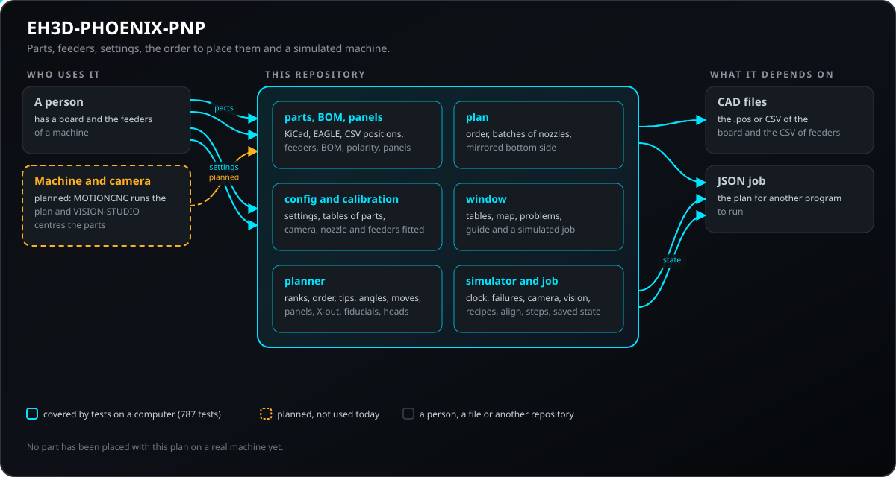
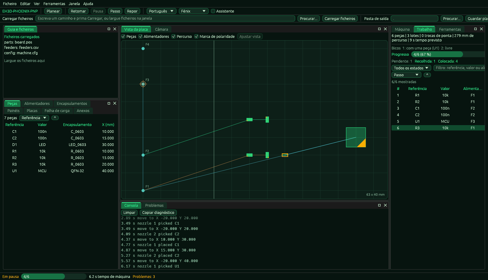
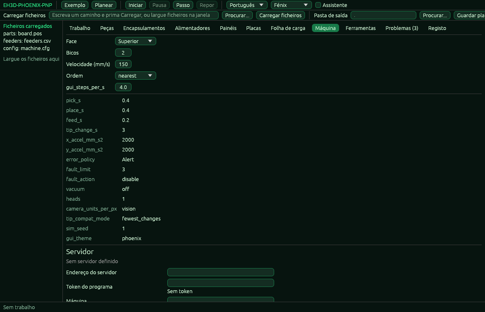

<p align="center">
  
</p>

# 📖 EH3D-PHOENIX-PNP

<p align="center"><a href="README.md">🇺🇸 English</a> | <a href="README_spa.md">🇪🇸 Español</a> | <a href="README_fra.md">🇫🇷 Français</a> | <a href="README_ita.md">🇮🇹 Italiano</a> | <a href="README_deu.md">🇩🇪 Deutsch</a> | <a href="README_zho.md">🇨🇳 中文</a> | <a href="README_jpn.md">🇯🇵 日本語</a> | 🇵🇹 <b>Português</b></p>

### Montagem pick and place: posições, alimentadores e ordem de colocação

<p align="center">
  
  
  
  
  
</p>

---

**Verificação de honestidade - o que funciona hoje:** uma biblioteca Rust e um programa de linha de comandos (`phoenix-pnp`) com 1942 testes que correm num computador: lê o ficheiro de posições de uma placa, dá a cada componente o seu alimentador (com prioridades, tabuleiros e tiras), lê as definições da máquina de um ficheiro, planeia a ordem de colocação para uma cabeça de até seis bicos (níveis, pontas de bico, limites de ângulo, tempo dos movimentos, painéis), escreve uma folha de carga e, numa máquina simulada, executa o plano passo a passo com falhas injetadas. Também tem uma janela (compilada com `--features gui`) cuja lógica é testada sem ecrã; o desenho em si não está coberto por testes e, embora o programa tire imagens da sua própria janela (`--shot`), nenhuma pessoa verificou o desenho num ecrã. Não controla nenhuma máquina: não foi experimentado numa máquina e não foi verificado com uma coleção de ficheiros reais.

---

> **Estado de segurança:** este programa não controla nenhuma máquina e não é um sistema de segurança. O que produz deve ser verificado por uma pessoa antes de se executar algo numa máquina; nada disto correu em hardware real.


## 📋 Num relance

| | |
|---|---|
| Versão | `0.1.4` |
| Maturidade | Estrutura inicial |
| Testes | 1942 |
| Tecnologias | Rust |
| Em hardware real | Não experimentado: nada disto correu numa máquina |

**Ir para:** [Visão geral](#-visão-geral) · [Arquitetura](#-arquitetura) · [Início rápido](#-início-rápido) · [Testes](#-testes) · [Estrutura](#-estrutura-do-repositório) · [Relacionados](#-projetos-relacionados)

## 🚦 Estado do projeto

Cada linha é uma parte deste repositório e a luz diz até onde chega hoje. É escrita com o que o repositório consegue demonstrar (testes, compilações, execuções), não com o que está previsto.

🟢 Feito e verificado · 🟡 Funciona, com limites conhecidos · 🟠 Feito a meio ou ainda por verificar · 🔴 Por fazer ou a não funcionar

| Área | Estado | O que significa aqui |
|---|---|---|
| Núcleo | 🟡 | lê o ficheiro de posições de uma placa, dá a cada componente o seu alimentador (prioridade, tabuleiro, tira), planeia a ordem de colocação para uma cabeça de até seis bicos com níveis, pontas de bico, limites de ângulo e o tempo dos movimentos, planeia painéis e escreve a folha de carga; testado num computador com entradas normais e danificadas, não com uma coleção de ficheiros reais. |
| Linha de comandos | 🟡 | `phoenix-pnp` executa as mesmas funções da biblioteca (`parts`, `check`, `plan`, `schedule`, `preflight`, `simulate`, `loadsheet`, `config-check`, `check-bottom`, `tables-check`, `recipe-check`, `import-centroid`, `vision-test`) e imprime o resultado; cada erro volta como uma mensagem com o seu código `PHOENIX-PNP-NNN` e um código de saída diferente de zero. |
| Testes | 🟡 | 1942 testes passam (`cargo test`), com casos normais, casos-limite, entradas danificadas e pequenos casos gerados. |
| Configuração da máquina | 🟡 | um ficheiro `chave = valor` com versão, um validador que indica a linha e os limites de segurança (curso de Z, limites de X e Y, repetições, ângulos do bico); os valores não foram comparados com uma máquina real. |
| Simulador e trabalho | 🟡 | um relógio virtual, falhas injetadas ao acaso (com semente) ou num sítio escolhido, repetições, as políticas alerta e adiar, alimentadores que se desligam após falhas repetidas, pausa, passo a passo e um estado guardado para retomar; apenas simula, nada moveu uma máquina. |
| Segurança | 🟡 | Rust seguro e simples (`forbid(unsafe_code)`): nada entra em pânico com os ficheiros recebidos e um valor mau é um erro com o seu motivo; sem revisão independente. |
| Janela | 🟠 | Uma janela egui (compila-se com `--features gui`; `phoenix-pnp` sem comando abre-a): separadores de trabalho, peças, encapsulamentos, alimentadores, folha de carga, máquina, ferramentas, problemas e registo, um mapa da mesa de trabalho com o percurso da cabeça, marcas de polaridade e a peça seguinte, um assistente de cinco passos, problemas com correções que se podem anular, um trabalho simulado que se pode pausar, retomar e avançar passo a passo, e os oito idiomas. A sua lógica é testada sem ecrã; o desenho não está coberto por testes: o programa tira imagens da sua própria janela (`--shot`), mas nenhuma pessoa verificou o desenho num ecrã. Tem ainda separadores de painéis (com os fiduciais e o ajuste que move as peças) e de placas, um seletor de ficheiros, tabelas de alimentadores e de encapsulamentos que se podem editar com anular, larguras de coluna memorizadas e um programa à parte (`phoenix-pnp-gui`) que abre sem consola no Windows. Os separadores são agora painéis do quadro de painéis da suite (`eh3d-dock`): podem ser movidos, postos a flutuar, recolhidos e guardados em três disposições, há uma barra de menus e quinze comandos têm um painel; isto foi compilado e executado sem janela, não visto num ecrã. |
| Hardware real | 🔴 | Não experimentado: nada disto foi executado numa máquina. |
| Documentação | 🟡 | README em oito idiomas, o registo de alterações e as duas imagens desenhadas a partir de `docs/`. |

## 🎯 Visão geral

* **Os componentes** (`src/parts.rs`): um ficheiro `.pos` do KiCad ou um CSV (vírgula ou ponto e vírgula, aspas, cabeçalho encontrado pelo nome) com posições em mm, mil ou polegadas, os ângulos levados a 0-360, a face superior ou inferior, e cada linha sem sentido é recusada com o seu número; uma referência repetida é um erro.
* **Peças que não se montam, as tabelas dos exemplos e o relatório de um trabalho** (`src/parts.rs`, `src/commands.rs`, `src/job.rs`): uma coluna `dnp`, `do not place` ou `fitted` num CSV (ou `--dnp R1,R2`) deixa peças fora do plano, da folha de carga e das verificações e lista-as no relatório; `tables-check` lê as tabelas (`--parts`, `--packages`, `--catalog`, `--feeders`, `--slots`) e indica o código e a linha de cada erro; `simulate --report-csv FICHEIRO` escreve as estatísticas do trabalho num CSV cujo cabeçalho nunca muda. `examples/` traz uma placa com coluna `dnp`, alimentadores de todos os tipos e uma tabela de encapsulamentos comuns.
* **Os alimentadores** (`src/feeders.rs`): um CSV de alimentadores (id, valor, encapsulamento, posição de recolha, peças que restam); cada componente recebe o primeiro alimentador que contém o seu valor e encapsulamento, sem distinguir maiúsculas; um componente sem alimentador e um alimentador que se esgota são comunicados, e um segundo alimentador do mesmo tipo assume.
* **O plano** (`src/plan.rs`): os lugares percorrem-se ao mais próximo e cortam-se em lotes de um a seis bicos, os alimentadores de um lote visitam-se ao mais próximo, a face inferior é espelhada em relação à largura da placa, e o plano dá o percurso e uma estimativa do tempo; escreve-se como trabalho JSON.
* **As tabelas e as definições** (`src/catalog.rs`, `src/config.rs`, `src/rotation.rs`): tabelas de peças e de encapsulamentos cujos valores se herdam (peça, depois encapsulamento, depois os valores por omissão), um ficheiro de configuração da máquina no formato `chave = valor` (`examples/machine.cfg` documenta cada chave), mais nomes para as colunas de um CSV de posições e correções da rotação por encapsulamento.
* **Os alimentadores com mais do que uma fita** (`src/feeding.rs`): prioridade, tabuleiros, tiras e alimentadores desligados; o alimentador de um componente escolhe-se da mesma maneira, seja qual for a ordem dos ficheiros.
* **O planeador da máquina** (`src/planner.rs`, `src/motion.rs`): níveis (blocos colocados um a seguir ao outro), estratégias de ordem, pontas de bico e as suas trocas, os limites do ângulo do bico, o tempo dos movimentos com aceleração e arranque brusco, percursos mais curtos (2-opt) e a correção da origem de um componente.
* **Painéis, folha de carga e exportações** (`src/panel.rs`, `src/loadsheet.rs`, `src/export.rs`): placas e painéis dentro de painéis, a ranhura de cada tipo de fita, um relatório, a lista do que falta e um G-code que só move a cabeça.
* **Fiduciais de um painel** (`src/fiducial.rs`): os lugares medidos das marcas são ajustados aos desenhados (uma semelhança com duas marcas, um ajuste afim com três ou mais) e as peças do painel são movidas e rodadas pelo ajuste; cada marca tem o seu resíduo, e um ajuste que falha uma marca em mais de `fiducial_max_residual_mm` é recusado (`--fiducials FICHEIRO` com `--panel`, ou o separador Painéis da janela).
* **Placas marcadas como defeituosas (X-out) e marcas de dois níveis** (`src/marks.rs`, `src/panel.rs`): um filho do ficheiro do painel com `"x_out": true`, ou `--x-out A,B/C`, fica de fora com tudo o que contém; o plano, a folha de carga e as verificações não o veem, e um nome que nenhuma placa tem (`PHOENIX-PNP-042`) ou um painel com todas as placas de fora (`PHOENIX-PNP-043`) é um erro. Uma peça de uma placa cujo valor ou encapsulamento contém uma palavra de `fiducial_words`, ou cuja referência é um prefixo de `fiducial_refs` seguido de um número (`FID1`), é uma marca da sua placa e não é colocada; o ficheiro de `--fiducials` pode então nomear as marcas do painel (`f1`) e das placas (`A/FID1`): as marcas de uma placa ajustam-se em conjunto e movem apenas as peças dessa placa, e as peças das placas sem marcas medidas seguem o ajuste do painel. Simulado: nenhuma placa foi alguma vez medida numa máquina; a janela ainda não usa as marcas das placas.
* **Mais do planeador e do simulador:** a ordem em que as células de um tabuleiro são esvaziadas (linhas, colunas ou serpente), uma procura da ordem das pontas do bico que conta o percurso e a viagem ao trocador (`tip_strategy = optimize`, limitada por `tip_opt_max_evals` e `tip_opt_time_limit_s`), probabilidades de falha por encapsulamento e por alimentador (`sim_part_fail`, `sim_feeder_fail`) com estatísticas por encapsulamento e por alimentador e as peças por hora, e `check-bottom`, que mostra o ângulo que cada regra da face inferior dá.
* **O passo de alinhamento** (`src/job.rs`, `src/sim.rs`, `src/model.rs`): com `align = on` o trabalho olha para cada peça com a câmara depois de a recolher e corrige a colocação pelo que vê (a cabeça vai ao lugar menos o desvio da peça e o bico roda menos a rotação da peça); `pick_tolerance_mm` deita fora uma peça mais desviada, que é recolhida de novo como diz `error_policy`; `align_passes` (de 1 a 5) e `align_settle_s` definem os olhares e a espera antes de cada um, que se somam ao tempo do plano; a câmara simulada tem um desvio, um erro e falhas que se podem injetar (`sim_align_*`, `sim_camera_fail_rate`); e a correção (média, maior, peças deitadas fora) aparece no texto, no relatório JSON e nas linhas `align` de `--report-csv`. Desligado por defeito: um trabalho é então o de sempre. Não testado numa máquina. Com `align_rereads` acima de 0 (até 5, 0 por omissão) a câmara volta a olhar para uma peça cujo primeiro olhar esteve fora da tolerância antes de a descartar, um olhar dentro da tolerância conta como o primeiro, e o relatório de trabalho conta por alimentador os olhares fora da tolerância, os olhares extra, as peças que salvaram, as descartadas e os olhares sem leitura.
* **A cadeia de visão** (`src/vision.rs`, `src/sim.rs`, `examples/vision.cfg`): com `vision = pipeline` a câmara simulada desenha em memória uma imagem da peça (o seu tamanho, a sua rotação e a distância ao bico, com um ruído tirado de `sim_seed`) e mede-a com os passos de um ficheiro de definições (`--vision FILE`): uma máscara, um filtro de mediana, um limiar fixo ou de Otsu, um intervalo de área para a mancha e o menor retângulo rodado, cujo centro e ângulo são o desvio que o passo de alinhamento corrige. Uma peça que não se encontra, uma mancha de área errada e várias manchas são olhares sem leitura, cada um com o seu código (`PHOENIX-PNP-037` a `PHOENIX-PNP-039`). `phoenix-pnp vision-test` desenha uma peça com o tamanho, a rotação, o desvio e o ruído que se lhe dão e imprime o que foi medido com o seu erro. Desligado por defeito: um trabalho é então o de sempre. Não testado com uma câmara real.
* **O relatório de trabalho** (`src/report.rs`, `src/job.rs`): depois de simular um trabalho, `simulate` pode escrever o relatório como texto na língua de `--lang` (`--report-text`), como página HTML que contém tudo, sem scripts nem nada de fora, e que nunca é escrita por cima de um ficheiro que já existe (`--report-html`), como secções acrescentadas depois das linhas do CSV (`--report-csv`, o cabeçalho não muda) e como `work` no JSON (`--report`). Diz quantas peças foram colocadas, adiadas, saltadas pela pessoa, continuam pendentes ou não se montam; para onde foi o tempo de máquina (alimentar e recolher, olhares da câmara, colocações, deslocações da cabeça, trocas de ponta); quantas recolhas saíram à primeira tentativa; o mesmo por encapsulamento, alimentador, bico, ponta e placa de um painel; os erros ocorridos com os seus códigos; os avisos antes do trabalho; e um histograma do que a câmara corrigiu (X, Y e rotação). Simulado: nada disto foi medido numa máquina.
* **O separador Trabalho e as decisões da pessoa** (`src/gui/jobtab.rs`, `src/gui/window.rs`, `src/job.rs`): a tabela mostra o estado de cada colocação (em espera, recolhida, alinhada, colocada, adiada, saltada, com falha) e as peças que não se montam, uma barra de progresso com o tempo de máquina e uma estimativa do tempo que falta, e filtros por estado, por texto e pelo que já está feito. Quando um erro para o trabalho, um diálogo nomeia o passo que falhou e oferece quatro ações executadas sobre o trabalho simulado, que depois continua: tentar de novo, saltar a peça, adiá-la ou desligar o alimentador para que outro do mesmo tipo assuma. Cada decisão é contada no relatório. A lógica não precisa de ecrã e está testada; nenhuma pessoa verificou o desenho num ecrã (as imagens deste separador em `images/screens/` são tiradas pelo próprio programa).
* **O vácuo, os atuadores e a janela de falhas de um alimentador** (`src/sim.rs`, `src/job.rs`, `src/config.rs`): com `vacuum = on` a bomba simulada aspira durante `vacuum_suck_s` segundos depois de cada recolha e lê-se o nível do bico (quilopascais); um nível abaixo de `vacuum_pick_min_kpa` significa que o bico não segura nenhuma peça (`PHOENIX-PNP-044`, e a recolha repete-se como dizem as repetições) e, depois do sopro de `vacuum_blow_s` segundos em cada colocação, um nível acima de `vacuum_release_max_kpa` significa que a peça continua colada ao bico (`PHOENIX-PNP-045`). O sensor tem um gerador próprio (`sim_vacuum_noise_kpa`, `sim_vacuum_miss_rate`, `sim_vacuum_stuck_rate`) e vem desligado, pelo que um trabalho sem ele é exatamente o que era. Os dispositivos de ligar/desligar declaram-se com `actuator = NOME : ATRASO_S` e comutam-se com `Job::set_actuator`, que soma o seu atraso ao relógio (`PHOENIX-PNP-046` para um nome que a máquina não tem). Com `fault_action = alert`, um alimentador que atinge `fault_limit` falhas nas suas últimas `fault_window` recolhas já não se desliga sozinho: o trabalho para (`PHOENIX-PNP-047`) e o diálogo do separador Job oferece repetir, deixar a peça de fora, pô-la de lado ou desligar o alimentador.
* **O modelo da câmara, as cabeças da máquina e as pontas de um encapsulamento** (`src/camera.rs`, `src/heads.rs`, `src/tips.rs`, `src/config.rs`): a câmara é descrita por `camera_units_per_px` (0 é o tamanho para que a visão está ajustada), `camera_offset_x_mm` e `camera_offset_y_mm` (onde está o eixo do bico na imagem), `camera_rotation_deg`, `camera_flip_x` e `camera_flip_y`, e pela lente (`camera_lens_scale`, `camera_lens_k1`); a câmara simulada do passo de alinhamento lê a peça através dela, com ou sem imagem, e com os valores por omissão um trabalho é exatamente o que era. `head = NOME : BICOS [: DESLOC_X : DESLOC_Y : CAMARA_X : CAMARA_Y : CAMARA_ROT : CAMARA_UNIDADES : CAMARA_LENTE]` declara até quatro cabeças, cada uma com os seus bicos, o seu deslocamento e a sua câmara; com duas ou mais cabeças, `schedule` dá cada peça a uma cabeça que a alcance (`PHOENIX-PNP-048` se nenhuma a alcançar), planeia cada cabeça e conta, no relógio da máquina, o tempo que uma cabeça espera por um alimentador que outra está a usar. `tip_compat = PADRÃO : PONTA, PONTA, ...` lista as pontas que um encapsulamento aceita e `tip_compat_mode` (`fewest_changes` ou `preferred`) escolhe uma ponta para cada tipo de peça, de modo que a máquina troque de ponta o menos vezes possível; uma ponta indicada nas tabelas é mantida.
* **Receitas** (`src/recipe.rs`, `src/job.rs`, `src/commands.rs`): um ficheiro de texto com versão (`examples/job.recipe`) fixa os passos por que passa um trabalho (`prepare`, `pick`, `align`, `place` e `check`, nessa ordem e nenhum duas vezes; o passo de alinhamento e a verificação do vácuo só estão ativos se a receita os tiver) e os parâmetros que mudam para um encapsulamento, um alimentador ou uma ponta (`pick_retries`, `pick_tolerance_mm`, `vacuum_suck_s` e `vacuum_blow_s`; para cada chave ganha a primeira regra que corresponde, primeiro as dos alimentadores, depois as dos encapsulamentos e por fim as das pontas). `phoenix-pnp recipe-check FICHEIRO` lê-a e verifica-a, e `simulate ... --recipe FICHEIRO` executa o trabalho com ela. Os seus erros têm os códigos `PHOENIX-PNP-049` a `PHOENIX-PNP-052` (uma linha inválida, passos fora de ordem, um ficheiro acima dos seus limites, uma versão demasiado recente) e os limites são as chaves `recipe_max_bytes` e `recipe_max_rules` do `machine.cfg`. Um estado guardado também se lembra do alimentador da última recolha e da recolha que foi interrompida, pelo que um trabalho carregado noutra execução oferece à pessoa as mesmas decisões (um estado antigo continua a carregar).
* **Importação de ficheiros de posições** (`src/import.rs`, `src/commands.rs`): `phoenix-pnp import-centroid FICHEIRO` lê um CSV de centroides (`--map FICHEIRO` nomeia as suas colunas, `examples/centroid.map`; `examples/centroid.csv` não precisa de mapa), o texto de posições do EAGLE (`examples/board.mnt`: nome, x, y, rotação `R90` ou `MR90` para a face inferior, valor, encapsulamento) ou o `.pos` do KiCad (`--format auto|csv|eagle|kicad-pos`; `auto` distingue-os pela primeira linha) e escreve a tabela de peças `ref,val,package,x,y,rot,side,dnp` em milímetros em `--out` (um ficheiro que já existe nunca é substituído: `PHOENIX-PNP-040`) ou na saída padrão. As unidades são mm, mil ou polegadas (no cabeçalho como `X (mil)`, na célula como `0.5in`, num comentário como `## Unit = inch`, no mapa ou em `import_unit`); os ângulos saem de 0 a 360; a coluna da face é opcional; uma coluna `dnp` ou `fitted` (ou `--dnp R1-R5,C7` com intervalos de referências) marca as peças que não se montam; `import_bottom_mirror_width_mm` espelha o X da face inferior e `bottom_rotation` roda o seu ângulo. Os três leitores são do próprio programa (nenhum outro repositório tem um leitor que se possa usar sem acrescentar uma dependência) e a disposição do texto do EAGLE não foi comparada com um ficheiro escrito por uma instalação real. Cada erro tem um código de `PHOENIX-PNP-053` a `PHOENIX-PNP-056` (uma linha inválida, um cabeçalho sem uma coluna do mapa, um formato desconhecido, um intervalo de referências inválido) e o número da linha.
* **Lista de materiais** (`src/bom.rs`, `src/cmd_tools.rs`): `phoenix-pnp bom-check PEÇAS BOM` lê uma lista de materiais (`examples/bom.csv`: as referências numa célula, em intervalo ou uma por linha, e o valor, o encapsulamento, a quantidade e a referência do fabricante, se existirem) e diz que referências só um dos lados tem, quais aparecem duas vezes, que valores ou encapsulamentos diferem e que quantidades não batem certo; uma peça marcada como não montar pode estar na lista ou não. Um erro do ficheiro tem o código `PHOENIX-PNP-057` e a sua linha.
* **Existências para uma série** (`src/stock.rs`): `phoenix-pnp stock PEÇAS ALIMENTADORES --boards N` soma as placas e diz, tipo de peça a tipo, quantas peças N placas pedem face às dos alimentadores ligados, que tipos ficam curtos, em quanto e ao fim de quantas placas acaba a primeira bobina; sai com 2 se algo faltar e escreve a tabela com `--out`. `bom-order --have ALIMENTADORES` desconta da lista de peças a comprar o que os alimentadores já têm e dá as colunas `on_hand` e `to_buy`.
* **Calibração da câmara** (`src/calibrate.rs`): `phoenix-pnp camera-calibrate FICHEIRO` ajusta o modelo da câmara (tamanho de um píxel, rotação, espelho e onde está o eixo do bico na imagem) a observações de uma marca em locais conhecidos da cabeça (`px,py,x_mm,y_mm` [ver `examples/camera_points.csv`], pelo menos três) e imprime a qualidade do ajuste e as linhas `camera_*` para a configuração; a lente não é ajustada. O seu erro é o código `PHOENIX-PNP-058`.
* **Excentricidade do bico** (`src/calibrate.rs`, `src/export.rs`): `phoenix-pnp nozzle-calibrate FICHEIRO` ajusta um círculo a leituras da ponta do bico em vários ângulos (`angle_deg,x_mm,y_mm` [ver `examples/nozzle_readings.csv`]) e imprime `nozzle_runout_mm` e `nozzle_runout_deg`; com a excentricidade acima de 0, o G-code de `schedule --gcode` move cada lugar no sentido contrário ao da excentricidade, ao ângulo da peça.
* **Painel de uma grelha de placas** (`src/panel.rs`, `src/cmd_tools.rs`): `phoenix-pnp panelize PLACA --cols N --rows N --pitch-x MM --pitch-y MM` escreve o ficheiro de painel para uma grelha de cópias de uma placa, todas com a mesma rotação, com três fiduciais a uma margem (`--fiducials MM`, em volta do tamanho real da placa dado por `--board-size W,H`) e placas marcadas como más pelos nomes `P1`, `P2`, ... (`--x-out P2,P5`); um ficheiro que existe nunca é sobrescrito.
* **Folha das peças com sentido** (`src/polarity.rs`): `phoenix-pnp polarity-sheet PEÇAS` lista as peças cuja referência coincide com `polarity_refs` ou cujo encapsulamento coincide com `polarity_packages` (por omissão díodos, LED, circuitos integrados, transístores, condensadores polarizados e conectores) com o lugar e a rotação e uma coluna vazia para assinalar, para a verificação após um trabalho; `--side` mantém um só lado.
* **Folga dos eixos** (`src/sim.rs`, `src/motion.rs`): `backlash_x_mm`, `backlash_y_mm` e `backlash_mode` fazem a máquina simulada terminar curto da folga um movimento que inverte um eixo (`off`, contado por `simulate`) ou passar do lugar e voltar pelo lado positivo (`approach`, que demora mais e não deixa erro); com folga 0 nada muda.
* **Lista de peças a comprar** (`src/bom.rs`): `phoenix-pnp bom-order BOM --boards N` soma as linhas de uma lista de materiais que são a mesma peça e dá a cada linha as peças para N placas mais uma margem (`order_spare_percent` por cento ou `order_spare_min`, o maior; prevalecem `--spare-percent` e `--spare-min`), sem as peças que `--parts PEÇAS` marca como não montar; escreve um CSV ordenado por encapsulamento e valor.
* **Ensino de alimentadores** (`src/calibrate.rs`): `phoenix-pnp feeder-teach strip` dá o passo e o ângulo de uma tira a partir dos lugares da primeira e da última peça, e `feeder-teach tray` os dois passos e o ângulo de um tabuleiro a partir de três das suas células, com o desvio ao esquadro; ambos imprimem as colunas do ficheiro de alimentadores que definem. `feeder-teach --measures FICHEIRO` lê os lugares de vários alimentadores de um ficheiro e imprime para cada um uma linha e uma linha do ficheiro de alimentadores (`examples/feeder_measures.csv`).
* **O simulador e o trabalho** (`src/sim.rs`, `src/job.rs`, `src/preflight.rs`, `src/model.rs`): as verificações antes de um trabalho, uma máquina com relógio virtual e falhas que se podem injetar, e um trabalho que se pode pôr em pausa, executar passo a passo, guardar e retomar.
* **A janela** (`src/gui.rs`, `src/gui/`): o que a janela faz além de desenhar não precisa de ecrã (os ficheiros carregados, o plano e os seus problemas com correções, o trabalho simulado, a geometria do mapa, as tabelas com seleção partilhada, o assistente de cinco passos e os textos em oito idiomas) e é testado; só `src/gui/window.rs`, compilado com `--features gui`, a desenha com egui. A velocidade da simulação, o tema e o tamanho desenhado para uma peça de encapsulamento desconhecido são chaves de `machine.cfg` (`gui_steps_per_s`, `gui_theme`, `gui_part_size_mm`).
* **Bloqueios dos eixos** (`src/interlock.rs`, `src/driver.rs`, `src/gcodedriver.rs`, `examples/driver_marlin.cfg`): uma linha `interlock = SINAL | on|off | xy|z|rot|all` de um perfil de controlador diz que os eixos que nomeia só se podem mover enquanto o sinal estiver no estado que nomeia (o exemplo mantém o carro quieto em X e Y enquanto a válvula de sopro estiver ativa). Os sinais são os nomes dos atuadores do perfil, que a sessão conhece pelo que comutou por último, e os nomes que se dá a um sensor com `Session::set_signal` (uma porta, os bicos levantados); um sinal que ninguém comunicou é desconhecido e não satisfaz uma regra, pelo que o movimento é recusado. Um movimento recusado é uma falha de segurança como um fora dos limites: as linhas de `safe_stop` são enviadas, as regras de segurança abrandam a máquina e nada mais se envia até uma nova sessão. A recusa é dita nos oito idiomas. Tudo é um cálculo sobre nomes e números, experimentado contra o controlador simulado com movimentos ao acaso numa semente fixa, em que a sessão e o cálculo têm de concordar; não se leu nenhum sensor de uma máquina real.
* **O processo de uma placa e o modo manual guiado por fases** (`src/process.rs`, `src/cmd_import.rs`): um processo é uma lista de fases (`phase = NOME | tarefa, tarefa`, com as tarefas `load`, `place top`, `place bottom by hand`, `reflow`, `solder by hand`, `glue`, `through-hole` e `inspect`) ou uma de duas predefinições, `pnp` (a máquina coloca cada face) e `manual` (uma pessoa coloca cada face à mão); uma fase só começa quando as anteriores estão feitas e nenhuma está em curso, só termina quando está em curso, a sua carga (os alimentadores carregados para ela) só se pode mudar enquanto está pendente, e o estado pode ser guardado e retomado. `phoenix-pnp assist PEÇAS --process pnp|manual|FICHEIRO` percorre-o: as peças de uma face colocada à mão pedem-se uma a uma, as outras tarefas dizem-se no idioma da pessoa e esperam `done`, diz-se quando uma face é colocada pela máquina e omitem-se as fases de uma face sem peças. As recusas dizem-se nos oito idiomas. Nada se move: o trabalho é feito por uma pessoa.
* **A janela sobre o quadro de painéis da suite** (`src/gui/docking.rs`, `src/gui/cmdpanel.rs`, `src/gui/window.rs`, `Cargo.toml`): os separadores da janela são painéis de `eh3d-dock` do EH3D-COMMON (a compilação usa `EH3D-COMMON` na versão 0.3.0): cada um pode ser retirado, reposto a partir do menu Ver, movido arrastando o seu separador para o meio ou para um lado de outro grupo, posto a flutuar sobre a janela, recolhido num bordo, maximizado e bloqueado. A janela arranca numa de três disposições, Configurar, Executar e Compacto, com a vista da placa, peças, alimentadores, trabalho, câmara, máquina e consola do setor de pick and place e, além disso, o guia, encapsulamentos, painéis, placas, folha de carga, ferramentas e problemas; a barra de menus tem Ficheiro (com os exemplos e os ficheiros recentes), Editar, Ver, Ferramentas (planear, iniciar, pausar, avançar, repor e os painéis dos comandos), Janela (as disposições e as que a pessoa guarda com um nome) e Ajuda, com F5 a F8 e os atalhos habituais; uma entrada que não se pode usar fica também desligada para o seu atalho. O que a pessoa dispôs fica guardado em `window.cfg` com as chaves `dock.` e volta no arranque seguinte; uma disposição danificada ou de outra versão é substituída pela de fábrica, com um aviso. Onze comandos (`driver-check`, `driver-test`, `driver-run`, `safety-replay`, `homing-repeat`, `bringup`, `import-openpnp`, `assist`, `align-iterate`, `vacuum-calibrate` e `test-board-gen`) têm um painel cada, escondido ao início (os menus Ver e Ferramentas mostram-no): um painel executa `phoenix-pnp` junto à janela com os argumentos escritos nele (separados por espaços e aspas, limitados, lidos por nenhuma shell), sem janela de consola e sem nada a ler do teclado, no máximo `command_timeout_s` segundos (de 5 a 600, 60 por omissão, em `window.cfg`), e mostra o que imprimiu, pelo que um painel e o seu comando não podem divergir. Os painéis e os menus são dados e testam-se sem ecrã; o desenho com o quadro só foi compilado e executado num contexto sem janela, e nenhuma pessoa viu as disposições num ecrã.
* **O olhar à peça no bico** (`src/inspect.rs`, `src/cmd_vis.rs`): `phoenix-pnp part-inspect LEITURAS --sizes TAMANHOS` (ou `--packages ENCAPSULAMENTOS`) compara o que a câmara mediu de cada peça (os dois lados, onde pende do eixo e quanto está rodada) com o tamanho do seu encapsulamento e diz porque é recusada (`part_size_tol_mm`, `part_angle_tol_deg`, `part_offset_max_mm`); o tamanho vem de uma tabela de tamanhos ou das colunas `body_long_mm` e `body_short_mm` da tabela de encapsulamentos (`examples/packages_bodies.csv`), e o comando sai com 2 enquanto uma peça for recusada ou não tiver tamanho.
* **Tubos e alimentadores a granel** (`src/feeding.rs`, `src/feedlib.rs`): além de uma fita, um tabuleiro e uma tira, a coluna `kind` da tabela de alimentadores aceita `tube` (uma vareta ou calha cujas peças deslizam até um batente) e `bulk` (peças soltas num depósito ou numa taça, que não chegam numa direção fixa); ambos recolhem do único lugar `x`, `y`, como uma fita, tomam o ângulo das peças de `rotation`, esvaziam-se pela contagem e são verificados pelo `feeder-check`; o separador Alimentadores da janela oferece os cinco tipos nos oito idiomas (`examples/feeders_tubes.csv`).
* **Peças colocadas e tempo por alimentador** (`src/job.rs`, `src/feedrep.rs`, `src/report.rs`): o trabalho anota de que alimentador cada bico tirou a sua peça (também quando outro alimentador do tipo assumiu) e conta a peça como colocada a partir desse alimentador, e soma o tempo dos passos que recolheram de cada alimentador (o caminho até ele, o avanço, a recolha e o olhar); o relatório de trabalho, o seu JSON e `simulate --report-feeders` (as colunas `placed` e `busy_s` no fim) mostram-nos, e um trabalho guardado conserva-os.
* **Vida das pontas dos bicos** (`src/nozzlelife.rs`, `src/cmd_tools.rs`, `src/commands.rs`): `simulate --nozzle-life FICHEIRO` soma o que um trabalho levado até ao fim fez com cada ponta (as peças colocadas e as vezes que foi montada) a um pequeno CSV que a pessoa guarda junto da configuração; um trabalho conta-se uma vez, um ficheiro que não é um registo das pontas nunca é escrito por cima, o ficheiro substituído fica como `FICHEIRO.prev` e as contagens só descem quando `nozzle-life FICHEIRO --reset PONTA` regista que uma ponta foi substituída. `nozzle_life_warn` (por omissão 500000, 0 não avisa) é o número de peças a partir do qual se diz à pessoa para olhar para uma ponta, com `simulate` e `nozzle-life`. Novo código de erro `PHOENIX-PNP-059`.
* **Que ordem é a mais rápida** (`src/compare.rs`, `src/commands.rs`): `phoenix-pnp order-compare PEÇAS ALIMENTADORES` planeia a mesma placa com cada `order` dos lugares (nearest, part, height_part, pick, tips, none) e cada `tip_strategy` (minimize, as_planned, optimize), e mostra-os lado a lado com os lotes, as trocas de ponta, o percurso da cabeça e os segundos, com a mais rápida de cada lista assinalada, a da configuração assinalada e uma linha que diz quantos segundos pouparia a melhor definição; aceita as opções de `schedule` e não altera nada.
* **Uma imagem do plano** (`src/preview.rs`, `src/commands.rs`): `phoenix-pnp schedule PEÇAS ALIMENTADORES SAÍDA.json --svg SAÍDA.svg` escreve também o plano como um ficheiro SVG para ver antes de a máquina se mexer, para imprimir ou guardar com o trabalho: os alimentadores, o lugar de cada peça com o número da sua vez e a cor do seu bico, a linha que cada peça segue desde o seu alimentador, o percurso tracejado da cabeça por todo o trabalho e os totais; não tem scripts nem nada de fora, o que se escrever numa referência ou num id é protegido, e uma imagem que existe nunca é escrita por cima.
* **Calibração da câmara com um padrão** (`src/pattern.rs`, `src/cmd_tools.rs`): `phoenix-pnp camera-pattern FICHEIRO [--pitch MM]` lê os pontos de uma grelha (os cantos interiores de um tabuleiro de xadrez ou os centros de pontos) como `col,row,px,py` (`examples/camera_pattern.csv`) e ajusta o tamanho de um píxel (`camera_units_per_px`) e a distorção radial da lente (`camera_lens_k1`) em conjunto com a rotação, o deslocamento e o espelho da folha na imagem; depois diz quanto os pontos se afastam do modelo com e sem a distorção e qual é o mais distante; as linhas para a configuração são impressas e o código de saída é 2 quando um ponto passa de `camera_pattern_max_residual_mm`. Os pontos distam `camera_pattern_pitch_mm`. A rotação e o desvio da câmara continuam a vir de `camera-calibrate`, que move a cabeça. O separador Ferramentas tem a mesma calibração e recusa pôr na máquina um ajuste acima do limite.
* **Que fiducial está fora** (`src/fidcheck.rs`, `src/gui/workspace.rs`, `src/gui/tables.rs`): ao usar as marcas medidas de um painel, a janela calcula o resíduo de cada marca (também quando o ajuste é recusado, para se ver porquê), a única marca que, retirada, deixa todas as outras dentro de `fiducial_max_residual_mm`, e a rotação, as escalas e a inclinação face aos seus limites. A tabela de fiduciais assinala com `!` uma marca acima do limite e com `?` a que não concorda, e o painel lista os avisos por palavras (também no registo); `fidcheck::analyze_marks`, `fidcheck::warnings` e `fidcheck::residual_table` dão o mesmo ao comando `fiducial-check` e à ferramenta de verificação de fiduciais.
* **Fila de trabalhos** (`src/queue.rs`, `src/cmd_queue.rs`): várias placas ou painéis um a seguir ao outro. `phoenix-pnp queue-add FILA NOME ORIGEM ALIMENTADORES [--panel] [--boards N]` põe um trabalho num pequeno CSV que sobrevive a o programa parar (é escrito num ficheiro temporário e movido para o lugar, o ficheiro que substitui fica guardado como `CAMINHO.prev` e a última linha leva uma soma de controlo, pelo que um ficheiro cortado ou alterado à mão é recusado); `queue-status [--check]` lista os trabalhos e o que foi feito de cada um (pending, running, done, failed, skipped) e com `--check` planeia os que faltam; `queue-edit` salta, repõe, retira a confirmação de um trabalho ou tira-o; `queue-run` faz os trabalhos placa a placa na máquina simulada e escreve a fila depois de cada placa. Nada corre sem confirmação: com `queue_confirm` ligado (por omissão) um trabalho só corre depois de `queue-confirm` registar a identidade do seu plano (o plano e o texto dos ficheiros de que foi feito), e uma alteração a um ficheiro anula-a; `queue_stop_on_failure` (por omissão ligado) para a fila no primeiro trabalho que falha. Um segundo `queue-run` sobre a mesma fila é recusado enquanto existir um ficheiro `.lock`. A ferramenta Fila do separador Ferramentas faz tudo isto com botões. Novo código de erro `PHOENIX-PNP-060`.
* **Texto em UTF-16** (`src/parts.rs`): cada tabela e ficheiro de definições que os comandos e a janela leem (posições, alimentadores, encapsulamentos, listas de materiais, painéis, marcas medidas) pode estar em UTF-16 com marca de ordem de bytes, como os programas do Windows e as folhas de cálculo guardam o "texto Unicode"; é lido como UTF-8. O texto que não é nenhum dos dois é lido como Latin-1 com uma nota, e uma ferramenta do separador Ferramentas que lê um ficheiro recusa-o.
* **Corrigir a lente** (`src/camera.rs`, `src/sim.rs`): com `camera_correct_lens = on` a câmara tira daquilo que vê a distorção da lente (`camera_lens_k1`, tal como o `camera-pattern` a encontra), pelo que as leituras do passo de alinhamento são as de uma lente que nada distorce; `CameraModel::to_machine_corrected` e `read_corrected` fazem-no invertendo `d * (1 + k1 * d * d)`. Desligado (por omissão) deixa a distorção nas leituras. `camera_units_per_px` deve então ser o tamanho real de um píxel, como o `camera-pattern` o dá.
* **Caminhos da fila a partir da sua pasta** (`src/queue.rs`, `src/cmd_queue.rs`): com `queue_relative_paths = on` (ou `queue-add --relative`) os ficheiros de um trabalho que estão na pasta do ficheiro da fila, ou abaixo, são guardados como caminhos a partir dessa pasta, para que a pasta possa ser movida ou partilhada; `queue-status`, `queue-confirm` e `queue-run` leem-nos a partir da pasta da fila, seja qual for a pasta de onde correm. Desligado (o predefinido) guarda caminhos absolutos; ambos funcionam da mesma forma e dão a mesma identidade do plano.
* **A fila com botões** (`src/gui/queuetab.rs`, `src/gui/window.rs`): a ferramenta Fila do separador Ferramentas lê um ficheiro de fila como lista de trabalhos e tem botões para adicionar um trabalho (um formulário verificado na língua da janela), verificar os planos, confirmar o plano do trabalho escolhido, retirar a confirmação, saltar, repor, retirar e executar. Cada botão executa o comando com o mesmo nome como o programa junto à janela, pelo que a janela e a linha de comandos planeiam, confirmam e executam de uma só maneira (mesma identidade do plano, mesmo bloqueio). O primeiro toque em Executar só pergunta (`queue_gui_ask_run`, ligado por predefinição); o segundo inicia a execução na máquina simulada, em segundo plano, com um botão Parar.
* **Uma câmara simulada que se pode piorar** (`src/vision.rs`): `vision.cfg` acrescenta `sim_blur_px` (câmara desfocada), `sim_salt_pepper` (píxeis que ficam pretos ou brancos), `sim_gradient_levels` (luz desigual), `sim_failure_rate` e `sim_failure_kind` (uma parte das imagens estragada: a peça não está, a luz apagada ou tudo saturado); tudo está desligado por predefinição e o ruído de um trabalho que não os usa não se move. `vision-test` e `simulate --vision` usam-nos como o ruído que já havia.
* **Leituras para experimentar as verificações** (`src/visionsim.rs`, `src/cmd_vis.rs`): `phoenix-pnp vision-readings PARTS --sizes F` desenha a imagem que a câmara simulada dá de cada peça de um ficheiro de posições (pendurada um pouco fora do eixo e rodada, dentro de `--spread` e `--turn`; `--wrong-every N` faz de cada N-ésima peça uma de outro tamanho) e escreve as leituras no ficheiro que `part-inspect` lê; `phoenix-pnp vision-marks DESIGN --shift X,Y --turn DEG --scale S` olha para cada marca de um painel que está como se diz e escreve as marcas medidas que `fiducial-check` lê. O desfoque, o ruído e as falhas vêm de `--vision`; uma imagem em que não se encontra nada não dá leitura e é contada com o motivo; a mesma `--seed` dá as mesmas leituras.
* **Um relatório de trabalho para guardar** (`src/report.rs`): `simulate --report-html FILE` (uma página sem scripts nem nada de fora), `--report-text`, `--report` (JSON) e `--report-csv` dizem agora também, por alimentador, quantas peças foram apanhadas, colocadas, adiadas e saltadas, e, por ponta de bico, o que o trabalho acrescentou à sua vida (`--nozzle-life` dá o registo anterior ao trabalho), os usos antes e depois e um aviso quando uma ponta chega a `nozzle_life_warn`; os tempos, os achados das verificações e os erros com os seus códigos já lá estavam.
* **Um tempo mais fiel para o plano** (`src/planner.rs`): com `backlash_mode = approach` a máquina passa do lugar pela folga de um eixo e volta, o que leva tempo; o plano deixava-o de fora e agora conta-o troço a troço (só onde há espaço antes do limite), pelo que os seus segundos são os do trabalho simulado, e `AdvancedPlan::approach_s`, o relatório do plano e o seu JSON dizem quantos segundos são das segundas passagens. As pontas continuam agrupadas em lotes e os alimentadores de um lote são visitados do mais próximo para o mais longe; sem approach nada muda.
* **Tamanhos dos encapsulamentos comuns** (`src/pkggen.rs`, `src/cmd_tools.rs`): `phoenix-pnp package-gen 0603 SOT-23-5 SOIC-8 QFN-32-5x5 LQFP-48` (ou `--from PARTS` para os encapsulamentos de um ficheiro de posições) escreve as linhas de uma tabela de encapsulamentos (`package,height_mm,tape_mm,body_long_mm,body_short_mm`) a partir dos tamanhos nominais dos chips dos códigos EIA, SOT, SOD, SOIC (estreito e largo), TSSOP, QFN, DFN e QFP, com a largura da fita que segura o corpo; `--packages` de `part-inspect` e o catálogo leem o resultado. Um nome desconhecido é um erro com o seu motivo, nunca um palpite. `phoenix-pnp package-kicad CAMINHO...` faz o mesmo com ficheiros de pegada do KiCad (`src/kicadmod.rs`, `examples/chip_0603.kicad_mod`): o corpo é a caixa do desenho na camada de fabrico (a área de reserva, com uma nota, quando não há), a altura é a do encapsulamento se o nome for conhecido, ou `--height`; a leitura é limitada em tamanho, profundidade e elementos, e um ficheiro que não se entende é nomeado com o seu motivo.
* **Desvios de colocação aprendidos** (`src/learn.rs`, `src/cmd_tools.rs`, `src/job.rs`): `phoenix-pnp place-learn READINGS --state F` toma linhas `package,dx_mm,dy_mm` (quanto uma peça acabou longe do seu lugar) e guarda o desvio médio de cada encapsulamento num ficheiro com número de controlo. Uma leitura longe das outras do seu encapsulamento fica de fora, um encapsulamento com poucas leituras não é tocado, o desvio conhecido conta no máximo por `place_learn_memory` leituras para seguir uma máquina que deriva, e nenhum desvio passa `place_learn_cap_mm`; `--residual` é para leituras tiradas com os desvios já aplicados, `--dry-run` não escreve nada, `--show` e `--forget` leem e podam o ficheiro. A aprendizagem está desligada até `place_learn` estar ligado, e `simulate --place-offsets FILE` leva a cabeça a cada lugar menos o desvio do seu encapsulamento só se `place_learn_apply` estiver ligado; um ficheiro cortado ou alterado à mão é recusado.
* **Um trabalho num ficheiro para outros programas** (`src/exchange.rs`, `src/commands.rs`, `src/cmd_tools.rs`): `phoenix-pnp job-export PARTS FEEDERS OUT [--state F]` escreve o plano (o documento de `schedule`), o estado de cada peça (`pending`, `placed`, `deferred` com o seu motivo, `skipped`) e a fase do trabalho (pronto, em pausa, parado, terminado) num ficheiro JSON com versão e tipo; com o estado guardado de `simulate` diz em que ponto está esse trabalho. `phoenix-pnp job-import FILE [--csv F]` lê um ficheiro assim com todas as verificações (limite de tamanho e de colocações, números finitos dentro de 100000 mm, nomes e motivos de um comprimento dado e sem carateres de controlo, cada referência uma vez, lotes e bocais contados, uma linha de estado por colocação que nomeia a mesma referência e uma fase que concorda com os estados), diz o que contém e pode escrever as colocações com o seu estado como tabela. Nada é executado a partir dele e nada é aplicado a uma máquina.
* **Ganchos (hooks), desligados por omissão** (`src/hooks.rs`, `src/commands.rs`, `examples/hooks.csv`): `simulate --hooks FILE` executa um programa do operador para um evento do trabalho (`job-finished`, `job-paused`, `job-stopped`, `part-aside`, `feeder-off`), para acender uma luz, tocar um som ou enviar uma mensagem. Executar um programa é o mais arriscado que a biblioteca faz, por isso está desligado até `hooks` estar ligado (`--hooks-dry-run` só lista o que seria executado). O ficheiro de regras (`event,program,argument...`) é a lista do que se pode executar: um programa é um ficheiro da pasta das regras, com nome de letras, algarismos, `.`, `_` e `-`, nunca um caminho, uma pesquisa no sistema, uma shell nem uma ligação para fora da pasta (um ficheiro de comandos, `.bat` ou `.cmd`, é admitido, e cada um que as regras nomeiam é assinalado antes de o trabalho correr, porque executa comandos do sistema); os argumentos são passados um a um com os dados do evento em `{event}`, `{reference}`, `{feeder}`, `{reason}`, `{phase}`, `{placed}` e `{total}`. Um ficheiro de regras tem limite de tamanho e no máximo 50 regras, executam-se no máximo `hooks_max_runs` programas por trabalho, cada um tem `hooks_timeout_s` segundos e o que imprime é cortado a 4096 bytes; um gancho que falha não altera nada do trabalho.
* **Um diário do trabalho simulado** (`src/journal.rs`, `src/commands.rs`): `simulate --journal FILE` escreve uma linha por cada passo do trabalho: a peça, o alimentador de onde o plano a tira, o bico, o segundo do relógio da máquina, quanto durou o passo e como acabou (`ok`, ou o código do erro que parou o trabalho). O trabalho faz os mesmos passos que um sem registo; se um erro o parar, o diário fica na mesma, com o passo que falhou como última linha, e um ficheiro que existe nunca é sobrescrito.
* **O que mudou entre duas tabelas de peças** (`src/partsdiff.rs`, `src/cmd_more.rs`): `phoenix-pnp parts-diff FIRST SECOND [--tol MM] [--rot-tol DEG] [--out F]` compara dois ficheiros de posições por referência e diz, peça a peça, quais foram acrescentadas ou retiradas, movidas, rodadas, ganharam outro valor ou outro encapsulamento ou passaram para o outro lado; um lugar dentro de `--tol` e uma rotação dentro de `--rot-tol` (medida pelo caminho curto) são iguais, um valor ou encapsulamento que só difere nas maiúsculas é o mesmo, e `--out` escreve as alterações em CSV. Sai com 2 se as tabelas diferirem.
* **O que mudou entre duas configurações** (`src/configdiff.rs`, `src/cmd_more.rs`): `phoenix-pnp config-diff FIRST SECOND` lista as definições que dois ficheiros de configuração dão de forma diferente no que significam, não na maneira como estão escritas: `yes` e `on`, `5` e `5.0`, e uma linha que dá o valor por omissão são o mesmo que não ter a linha. Uma definição que um ficheiro não fixa aparece como `(default)`, e um ficheiro inválido é nomeado com o seu código. Sai com 2 se as máquinas diferirem.
* **O que contém uma tabela de peças** (`src/boardstats.rs`, `src/cmd_more.rs`): `phoenix-pnp board-stats PARTS [--near MM] [--limit N]` conta as peças de cada lado, os tipos (valor e encapsulamento), cada encapsulamento e a caixa que contém os centros; com `--near` encontra, com uma grelha e sem comparar cada par, as peças de um lado cujos centros estão mais perto do que essa distância (uma peça copiada duas vezes, duas pegadas na mesma origem), de 0,01 a 50 mm. Sai com 2 se encontrar um par.
* **Se os alimentadores chegam para uma fila** (`src/queuestock.rs`, `src/cmd_more.rs`): `phoenix-pnp queue-stock QUEUE [--out F]` soma o que os trabalhos que ainda faltam tiram dos alimentadores, um a seguir ao outro, e diz de cada tipo de peça quantas têm os alimentadores, quantas faltam e em que trabalho acaba a bobina. Os trabalhos que partilham uma tabela de alimentadores partilham as suas bobinas; um alimentador desligado e um painel não são contados. Sai com 2 se uma bobina ficar curta.
* **A tabela de alimentadores depois de um trabalho** (`src/deplete.rs`, `src/cmd_more.rs`): `phoenix-pnp feeder-deplete FEEDERS --state F [--out F]` lê o estado guardado de `simulate --state` e escreve a tabela como está agora: a contagem de cada alimentador é o que resta, o lugar seguinte de uma tira avança conforme as peças tiradas, um tabuleiro mantém o seu lugar (a célula seguinte sai da contagem) e as outras colunas ficam como estavam. Diz que alimentadores estão baixos ou vazios (abaixo de `warn_below`); um estado de outra tabela é recusado. Sai com 2 se um alimentador estiver baixo.
* **A tabela de alimentadores depois de trocar bobinas** (`src/refill.rs`, `src/cmd_more.rs`): `phoenix-pnp feeder-refill FEEDERS REFILLS [--out F]` lê uma tabela `id,count[,x,y]` com uma linha por cada alimentador que recebeu uma bobina nova e escreve a tabela de alimentadores com as novas contagens; uma tira recomeça em `x,y` (mantém o seu lugar se não for dado), um tabuleiro não pode ter mais peças do que células, e um alimentador que não está na tabela, uma contagem de 0, um lugar para um alimentador que não é uma tira e um alimentador nomeado duas vezes são recusados com o código `PHOENIX-PNP-013`, sem mudar nada. As outras colunas e o delimitador ficam como estavam.
* **As peças que ficam para uma pessoa** (`src/asidesheet.rs`, `src/commands.rs`): `phoenix-pnp aside-sheet PARTS FEEDERS --state F [--pending] [--out F]` lista, depois do trabalho de um estado guardado, as peças postas de parte e as deixadas de fora (com `--pending` também as que o trabalho não chegou a fazer), ordenadas por valor e encapsulamento para se ir buscar cada bobina uma só vez, com o lugar e a rotação da tabela, porque ficou cada uma para trás e o alimentador de onde devia vir. Sai com 2 se houver alguma peça na folha.
* **O que difere entre dois trabalhos** (`src/jobdiff.rs`, `src/cmd_more.rs`): `phoenix-pnp job-diff FIRST SECOND [--out F]` compara dois ficheiros de `job-export`: as peças que entram e saem, o alimentador, o bico, o lote, a ponta, onde cada peça é recolhida e colocada (um lugar dentro de um milésimo de milímetro e uma rotação dentro de um centésimo de grau são iguais), o que foi feito dela, a ordem das peças e o plano no seu conjunto (lotes, trocas de ponta, percurso, segundos, fase). Sai com 2 se os trabalhos diferirem.
* **Onde pôr os alimentadores** (`src/slots.rs`, `src/commands.rs`): `phoenix-pnp feeder-slots PARTS FEEDERS [--max-plans N] [--out F]` troca os lugares de dois alimentadores do mesmo tipo (fita, tubo ou a granel, ligados) enquanto o plano acelerar, planeando a placa de novo a cada troca (no máximo N planos, 5000 por omissão), e diz que alimentadores mudam, com os nomes das ranhuras, e o que poupa em segundos e percurso; `--out` escreve a tabela com os lugares novos. Os alimentadores só trocam de lugar, e verificar se uma fita cabe na ranhura para onde vai fica para a pessoa. Sai com 2 se existir uma forma melhor.
* **O mesmo trabalho muitas vezes** (`src/runs.rs`, `src/commands.rs`): `phoenix-pnp simulate-runs PARTS FEEDERS [--runs N] [--seed S] [--out F]` executa o plano N vezes (20 por omissão) na máquina simulada, cada uma a partir de outra semente, e diz quantas execuções colocaram todas as peças, quantas foram paradas por um erro e qual, as peças colocadas e postas de parte e o tempo mais curto, o do meio e o mais longo; `--out` escreve uma linha por execução e a mesma primeira semente dá a mesma tabela. Mede o plano e as definições numa máquina simulada, não uma máquina. Sai com 2 se alguma execução não colocou todas as peças.
* **Quantas placas dura uma bobina** (`src/runway.rs`, `src/commands.rs`): `phoenix-pnp reel-runway PARTS FEEDERS [--boards N] [--out F]` toma o que o plano tira de cada alimentador ativo para uma placa e diz quantas placas inteiras dura a sua bobina, quantas peças sobram depois e que bobina acaba primeiro; um alimentador de que nenhuma peça tira dura para sempre e vem em último, e um desligado não é listado. `stock` responde para um número de placas pedido; isto responde ao contrário. Sai com 2 se uma bobina durar menos de N placas (1 se não for dado).
* **Quantos bocais compensam** (`src/nozzles.rs`, `src/commands.rs`): `phoenix-pnp nozzle-compare PARTS FEEDERS [--max N] [--out F]` planeia a mesma placa com um bocal na cabeça, depois dois, até N (6 por omissão), e mostra os lotes, as trocas de ponta, o percurso e os segundos de cada um, o mais rápido assinalado (o de menos bocais se empatarem), o que cada bocal tira ao anterior e o que o mais rápido pouparia face à configuração. As cabeças que a configuração declara ficam de fora (planeia-se uma cabeça com cada número) e um número com que não se consegue fazer o plano diz porquê. Não se altera nada nas definições. Sai com 2 se nenhum número de bocais der um plano.
* **Que alimentadores dão problemas** (`src/hotspots.rs`, `src/commands.rs`): `phoenix-pnp simulate-hotspots PARTS FEEDERS [--runs N] [--seed S] [--out F]` executa o plano na máquina simulada como `simulate-runs` (N é `simulate_runs_count` se não for dado) e soma de cada alimentador as peças recolhidas, as recolhas que falharam (também as que uma nova tentativa remediou) e a sua parte das tentativas, as execuções em que o alimentador foi desligado e as peças suas que ficaram de parte, o pior primeiro; `--out` escreve uma linha por alimentador e a mesma primeira semente dá a mesma tabela. Mede o plano e as definições numa máquina simulada, não uma máquina. Sai com 2 se um alimentador deu problemas em alguma execução.
* **O que mudar entre os trabalhos de uma fila** (`src/changeover.rs`, `src/cmd_more.rs`): `phoenix-pnp queue-changeover QUEUE [--out F]` toma os trabalhos que ainda faltam fazer pela ordem da fila e compara a tabela de alimentadores de cada um com a do trabalho anterior (um alimentador acha-se pelo seu id, e só contam os ativos): um alimentador que tem outro tipo de peça é uma bobina a trocar, um ativo só para o trabalho seguinte é uma bobina a pôr, um que o seguinte não ativa é uma bobina que pode ficar, e o resto fica como está; os trabalhos que partilham uma tabela seguem-se sem nada a mudar. `--out` escreve uma linha por alimentador de cada mudança. Sai com 2 se houver uma bobina a trocar ou a pôr.
* **Os comandos novos como painéis do separador de ferramentas** (`src/gui/toolmore.rs`, `src/gui/toolbox.rs`): Diferenças de peças, Diferenças de definições, Estatísticas da placa, Existências da fila, Alimentadores após o trabalho, Diário do trabalho, Bobinas trocadas, Peças à mão, Diferenças de trabalhos, Lugares dos alimentadores e Muitas execuções usam as mesmas funções da biblioteca que `parts-diff`, `config-diff`, `board-stats`, `queue-stock`, `feeder-deplete`, `simulate --journal`, `feeder-refill`, `aside-sheet`, `job-diff`, `feeder-slots` e `simulate-runs`, nos oito idiomas e com as mesmas recusas e códigos de erro. Alguns leem um segundo texto de um ficheiro próprio, a ferramenta que precisa de um estado guardado usa o do trabalho em curso no separador Trabalho quando não é dado nenhum, e cada uma escreve o resultado na pasta de saída com o seu próprio nome (`parts_diff.csv`, `journal.csv`, `runs.csv` e assim por diante), nunca sobre um ficheiro que exista nem sobre um ficheiro lido.
* **Mais quatro painéis do separador de ferramentas** (`src/gui/toolmore.rs`, `src/gui/toolbox.rs`): Autonomia das bobinas, Comparação de bocais, Pontos problemáticos e Trocas da fila usam as mesmas funções da biblioteca que `reel-runway`, `nozzle-compare`, `simulate-hotspots` e `queue-changeover`, nas oito línguas e com as mesmas recusas e códigos de erro; o primeiro pede as placas pretendidas (as bobinas que duram menos ficam assinaladas), o segundo o máximo de bocais, o terceiro usa as execuções e a primeira semente do painel das execuções, o quarto o ficheiro de fila das ferramentas da fila, e cada um escreve o resultado com o seu próprio nome (`reel_runway.csv`, `nozzle_compare.csv`, `hotspots.csv`, `queue_changeover.csv`), nunca por cima de um ficheiro que exista ou que tenha sido lido.
* **Os valores dos formulários são definições** (`src/toolvalues.rs`, `src/config.rs`, `examples/machine.cfg`): as tolerâncias de `parts-diff` (`parts_diff_tol_mm`, de 0 a 100, e `parts_diff_rot_tol_deg`, de 0 a 180), a distância e os pares de `board-stats` (`board_stats_near_mm`, de 0,01 a 50, com 0 a pesquisa fica desligada, e `board_stats_limit`, de 1 a 1000), o máximo de planos de `feeder-slots` (`feeder_slots_max_plans`, de 1 a 1000000), as execuções de `simulate-runs` e `simulate-hotspots` (`simulate_runs_count`, de 1 a 10000) e os passos do painel do diário (`journal_steps`, de 0 a 1000000, com 0 o trabalho corre até ao fim) são chaves de `machine.cfg`, cada uma com o seu intervalo (um valor fora dele é recusado com `PHOENIX-PNP-006`) e com, por omissão, o valor que o programa tinha antes. Um comando usa-as quando a sua opção não é dada, e a opção manda; os painéis do separador de ferramentas começam com elas e têm um botão que guarda o que foi escrito no ficheiro carregado em último lugar: só mudam as linhas destas chaves (ou são acrescentadas no fim), os comentários, as outras linhas e os fins de linha ficam como estavam, o ficheiro é escrito ao lado de si próprio e movido para o seu lugar, e um valor que o ficheiro recusaria deixa-o como estava.
* **O servidor EH3D** (`src/server.rs`, `src/cmd_server.rs`, `examples/machine.cfg`): com `mode = server` e `server_address`, `server_token` e `server_machine` nas definições (`server_timeout_s` de 0,5 a 120, `server_poll_ms` de 50 a 60000, `server_attempts` de 1 a 10; `mode` é `local` por defeito e então nada fala com um servidor), `phoenix-pnp server-send PARTS FEEDERS` envia a tabela de alimentadores e as colocações à máquina `pnp` do servidor EH3D como trabalhos da sua fila; `--start` arranca o trabalho e `--follow` acompanha-o até ao fim. `server-status` mostra a máquina e os seus alimentadores, `server-job ID --pause|--resume|--cancel` retém ou pára um trabalho e `server-request` escreve os dois pedidos como ficheiros JSON para outros programas. `--sim` fá-lo contra um servidor em memória que guarda as regras do plugin, e o token nunca é impresso (`config-diff` mostra `(set)`). Foi experimentado contra esse servidor e um pequeno feito nos testes, não contra uma máquina real: a máquina, os seus alimentadores e a cabeça são do servidor.
* **O servidor EH3D através do cliente comum** (`src/server.rs`, `src/cmd_server.rs`, `Cargo.toml`): a ligação é o `eh3d-serverclient` do EH3D-COMMON (é preciso uma pasta vizinha para compilar): um pedido que falha na rede é repetido com pausas crescentes (`server_retries`, de 0 a 5, 2 por omissão; um `POST` nunca é enviado duas vezes), as recusas do servidor são ditas pelo seu código na língua do comando, e `server_mdns` (desligado) é a única forma de a ligação procurar o servidor na rede. `phoenix-pnp server-feeders [list | set SLOT PART COUNT | clear SLOT] [--sim] [--out F]` lê e muda os alimentadores da máquina do servidor sem nenhum trabalho, `server-calibrate feeder|nozzle|camera TARGET [--offset X,Y]` faz um trabalho de calibração (até 5 mm em cada eixo; a máquina do servidor hoje não mede nada) e `server-send --dry-run` pede ao servidor que percorra o trabalho sem tirar nenhuma peça de um alimentador. O painel Máquina do servidor do separador de ferramentas faz o mesmo, uma linha para cada coisa (`list`, `set`, `clear`, `calibrate`, `load`, `dry-run`). Experimentado contra o servidor em memória e um pequeno feito nos testes, não contra uma máquina real.
* **Uma calibração de câmara experimentada numa câmara inventada** (`src/calibsim.rs`, `src/cmd_flow.rs`): `phoenix-pnp camera-selftest [--points N] [--noise PX] [--field PX] [--seed S] [--tol MM] [--out F]` inventa a câmara das definições (as chaves `camera_*`), olha para uma marca em lugares escolhidos ao acaso pela semente, junta o ruído de uma leitura, ajusta a câmara como `camera-calibrate` e diz quanto a câmara encontrada se afasta da inventada sobre uma grelha da imagem. Diz quantos avistamentos e quão pouco ruído uma calibração precisa antes de existir uma máquina; `--out` escreve os avistamentos para `camera-calibrate`. O código de saída é 2 quando o erro passa de `--tol` (0,05 mm por defeito). Testa o ajuste numa câmara simulada, não numa real.
* **Pontos de partida para as definições** (`src/template.rs`, `src/cmd_flow.rs`): `phoenix-pnp machine-template [NAME] [--out F]` lista, imprime ou escreve ficheiros de definições curtos para começar (`desktop-1`, `desktop-2`, `dual-head`, `production-4`, `simulation`, `server` e `full`, que é o `examples/machine.cfg` documentado): cada um diz só o que difere dos valores por defeito, com um comentário que diz porquê. São lidos pelo mesmo leitor de qualquer ficheiro de definições (um teste lê-os todos) e os números são pontos de partida para afinar na máquina, não medições. Um ficheiro que existe nunca é escrito por cima.
* **De que lote veio cada peça** (`src/lottrace.rs`, `src/cmd_flow.rs`): `phoenix-pnp lot-trace PARTS FEEDERS LOTS [--serial S] [--out F]` junta o alimentador de onde se tira cada peça com uma tabela `feeder,lot[,reel][,date_code][,supplier]` do que há nos alimentadores (`examples/lots.csv`): uma linha por lote com as suas peças, um CSV com uma linha por peça (o número de série da placa na primeira coluna), os alimentadores que dão peças e não têm lote, as peças que nenhum alimentador tem e os lotes que nomeiam um alimentador que não está na tabela. O código de saída é 2 quando uma peça não tem alimentador ou um alimentador que dá peças não tem lote. Não lê as bobinas: a tabela diz o que o operador pôs.
* **As peças para um montador** (`src/asmexport.rs`, `src/cmd_flow.rs`): `phoenix-pnp export-assembler PARTS [--format cpl|kicad-pos|generic] [--side all|top|bottom] [--unit mm|inch] [--out F]` escreve a tabela de peças na forma que um montador ou outro programa pede: a lista de colocação (designador, valor, encapsulamento, mid x, mid y, rotação, camada, as posições com a sua unidade), o ficheiro de texto com colunas que o KiCad escreve e que `parts` volta a ler, ou um CSV simples com a unidade no nome das colunas. As peças vêm pela ordem das suas referências, a rotação é sempre de 0 até 360 e o que se escreve volta a ler-se até aos dígitos escritos (um teste fá-lo com placas feitas ao acaso).
* **Uma placa para várias máquinas** (`src/splitjob.rs`, `src/cmd_flow.rs`): `phoenix-pnp split-job PARTS FEEDERS --machines N [--out F]` dá alimentadores inteiros a N máquinas (até 16) para que cada uma tenha trabalho parecido: uma bobina está numa máquina, por isso as peças de um alimentador vão juntas, os alimentadores com mais peças vão primeiro, cada um para a máquina que até aí tem menos, e a mesma placa com as mesmas tabelas dá sempre a mesma repartição. O trabalho é o tempo de uma recolha e de uma colocação das definições; os movimentos da cabeça ficam de fora, por isso os tempos servem para comparar as máquinas e não para planear. `--out` escreve uma linha `machine,feeder,reference` por peça. O código de saída é 2 quando uma peça não tem alimentador.
* **A probabilidade de uma boa placa** (`src/failodds.rs`, `src/cmd_flow.rs`): `phoenix-pnp failure-odds PARTS FEEDERS [--rules F] [--min-ok PERCENT] [--out F]` diz, com aritmética e sem acaso, quão provável é uma placa passar sem nenhuma peça em erro com as repetições permitidas: uma etapa que falha com probabilidade `p` e pode ser tentada `r + 1` vezes acaba em erro com probabilidade `p^(r+1)`, com `sim_feed_fail_rate`, `sim_pick_fail_rate`, `sim_place_fail_rate`, `sim_part_fail` e `sim_feeder_fail`. Dá as falhas e repetições esperadas por encapsulamento, os segundos que as repetições custam e a probabilidade de uma boa placa. Um ficheiro de regras `pattern,feed_retries,pick_retries,place_retries` (`examples/failure_rules.csv`) dá outras repetições aos encapsulamentos que coincidem, para comparar as de uma peça pequena e de uma grande (o trabalho em si usa as repetições das definições). O código de saída é 2 quando a probabilidade fica abaixo de `--min-ok` (0 por defeito: nunca). As probabilidades são as da máquina simulada, não as de uma real.
* **Uma tabela de peças rodada ou virada** (`src/reorient.rs`, `src/cmd_flow.rs`): `phoenix-pnp pos-transform PARTS [--rotate DEG] [--flip] [--shift X,Y] [--zero] [--format F] [--unit U] [--out F]` roda a tabela inteira no sentido contrário ao dos ponteiros do relógio em torno da origem, vira-a da esquerda para a direita (os lados trocam e os ângulos espelham-se), move-a e, com `--zero`, move-a para que o seu canto inferior esquerdo seja a origem, por esta ordem, para uma placa que está rodada na máquina ou é montada pelo outro lado. Escreve qualquer das formas de `export-assembler` (`kicad-pos` por defeito). As distâncias entre as peças não mudam, uma rotação e a sua contrária ou duas viragens devolvem a tabela, e uma tabela que passasse de um milhão de milímetros é recusada.
* **A altura dos bocais** (`src/nozzlez.rs`, `src/cmd_flow.rs`, `examples/z_probe.csv`): `phoenix-pnp nozzle-zcal [FILE | --simulate] [--nozzles N] [--probes N] [--noise MM] [--seed S] [--tol MM] [--out F]` toma várias apalpações da mesa com cada bocal (`nozzle,z_mm`) e dá a altura média de cada um, quanto as suas apalpações diferem, o seu desvio em relação à média dos bocais e a correção, assinalando os bocais fora de linha (acima de `nozzle_z_tol_mm`), ruidosos ou apalpados uma só vez. Com `--simulate` as alturas e as apalpações são inventadas a partir de uma semente e os desvios são comparados com as alturas inventadas. Sai com 2 se um bocal precisar de ser visto. Prova a aritmética numa cabeça simulada, não numa real.
* **As marcas de cada placa de um painel** (`src/panelfids.rs`, `src/cmd_flow.rs`, `examples/panel_marks.json`): `phoenix-pnp panel-fids PANEL [--x-out P2,P5] [--min-sep MM] [--out F]` lista as marcas de cada placa (as peças do seu ficheiro que são marcas, como `FID1`) nas coordenadas do painel, com o lugar e a rotação da placa já contados, e diz que placas não se podem alinhar pelas suas próprias marcas: nenhuma, só uma, ou as duas mais afastadas a menos de `panel_fid_min_sep_mm`. Uma placa marcada como má fica de fora. Sai com 2 se uma placa não se puder alinhar.
* **As fitas, passo a passo** (`src/tapesteps.rs`, `src/commands.rs`): `phoenix-pnp tape-steps PARTS FEEDERS [--out F]` percorre o plano e, em cada recolha, diz que peça da bobina é, quantas restam, o lugar de recolha e a que distância fica da recolha anterior do mesmo alimentador (uma tira tem de avançar o seu passo, dentro de `tape_pitch_tol_mm`), e assinala os passos `low` (o primeiro abaixo do aviso do alimentador), `last`, `empty`, com `pitch` errado, fora do alcance (`reach`) da máquina ou de um alimentador que a tabela não tem. Sai com 2 se um passo for uma falha.
* **A eficácia de um turno** (`src/shiftoee.rs`, `src/commands.rs`): `phoenix-pnp shift-oee PARTS FEEDERS [--runs N] [--seed S] [--shift MINUTES] [--reel-change SECONDS] [--min-oee PERCENT] [--out F]` executa o plano muitas vezes na máquina simulada e dá a disponibilidade (o turno menos as trocas de bobina de que as suas placas precisam, `shift_minutes` e `reel_change_s`), o desempenho (o tempo ideal do plano face ao tempo médio das execuções), a qualidade (as execuções que colocaram todas as peças), as placas que cabem no turno e a eficácia, o produto das três. Sai com 2 se ficar abaixo de `--min-oee`. É um número para o plano e as definições numa máquina simulada, não para um turno real.
* **Ficheiros de posições de montadores** (`src/asmimport.rs`, `src/cmd_flow.rs`, `examples/altium_pnp.csv`): `phoenix-pnp import-assembler FILE [--format cpl|kicad-pos|generic] [--unit mm|inch] [--out F]` lê os ficheiros de posições que os montadores e outros programas escrevem (uma coluna de designadores, o centro da peça como `Mid X` ou `Center-X(mil)`, a camada como `Top`, `T` ou `TopLayer`, números com a sua unidade como `12.5mm` ou `490mil`), diz que forma encontrou e dá as peças em milímetros numa forma que todos os comandos leem. O que o `export-assembler` escreve é lido de volta; uma linha ilegível é um erro com o seu número.
* **Várias listas de materiais numa só** (`src/bommerge.rs`, `src/cmd_flow.rs`, `examples/bom_b.csv`): `phoenix-pnp bom-merge FILE[:BOARDS]... [--out F]` soma as listas de materiais de várias placas, cada uma pelo número de placas pretendido, junta as linhas que são a mesma peça (o valor escrito igual, o encapsulamento, o número de peça) e diz para que lista é cada peça.
* **O painel do servidor e a procura de servidores** (`src/gui/serverui.rs`, `src/server.rs`, `Cargo.toml`): o separador Máquina da janela termina com o painel de `eh3d-view` do EH3D-COMMON: as definições do servidor, o estado da ligação, o teste de ligação e o início e fim de sessão de uma pessoa (o programa é `phoenix-pnp` para o servidor e a palavra-passe é apagada assim que é enviada). O que se aplica passa para a configuração, `mode` segue o endereço e as chaves são guardadas no ficheiro de definições carregado, nunca o token. `phoenix-pnp server-discover [--sim]` lista os servidores da rede local: não pergunta nada à rede a não ser com `server_mdns = on` e uma compilação com `--features mdns`. `server_attempts` é lido como o nome antigo de `server_retries`, com um aviso.
* **Mais seis painéis no separador Ferramentas** (`src/gui/toolbox.rs`, `src/gui/toolmore.rs`): as alturas dos bocais (`nozzle-zcal`), as marcas do painel (`panel-fids`), as fitas passo a passo (`tape-steps`), a eficácia de um turno (`shift-oee`), o ficheiro de posições de um montador (`import-assembler`) e várias listas de materiais (`bom-merge`), cada um com o mesmo texto do seu comando, as suas palavras nas oito línguas e a sua tabela escrita uma vez na pasta de saída, nunca sobre um ficheiro.
* **O registo de uma placa pelo número de série** (`src/serialsig.rs`, `src/sha256.rs`, `src/cmd_shop.rs`, `examples/lots.csv`): `phoenix-pnp serial-sign PARTS FEEDERS --serial S [--lots F] [--prev SIG] [--key-file F] [--out F]` escreve o número de série, as impressões digitais das tabelas (o `job-fingerprint` imprime-as), cada referência colocada com o seu alimentador e o lote da sua bobina, e uma assinatura (SHA-256, ou HMAC-SHA-256 com uma chave de um ficheiro, que nunca é impressa); `--prev` encadeia o registo à placa anterior. `phoenix-pnp serial-verify FILE [--key-file F] [--prev SIG]` diz se um registo está inteiro: um byte alterado, uma linha retirada, a chave errada ou uma cadeia partida são encontrados.
* **Um turno e várias cabeças** (`src/shiftplan.rs`, `src/headsplit.rs`, `src/cmd_shop.rs`): `phoenix-pnp shift-plan PARTS FEEDERS [--boards N] [--shift MINUTES] [--reel-change SECONDS]` percorre o turno placa a placa e diz em que placa e a que minuto se tem de trocar cada bobina, quantas placas cabem e as placas por hora; `phoenix-pnp head-split PARTS FEEDERS [--heads N]` simula a placa numa máquina com até 8 cabeças que tiram dos mesmos alimentadores (uma bobina é servida por uma cabeça de cada vez), com a placa cortada em faixas contra alimentadores inteiros por cabeça: o tempo de cada cabeça, as esperas e a forma mais rápida.
* **Encapsulamentos e espaços** (`src/footcheck.rs`, `src/clearance.rs`, `src/cmd_shop.rs`): `phoenix-pnp footprint-check PARTS [--packages F]` diz como está cada encapsulamento da placa face à tabela de encapsulamentos (conhecido, um alias como `R_0603_1608Metric` para `R_0603`, gerado a partir do nome, a um erro de distância ou desconhecido); `phoenix-pnp clearance PARTS --packages F [--min MM]` encontra os pares de peças de uma face cujos corpos, rodados com a peça, estão mais perto do que o mínimo (`clearance_min_mm`) ou se sobrepõem.
* **Ficheiros para as casas que montam uma placa** (`src/jlcpcb.rs`, `src/designators.rs`, `src/cmd_fab.rs`): `phoenix-pnp export-fab PARTS [--bom BOM] [--side all|top|bottom] [--mount] [--dnp-mode column|omit] [--cpl-out F] [--bom-out F]` escreve a lista de colocação que as casas de montagem pedem (`Designator`, `Mid X`, `Mid Y`, `Layer`, `Rotation`: uma peça por linha com as posições em duas colunas, as peças soldadas à superfície e as que atravessam a placa, e as peças que não se montam marcadas numa coluna cujo nome é `fab_dnp_column`, `Customer Supply` por omissão, ou deixadas de fora com `fab_dnp_mode = omit`) e a lista de materiais (`MPN`, `Designator`, `Quantity`, `Description`, `Footprint`, com os números de peça da lista do programa de CAD e os designadores em ordem natural, `R2` antes de `R10`). As palavras que dizem que uma peça atravessa a placa são a definição `fab_tht_words`. `phoenix-pnp fab-check FILE` lê uma lista de colocação e nomeia cada linha que uma casa recusaria (uma lista ou um intervalo na célula de um designador, um designador duas vezes, uma camada que não é `Top` nem `Bottom`, uma posição que não é um número). A forma é a pública destas listas e não foi enviada a nenhuma casa.
* **Ficheiros de posições de KiCad, Altium, EAGLE e casas de montagem** (`src/cplconv.rs`, `src/cmd_fab.rs`): `phoenix-pnp convert-cpl FILE [--from kicad|altium|eagle|jlcpcb|generic] [--to jlcpcb|cpl|kicad-pos|generic] [--origin X,Y] [--flip-y] [--cw] [--rot-offset DEG] [--bottom keep|mirror|half_turn] [--out F]` reconhece o dialeto de um ficheiro pelo seu cabeçalho (ou usa `--from`), lê-o em milímetros e graus e move a origem, inverte o eixo Y (o que inverte também a rotação), muda o sentido em que se conta a rotação, soma uma rotação e aplica a regra da face inferior, por esta ordem; os valores por omissão são as definições `cpl_*` e uma conversão pode ser desfeita (`cplconv::undo`). Não foi comparada com ficheiros escritos por instalações reais desses programas.
* **Nomes de pegadas segundo a IPC-7351B e pesquisa por nome** (`src/ipcname.rs`, `src/fpsearch.rs`, `src/cmd_fab.rs`): `phoenix-pnp ipc-name NAME... [--density L|N|M]` decompõe um nome da convenção pública (`RESC1608X55N`: a família, o corpo em décimas, a altura em centésimas e a densidade; `SOIC127P600X175-8N` e `QFP50P1000X1000X160-48N` para peças com terminais), escreve-o de uma só maneira, ou dá a um encapsulamento de chip da tabela (`R_0603`) o nome da convenção; `ipc-name --make FAMILY --pitch ... --height ...` faz um nome a partir das medidas. `phoenix-pnp footprint-find QUERY... [--packages F]` procura um nome na tabela de encapsulamentos: o mesmo texto, outro nome da mesma pegada (`R_0603`, `Resistor_SMD:R_0603_1608Metric` e `RESC1608X55N` são um só), os nomes que contêm as palavras e os nomes a poucas letras (`ipc_density`, `ipc_search_limit` e `ipc_search_distance` são definições). Usa-se apenas a convenção dos nomes: não há tabela de padrões de pads nem se calculam as suas medidas.
* **Verificações de montagem e máscara de pasta** (`src/dfm.rs`, `src/stencil.rs`, `src/cmd_fab.rs`, `examples/features.csv`): `phoenix-pnp dfm-check PARTS FEATURES [--packages F] [--out F]` avalia uma placa para montagem no idioma de `--lang` (os oito da suite): passo fino, o espaço entre os pads de duas peças, o espaço entre os corpos das peças de superfície, um furo dentro de um pad que se solda, uma pista que acaba no centro de um pad, o tamanho, a borda e o anel livre dos fiduciais, os furos de ferramenta e as peças perto da sua borda, e a largura das patilhas. `FEATURES` é uma tabela `kind,id,x_mm,y_mm,w_mm,h_mm,side`. Cada limite é uma definição (`dfm_*`, com os valores públicos dos guias das casas de montagem por omissão) e o relatório diz que não estão verificados enquanto `dfm_verified` estiver desligado. `phoenix-pnp stencil-apertures FEATURES [--out F]` faz as aberturas da máscara de pasta a partir dos pads (cada lado menor em `stencil_reduction_percent`, mais para passo fino, o pad térmico dividido em janelas que cobrem `stencil_thermal_percent` dele) e avisa quando a espessura, as reduções, a cobertura, a ponte entre janelas ou a razão de área de uma abertura (`L*W / (2*(L+W)*T)`, pelo menos `stencil_area_ratio_min`) estão fora dos seus intervalos. O código de saída é 2 se houver um aviso ou um erro.
* **Duas vistas de um trabalho simulado** (`src/busy.rs`, `src/tower.rs`, `src/cmd_fab.rs`, `examples/journal.csv`): a partir do diário que `simulate --journal` escreve, `phoenix-pnp sim-busy JOURNAL` diz quão ocupado esteve cada bico e cada alimentador (segundos, passos e parte do trabalho) e onde a máquina esperou (as `busy_gaps_listed` esperas mais longas), e `phoenix-pnp sim-tower JOURNAL` diz que luz mostraria uma torre de sinalização a cada segundo: vermelho durante um passo que falhou, amarelo durante um passo mais lento do que `tower_slow_factor` vezes a mediana do seu género e durante uma espera acima de `tower_idle_gap_s`, verde o resto. Nada é comandado: leem um ficheiro.
* **Testes dos ficheiros de montagem** (`tests/fab.rs`, `tests/ipc.rs`, `tests/dfm.rs`, `tests/simviews.rs`, `tests/fabcli.rs`, `tests/fabfuzz.rs`): os ficheiros de exemplo danificados com semente fixa para cada leitor novo, placas e nomes feitos ao acaso (o que se escreve é lido de volta, uma conversão desfaz-se, um nome escreve-se igual depois de lido, a ordem dos designadores é uma ordem total), cada regra das verificações nos oito idiomas, os comandos como uma pessoa os executa e as definições novas com os seus intervalos.
* **O driver de G-code, experimentado só num simulador** (`src/gcodedriver.rs`, `src/gcodesim.rs`, `src/driver.rs`, `src/drivertest.rs`, `src/textmatch.rs`, `src/cmd_drive.rs`, `examples/driver_marlin.cfg`, `examples/driver_klipper.cfg`): o primeiro driver é um perfil num ficheiro, para o Marlin em linha série e para o Klipper através do Moonraker: as linhas que ligam, fazem o homing e deixam a máquina segura, o modelo de um movimento (sempre seguido da linha que o espera), os pinos e bombas que comutam, os padrões de uma resposta (`ok`, um erro, `busy`, uma posição com o eixo `E`), os avanços, alturas e limites, os tempos e as tentativas. `phoenix-pnp driver-check PROFILE` lê-o e verifica-o (cada chave tem o seu intervalo; um avanço acima do máximo, um local fora dos limites ou um padrão que não compila é um erro com a sua linha, nas oito línguas); `driver-test PROFILE TRANSCRIPT` experimenta respostas gravadas contra os padrões (`examples/marlin_answers.txt`, `examples/klipper_answers.txt`); `driver-run PARTS FEEDERS PROFILE [--fault ...]` planeia a placa e envia-a, como linhas do perfil, para um Marlin ou Klipper simulado a que se podem dar falhas (um erro numa linha, nenhuma resposta, um controlador parado, linhas `busy`, uma posição que não é a real): uma consulta ou uma comutação é pedida de novo, um movimento não é enviado duas vezes (uma espera que esgota o tempo resolve-se perguntando onde está a cabeça), e um erro, uma tentativa que não chega ou uma posição que não é a pedida param-no depois das linhas de `safe_stop`, e nada mais é enviado. `homing-repeat` (a dispersão dos locais depois de N homings) e `bringup` (os passos de um primeiro arranque com PASS ou FAIL) correm no mesmo simulador. Nenhuma porta é aberta e nenhuma máquina foi movida com ele: diz `evidence=simulator`.
* **Regras que só tornam a máquina mais segura** (`src/safety.rs`, `examples/safety_events.txt`): depois de uma tentativa, de um tempo esgotado ou de um movimento recusado o avanço é reduzido (`safety_careful_speed_pct`, depois `safety_slow_speed_pct`) e a seguir a máquina fica retida; uma posição que não é a pedida ou um vácuo perdido retêm-na logo e um erro do controlador pára-a. Uma boa resposta não devolve nada, e só uma pessoa devolve uma máquina retida à marcha, a lenta e nunca a normal. `phoenix-pnp safety-replay EVENTS` repete um ficheiro de eventos e sai com 2 se a máquina acabar retida ou parada. Os testes percorrem todas as sequências de até cinco eventos e 500 execuções longas ao acaso, e falham se uma alteração deixar um problema acelerar a máquina.
* **Olhar, mover, olhar de novo, o vácuo e placas inventadas** (`src/lookmove.rs`, `src/vacuumcal.rs`, `src/testboard.rs`, `src/cmd_import.rs`, `examples/vacuum_readings.csv`): `phoenix-pnp align-iterate` leva a cabeça a uma marca em passos pequenos contra uma câmara inventada (nenhum passo acima de `lml_max_step_mm`; um olhar que piora reduz para metade o passo e o ganho para sempre, dois seguidos páram-no, e um olhar que não se lê pára-o sem mover); `phoenix-pnp vacuum-calibrate READINGS` propõe `vacuum_pick_min_kpa` e `vacuum_release_max_kpa` com uma margem dentro do intervalo entre as leituras com e sem peça e diz quando se sobrepõem; `phoenix-pnp test-board-gen grid|mixed|dense` escreve uma placa e os seus alimentadores inventados a partir de uma semente, para comparar máquinas e definições.
* **Importar os ficheiros de outro programa** (`src/xmlmini.rs`, `src/openpnp.rs`, `src/cmd_import.rs`, `examples/openpnp_machine.xml`, `examples/openpnp_package.xml`, `examples/openpnp_parts.xml`): `phoenix-pnp import-openpnp [--machine F] [--packages F] [--parts F] [--out-dir D]` lê, sem nunca neles escrever, os encapsulamentos, as peças e os alimentadores do OpenPnP para uma tabela de encapsulamentos, uma de peças e uma de alimentadores, com as unidades em milímetros. O leitor de XML é limitado (8 MiB, 32 níveis, 200000 elementos; um tipo de documento é recusado para que nada se expanda) e nunca entra em pânico; o que não se consegue converter (uma unidade desconhecida, um valor que não é um número, um campo em falta, um nome repetido, as cabeças, câmaras e atuadores) é dito com o seu ficheiro e a sua linha nas oito línguas, e uma linha que não se pode usar fica de fora. Os ficheiros de exemplo são escritos para os testes.
* **Um modo manual guiado** (`src/assist.rs`, `src/cmd_import.rs`, `examples/assist_answers.txt`): `phoenix-pnp assist PARTS [--feeders F] [--order reel|reference] [--out F] [--resume F]` guia uma pessoa por uma placa sem máquina: uma bobina de cada vez, a face superior antes da inferior, cada peça com a sua bobina, o seu local, a sua rotação e o sentido, se o tiver; a pessoa escreve a referência quando a peça está colocada e o percurso só avança se for a certa (`skip`, `back` e `quit` fazem o que dizem, e a lista de verificação pode ser guardada e lida de novo).
* **Testes do driver e da importação** (`tests/textmatch.rs`, `tests/driver.rs`, `tests/safety.rs`, `tests/drivercli.rs`, `tests/lookmove.rs`, `tests/vacuumcal.rs`, `tests/openpnp.rs`, `tests/assist.rs`, `tests/importcli.rs`, `tests/textvalues.rs`): o perfil e os seus erros nas oito línguas, as linhas que escreve, as respostas que lê, uma sessão com cada falha, as regras de segurança sobre toda a sequência curta de eventos, a importação cortada em cada ponto e danificada com uma semente fixa, cada comando novo como uma pessoa o executa, e que um valor que parece um número continua texto em cada tabela.
* **Rejeições e repetições por peça** (`src/rejects.rs`, `src/retrypolicy.rs`, `src/cmd_shop.rs`, `examples/rejects.csv`, `examples/retry_rules.csv`): `phoenix-pnp reject-report PARTS FEEDERS REJECTS [--boards N] [--max-rate PERCENT]` dá as peças rejeitadas de uma série por motivo (pela ordem de um diagrama de Pareto), encapsulamento, alimentador e referência; `phoenix-pnp retry-policy PARTS FEEDERS RULES` dá a cada peça as repetições da primeira regra que serve a sua referência, valor, encapsulamento ou alimentador, calcula a probabilidade de uma boa placa e aponta as regras que não servem a nada ou nunca atuam.
* **O custo de uma série e a idade das bobinas** (`src/bomcost.rs`, `src/lotage.rs`, `src/cmd_shop.rs`, `examples/prices.csv`): `phoenix-pnp bom-cost BOM PRICES [--boards N] [--spare PERCENT]` calcula o custo de uma série a partir de uma tabela de preços por escalões (compra-se a quantidade mínima à venda quando são precisas menos); `phoenix-pnp lot-age PARTS FEEDERS LOTS --week YYWW [--max-weeks N]` diz a idade do lote de cada alimentador pelo seu código de data, face à semana dada e a `lot_max_weeks`.
* **Testes com acaso, de cada chave e de cada comando** (`tests/fuzz.rs`, `tests/keys.rs`, `tests/cli_all.rs`): os ficheiros de exemplo danificados de muitas maneiras e bytes feitos ao acaso (de semente fixa, por isso repetem-se) são dados a cada leitor de ficheiros e nenhum pode dar pânico; as placas feitas ao acaso mantêm as propriedades que as ferramentas prometem (o que se escreve volta a ler-se, uma transformação mantém as distâncias e desfaz-se, uma repartição dá cada peça uma vez, as probabilidades ficam entre 0 e 1, um pedido que se faz é aceite pelo servidor em memória); cada chave das definições é verificada contra o exemplo, a sua verificação e os duplicados; e cada comando da ajuda corre sem nada, com uma opção errada e com ficheiros que não existem, e tem de responder com uma linha de erro e nunca um pânico.
* **Mais testes ao acaso e de cada comando novo** (`tests/flow2.rs`, `tests/server.rs`): placas feitas ao acaso com semente fixa verificam que o que o `export-assembler` escreve é lido de volta pelo `import-assembler` (em mm e em polegadas), que os desvios dos bocais encontram as alturas inventadas, que a eficácia de um turno é o produto das suas três partes e que os leitores novos nunca entram em pânico com ficheiros danificados; a ligação ao servidor é experimentada com um transporte que falha as primeiras vezes e com o servidor em memória.
* **Calibração combinada da câmara** (`src/combined.rs`, `src/cmd_tools.rs`, `src/gui/toolbox.rs`): `phoenix-pnp camera-combined FILE` lê `head_x,head_y,col,row,px,py` (`examples/camera_combined.csv`: uma folha fixa à mesa, a cabeça movida para vários sítios) e, com o lugar da folha (`camera_pattern_origin_x_mm`, `camera_pattern_origin_y_mm`) e o seu passo, encontra num só ajuste o tamanho do píxel, a rotação, o espelho, o desvio do bico, a distorção da lente e quanto a folha está rodada na mesa; a câmara de `camera-calibrate` e a lente de `camera-pattern` de uma vez. Está desligada por predefinição (`camera_combined = off`; os dois comandos separados não dependem dela), a cabeça tem de estar em dois ou mais sítios e o desvio só é tão bom quanto a medida da origem. O separador Ferramentas tem a mesma calibração; aplicá-la à máquina não liga `camera_correct_lens`. Com `camera_combined_touch = on` (ou `--touch`) o lugar da folha é tirado de uma linha `origin,X,Y` do ficheiro, onde o bocal tocou o ponto 0,0, em vez das definições; desligado por omissão.
* **Mais painéis no separador Ferramentas** (`src/gui/toolbox.rs`): o uso das pontas de bico (o registo que o `nozzle-life` guarda, com as pontas que chegam a `nozzle_life_warn` assinaladas), a inspeção das peças no bico face às dimensões dos encapsulamentos carregados, a verificação dos fiduciais (o resíduo de cada marca, a marca que não concorda e um aviso para uma marca acima de `fiducial_max_residual_mm`), a verificação da tabela de alimentadores, a comparação das ordens e das trocas de ponta (o que o mais rápido pouparia) e o desenho do plano em SVG; cada um escreve o seu resultado na pasta de saída com o seu próprio nome, sem sobrescrever um ficheiro existente. A folha de preparação do separador lê o registo das pontas quando se escreve ou se lê um, e diz então que ponta está gasta.
* **A folha de preparação** (`src/setup.rs`, `src/commands.rs`, `src/gui/toolbox.rs`): `phoenix-pnp setup-sheet PEÇAS ALIMENTADORES --boards N` reúne numa página, nos oito idiomas, os alimentadores a carregar pela ordem das ranhuras (tipo, peça, fita, ponta, peças que tem, lugar), as peças em falta para N placas, as pontas dos bicos da série com o seu desgaste face a `nozzle_life_warn` (`--life` lê o registo de `simulate --nozzle-life`), as calibrações de que o trabalho depende e se cada uma está definida (câmara, excentricidade do bico, folga dos eixos, lugar do trocador de pontas, fiduciais de um painel) e os avisos (um alimentador desligado que tem uma peça de que a placa precisa, um alimentador a granel com uma peça que tem direção); `--out` escreve os alimentadores como CSV e o comando sai com 2 enquanto faltarem peças. O separador Ferramentas tem a mesma folha para imprimir como `setup_sheet.txt`.
* **Separador de ferramentas** (`src/gui/toolbox.rs`): a folga dos eixos, a excentricidade do bico, a calibração da câmara, o ensino de alimentadores, a folha das peças com sentido, a verificação e a encomenda de uma lista de materiais, as existências para uma série e o painel de uma grelha de placas, cada uma com as funções da biblioteca do seu comando, um texto escrito ou lido de um ficheiro, o resultado no ecrã e, onde faz um ficheiro, um botão que o escreve na pasta de saída sem sobrescrever um ficheiro que exista; a câmara e a excentricidade podem ser postas na máquina. Os valores com que os formulários começam são chaves de `machine.cfg` (`order_boards`, `panel_cols`, `panel_rows`, `panel_pitch_x_mm`, `panel_pitch_y_mm`, `panel_fiducial_mm`, `panel_board_width_mm`, `panel_board_height_mm`).
* **As ranhuras dos bancos de alimentadores** (`src/slotbank.rs`, `src/cmd_nodes.rs`, `examples/slot_bank.csv`): `phoenix-pnp slot-bank TABELA [--tape MM]` lê que alimentador está em que ranhuras do banco esquerdo e do direito (`id,bank,first_slot,tape_mm,state,chain`) e desenha cada banco, uma letra por ranhura. Uma fita ocupa tantas ranhuras quantas a sua largura e a folga pedem (`slot_pitch_mm`, `slot_gap_mm`: uma fita de 8 mm ocupa três ranhuras de 4 mm, por isso um banco de `slot_bank_slots` = 60 aceita vinte), dois alimentadores não podem partilhar uma ranhura e nenhum pode acabar mais longe da borda do banco do que a cabeça alcança (`slot_reach_mm`). O que está numa ranhura é livre, ocupado, esgotado ou encravado, e as passagens de um para outro (carrega-se uma bobina, acaba, encrava, desbloqueia-se ou recarrega-se, ou retira-se) são uma tabela que um teste percorre por inteiro. O código de saída é 2 quando um alimentador está esgotado ou encravado.
* **A ligação aos nós dos alimentadores e da cabeça** (`src/nodelink.rs`, `src/nodesim.rs`, `src/cmd_nodes.rs`): o nó da cabeça e o dos alimentadores respondem por HTTP como dizem os seus contratos, e este programa pergunta pelo cliente comum da suite. Um nó de cabeça e um de alimentadores num computador falam o mesmo contrato, com silêncio, um token recusado e uma recusa tirados de uma semente fixa (`phoenix-pnp node-sim [--seed S] [--silence PM]`). Após `node_silence_limit` perguntas seguidas sem resposta, ou quando um nó diz estar em estado seguro, o nó fica retido e não lhe é pedido nada que mova até uma pessoa confirmar. O bloqueio dos eixos lê `xy_clear` da cabeça: a máquina só se move em X e Y enquanto a cabeça acabou de dizer que todos os bicos estão levantados, e uma cabeça que não se ouve nunca é dada como livre. O estado de um alimentador da cadeia move o estado da sua ranhura. Pelo cliente comum não se vê o motivo de uma recusa que o nó dá como `why`. Nada falou com um nó real.
* **Painéis das ranhuras e dos nós** (`src/gui/nodeview.rs`, `src/gui/docking.rs`, `src/gui/window.rs`): dois painéis, ocultos ao início e abertos pelo menu Ver ou Ferramentas, desenham os bancos (um quadrado por ranhura, com a cor do seu estado) e mostram se a cabeça e o nó dos alimentadores respondem, se estão retidos e se a máquina pode mover-se; na simulação pode baixar-se um bico, cortar-se a ligação e encravar-se um alimentador para ver as regras a atuar, e os painéis dizem que os nós são simulados. Uma disposição guardada antes de os painéis existirem continua a carregar, com os dois painéis novos ocultos. Os textos estão nos oito idiomas.
* **A composição de um painel** (`src/panelcomp.rs`, `src/cmd_nodes.rs`, `examples/panel_compose.json`): `phoenix-pnp panel-compose ESPEC [--clearance MM] [--out F]` recebe o tamanho da folha, a largura das suas quatro calhas, o contorno de cada placa e as unidades (que placa, onde vai a sua origem e quantos graus roda), verifica que cada unidade fica entre as calhas, que não há duas sobrepostas nem uma mais perto de outra do que `panel_clearance_mm`, e escreve o ficheiro de painel que os outros comandos leem, com as unidades ordenadas por nome e os números escritos de uma só maneira, de modo que a mesma composição dá o mesmo ficheiro. Cada unidade pode ser de outra placa. Se não couber não se escreve nada e o código de saída é 2.
* **A ajuda ensina o que funciona e pequenas guardas** (`tests/helpdemo.rs`, `tests/textkeep.rs`, `src/revision.rs`): cada exemplo que a ajuda mostra (`example: phoenix-pnp ...`) é executado por um teste, e a ajuda lista os códigos de saída (0, 1 e 2). Um valor que parece um número (`0402`, `007`) mantém-se como texto em todos os leitores de tabelas. `phoenix-pnp table-revision FICHEIRO` dá a revisão de uma tabela, e `feeder-refill ... --out FICHEIRO --revision TOKEN` substitui o ficheiro só se ele continuar como estava quando se tirou a revisão.
* **Códigos de saída e escritas presas a uma revisão** (`tests/exitcodes.rs`, `src/cmd_nodes.rs`, `src/revision.rs`): todo o comando que verifica alguma coisa termina com 0 quando tudo está bem, com 2 quando a sua verificação não é superada (os alimentadores não cobrem a placa, uma tabela ou um plano não é válido, dois ficheiros diferem, algo fica em falta) e com 1 quando não foi possível executá-lo (um ficheiro que não existe, uma opção errada); a ajuda diz os três códigos e um teste executa cada comando para os ver. `--revision TOKEN` (o token que `table-revision` dá) deixa `slot-bank --event ID=EVENTO --out FICHEIRO`, `import-centroid --out FICHEIRO`, `queue-add`, `queue-confirm` e `queue-edit` substituírem o ficheiro que leram, mas só enquanto ele estiver como foi lido; a janela faz o mesmo quando lê uma tabela dos bancos de um ficheiro (largue-o sobre a janela), deixa mudar o estado de um alimentador e guarda-a de volta.
* **Ganchos enquanto o trabalho decorre e o que faz cada bocal** (`src/hooks.rs`, `src/journal.rs`, `src/commands.rs`): além dos eventos do fim de um trabalho, uma regra pode nomear `nozzle-before-pick`, `nozzle-after-pick`, `nozzle-before-place`, `nozzle-after-place` e `placement-complete`, que `simulate --hooks` comunica a cada passo enquanto o trabalho decorre (a mesma semente dá a mesma lista; os limites dos ganchos contam para todo o trabalho). `{nozzle}`, `{step}` e `{nozzle_state}` juntam-se aos dados dos argumentos, e os mesmos dados chegam ao programa como uma linha de JSON com no máximo 1024 bytes na sua entrada. O diário tem uma coluna `nozzle_state` (`idle`, `picking`, `carrying`, `placing`) que diz o que o bocal faz depois de cada passo.
* **Ordem, cablagem e caminhos** (`src/placeorder.rs`, `src/wiring.rs`, `src/pathid.rs`): `placement_order = unit, height:desc, quantity:desc` ordena as colocações por uma lista de chaves (unidade de um painel, alimentador, peça, altura, área, quantidade), cada uma ascendente ou descendente, em vez do único `order`. `phoenix-pnp wiring-sheet PERFIL [--out F] [--svg F]` lê um perfil de driver e escreve o que vai a que pino (os eixos, a bomba, a válvula de sopro e se a linha que deixa a máquina segura larga cada um) e um desenho da pneumática; o código de saída é 2 quando um pino não se consegue ler, falta a bomba ou a válvula ou dois atuadores partilham um pino. Um caminho guarda-se numa fila com `/` entre os nomes, sem o prefixo do Windows e sem `..`, e duas escritas de um ficheiro são tidas como o mesmo. O que este programa pede ao cliente comum está em `docs/COMMON_REQUESTS.md`.
* **Homing sem fins de curso, despejos de firmware, a ficha da máquina e o estado de cada bico** (`src/gcodedriver.rs`, `src/fwdiff.rs`, `src/machsheet.rs`, `src/tower.rs`, `src/gui/jobtab.rs`, `examples/firmware_old.txt`): um perfil de driver diz `homing_mode = sensorless` com uma sensibilidade para X e outra para Y (`homing_sensitivity_x` e `homing_sensitivity_y`, de -64 a 255) e a linha que a define; vão antes das linhas de `home`, e `homing-repeat` nomeia-as e mostra quão afastados a máquina aterra. `phoenix-pnp fw-config-diff FIRST SECOND` compara dois despejos da configuração de um firmware (a resposta a `M503`) valor a valor, dá `80` e `80.00` por iguais e avisa para repor a EEPROM quando o firmware não é o mesmo nos dois (código de saída 2 se os valores diferirem). `phoenix-pnp machine-sheet` mostra a mesa, a máquina, a área de trabalho, a peça mais pequena testada e a velocidade máxima que as cinco linhas `spec_` das definições dão; o que ninguém escreveu diz "por medir" nas oito línguas, não se inventa nenhum valor e o relatório de um trabalho leva a ficha. O separador Trabalho mostra o que cada bico faz (livre ou com uma peça) e o `sim-tower` nomeia o bico e o seu estado junto a cada luz que não é verde. Através do cliente comum, a ligação a um nó dá o `why` de uma recusa tal como o nó o escreveu e conserva um token fixo. Tudo foi experimentado apenas em simuladores.
* **A impressão de um trabalho, um ficheiro Klipper, uma placa empenada, peças equivalentes, alimentadores de arrasto e a ordem da fila** (`src/toolpath.rs`, `src/heightmap.rs`, `src/equivalents.rs`, `src/drag.rs`, `src/cmd_extra.rs`, `src/fwdiff.rs`, `src/queue.rs`): `phoenix-pnp toolpath-hash PARTS FEEDERS PROFILE` escreve as linhas que o perfil de controlador dá para todo o trabalho e imprime o seu SHA-256 (o mesmo plano dá sempre o mesmo, um lugar movido um milésimo de milímetro dá outro), e `--expect HASH` sai com 2 quando as linhas não são as que se viram; não é a impressão que o servidor calcula. `fw-config-diff` lê também a configuração de um controlador Klipper (linhas `[secção]` e `chave: valor`, uma macro como um só valor, os valores guardados por `SAVE_CONFIG` mandam sobre o ficheiro de cima) e nunca a compara com um despejo Marlin. `phoenix-pnp height-map GRID --parts PARTS` lê alturas medidas numa grelha completa, diz quanto a placa empena (`heightmap_max_warp_mm`) e a variação de altura de cada colocação por interpolação bilinear; um lugar fora da grelha não tem correção. `phoenix-pnp equivalents PARTS FEEDERS GROUPS` põe as peças sem alimentador no alimentador com uma peça equivalente e mais peças por gastar, e diz quantas bobinas isso poupa. `phoenix-pnp drag-plan FEEDERS` dá para cada tira o curso mais curto feito de furos inteiros (`drag_hole_pitch_mm`) e bolsos inteiros, as recolhas que serve (no máximo `drag_max_picks_per_stroke`) e os cursos da fita. `queue-edit FILA NOME up|down|top|bottom` move um trabalho na ordem enquanto o que corre ou está feito mantém o lugar, com dois botões na janela, e os quatro comandos novos têm um painel cada (quinze ao todo). Experimentado com ficheiros escritos à mão e com um controlador simulado, nunca numa máquina.

## 🧩 Papel no EH3D

EH3D-PHOENIX-PNP é um programa da EH3D Fabrication Suite. Hoje funciona como biblioteca, linha de comandos e janela (compilada com `--features gui`); a janela ainda não tem o aspeto que os outros programas da suíte partilham. Lê e escreve ficheiros simples, por isso pode ser usado sozinho ou entre os outros programas.

## 🏛️ Arquitetura

<p align="center">
  
</p>


Como as partes deste repositório se encaixam: quem o usa, o que contém e de que depende. A imagem é desenhada a partir de `docs/architecture.json` e verificada com o código.

## ✨ Funcionalidades

* **Biblioteca e linha de comandos:** cada comando de `phoenix-pnp` é uma função da biblioteca, por isso outro programa da suíte pode chamá-la sem lançar um processo.
* **Linha de comandos estrita:** uma opção mal escrita (`--powr`) ou uma palavra a mais é um erro que a nomeia, não algo que se ignora; caso contrário o programa faria a sua saída com os valores por omissão.
* **Testes com entradas danificadas:** os testes também dão ficheiros vazios, lixo, números enormes e ficheiros cortados, e nenhum pode entrar em pânico.
* **Sem adivinhar:** um valor sem sentido é um erro que diz qual e porquê, nunca um resultado que apenas parece certo.
* **Sem código unsafe:** `#![forbid(unsafe_code)]` na biblioteca e no programa.
* **Um só leitor para as duas tabelas, e rápido numa placa grande:** o ficheiro de posições e o de alimentadores são lidos pelo mesmo leitor (vírgula ou ponto e vírgula, campos entre aspas com um separador ou uma quebra de linha), cinquenta mil peças são verificadas, atribuídas e planeadas num instante, o plano nunca é escrito por cima de um ficheiro de origem, uma opção desconhecida é um erro e `--origin-x` diz onde está a margem esquerda da placa ao espelhar a face inferior.

## 🔒 Segurança e proteção

| Ameaça | Defesa |
|---|---|
| Um ficheiro danificado, cortado ou vazio | sem pânico: os testes cortam uma entrada válida em cada posição e dão lixo |
| Um número sem sentido (negativo, não finito, absurdamente grande) | recusado com um erro que nomeia o valor; nada é arredondado para algo plausível |
| Uso inseguro de memória | Rust seguro e simples com `forbid(unsafe_code)` |

**O que não é defendido:** um resultado produzido sem erros não é um resultado verificado. Nada aqui conhece os limites de uma máquina e o programa não teve revisão independente. Comunique uma vulnerabilidade em privado (ver [SECURITY.md](SECURITY.md)).

## 🔌 Interfaces

A biblioteca é `eh3d_phoenix_pnp` (`use eh3d_phoenix_pnp::...`); a linha de comandos é `phoenix-pnp`. Os comandos são estes; cada um imprime o resultado na saída padrão e comunica um erro na saída de erros com um código de saída diferente de zero. Não há acesso à rede.

```text
phoenix-pnp [gui [FILES...]]                             a janela (compilada com --features gui)
phoenix-pnp parts PARTS                                  as peças de um ficheiro de posições, em milímetros
phoenix-pnp check PARTS FEEDERS                          as peças sem alimentador e os alimentadores que vão esgotar-se
phoenix-pnp plan PARTS FEEDERS OUT.json                  o plano simples, como trabalho JSON
phoenix-pnp schedule PARTS FEEDERS OUT.json              o plano com toda a configuração, painéis e fiduciais
phoenix-pnp preflight PARTS FEEDERS                      as verificações antes de um trabalho
phoenix-pnp simulate PARTS FEEDERS                       o trabalho numa máquina simulada, com os seus relatórios
phoenix-pnp loadsheet PARTS SLOTS OUT.csv                a folha de carga
phoenix-pnp config-check FILE                            se um ficheiro de configuração é válido
phoenix-pnp check-bottom PARTS                           o ângulo que cada regra da face inferior dá
phoenix-pnp tables-check [--parts F] [--feeders F] ...   se cada tabela é válida, com o código e a linha
phoenix-pnp recipe-check FILE                            se uma receita é válida, com o código e a linha
phoenix-pnp import-centroid FILE [--map F] [--out F]     um ficheiro de posições de um CAD como tabela de peças
phoenix-pnp bom-check PARTS BOM [--config F]              se a lista de materiais e a tabela de peças coincidem
phoenix-pnp camera-calibrate FILE [--config F]            as definições da câmara a partir de observações de uma marca, com a qualidade do ajuste
phoenix-pnp nozzle-calibrate FILE [--config F]            a excentricidade da ponta do bico a partir de leituras em vários ângulos
phoenix-pnp panelize BOARD --cols N --rows N --pitch-x MM --pitch-y MM [--out F] um ficheiro de painel para uma grelha de cópias de uma placa
phoenix-pnp slot-bank TABELA [--tape MM] [--out F]  os bancos de alimentadores: ranhuras ocupadas, livres, esgotadas ou encravadas, e onde cabe uma fita (sai com 2 se um alimentador está esgotado ou encravado)
phoenix-pnp panel-compose ESPEC [--clearance MM] [--out F]  verifica um painel de placas postas e rodadas numa folha com calhas e escreve o ficheiro de painel (sai com 2 sem escrever nada se não couber)
phoenix-pnp node-sim [--steps N] [--seed S] [--silence PM]  um trabalho num nó de cabeça e num de alimentadores simulados, com falhas tiradas da semente (sai com 2 se a ligação ficou retida)
phoenix-pnp table-revision FICHEIRO               a revisão de uma tabela; feeder-refill --out F --revision TOKEN só substitui F se ele ainda a tiver
phoenix-pnp polarity-sheet PARTS [--side top|bottom] [--out F] as peças com sentido, em CSV para a verificação após um trabalho
phoenix-pnp bom-order BOM [--boards N] [--spare-percent P] [--out F] as peças a comprar para N placas, com uma margem
phoenix-pnp feeder-teach strip|tray [places and counts] | --measures FILE   o passo e o ângulo de uma tira ou de um tabuleiro a partir de lugares medidos na máquina
phoenix-pnp stock PARTS FEEDERS [--boards N] [--side top|bottom] [--out F] se os alimentadores têm peças suficientes para N placas, tipo a tipo (sai com 2 se não)
phoenix-pnp part-inspect READINGS [--sizes F] [--packages F] [--out F] as peças no bico contra o tamanho do seu encapsulamento (sai com 2 se alguma for recusada)
phoenix-pnp fiducial-check DESIGN MEASURED [--config F] a rotação, a escala, o cisalhamento e o deslocamento que as marcas medidas dão ao painel, face aos limites
phoenix-pnp feeder-check FEEDERS [--packages F] [--catalog F] se a tabela de alimentadores é coerente consigo mesma (ranhuras, passos, células, lugares que colidem)
phoenix-pnp nozzle-life FILE [--warn N] [--reset TIP] as peças que cada ponta de bico colocou, a partir de um ficheiro junto da configuração (sai com 2 se uma ponta atingir o nível de aviso)
phoenix-pnp setup-sheet PARTS FEEDERS [--boards N] [--life F] [--out F] o que carregar em que ranhura, as peças em falta para N placas, as pontas dos bicos e o seu desgaste, as calibrações de que o trabalho depende (na língua de --lang; sai com 2 se faltarem peças)
phoenix-pnp order-compare PARTS FEEDERS [OPTIONS] a placa planeada com cada ordem dos lugares e cada maneira de trocar as pontas, lado a lado, com a mais rápida assinalada
phoenix-pnp camera-pattern FILE [--pitch MM]             o tamanho de um píxel e a distorção da lente a partir dos pontos de um padrão numa grelha
phoenix-pnp queue-add QUEUE NAME SOURCE FEEDERS          põe um trabalho (placas ou um painel) no fim de uma fila de trabalhos
phoenix-pnp queue-status QUEUE [--check]                 os trabalhos da fila e o que foi feito de cada um; --check planeia os que faltam
phoenix-pnp queue-confirm QUEUE NAME                     regista que o plano de um trabalho, tal como está agora, pode ser executado
phoenix-pnp queue-edit QUEUE NAME skip|reset|revoke|remove|up|down|top|bottom   salta um trabalho, recomeça-o, retira a sua confirmação, tira-o ou move-o na ordem
phoenix-pnp queue-run QUEUE [--only NAME]                faz os trabalhos confirmados placa a placa na máquina simulada
phoenix-pnp camera-combined FILE [--pitch MM] [--origin X,Y] [--touch]   a câmara, a rotação da folha e a distorção da lente com um padrão fixo à mesa enquanto a cabeça se move (precisa de camera_combined = on)
phoenix-pnp vision-readings PARTS --sizes F [--seed N]   as leituras que a câmara simulada dá das peças, no ficheiro que part-inspect lê
phoenix-pnp vision-marks DESIGN [--shift X,Y] [--turn DEG]   as marcas medidas de um painel que está como se diz, como a câmara simulada as lê, para fiducial-check
phoenix-pnp package-gen [NAME...] [--from PARTS]          as linhas de uma tabela de encapsulamentos (corpo, altura, fita) a partir de nomes padrão como 0603, SOT-23, SOIC-8, QFN-32
phoenix-pnp package-kicad PATH... [--height MM]            as linhas de uma tabela de encapsulamentos (corpo, altura, fita) a partir de ficheiros de pegada do KiCad (.kicad_mod) ou de uma pasta deles
phoenix-pnp place-learn READINGS --state F                o desvio médio da colocação de cada encapsulamento, aprendido de leituras (package,dx_mm,dy_mm), sem os valores atípicos e com limite (precisa de place_learn = on)
phoenix-pnp job-export PARTS FEEDERS OUT [--state F]       o plano e o estado de cada peça num ficheiro JSON para outros programas
phoenix-pnp job-import FILE [--csv F]                      lê e verifica um ficheiro assim, diz o que contém e pode escrever as colocações com o seu estado como tabela
phoenix-pnp parts-diff FIRST SECOND [--tol MM] [--rot-tol DEG] [--out F] o que mudou entre duas tabelas de peças, peça a peça: acrescentada, retirada, movida, rodada, valor, encapsulamento, lado (sai com 2 se diferirem)
phoenix-pnp config-diff FIRST SECOND                       as definições que dois ficheiros de configuração dão de forma diferente no que significam (yes e on, 5 e 5.0 são iguais; sai com 2 se as máquinas diferirem)
phoenix-pnp fw-config-diff FIRST SECOND                    os valores que dois despejos da configuração de um firmware (a resposta a M503) dão de forma diferente; avisa para repor a EEPROM se o firmware mudou (sai com 2 se os valores diferirem)
phoenix-pnp machine-sheet [--config F]                     a ficha da máquina a partir das definições; o que ninguém mediu di-lo
phoenix-pnp toolpath-hash PARTS FEEDERS PROFILE [--expect HASH] o SHA-256 das linhas que um perfil de controlador escreve para todo o trabalho; com --expect sai com 2 se não forem as linhas que se viram
phoenix-pnp height-map GRID [--parts PARTS] [--zero X,Y] [--out F] quanto uma placa empena a partir de uma grelha de alturas medidas e a variação de altura de cada colocação (sai com 2 se empena demasiado ou uma peça fica fora)
phoenix-pnp equivalents PARTS FEEDERS GROUPS [--out F]     as peças sem alimentador, postas num alimentador com uma peça equivalente e peças por gastar, e as bobinas que isso poupa (sai com 2 se uma peça não tiver alimentador)
phoenix-pnp drag-plan FEEDERS [--out F]                    o curso de um alimentador de arrasto para cada tira: furos e bolsos inteiros, as recolhas servidas, os cursos de uma fita (sai com 2 se uma não puder ser arrastada)
phoenix-pnp board-stats PARTS [--near MM] [--limit N]      o que contém uma tabela de peças (lados, tipos, encapsulamentos, a caixa dos centros) e, com --near, os pares de peças mais perto do que MM (sai com 2 se encontrar algum)
phoenix-pnp queue-stock QUEUE [--out F]                    se os alimentadores chegam para todos os trabalhos de uma fila que faltam, e em que trabalho acaba cada bobina (sai com 2 se alguma ficar curta)
phoenix-pnp feeder-deplete FEEDERS --state F [--out F]     a tabela de alimentadores depois do trabalho de um estado guardado: as peças que restam e o lugar seguinte das tiras (sai com 2 se um alimentador estiver baixo ou vazio)
phoenix-pnp feeder-refill FEEDERS REFILLS [--out F]        a tabela de alimentadores depois de trocar bobinas: as novas contagens e onde uma tira recomeça
phoenix-pnp aside-sheet PARTS FEEDERS --state F [--pending] [--out F]  as peças a colocar à mão depois do trabalho de um estado guardado: postas de parte, deixadas de fora, com --pending as ainda não colocadas (sai com 2 se houver)
phoenix-pnp job-diff FIRST SECOND [--out F]                o que difere entre dois ficheiros de job-export, peça a peça e no plano no seu conjunto (sai com 2 se os trabalhos diferirem)
phoenix-pnp feeder-slots PARTS FEEDERS [--max-plans N] [--out F]  troca os lugares de alimentadores do mesmo tipo enquanto o plano acelerar, e diz o que poupa (sai com 2 se existir melhor)
phoenix-pnp simulate-runs PARTS FEEDERS [--runs N] [--seed S] [--out F]  executa o trabalho N vezes na máquina simulada com outras sementes: execuções que colocaram tudo, erros, peças postas de parte, tempos (sai com 2 se alguma não colocou todas as peças)
phoenix-pnp reel-runway PARTS FEEDERS [--boards N] [--out F]  quantas placas inteiras dura cada bobina e qual acaba primeiro (sai com 2 se uma bobina durar menos de N placas)
phoenix-pnp nozzle-compare PARTS FEEDERS [--max N] [--out F]  a placa planeada com um a seis bocais na cabeça: lotes, pontas, percurso, segundos, ganho de cada bocal (sai com 2 se não houver plano)
phoenix-pnp simulate-hotspots PARTS FEEDERS [--runs N] [--seed S] [--out F]  os alimentadores que dão problemas em muitas execuções simuladas: recolhas falhadas, desligados, de parte (sai com 2 se algum)
phoenix-pnp queue-changeover QUEUE [--out F]  o que mudar nos alimentadores entre os trabalhos de uma fila: bobinas a trocar, a pôr, que podem ficar (sai com 2 se houver uma a trocar)
phoenix-pnp server-send PARTS FEEDERS [--start] [--follow] [--dry-run] [--sim]  com mode = server, envia os alimentadores e as colocações ao servidor EH3D como trabalhos; --follow lê o trabalho (sai com 2 se não terminou bem)
phoenix-pnp server-status [JOB]  a máquina do servidor (estado e alimentadores) ou como vai um trabalho
phoenix-pnp server-job ID --start|--pause|--resume|--cancel  diz a um trabalho do servidor o que fazer e como está
phoenix-pnp server-feeders [list | set SLOT PART COUNT | clear SLOT]  os alimentadores da máquina do servidor, ou uma ranhura declarada, reabastecida ou esvaziada de uma vez (sai com 2 se um alimentador não tiver peças)
phoenix-pnp server-calibrate feeder|nozzle|camera TARGET [--offset X,Y]  um trabalho de calibração na máquina do servidor, iniciado e seguido (sai com 2 se não terminou bem)
phoenix-pnp server-request PARTS FEEDERS --out DIR  escreve os dois pedidos de server-send (feeders.json, place.json) para outros programas
phoenix-pnp camera-selftest [--points N] [--noise PX] [--seed S] [--tol MM]  uma câmara inventada, observada ao acaso e ajustada como camera-calibrate: quanto o ajuste se afasta da verdade (sai com 2 acima de MM)
phoenix-pnp machine-template [NAME] [--out F]  os pontos de partida para as definições de uma máquina (desktop-1, desktop-2, dual-head, production-4, simulation, server, full), impressos ou escritos
phoenix-pnp lot-trace PARTS FEEDERS LOTS [--serial S] [--out F]  o lote e a bobina de cada peça colocada, a partir de uma tabela do que há nos alimentadores (sai com 2 se uma peça não tiver lote)
phoenix-pnp export-assembler PARTS [--format cpl|kicad-pos|generic] [--side S] [--unit mm|inch] [--out F]  as peças na forma que um montador ou outro programa pede: lista de colocação, .pos do KiCad ou CSV simples
phoenix-pnp split-job PARTS FEEDERS --machines N [--out F]  alimentadores inteiros repartidos por N máquinas para que cada uma tenha trabalho parecido (sai com 2 se uma peça não tiver alimentador)
phoenix-pnp failure-odds PARTS FEEDERS [--rules F] [--min-ok PERCENT] [--out F]  a probabilidade de uma placa passar sem nenhuma peça em erro com as repetições permitidas (sai com 2 abaixo de PERCENT)
phoenix-pnp pos-transform PARTS [--rotate DEG] [--flip] [--shift X,Y] [--zero] [--out F]  toda a tabela de peças rodada, virada da esquerda para a direita (os lados trocam), movida ou levada à origem; as distâncias não mudam
phoenix-pnp nozzle-zcal [FILE | --simulate] [--tol MM] [--out F]  a altura de cada bocal por apalpações: média, dispersão, desvio e correção (sai com 2 se algum precisar de ser visto)
phoenix-pnp panel-fids PANEL [--min-sep MM] [--out F]  as marcas de cada placa de um painel em coordenadas do painel, e as placas que não se alinham (sai com 2 se houver alguma)
phoenix-pnp tape-steps PARTS FEEDERS [--out F]  as fitas em cada passo do plano: peças que restam, passo, alcance (sai com 2 se um passo for uma falha)
phoenix-pnp shift-oee PARTS FEEDERS [--runs N] [--shift MINUTES] [--min-oee PERCENT]  disponibilidade, desempenho e qualidade de um turno na máquina simulada
phoenix-pnp import-assembler FILE [--format F] [--unit U] [--out F]  um ficheiro de posições de um montador lido como peças em milímetros
phoenix-pnp bom-merge FILE[:BOARDS]... [--out F]  as listas de materiais de várias placas somadas numa lista de compra
phoenix-pnp job-fingerprint FILE...  o SHA-256 de cada tabela com os fins de linha igualados, e um para o conjunto
phoenix-pnp serial-sign PARTS FEEDERS --serial S [--lots F] [--key-file F] [--out F]  o registo de uma placa pelo número de série, assinado com um hash (ou uma chave) e encadeado à anterior
phoenix-pnp serial-verify FILE [--key-file F] [--prev SIG]  se um registo está inteiro (sai com 2 se não estiver)
phoenix-pnp shift-plan PARTS FEEDERS [--boards N] [--shift MINUTES] [--out F]  o turno placa a placa: onde se trocam as bobinas e quantas placas cabem
phoenix-pnp head-split PARTS FEEDERS [--heads N] [--out F]  várias cabeças nos mesmos alimentadores: faixas contra alimentadores inteiros, esperas e a forma mais rápida
phoenix-pnp footprint-check PARTS [--packages F] [--out F]  os encapsulamentos da placa face à tabela de encapsulamentos (sai com 2 se algum pede revisão)
phoenix-pnp reject-report PARTS FEEDERS REJECTS [--boards N] [--max-rate PERCENT] [--out F]  as peças rejeitadas de uma série por motivo, encapsulamento, alimentador e referência
phoenix-pnp retry-policy PARTS FEEDERS RULES [--out F]  as repetições de cada peça segundo regras; as regras que não servem a nada (sai com 2)
phoenix-pnp clearance PARTS --packages F [--min MM] [--out F]  as peças cujos corpos estão demasiado perto ou se sobrepõem (sai com 2 se houver alguma)
phoenix-pnp bom-cost BOM PRICES [--boards N] [--spare PERCENT] [--out F]  o custo de uma série com escalões de preço (sai com 2 se uma peça não tiver preço)
phoenix-pnp lot-age PARTS FEEDERS LOTS --week YYWW [--max-weeks N] [--out F]  a idade do lote de cada alimentador (sai com 2 se algum for velho)
phoenix-pnp export-fab PARTS [--bom BOM] [--cpl-out F] [--bom-out F]  a lista de colocação e a lista de materiais na forma que as casas de montagem pedem
phoenix-pnp fab-check FILE  o que uma casa de montagem recusaria numa lista de colocação (sai com 2 se houver uma linha)
phoenix-pnp convert-cpl FILE [--from D] [--to F] [--origin X,Y] [--flip-y] [--cw] [--rot-offset DEG] [--out F]  um ficheiro de posições de KiCad, Altium, EAGLE ou de uma casa levado a outra origem e rotação
phoenix-pnp ipc-name NAME... [--density L|N|M] | --make FAMILY ...  nomes de pegadas segundo a convenção da IPC-7351B
phoenix-pnp footprint-find QUERY... [--packages F]  os nomes da tabela de encapsulamentos que são a consulta ou outro nome dela (sai com 2 se alguma não encontrar nada)
phoenix-pnp dfm-check PARTS FEATURES [--packages F] [--out F]  as verificações da placa para montagem nos oito idiomas (sai com 2 com um aviso ou um erro)
phoenix-pnp stencil-apertures FEATURES [--out F]  as aberturas da máscara de pasta e os avisos (sai com 2 com um aviso)
phoenix-pnp sim-busy JOURNAL [--out F]  quão ocupado esteve cada bico e alimentador num trabalho simulado e onde esperou (sai com 2 se um passo falhou)
phoenix-pnp sim-tower JOURNAL [--out F]  a luz de uma torre de sinalização a cada segundo de um trabalho simulado (sai com 2 se houve vermelho)
phoenix-pnp driver-check PROFILE  lê e verifica um perfil de driver de G-code (Marlin em linha série, Klipper através do Moonraker)
phoenix-pnp driver-test PROFILE TRANSCRIPT  experimenta respostas gravadas contra os padrões de um perfil (sai com 2 se uma se ler diferente)
phoenix-pnp driver-run PARTS FEEDERS PROFILE [--fault ...] [--script-out F] [--log-out F]  planeia a placa e envia-a para um controlador SIMULADO (não abre nenhuma porta)
phoenix-pnp safety-replay EVENTS [--profile F]  repete eventos contra as regras que só abrandam a máquina (sai com 2 se acabar retida ou parada)
phoenix-pnp homing-repeat PROFILE [--runs N] [--jitter MM] [--max-spread MM]  quanto se afastam os locais de uma máquina simulada depois de N homings (sai com 2 acima do limite)
phoenix-pnp bringup PROFILE [--fault ...]  os passos de um primeiro arranque num controlador simulado, PASS ou FAIL cada um (sai com 2 num FAIL)
phoenix-pnp import-openpnp [--machine F] [--packages F] [--parts F] [--out-dir D]  lê os ficheiros do OpenPnP para as tabelas deste programa, sem nunca neles escrever
phoenix-pnp assist PARTS [--feeders F] [--process pnp|manual|FILE] [--answers F] [--resume F] [--out F]  o modo manual guiado: as peças uma a uma, verificadas pela referência
phoenix-pnp align-iterate [--error X,Y] [--noise MM] [--scale K] [--seed S]  olha, move parte do que viu e olha de novo contra uma câmara inventada (sai com 2 se não alinhar)
phoenix-pnp vacuum-calibrate READINGS [--out F]  os limiares do vácuo a partir de leituras estado,kpa (sai com 2 se as leituras se sobrepuserem)
phoenix-pnp test-board-gen grid|mixed|dense PARTS_OUT FEEDERS_OUT [--seed S] [--count N]  uma placa inventada a partir de uma semente, com os seus alimentadores
phoenix-pnp server-discover [--sim]  os servidores da rede local (precisa de server_mdns = on e --features mdns)
phoenix-pnp vision-test [--turn DEG] [--dx MM] ...       mede a imagem de uma peça feita em memória
```

`phoenix-pnp help` lista todas as opções. As opções comuns a `schedule`, `preflight`, `simulate` e `loadsheet` são `--config`, `--packages`, `--catalog`, `--panel`, `--fiducials`, `--x-out`, `--dnp`, `--side`, `--board-width`, `--origin-x`, `--nozzles`, `--speed`, `--order` e `--lang`; `--shot` e as suas companheiras tiram uma imagem da janela (ver o início rápido).

## ⚙️ Configuração

A máquina e o planeador configuram-se com um ficheiro de texto de linhas `chave = valor` (`--config FICHEIRO`), o mesmo formato dos outros programas da suite; `examples/machine.cfg` lista cada chave com o seu valor por omissão e o que faz. Uma chave em falta mantém o valor por omissão; uma chave desconhecida, escrita duas vezes ou fora do seu intervalo é um erro que indica a linha. As opções da linha de comandos (`--nozzles`, `--speed`, `--order`, `--side`) prevalecem sobre o ficheiro.

As colunas que marcam uma peça como não montada e as palavras que usam também são definições: `header_dnp` e `header_fitted` acrescentam nomes da coluna, `dnp_yes_words` e `dnp_no_words` acrescentam palavras para sim e não. Uma coluna chamada `dnp`, `do not place`, `do not populate`, `do not mount`, `do_not_place`, `not fitted` ou `no montar` deixa a peça de fora com um sim (`yes`, `y`, `true`, `1`, `x`); uma chamada `fitted`, `populate`, `populated`, `mount`, `mounted` ou `montar` deixa-a de fora com um não (`no`, `n`, `false`, `0`, `-`); uma célula vazia monta a peça e qualquer outra palavra é um erro que indica a linha.

As peças que são marcas da sua placa também são definições: `fiducial_words` (por omissão `fiducial`) e `fiducial_refs` (por omissão `fid, fd`); uma lista vazia desativa a regra.

As tabelas de encapsulamentos e de peças (`--packages`, `--catalog`) são ficheiros CSV em que uma célula vazia herda; um painel (`--panel`) é um ficheiro JSON; as ranhuras da máquina (`loadsheet`) são um CSV com `id,x,y,max_width_mm`. Um ficheiro maior do que `max_file_bytes` é recusado. Cada erro tem um código `PHOENIX-PNP-NNN`; a sua mensagem é escrita no idioma da chave `language` ou de `--lang` (`en`, `es`, `de`, `fr`, `it`, `ja`, `zh` ou `pt`):

| Código | Significado |
|---|---|
| `PHOENIX-PNP-001` | O ficheiro excede o tamanho permitido |
| `PHOENIX-PNP-002` | Há mais peças do que o limite permite |
| `PHOENIX-PNP-003` | Uma linha da configuração não é chave = valor |
| `PHOENIX-PNP-004` | A configuração tem uma chave desconhecida |
| `PHOENIX-PNP-005` | Um valor da configuração não é válido |
| `PHOENIX-PNP-006` | Um valor da configuração está fora do seu intervalo |
| `PHOENIX-PNP-007` | A configuração foi escrita para uma versão mais recente do programa |
| `PHOENIX-PNP-008` | Uma chave da configuração está escrita duas vezes |
| `PHOENIX-PNP-009` | Uma definição ultrapassa os limites de segurança |
| `PHOENIX-PNP-010` | Uma linha da tabela de peças ou de encapsulamentos não é válida |
| `PHOENIX-PNP-011` | Uma peça ou um encapsulamento está definido duas vezes |
| `PHOENIX-PNP-012` | Uma regra de correção de rotação não é válida |
| `PHOENIX-PNP-013` | Uma linha dos alimentadores não é válida |
| `PHOENIX-PNP-014` | O ficheiro do painel não é válido |
| `PHOENIX-PNP-015` | O painel está demasiado aninhado ou tem demasiadas placas |
| `PHOENIX-PNP-016` | A tabela de ranhuras não é válida |
| `PHOENIX-PNP-017` | Uma definição do plano não é válida |
| `PHOENIX-PNP-018` | O nozzle não consegue rodar para esse ângulo dentro dos seus limites |
| `PHOENIX-PNP-019` | O nozzle já tem uma peça: não pode pegar noutra |
| `PHOENIX-PNP-020` | O nozzle não tem nenhuma peça para colocar |
| `PHOENIX-PNP-021` | Não há nenhum alimentador disponível para a peça |
| `PHOENIX-PNP-022` | Não foi possível pegar na peça depois de todas as tentativas |
| `PHOENIX-PNP-023` | O alimentador não conseguiu avançar depois de todas as tentativas |
| `PHOENIX-PNP-024` | Não foi possível colocar a peça depois de todas as tentativas |
| `PHOENIX-PNP-025` | O estado guardado pertence a outro trabalho |
| `PHOENIX-PNP-026` | O estado guardado do trabalho não é válido |
| `PHOENIX-PNP-027` | O trabalho está em pausa, terminado ou parado por um erro |
| `PHOENIX-PNP-028` | As verificações antes do trabalho encontraram erros |
| `PHOENIX-PNP-029` | Um comprimento ou um ângulo não é válido |
| `PHOENIX-PNP-030` | O controlador não aceitou o comando |
| `PHOENIX-PNP-031` | O simulador injetou uma falha |
| `PHOENIX-PNP-032` | Os fiduciais não são válidos ou não dão uma posição |
| `PHOENIX-PNP-033` | Uma marca de montagem não é sim nem não, ou uma referência a omitir não é conhecida |
| `PHOENIX-PNP-034` | O ficheiro de posições não é válido |
| `PHOENIX-PNP-035` | A câmara encontrou a peça mais deslocada do que a tolerância permite |
| `PHOENIX-PNP-036` | A câmara não deu nenhuma leitura da peça |
| `PHOENIX-PNP-037` | A visão não encontrou a peça na imagem |
| `PHOENIX-PNP-038` | A mancha encontrada na imagem tem uma área fora do intervalo permitido |
| `PHOENIX-PNP-039` | A visão encontrou mais de uma mancha que pode ser a peça |
| `PHOENIX-PNP-040` | O ficheiro do relatório já existe e não é substituído |
| `PHOENIX-PNP-041` | A ação não se adequa ao estado do trabalho |
| `PHOENIX-PNP-042` | Uma placa marcada como defeituosa (X-out) não está no painel |
| `PHOENIX-PNP-043` | Todas as placas do painel estão marcadas como defeituosas (X-out): não resta nada para colocar |
| `PHOENIX-PNP-044` | O vácuo não mostra nenhuma peça no bico depois da recolha |
| `PHOENIX-PNP-045` | O vácuo mostra que a peça continua no bico depois da colocação |
| `PHOENIX-PNP-046` | A máquina não tem nenhum atuador com esse nome |
| `PHOENIX-PNP-047` | Um alimentador tem demasiadas falhas nas últimas recolhas: a pessoa decide |
| `PHOENIX-PNP-048` | Nenhuma cabeça da máquina alcança a peça |
| `PHOENIX-PNP-049` | Uma linha da receita não é válida |
| `PHOENIX-PNP-050` | Os passos da receita não estão na ordem do trabalho |
| `PHOENIX-PNP-051` | A receita excede os limites permitidos |
| `PHOENIX-PNP-052` | A receita foi escrita para uma versão mais recente do programa |
| `PHOENIX-PNP-053` | Uma linha do ficheiro de posições não é válida |
| `PHOENIX-PNP-054` | O mapa de colunas, ou o cabeçalho a que se aplica, não indica as colunas necessárias |
| `PHOENIX-PNP-055` | O formato do ficheiro de posições não é conhecido |
| `PHOENIX-PNP-056` | Um intervalo de referências não é válido |
| `PHOENIX-PNP-057` | Uma linha da lista de materiais não é válida |
| `PHOENIX-PNP-058` | Os pontos de calibração não são válidos ou não dão resultado |
| `PHOENIX-PNP-059` | O ficheiro do uso das pontas dos bicos não é válido |
| `PHOENIX-PNP-060` | A fila de trabalhos não é válida, ou foi cortada ou alterada à mão |

## 🚀 Início rápido

Precisa de uma cadeia de ferramentas Rust estável (1.95 ou mais recente).

```bash
cargo build --release
cargo test
cargo run --release -- plan examples/board.pos examples/feeders.csv examples/plan.json --nozzles 2
cargo run --release -- schedule examples/board.pos examples/feeders.csv examples/schedule.json --config examples/machine.cfg --packages examples/packages.csv --catalog examples/catalog.csv
cargo run --release -- simulate examples/board.pos examples/feeders.csv --config examples/machine.cfg --state examples/job_state.json --steps 5
cargo run --release -- loadsheet examples/board.pos examples/slots.csv examples/loadsheet.csv --packages examples/packages.csv
cargo run --release -- check-bottom examples/board.pos
cargo run --release -- schedule examples/board_dnp.csv examples/feeders.csv examples/schedule_dnp.json --config examples/machine.cfg --packages examples/packages.csv --catalog examples/catalog.csv
cargo run --release -- tables-check --parts examples/board_dnp.csv --packages examples/packages_common.csv --feeders examples/feeders_kinds.csv --slots examples/slots.csv --config examples/machine.cfg
cargo run --release -- simulate examples/board.pos examples/feeders.csv --config examples/machine.cfg --report-csv examples/job_report.csv
cargo run --release -- simulate examples/board.pos examples/feeders.csv --config examples/machine.cfg --report-text examples/job_report.txt --report-html examples/job_report.html
cargo run --release -- schedule examples/feeders.csv examples/schedule_panel.json --panel examples/panel.json --fiducials examples/marks.csv --config examples/machine.cfg
cargo run --release -- schedule examples/feeders.csv examples/schedule_xout.json --panel examples/panel.json --x-out B --config examples/machine.cfg
cargo run --release -- vision-test --vision examples/vision.cfg --turn 30 --dx 0.5 --dy -0.3
cargo run --release -- import-centroid examples/centroid_custom.csv --map examples/centroid.map --out examples/parts_from_centroid.csv
cargo run --release -- import-centroid examples/board.mnt --dnp R1-R2
cargo run --release --features gui -- --shot screen.png examples/board.pos examples/feeders.csv examples/machine.cfg   # a picture of the window
cargo run --release --features gui -- --shot job.png --window job --steps 9 examples/board.pos examples/feeders.csv examples/machine.cfg   # the Job tab with the job on its way
cargo run --release --features gui
```

Para tirar uma captura da janela sem a abrir à mão, execute-o com `--shot FICHEIRO.png` (também `--size WxH`, `--theme phoenix|light|contrast`, `--wait N`, `--window TAB`, `--steps N`, `--lang CODE`, `--open FILE`, `--replace`): abre-se com esse tamanho, guarda o PNG, não guarda definições e fecha-se sozinho (código de saída 0 se o ficheiro foi escrito, 1 se não, 2 se os argumentos estiverem errados). `--window` escolhe o separador da captura (`job`, `parts`, `packages`, `feeders`, `panels`, `boards`, `loadsheet`, `machine`, `problems` ou `log`) e `--steps N` faz N passos do trabalho simulado antes de a tirar, de modo que o separador Trabalho mostra um trabalho em curso.

<p align="center">
  
  
</p>

A última linha abre a janela; `phoenix-pnp` sem comando também a abre se foi compilado com `--features gui` (em Linux a janela precisa dos ficheiros de desenvolvimento de X11 ou Wayland e de OpenGL). Com um comando, o programa continua a ser uma linha de comandos. No Windows, `phoenix-pnp-gui` (compilado com a mesma funcionalidade) abre a janela sem consola; veja `docs/windows-console.md`.

## 🧪 Testes

O conjunto tem 1942 testes (`cargo test`, executados em Windows e Linux na CI). Verificam os casos normais, os casos-limite e as entradas danificadas: ficheiros vazios, lixo e ficheiros cortados nunca provocam um pânico. Pequenos casos gerados (a partir de uma semente fixa, por isso dão os mesmos números em cada execução) verificam que o plano não depende da ordem dos ficheiros, que um percurso nunca fica mais comprido, que um trabalho guardado e retomado em qualquer ponto acaba como o que nunca parou, e que os comprimentos e os ângulos se convertem de ida e volta. A CI também executa `cargo fmt --check`, `cargo clippy` com os avisos como erros e `python -I tools/ci_validate.py`.

## 🏗️ Compilação e publicação

A versão está em `Cargo.toml` e em `eh3d.project.json`; cada versão tem a sua entrada em [CHANGELOG.md](CHANGELOG.md). `build.bat` / `build.sh` compilam o programa, `test.bat` / `test.sh` executam os testes e `run.bat` / `run.sh` executam-no com um exemplo. As versões são publicadas no GitHub.

## 📂 Estrutura do repositório

<p align="center">
  
</p>

<details>
<summary>Versão em texto da árvore</summary>

```text
EH3D-PHOENIX-PNP/
├── src/
│   ├── asidesheet.rs                            a folha das peças que uma pessoa coloca à mão depois de um trabalho: postas de parte, deixadas de fora, ainda não colocadas
│   ├── asmexport.rs                             as peças escritas para montadores: lista de colocação, .pos do KiCad, CSV simples, mm ou polegadas
│   ├── asmimport.rs                             os ficheiros de posições de montadores lidos como peças: Mid X, mil, TopLayer
│   ├── assist.rs                                o modo manual guiado: peças uma a uma, verificadas pela referência, saltar, voltar
│   ├── boardstats.rs                            as contagens de uma tabela de peças e os pares de peças demasiado próximos
│   ├── bom.rs                                   a lista de materiais: leitura, verificação com a placa, encomenda
│   ├── bomcost.rs                               o custo de uma série a partir da lista de materiais e de uma tabela de preços por escalões
│   ├── bommerge.rs                              as listas de materiais de várias placas somadas numa lista de compra
│   ├── busy.rs                                  ocupação de cada bico e alimentador num trabalho simulado, e as esperas, a partir do diário
│   ├── calibrate.rs                             as calibrações da câmara e da ponta do bico, e o ensino dos alimentadores
│   ├── calibsim.rs                              uma calibração de câmara experimentada numa câmara inventada: avistamentos, ajuste, erro
│   ├── camera.rs                                o modelo de uma câmara: tamanho do pixel, deslocamentos, rotação, espelho e lente
│   ├── catalog.rs                               as tabelas de peças e de encapsulamentos e a herança das suas propriedades
│   ├── changeover.rs                            o que mudar nos alimentadores entre os trabalhos de uma fila: bobinas a trocar, pôr, deixar
│   ├── clearance.rs                             o espaço entre os corpos das peças de uma placa: pares demasiado juntos ou sobrepostos
│   ├── cli_args.rs                              os argumentos da linha de comandos, estritos: uma opção desconhecida é um erro
│   ├── cmd_drive.rs                             os comandos do driver de G-code: driver-check, driver-test, driver-run, bringup
│   ├── cmd_extra.rs                             os comandos toolpath-hash, height-map, equivalents e drag-plan
│   ├── cmd_fab.rs                               os comandos dos ficheiros de montagem, das verificações, da máscara e das vistas do diário
│   ├── cmd_flow.rs                              comandos do fluxo sem máquina: lotes, repartição, risco, alturas, marcas, importação, listas
│   ├── cmd_import.rs                            os comandos import-openpnp, assist, align-iterate, vacuum-calibrate, test-board-gen
│   ├── cmd_more.rs                              os comandos parts-diff, config-diff, board-stats, queue-stock, feeder-deplete, feeder-refill e job-diff
│   ├── cmd_nodes.rs                             os comandos slot-bank, panel-compose, node-sim e table-revision; código de saída 2
│   ├── cmd_queue.rs                             os comandos da fila de trabalhos: adicionar, estado, confirmar, editar, executar
│   ├── cmd_server.rs                            os comandos que falam com o servidor EH3D: enviar, pedido, estado, trabalho, alimentadores
│   ├── cmd_shop.rs                              os comandos da oficina: registos, turnos, cabeças, encapsulamentos, rejeições, custos, lotes
│   ├── cmd_tools.rs                             os comandos que verificam, calibram e criam ficheiros: lista de materiais, calibração, painel
│   ├── cmd_vis.rs                               os comandos part-inspect, fiducial-check e feeder-check
│   ├── combined.rs                              a calibração da câmara com um padrão fixo enquanto a cabeça se move
│   ├── commands.rs                              os comandos com configuração, tables-check, check-bottom, tape-steps, shift-oee
│   ├── compare.rs                               a placa planeada com cada ordem e estratégia de pontas, lado a lado
│   ├── config.rs                                o ficheiro de configuração da máquina: chaves, intervalos e limites de segurança
│   ├── configdiff.rs                            o que dois ficheiros de configuração dão de forma diferente, no significado
│   ├── cplconv.rs                               ficheiros de posições de KiCad, Altium, EAGLE e casas de montagem: origem e rotação unificadas
│   ├── deplete.rs                               a tabela de alimentadores depois de um trabalho: as peças que restam e o lugar seguinte das tiras
│   ├── designators.rs                           a ordem natural dos designadores (R2 antes de R10) e a sua escrita em listas e intervalos
│   ├── dfm.rs                                   as verificações de uma placa para montagem, com os limites nas definições, em oito idiomas
│   ├── drag.rs                                  um alimentador que arrasta a fita pelos furos: o curso, as recolhas que serve e os cursos de uma fita
│   ├── driver.rs                                uma sessão do driver: tempos, tentativas, uma paragem segura, mais lento após problemas
│   ├── drivertest.rs                            respostas gravadas de um controlador, testadas contra os padrões de um perfil
│   ├── equivalents.rs                           peças que outra já num alimentador pode substituir, com as bobinas que isso poupa
│   ├── error.rs                                 os códigos de erro PHOENIX-PNP-NNN e o seu significado em oito idiomas
│   ├── exchange.rs                              um trabalho num ficheiro JSON para outros programas: o plano e o estado de cada peça
│   ├── export.rs                                o relatório, a lista do que falta e o G-code dos movimentos
│   ├── failodds.rs                              a probabilidade de uma placa passar sem erro com as repetições permitidas, por encapsulamento
│   ├── feeders.rs                               uma parte da lógica
│   ├── feeding.rs                               alimentadores com prioridade, tabuleiros e tiras, e a escolha do alimentador de um componente
│   ├── feedlib.rs                               se a biblioteca de alimentadores é coerente
│   ├── feedrep.rs                               as recolhas de cada alimentador num trabalho
│   ├── fidcheck.rs                              o que diz o ajuste de fiduciais: rotação, escala, cisalhamento, deslocamento, a marca discordante
│   ├── fiducial.rs                              fiduciais de um painel: o ajuste das marcas medidas e a correção das peças
│   ├── footcheck.rs                             os encapsulamentos de uma placa face à tabela de encapsulamentos: conhecido, alias, gerado, parecido
│   ├── fpsearch.rs                              os nomes das pegadas levados a uma forma e uma pesquisa numa biblioteca
│   ├── fwdiff.rs                                o que dois despejos da configuração de um firmware dão de forma diferente
│   ├── gcodedriver.rs                           o perfil de um driver de G-code num ficheiro: linhas, padrões, tempos, pedidos Moonraker
│   ├── gcodesim.rs                              um controlador Marlin e Klipper simulado com falhas, e as ligações a ele
│   ├── gui.rs                                   a janela: módulos que não precisam de ecrã e o desenho em window.rs
│   ├── gui/app.rs                               o estado da janela: carregar, planear, iniciar, pausar, avançar, corrigir, guardar
│   ├── gui/browse.rs                            o seletor de ficheiros: pastas e ficheiros, subir, caminhos escritos
│   ├── gui/cmdpanel.rs                          os painéis dos quinze comandos de controlador e assistentes: executar, limite, saída
│   ├── gui/docking.rs                           os painéis, as três disposições e a barra de menus dados ao quadro de painéis
│   ├── gui/jobtab.rs                            o separador Trabalho sem janela: estados, filtros, progresso, diálogo de erro
│   ├── gui/log.rs                               o registo com níveis e o texto do diagnóstico que se pode copiar
│   ├── gui/nodeview.rs                          o que mostram os painéis de ranhuras e nós: a bancada, as luzes, as células
│   ├── gui/problems.rs                          os problemas de um trabalho e as correções que os resolvem
│   ├── gui/queuetab.rs                          a ferramenta Fila sem a janela: a lista de trabalhos, o formulário e os botões
│   ├── gui/samples.rs                           exemplos, da placa pequena à grande
│   ├── gui/serverui.rs                          o painel do servidor da janela: definições, ligação, início de sessão; guardadas sem o token
│   ├── gui/session.rs                           o trabalho simulado que se inicia, pausa, retoma e avança passo a passo
│   ├── gui/settings.rs                          o que a janela memoriza: idioma, tema, camadas, pastas e a largura das colunas
│   ├── gui/shot.rs                              o modo de captura da janela (--shot): os seus argumentos
│   ├── gui/tables.rs                            as linhas, a ordenação e a seleção partilhada pelas tabelas
│   ├── gui/texts.rs                             cada palavra da janela nos oito idiomas
│   ├── gui/theme.rs                             as cores: verde fénix, claro e alto contraste
│   ├── gui/toolbox.rs                           o separador de ferramentas sem a janela: as ferramentas, os seus formulários e o que escrevem
│   ├── gui/toolmore.rs                          os painéis do separador de ferramentas que comparam e contam, sem a janela: diferenças, estatísticas, existências, diário, execuções
│   ├── gui/view.rs                              a geometria do mapa: corpos, marcas de polaridade, ajuste, zoom e seleção
│   ├── gui/window.rs                            o desenho com egui, compilado com a funcionalidade gui: separadores, mapa e tabelas
│   ├── gui/wizard.rs                            o assistente de cinco passos, do nada a um trabalho simulado
│   ├── gui/workspace.rs                         os ficheiros carregados, o plano e as edições, sem janela
│   ├── gui_main.rs                              a janela como programa à parte, sem consola no Windows
│   ├── heads.rs                                 várias cabeças: alcance, distribuição das peças, esperas por um alimentador
│   ├── headsplit.rs                             várias cabeças numa placa e numa fila de alimentadores: faixas ou alimentadores inteiros, esperas
│   ├── heightmap.rs                             a altura de uma placa empenada a partir de uma grelha de pontos medidos, e a variação de altura de cada colocação
│   ├── hooks.rs                                 programas executados em eventos de um trabalho, desligados por omissão, com lista e tempo limitados
│   ├── hotspots.rs                              que alimentadores dão problemas em muitas execuções simuladas: falhas, desligados, de parte
│   ├── import.rs                                a importação de posições: CSV de centroides com mapa das colunas, texto do EAGLE, .pos do KiCad
│   ├── inspect.rs                               a verificação da peça no bico: tamanho, rotação e posição
│   ├── interlock.rs                             as regras que impedem mover um eixo enquanto um sinal não estiver como deve
│   ├── ipcname.rs                               os nomes das pegadas pela convenção pública IPC-7351B, escritos e lidos
│   ├── jlcpcb.rs                                a lista de colocação e a lista de materiais na forma que as casas de montagem pedem
│   ├── job.rs                                   o trabalho: passos, pausa, repetições, políticas, estatísticas e estado guardado
│   ├── jobdiff.rs                               o que difere entre dois trabalhos em ficheiros, peça a peça e no plano no seu conjunto
│   ├── journal.rs                               o diário de um trabalho simulado: uma linha por cada passo, com o modo como acabou
│   ├── kicadmod.rs                              o tamanho do corpo de um encapsulamento, lido de um ficheiro de pegada do KiCad
│   ├── learn.rs                                 o desvio de colocação de cada encapsulamento, aprendido de leituras
│   ├── lib.rs                                   a biblioteca: o que cada comando usa
│   ├── loadsheet.rs                             a folha de carga: a ranhura de cada tipo de fita
│   ├── lookmove.rs                              olhar, mover, olhar de novo: passos com limite para uma marca, só mais pequenos se piorar
│   ├── lotage.rs                                a idade do lote de cada bobina, pelo código de data, face a uma semana e a um limite
│   ├── lottrace.rs                              o lote e a bobina de onde veio cada peça colocada, e o que falta
│   ├── machsheet.rs                             a ficha da máquina; o que não foi medido di-lo
│   ├── main.rs                                  a linha de comandos e a entrada da janela quando corre sem comando
│   ├── marks.rs                                 marcas de dois níveis: as peças que são marcas e o ajuste do painel e de cada placa
│   ├── model.rs                                 as partes de uma máquina como traits: máquina, bico, alimentador, atuador, câmara, controlador
│   ├── motion.rs                                o tempo de um movimento, com aceleração e arranque brusco
│   ├── msg8.rs                                  textos nas oito línguas: uma linha de oito cadeias com lugares a preencher
│   ├── nodelink.rs                              ligação ao nó da cabeça e ao dos alimentadores: estados, ordens, recusas e retenção
│   ├── nodesim.rs                               um nó de cabeça e um de alimentadores num computador, com falhas de uma semente
│   ├── nozzlelife.rs                            o uso das pontas dos bicos: peças colocadas, montagens, substituições e o nível de aviso
│   ├── nozzles.rs                               a placa planeada com um a seis bocais: lotes, pontas, percurso, segundos e ganho de cada um
│   ├── nozzlez.rs                               a altura de cada bocal por apalpações: média, dispersão, desvio, correção, simulada
│   ├── openpnp.rs                               a importação só de leitura de encapsulamentos, peças e alimentadores do OpenPnP, com unidades
│   ├── panel.rs                                 painéis: placas e painéis dentro de painéis, cada um no seu lugar
│   ├── panelcomp.rs                             composição de um painel: folha, calhas, contornos, unidades postas e rodadas
│   ├── panelfids.rs                             as marcas de cada placa de um painel, em coordenadas do painel, e quais não se alinham
│   ├── parts.rs                                 o ficheiro de posições e as peças que não se montam
│   ├── partsdiff.rs                             o que mudou entre duas tabelas de peças, peça a peça
│   ├── pathid.rs                                caminhos portáteis: como se guarda um caminho e quando dois são o mesmo ficheiro
│   ├── pattern.rs                               a calibração da câmara com um padrão: tamanho do píxel, distorção da lente, resíduo
│   ├── pkggen.rs                                os tamanhos dos encapsulamentos comuns a partir dos seus nomes
│   ├── placeorder.rs                            a ordem composta das colocações: uma lista de chaves, ascendentes ou descendentes
│   ├── plan.rs                                  uma parte da lógica
│   ├── planner.rs                               o planeador que conhece a máquina: níveis, ordem, pontas e a sua procura, ângulos e tempo
│   ├── polarity.rs                              a folha das peças com sentido
│   ├── preflight.rs                             as verificações antes de um trabalho, com gravidade e aquilo a que apontam
│   ├── preview.rs                               uma imagem do plano: alimentadores, lugares, percurso da cabeça
│   ├── process.rs                               as fases de uma placa (carregar, colocar, forno, soldar, olhar), a sua ordem e a sua carga
│   ├── queue.rs                                 a fila de trabalhos: o ficheiro com a sua soma de controlo, estados, a porta da confirmação
│   ├── queuestock.rs                            se os alimentadores chegam para os trabalhos de uma fila, e onde acaba uma bobina
│   ├── recipe.rs                                a receita de um trabalho: o seu ficheiro, os seus passos e os parâmetros por encapsulamento, alimentador e ponta
│   ├── refill.rs                                a tabela de alimentadores depois de trocar bobinas: a nova contagem e o primeiro lugar de uma tira
│   ├── rejects.rs                               as peças rejeitadas de uma série por motivo, encapsulamento, alimentador e referência, em ordem de Pareto
│   ├── reorient.rs                              uma tabela de peças rodada, virada ou movida no conjunto, mantendo as distâncias
│   ├── report.rs                                o relatório de trabalho: fases, recolhas, grupos, erros; texto, HTML, CSV, JSON
│   ├── retrypolicy.rs                           as repetições de cada peça segundo regras sobre referência, valor, encapsulamento ou alimentador
│   ├── revision.rs                              revisão de uma tabela partilhada: recusa-se escrever se o ficheiro mudou depois de lido
│   ├── rotation.rs                              correções da rotação por encapsulamento, e como roda um bico limitado
│   ├── runs.rs                                  o mesmo trabalho executado muitas vezes na máquina simulada, cada vez a partir de outra semente
│   ├── runway.rs                                quantas placas inteiras dura cada bobina, a que acaba primeiro, as peças que sobram
│   ├── safety.rs                                as regras que só abrandam a máquina após um problema e nunca devolvem velocidade
│   ├── serialsig.rs                             o registo de uma placa pelo seu número de série, assinado com um hash e encadeado à anterior
│   ├── server.rs                                o caminho para o servidor EH3D: pedidos, trabalhos, o cliente comum e um servidor em memória
│   ├── setup.rs                                 a folha de preparação: alimentadores, peças, pontas, calibrações
│   ├── sha256.rs                                SHA-256 e HMAC-SHA-256, verificados com os vetores de teste publicados
│   ├── shiftoee.rs                              a eficácia de um turno: disponibilidade, desempenho, qualidade, placas possíveis, simulada
│   ├── shiftplan.rs                             um turno placa a placa: onde se trocam as bobinas e quantas placas cabem
│   ├── sim.rs                                   a máquina simulada: relógio virtual e falhas que se podem injetar
│   ├── slotbank.rs                              ranhuras dos bancos de alimentadores: quantas uma fita ocupa, sobreposições, alcance, estados
│   ├── slots.rs                                 onde colocar os alimentadores para o plano ser o mais rápido: trocas de lugares entre alimentadores do mesmo tipo
│   ├── splitjob.rs                              uma placa repartida entre máquinas: alimentadores inteiros a cada uma, trabalho equilibrado
│   ├── stencil.rs                               as aberturas da máscara de pasta a partir dos pads: redução, janelas térmicas, razão de área
│   ├── stock.rs                                 as peças dos alimentadores face às que uma série de placas pede
│   ├── tapesteps.rs                             as fitas verificadas em cada passo: peças que restam, passo, alcance, baixo, última, vazia
│   ├── template.rs                              pontos de partida para as definições de uma máquina, cada um lido pelo leitor de definições
│   ├── testboard.rs                             placas inventadas a partir de uma semente: grelha, mistura nas duas faces, densa, com alimentadores
│   ├── textmatch.rs                             um pequeno comparador de padrões com tempo limitado para as linhas de um controlador
│   ├── tips.rs                                  as pontas que um encapsulamento aceita e a escolha de uma para cada tipo de peça
│   ├── toolpath.rs                              as linhas que um perfil de controlador escreve para um trabalho e a sua impressão SHA-256
│   ├── toolvalues.rs                            os valores dos formulários das ferramentas como definições do ficheiro e a sua gravação
│   ├── tower.rs                                 a torre de sinalização de um trabalho simulado: a luz a cada segundo, lida do diário
│   ├── units.rs                                 comprimentos e lugares que levam a sua unidade
│   ├── vacuumcal.rs                             os limiares do vácuo a partir de leituras, com margem dentro do intervalo
│   ├── vision.rs                                a cadeia de visão: filtro, limiar, manchas, menor retângulo rodado
│   ├── visionsim.rs                             as leituras da câmara simulada para part-inspect e fiducial-check
│   ├── wiring.rs                                a folha de cablagem e o desenho pneumático, lidos de um perfil de driver
│   └── xmlmini.rs                               um leitor de XML limitado para ficheiros de outros programas: limites, sem entidades
├── tests/
│   ├── align.rs                                 testes do passo de alinhamento: câmara, lugar corrigido, tolerância e tempo
│   ├── approach.rs                              testes do tempo do plano com approach: as segundas passagens e os segundos do trabalho
│   ├── asidesheet.rs                            testes da folha de peças à mão: postas de parte, deixadas de fora, pendentes, a ordem, o comando
│   ├── asmexport.rs                             testes dos ficheiros para montadores: colunas, unidades, lados, releitura, comando
│   ├── assist.rs                                testes do modo guiado: ordem, verificação, saltar, voltar, lista, retomar, textos
│   ├── backlash.rs                              testes da folga dos eixos da máquina simulada
│   ├── boardstats.rs                            testes das contagens e das peças demasiado próximas: a grelha contra cada par
│   ├── bom.rs                                   testes da lista de materiais: leitura, verificação, código, bom-check
│   ├── bom_order.rs                             testes da lista de peças a comprar
│   ├── calibrate.rs                             testes das calibrações: ajustes, ficheiros, linhas de configuração, G-code
│   ├── calibsim.rs                              testes da calibração numa câmara inventada: ajuste, espelho, ruído, comando
│   ├── camera.rs                                testes do modelo da câmara, das câmaras das cabeças e da câmara do simulador
│   ├── changeover.rs                            testes das trocas entre trabalhos: os tipos, as bobinas a trocar e pôr, a fila, o comando
│   ├── cli_all.rs                               testes de que cada comando responde com uma linha de erro, nunca um pânico, e a ajuda os nomeia
│   ├── cmdpanel.rs                              testes dos painéis de comandos: argumentos, execução, limite de tempo e saída cortada
│   ├── combined.rs                              testes da calibração combinada: o ficheiro, o ajuste, o modo, o comando, a ferramenta
│   ├── commands.rs                              testes dos comandos que usam a configuração
│   ├── compare.rs                               testes da comparação das ordens: a mais rápida, o texto, o conselho, o comando
│   ├── configdiff.rs                            testes da diferença entre configurações: mesmo significado, valor por omissão, listas
│   ├── deplete.rs                               testes da tabela de alimentadores depois de um trabalho: contagens, tira, tabuleiro, comando
│   ├── dfm.rs                                   testes das verificações de montagem e da máscara de pasta: cada regra, oito idiomas
│   ├── docking.rs                               testes do quadro de painéis: painéis, disposições, menus, disposição guardada e atalhos
│   ├── drag.rs                                  testes do alimentador de arrasto: o curso, as recolhas de um curso, passos recusados, passos de uma semente fixa, o comando
│   ├── driver.rs                                testes do driver: perfil, linhas, respostas, Moonraker, controlador simulado, sessão
│   ├── drivercli.rs                             testes de driver-check, driver-test, driver-run, safety-replay, homing-repeat, bringup
│   ├── encoding.rs                              testes da codificação dos ficheiros: UTF-8, UTF-16 e Latin-1
│   ├── equivalent.rs                            testes das peças equivalentes: as trocas, as peças que restam, a ordem dos alimentadores, tabelas recusadas, o comando
│   ├── exchange.rs                              testes do ficheiro de troca de um trabalho: escrita, leitura, cada recusa, os comandos
│   ├── exitcodes.rs                             testes do código de saída 2 de uma verificação não superada, comando a comando
│   ├── fab.rs                                   testes dos ficheiros para casas de montagem e da conversão de ficheiros de posições
│   ├── fabcli.rs                                testes dos comandos dos ficheiros de montagem, com os ficheiros de exemplo
│   ├── fabfuzz.rs                               testes ao acaso com semente fixa dos leitores e escritores dos ficheiros de montagem
│   ├── failodds.rs                              testes da probabilidade de uma boa placa: repetições, regras, ficheiro de regras, comando
│   ├── feeding.rs                               testes dos alimentadores: prioridade, tabuleiros e tiras
│   ├── feedlib.rs                               testes da verificação da biblioteca de alimentadores
│   ├── feedrep.rs                               testes das recolhas de cada alimentador
│   ├── fidcheck.rs                              testes da verificação do ajuste de fiduciais
│   ├── flow2.rs                                 testes de alturas de bocais, marcas de painel, fitas, turno, ficheiros de montadores e listas
│   ├── flow3.rs                                 acaso com semente fixa para os novos leitores, registos, turnos, corpos, custos e rejeições
│   ├── fuzz.rs                                  testes com acaso de semente fixa: ficheiros danificados não dão pânico, o que se escreve volta a ler-se
│   ├── fwdiff.rs                                testes da diferença entre despejos de firmware e do aviso da EEPROM
│   ├── gui.rs                                   testes da janela sem ecrã: estado, plano, trabalho, mapa, tabelas e assistente
│   ├── heads.rs                                 testes das cabeças: linhas da configuração, alcance, distribuição, o relógio e schedule
│   ├── heightmap.rs                             testes da altura de uma placa empenada: alturas bilineares, um plano com semente fixa, lugares fora, grelhas recusadas, o comando
│   ├── helpdemo.rs                              testes que executam cada exemplo da ajuda e verificam os códigos de saída
│   ├── homingmode.rs                            testes do homing sem fins de curso: o modo, as sensibilidades, a ordem das linhas
│   ├── hooks.rs                                 testes dos ganchos: desligados por omissão, regras, eventos, chamadas, execução, simulate --hooks
│   ├── hotspots.rs                              testes dos pontos problemáticos das execuções: recolhas, falhas, desligados, de parte, ordem, comando
│   ├── import.rs                                testes da importação: formatos, unidades, face inferior, DNP, intervalos, erros com a sua linha
│   ├── importcli.rs                             testes de import-openpnp, assist, align-iterate, vacuum-calibrate e test-board-gen
│   ├── inspect.rs                               testes da verificação da peça no bico
│   ├── interlock.rs                             testes dos bloqueios: as regras, a recusa, a paragem e movimentos ao acaso
│   ├── ipc.rs                                   testes dos nomes de pegadas IPC-7351B e da pesquisa numa biblioteca
│   ├── job.rs                                   testes do trabalho: passos, repetições e estado guardado
│   ├── jobdiff.rs                               testes do que difere entre dois trabalhos: cada tipo de alteração, as tolerâncias, a ordem, o comando
│   ├── jobreport.rs                             testes do relatório de trabalho: peças perdidas por alimentador, vida das pontas, os ficheiros
│   ├── jobtab.rs                                testes do separador Trabalho sem ecrã: estados, filtros, progresso, diálogo
│   ├── journal.rs                               testes do diário de um trabalho: uma linha por passo, o erro que o pára, o comando
│   ├── keys.rs                                  testes de cada chave das definições: a lista, o exemplo, as verificações, duplicados
│   ├── kicadmod.rs                              testes das pegadas do KiCad: o corpo, a área de reserva, ficheiros danificados, a linha, o comando
│   ├── klippercfg.rs                            testes da comparação da configuração de um controlador Klipper: secções, o bloco guardado, macros, um despejo Marlin à parte
│   ├── learn.rs                                 testes dos desvios aprendidos: leituras, atípicos, limite, ficheiro, trabalho, comando
│   ├── loadsheet.rs                             testes da folha de carga e das exportações
│   ├── lookmove.rs                              testes de olhar, mover, olhar de novo: convergência, limite, só passos menores, definições
│   ├── looks.rs                                 testes dos olhares extra da câmara e dos olhares contados por alimentador no relatório
│   ├── lottrace.rs                              testes da rastreabilidade por lote: o lote de cada peça, o que falta, a tabela de lotes, comando
│   ├── machsheet.rs                             testes da ficha da máquina: o dado, o por medir em oito línguas, no relatório
│   ├── marks.rs                                 testes das placas marcadas como defeituosas, das peças que são marcas e das marcas de dois níveis
│   ├── model.rs                                 testes do modelo de dados: códigos, comprimentos, configuração e tabelas
│   ├── more.rs                                  mais testes da biblioteca e da linha de comandos
│   ├── names.rs                                 testes dos nomes dos ficheiros: nenhum que só difira nas maiúsculas, nenhum que o Windows não aceite
│   ├── nodedock.rs                              testes dos painéis de ranhuras e nós: no quadro, ocultos, disposições guardadas, bancada
│   ├── nodelink.rs                              testes da ligação aos nós: ordens, recusas, silêncio, retenções, falhas, bloqueio
│   ├── nodereason.rs                            testes do motivo de uma recusa e do token fixo
│   ├── nozzlelife.rs                            testes do uso das pontas dos bicos: o ficheiro, o que um trabalho acrescenta, os comandos
│   ├── nozzles.rs                               testes da comparação de bocais: as linhas, o mais rápido, o ganho, as cabeças de fora, o comando
│   ├── nozzleview.rs                            testes do estado de cada bico no diário, na torre de sinal e no separador Trabalho
│   ├── openpnp.rs                               testes do leitor XML e da importação OpenPnP: limites, unidades, avisos, ficheiros danificados
│   ├── panel.rs                                 testes dos painéis e dos seus fiduciais
│   ├── panelcomp.rs                             testes da composição de um painel: calhas, sobreposições, distâncias, ficheiro estável
│   ├── panelize.rs                              testes do painel de uma grelha de placas e de panelize
│   ├── partsdiff.rs                             testes do que mudou entre duas tabelas de peças: cada tipo, tolerâncias, comando
│   ├── pathid.rs                                testes dos caminhos portáteis e da identidade de dois caminhos
│   ├── pattern.rs                               testes da calibração com um padrão: o ficheiro, o ajuste, o limite, o comando e a ferramenta
│   ├── pkggen.rs                                testes dos tamanhos dos encapsulamentos: as famílias, os erros, a tabela, o comando
│   ├── placeorder.rs                            testes da ordem composta das colocações e da sua definição
│   ├── planner.rs                               testes do tempo dos movimentos e do planeador
│   ├── pnp.rs                                   testes da biblioteca e da linha de comandos
│   ├── polarity.rs                              testes da folha das peças com sentido
│   ├── preflight.rs                             testes das verificações antes de um trabalho
│   ├── preview.rs                               testes da imagem do plano: as partes, a proteção, o tamanho e --svg
│   ├── process.rs                               testes do processo: fases, ordem, carga, estado guardado e o percurso do modo guiado
│   ├── queue.rs                                 testes da fila de trabalhos: o ficheiro, a soma de controlo, a porta, os comandos e a ferramenta
│   ├── queuemove.rs                             testes da ordem da fila: subir, descer, primeiro, último, o que está fixo mantém o lugar, movimentos com semente fixa, o comando
│   ├── queuestock.rs                            testes dos alimentadores face a uma fila: total acumulado, onde acaba uma bobina, comando
│   ├── readme.rs                                testes de que o README se pode executar e está completo
│   ├── recipe.rs                                testes da receita: o ficheiro, os limites, os passos, as regras no trabalho e o estado guardado
│   ├── refill.rs                                testes da tabela de alimentadores depois de trocar bobinas: as contagens, a tira, o tabuleiro, cada recusa, o comando
│   ├── reorient.rs                              testes da tabela movida no conjunto: rotação, viragem, deslocamento, distâncias, comando
│   ├── report.rs                                testes do relatório: fases, recolhas, histogramas, grupos, decisões, formatos
│   ├── reqs.rs                                  testes do registo de requisitos: cada um nomeia um teste que existe e um estado coerente
│   ├── revision.rs                              testes da revisão de uma tabela: token, escritas desatualizadas recusadas, sem ficheiros a meio
│   ├── runs.rs                                  testes das muitas execuções de um trabalho: as sementes, as que colocaram tudo, os erros, os tempos, o comando
│   ├── runway.rs                                testes das placas que dura uma bobina: a conta, a ordem, alimentadores desligados e sem uso, o comando
│   ├── safety.rs                                testes que falham se uma alteração deixar um problema acelerar a máquina ou soltar uma retenção
│   ├── samples.rs                               testes dos exemplos das calibrações e do ficheiro de medidas dos alimentadores
│   ├── server.rs                                testes do caminho para o servidor: definições, repetições, rotas, servidor em memória, comandos
│   ├── serverui.rs                              o painel do servidor da janela num servidor em memória: definições, sessão, ficheiro, sem token
│   ├── setup.rs                                 testes da folha de preparação: listas, idiomas, comando e ferramenta
│   ├── shop.rs                                  os comandos da oficina executados como os executa uma pessoa, com os ficheiros de exemplo
│   ├── shot.rs                                  testes do modo de imagem da janela: os seus argumentos, lidos e verificados sem ecrã
│   ├── sim.rs                                   testes da máquina simulada
│   ├── simviews.rs                              testes do uso de bicos e alimentadores, das esperas e da torre, a partir de um diário
│   ├── slotbank.rs                              testes das ranhuras dos bancos: larguras, sobreposições, alcance, estados, cadeia
│   ├── slots.rs                                 testes dos lugares dos alimentadores: as trocas, o que poupam, o que nunca se move, os nomes das ranhuras, o limite, o comando
│   ├── splitjob.rs                              testes da placa repartida entre máquinas: alimentadores inteiros, equilíbrio, comando
│   ├── stock.rs                                 testes das existências de uma série e das compras
│   ├── strict.rs                                testes da linha de comandos: opções e palavras que não conhece
│   ├── tables.rs                                testes das peças que não se montam, de tables-check e do relatório de um trabalho em CSV
│   ├── teach.rs                                 testes do ensino de tiras e tabuleiros
│   ├── template.rs                              testes dos pontos de partida das definições: válidos, o que cada um muda, comando
│   ├── textkeep.rs                              testes de que um valor que parece um número se mantém como texto em cada leitor
│   ├── textmatch.rs                             testes do comparador de padrões: sintaxe, recusas, tempo limitado, texto ao acaso
│   ├── tips.rs                                  testes das pontas que um encapsulamento aceita: as regras, a escolha e o plano
│   ├── toolbox.rs                               testes do separador de ferramentas: as suas definições, cada ferramenta com os exemplos, o que aplica e escreve
│   ├── toolflow.rs                              testes dos painéis de bobinas, bocais, pontos problemáticos e trocas, e da gravação dos valores
│   ├── toolmore.rs                              testes dos painéis de comparar e contar do separador de ferramentas: cada um face ao seu comando, as recusas, os ficheiros
│   ├── toolpanels.rs                            testes dos painéis de bobinas, peças à mão, diferenças de trabalhos, lugares dos alimentadores e muitas execuções, e das palavras do separador
│   ├── toolpath.rs                              testes da impressão das linhas de um trabalho: um valor conhecido, --expect, um lugar movido, placas com semente fixa
│   ├── toolshop.rs                              os seis novos painéis do separador Ferramentas: o que diz o comando, as palavras, as tabelas
│   ├── toolvalues.rs                            testes dos valores dos formulários como definições: intervalos, predefinições, comandos, gravação no ficheiro
│   ├── vacuum.rs                                testes do vácuo, dos atuadores e da janela de falhas de um alimentador
│   ├── vacuumcal.rs                             testes dos limiares do vácuo e das placas inventadas a partir de uma semente
│   ├── vis_cli.rs                               testes dos comandos part-inspect, fiducial-check, feeder-check e --report-feeders
│   ├── vision.rs                                testes da visão: imagens calculadas à mão, falhas, definições
│   ├── vision_job.rs                            testes da visão no trabalho e vision-test: leituras, falhas, estado guardado
│   ├── visionsim.rs                             testes da câmara pior e das leituras que dá às duas verificações
│   └── wiring.rs                                testes da folha de cablagem e do desenho pneumático
├── examples/
│   ├── altium_pnp.csv                           um ficheiro de posições no formato Altium, em mils, para import-assembler
│   ├── assist_answers.txt                       as respostas de uma pessoa que percorre a placa de exemplo no modo guiado
│   ├── board.mnt                                as posições de uma placa como o texto do EAGLE as tem
│   ├── board.pos                                um exemplo para experimentar o programa
│   ├── board_dnp.csv                            uma placa com uma coluna dnp: duas das suas peças não se montam
│   ├── board_equiv.pos                          uma placa pequena cujas peças não têm alimentador próprio, para equivalents
│   ├── board_marks.pos                          a placa de exemplo com duas peças fiduciais, para panel-fids
│   ├── bom.csv                                  uma lista de materiais que coincide com board.pos
│   ├── bom_b.csv                                a lista de materiais de uma segunda placa, para bom-merge
│   ├── camera_combined.csv                      observações de um padrão fixo a partir de quatro sítios da cabeça para camera-combined
│   ├── camera_pattern.csv                       pontos de um padrão numa grelha para camera-pattern
│   ├── camera_points.csv                        observações de uma marca para camera-calibrate
│   ├── catalog.csv                              uma tabela de peças: nível e altura
│   ├── centroid.csv                             um CSV de centroides com uma coluna de peças que não se montam e um valor com uma vírgula
│   ├── centroid.map                             o mapa das colunas de centroid_custom.csv
│   ├── centroid_custom.csv                      um CSV de centroides com outros nomes de colunas, milésimas de polegada nos cabeçalhos e palavras para as faces
│   ├── chip_0603.kicad_mod                      uma pegada do KiCad de um chip 0603, para package-kicad
│   ├── driver_klipper.cfg                       um perfil de driver para Klipper através do Moonraker, com cada chave explicada
│   ├── driver_marlin.cfg                        um perfil de driver para Marlin em linha série, com cada chave explicada
│   ├── equivalents.csv                          grupos de peças que se podem substituir entre si (group,value,package)
│   ├── failure_rules.csv                        repetições por encapsulamento para failure-odds
│   ├── features.csv                             contorno, pads, furo, fiduciais, furo de ferramenta e patilha, para dfm-check e stencil-apertures
│   ├── feeder_measures.csv                      lugares medidos de uma tira e de um tabuleiro, para feeder-teach
│   ├── feeders.csv                              um exemplo para experimentar o programa
│   ├── feeders_drag.csv                         uma tabela de alimentadores com tiras de 2, 3 e 4 mm e um tabuleiro, para drag-plan e equivalents
│   ├── feeders_kinds.csv                        alimentadores de todos os tipos: fita, tira, tabuleiro e um desligado
│   ├── feeders_tubes.csv                        uma tabela de alimentadores com um tubo e um a granel além de uma fita
│   ├── fid_design.csv                           os lugares de projeto de quatro fiduciais
│   ├── fid_measured.csv                         os mesmos quatro fiduciais medidos na máquina
│   ├── firmware_new.txt                         a mesma máquina depois de outro firmware: outros valores, uma linha a menos, uma a mais
│   ├── firmware_old.txt                         um despejo da configuração de um firmware (a resposta a M503), para fw-config-diff
│   ├── height_grid.csv                          alturas de uma placa medidas numa grelha de três por três pontos, para height-map
│   ├── hooks.csv                                regras dos ganchos para simulate --hooks: um evento e um programa em cada
│   ├── job.recipe                               uma receita com todos os passos e regras por encapsulamento, alimentador e ponta
│   ├── job_basic.recipe                         a receita mais curta: preparar, recolher e colocar
│   ├── journal.csv                              o diário de um trabalho simulado com um passo lento, uma espera e uma falha, para sim-busy
│   ├── klipper_answers.txt                      respostas do Klipper através da ligação, escritas à mão
│   ├── klipper_new.cfg                          a mesma máquina Klipper depois de afinados os valores, com um bloco guardado e uma macro nova
│   ├── klipper_old.cfg                          a configuração de uma máquina pick and place num controlador Klipper, para fw-config-diff
│   ├── lots.csv                                 o lote e a bobina de cada alimentador, para lot-trace
│   ├── machine.cfg                              as definições da máquina, cada chave explicada
│   ├── marks.csv                                as posições medidas dos fiduciais do painel
│   ├── marlin_answers.txt                       respostas do Marlin escritas à mão, para testar contra o perfil
│   ├── nozzle_life.csv                          o uso de duas pontas de bico, uma delas acima do nível de aviso
│   ├── nozzle_readings.csv                      leituras da ponta do bico em vários ângulos para nozzle-calibrate
│   ├── nozzle_reads.csv                         leituras de peças no bico para o part-inspect
│   ├── openpnp_machine.xml                      um ficheiro de máquina com alimentadores na forma do OpenPnP, escrito para os testes
│   ├── openpnp_package.xml                      um ficheiro de encapsulamentos na forma do OpenPnP, escrito para os testes
│   ├── openpnp_parts.xml                        um ficheiro de peças na forma do OpenPnP, escrito para os testes
│   ├── package_sizes.csv                        o tamanho do corpo de cada encapsulamento
│   ├── packages.csv                             uma tabela de encapsulamentos: altura, ponta, nível e fita
│   ├── packages_bodies.csv                      uma tabela de encapsulamentos com o tamanho do corpo de cada um, para o part-inspect
│   ├── packages_common.csv                      uma tabela de encapsulamentos comuns, das resistências 0201 aos QFN, para ajustar às suas peças
│   ├── panel.json                               um painel de duas placas
│   ├── panel_compose.json                       um painel de quatro unidades de duas placas, postas e rodadas, para o panel-compose
│   ├── panel_marks.json                         um painel de placas com marcas, uma rodada e uma má, para panel-fids
│   ├── prices.csv                               uma tabela de preços por escalões, para bom-cost
│   ├── rejects.csv                              as peças rejeitadas numa série, com motivo e placa, para reject-report
│   ├── retry_rules.csv                          regras de repetições de uma peça por referência, valor, encapsulamento ou alimentador, para retry-policy
│   ├── safety_events.txt                        eventos de uma execução para safety-replay
│   ├── slot_bank.csv                            os bancos de alimentadores: que fita está em que ranhuras, para o slot-bank
│   ├── slots.csv                                as ranhuras da máquina
│   ├── vacuum_readings.csv                      leituras do sensor de vácuo com peça presa, livre e solta
│   ├── vision.cfg                               as definições da cadeia de visão, cada chave explicada
│   └── z_probe.csv                              apalpações de dois bocais, para nozzle-zcal
├── docs/
│   ├── architecture.json                        dados da imagem de Arquitetura
│   ├── COMMON_REQUESTS.md                       o que este programa pediu ao cliente comum e em que ponto está
│   ├── NOT_YET.md                               boas ideias fora desta versão, com o porquê e o quando
│   ├── REQUIREMENTS.md                          o registo de requisitos: estado, evidência e teste de cada um
│   ├── SCOPE.md                                 para que serve, o que não fará e o que nunca decide
│   ├── STATUS.md                                o que existe, o que falta e o que continua em aberto
│   ├── structure.json                           dados da imagem de Estrutura
│   └── windows-console.md                       porque é que a janela é um programa à parte no Windows
├── tools/                                       verificação da CI e do README e ferramentas de imagens
├── images/                                      banner, imagens de Arquitetura e Estrutura, e capturas da janela
├── .github/                                     fluxos de CI e de publicação, modelos de issues e pull requests
├── eh3d.project.json                            manifesto: versão, papel, maturidade e comando de compilação
├── Cargo.toml Cargo.lock                        o workspace e as suas dependências fixadas
├── rust-toolchain.toml                          a toolchain de Rust fixada
├── CHANGELOG.md                                 o que mudou em cada versão
├── AGENTS.md                                    as regras para quem altera o repositório
├── SECURITY.md SUPPORT.md                       como comunicar uma vulnerabilidade e onde perguntar
└── CONTRIBUTING.md CODE_OF_CONDUCT.md LICENSE   como contribuir, o código de conduta e a licença
```

</details>

## 🗺️ Roteiro e limites conhecidos

**Limites conhecidos hoje**

* Nenhuma pessoa verificou o desenho da janela num ecrã (as imagens de `images/screens/` são tiradas pelo próprio programa com `--shot`); a janela não tem jog nem câmara real e ainda não usa as marcas que são peças de uma placa.
* Não foi experimentado numa máquina nem com uma coleção de ficheiros reais, e não teve revisão independente; tudo o que faz com uma máquina é uma simulação.
* Os leitores dos ficheiros de posições de KiCad, Altium, EAGLE e casas de montagem, os ficheiros escritos para casas de montagem, os nomes segundo a IPC-7351B e os valores das verificações de montagem e da máscara não foram comparados com ficheiros reais, com a norma nem com as regras de uma casa; a regra do ângulo da face inferior de um CSV (`bottom_rotation`, `cpl_bottom_rotation`) não foi comparada com ficheiros reais de nenhum programa de CAD.
* O driver só foi experimentado contra um Marlin e um Klipper simulados: nenhuma porta é aberta, nenhuma máquina foi movida e as respostas dos exemplos são escritas à mão, não capturadas de um controlador real; a importação dos ficheiros do OpenPnP não foi experimentada com ficheiros reais; o modo guiado e a câmara inventada não são uma máquina.
* A câmara e a visão são simuladas: não há câmara real, nem correção da recolha a partir de uma imagem real, nem controlador de uma máquina real; o plano é um ficheiro JSON para outro programa executar.

**A seguir**

* Levar a janela ao aspeto comum aos programas da suíte, e fazer com que use as marcas que são peças de uma placa e mostre as placas marcadas como defeituosas.
* Experimentar a cadeia de visão com imagens de uma câmara real e as marcas de dois níveis com um painel real; enviar um plano para uma máquina só depois de o experimentar numa real.
* Experimentá-lo com ficheiros reais e com os outros programas da suite.

## 🌍 Idiomas

O README e os textos existem em inglês, espanhol, francês, italiano, alemão, chinês, japonês e português europeu.

## 🔗 Projetos relacionados

* [EH3D-VISION-STUDIO](https://github.com/JuanenRac/EH3D-VISION-STUDIO): as câmaras, os fiduciais e a inspeção
* [EH3D-MOTIONCNC](https://github.com/JuanenRac/EH3D-MOTIONCNC): o programa de controlo de máquina
* [EH3D-GERBERVIEWER](https://github.com/JuanenRac/EH3D-GERBERVIEWER): o visualizador de camadas Gerber
* [EH3D-TOOL-MANAGER](https://github.com/JuanenRac/EH3D-TOOL-MANAGER): o armazém de ferramentas partilhado pelos programas CAM
* [EH3D-SUITE-LAUNCHER](https://github.com/JuanenRac/EH3D-SUITE-LAUNCHER): o centro que encontra e arranca os programas da suíte

## 📚 Documentação

* [Registo de alterações](CHANGELOG.md)
* [Âmbito](docs/SCOPE.md): para que serve o programa, o que não fará e o que nunca decide.
* [Requisitos](docs/REQUIREMENTS.md): o registo das capacidades, o estado de cada uma e o teste que a mostra.
* [Estado](docs/STATUS.md): o que existe, o que falta e o que continua em aberto.
* [Ainda não](docs/NOT_YET.md): boas ideias que ficam fora desta versão.
* [Regras para alterar o repositório](AGENTS.md): as regras para quem altera o repositório.
* [Dados de arquitetura e estrutura](docs/architecture.json): os dados a partir dos quais as duas imagens são desenhadas.
* [Porque é que a janela é um programa à parte no Windows](docs/windows-console.md)

## 🤝 Contribuir e comunidade

* Antes de um pull request execute `cargo fmt --check`, `cargo clippy --all-targets -- -D warnings`, `cargo test` e `python -I tools/ci_validate.py`: tudo tem de passar. Veja [CONTRIBUTING.md](CONTRIBUTING.md) e o [código de conduta](CODE_OF_CONDUCT.md).
* O README existe em oito idiomas: uma alteração ao texto faz-se nos oito ficheiros, e as duas imagens são desenhadas a partir de `docs/architecture.json` e `docs/structure.json` por `tools/make_architecture.py` e `tools/make_structure.py`.
* Comunique uma vulnerabilidade em privado: [SECURITY.md](SECURITY.md). Perguntas, ideias e relatos: electrohobby3d@gmail.com ([SUPPORT.md](SUPPORT.md)).

## 👤 AUTOR

**JuanenRac (Electro Hobby 3D)** · electrohobby3d@gmail.com

## 📜 LICENÇA

Software: GPL-3.0-or-later. Ver [LICENSE](LICENSE). Os projetos de hardware da suite usam a CERN OHL-S.
