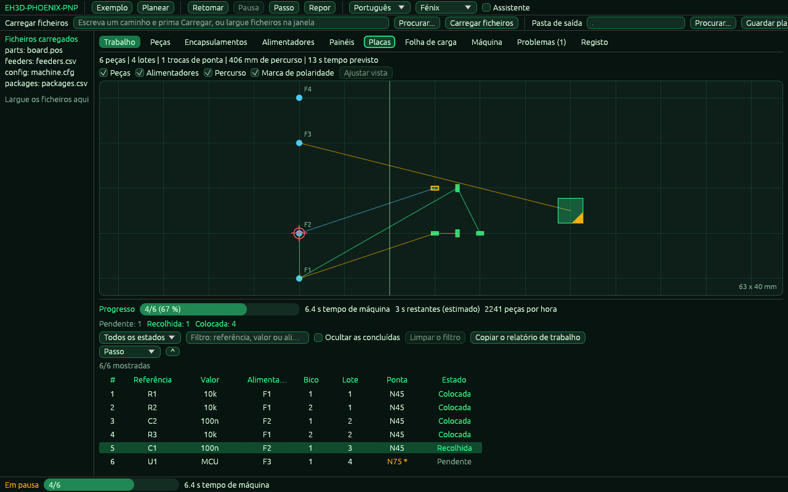

<p align="center">
  
</p>

# 📖 EH3D-PHOENIX-PNP

<p align="center"><a href="README.md">🇺🇸 English</a> | <a href="README_spa.md">🇪🇸 Español</a> | <a href="README_fra.md">🇫🇷 Français</a> | <a href="README_ita.md">🇮🇹 Italiano</a> | <a href="README_deu.md">🇩🇪 Deutsch</a> | <a href="README_zho.md">🇨🇳 中文</a> | <a href="README_jpn.md">🇯🇵 日本語</a> | 🇵🇹 <b>Português</b></p>

### Montagem pick and place: posições, alimentadores e ordem de colocação

<p align="center">
  
  
  
  
  
</p>

---

**Verificação de honestidade - o que funciona hoje:** uma biblioteca Rust e um programa de linha de comandos (`phoenix-pnp`) com 434 testes que correm num computador: lê o ficheiro de posições de uma placa, dá a cada componente o seu alimentador (com prioridades, tabuleiros e tiras), lê as definições da máquina de um ficheiro, planeia a ordem de colocação para uma cabeça de até seis bicos (níveis, pontas de bico, limites de ângulo, tempo dos movimentos, painéis), escreve uma folha de carga e, numa máquina simulada, executa o plano passo a passo com falhas injetadas. Também tem uma janela (compilada com `--features gui`) cuja lógica é testada sem ecrã; o desenho em si não está coberto por testes e, embora o programa tire imagens da sua própria janela (`--shot`), nenhuma pessoa verificou o desenho num ecrã. Não controla nenhuma máquina: não foi experimentado numa máquina e não foi verificado com uma coleção de ficheiros reais.

---

> **Estado de segurança:** este programa não controla nenhuma máquina e não é um sistema de segurança. O que produz deve ser verificado por uma pessoa antes de se executar algo numa máquina; nada disto correu em hardware real.


## 📋 Num relance

| | |
|---|---|
| Versão | `0.0.5` |
| Maturidade | Estrutura inicial |
| Testes | 434 |
| Tecnologias | Rust |
| Em hardware real | Não experimentado: nada disto correu numa máquina |

**Ir para:** [Visão geral](#-visão-geral) · [Arquitetura](#-arquitetura) · [Início rápido](#-início-rápido) · [Testes](#-testes) · [Estrutura](#-estrutura-do-repositório) · [Relacionados](#-projetos-relacionados)

## 🚦 Estado do projeto

Cada linha é uma parte deste repositório e a luz diz até onde chega hoje. É escrita com o que o repositório consegue demonstrar (testes, compilações, execuções), não com o que está previsto.

🟢 Feito e verificado · 🟡 Funciona, com limites conhecidos · 🟠 Feito a meio ou ainda por verificar · 🔴 Por fazer ou a não funcionar

| Área | Estado | O que significa aqui |
|---|---|---|
| Núcleo | 🟡 | lê o ficheiro de posições de uma placa, dá a cada componente o seu alimentador (prioridade, tabuleiro, tira), planeia a ordem de colocação para uma cabeça de até seis bicos com níveis, pontas de bico, limites de ângulo e o tempo dos movimentos, planeia painéis e escreve a folha de carga; testado num computador com entradas normais e danificadas, não com uma coleção de ficheiros reais. |
| Linha de comandos | 🟡 | `phoenix-pnp` executa as mesmas funções da biblioteca (`parts`, `check`, `plan`, `schedule`, `preflight`, `simulate`, `loadsheet`, `config-check`, `check-bottom`, `tables-check`, `vision-test`) e imprime o resultado; cada erro volta como uma mensagem com o seu código `PHOENIX-PNP-NNN` e um código de saída diferente de zero. |
| Testes | 🟡 | 434 testes passam (`cargo test`), com casos normais, casos-limite, entradas danificadas e pequenos casos gerados. |
| Configuração da máquina | 🟡 | um ficheiro `chave = valor` com versão, um validador que indica a linha e os limites de segurança (curso de Z, limites de X e Y, repetições, ângulos do bico); os valores não foram comparados com uma máquina real. |
| Simulador e trabalho | 🟡 | um relógio virtual, falhas injetadas ao acaso (com semente) ou num sítio escolhido, repetições, as políticas alerta e adiar, alimentadores que se desligam após falhas repetidas, pausa, passo a passo e um estado guardado para retomar; apenas simula, nada moveu uma máquina. |
| Segurança | 🟡 | Rust seguro e simples (`forbid(unsafe_code)`): nada entra em pânico com os ficheiros recebidos e um valor mau é um erro com o seu motivo; sem revisão independente. |
| Janela | 🟠 | Uma janela egui (compila-se com `--features gui`; `phoenix-pnp` sem comando abre-a): separadores de trabalho, peças, encapsulamentos, alimentadores, folha de carga, máquina, problemas e registo, um mapa da mesa de trabalho com o percurso da cabeça, marcas de polaridade e a peça seguinte, um assistente de cinco passos, problemas com correções que se podem anular, um trabalho simulado que se pode pausar, retomar e avançar passo a passo, e os oito idiomas. A sua lógica é testada sem ecrã; o desenho não está coberto por testes: o programa tira imagens da sua própria janela (`--shot`), mas nenhuma pessoa verificou o desenho num ecrã. Tem ainda separadores de painéis (com os fiduciais e o ajuste que move as peças) e de placas, um seletor de ficheiros, tabelas de alimentadores e de encapsulamentos que se podem editar com anular, larguras de coluna memorizadas e um programa à parte (`phoenix-pnp-gui`) que abre sem consola no Windows. |
| Hardware real | 🔴 | Não experimentado: nada disto foi executado numa máquina. |
| Documentação | 🟡 | README em oito idiomas, o registo de alterações e as duas imagens desenhadas a partir de `docs/`. |

## 🎯 Visão geral

* **Os componentes** (`src/parts.rs`): um ficheiro `.pos` do KiCad ou um CSV (vírgula ou ponto e vírgula, aspas, cabeçalho encontrado pelo nome) com posições em mm, mil ou polegadas, os ângulos levados a 0-360, a face superior ou inferior, e cada linha sem sentido é recusada com o seu número; uma referência repetida é um erro.
* **Peças que não se montam, as tabelas dos exemplos e o relatório de um trabalho** (`src/parts.rs`, `src/commands.rs`, `src/job.rs`): uma coluna `dnp`, `do not place` ou `fitted` num CSV (ou `--dnp R1,R2`) deixa peças fora do plano, da folha de carga e das verificações e lista-as no relatório; `tables-check` lê as tabelas (`--parts`, `--packages`, `--catalog`, `--feeders`, `--slots`) e indica o código e a linha de cada erro; `simulate --report-csv FICHEIRO` escreve as estatísticas do trabalho num CSV cujo cabeçalho nunca muda. `examples/` traz uma placa com coluna `dnp`, alimentadores de todos os tipos e uma tabela de encapsulamentos comuns.
* **Os alimentadores** (`src/feeders.rs`): um CSV de alimentadores (id, valor, encapsulamento, posição de recolha, peças que restam); cada componente recebe o primeiro alimentador que contém o seu valor e encapsulamento, sem distinguir maiúsculas; um componente sem alimentador e um alimentador que se esgota são comunicados, e um segundo alimentador do mesmo tipo assume.
* **O plano** (`src/plan.rs`): os lugares percorrem-se ao mais próximo e cortam-se em lotes de um a seis bicos, os alimentadores de um lote visitam-se ao mais próximo, a face inferior é espelhada em relação à largura da placa, e o plano dá o percurso e uma estimativa do tempo; escreve-se como trabalho JSON.
* **As tabelas e as definições** (`src/catalog.rs`, `src/config.rs`, `src/rotation.rs`): tabelas de peças e de encapsulamentos cujos valores se herdam (peça, depois encapsulamento, depois os valores por omissão), um ficheiro de configuração da máquina no formato `chave = valor` (`examples/machine.cfg` documenta cada chave), mais nomes para as colunas de um CSV de posições e correções da rotação por encapsulamento.
* **Os alimentadores com mais do que uma fita** (`src/feeding.rs`): prioridade, tabuleiros, tiras e alimentadores desligados; o alimentador de um componente escolhe-se da mesma maneira, seja qual for a ordem dos ficheiros.
* **O planeador da máquina** (`src/planner.rs`, `src/motion.rs`): níveis (blocos colocados um a seguir ao outro), estratégias de ordem, pontas de bico e as suas trocas, os limites do ângulo do bico, o tempo dos movimentos com aceleração e arranque brusco, percursos mais curtos (2-opt) e a correção da origem de um componente.
* **Painéis, folha de carga e exportações** (`src/panel.rs`, `src/loadsheet.rs`, `src/export.rs`): placas e painéis dentro de painéis, a ranhura de cada tipo de fita, um relatório, a lista do que falta e um G-code que só move a cabeça.
* **Fiduciais de um painel** (`src/fiducial.rs`): os lugares medidos das marcas são ajustados aos desenhados (uma semelhança com duas marcas, um ajuste afim com três ou mais) e as peças do painel são movidas e rodadas pelo ajuste; cada marca tem o seu resíduo, e um ajuste que falha uma marca em mais de `fiducial_max_residual_mm` é recusado (`--fiducials FICHEIRO` com `--panel`, ou o separador Painéis da janela).
* **Mais do planeador e do simulador:** a ordem em que as células de um tabuleiro são esvaziadas (linhas, colunas ou serpente), uma procura da ordem das pontas do bico que conta o percurso e a viagem ao trocador (`tip_strategy = optimize`, limitada por `tip_opt_max_evals` e `tip_opt_time_limit_s`), probabilidades de falha por encapsulamento e por alimentador (`sim_part_fail`, `sim_feeder_fail`) com estatísticas por encapsulamento e por alimentador e as peças por hora, e `check-bottom`, que mostra o ângulo que cada regra da face inferior dá.
* **O passo de alinhamento** (`src/job.rs`, `src/sim.rs`, `src/model.rs`): com `align = on` o trabalho olha para cada peça com a câmara depois de a recolher e corrige a colocação pelo que vê (a cabeça vai ao lugar menos o desvio da peça e o bocal roda menos a rotação da peça); `pick_tolerance_mm` deita fora uma peça mais desviada, que é recolhida de novo como diz `error_policy`; `align_passes` (de 1 a 5) e `align_settle_s` definem os olhares e a espera antes de cada um, que se somam ao tempo do plano; a câmara simulada tem um desvio, um erro e falhas que se podem injetar (`sim_align_*`, `sim_camera_fail_rate`); e a correção (média, maior, peças deitadas fora) aparece no texto, no relatório JSON e nas linhas `align` de `--report-csv`. Desligado por defeito: um trabalho é então o de sempre. Não testado numa máquina.
* **A cadeia de visão** (`src/vision.rs`, `src/sim.rs`, `examples/vision.cfg`): com `vision = pipeline` a câmara simulada desenha em memória uma imagem da peça (o seu tamanho, a sua rotação e a distância ao bico, com um ruído tirado de `sim_seed`) e mede-a com os passos de um ficheiro de definições (`--vision FILE`): uma máscara, um filtro de mediana, um limiar fixo ou de Otsu, um intervalo de área para a mancha e o menor retângulo rodado, cujo centro e ângulo são o desvio que o passo de alinhamento corrige. Uma peça que não se encontra, uma mancha de área errada e várias manchas são olhares sem leitura, cada um com o seu código (`PHOENIX-PNP-037` a `PHOENIX-PNP-039`). `phoenix-pnp vision-test` desenha uma peça com o tamanho, a rotação, o desvio e o ruído que se lhe dão e imprime o que foi medido com o seu erro. Desligado por defeito: um trabalho é então o de sempre. Não testado com uma câmara real.
* **O relatório de trabalho** (`src/report.rs`, `src/job.rs`): depois de simular um trabalho, `simulate` pode escrever o relatório como texto na língua de `--lang` (`--report-text`), como página HTML que contém tudo, sem scripts nem nada de fora, e que nunca é escrita por cima de um ficheiro que já existe (`--report-html`), como secções acrescentadas depois das linhas do CSV (`--report-csv`, o cabeçalho não muda) e como `work` no JSON (`--report`). Diz quantas peças foram colocadas, adiadas, saltadas pela pessoa, continuam pendentes ou não se montam; para onde foi o tempo de máquina (alimentar e recolher, olhares da câmara, colocações, deslocações da cabeça, trocas de ponta); quantas recolhas saíram à primeira tentativa; o mesmo por encapsulamento, alimentador, bico, ponta e placa de um painel; os erros ocorridos com os seus códigos; os avisos antes do trabalho; e um histograma do que a câmara corrigiu (X, Y e rotação). Simulado: nada disto foi medido numa máquina.
* **O separador Trabalho e as decisões da pessoa** (`src/gui/jobtab.rs`, `src/gui/window.rs`, `src/job.rs`): a tabela mostra o estado de cada colocação (em espera, recolhida, alinhada, colocada, adiada, saltada, com falha) e as peças que não se montam, uma barra de progresso com o tempo de máquina e uma estimativa do tempo que falta, e filtros por estado, por texto e pelo que já está feito. Quando um erro para o trabalho, um diálogo nomeia o passo que falhou e oferece quatro ações executadas sobre o trabalho simulado, que depois continua: tentar de novo, saltar a peça, adiá-la ou desligar o alimentador para que outro do mesmo tipo assuma. Cada decisão é contada no relatório. A lógica não precisa de ecrã e está testada; nenhuma pessoa verificou o desenho num ecrã (as imagens deste separador em `images/screens/` são tiradas pelo próprio programa).
* **O simulador e o trabalho** (`src/sim.rs`, `src/job.rs`, `src/preflight.rs`, `src/model.rs`): as verificações antes de um trabalho, uma máquina com relógio virtual e falhas que se podem injetar, e um trabalho que se pode pôr em pausa, executar passo a passo, guardar e retomar.
* **A janela** (`src/gui.rs`, `src/gui/`): o que a janela faz além de desenhar não precisa de ecrã (os ficheiros carregados, o plano e os seus problemas com correções, o trabalho simulado, a geometria do mapa, as tabelas com seleção partilhada, o assistente de cinco passos e os textos em oito idiomas) e é testado; só `src/gui/window.rs`, compilado com `--features gui`, a desenha com egui. A velocidade da simulação, o tema e o tamanho desenhado para uma peça de encapsulamento desconhecido são chaves de `machine.cfg` (`gui_steps_per_s`, `gui_theme`, `gui_part_size_mm`).

## 🧩 Papel no EH3D

EH3D-PHOENIX-PNP é um programa da EH3D Fabrication Suite. Hoje funciona como biblioteca, linha de comandos e janela (compilada com `--features gui`); a janela ainda não tem o aspeto que os outros programas da suíte partilham. Lê e escreve ficheiros simples, por isso pode ser usado sozinho ou entre os outros programas.

## 🏛️ Arquitetura

<p align="center">
  
</p>


Como as partes deste repositório se encaixam: quem o usa, o que contém e de que depende. A imagem é desenhada a partir de `docs/architecture.json` e verificada com o código.

## ✨ Funcionalidades

* **Biblioteca e linha de comandos:** cada comando de `phoenix-pnp` é uma função da biblioteca, por isso outro programa da suíte pode chamá-la sem lançar um processo.
* **Linha de comandos estrita:** uma opção mal escrita (`--powr`) ou uma palavra a mais é um erro que a nomeia, não algo que se ignora; caso contrário o programa faria a sua saída com os valores por omissão.
* **Testes com entradas danificadas:** os testes também dão ficheiros vazios, lixo, números enormes e ficheiros cortados, e nenhum pode entrar em pânico.
* **Sem adivinhar:** um valor sem sentido é um erro que diz qual e porquê, nunca um resultado que apenas parece certo.
* **Sem código unsafe:** `#![forbid(unsafe_code)]` na biblioteca e no programa.
* **Um só leitor para as duas tabelas, e rápido numa placa grande:** o ficheiro de posições e o de alimentadores são lidos pelo mesmo leitor (vírgula ou ponto e vírgula, campos entre aspas com um separador ou uma quebra de linha), cinquenta mil peças são verificadas, atribuídas e planeadas num instante, o plano nunca é escrito por cima de um ficheiro de origem, uma opção desconhecida é um erro e `--origin-x` diz onde está a margem esquerda da placa ao espelhar a face inferior.

## 🔒 Segurança e proteção

| Ameaça | Defesa |
|---|---|
| Um ficheiro danificado, cortado ou vazio | sem pânico: os testes cortam uma entrada válida em cada posição e dão lixo |
| Um número sem sentido (negativo, não finito, absurdamente grande) | recusado com um erro que nomeia o valor; nada é arredondado para algo plausível |
| Uso inseguro de memória | Rust seguro e simples com `forbid(unsafe_code)` |

**O que não é defendido:** um resultado produzido sem erros não é um resultado verificado. Nada aqui conhece os limites de uma máquina e o programa não teve revisão independente. Comunique uma vulnerabilidade em privado (ver [SECURITY.md](SECURITY.md)).

## 🔌 Interfaces

A biblioteca é `eh3d_phoenix_pnp` (`use eh3d_phoenix_pnp::...`); a linha de comandos é `phoenix-pnp`. Os comandos são estes; cada um imprime o resultado na saída padrão e comunica um erro na saída de erros com um código de saída diferente de zero. Não há acesso à rede.

```text
phoenix-pnp [gui [FILES...]]                             a janela (compilada com --features gui)
phoenix-pnp parts PARTS                                  as peças de um ficheiro de posições, em milímetros
phoenix-pnp check PARTS FEEDERS                          as peças sem alimentador e os alimentadores que vão esgotar-se
phoenix-pnp plan PARTS FEEDERS OUT.json                  o plano simples, como trabalho JSON
phoenix-pnp schedule PARTS FEEDERS OUT.json              o plano com toda a configuração, painéis e fiduciais
phoenix-pnp preflight PARTS FEEDERS                      as verificações antes de um trabalho
phoenix-pnp simulate PARTS FEEDERS                       o trabalho numa máquina simulada, com os seus relatórios
phoenix-pnp loadsheet PARTS SLOTS OUT.csv                a folha de carga
phoenix-pnp config-check FILE                            se um ficheiro de configuração é válido
phoenix-pnp check-bottom PARTS                           o ângulo que cada regra da face inferior dá
phoenix-pnp tables-check [--parts F] [--feeders F] ...   se cada tabela é válida, com o código e a linha
phoenix-pnp vision-test [--turn DEG] [--dx MM] ...       mede a imagem de uma peça feita em memória
```

`phoenix-pnp help` lista todas as opções. As opções comuns a `schedule`, `preflight`, `simulate` e `loadsheet` são `--config`, `--packages`, `--catalog`, `--panel`, `--fiducials`, `--x-out`, `--dnp`, `--side`, `--board-width`, `--origin-x`, `--nozzles`, `--speed`, `--order` e `--lang`; `--shot` e as suas companheiras tiram uma imagem da janela (ver o início rápido).

## ⚙️ Configuração

A máquina e o planeador configuram-se com um ficheiro de texto de linhas `chave = valor` (`--config FICHEIRO`), o mesmo formato dos outros programas da suite; `examples/machine.cfg` lista cada chave com o seu valor por omissão e o que faz. Uma chave em falta mantém o valor por omissão; uma chave desconhecida, escrita duas vezes ou fora do seu intervalo é um erro que indica a linha. As opções da linha de comandos (`--nozzles`, `--speed`, `--order`, `--side`) prevalecem sobre o ficheiro.

As colunas que marcam uma peça como não montada e as palavras que usam também são definições: `header_dnp` e `header_fitted` acrescentam nomes da coluna, `dnp_yes_words` e `dnp_no_words` acrescentam palavras para sim e não. Uma coluna chamada `dnp`, `do not place`, `do not populate`, `do not mount`, `do_not_place`, `not fitted` ou `no montar` deixa a peça de fora com um sim (`yes`, `y`, `true`, `1`, `x`); uma chamada `fitted`, `populate`, `populated`, `mount`, `mounted` ou `montar` deixa-a de fora com um não (`no`, `n`, `false`, `0`, `-`); uma célula vazia monta a peça e qualquer outra palavra é um erro que indica a linha.

As tabelas de encapsulamentos e de peças (`--packages`, `--catalog`) são ficheiros CSV em que uma célula vazia herda; um painel (`--panel`) é um ficheiro JSON; as ranhuras da máquina (`loadsheet`) são um CSV com `id,x,y,max_width_mm`. Um ficheiro maior do que `max_file_bytes` é recusado. Cada erro tem um código `PHOENIX-PNP-NNN`; a sua mensagem é escrita no idioma da chave `language` ou de `--lang` (`en`, `es`, `de`, `fr`, `it`, `ja`, `zh` ou `pt`):

| Código | Significado |
|---|---|
| `PHOENIX-PNP-001` | O ficheiro excede o tamanho permitido |
| `PHOENIX-PNP-002` | Há mais peças do que o limite permite |
| `PHOENIX-PNP-003` | Uma linha da configuração não é chave = valor |
| `PHOENIX-PNP-004` | A configuração tem uma chave desconhecida |
| `PHOENIX-PNP-005` | Um valor da configuração não é válido |
| `PHOENIX-PNP-006` | Um valor da configuração está fora do seu intervalo |
| `PHOENIX-PNP-007` | A configuração foi escrita para uma versão mais recente do programa |
| `PHOENIX-PNP-008` | Uma chave da configuração está escrita duas vezes |
| `PHOENIX-PNP-009` | Uma definição ultrapassa os limites de segurança |
| `PHOENIX-PNP-010` | Uma linha da tabela de peças ou de encapsulamentos não é válida |
| `PHOENIX-PNP-011` | Uma peça ou um encapsulamento está definido duas vezes |
| `PHOENIX-PNP-012` | Uma regra de correção de rotação não é válida |
| `PHOENIX-PNP-013` | Uma linha dos alimentadores não é válida |
| `PHOENIX-PNP-014` | O ficheiro do painel não é válido |
| `PHOENIX-PNP-015` | O painel está demasiado aninhado ou tem demasiadas placas |
| `PHOENIX-PNP-016` | A tabela de ranhuras não é válida |
| `PHOENIX-PNP-017` | Uma definição do plano não é válida |
| `PHOENIX-PNP-018` | O nozzle não consegue rodar para esse ângulo dentro dos seus limites |
| `PHOENIX-PNP-019` | O nozzle já tem uma peça: não pode pegar noutra |
| `PHOENIX-PNP-020` | O nozzle não tem nenhuma peça para colocar |
| `PHOENIX-PNP-021` | Não há nenhum alimentador disponível para a peça |
| `PHOENIX-PNP-022` | Não foi possível pegar na peça depois de todas as tentativas |
| `PHOENIX-PNP-023` | O alimentador não conseguiu avançar depois de todas as tentativas |
| `PHOENIX-PNP-024` | Não foi possível colocar a peça depois de todas as tentativas |
| `PHOENIX-PNP-025` | O estado guardado pertence a outro trabalho |
| `PHOENIX-PNP-026` | O estado guardado do trabalho não é válido |
| `PHOENIX-PNP-027` | O trabalho está em pausa, terminado ou parado por um erro |
| `PHOENIX-PNP-028` | As verificações antes do trabalho encontraram erros |
| `PHOENIX-PNP-029` | Um comprimento ou um ângulo não é válido |
| `PHOENIX-PNP-030` | O controlador não aceitou o comando |
| `PHOENIX-PNP-031` | O simulador injetou uma falha |
| `PHOENIX-PNP-032` | Os fiduciais não são válidos ou não dão uma posição |
| `PHOENIX-PNP-033` | Uma marca de montagem não é sim nem não, ou uma referência a omitir não é conhecida |
| `PHOENIX-PNP-034` | O ficheiro de posições não é válido |
| `PHOENIX-PNP-035` | A câmara encontrou a peça mais deslocada do que a tolerância permite |
| `PHOENIX-PNP-036` | A câmara não deu nenhuma leitura da peça |
| `PHOENIX-PNP-037` | A visão não encontrou a peça na imagem |
| `PHOENIX-PNP-038` | A mancha encontrada na imagem tem uma área fora do intervalo permitido |
| `PHOENIX-PNP-039` | A visão encontrou mais de uma mancha que pode ser a peça |
| `PHOENIX-PNP-040` | O ficheiro do relatório já existe e não é substituído |
| `PHOENIX-PNP-041` | A ação não se adequa ao estado do trabalho |

## 🚀 Início rápido

Precisa de uma cadeia de ferramentas Rust estável (1.95 ou mais recente).

```bash
cargo build --release
cargo test
cargo run --release -- plan examples/board.pos examples/feeders.csv examples/plan.json --nozzles 2
cargo run --release -- schedule examples/board.pos examples/feeders.csv examples/schedule.json --config examples/machine.cfg --packages examples/packages.csv --catalog examples/catalog.csv
cargo run --release -- simulate examples/board.pos examples/feeders.csv --config examples/machine.cfg --state examples/job_state.json --steps 5
cargo run --release -- loadsheet examples/board.pos examples/slots.csv examples/loadsheet.csv --packages examples/packages.csv
cargo run --release -- check-bottom examples/board.pos
cargo run --release -- schedule examples/board_dnp.csv examples/feeders.csv examples/schedule_dnp.json --config examples/machine.cfg --packages examples/packages.csv --catalog examples/catalog.csv
cargo run --release -- tables-check --parts examples/board_dnp.csv --packages examples/packages_common.csv --feeders examples/feeders_kinds.csv --slots examples/slots.csv --config examples/machine.cfg
cargo run --release -- simulate examples/board.pos examples/feeders.csv --config examples/machine.cfg --report-csv examples/job_report.csv
cargo run --release -- simulate examples/board.pos examples/feeders.csv --config examples/machine.cfg --report-text examples/job_report.txt --report-html examples/job_report.html
cargo run --release -- schedule examples/feeders.csv examples/schedule_panel.json --panel examples/panel.json --fiducials examples/marks.csv --config examples/machine.cfg
cargo run --release -- vision-test --vision examples/vision.cfg --turn 30 --dx 0.5 --dy -0.3
cargo run --release --features gui -- --shot screen.png examples/board.pos examples/feeders.csv examples/machine.cfg   # a picture of the window
cargo run --release --features gui -- --shot job.png --window job --steps 9 examples/board.pos examples/feeders.csv examples/machine.cfg   # the Job tab with the job on its way
cargo run --release --features gui
```

Para tirar uma captura da janela sem a abrir à mão, execute-o com `--shot FICHEIRO.png` (também `--size WxH`, `--theme phoenix|light|contrast`, `--wait N`, `--window TAB`, `--steps N`, `--lang CODE`, `--open FILE`, `--replace`): abre-se com esse tamanho, guarda o PNG, não guarda definições e fecha-se sozinho (código de saída 0 se o ficheiro foi escrito, 1 se não, 2 se os argumentos estiverem errados). `--window` escolhe o separador da captura (`job`, `parts`, `packages`, `feeders`, `panels`, `boards`, `loadsheet`, `machine`, `problems` ou `log`) e `--steps N` faz N passos do trabalho simulado antes de a tirar, de modo que o separador Trabalho mostra um trabalho em curso.

<p align="center">
  
</p>

A última linha abre a janela; `phoenix-pnp` sem comando também a abre se foi compilado com `--features gui` (em Linux a janela precisa dos ficheiros de desenvolvimento de X11 ou Wayland e de OpenGL). Com um comando, o programa continua a ser uma linha de comandos. No Windows, `phoenix-pnp-gui` (compilado com a mesma funcionalidade) abre a janela sem consola; veja `docs/windows-console.md`.

## 🧪 Testes

O conjunto tem 434 testes (`cargo test`, executados em Windows e Linux na CI). Verificam os casos normais, os casos-limite e as entradas danificadas: ficheiros vazios, lixo e ficheiros cortados nunca provocam um pânico. Pequenos casos gerados (a partir de uma semente fixa, por isso dão os mesmos números em cada execução) verificam que o plano não depende da ordem dos ficheiros, que um percurso nunca fica mais comprido, que um trabalho guardado e retomado em qualquer ponto acaba como o que nunca parou, e que os comprimentos e os ângulos se convertem de ida e volta. A CI também executa `cargo fmt --check`, `cargo clippy` com os avisos como erros e `python -I tools/ci_validate.py`.

## 🏗️ Compilação e publicação

A versão está em `Cargo.toml` e em `eh3d.project.json`; cada versão tem a sua entrada em [CHANGELOG.md](CHANGELOG.md). `build.bat` / `build.sh` compilam o programa, `test.bat` / `test.sh` executam os testes e `run.bat` / `run.sh` executam-no com um exemplo. As versões são publicadas no GitHub.

## 📂 Estrutura do repositório

<p align="center">
  
</p>

<details>
<summary>Versão em texto da árvore</summary>

```text
EH3D-PHOENIX-PNP/
├── src/
│   ├── catalog.rs                               as tabelas de peças e de encapsulamentos e a herança das suas propriedades
│   ├── cli_args.rs                              os argumentos da linha de comandos, estritos: uma opção desconhecida é um erro
│   ├── commands.rs                              os comandos com configuração, tables-check e check-bottom
│   ├── config.rs                                o ficheiro de configuração da máquina: chaves, intervalos e limites de segurança
│   ├── error.rs                                 os códigos de erro PHOENIX-PNP-NNN e o seu significado em oito idiomas
│   ├── export.rs                                o relatório, a lista do que falta e o G-code dos movimentos
│   ├── feeders.rs                               uma parte da lógica
│   ├── feeding.rs                               alimentadores com prioridade, tabuleiros e tiras, e a escolha do alimentador de um componente
│   ├── fiducial.rs                              fiduciais de um painel: o ajuste das marcas medidas e a correção das peças
│   ├── gui.rs                                   a janela: módulos que não precisam de ecrã e o desenho em window.rs
│   ├── gui/app.rs                               o estado da janela: carregar, planear, iniciar, pausar, avançar, corrigir, guardar
│   ├── gui/browse.rs                            o seletor de ficheiros: pastas e ficheiros, subir, caminhos escritos
│   ├── gui/jobtab.rs                            o separador Trabalho sem janela: estados, filtros, progresso, diálogo de erro
│   ├── gui/log.rs                               o registo com níveis e o texto do diagnóstico que se pode copiar
│   ├── gui/problems.rs                          os problemas de um trabalho e as correções que os resolvem
│   ├── gui/samples.rs                           exemplos, da placa pequena à grande
│   ├── gui/session.rs                           o trabalho simulado que se inicia, pausa, retoma e avança passo a passo
│   ├── gui/settings.rs                          o que a janela memoriza: idioma, tema, camadas, pastas e a largura das colunas
│   ├── gui/shot.rs                              o modo de captura da janela (--shot): os seus argumentos
│   ├── gui/tables.rs                            as linhas, a ordenação e a seleção partilhada pelas tabelas
│   ├── gui/texts.rs                             cada palavra da janela nos oito idiomas
│   ├── gui/theme.rs                             as cores: verde fénix, claro e alto contraste
│   ├── gui/view.rs                              a geometria do mapa: corpos, marcas de polaridade, ajuste, zoom e seleção
│   ├── gui/window.rs                            o desenho com egui, compilado com a funcionalidade gui: separadores, mapa e tabelas
│   ├── gui/wizard.rs                            o assistente de cinco passos, do nada a um trabalho simulado
│   ├── gui/workspace.rs                         os ficheiros carregados, o plano e as edições, sem janela
│   ├── gui_main.rs                              a janela como programa à parte, sem consola no Windows
│   ├── job.rs                                   o trabalho: passos, pausa, repetições, políticas, estatísticas e estado guardado
│   ├── lib.rs                                   a biblioteca: o que cada comando usa
│   ├── loadsheet.rs                             a folha de carga: a ranhura de cada tipo de fita
│   ├── main.rs                                  a linha de comandos e a entrada da janela quando corre sem comando
│   ├── model.rs                                 as partes de uma máquina como traits: máquina, bico, alimentador, atuador, câmara, controlador
│   ├── motion.rs                                o tempo de um movimento, com aceleração e arranque brusco
│   ├── panel.rs                                 painéis: placas e painéis dentro de painéis, cada um no seu lugar
│   ├── parts.rs                                 o ficheiro de posições e as peças que não se montam
│   ├── plan.rs                                  uma parte da lógica
│   ├── planner.rs                               o planeador que conhece a máquina: níveis, ordem, pontas e a sua procura, ângulos e tempo
│   ├── preflight.rs                             as verificações antes de um trabalho, com gravidade e aquilo a que apontam
│   ├── report.rs                                o relatório de trabalho: fases, recolhas, grupos, erros; texto, HTML, CSV, JSON
│   ├── rotation.rs                              correções da rotação por encapsulamento, e como roda um bico limitado
│   ├── sim.rs                                   a máquina simulada: relógio virtual e falhas que se podem injetar
│   ├── units.rs                                 comprimentos e lugares que levam a sua unidade
│   └── vision.rs                                a cadeia de visão: filtro, limiar, manchas, menor retângulo rodado
├── tests/
│   ├── align.rs                                 testes do passo de alinhamento: câmara, lugar corrigido, tolerância e tempo
│   ├── commands.rs                              testes dos comandos que usam a configuração
│   ├── feeding.rs                               testes dos alimentadores: prioridade, tabuleiros e tiras
│   ├── gui.rs                                   testes da janela sem ecrã: estado, plano, trabalho, mapa, tabelas e assistente
│   ├── job.rs                                   testes do trabalho: passos, repetições e estado guardado
│   ├── jobtab.rs                                testes do separador Trabalho sem ecrã: estados, filtros, progresso, diálogo
│   ├── loadsheet.rs                             testes da folha de carga e das exportações
│   ├── model.rs                                 testes do modelo de dados: códigos, comprimentos, configuração e tabelas
│   ├── more.rs                                  mais testes da biblioteca e da linha de comandos
│   ├── panel.rs                                 testes dos painéis e dos seus fiduciais
│   ├── planner.rs                               testes do tempo dos movimentos e do planeador
│   ├── pnp.rs                                   testes da biblioteca e da linha de comandos
│   ├── preflight.rs                             testes das verificações antes de um trabalho
│   ├── readme.rs                                testes de que o README se pode executar e está completo
│   ├── report.rs                                testes do relatório: fases, recolhas, histogramas, grupos, decisões, formatos
│   ├── sim.rs                                   testes da máquina simulada
│   ├── strict.rs                                testes da linha de comandos: opções e palavras que não conhece
│   ├── tables.rs                                testes das peças que não se montam, de tables-check e do relatório de um trabalho em CSV
│   ├── vision.rs                                testes da visão: imagens calculadas à mão, falhas, definições
│   └── vision_job.rs                            testes da visão no trabalho e vision-test: leituras, falhas, estado guardado
├── examples/
│   ├── board.pos                                um exemplo para experimentar o programa
│   ├── board_dnp.csv                            uma placa com uma coluna dnp: duas das suas peças não se montam
│   ├── catalog.csv                              uma tabela de peças: nível e altura
│   ├── feeders.csv                              um exemplo para experimentar o programa
│   ├── feeders_kinds.csv                        alimentadores de todos os tipos: fita, tira, tabuleiro e um desligado
│   ├── machine.cfg                              as definições da máquina, cada chave explicada
│   ├── marks.csv                                as posições medidas dos fiduciais do painel
│   ├── packages.csv                             uma tabela de encapsulamentos: altura, ponta, nível e fita
│   ├── packages_common.csv                      uma tabela de encapsulamentos comuns, das resistências 0201 aos QFN, para ajustar às suas peças
│   ├── panel.json                               um painel de duas placas
│   ├── slots.csv                                as ranhuras da máquina
│   └── vision.cfg                               as definições da cadeia de visão, cada chave explicada
├── docs/
│   ├── architecture.json                        dados da imagem de Arquitetura
│   ├── structure.json                           dados da imagem de Estrutura
│   └── windows-console.md                       porque é que a janela é um programa à parte no Windows
├── tools/                                       verificação da CI e do README e ferramentas de imagens
├── images/                                      banner, imagens de Arquitetura e Estrutura, e capturas da janela
├── .github/                                     fluxos de CI e de publicação, modelos de issues e pull requests
├── eh3d.project.json                            manifesto: versão, papel, maturidade e comando de compilação
├── Cargo.toml Cargo.lock                        o workspace e as suas dependências fixadas
├── rust-toolchain.toml                          a toolchain de Rust fixada
├── CHANGELOG.md                                 o que mudou em cada versão
├── SECURITY.md SUPPORT.md                       como comunicar uma vulnerabilidade e onde perguntar
└── CONTRIBUTING.md CODE_OF_CONDUCT.md LICENSE   como contribuir, o código de conduta e a licença
```

</details>

## 🗺️ Roteiro e limites conhecidos

**Limites conhecidos hoje**

* Nenhuma pessoa verificou o desenho da janela num ecrã (as imagens de `images/screens/` são tiradas pelo próprio programa com `--shot`); a janela não tem jog nem câmara real e ainda não usa as marcas que são peças de uma placa.
* Não foi experimentado numa máquina nem com uma coleção de ficheiros reais, e não teve revisão independente; tudo o que faz com uma máquina é uma simulação.
* Não lê os ficheiros de outros programas de colocação, e a regra do ângulo da face inferior de um CSV (`bottom_rotation`) não foi comparada com ficheiros reais de nenhum programa de CAD.
* A câmara e a visão são simuladas: não há câmara real, nem correção da recolha a partir de uma imagem real, nem controlador de uma máquina real; o plano é um ficheiro JSON para outro programa executar.

**A seguir**

* Levar a janela ao aspeto comum aos programas da suíte, e fazer com que use as marcas que são peças de uma placa e mostre as placas marcadas como defeituosas.
* Experimentar a cadeia de visão com imagens de uma câmara real e as marcas de dois níveis com um painel real; enviar um plano para uma máquina só depois de o experimentar numa real.
* Experimentá-lo com ficheiros reais e com os outros programas da suite.

## 🌍 Idiomas

O README e os textos existem em inglês, espanhol, francês, italiano, alemão, chinês, japonês e português europeu.

## 🔗 Projetos relacionados

* [EH3D-VISION-STUDIO](https://github.com/JuanenRac/EH3D-VISION-STUDIO): as câmaras, os fiduciais e a inspeção
* [EH3D-MOTIONCNC](https://github.com/JuanenRac/EH3D-MOTIONCNC): o programa de controlo de máquina
* [EH3D-GERBERVIEWER](https://github.com/JuanenRac/EH3D-GERBERVIEWER): o visualizador de camadas Gerber
* [EH3D-TOOL-MANAGER](https://github.com/JuanenRac/EH3D-TOOL-MANAGER): o armazém de ferramentas partilhado pelos programas CAM
* [EH3D-SUITE-LAUNCHER](https://github.com/JuanenRac/EH3D-SUITE-LAUNCHER): o centro que encontra e arranca os programas da suíte

## 📚 Documentação

* [Registo de alterações](CHANGELOG.md)
* [Dados de arquitetura e estrutura](docs/architecture.json): os dados a partir dos quais as duas imagens são desenhadas.
* [Porque é que a janela é um programa à parte no Windows](docs/windows-console.md)

## 🤝 Contribuir e comunidade

* Antes de um pull request execute `cargo fmt --check`, `cargo clippy --all-targets -- -D warnings`, `cargo test` e `python -I tools/ci_validate.py`: tudo tem de passar. Veja [CONTRIBUTING.md](CONTRIBUTING.md) e o [código de conduta](CODE_OF_CONDUCT.md).
* O README existe em oito idiomas: uma alteração ao texto faz-se nos oito ficheiros, e as duas imagens são desenhadas a partir de `docs/architecture.json` e `docs/structure.json` por `tools/make_architecture.py` e `tools/make_structure.py`.
* Comunique uma vulnerabilidade em privado: [SECURITY.md](SECURITY.md). Perguntas, ideias e relatos: electrohobby3d@gmail.com ([SUPPORT.md](SUPPORT.md)).

## 👤 AUTOR

**JuanenRac (Electro Hobby 3D)** · electrohobby3d@gmail.com

## 📜 LICENÇA

Software: GPL-3.0-or-later. Ver [LICENSE](LICENSE). Os projetos de hardware da suite usam a CERN OHL-S.
