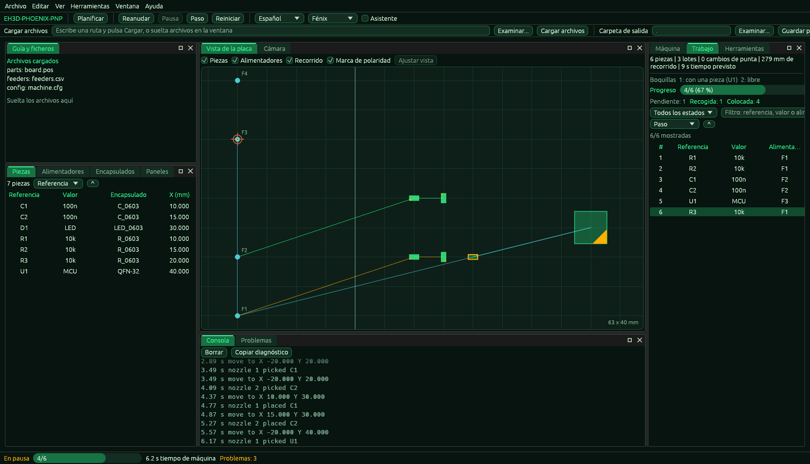

<p align="center">
  
</p>

# 📖 EH3D-PHOENIX-PNP

<p align="center"><a href="README.md">🇺🇸 English</a> | 🇪🇸 <b>Español</b> | <a href="README_fra.md">🇫🇷 Français</a> | <a href="README_ita.md">🇮🇹 Italiano</a> | <a href="README_deu.md">🇩🇪 Deutsch</a> | <a href="README_zho.md">🇨🇳 中文</a> | <a href="README_jpn.md">🇯🇵 日本語</a> | <a href="README_por.md">🇵🇹 Português</a></p>

### Montaje pick and place: posiciones, alimentadores y orden de colocación

<p align="center">
  
  
  
  
  
</p>

---

**Comprobación de honestidad - lo que funciona hoy:** una biblioteca Rust y un programa de línea de comandos (`phoenix-pnp`) con 986 pruebas que se ejecutan en un ordenador: lee el fichero de posiciones de una placa, da a cada componente su alimentador (con prioridades, bandejas y tiras), lee los ajustes de la máquina de un fichero, planifica el orden de colocación para un cabezal de hasta seis boquillas (rangos, puntas de boquilla, límites de ángulo, tiempo de los movimientos, paneles), escribe una hoja de carga y, en una máquina simulada, ejecuta el plan paso a paso con fallos inyectados. También tiene una ventana (se compila con `--features gui`) cuya lógica se prueba sin pantalla; el dibujo en sí no está cubierto por pruebas y, aunque el programa hace capturas de su propia ventana (`--shot`), ninguna persona ha revisado el dibujo en una pantalla. No controla ninguna máquina: no se ha probado en una máquina y no se ha comprobado con una colección de ficheros reales.

---

> **Estado de seguridad:** este programa no controla ninguna máquina y no es un sistema de seguridad. Lo que produce debe revisarlo una persona antes de ejecutar nada en una máquina; nada de esto se ha ejecutado en hardware real.


## 📋 De un vistazo

| | |
|---|---|
| Versión | `0.0.9` |
| Madurez | Andamiaje |
| Pruebas | 986 |
| Pila tecnológica | Rust |
| En hardware real | No probado: nada de esto se ha ejecutado en una máquina |

**Ir a:** [Resumen](#-resumen) · [Arquitectura](#-arquitectura) · [Inicio rápido](#-inicio-rápido) · [Pruebas](#-pruebas) · [Estructura](#-estructura-del-repositorio) · [Relacionados](#-proyectos-relacionados)

## 🚦 Estado del proyecto

Cada línea es una parte de este repositorio y la luz dice hasta dónde llega hoy. Se escribe con lo que el repositorio puede demostrar (pruebas, compilaciones, ejecuciones), no con lo previsto.

🟢 Hecho y verificado · 🟡 Funciona, con límites conocidos · 🟠 Hecho a medias o sin verificar · 🔴 Sin hacer o sin funcionar

| Área | Estado | Qué significa aquí |
|---|---|---|
| Núcleo | 🟡 | lee el fichero de posiciones de una placa, da a cada componente su alimentador (prioridad, bandeja, tira), planifica el orden de colocación para un cabezal de hasta seis boquillas con rangos, puntas de boquilla, límites de ángulo y el tiempo de los movimientos, planifica paneles y escribe la hoja de carga; probado en un ordenador con entradas normales y dañadas, no con una colección de ficheros reales. |
| Línea de comandos | 🟡 | `phoenix-pnp` ejecuta las mismas funciones que la biblioteca (`parts`, `check`, `plan`, `schedule`, `preflight`, `simulate`, `loadsheet`, `config-check`, `check-bottom`, `tables-check`, `recipe-check`, `import-centroid`, `vision-test`) e imprime el resultado; cada error vuelve como un mensaje con su código `PHOENIX-PNP-NNN` y un código de salida distinto de cero. |
| Pruebas | 🟡 | 986 pruebas pasan (`cargo test`), con casos normales, casos límite, entradas dañadas y pequeños casos generados. |
| Configuración de la máquina | 🟡 | un fichero `clave = valor` con versión, un validador que nombra la línea y los límites de seguridad (recorrido de Z, límites de X e Y, reintentos, ángulos de boquilla); los valores no se han comparado con una máquina real. |
| Simulador y trabajo | 🟡 | un reloj virtual, fallos inyectados al azar (con semilla) o en un lugar elegido, reintentos, las políticas alerta y aplazar, alimentadores que se apagan tras fallos repetidos, pausa, paso a paso y un estado guardado para reanudar; solo simula, nada ha movido una máquina. |
| Seguridad | 🟡 | Rust seguro y simple (`forbid(unsafe_code)`): nada entra en pánico con los ficheros recibidos y un valor malo es un error con su motivo; sin revisión independiente. |
| Ventana | 🟠 | Una ventana egui (se compila con `--features gui`; `phoenix-pnp` sin orden la abre): pestañas de trabajo, piezas, encapsulados, alimentadores, hoja de carga, máquina, herramientas, problemas y registro, un mapa de la mesa de trabajo con el recorrido del cabezal, marcas de polaridad y la pieza que toca, un asistente de cinco pasos, problemas con arreglos que se pueden deshacer, un trabajo simulado que se puede pausar, reanudar y avanzar paso a paso, y los ocho idiomas. Su lógica se prueba sin pantalla; el dibujo no está cubierto por pruebas: el programa hace capturas de su propia ventana (`--shot`), pero ninguna persona ha revisado el dibujo en una pantalla. También tiene pestañas de paneles (con los fiduciales y el ajuste que mueve las piezas) y de placas, un selector de archivos, tablas de alimentadores y encapsulados que se pueden editar con deshacer, anchos de columna que se recuerdan y un programa propio (`phoenix-pnp-gui`) que se abre sin consola en Windows. |
| Hardware real | 🔴 | No probado: nada de esto se ha ejecutado en una máquina. |
| Documentación | 🟡 | README en ocho idiomas, el registro de cambios y las dos imágenes dibujadas desde `docs/`. |

## 🎯 Resumen

* **Los componentes** (`src/parts.rs`): un fichero `.pos` de KiCad o un CSV (coma o punto y coma, comillas, cabecera hallada por nombre) con posiciones en mm, mil o pulgadas, los ángulos llevados a 0-360, la cara superior o inferior, y cada fila sin sentido se rechaza con su número; una referencia repetida es un error.
* **Componentes que no se montan, las tablas de los ejemplos y el informe de un trabajo** (`src/parts.rs`, `src/commands.rs`, `src/job.rs`): una columna `dnp`, `do not place` o `fitted` en un CSV (o `--dnp R1,R2`) deja componentes fuera del plan, de la hoja de carga y de las comprobaciones y los lista en el informe; `tables-check` lee las tablas (`--parts`, `--packages`, `--catalog`, `--feeders`, `--slots`) y nombra el código y la fila de cada error; `simulate --report-csv FICHERO` escribe las estadísticas del trabajo en un CSV cuya cabecera no cambia. `examples/` trae una placa con columna `dnp`, alimentadores de todos los tipos y una tabla de encapsulados habituales.
* **Los alimentadores** (`src/feeders.rs`): un CSV de alimentadores (id, valor, encapsulado, posición de recogida, piezas que quedan); cada componente recibe el primer alimentador que contiene su valor y encapsulado, sin distinguir mayúsculas; se informa de un componente sin alimentador y de un alimentador que se agota, y un segundo alimentador del mismo tipo toma el relevo.
* **El plan** (`src/plan.rs`): los lugares se recorren al más cercano y se cortan en lotes de una a seis boquillas, los alimentadores de un lote se visitan al más cercano, la cara inferior se refleja respecto al ancho de la placa, y el plan da el recorrido y una estimación del tiempo; se escribe como trabajo JSON.
* **Las tablas y los ajustes** (`src/catalog.rs`, `src/config.rs`, `src/rotation.rs`): tablas de componentes y encapsulados cuyos valores se heredan (componente, luego encapsulado, luego los valores por defecto), un fichero de configuración de la máquina en formato `clave = valor` (`examples/machine.cfg` documenta cada clave), más nombres para las columnas de un CSV de posiciones y correcciones de la rotación por encapsulado.
* **Los alimentadores con algo más que una cinta** (`src/feeding.rs`): prioridad, bandejas, tiras y alimentadores que se apagan; el alimentador de un componente se elige igual sea cual sea el orden de los ficheros.
* **El planificador de la máquina** (`src/planner.rs`, `src/motion.rs`): rangos (bloques que se colocan uno tras otro), estrategias de orden, puntas de boquilla y sus cambios, los límites del ángulo de la boquilla, el tiempo de los movimientos con aceleración y tirón, recorridos más cortos (2-opt) y la corrección del origen de un componente.
* **Paneles, hoja de carga y exportaciones** (`src/panel.rs`, `src/loadsheet.rs`, `src/export.rs`): placas y paneles dentro de paneles, la ranura de cada tipo de cinta, un informe, la lista de lo que falta y un G-code que solo mueve el cabezal.
* **Fiduciales de un panel** (`src/fiducial.rs`): los lugares medidos de las marcas se ajustan a los diseñados (una semejanza con dos marcas, un ajuste afín con tres o más) y las piezas del panel se mueven y giran con el ajuste; cada marca tiene su residuo, y un ajuste que falla una marca en más de `fiducial_max_residual_mm` se rechaza (`--fiducials FICHERO` con `--panel`, o la pestaña Paneles de la ventana).
* **Placas marcadas como malas (X-out) y marcas de dos niveles** (`src/marks.rs`, `src/panel.rs`): un hijo del fichero del panel con `"x_out": true`, o `--x-out A,B/C`, se deja fuera con todo lo que contiene; el plan, la hoja de carga y las comprobaciones no lo ven, y un nombre que ninguna placa tiene (`PHOENIX-PNP-042`) o un panel con todas las placas fuera (`PHOENIX-PNP-043`) es un error. Una pieza de una placa cuyo valor o encapsulado contiene una palabra de `fiducial_words`, o cuya referencia es un prefijo de `fiducial_refs` seguido de un número (`FID1`), es una marca de su placa y no se coloca; el fichero de `--fiducials` puede nombrar entonces las marcas del panel (`f1`) y de las placas (`A/FID1`): las marcas de una placa se ajustan juntas y solo mueven las piezas de esa placa, y las piezas de las placas sin marcas medidas siguen el ajuste del panel. Simulado: ninguna placa se midió nunca en una máquina; la ventana todavía no usa las marcas de las placas.
* **Más del planificador y del simulador:** el orden en que se vacían las celdas de una bandeja (filas, columnas o serpiente), una búsqueda del orden de las puntas de boquilla que cuenta el recorrido y el viaje al cambiador (`tip_strategy = optimize`, limitada por `tip_opt_max_evals` y `tip_opt_time_limit_s`), probabilidades de fallo por encapsulado y por alimentador (`sim_part_fail`, `sim_feeder_fail`) con estadísticas por encapsulado y por alimentador y las piezas por hora, y `check-bottom`, que muestra el ángulo que da cada regla de la cara inferior.
* **El paso de alineación** (`src/job.rs`, `src/sim.rs`, `src/model.rs`): con `align = on` el trabajo mira cada pieza con la cámara después de recogerla y corrige la colocación según lo que ve (el cabezal va al lugar menos el desplazamiento de la pieza y la boquilla gira menos el giro de la pieza); `pick_tolerance_mm` descarta una pieza más desplazada, que se vuelve a recoger como dice `error_policy`; `align_passes` (de 1 a 5) y `align_settle_s` fijan las miradas y la espera antes de cada una, que suman al tiempo del plan; la cámara simulada tiene un desplazamiento, un error y fallos que se pueden inyectar (`sim_align_*`, `sim_camera_fail_rate`); y la corrección (media, mayor, piezas descartadas) sale en el texto, en el informe JSON y en las filas `align` de `--report-csv`. Apagado por defecto: un trabajo es entonces el de siempre. No probado en una máquina. Con `align_rereads` mayor que 0 (hasta 5, 0 por defecto) la cámara vuelve a mirar una pieza cuya primera mirada estuvo fuera de tolerancia antes de descartarla, una mirada dentro de la tolerancia cuenta como la primera, y el informe de trabajo cuenta por alimentador las miradas fuera de tolerancia, las miradas extra, las piezas que salvaron, las descartadas y las miradas sin lectura.
* **La tubería de visión** (`src/vision.rs`, `src/sim.rs`, `examples/vision.cfg`): con `vision = pipeline` la cámara simulada dibuja en memoria una imagen de la pieza (su tamaño, su giro y lo lejos que está de la boquilla, con un ruido sacado de `sim_seed`) y la mide con los pasos de un archivo de ajustes (`--vision FILE`): una máscara, un filtro de mediana, un umbral fijo o de Otsu, un rango de área para la mancha y el rectángulo girado más pequeño, cuyo centro y ángulo son el desplazamiento que corrige el paso de alineación. Una pieza que no se halla, una mancha de área equivocada y varias manchas son miradas sin lectura, cada una con su código (`PHOENIX-PNP-037` a `PHOENIX-PNP-039`). `phoenix-pnp vision-test` dibuja una pieza con el tamaño, el giro, el desplazamiento y el ruido que se le dan e imprime lo medido con su error. Apagado por defecto: un trabajo es entonces el de siempre. No probado con una cámara real.
* **El informe de trabajo** (`src/report.rs`, `src/job.rs`): tras simular un trabajo, `simulate` puede escribir el informe como texto en el idioma de `--lang` (`--report-text`), como una página HTML que lo contiene todo, sin scripts ni nada de fuera, y que nunca se escribe sobre un archivo que ya existe (`--report-html`), como secciones añadidas tras las filas del CSV (`--report-csv`, la cabecera no cambia) y como `work` en el JSON (`--report`). Dice cuántas piezas se colocaron, se aplazaron, saltó la persona, siguen pendientes o no se montan; en qué se fue el tiempo de máquina (alimentar y recoger, las miradas de la cámara, las colocaciones, los desplazamientos del cabezal, los cambios de punta); cuántas recogidas salieron al primer intento; lo mismo por paquete, alimentador, boquilla, punta y placa de un panel; los errores producidos con sus códigos; los avisos antes del trabajo; y un histograma de lo que corrigió la cámara (X, Y y giro). Simulado: nada de ello se midió en una máquina.
* **La pestaña Trabajo y las decisiones de la persona** (`src/gui/jobtab.rs`, `src/gui/window.rs`, `src/job.rs`): la tabla muestra el estado de cada colocación (en espera, recogida, alineada, colocada, aplazada, saltada, con fallo) y las piezas que no se montan, una barra de progreso con el tiempo de máquina y una estimación del tiempo que falta, y filtros por estado, por texto y por lo que ya está hecho. Cuando un error detiene el trabajo, un diálogo nombra el paso que falló y ofrece cuatro acciones que se ejecutan sobre el trabajo simulado, que después sigue: reintentar, saltar la pieza, aplazarla o apagar el alimentador para que otro del mismo tipo tome el relevo. Cada decisión se cuenta en el informe. La lógica no necesita pantalla y está probada; ninguna persona ha revisado el dibujo en una pantalla (las imágenes de esta pestaña en `images/screens/` las hace el propio programa).
* **El vacío, los actuadores y la ventana de fallos de un alimentador** (`src/sim.rs`, `src/job.rs`, `src/config.rs`): con `vacuum = on` la bomba simulada aspira durante `vacuum_suck_s` segundos tras cada recogida y se lee el nivel de la boquilla (kilopascales); un nivel por debajo de `vacuum_pick_min_kpa` significa que la boquilla no sujeta ninguna pieza (`PHOENIX-PNP-044`, y la recogida se repite como dicen los reintentos) y, tras el soplado de `vacuum_blow_s` segundos en cada colocación, un nivel por encima de `vacuum_release_max_kpa` significa que la pieza sigue pegada a la boquilla (`PHOENIX-PNP-045`). El sensor tiene un generador propio (`sim_vacuum_noise_kpa`, `sim_vacuum_miss_rate`, `sim_vacuum_stuck_rate`) y viene apagado, así que un trabajo sin él es exactamente el que era. Los dispositivos de encendido/apagado se declaran con `actuator = NOMBRE : RETARDO_S` y se conmutan con `Job::set_actuator`, que suma su retardo al reloj (`PHOENIX-PNP-046` si la máquina no tiene ese nombre). Con `fault_action = alert`, un alimentador que alcanza `fault_limit` fallos entre sus últimas `fault_window` recogidas ya no se apaga solo: el trabajo se detiene (`PHOENIX-PNP-047`) y el diálogo de la pestaña Job ofrece reintentar, dejar la pieza fuera, apartarla o apagar el alimentador.
* **El modelo de cámara, las cabezas de la máquina y las puntas de un encapsulado** (`src/camera.rs`, `src/heads.rs`, `src/tips.rs`, `src/config.rs`): la cámara se describe con `camera_units_per_px` (0 es el tamaño para el que está ajustada la visión), `camera_offset_x_mm` y `camera_offset_y_mm` (dónde está el eje de la boquilla en la imagen), `camera_rotation_deg`, `camera_flip_x` y `camera_flip_y`, y la lente (`camera_lens_scale`, `camera_lens_k1`); la cámara simulada del paso de alineación lee la pieza a través de ella, con o sin imagen, y con los valores por defecto un trabajo es exactamente el que era. `head = NOMBRE : BOQUILLAS [: DESPL_X : DESPL_Y : CAMARA_X : CAMARA_Y : CAMARA_ROT : CAMARA_UNIDADES : CAMARA_LENTE]` declara hasta cuatro cabezas, cada una con sus boquillas, su desplazamiento y su cámara; con dos o más cabezas `schedule` da cada pieza a una cabeza que la alcance (`PHOENIX-PNP-048` si ninguna), planifica cada cabeza y cuenta, en el reloj de la máquina, el tiempo que una cabeza espera a un alimentador que usa otra. `tip_compat = PATRÓN : PUNTA, PUNTA, ...` lista las puntas que acepta un encapsulado y `tip_compat_mode` (`fewest_changes` o `preferred`) elige una punta para cada tipo de pieza de modo que la máquina cambie de punta las menos veces posibles; una punta nombrada en las tablas se respeta.
* **Recetas** (`src/recipe.rs`, `src/job.rs`, `src/commands.rs`): un fichero de texto con versión (`examples/job.recipe`) fija los pasos por los que pasa un trabajo (`prepare`, `pick`, `align`, `place` y `check`, en ese orden y ninguno dos veces; el paso de alineación y la comprobación del vacío solo están activos si la receta los tiene) y los parámetros que cambian para un encapsulado, un alimentador o una punta de boquilla (`pick_retries`, `pick_tolerance_mm`, `vacuum_suck_s` y `vacuum_blow_s`; para cada clave gana la primera regla que coincide, primero las de los alimentadores, luego las de los encapsulados y después las de las puntas). `phoenix-pnp recipe-check FICHERO` la lee y la comprueba, y `simulate ... --recipe FICHERO` ejecuta el trabajo con ella. Sus errores tienen los códigos `PHOENIX-PNP-049` a `PHOENIX-PNP-052` (una línea no válida, pasos desordenados, un fichero que supera sus límites, una versión demasiado nueva) y los límites son las claves `recipe_max_bytes` y `recipe_max_rules` de `machine.cfg`. Un estado guardado también recuerda el alimentador de la última recogida y la recogida que se detuvo, así que un trabajo cargado en otra ejecución ofrece a la persona las mismas decisiones (un estado antiguo se sigue cargando).
* **Importación de ficheros de posiciones** (`src/import.rs`, `src/commands.rs`): `phoenix-pnp import-centroid FICHERO` lee un CSV de centroides (`--map FICHERO` nombra sus columnas, `examples/centroid.map`; `examples/centroid.csv` no necesita mapa), el texto de posiciones de EAGLE (`examples/board.mnt`: nombre, x, y, giro `R90` o `MR90` para la cara inferior, valor, encapsulado) o el `.pos` de KiCad (`--format auto|csv|eagle|kicad-pos`; `auto` los distingue por la primera fila) y escribe la tabla de piezas `ref,val,package,x,y,rot,side,dnp` en milímetros en `--out` (un fichero que ya existe nunca se sobrescribe: `PHOENIX-PNP-040`) o en la salida estándar. Las unidades son mm, mil o pulgadas (en la cabecera como `X (mil)`, en la celda como `0.5in`, en un comentario como `## Unit = inch`, en el mapa o en `import_unit`); los ángulos salen de 0 a 360; la columna de la cara es opcional; una columna `dnp` o `fitted` (o `--dnp R1-R5,C7` con rangos de referencias) marca las piezas que no se montan; `import_bottom_mirror_width_mm` refleja la X de la cara inferior y `bottom_rotation` gira su ángulo. Los tres lectores son propios del programa (ningún otro repositorio tiene un lector que se pueda usar sin añadir una dependencia) y la disposición del texto de EAGLE no se ha comparado con un fichero escrito por una instalación real. Cada error tiene un código de `PHOENIX-PNP-053` a `PHOENIX-PNP-056` (una línea no válida, una cabecera sin una columna del mapa, un formato desconocido, un rango de referencias no válido) y el número de la línea.
* **Lista de materiales** (`src/bom.rs`, `src/cmd_tools.rs`): `phoenix-pnp bom-check PIEZAS BOM` lee una lista de materiales (`examples/bom.csv`: las referencias en una celda, como rango o una por fila, y el valor, el encapsulado, la cantidad y la referencia del fabricante si los tiene) y dice qué referencias tiene solo uno de los lados, cuáles aparecen dos veces, qué valores o encapsulados difieren y qué cantidades no cuadran; una pieza marcada como no montar puede estar en la lista o no. Un error del fichero lleva el código `PHOENIX-PNP-057` y su línea.
* **Existencias para una tirada** (`src/stock.rs`): `phoenix-pnp stock PIEZAS ALIMENTADORES --boards N` suma las placas y dice, tipo de pieza por tipo, cuántas piezas necesitan N placas frente a las de los alimentadores encendidos, qué tipos se quedan cortos, en cuánto y tras cuántas placas se acaba la primera bobina; sale con 1 si algo falta y escribe la tabla con `--out`. `bom-order --have ALIMENTADORES` descuenta de la lista de piezas que comprar lo que los alimentadores ya tienen y da las columnas `on_hand` y `to_buy`.
* **Calibración de la cámara** (`src/calibrate.rs`): `phoenix-pnp camera-calibrate FICHERO` ajusta el modelo de la cámara (tamaño de un píxel, giro, espejo y dónde está el eje de la boquilla en la imagen) a avistamientos de una marca en lugares conocidos del cabezal (`px,py,x_mm,y_mm` [ver `examples/camera_points.csv`], al menos tres) e imprime lo bien que encajan y las líneas `camera_*` para la configuración; la lente no se ajusta. Su error es el código `PHOENIX-PNP-058`.
* **Excentricidad de la boquilla** (`src/calibrate.rs`, `src/export.rs`): `phoenix-pnp nozzle-calibrate FICHERO` ajusta un círculo a lecturas de la punta de la boquilla en varios ángulos (`angle_deg,x_mm,y_mm` [ver `examples/nozzle_readings.csv`]) e imprime `nozzle_runout_mm` y `nozzle_runout_deg`; con la excentricidad por encima de 0, el G-code de `schedule --gcode` mueve cada lugar en sentido contrario a la excentricidad al ángulo de la pieza.
* **Panel de una cuadrícula de placas** (`src/panel.rs`, `src/cmd_tools.rs`): `phoenix-pnp panelize PLACA --cols N --rows N --pitch-x MM --pitch-y MM` escribe el fichero de panel para una cuadrícula de copias de una placa, con el mismo giro para todas, tres fiduciales a un margen (`--fiducials MM`, alrededor del tamaño real de la placa que da `--board-size W,H`) y placas marcadas como malas por sus nombres `P1`, `P2`, ... (`--x-out P2,P5`); un fichero que existe no se sobrescribe nunca.
* **Hoja de piezas con sentido** (`src/polarity.rs`): `phoenix-pnp polarity-sheet PIEZAS` lista las piezas cuya referencia coincide con `polarity_refs` o cuyo encapsulado coincide con `polarity_packages` (por defecto diodos, LED, chips, transistores, condensadores polarizados y conectores) con su lugar y giro y una columna vacía para marcar, para la revisión tras un trabajo; `--side` deja un solo lado.
* **Holgura de los ejes** (`src/sim.rs`, `src/motion.rs`): `backlash_x_mm`, `backlash_y_mm` y `backlash_mode` hacen que la máquina simulada termine corta por la holgura un movimiento que invierte un eje (`off`, que `simulate` cuenta) o que pase del lugar y vuelva desde el lado positivo (`approach`, que tarda más y no deja error); con holgura 0 no cambia nada.
* **Lista de piezas que comprar** (`src/bom.rs`): `phoenix-pnp bom-order BOM --boards N` suma las filas de una lista de materiales que son la misma pieza y da a cada línea las piezas para N placas más un sobrante (`order_spare_percent` por ciento o `order_spare_min`, el mayor; mandan `--spare-percent` y `--spare-min`), sin las piezas que `--parts PIEZAS` marca como no montar; escribe un CSV ordenado por encapsulado y valor.
* **Enseñanza de alimentadores** (`src/calibrate.rs`): `phoenix-pnp feeder-teach strip` da el paso y el ángulo de una tira a partir de los lugares de su primera y última pieza, y `feeder-teach tray` los dos pasos y el ángulo de una bandeja a partir de tres de sus celdas, con cuánto se aleja de la escuadra; ambos imprimen las columnas del fichero de alimentadores que fijan. `feeder-teach --measures FICHERO` lee los lugares de varios alimentadores de un fichero e imprime una línea y una fila del fichero de alimentadores para cada uno (`examples/feeder_measures.csv`).
* **El simulador y el trabajo** (`src/sim.rs`, `src/job.rs`, `src/preflight.rs`, `src/model.rs`): las comprobaciones previas al trabajo, una máquina con reloj virtual y fallos que se pueden inyectar, y un trabajo que se puede pausar, ejecutar paso a paso, guardar y reanudar.
* **La ventana** (`src/gui.rs`, `src/gui/`): lo que la ventana hace además de dibujar no necesita pantalla (los ficheros cargados, el plan y sus problemas con arreglos, el trabajo simulado, la geometría del mapa, las tablas con una selección compartida, el asistente de cinco pasos y los textos en ocho idiomas) y se prueba; solo `src/gui/window.rs`, que se compila con `--features gui`, lo dibuja con egui. La velocidad de la simulación, el tema y el tamaño dibujado para una pieza de encapsulado desconocido son claves de `machine.cfg` (`gui_steps_per_s`, `gui_theme`, `gui_part_size_mm`).
* **La mirada a la pieza en la boquilla** (`src/inspect.rs`, `src/cmd_vis.rs`): `phoenix-pnp part-inspect LECTURAS --sizes TAMAÑOS` (o `--packages ENCAPSULADOS`) compara lo que la cámara midió de cada pieza (sus dos lados, dónde cuelga del eje y cuánto está girada) con el tamaño de su encapsulado y dice por qué se rechaza (`part_size_tol_mm`, `part_angle_tol_deg`, `part_offset_max_mm`); el tamaño sale de una tabla de tamaños o de las columnas `body_long_mm` y `body_short_mm` de la tabla de encapsulados (`examples/packages_bodies.csv`), y el comando sale con 1 mientras una pieza se rechaza o no tiene tamaño.
* **Varillas y alimentadores a granel** (`src/feeding.rs`, `src/feedlib.rs`): además de una cinta, una bandeja y una tira, la columna `kind` de la tabla de alimentadores admite `tube` (una varilla o carril cuyas piezas se deslizan hasta un tope) y `bulk` (piezas sueltas en un depósito o un cuenco, que no llegan en una dirección fija); ambos toman del único lugar `x`, `y`, como una cinta, toman el ángulo de las piezas de `rotation`, se vacían por la cuenta y los comprueba `feeder-check`; la pestaña Alimentadores de la ventana ofrece los cinco tipos en los ocho idiomas (`examples/feeders_tubes.csv`).
* **Piezas colocadas y tiempo por alimentador** (`src/job.rs`, `src/feedrep.rs`, `src/report.rs`): el trabajo anota de qué alimentador tomó cada boquilla su pieza (también cuando otro alimentador del tipo ha tomado el relevo) y cuenta la pieza como colocada desde ese alimentador, y suma el tiempo de los pasos que recogieron de cada alimentador (el camino hasta él, la alimentación, la recogida y la mirada); el informe de trabajo, su JSON y `simulate --report-feeders` (las columnas `placed` y `busy_s` al final) los muestran, y un trabajo guardado los conserva.
* **Vida de las puntas de boquilla** (`src/nozzlelife.rs`, `src/cmd_tools.rs`, `src/commands.rs`): `simulate --nozzle-life FICHERO` suma lo que hizo con cada punta un trabajo que llegó a su fin (las piezas colocadas y las veces que se montó) a un CSV pequeño que la persona guarda junto a la configuración; un trabajo se cuenta una vez, un archivo que no es un registro de las puntas nunca se pisa, el archivo que se sustituye se conserva como `FICHERO.prev` y las cuentas solo bajan cuando `nozzle-life FICHERO --reset PUNTA` anota que se cambió una punta. `nozzle_life_warn` (por defecto 500000, 0 no avisa) es el número de piezas a partir del cual se avisa a la persona de que mire una punta, con `simulate` y con `nozzle-life`. Código de error nuevo `PHOENIX-PNP-059`.
* **Qué orden es más rápido** (`src/compare.rs`, `src/commands.rs`): `phoenix-pnp order-compare PIEZAS ALIMENTADORES` planifica la misma placa con cada `order` de los lugares (nearest, part, height_part, pick, tips, none) y cada `tip_strategy` (minimize, as_planned, optimize), y los muestra lado a lado con los lotes, los cambios de punta, el recorrido de la cabeza y los segundos, con la más rápida de cada lista marcada, la que tiene la configuración marcada y una línea que dice cuántos segundos ahorraría el mejor ajuste; toma las opciones de `schedule` y no cambia nada.
* **Una imagen del plan** (`src/preview.rs`, `src/commands.rs`): `phoenix-pnp schedule PIEZAS ALIMENTADORES SALIDA.json --svg SALIDA.svg` escribe además el plan como un archivo SVG para mirarlo antes de que la máquina se mueva, para imprimirlo o guardarlo con el trabajo: los alimentadores, el lugar de cada pieza con el número de su turno y el color de su boquilla, la línea que sigue cada pieza desde su alimentador, el recorrido discontinuo de la cabeza por todo el trabajo y los totales; no lleva scripts ni nada de fuera, lo que se escriba en una referencia o un id se escapa, y una imagen que existe nunca se pisa.
* **Calibración de la cámara con un patrón** (`src/pattern.rs`, `src/cmd_tools.rs`): `phoenix-pnp camera-pattern FICHERO [--pitch MM]` lee los puntos de una cuadrícula (las esquinas interiores de un tablero de ajedrez o los centros de puntos) como `col,row,px,py` (`examples/camera_pattern.csv`) y ajusta el tamaño de un píxel (`camera_units_per_px`) y la curvatura radial de la lente (`camera_lens_k1`) junto con el giro, el desplazamiento y el espejo de la hoja en la imagen; luego dice cuánto se alejan los puntos del modelo con y sin la curvatura y cuál es el más lejano; se imprimen las líneas para la configuración y el código de salida es 1 cuando un punto supera `camera_pattern_max_residual_mm`. Los puntos están a `camera_pattern_pitch_mm` unos de otros. El giro y el desplazamiento de la cámara siguen saliendo de `camera-calibrate`, que mueve la cabeza. La pestaña Herramientas tiene la misma calibración y se niega a poner en la máquina un ajuste que supera el límite.
* **Qué fiducial falla** (`src/fidcheck.rs`, `src/gui/workspace.rs`, `src/gui/tables.rs`): al usar las marcas medidas de un panel, la ventana calcula el residuo de cada marca (también cuando el ajuste se rechaza, para que se vea por qué), la única marca que, quitada, deja todas las demás dentro de `fiducial_max_residual_mm`, y el giro, las escalas y la inclinación frente a sus límites. La tabla de fiduciales señala con `!` una marca por encima del límite y con `?` la que no concuerda, y el panel lista los avisos con palabras (también en el registro); `fidcheck::analyze_marks`, `fidcheck::warnings` y `fidcheck::residual_table` dan lo mismo al comando `fiducial-check` y a la herramienta de revisión de fiduciales.
* **Cola de trabajos** (`src/queue.rs`, `src/cmd_queue.rs`): varias placas o paneles uno tras otro. `phoenix-pnp queue-add COLA NOMBRE ORIGEN ALIMENTADORES [--panel] [--boards N]` pone un trabajo en un CSV pequeño que sobrevive a que el programa se pare (se escribe en un fichero temporal y se mueve a su sitio, el fichero que reemplaza se guarda como `RUTA.prev` y la última línea lleva una suma de control, de modo que un fichero cortado o cambiado a mano se rechaza); `queue-status [--check]` lista los trabajos y qué fue de cada uno (pending, running, done, failed, skipped) y con `--check` planifica los que faltan; `queue-edit` salta, reinicia, retira la confirmación de un trabajo o lo quita; `queue-run` hace los trabajos placa a placa en la máquina simulada y escribe la cola tras cada placa. Nada se ejecuta sin confirmación: con `queue_confirm` activado (por defecto) un trabajo se ejecuta solo después de que `queue-confirm` registrase la identidad de su plan (el plan y el texto de los ficheros con que se hizo), y un cambio en un fichero la anula; `queue_stop_on_failure` (por defecto activado) detiene la cola en el primer trabajo que falla. Un segundo `queue-run` sobre la misma cola se rechaza mientras exista un fichero `.lock`. La herramienta Cola de la pestaña Herramientas hace todo esto con botones. Nuevo código de error `PHOENIX-PNP-060`.
* **Texto en UTF-16** (`src/parts.rs`): cada tabla y fichero de ajustes que leen los comandos y la ventana (posiciones, alimentadores, encapsulados, listas de materiales, paneles, marcas medidas) puede estar en UTF-16 con marca de orden de bytes, como guardan "texto Unicode" los programas de Windows y las hojas de cálculo; se lee como UTF-8. El texto que no es ninguno de los dos se lee como Latin-1 con una nota, y una herramienta de la pestaña Herramientas que lee un fichero lo rechaza.
* **Corregir la lente** (`src/camera.rs`, `src/sim.rs`): con `camera_correct_lens = on` la cámara quita la curvatura de la lente (`camera_lens_k1`, tal como la halla `camera-pattern`) de lo que ve, de modo que las lecturas del paso de alineación son las de una lente que no curva nada; `CameraModel::to_machine_corrected` y `read_corrected` lo hacen invirtiendo `d * (1 + k1 * d * d)`. Desactivado (por defecto) deja la curvatura en las lecturas. `camera_units_per_px` debería ser entonces el tamaño real de un píxel, como lo da `camera-pattern`.
* **Rutas de la cola desde su carpeta** (`src/queue.rs`, `src/cmd_queue.rs`): con `queue_relative_paths = on` (o `queue-add --relative`) los ficheros de un trabajo que están en la carpeta del fichero de la cola, o debajo, se guardan como rutas desde esa carpeta, de modo que la carpeta se puede mover o compartir; `queue-status`, `queue-confirm` y `queue-run` las toman de la carpeta de la cola, desde cualquier carpeta que se ejecuten. Apagado (el defecto) guarda rutas absolutas; ambas funcionan igual y dan la misma identidad del plan.
* **La cola con botones** (`src/gui/queuetab.rs`, `src/gui/window.rs`): la herramienta Cola de la pestaña Herramientas lee un fichero de cola como lista de trabajos y tiene botones para añadir un trabajo (un formulario revisado en el idioma de la ventana), revisar los planes, confirmar el plan del trabajo elegido, retirar la confirmación, saltar, reiniciar, quitar y ejecutar. Cada botón ejecuta el comando del mismo nombre como el programa junto a la ventana, así que la ventana y la línea de comandos planifican, confirman y ejecutan de una sola manera (misma identidad del plan, mismo bloqueo). La primera pulsación de Ejecutar solo pregunta (`queue_gui_ask_run`, activo por defecto); la segunda inicia la ejecución en la máquina simulada, en segundo plano, con un botón de Parar.
* **Una cámara simulada que se puede empeorar** (`src/vision.rs`): `vision.cfg` añade `sim_blur_px` (cámara desenfocada), `sim_salt_pepper` (píxeles que se vuelven negros o blancos), `sim_gradient_levels` (luz desigual), `sim_failure_rate` y `sim_failure_kind` (una parte de las imágenes estropeada: la pieza no está, la luz apagada o todo saturado); todo está apagado por defecto y el ruido de un trabajo que no los usa no se mueve. `vision-test` y `simulate --vision` los usan igual que el ruido que ya había.
* **Lecturas para probar las comprobaciones** (`src/visionsim.rs`, `src/cmd_vis.rs`): `phoenix-pnp vision-readings PARTS --sizes F` dibuja la imagen que da la cámara simulada de cada pieza de un fichero de posiciones (colgando algo fuera del eje y girada, dentro de `--spread` y `--turn`; `--wrong-every N` hace que cada N-ésima pieza sea de otro tamaño) y escribe las lecturas en el fichero que lee `part-inspect`; `phoenix-pnp vision-marks DESIGN --shift X,Y --turn DEG --scale S` mira cada marca de un panel que está como se dice y escribe las marcas medidas que lee `fiducial-check`. El desenfoque, el ruido y los fallos vienen de `--vision`; una imagen en la que no se encuentra nada no da lectura y se cuenta con su motivo; la misma `--seed` da las mismas lecturas.
* **Un informe de trabajo para guardar** (`src/report.rs`): `simulate --report-html FILE` (una página sin scripts ni nada de fuera), `--report-text`, `--report` (JSON) y `--report-csv` ahora dicen también, por alimentador, cuántas piezas se tomaron, se colocaron, se aplazaron y se saltaron, y, por punta de boquilla, lo que el trabajo añadió a su vida (`--nozzle-life` da el registro anterior al trabajo), los usos antes y después y un aviso cuando una punta llega a `nozzle_life_warn`; los tiempos, los avisos de las comprobaciones y los errores con sus códigos ya estaban.
* **Un tiempo más fiel para el plan** (`src/planner.rs`): con `backlash_mode = approach` la máquina se pasa del lugar por la holgura de un eje y vuelve, lo que lleva tiempo; el plan lo dejaba fuera y ahora lo cuenta tramo a tramo (solo donde hay sitio antes del límite), así que sus segundos son los del trabajo simulado, y `AdvancedPlan::approach_s`, el informe del plan y su JSON dicen cuántos segundos son de las segundas pasadas. Las puntas siguen agrupadas en tandas y los alimentadores de una tanda se visitan del más cercano al más lejano; sin el modo approach no cambia nada.
* **Tamaños de los encapsulados comunes** (`src/pkggen.rs`, `src/cmd_tools.rs`): `phoenix-pnp package-gen 0603 SOT-23-5 SOIC-8 QFN-32-5x5 LQFP-48` (o `--from PARTS` para los encapsulados de un fichero de posiciones) escribe las filas de una tabla de encapsulados (`package,height_mm,tape_mm,body_long_mm,body_short_mm`) con los tamaños nominales de los chips de los códigos EIA, SOT, SOD, SOIC (estrecho y ancho), TSSOP, QFN, DFN y QFP, con el ancho de la cinta que sostiene el cuerpo; `--packages` de `part-inspect` y el catálogo leen el resultado. Un nombre desconocido es un error con su motivo, nunca una suposición. `phoenix-pnp package-kicad RUTA...` hace lo mismo con ficheros de huella de KiCad (`src/kicadmod.rs`, `examples/chip_0603.kicad_mod`): el cuerpo es la caja del dibujo en la capa de fabricación (el área de reserva, con una nota, si no hay), la altura es la del paquete si el nombre es conocido o `--height`; la lectura está limitada en tamaño, profundidad y elementos, y un fichero que no se entiende se nombra con su motivo.
* **Desplazamientos de colocación aprendidos** (`src/learn.rs`, `src/cmd_tools.rs`, `src/job.rs`): `phoenix-pnp place-learn READINGS --state F` toma filas `package,dx_mm,dy_mm` (cuánto acabó una pieza de su sitio) y guarda el desplazamiento medio de cada paquete en un fichero con número de control. Se deja fuera una lectura lejana a las demás de su paquete, un paquete con pocas lecturas no se toca, el desplazamiento conocido cuenta como mucho por `place_learn_memory` lecturas para seguir a una máquina que deriva, y ningún desplazamiento supera `place_learn_cap_mm`; `--residual` es para lecturas tomadas con los desplazamientos ya aplicados, `--dry-run` no escribe nada, `--show` y `--forget` leen y recortan el fichero. El aprendizaje está apagado hasta que `place_learn` esté en on, y `simulate --place-offsets FILE` lleva el cabezal a cada sitio menos el desplazamiento de su paquete solo si `place_learn_apply` está en on; un fichero cortado o cambiado a mano se rechaza.
* **Un trabajo en un fichero para otros programas** (`src/exchange.rs`, `src/commands.rs`, `src/cmd_tools.rs`): `phoenix-pnp job-export PARTS FEEDERS OUT [--state F]` escribe el plan (el documento de `schedule`), el estado de cada pieza (`pending`, `placed`, `deferred` con su motivo, `skipped`) y la fase del trabajo (listo, en pausa, detenido, terminado) en un fichero JSON con versión y tipo; con el estado guardado de `simulate` dice dónde está ese trabajo. `phoenix-pnp job-import FILE [--csv F]` lee un fichero así con todas las comprobaciones (límite de tamaño y de colocaciones, números finitos dentro de 100000 mm, nombres y motivos de una longitud y sin caracteres de control, cada referencia una vez, lotes y boquillas contados, una fila de estado por colocación que nombra la misma referencia y una fase que concuerda con los estados), dice qué contiene y puede escribir las colocaciones con su estado como tabla. No se ejecuta nada desde él ni se aplica nada a una máquina.
* **Ganchos, apagados por defecto** (`src/hooks.rs`, `src/commands.rs`, `examples/hooks.csv`): `simulate --hooks FILE` ejecuta un programa del operador ante un evento del trabajo (`job-finished`, `job-paused`, `job-stopped`, `part-aside`, `feeder-off`), para encender una luz, reproducir un sonido o enviar un mensaje. Ejecutar un programa es lo más arriesgado que hace la biblioteca, así que está apagado hasta que `hooks` esté en on (`--hooks-dry-run` solo lista lo que se ejecutaría). El fichero de reglas (`event,program,argument...`) es la lista de lo que se puede ejecutar: un programa es un fichero de la carpeta de las reglas, con nombre de letras, cifras, `.`, `_` y `-`, nunca una ruta, una búsqueda en el sistema, un intérprete de órdenes, un enlace fuera de la carpeta ni un fichero por lotes; los argumentos se pasan uno a uno con los datos del evento en `{event}`, `{reference}`, `{feeder}`, `{reason}`, `{phase}`, `{placed}` y `{total}`. Un fichero de reglas tiene límite de tamaño y como mucho 50 reglas, se ejecutan como mucho `hooks_max_runs` programas por trabajo, cada uno tiene `hooks_timeout_s` segundos y lo que imprime se corta a 4096 bytes; un gancho que falla no cambia nada del trabajo.
* **Un diario del trabajo simulado** (`src/journal.rs`, `src/commands.rs`): `simulate --journal FILE` escribe una fila por cada paso del trabajo: la pieza, el alimentador del que la toma el plan, la boquilla, el segundo del reloj de la máquina, cuánto duró el paso y cómo acabó (`ok`, o el código del error que detuvo el trabajo). El trabajo hace los mismos pasos que uno sin registrar; si un error lo detiene, el diario queda igualmente, con el paso que falló como última fila, y un fichero que existe nunca se sobrescribe.
* **Qué cambió entre dos tablas de piezas** (`src/partsdiff.rs`, `src/cmd_more.rs`): `phoenix-pnp parts-diff FIRST SECOND [--tol MM] [--rot-tol DEG] [--out F]` compara dos ficheros de posiciones por referencia y dice, pieza a pieza, cuáles se añadieron o quitaron, se movieron, giraron, cambiaron de valor o de encapsulado o pasaron a la otra cara; un lugar dentro de `--tol` y un giro dentro de `--rot-tol` (medido por el camino corto) son lo mismo, un valor o un encapsulado que solo difiere en mayúsculas es el mismo, y `--out` escribe los cambios como CSV. Sale con 1 si las tablas difieren.
* **Qué cambió entre dos configuraciones** (`src/configdiff.rs`, `src/cmd_more.rs`): `phoenix-pnp config-diff FIRST SECOND` enumera los ajustes que dos ficheros de configuración dan distinto en lo que significan, no en cómo están escritos: `yes` y `on`, `5` y `5.0`, y una línea que da el valor por defecto son lo mismo que no tener esa línea. Un ajuste que un fichero no fija se muestra como `(default)`, y un fichero que no es válido se nombra con su código. Sale con 1 si las máquinas difieren.
* **Qué contiene una tabla de piezas** (`src/boardstats.rs`, `src/cmd_more.rs`): `phoenix-pnp board-stats PARTS [--near MM] [--limit N]` cuenta las piezas de cada cara, los tipos (valor y encapsulado), cada encapsulado y la caja que contiene los centros; con `--near` encuentra, con una cuadrícula y no comparando cada par, las piezas de una cara cuyos centros están más cerca que esa distancia (una pieza copiada dos veces, dos huellas en un mismo origen), de 0,01 a 50 mm. Sale con 1 si encuentra un par.
* **Si los alimentadores alcanzan para una cola** (`src/queuestock.rs`, `src/cmd_more.rs`): `phoenix-pnp queue-stock QUEUE [--out F]` suma lo que los trabajos que aún faltan toman de los alimentadores, uno tras otro, y dice de cada tipo de pieza cuántas tienen los alimentadores, cuántas faltan y en qué trabajo se acaba el carrete. Los trabajos que comparten una tabla de alimentadores comparten sus carretes; un alimentador apagado y un panel no se cuentan. Sale con 1 si un carrete se queda corto.
* **Calibración combinada de la cámara** (`src/combined.rs`, `src/cmd_tools.rs`, `src/gui/toolbox.rs`): `phoenix-pnp camera-combined FILE` lee `head_x,head_y,col,row,px,py` (`examples/camera_combined.csv`: una hoja fija a la mesa, el cabezal movido a varios sitios) y, con el lugar de la hoja (`camera_pattern_origin_x_mm`, `camera_pattern_origin_y_mm`) y su paso, halla en un solo ajuste el tamaño del píxel, el giro, el espejo, el desplazamiento de la boquilla, la curvatura de la lente y cuánto está girada la hoja en la mesa; la cámara de `camera-calibrate` y la lente de `camera-pattern` de una vez. Está apagada por defecto (`camera_combined = off`; los dos comandos separados no dependen de ella), el cabezal debe estar en dos o más sitios y el desplazamiento solo es tan bueno como la medida del origen. La pestaña Herramientas tiene la misma calibración; ponerla en la máquina no activa `camera_correct_lens`. Con `camera_combined_touch = on` (o `--touch`) el lugar de la hoja se toma de una fila `origin,X,Y` del fichero, donde la boquilla tocó el punto 0,0, en vez de los ajustes; apagado por defecto.
* **Más paneles en la pestaña Herramientas** (`src/gui/toolbox.rs`): el uso de las puntas de boquilla (el registro que guarda `nozzle-life`, con las puntas que llegan a `nozzle_life_warn` marcadas), la inspección de las piezas en la boquilla contra los tamaños de los encapsulados cargados, la revisión de los fiduciales (el residuo de cada marca, la marca que no concuerda y un aviso para una marca por encima de `fiducial_max_residual_mm`), la revisión de la tabla de alimentadores, la comparación de los órdenes y de los cambios de punta (lo que ahorraría el más rápido) y el dibujo del plan como SVG; cada una escribe su resultado en la carpeta de salida con su propio nombre sin pisar un fichero que exista. La hoja de preparación de la pestaña lee el registro de las puntas cuando se escribe o se lee uno, y entonces dice qué punta está gastada.
* **La hoja de preparación** (`src/setup.rs`, `src/commands.rs`, `src/gui/toolbox.rs`): `phoenix-pnp setup-sheet PIEZAS ALIMENTADORES --boards N` reúne en una página, en los ocho idiomas, los alimentadores que cargar por orden de ranura (tipo, pieza, cinta, punta, piezas que tiene, lugar), las piezas que faltan para N placas, las puntas de boquilla de la tirada con su desgaste frente a `nozzle_life_warn` (`--life` lee el registro de `simulate --nozzle-life`), las calibraciones de las que depende el trabajo y si cada una está puesta (cámara, excentricidad de la boquilla, holgura de los ejes, lugar del cambiador de puntas, fiduciales de un panel) y los avisos (un alimentador apagado que tiene una pieza que la placa necesita, un alimentador a granel con una pieza que tiene dirección); `--out` escribe los alimentadores como CSV y el comando sale con 1 mientras falten piezas. La pestaña Herramientas tiene la misma hoja para imprimir como `setup_sheet.txt`.
* **Pestaña de herramientas** (`src/gui/toolbox.rs`): la holgura de los ejes, la excentricidad de la boquilla, la calibración de la cámara, la enseñanza de alimentadores, la hoja de las piezas con sentido, la comprobación y el pedido de una lista de materiales, las existencias para una tirada y el panel de una cuadrícula de placas, cada una con las funciones de la biblioteca de su orden, un texto que se escribe o se lee de un fichero, el resultado en pantalla y, donde hace un fichero, un botón que lo escribe en la carpeta de salida sin pisar un fichero que exista; la cámara y la excentricidad se pueden poner en la máquina. Los valores con que empiezan los formularios son claves de `machine.cfg` (`order_boards`, `panel_cols`, `panel_rows`, `panel_pitch_x_mm`, `panel_pitch_y_mm`, `panel_fiducial_mm`, `panel_board_width_mm`, `panel_board_height_mm`).

## 🧩 Papel en EH3D

EH3D-PHOENIX-PNP es un programa de la EH3D Fabrication Suite. Hoy funciona como biblioteca, línea de comandos y ventana (se compila con `--features gui`); la ventana aún no tiene el aspecto que comparten los demás programas de la suite. Lee y escribe ficheros simples, así que puede usarse solo o entre los demás programas.

## 🏛️ Arquitectura

<p align="center">
  
</p>


Cómo encajan las partes de este repositorio: quién lo usa, qué contiene y de qué depende. La imagen se dibuja desde `docs/architecture.json` y se comprueba con el código.

## ✨ Funciones

* **Biblioteca y línea de comandos:** cada orden de `phoenix-pnp` es una función de la biblioteca, así que otro programa de la suite puede llamarla sin lanzar un proceso.
* **Línea de comandos estricta:** una opción mal escrita (`--powr`) o una palabra de más es un error que la nombra, no algo que se ignora; si no, el programa haría su salida con los valores por defecto.
* **Pruebas con entradas dañadas:** las pruebas también dan ficheros vacíos, basura, números enormes y ficheros cortados, y ninguna puede provocar un pánico.
* **Sin adivinar:** un valor que no tiene sentido es un error que dice cuál y por qué, nunca un resultado que solo lo parece.
* **Sin código unsafe:** `#![forbid(unsafe_code)]` en la biblioteca y el programa.
* **Un solo lector para las dos tablas, y rápido en una placa grande:** el fichero de posiciones y el de alimentadores los lee el mismo lector (coma o punto y coma, campos entre comillas con un separador o un salto de línea), cincuenta mil piezas se comprueban, se asignan y se planifican en un momento, el plan nunca se escribe sobre un fichero de origen, una opción desconocida es un error y `--origin-x` dice dónde está el borde izquierdo de la placa al espejar la cara inferior.

## 🔒 Seguridad y protección

| Amenaza | Defensa |
|---|---|
| Un fichero dañado, cortado o vacío | sin pánico: las pruebas cortan una entrada válida en cada posición y dan basura |
| Un número sin sentido (negativo, no finito, absurdamente grande) | se rechaza con un error que nombra el valor; nada se redondea hasta parecer plausible |
| Uso inseguro de memoria | Rust seguro y simple con `forbid(unsafe_code)` |

**Lo que no se defiende:** un resultado producido sin errores no es un resultado verificado. Nada de esto conoce los límites de una máquina y el programa no ha tenido revisión independiente. Informe de una vulnerabilidad en privado (véase [SECURITY.md](SECURITY.md)).

## 🔌 Interfaces

La biblioteca es `eh3d_phoenix_pnp` (`use eh3d_phoenix_pnp::...`); la línea de comandos es `phoenix-pnp`. Las órdenes son estas; cada una imprime su resultado por la salida estándar e informa de un error por la salida de errores con un código de salida distinto de cero. No hay acceso a la red.

```text
phoenix-pnp [gui [FILES...]]                             la ventana (se compila con --features gui)
phoenix-pnp parts PARTS                                  las piezas de un fichero de posiciones, en milímetros
phoenix-pnp check PARTS FEEDERS                          las piezas sin alimentador y los alimentadores que se agotarán
phoenix-pnp plan PARTS FEEDERS OUT.json                  el plan sencillo, como un trabajo JSON
phoenix-pnp schedule PARTS FEEDERS OUT.json              el plan con toda la configuración, paneles y fiduciales
phoenix-pnp preflight PARTS FEEDERS                      las comprobaciones antes de un trabajo
phoenix-pnp simulate PARTS FEEDERS                       el trabajo en una máquina simulada, con sus informes
phoenix-pnp loadsheet PARTS SLOTS OUT.csv                la hoja de carga
phoenix-pnp config-check FILE                            si un fichero de configuración es válido
phoenix-pnp check-bottom PARTS                           el ángulo que da cada regla de la cara inferior
phoenix-pnp tables-check [--parts F] [--feeders F] ...   si cada tabla es válida, con el código y la fila
phoenix-pnp recipe-check FILE                            si una receta es válida, con el código y la línea
phoenix-pnp import-centroid FILE [--map F] [--out F]     un fichero de posiciones de un CAD como tabla de piezas
phoenix-pnp bom-check PARTS BOM [--config F]              si la lista de materiales y la tabla de piezas coinciden
phoenix-pnp camera-calibrate FILE [--config F]            los ajustes de la cámara a partir de avistamientos de una marca, con lo bien que encajan
phoenix-pnp nozzle-calibrate FILE [--config F]            la excentricidad de la punta de la boquilla a partir de lecturas en varios ángulos
phoenix-pnp panelize BOARD --cols N --rows N --pitch-x MM --pitch-y MM [--out F] un fichero de panel para una cuadrícula de copias de una placa
phoenix-pnp polarity-sheet PARTS [--side top|bottom] [--out F] las piezas con sentido, como CSV para la revisión tras un trabajo
phoenix-pnp bom-order BOM [--boards N] [--spare-percent P] [--out F] las piezas que comprar para N placas, con un sobrante
phoenix-pnp feeder-teach strip|tray [places and counts] | --measures FILE   el paso y el ángulo de una tira o una bandeja a partir de lugares medidos en la máquina
phoenix-pnp stock PARTS FEEDERS [--boards N] [--side top|bottom] [--out F] si los alimentadores tienen piezas bastantes para N placas, tipo por tipo (sale con 1 si no)
phoenix-pnp part-inspect READINGS [--sizes F] [--packages F] [--out F] las piezas en la boquilla frente al tamaño de su encapsulado (sale con 1 si se rechaza alguna)
phoenix-pnp fiducial-check DESIGN MEASURED [--config F] el giro, la escala, la deformación y el desplazamiento que las marcas medidas dan al panel, frente a los límites
phoenix-pnp feeder-check FEEDERS [--packages F] [--catalog F] si la tabla de alimentadores es coherente consigo misma (ranuras, pasos, celdas, lugares que chocan)
phoenix-pnp nozzle-life FILE [--warn N] [--reset TIP] las piezas que ha colocado cada punta de boquilla, de un archivo junto a la configuración (sale con 1 si una punta llega al nivel de aviso)
phoenix-pnp setup-sheet PARTS FEEDERS [--boards N] [--life F] [--out F] qué cargar en qué ranura, las piezas que faltan para N placas, las puntas de boquilla y su desgaste, las calibraciones de las que depende el trabajo (en el idioma de --lang; sale con 1 si faltan piezas)
phoenix-pnp order-compare PARTS FEEDERS [OPTIONS] la placa planificada con cada orden de los lugares y cada manera de cambiar las puntas, lado a lado, con la más rápida marcada
phoenix-pnp camera-pattern FILE [--pitch MM]             el tamaño de un píxel y la curvatura de la lente a partir de los puntos de un patrón en una cuadrícula
phoenix-pnp queue-add QUEUE NAME SOURCE FEEDERS          pone un trabajo (placas o un panel) al final de una cola de trabajos
phoenix-pnp queue-status QUEUE [--check]                 los trabajos de la cola y qué fue de cada uno; --check planifica los que faltan
phoenix-pnp queue-confirm QUEUE NAME                     registra que el plan de un trabajo, tal como está ahora, puede ejecutarse
phoenix-pnp queue-edit QUEUE NAME skip|reset|revoke|remove   salta un trabajo, lo reinicia, retira su confirmación o lo quita
phoenix-pnp queue-run QUEUE [--only NAME]                hace los trabajos confirmados placa a placa en la máquina simulada
phoenix-pnp camera-combined FILE [--pitch MM] [--origin X,Y] [--touch]   la cámara, el giro de la hoja y la curvatura de la lente con un patrón fijo a la mesa mientras se mueve el cabezal (necesita camera_combined = on)
phoenix-pnp vision-readings PARTS --sizes F [--seed N]   las lecturas que da la cámara simulada de las piezas, en el fichero que lee part-inspect
phoenix-pnp vision-marks DESIGN [--shift X,Y] [--turn DEG]   las marcas medidas de un panel que está como se dice, tal como las lee la cámara simulada, para fiducial-check
phoenix-pnp package-gen [NAME...] [--from PARTS]          las filas de una tabla de encapsulados (cuerpo, altura, cinta) con nombres estándar como 0603, SOT-23, SOIC-8, QFN-32
phoenix-pnp package-kicad PATH... [--height MM]            las filas de una tabla de encapsulados (cuerpo, altura, cinta) desde ficheros de huella de KiCad (.kicad_mod) o una carpeta de ellos
phoenix-pnp place-learn READINGS --state F                el desplazamiento medio de la colocación de cada paquete, aprendido de lecturas (package,dx_mm,dy_mm), sin los valores atípicos y con tope (necesita place_learn = on)
phoenix-pnp job-export PARTS FEEDERS OUT [--state F]       el plan y el estado de cada pieza en un fichero JSON para otros programas
phoenix-pnp job-import FILE [--csv F]                      lee y comprueba un fichero así, dice qué contiene y puede escribir las colocaciones con su estado como tabla
phoenix-pnp parts-diff FIRST SECOND [--tol MM] [--rot-tol DEG] [--out F] qué cambió entre dos tablas de piezas, pieza a pieza: añadida, quitada, movida, girada, valor, encapsulado, cara (sale con 1 si difieren)
phoenix-pnp config-diff FIRST SECOND                       los ajustes que dos ficheros de configuración dan distinto en lo que significan (yes y on, 5 y 5.0 son lo mismo; sale con 1 si las máquinas difieren)
phoenix-pnp board-stats PARTS [--near MM] [--limit N]      qué contiene una tabla de piezas (caras, tipos, encapsulados, la caja de los centros) y, con --near, los pares de piezas más cerca que MM (sale con 1 si encuentra alguno)
phoenix-pnp queue-stock QUEUE [--out F]                    si los alimentadores alcanzan para todos los trabajos de una cola que faltan, y en qué trabajo se acaba cada carrete (sale con 1 si alguno se queda corto)
phoenix-pnp vision-test [--turn DEG] [--dx MM] ...       mide la imagen de una pieza hecha en memoria
```

`phoenix-pnp help` lista todas las opciones. Las opciones comunes de `schedule`, `preflight`, `simulate` y `loadsheet` son `--config`, `--packages`, `--catalog`, `--panel`, `--fiducials`, `--x-out`, `--dnp`, `--side`, `--board-width`, `--origin-x`, `--nozzles`, `--speed`, `--order` y `--lang`; `--shot` y sus acompañantes hacen una captura de la ventana (véase el inicio rápido).

## ⚙️ Configuración

La máquina y el planificador se configuran con un fichero de texto de líneas `clave = valor` (`--config FICHERO`), el mismo formato que usan los demás programas de la suite; `examples/machine.cfg` lista cada clave con su valor por defecto y lo que hace. Una clave que falta conserva su valor por defecto; una clave desconocida, escrita dos veces o fuera de su rango es un error que nombra la línea. Las opciones de la línea de comandos (`--nozzles`, `--speed`, `--order`, `--side`) mandan sobre el fichero.

Las columnas que marcan un componente como no montado y las palabras que usan también son ajustes: `header_dnp` y `header_fitted` añaden nombres de la columna, `dnp_yes_words` y `dnp_no_words` añaden palabras para sí y no. Una columna llamada `dnp`, `do not place`, `do not populate`, `do not mount`, `do_not_place`, `not fitted` o `no montar` deja fuera el componente con un sí (`yes`, `y`, `true`, `1`, `x`); una llamada `fitted`, `populate`, `populated`, `mount`, `mounted` o `montar` lo deja fuera con un no (`no`, `n`, `false`, `0`, `-`); una celda vacía monta el componente y cualquier otra palabra es un error que nombra la fila.

Las piezas que son marcas de su placa también son ajustes: `fiducial_words` (por defecto `fiducial`) y `fiducial_refs` (por defecto `fid, fd`); una lista vacía desactiva la regla.

Las tablas de encapsulados y de componentes (`--packages`, `--catalog`) son ficheros CSV en los que una celda vacía hereda; un panel (`--panel`) es un fichero JSON; las ranuras de la máquina (`loadsheet`) son un CSV con `id,x,y,max_width_mm`. Un fichero mayor que `max_file_bytes` se rechaza. Cada error tiene un código `PHOENIX-PNP-NNN`; su mensaje se escribe en el idioma de la clave `language` o de `--lang` (`en`, `es`, `de`, `fr`, `it`, `ja`, `zh` o `pt`):

| Código | Significado |
|---|---|
| `PHOENIX-PNP-001` | El archivo supera el tamaño permitido |
| `PHOENIX-PNP-002` | Hay más piezas de las que permite el límite |
| `PHOENIX-PNP-003` | Una línea de la configuración no es clave = valor |
| `PHOENIX-PNP-004` | La configuración tiene una clave que no se conoce |
| `PHOENIX-PNP-005` | Un valor de la configuración no es válido |
| `PHOENIX-PNP-006` | Un valor de la configuración está fuera de su rango |
| `PHOENIX-PNP-007` | La configuración se escribió para una versión más nueva del programa |
| `PHOENIX-PNP-008` | Una clave de la configuración está escrita dos veces |
| `PHOENIX-PNP-009` | Un ajuste supera los límites de seguridad |
| `PHOENIX-PNP-010` | Una fila de la tabla de piezas o paquetes no es válida |
| `PHOENIX-PNP-011` | Una pieza o un paquete está definido dos veces |
| `PHOENIX-PNP-012` | Una regla de corrección de rotación no es válida |
| `PHOENIX-PNP-013` | Una fila de los alimentadores no es válida |
| `PHOENIX-PNP-014` | El archivo del panel no es válido |
| `PHOENIX-PNP-015` | El panel está anidado demasiado hondo o tiene demasiadas placas |
| `PHOENIX-PNP-016` | La tabla de ranuras no es válida |
| `PHOENIX-PNP-017` | Un ajuste del plan no es válido |
| `PHOENIX-PNP-018` | El nozzle no puede girar a ese ángulo dentro de sus límites |
| `PHOENIX-PNP-019` | El nozzle ya lleva una pieza: no puede recoger otra |
| `PHOENIX-PNP-020` | El nozzle no lleva ninguna pieza para colocar |
| `PHOENIX-PNP-021` | No hay ningún alimentador disponible para la pieza |
| `PHOENIX-PNP-022` | No se pudo recoger la pieza tras todos los intentos |
| `PHOENIX-PNP-023` | El alimentador no pudo avanzar tras todos los intentos |
| `PHOENIX-PNP-024` | No se pudo colocar la pieza tras todos los intentos |
| `PHOENIX-PNP-025` | El estado guardado pertenece a otro trabajo |
| `PHOENIX-PNP-026` | El estado guardado del trabajo no es válido |
| `PHOENIX-PNP-027` | El trabajo está en pausa, terminado o detenido por un error |
| `PHOENIX-PNP-028` | Las comprobaciones previas al trabajo encontraron errores |
| `PHOENIX-PNP-029` | Una longitud o un ángulo no es válido |
| `PHOENIX-PNP-030` | El controlador no aceptó la orden |
| `PHOENIX-PNP-031` | El simulador inyectó un fallo |
| `PHOENIX-PNP-032` | Los fiduciales no son válidos o no dan una posición |
| `PHOENIX-PNP-033` | Una marca de montaje no es sí ni no, o una referencia que se omite no se conoce |
| `PHOENIX-PNP-034` | El archivo de posiciones no es válido |
| `PHOENIX-PNP-035` | La cámara encontró la pieza más desplazada de lo que permite la tolerancia |
| `PHOENIX-PNP-036` | La cámara no dio ninguna lectura de la pieza |
| `PHOENIX-PNP-037` | La visión no encontró la pieza en la imagen |
| `PHOENIX-PNP-038` | La mancha hallada en la imagen tiene un área fuera del rango permitido |
| `PHOENIX-PNP-039` | La visión encontró más de una mancha que podría ser la pieza |
| `PHOENIX-PNP-040` | El archivo del informe ya existe y no se sobrescribe |
| `PHOENIX-PNP-041` | La acción no corresponde al estado del trabajo |
| `PHOENIX-PNP-042` | Una placa marcada como mala (X-out) no está en el panel |
| `PHOENIX-PNP-043` | Todas las placas del panel están marcadas como malas (X-out): no queda nada que colocar |
| `PHOENIX-PNP-044` | El vacío no muestra ninguna pieza en la boquilla tras recogerla |
| `PHOENIX-PNP-045` | El vacío muestra que la pieza sigue en la boquilla tras colocarla |
| `PHOENIX-PNP-046` | La máquina no tiene ningún actuador con ese nombre |
| `PHOENIX-PNP-047` | Un alimentador tiene demasiados fallos entre sus últimas recogidas: decide la persona |
| `PHOENIX-PNP-048` | Ninguna cabeza de la máquina alcanza la pieza |
| `PHOENIX-PNP-049` | Una línea de la receta no es válida |
| `PHOENIX-PNP-050` | Los pasos de la receta no están en el orden del trabajo |
| `PHOENIX-PNP-051` | La receta supera los límites permitidos |
| `PHOENIX-PNP-052` | La receta se escribió para una versión más nueva del programa |
| `PHOENIX-PNP-053` | Una línea del archivo de posiciones no es válida |
| `PHOENIX-PNP-054` | El mapa de columnas, o la cabecera a la que se aplica, no da las columnas necesarias |
| `PHOENIX-PNP-055` | No se conoce el formato del archivo de posiciones |
| `PHOENIX-PNP-056` | Un rango de referencias no es válido |
| `PHOENIX-PNP-057` | Una línea de la lista de materiales no es válida |
| `PHOENIX-PNP-058` | Los puntos de calibración no son válidos o no dan un resultado |
| `PHOENIX-PNP-059` | El archivo del uso de las puntas de boquilla no es válido |
| `PHOENIX-PNP-060` | La cola de trabajos no es válida, o se cortó o se cambió a mano |

## 🚀 Inicio rápido

Necesita una cadena de herramientas Rust estable (1.95 o más reciente).

```bash
cargo build --release
cargo test
cargo run --release -- plan examples/board.pos examples/feeders.csv examples/plan.json --nozzles 2
cargo run --release -- schedule examples/board.pos examples/feeders.csv examples/schedule.json --config examples/machine.cfg --packages examples/packages.csv --catalog examples/catalog.csv
cargo run --release -- simulate examples/board.pos examples/feeders.csv --config examples/machine.cfg --state examples/job_state.json --steps 5
cargo run --release -- loadsheet examples/board.pos examples/slots.csv examples/loadsheet.csv --packages examples/packages.csv
cargo run --release -- check-bottom examples/board.pos
cargo run --release -- schedule examples/board_dnp.csv examples/feeders.csv examples/schedule_dnp.json --config examples/machine.cfg --packages examples/packages.csv --catalog examples/catalog.csv
cargo run --release -- tables-check --parts examples/board_dnp.csv --packages examples/packages_common.csv --feeders examples/feeders_kinds.csv --slots examples/slots.csv --config examples/machine.cfg
cargo run --release -- simulate examples/board.pos examples/feeders.csv --config examples/machine.cfg --report-csv examples/job_report.csv
cargo run --release -- simulate examples/board.pos examples/feeders.csv --config examples/machine.cfg --report-text examples/job_report.txt --report-html examples/job_report.html
cargo run --release -- schedule examples/feeders.csv examples/schedule_panel.json --panel examples/panel.json --fiducials examples/marks.csv --config examples/machine.cfg
cargo run --release -- schedule examples/feeders.csv examples/schedule_xout.json --panel examples/panel.json --x-out B --config examples/machine.cfg
cargo run --release -- vision-test --vision examples/vision.cfg --turn 30 --dx 0.5 --dy -0.3
cargo run --release -- import-centroid examples/centroid_custom.csv --map examples/centroid.map --out examples/parts_from_centroid.csv
cargo run --release -- import-centroid examples/board.mnt --dnp R1-R2
cargo run --release --features gui -- --shot screen.png examples/board.pos examples/feeders.csv examples/machine.cfg   # a picture of the window
cargo run --release --features gui -- --shot job.png --window job --steps 9 examples/board.pos examples/feeders.csv examples/machine.cfg   # the Job tab with the job on its way
cargo run --release --features gui
```

Para sacar una captura de la ventana sin abrirla a mano, ejecútelo con `--shot FICHERO.png` (también `--size WxH`, `--theme phoenix|light|contrast`, `--wait N`, `--window TAB`, `--steps N`, `--lang CODE`, `--open FILE`, `--replace`): se abre con ese tamaño, guarda el PNG, no guarda ajustes y se cierra solo (código de salida 0 si se escribió el fichero, 1 si no, 2 si los argumentos están mal). `--window` elige la pestaña de la captura (`job`, `parts`, `packages`, `feeders`, `panels`, `boards`, `loadsheet`, `machine`, `problems` o `log`) y `--steps N` hace N pasos del trabajo simulado antes de sacarla, de modo que la pestaña Trabajo muestra un trabajo en marcha.

<p align="center">
  
</p>

La última línea abre la ventana; también lo hace `phoenix-pnp` sin orden cuando se compiló con `--features gui` (en Linux la ventana necesita los ficheros de desarrollo de X11 o Wayland y de OpenGL). Con una orden, el programa sigue siendo una línea de comandos. En Windows, `phoenix-pnp-gui` (que se compila con la misma característica) abre la ventana sin consola; véase `docs/windows-console.md`.

## 🧪 Pruebas

La suite tiene 986 pruebas (`cargo test`, que se ejecutan en Windows y Linux en la CI). Comprueban los casos normales, los casos límite y las entradas dañadas: los ficheros vacíos, la basura y los ficheros cortados nunca provocan un pánico. Pequeños casos generados (desde una semilla fija, así que dan los mismos números en cada ejecución) comprueban que el plan no depende del orden de los ficheros, que un recorrido nunca se alarga, que un trabajo guardado y reanudado en cualquier punto acaba igual que el que nunca se detuvo, y que las longitudes y los ángulos se convierten de ida y vuelta. La CI también ejecuta `cargo fmt --check`, `cargo clippy` con las advertencias como errores y `python -I tools/ci_validate.py`.

## 🏗️ Compilación y publicación

La versión está en `Cargo.toml` y en `eh3d.project.json`; cada versión tiene su entrada en [CHANGELOG.md](CHANGELOG.md). `build.bat` / `build.sh` compilan el programa, `test.bat` / `test.sh` ejecutan las pruebas y `run.bat` / `run.sh` lo ejecutan con un ejemplo. Las versiones se publican en GitHub.

## 📂 Estructura del repositorio

<p align="center">
  
</p>

<details>
<summary>Versión en texto del árbol</summary>

```text
EH3D-PHOENIX-PNP/
├── src/
│   ├── boardstats.rs                            los recuentos de una tabla de piezas y los pares de piezas demasiado juntas
│   ├── bom.rs                                   la lista de materiales: lectura, comprobación con la placa, pedido
│   ├── calibrate.rs                             las calibraciones de la cámara y de la punta de la boquilla, y la enseñanza de alimentadores
│   ├── camera.rs                                el modelo de una cámara: tamaño del píxel, desplazamientos, giro, espejo y lente
│   ├── catalog.rs                               las tablas de componentes y encapsulados y la herencia de sus propiedades
│   ├── cli_args.rs                              los argumentos de la línea de comandos, estrictos: una opción desconocida es un error
│   ├── cmd_more.rs                              los comandos parts-diff, config-diff, board-stats, queue-stock y feeder-deplete
│   ├── cmd_queue.rs                             los comandos de la cola de trabajos: añadir, estado, confirmar, editar, ejecutar
│   ├── cmd_tools.rs                             los comandos que comprueban, calibran y crean ficheros: BOM, calibración, panel
│   ├── cmd_vis.rs                               los comandos part-inspect, fiducial-check y feeder-check
│   ├── combined.rs                              la calibración de la cámara con un patrón fijo mientras se mueve el cabezal
│   ├── commands.rs                              las órdenes que usan la configuración, tables-check y check-bottom
│   ├── compare.rs                               la placa planificada con cada orden y estrategia de puntas, lado a lado
│   ├── config.rs                                el fichero de configuración de la máquina: claves, rangos y límites de seguridad
│   ├── configdiff.rs                            lo que dos ficheros de configuración dan distinto, en lo que significan
│   ├── error.rs                                 los códigos de error PHOENIX-PNP-NNN y su significado en ocho idiomas
│   ├── exchange.rs                              un trabajo en un fichero JSON para otros programas: el plan y el estado de cada pieza
│   ├── export.rs                                el informe, la lista de lo que falta y el G-code de los movimientos
│   ├── feeders.rs                               una parte de la lógica
│   ├── feeding.rs                               alimentadores con prioridad, bandejas y tiras, y la elección del alimentador de un componente
│   ├── feedlib.rs                               si la biblioteca de alimentadores es coherente
│   ├── feedrep.rs                               las recogidas de cada alimentador en un trabajo
│   ├── fidcheck.rs                              lo que dice el ajuste de fiduciales: giro, escala, cizalla, desplazamiento, la marca discordante
│   ├── fiducial.rs                              fiduciales de un panel: el ajuste de las marcas medidas y la corrección de las piezas
│   ├── gui.rs                                   la ventana: módulos que no necesitan pantalla y el dibujo en window.rs
│   ├── gui/app.rs                               el estado de la ventana: cargar, planificar, iniciar, pausar, avanzar, arreglar, guardar
│   ├── gui/browse.rs                            el selector de archivos: carpetas y archivos, subir, rutas escritas
│   ├── gui/jobtab.rs                            la pestaña Trabajo sin ventana: estados, filtros, progreso, diálogo de error
│   ├── gui/log.rs                               el registro con niveles y el texto del diagnóstico que se puede copiar
│   ├── gui/problems.rs                          los problemas de un trabajo y los arreglos que los corrigen
│   ├── gui/queuetab.rs                          la herramienta Cola sin la ventana: la lista de trabajos, el formulario y los botones
│   ├── gui/samples.rs                           ejemplos, de una placa pequeña a una grande
│   ├── gui/session.rs                           el trabajo simulado que se inicia, pausa, reanuda y avanza paso a paso
│   ├── gui/settings.rs                          lo que recuerda la ventana: idioma, tema, capas, carpetas y el ancho de las columnas
│   ├── gui/shot.rs                              el modo de captura de la ventana (--shot): sus argumentos
│   ├── gui/tables.rs                            las filas, el orden y la selección que comparten las tablas
│   ├── gui/texts.rs                             cada palabra de la ventana en los ocho idiomas
│   ├── gui/theme.rs                             los colores: verde fénix, claro y alto contraste
│   ├── gui/toolbox.rs                           la pestaña de herramientas sin la ventana: las herramientas, sus formularios y lo que escriben
│   ├── gui/view.rs                              la geometría del mapa: cuerpos, marcas de polaridad, ajuste, zoom y selección
│   ├── gui/window.rs                            el dibujo con egui, que se compila con la característica gui: pestañas, mapa y tablas
│   ├── gui/wizard.rs                            el asistente de cinco pasos, de la nada a un trabajo simulado
│   ├── gui/workspace.rs                         los archivos cargados, el plan y las ediciones, sin ventana
│   ├── gui_main.rs                              la ventana como programa propio, sin consola en Windows
│   ├── heads.rs                                 varias cabezas: alcance, reparto de piezas, esperas por un alimentador
│   ├── hooks.rs                                 programas ejecutados ante eventos de un trabajo, apagados por defecto, con lista y tiempo limitados
│   ├── import.rs                                la importación de posiciones: CSV de centroides con mapa de columnas, texto de EAGLE, .pos de KiCad
│   ├── inspect.rs                               la mirada a la pieza en la boquilla: tamaño, giro y lugar
│   ├── job.rs                                   el trabajo: pasos, pausa, reintentos, políticas, estadísticas y estado guardado
│   ├── journal.rs                               el diario de un trabajo simulado: una fila por cada paso, con cómo acabó
│   ├── kicadmod.rs                              el tamaño del cuerpo de un paquete, leído de un fichero de huella de KiCad
│   ├── learn.rs                                 el desplazamiento de colocación de cada paquete, aprendido de lecturas
│   ├── lib.rs                                   la biblioteca: lo que usa cada orden
│   ├── loadsheet.rs                             la hoja de carga: la ranura de cada tipo de cinta
│   ├── main.rs                                  la línea de comandos y la entrada de la ventana cuando se ejecuta sin orden
│   ├── marks.rs                                 marcas de dos niveles: las piezas que son marcas, el ajuste de un panel y de cada placa
│   ├── model.rs                                 las partes de una máquina como traits: máquina, boquilla, alimentador, actuador, cámara, controlador
│   ├── motion.rs                                el tiempo que tarda un movimiento, con aceleración y tirón
│   ├── nozzlelife.rs                            el uso de las puntas de boquilla: piezas colocadas, montajes, sustituciones, el nivel de aviso
│   ├── panel.rs                                 paneles: placas y paneles dentro de paneles, cada uno en su sitio
│   ├── parts.rs                                 el archivo de posiciones y las piezas que no se montan
│   ├── partsdiff.rs                             qué cambió entre dos tablas de piezas, pieza a pieza
│   ├── pattern.rs                               la calibración de la cámara con un patrón: tamaño del píxel, curvatura de la lente, residuo
│   ├── pkggen.rs                                los tamaños de los encapsulados comunes a partir de sus nombres
│   ├── plan.rs                                  una parte de la lógica
│   ├── planner.rs                               el planificador que conoce la máquina: rangos, orden, puntas y su búsqueda, ángulos y tiempo
│   ├── polarity.rs                              la hoja de las piezas con sentido
│   ├── preflight.rs                             las comprobaciones previas al trabajo, con gravedad y aquello a lo que apuntan
│   ├── preview.rs                               una imagen del plan: alimentadores, lugares, el recorrido de la cabeza
│   ├── queue.rs                                 la cola de trabajos: el fichero con su suma de control, estados, la puerta de la confirmación
│   ├── queuestock.rs                            si los alimentadores alcanzan para los trabajos de una cola, y dónde se acaba un carrete
│   ├── recipe.rs                                la receta de un trabajo: su fichero, sus pasos y los parámetros por encapsulado, alimentador y punta
│   ├── report.rs                                el informe del trabajo: fases, recogidas, grupos, errores; texto, HTML, CSV, JSON
│   ├── rotation.rs                              correcciones de la rotación por encapsulado, y cómo gira una boquilla limitada
│   ├── setup.rs                                 la hoja de preparación: alimentadores por ranura, piezas, puntas, calibraciones
│   ├── sim.rs                                   la máquina simulada: reloj virtual y fallos que se pueden inyectar
│   ├── stock.rs                                 las piezas que tienen los alimentadores frente a las que necesita una tirada de placas
│   ├── tips.rs                                  las puntas que acepta un encapsulado y la elección de una para cada tipo de pieza
│   ├── units.rs                                 longitudes y lugares que llevan su unidad
│   ├── vision.rs                                la tubería de visión: filtro, umbral, manchas y el menor rectángulo girado
│   └── visionsim.rs                             las lecturas de la cámara simulada para part-inspect y fiducial-check
├── tests/
│   ├── align.rs                                 pruebas del paso de alineación: cámara, colocación corregida, tolerancia y tiempo
│   ├── approach.rs                              pruebas del tiempo del plan con approach: las segundas pasadas y los segundos del trabajo
│   ├── backlash.rs                              pruebas de la holgura de los ejes de la máquina simulada
│   ├── boardstats.rs                            pruebas de los recuentos y de las piezas demasiado juntas: la cuadrícula frente a cada par
│   ├── bom.rs                                   pruebas de la lista de materiales: lectura, comprobación, código, bom-check
│   ├── bom_order.rs                             pruebas de la lista de piezas que comprar
│   ├── calibrate.rs                             pruebas de las calibraciones: ajustes, ficheros, líneas de configuración, G-code
│   ├── camera.rs                                pruebas del modelo de cámara, las cámaras de las cabezas y la cámara del simulador
│   ├── combined.rs                              pruebas de la calibración combinada: el fichero, el ajuste, el modo, el comando, la herramienta
│   ├── commands.rs                              pruebas de las órdenes que usan la configuración
│   ├── compare.rs                               pruebas de la comparación de órdenes: la más rápida, el texto, el consejo, el comando
│   ├── configdiff.rs                            pruebas de la diferencia entre configuraciones: mismo sentido, el valor por defecto, listas
│   ├── encoding.rs                              pruebas de la codificación de los ficheros: UTF-8, UTF-16 y Latin-1
│   ├── exchange.rs                              pruebas del fichero de intercambio de trabajos: escritura, lectura, cada rechazo, los comandos
│   ├── feeding.rs                               pruebas de los alimentadores: prioridad, bandejas y tiras
│   ├── feedlib.rs                               pruebas de la comprobación de la biblioteca de alimentadores
│   ├── feedrep.rs                               pruebas de las recogidas de cada alimentador
│   ├── fidcheck.rs                              pruebas de la comprobación del ajuste de fiduciales
│   ├── gui.rs                                   pruebas de la ventana sin pantalla: estado, plan, trabajo, mapa, tablas y asistente
│   ├── heads.rs                                 pruebas de las cabezas: líneas de la configuración, alcance, reparto, el reloj y schedule
│   ├── hooks.rs                                 pruebas de los ganchos: apagados por defecto, reglas, eventos, llamadas, ejecución, simulate --hooks
│   ├── import.rs                                pruebas de la importación: formatos, unidades, cara inferior, DNP, rangos, errores con su línea
│   ├── inspect.rs                               pruebas de la mirada a la pieza en la boquilla
│   ├── job.rs                                   pruebas del trabajo: pasos, reintentos y estado guardado
│   ├── jobreport.rs                             pruebas del informe de trabajo: las piezas perdidas por alimentador, la vida de las puntas, los ficheros
│   ├── jobtab.rs                                pruebas de la pestaña Trabajo sin pantalla: estados, filtros, progreso, diálogo
│   ├── journal.rs                               pruebas del diario de un trabajo: una fila por paso, el error que lo detiene, el comando
│   ├── kicadmod.rs                              pruebas de las huellas de KiCad: el cuerpo, el área de reserva, ficheros dañados, la fila, el comando
│   ├── learn.rs                                 pruebas de los desplazamientos aprendidos: lecturas, atípicos, tope, fichero, trabajo, comando
│   ├── loadsheet.rs                             pruebas de la hoja de carga y las exportaciones
│   ├── looks.rs                                 pruebas de las miradas extra de la cámara y de las miradas contadas por alimentador en el informe
│   ├── marks.rs                                 pruebas de las placas marcadas como malas, las piezas que son marcas y las marcas de dos niveles
│   ├── model.rs                                 pruebas del modelo de datos: códigos, longitudes, configuración y tablas
│   ├── more.rs                                  más pruebas de la biblioteca y la línea de comandos
│   ├── names.rs                                 pruebas de los nombres de los ficheros: ninguno que solo difiera en mayúsculas, ninguno que Windows no admita
│   ├── nozzlelife.rs                            pruebas del uso de las puntas de boquilla: el archivo, lo que añade un trabajo, los comandos
│   ├── panel.rs                                 pruebas de los paneles y de sus fiduciales
│   ├── panelize.rs                              pruebas del panel de una cuadrícula de placas y de panelize
│   ├── partsdiff.rs                             pruebas de lo que cambió entre dos tablas de piezas: cada clase, tolerancias, comando
│   ├── pattern.rs                               pruebas de la calibración con un patrón: el fichero, el ajuste, el límite, el comando y la herramienta
│   ├── pkggen.rs                                pruebas de los tamaños de los encapsulados: las familias, los errores, la tabla, el comando
│   ├── planner.rs                               pruebas del tiempo de los movimientos y del planificador
│   ├── pnp.rs                                   pruebas de la biblioteca y la línea de comandos
│   ├── polarity.rs                              pruebas de la hoja de las piezas con sentido
│   ├── preflight.rs                             pruebas de las comprobaciones previas al trabajo
│   ├── preview.rs                               pruebas de la imagen del plan: sus partes, el escape, el tamaño y --svg
│   ├── queue.rs                                 pruebas de la cola de trabajos: el fichero, la suma de control, la puerta, los comandos y la herramienta
│   ├── queuestock.rs                            pruebas de los alimentadores frente a una cola: total acumulado, dónde se acaba un carrete, comando
│   ├── readme.rs                                pruebas de que el README se puede ejecutar y está completo
│   ├── recipe.rs                                pruebas de la receta: el fichero, los límites, los pasos, las reglas en el trabajo y el estado guardado
│   ├── report.rs                                pruebas del informe: fases, recogidas, histogramas, grupos, decisiones, formatos
│   ├── samples.rs                               pruebas de los ejemplos de las calibraciones y del fichero de medidas de los alimentadores
│   ├── setup.rs                                 pruebas de la hoja de preparación: listas, idiomas, comando y herramienta
│   ├── shot.rs                                  pruebas del modo de captura de la ventana: sus argumentos, leídos y comprobados sin pantalla
│   ├── sim.rs                                   pruebas de la máquina simulada
│   ├── stock.rs                                 pruebas de las existencias de una tirada y de lo que comprar
│   ├── strict.rs                                pruebas de la línea de comandos: opciones y palabras que no conoce
│   ├── tables.rs                                pruebas de las piezas que no se montan, de tables-check y del informe de un trabajo en CSV
│   ├── teach.rs                                 pruebas de la enseñanza de tiras y bandejas
│   ├── tips.rs                                  pruebas de las puntas que acepta un encapsulado: las reglas, la elección y el plan
│   ├── toolbox.rs                               pruebas de la pestaña de herramientas: sus ajustes, cada herramienta con los ejemplos, lo que aplica y escribe
│   ├── vacuum.rs                                pruebas del vacío, los actuadores y la ventana de fallos de un alimentador
│   ├── vis_cli.rs                               pruebas de los comandos part-inspect, fiducial-check, feeder-check y --report-feeders
│   ├── vision.rs                                pruebas de la visión: imágenes calculadas a mano, fallos y ajustes
│   ├── vision_job.rs                            pruebas de la visión en el trabajo y vision-test: lecturas, fallos, estado
│   └── visionsim.rs                             pruebas de la cámara peor y de las lecturas que da a las dos comprobaciones
├── examples/
│   ├── board.mnt                                las posiciones de una placa como las tiene el texto de EAGLE
│   ├── board.pos                                una muestra para probar el programa
│   ├── board_dnp.csv                            una placa con una columna dnp: dos de sus piezas no se montan
│   ├── bom.csv                                  una lista de materiales que coincide con board.pos
│   ├── camera_combined.csv                      observaciones de un patrón fijo desde cuatro sitios del cabezal para camera-combined
│   ├── camera_points.csv                        avistamientos de una marca para camera-calibrate
│   ├── camera_pattern.csv                       puntos de un patrón en una cuadrícula para camera-pattern
│   ├── catalog.csv                              una tabla de componentes: rango y altura
│   ├── centroid.csv                             un CSV de centroides con una columna de piezas que no se montan y un valor con una coma
│   ├── centroid.map                             el mapa de las columnas de centroid_custom.csv
│   ├── centroid_custom.csv                      un CSV de centroides con otros nombres de columnas, milésimas de pulgada en las cabeceras y palabras para las caras
│   ├── chip_0603.kicad_mod                      una huella de KiCad de un chip 0603, para package-kicad
│   ├── feeder_measures.csv                      lugares medidos de una tira y una bandeja, para feeder-teach
│   ├── feeders.csv                              una muestra para probar el programa
│   ├── feeders_kinds.csv                        alimentadores de todos los tipos: cinta, tira, bandeja y uno apagado
│   ├── feeders_tubes.csv                        una tabla de alimentadores con una varilla y uno a granel además de una cinta
│   ├── hooks.csv                                reglas de los ganchos para simulate --hooks: un evento y un programa en cada una
│   ├── fid_design.csv                           los lugares de diseño de cuatro fiduciales
│   ├── fid_measured.csv                         los mismos cuatro fiduciales medidos en la máquina
│   ├── job.recipe                               una receta con todos los pasos y reglas por encapsulado, alimentador y punta
│   ├── job_basic.recipe                         la receta más corta: preparar, recoger y colocar
│   ├── machine.cfg                              los ajustes de la máquina, cada clave explicada
│   ├── marks.csv                                los lugares medidos de los fiduciales del panel
│   ├── nozzle_life.csv                          el uso de dos puntas de boquilla, una de ellas por encima del nivel de aviso
│   ├── nozzle_readings.csv                      lecturas de la punta de la boquilla en varios ángulos para nozzle-calibrate
│   ├── nozzle_reads.csv                         lecturas de piezas en la boquilla para part-inspect
│   ├── package_sizes.csv                        el tamaño del cuerpo de cada encapsulado
│   ├── packages.csv                             una tabla de encapsulados: altura, punta, rango y cinta
│   ├── packages_bodies.csv                      una tabla de encapsulados con el tamaño del cuerpo de cada uno, para part-inspect
│   ├── packages_common.csv                      una tabla de paquetes habituales, de resistencias 0201 a QFN, para ajustar a tus piezas
│   ├── panel.json                               un panel de dos placas
│   ├── slots.csv                                las ranuras de la máquina
│   └── vision.cfg                               los ajustes de la tubería de visión, cada clave explicada
├── docs/
│   ├── architecture.json                        datos de la imagen de Arquitectura
│   ├── structure.json                           datos de la imagen de Estructura
│   └── windows-console.md                       por qué la ventana es un programa propio en Windows
├── tools/                                       comprobación del CI y del README y herramientas de imágenes
├── images/                                      banner, imágenes de Arquitectura y Estructura, y capturas de la ventana
├── .github/                                     flujos de CI y de publicación, plantillas de issues y pull requests
├── eh3d.project.json                            manifiesto: versión, rol, madurez y comando de compilación
├── Cargo.toml Cargo.lock                        el workspace y sus dependencias fijadas
├── rust-toolchain.toml                          la toolchain de Rust fijada
├── CHANGELOG.md                                 qué cambió en cada versión
├── SECURITY.md SUPPORT.md                       cómo informar de una vulnerabilidad y dónde preguntar
└── CONTRIBUTING.md CODE_OF_CONDUCT.md LICENSE   cómo contribuir, el código de conducta y la licencia
```

</details>

## 🗺️ Hoja de ruta y límites conocidos

**Límites conocidos hoy**

* El dibujo de la ventana no lo ha revisado una persona en una pantalla (las imágenes de `images/screens/` las hace el propio programa con `--shot`); la ventana no tiene desplazamiento manual ni cámara real, y todavía no usa las marcas que son piezas de una placa.
* No se ha probado en una máquina ni con una colección de ficheros reales, y no ha tenido revisión independiente; todo lo que hace con una máquina es una simulación.
* No lee los ficheros de otros programas de colocación, y la regla del ángulo de la cara inferior de un CSV (`bottom_rotation`) no se ha comparado con ficheros reales de ningún programa de CAD.
* La cámara y la visión son simuladas: no hay cámara real, ni corrección de la recogida a partir de una imagen real, ni controlador de una máquina real; el plan es un fichero JSON para que lo ejecute otro programa.

**Siguiente**

* Llevar la ventana al aspecto que comparten los programas de la suite, y hacer que use las marcas que son piezas de una placa y muestre las placas marcadas como malas.
* Probar la cadena de visión con imágenes de una cámara real y las marcas de dos niveles con un panel real; enviar un plan a una máquina solo después de probarlo en una real.
* Probarlo con ficheros reales y con los demás programas de la suite.

## 🌍 Idiomas

El README y los textos existen en inglés, español, francés, italiano, alemán, chino, japonés y portugués de Portugal.

## 🔗 Proyectos relacionados

* [EH3D-VISION-STUDIO](https://github.com/JuanenRac/EH3D-VISION-STUDIO): las cámaras, los fiduciales y la inspección
* [EH3D-MOTIONCNC](https://github.com/JuanenRac/EH3D-MOTIONCNC): el programa de control de máquina
* [EH3D-GERBERVIEWER](https://github.com/JuanenRac/EH3D-GERBERVIEWER): el visor de capas Gerber
* [EH3D-TOOL-MANAGER](https://github.com/JuanenRac/EH3D-TOOL-MANAGER): el almacén de herramientas que comparten los programas CAM
* [EH3D-SUITE-LAUNCHER](https://github.com/JuanenRac/EH3D-SUITE-LAUNCHER): el centro que encuentra y arranca los programas de la suite

## 📚 Documentación

* [Registro de cambios](CHANGELOG.md)
* [Datos de arquitectura y estructura](docs/architecture.json): los datos con los que se dibujan las dos imágenes.
* [Por qué la ventana es un programa propio en Windows](docs/windows-console.md)

## 🤝 Contribuir y comunidad

* Antes de una pull request ejecute `cargo fmt --check`, `cargo clippy --all-targets -- -D warnings`, `cargo test` y `python -I tools/ci_validate.py`: todo debe pasar. Véanse [CONTRIBUTING.md](CONTRIBUTING.md) y el [código de conducta](CODE_OF_CONDUCT.md).
* El README existe en ocho idiomas: un cambio de texto se hace en los ocho ficheros, y las dos imágenes se dibujan desde `docs/architecture.json` y `docs/structure.json` con `tools/make_architecture.py` y `tools/make_structure.py`.
* Informe de una vulnerabilidad en privado: [SECURITY.md](SECURITY.md). Preguntas, ideas e informes: electrohobby3d@gmail.com ([SUPPORT.md](SUPPORT.md)).

## 👤 AUTOR

**JuanenRac (Electro Hobby 3D)** · electrohobby3d@gmail.com

## 📜 LICENCIA

Software: GPL-3.0-or-later. Véase [LICENSE](LICENSE). Los diseños de hardware de la suite usan CERN OHL-S.
