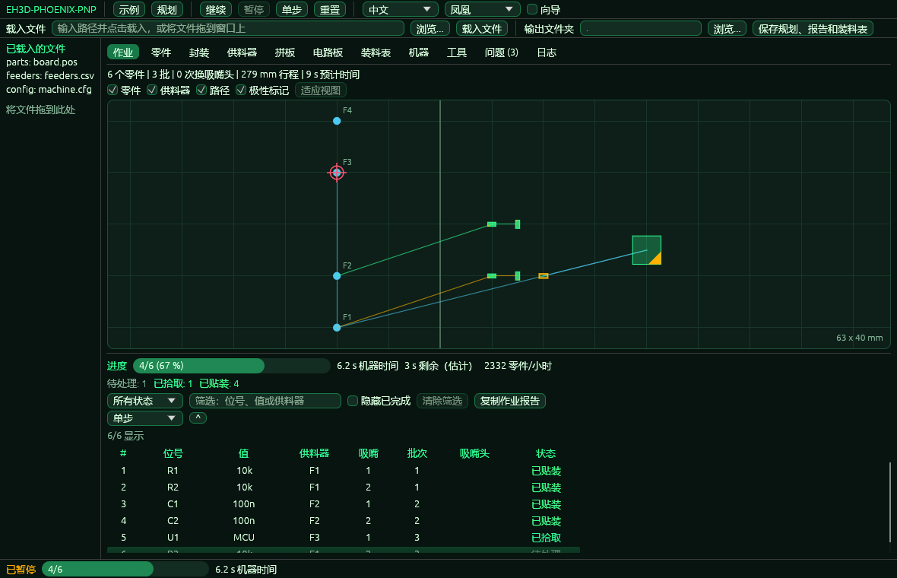
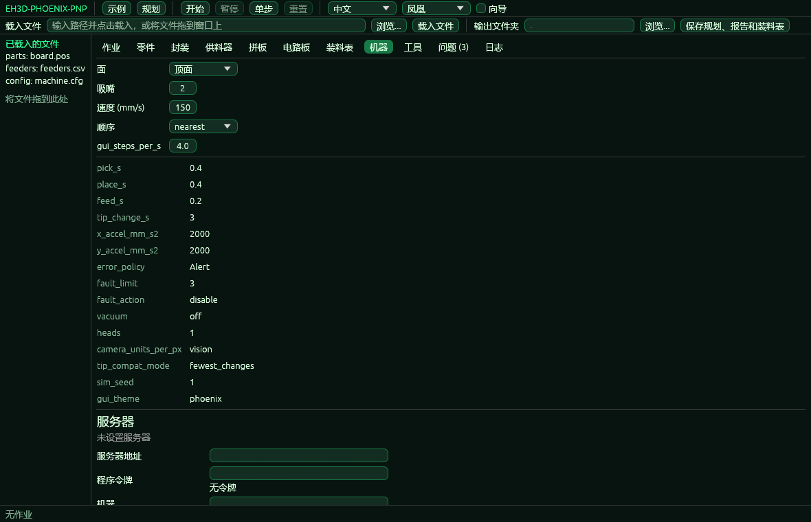

<p align="center">
  
</p>

# 📖 EH3D-PHOENIX-PNP

<p align="center"><a href="README.md">🇺🇸 English</a> | <a href="README_spa.md">🇪🇸 Español</a> | <a href="README_fra.md">🇫🇷 Français</a> | <a href="README_ita.md">🇮🇹 Italiano</a> | <a href="README_deu.md">🇩🇪 Deutsch</a> | 🇨🇳 <b>中文</b> | <a href="README_jpn.md">🇯🇵 日本語</a> | <a href="README_por.md">🇵🇹 Português</a></p>

### 贴片装配：位置、供料器和贴装顺序

<p align="center">
  
  
  
  
  
</p>

---

**诚实检查 - 当前真正能运行的内容：** 一个 Rust 库和一个命令行程序（`phoenix-pnp`），有 1876 个可在计算机上运行的测试：读取电路板的位置文件，为每个元件分配供料器（支持优先级、托盘和料带），从文件读取机器设置，为最多六个吸嘴的贴装头规划贴装顺序（等级、吸嘴头、角度限制、移动时间、拼板），写出上料表，并在模拟机器上逐步执行计划，可注入故障。它还有一个窗口（用 `--features gui` 构建），其逻辑在没有屏幕的情况下经过测试；绘制本身不在测试范围内；程序会拍摄自己窗口的图片（`--shot`），但没有人在屏幕上检查过绘制。它不控制任何机器：没有在机器上试过，也没有用真实文件集合检查过。

---

> **安全状态：** 本程序不控制任何机器，也不是安全系统。它的输出在机器上运行之前必须由人检查；这里的任何内容都没有在真实硬件上运行过。


## 📋 速览

| | |
|---|---|
| 版本 | `0.1.3` |
| 成熟度 | 脚手架 |
| 测试 | 1876 |
| 技术栈 | Rust |
| 真实硬件 | 未试过：这里的任何内容都没有在机器上运行过 |

**跳转到：** [概述](#-概述) · [架构](#-架构) · [快速开始](#-快速开始) · [测试](#-测试) · [结构](#-仓库结构) · [相关项目](#-相关项目)

## 🚦 项目状态

每一行是本仓库的一个部分，灯号表示它今天做到了哪一步。内容依据仓库能够展示的证据（测试、构建、运行），而不是计划。

🟢 已完成并验证 · 🟡 可用，有已知限制 · 🟠 部分完成或尚未验证 · 🔴 未完成或不可用

| 领域 | 状态 | 在这里的含义 |
|---|---|---|
| 核心 | 🟡 | 读取电路板的位置文件，为每个元件分配供料器（优先级、托盘、料带），为最多六个吸嘴的贴装头规划贴装顺序（等级、吸嘴头、角度限制和移动时间），规划拼板并写出上料表；已在计算机上用正常和损坏的输入测试，但没有用真实文件集合测试。 |
| 命令行 | 🟡 | `phoenix-pnp` 运行与库相同的函数（`parts`、`check`、`plan`、`schedule`、`preflight`、`simulate`、`loadsheet`、`config-check`, `check-bottom`, `tables-check`, `recipe-check`, `import-centroid`, `vision-test`）并打印结果；每个错误都以带 `PHOENIX-PNP-NNN` 代码的消息和非零退出码返回。 |
| 测试 | 🟡 | 1876 个测试通过（`cargo test`），包括正常情况、边界情况、损坏的输入和小型生成的用例。 |
| 机器配置 | 🟡 | 带版本号的 `键 = 值` 文件、会指出行号的校验器以及安全限制（Z 行程、X 和 Y 的限位、重试次数、吸嘴角度）；这些值没有与真实机器比对过。 |
| 模拟器与作业 | 🟡 | 虚拟时钟、按概率（带种子）或在选定位置注入的故障、重试、警报与搁置两种策略、反复故障后停用的供料器、暂停、单步执行以及可用于恢复的已保存状态；只是模拟，没有驱动过任何机器。 |
| 安全 | 🟡 | 纯安全 Rust（`forbid(unsafe_code)`）：处理收到的文件时不会 panic，错误的值会返回带原因的错误；没有独立审查。 |
| 窗口 | 🟠 | 一个 egui 窗口（用 `--features gui` 构建；不带命令运行 `phoenix-pnp` 即可打开）：作业、零件、封装、供料器、上料表、机器、工具、问题和日志等页面，显示贴装头路径、极性标记和下一个零件的工作台地图，五步向导，带可撤销修复的问题列表，可暂停、继续和单步的模拟作业，以及八种语言。其逻辑在没有屏幕的情况下经过测试；绘制不在测试范围内；程序会拍摄自己窗口的图片（`--shot`），但没有人在屏幕上检查过绘制。还有拼板页（含基准点和移动零件的拟合）和电路板页、文件选择器、可撤销编辑的供料器与封装表、会记住的列宽，以及在 Windows 上无控制台打开的独立程序（`phoenix-pnp-gui`）。 标签页现在是套件停靠框架（`eh3d-dock`）的面板：可以移动、浮动、折叠并保存为三种布局，有菜单栏，十一个命令各有一个面板；这只在没有窗口的环境中编译并运行过，没有在屏幕上看过。 |
| 真实硬件 | 🔴 | 未试过：这里的任何内容都没有在机器上运行过。 |
| 文档 | 🟡 | 八种语言的 README、更新日志，以及由 `docs/` 绘制的两张图。 |

## 🎯 概述

* **元件**（`src/parts.rs`）：KiCad 的 `.pos` 文件或 CSV（逗号或分号、引号、按名称查找表头），位置单位可为 mm、mil 或英寸，角度归一到 0-360，面为顶面或底面；每个不合理的行都会带行号被拒绝，重复的位号是错误。
* **不贴装的零件、示例的表格和作业报告**（`src/parts.rs`、`src/commands.rs`、`src/job.rs`）：CSV 中名为 `dnp`、`do not place` 或 `fitted` 的列（或 `--dnp R1,R2`）会让零件不进入计划、上料表和检查，并在报告中列出；`tables-check` 读取表格（`--parts`、`--packages`、`--catalog`、`--feeders`、`--slots`），并给出每个错误的代码和行号；`simulate --report-csv 文件` 把作业统计写成表头永不改变的 CSV。`examples/` 里有带 `dnp` 列的电路板、各种供料器以及常见封装表。
* **供料器**（`src/feeders.rs`）：供料器的 CSV（编号、值、封装、取料位置、剩余数量）；每个元件得到第一个值和封装相同（不区分大小写）的供料器；没有供料器的元件和将耗尽的供料器会被报告，同类的第二个供料器接替。
* **计划**（`src/plan.rs`）：按最近优先走过各贴装位置，并切分成一到六个吸嘴的批次，批内供料器也按最近优先访问，底面按板宽镜像，计划给出行程和时间估计，并写成 JSON 作业。
* **表格与设置**（`src/catalog.rs`、`src/config.rs`、`src/rotation.rs`）：数值可继承的零件表和封装表（先零件，再封装，再默认值）、`键 = 值` 格式的机器配置文件（`examples/machine.cfg` 说明每个键）、CSV 位置文件列名的更多写法，以及按封装的旋转修正。
* **不止料带的供料器**（`src/feeding.rs`）：优先级、托盘、料带和被停用的供料器；无论文件顺序如何，元件的供料器选择都相同。
* **机器的规划器**（`src/planner.rs`、`src/motion.rs`）：等级（依次贴装的块）、顺序策略、吸嘴头及其更换、吸嘴角度的限制、含加速度和加加速度的移动时间、更短的路径（2-opt）以及元件原点的修正。
* **拼板、上料表与导出**（`src/panel.rs`、`src/loadsheet.rs`、`src/export.rs`）：拼板中的电路板和拼板、每种料带的槽位、报告、缺料清单，以及只移动贴装头的 G 代码。
* **拼板的基准点**（`src/fiducial.rs`）：把基准点的实测位置拟合到设计位置（两个点用相似变换，三个及以上用仿射拟合），拼板的零件按拟合移动并旋转；每个点都有残差，某点偏离超过 `fiducial_max_residual_mm` 的拟合会被拒绝（`--fiducials 文件` 配合 `--panel`，或窗口的拼板页）。
* **标记为不良的电路板（X-out）与两级标记** (`src/marks.rs`, `src/panel.rs`)：拼板文件中带 `"x_out": true` 的子项，或 `--x-out A,B/C` 指定的项，连同其中的一切都会被排除；计划、上料表和检查都看不到它，任何电路板都没有的名称（`PHOENIX-PNP-042`）或所有电路板都被排除的拼板（`PHOENIX-PNP-043`）都是错误。电路板上的零件，若其值或封装含有 `fiducial_words` 中的词，或其位号是 `fiducial_refs` 中的前缀加数字（`FID1`），就是该电路板的标记，不会被贴装；`--fiducials` 文件随后可以命名拼板的标记（`f1`）和电路板的标记（`A/FID1`）：一块电路板的标记一起拟合，只移动该电路板的零件，没有测量标记的电路板的零件则跟随拼板的拟合。仅为模拟：从未在机器上测量过任何电路板，窗口还不使用电路板的标记。
* **规划器和模拟器的更多功能：** 托盘单元格被取空的顺序（按行、按列或蛇形）、同时计入路程和去换头位置往返的吸嘴头顺序搜索（`tip_strategy = optimize`，受 `tip_opt_max_evals` 和 `tip_opt_time_limit_s` 限制）、按封装和按供料器设置的故障概率（`sim_part_fail`、`sim_feeder_fail`）及其统计和每小时零件数，以及显示底面各规则所得角度的 `check-bottom`。
* **对位步骤** (`src/job.rs`, `src/sim.rs`, `src/model.rs`)：`align = on` 时，作业在吸取零件后用相机查看，并按所见修正贴装（贴装头移到目标位置减去零件的偏移，吸嘴少转零件的旋转量）；`pick_tolerance_mm` 会丢弃偏移更大的零件，并按 `error_policy` 重新吸取；`align_passes`（1 到 5）和 `align_settle_s` 设定查看次数和每次之前的等待，它们计入计划时间；模拟相机有偏移、误差和可注入的故障 (`sim_align_*`, `sim_camera_fail_rate`)；修正量（平均值、最大值、丢弃的零件）出现在文本、JSON 报告和 `--report-csv` 的 `align` 行中。默认关闭：此时作业与以往完全一样。未在机器上试过。 当 `align_rereads` 大于 0（最大 5，默认 0）时，对第一次查看超出公差的零件，相机会在丢弃前再看一次；落在公差内的查看视为第一次，作业报告会按供料器统计超出公差的查看、额外查看、由此保住的零件、丢弃的零件以及无读数的查看。
* **视觉处理流程**（`src/vision.rs`、`src/sim.rs`、`examples/vision.cfg`）：设置 `vision = pipeline` 后，模拟相机在内存中画出零件的图像（大小、旋转以及与吸嘴的偏差，噪声取自 `sim_seed`），并用设置文件（`--vision FILE`）中的步骤测量：掩膜、中值滤波、固定阈值或 Otsu 阈值、斑块的面积范围和最小旋转矩形，其中心和角度就是对位步骤所修正的偏差。找不到零件、斑块面积不符和出现多个斑块，都是没有读数的查看，各有自己的代码（`PHOENIX-PNP-037` 至 `PHOENIX-PNP-039`）。`phoenix-pnp vision-test` 按给定的大小、旋转、偏差和噪声画出零件，并打印测量结果及其误差。默认关闭：此时作业与以前完全相同。未在真实相机上试过。
* **作业报告** (`src/report.rs`, `src/job.rs`)：模拟作业之后，`simulate` 可以把报告写成：按 `--lang` 语言的文本 (`--report-text`)；包含全部内容、没有脚本也不引用任何外部资源、且绝不覆盖已有文件的 HTML 页面 (`--report-html`)；追加在 CSV 各行之后的分节 (`--report-csv`，表头不变)；以及 JSON 中的 `work` (`--report`)。报告给出已贴装、已搁置、被操作员跳过、仍待处理和不贴装的零件数量，机器时间花在哪里（送料与拾取、相机查看、贴装、吸头移动、更换吸嘴），首次拾取就成功的数量，按封装、供料器、吸嘴、吸嘴头和拼板中各电路板的同样统计，出现的错误及其代码，作业前的提示，以及相机修正量（X、Y 和旋转）的直方图。这是模拟结果：其中没有任何数据是在真实机器上测得的。
* **“作业”标签页与操作员的决定** (`src/gui/jobtab.rs`, `src/gui/window.rs`, `src/job.rs`)：表格显示每个贴装的状态（等待、已拾取、已对位、已贴装、已搁置、已跳过、失败）和不贴装的零件，带机器时间和剩余时间估计的进度条，以及按状态、按文本和按是否完成的筛选。错误使作业停止时，对话框会指出失败的步骤，并提供四个在模拟作业上执行的操作，之后作业继续：重试、跳过该零件、搁置该零件，或关闭供料器以便由同类的另一个供料器接手。每个决定都会计入报告。逻辑无需屏幕并已测试；没有人在屏幕上检查过界面绘制（`images/screens/` 中此标签页的图片由程序自己拍摄）。
* **真空、执行器与供料器的故障窗口** (`src/sim.rs`, `src/job.rs`, `src/config.rs`)：`vacuum = on` 时，模拟的泵在每次拾取后吸气 `vacuum_suck_s` 秒，并读取吸嘴的真空度（千帕）；低于 `vacuum_pick_min_kpa` 表示吸嘴上没有零件（`PHOENIX-PNP-044`，并按重试设置重新拾取），每次贴装后吹气 `vacuum_blow_s` 秒，高于 `vacuum_release_max_kpa` 表示零件仍粘在吸嘴上（`PHOENIX-PNP-045`）。传感器有自己的随机数生成器（`sim_vacuum_noise_kpa`、`sim_vacuum_miss_rate`、`sim_vacuum_stuck_rate`），默认关闭，因此不使用它的作业与以前完全一样。开关型设备用 `actuator = 名称 : 延迟秒数` 声明，并用 `Job::set_actuator` 切换，其延迟会加到时钟上（机器没有的名称为 `PHOENIX-PNP-046`）。`fault_action = alert` 时，在最近 `fault_window` 次拾取中达到 `fault_limit` 次故障的供料器不再自行关闭：作业停止（`PHOENIX-PNP-047`），Job 标签页的对话框提供重试、跳过该零件、搁置或关闭该供料器。
* **相机模型、机器的贴装头与封装可用的吸嘴** (`src/camera.rs`, `src/heads.rs`, `src/tips.rs`, `src/config.rs`): 相机由 `camera_units_per_px`（0 表示视觉流水线设定的尺寸）、`camera_offset_x_mm` 与 `camera_offset_y_mm`（吸嘴轴线在图像中的位置）、`camera_rotation_deg`、`camera_flip_x` 与 `camera_flip_y`，以及镜头（`camera_lens_scale`、`camera_lens_k1`）来描述；对位步骤中模拟的相机透过该模型读取零件，无论有无图像，使用默认值时作业与以前完全一样。`head = 名称 : 吸嘴数 [: 偏移X : 偏移Y : 相机X : 相机Y : 相机旋转 : 相机单位 : 相机镜头]` 最多声明四个贴装头，每个都有自己的吸嘴、偏移和相机；有两个或更多贴装头时，`schedule` 把每个零件分给够得着它的贴装头（都够不着则为 `PHOENIX-PNP-048`），为每个贴装头做计划，并在机器的时钟上计入贴装头等待另一个贴装头正在使用的供料器的时间。`tip_compat = 模式 : 吸嘴, 吸嘴, ...` 列出封装可接受的吸嘴，`tip_compat_mode`（`fewest_changes` 或 `preferred`）为每一类零件选一个吸嘴，使机器换吸嘴的次数尽可能少；表中指定的吸嘴会被保留。
* **配方** (`src/recipe.rs`, `src/job.rs`, `src/commands.rs`)：带版本号的文本文件（`examples/job.recipe`）规定作业经过的步骤（`prepare`、`pick`、`align`、`place` 和 `check`，按此顺序且每步至多一次；只有配方包含对位步骤和真空检查时它们才会启用），以及随封装、供料器或吸嘴而变的参数（`pick_retries`、`pick_tolerance_mm`、`vacuum_suck_s` 和 `vacuum_blow_s`；每个键以第一条匹配的规则为准，先看供料器，再看封装，最后看吸嘴）。`phoenix-pnp recipe-check 文件` 读取并检查它，`simulate ... --recipe 文件` 按它执行作业。其错误的代码为 `PHOENIX-PNP-049` 至 `PHOENIX-PNP-052`（无效的行、步骤顺序错误、文件超出限制、版本过新），限制是 `machine.cfg` 的键 `recipe_max_bytes` 和 `recipe_max_rules`。保存的状态还会记住最近一次拾取的供料器和被中止的拾取，因此在另一次运行中载入的作业会向操作人员提供同样的决定（旧状态仍可载入）。
* **位置文件的导入** (`src/import.rs`, `src/commands.rs`)：`phoenix-pnp import-centroid 文件` 读取质心 CSV（`--map 文件` 指定其列，见 `examples/centroid.map`；`examples/centroid.csv` 不需要映射）、EAGLE 的位置文本（`examples/board.mnt`：名称、x、y、旋转（底面为 `R90` 或 `MR90`）、值、封装）或 KiCad 的 `.pos`（`--format auto|csv|eagle|kicad-pos`；`auto` 根据第一行判别），并把零件表 `ref,val,package,x,y,rot,side,dnp` 以毫米写入 `--out`（已存在的文件绝不会被覆盖：`PHOENIX-PNP-040`）或标准输出。单位为 mm、mil 或 inch（写在表头 `X (mil)`、单元格 `0.5in`、注释 `## Unit = inch`、映射或 `import_unit` 中）；角度输出为 0 至 360；面所在的列可省略；列 `dnp` 或 `fitted`（或带位号范围的 `--dnp R1-R5,C7`）标记不贴装的零件；`import_bottom_mirror_width_mm` 镜像底面的 X，`bottom_rotation` 旋转其角度。三个读取器都是程序自带的（其他仓库没有无需增加依赖就能使用的读取器），EAGLE 文本的排布也没有与真实安装写出的文件比对过。每个错误都带有 `PHOENIX-PNP-053` 至 `PHOENIX-PNP-056` 的代码（无效的行、缺少映射所需列的表头、未知的格式、无效的位号范围）以及行号。
* **物料清单**（`src/bom.rs`、`src/cmd_tools.rs`）：`phoenix-pnp bom-check 零件 BOM` 读取物料清单（`examples/bom.csv`：单元格中的位号，可为范围或每行一个，以及有则读取的值、封装、数量和料号），并指出只有一方才有的位号、重复列出的位号、值或封装不同之处以及数量对不上的行；标记为不贴装的零件可在清单中也可不在。文件错误带有代码 `PHOENIX-PNP-057` 和行号。
* **批量生产的库存**（`src/stock.rs`）：`phoenix-pnp stock 零件 供料器 --boards N` 把板数累加，按零件种类说明 N 块板所需数量与已开启供料器中的数量之比，哪些种类不够、差多少，以及第一卷料在多少块板之后用完；有不足时以 2 退出，并用 `--out` 写出表格。`bom-order --have 供料器` 从采购清单中扣除供料器已有的数量，并给出 `on_hand` 与 `to_buy` 两列。
* **相机校准**（`src/calibrate.rs`）：`phoenix-pnp camera-calibrate 文件` 用头部已知位置上对同一标记的观测（`px,py,x_mm,y_mm` [见 `examples/camera_points.csv`]，至少三个）拟合相机模型（像素大小、旋转、镜像以及吸嘴轴线在图像中的位置），输出拟合程度和用于配置的 `camera_*` 行；不拟合镜头。其错误为代码 `PHOENIX-PNP-058`。
* **吸嘴偏心**（`src/calibrate.rs`、`src/export.rs`）：`phoenix-pnp nozzle-calibrate 文件` 用多个角度下吸嘴头的读数（`angle_deg,x_mm,y_mm` [见 `examples/nozzle_readings.csv`]）拟合圆，输出 `nozzle_runout_mm` 和 `nozzle_runout_deg`；偏心大于 0 时，`schedule --gcode` 的 G 代码会把每个贴装位置按零件角度处的偏心反方向移动。
* **网格拼板**（`src/panel.rs`、`src/cmd_tools.rs`）：`phoenix-pnp panelize 电路板 --cols N --rows N --pitch-x MM --pitch-y MM` 为同一电路板按网格复制的拼板写出拼板文件，各板旋转相同，带有隔开一定边距的三个基准点（`--fiducials MM`，按 `--board-size W,H` 给出的电路板实际尺寸），并可按名称 `P1`、`P2`……标记不良板（`--x-out P2,P5`）；已存在的文件绝不覆盖。
* **有方向零件清单**（`src/polarity.rs`）：`phoenix-pnp polarity-sheet 零件` 列出位号匹配 `polarity_refs` 或封装匹配 `polarity_packages` 的零件（默认包括二极管、LED、芯片、晶体管、有极性电容和连接器），附位置、旋转和一列空白勾选栏，用于作业后的检查；`--side` 只保留一面。
* **轴间隙（反向间隙）**（`src/sim.rs`、`src/motion.rs`）：`backlash_x_mm`、`backlash_y_mm` 和 `backlash_mode` 使模拟机器在轴反向的移动中要么短了一个间隙停下（`off`，由 `simulate` 计数），要么越过位置再从正方向返回（`approach`，耗时更多但没有误差）；间隙为 0 时一切不变。
* **采购清单**（`src/bom.rs`）：`phoenix-pnp bom-order BOM --boards N` 把物料清单中相同零件的行相加，给每一行 N 块板所需的数量加上备用量（`order_spare_percent` 百分比或 `order_spare_min`，取较大者；`--spare-percent` 和 `--spare-min` 优先），不计 `--parts 零件` 中标记为不贴装的零件；写出按封装和值排序的 CSV。
* **供料器示教**（`src/calibrate.rs`）：`phoenix-pnp feeder-teach strip` 根据第一个和最后一个零件的位置求料带的间距与角度，`feeder-teach tray` 根据料盘的三个格位求两个间距与角度（并给出列与直角的偏差）；两者都会输出它们所设定的供料器文件的列。`feeder-teach --measures FILE` 从一个文件读取多个供料器的位置，并为每个供料器输出一行说明和供料器文件的一行（`examples/feeder_measures.csv`）。
* **模拟器与作业**（`src/sim.rs`、`src/job.rs`、`src/preflight.rs`、`src/model.rs`）：作业前的检查、带虚拟时钟和可注入故障的机器，以及可暂停、单步执行、保存并恢复的作业。
* **窗口**（`src/gui.rs`、`src/gui/`）：窗口除绘制之外的工作都不需要屏幕（已载入的文件、规划及其问题与修复、模拟作业、地图的几何、共享选择的表格、五步向导和八种语言的文字），并经过测试；只有用 `--features gui` 构建的 `src/gui/window.rs` 用 egui 绘制。模拟速度、主题以及为未知封装的零件绘制的大小是 `machine.cfg` 的键（`gui_steps_per_s`、`gui_theme`、`gui_part_size_mm`）。
* **轴的互锁**（`src/interlock.rs`、`src/driver.rs`、`src/gcodedriver.rs`、`examples/driver_marlin.cfg`）：驱动配置档中的一行 `interlock = 信号 | on|off | xy|z|rot|all` 表示所列的轴只有在信号处于指定状态时才能移动（示例在吹气阀打开时让滑架在 X 和 Y 方向保持不动）。信号是配置档中执行器的名称（会话根据最后一次切换得知其状态），以及用 `Session::set_signal` 给传感器起的名称（门、吸嘴抬起）；没有人报告过的信号是未知的，不满足任何规则，因此移动被拒绝。被拒绝的移动与超出限位的移动一样是安全故障：会发送 `safe_stop` 的各行，安全规则使机器减速，在新会话之前不再发送任何内容。拒绝的原因以八种语言说明。这一切都是对名称和数字的计算，用固定种子随机生成的移动在模拟控制器上试验，会话与计算必须一致；没有读取过真实机器的任何传感器。
* **电路板的流程和按阶段的引导手工模式**（`src/process.rs`、`src/cmd_import.rs`）：流程是阶段列表（`phase = 名称 | 任务, 任务`，任务有 `load`、`place top`、`place bottom by hand`、`reflow`、`solder by hand`、`glue`、`through-hole` 和 `inspect`），或两个预设之一：`pnp`（机器贴装每一面）和 `manual`（人工贴装每一面）；只有前面的阶段都完成且没有阶段在进行时，一个阶段才能开始；只有进行中的阶段才能结束；其装料（为它装好的供料器）只能在待办时更改；状态可以保存并重新读入。`phoenix-pnp assist 元件 --process pnp|manual|文件` 会按此流程走：手工贴装的一面逐个询问元件，其他任务用用户的语言说明并等待 `done`，由机器贴装的一面会被说明，没有元件的一面其阶段会被省略。拒绝的原因以八种语言说明。不会移动任何东西：工作由人完成。
* **基于套件停靠框架的窗口**（`src/gui/docking.rs`、`src/gui/cmdpanel.rs`、`src/gui/window.rs`、`Cargo.toml`）：窗口的标签页是 EH3D-COMMON 的 `eh3d-dock` 面板（构建以 0.3.0 版获取 `EH3D-COMMON`）：每个面板都可以移除、从“视图”菜单放回、把标签拖到另一组的中间或一侧来移动、浮动在窗口之上、折叠到边缘、最大化和锁定。窗口以三种布局之一启动：配置、运行和紧凑，含贴片领域的电路板视图、元件、供料器、作业、相机、机器和控制台，以及向导、封装、拼板、电路板、装料表、工具和问题；菜单栏有文件（含示例和最近文件）、编辑、视图、工具（规划、开始、暂停、单步、重置以及各命令的面板）、窗口（各布局以及用户按名称保存的布局）和帮助，带有 F5 到 F8 和常用快捷键，不可用的菜单项其快捷键也无效。用户的布局保存在 `window.cfg` 的 `dock.` 键下，下次启动时恢复；损坏或来自其他版本的布局会被出厂布局替换，并给出提示。十一个命令（`driver-check`、`driver-test`、`driver-run`、`safety-replay`、`homing-repeat`、`bringup`、`import-openpnp`、`assist`、`align-iterate`、`vacuum-calibrate` 和 `test-board-gen`）各有一个面板，起初隐藏（视图和工具菜单可显示）：面板用其中输入的参数（以空格和引号分隔、有数量限制、不经任何 shell 读取）在窗口旁运行 `phoenix-pnp`，不开控制台窗口、不从键盘读取，最长 `command_timeout_s` 秒（5 到 600，默认 60，在 `window.cfg` 中），并显示其输出，因此面板与命令不会不一致。面板和菜单都是数据，无需屏幕即可测试；用该框架绘制的界面只在没有窗口的环境中编译并运行过，没有人在真实屏幕上看过这些布局。
* **检查吸嘴上的元件**（`src/inspect.rs`、`src/cmd_vis.rs`）：`phoenix-pnp part-inspect 读数 --sizes 尺寸表`（或 `--packages 封装表`）把相机测得的每个元件（两条边、偏离轴心的位置和旋转量）与其封装尺寸比较，并给出被拒绝的原因（`part_size_tol_mm`、`part_angle_tol_deg`、`part_offset_max_mm`）；尺寸来自尺寸表，或来自封装表的 `body_long_mm` 与 `body_short_mm` 列（`examples/packages_bodies.csv`），只要有元件被拒绝或没有尺寸，命令就以 2 退出。
* **料管与散料供料器**（`src/feeding.rs`、`src/feedlib.rs`）：除料带、托盘和条带外，供料器表的 `kind` 列还接受 `tube`（零件滑向挡块的料管或导轨）和 `bulk`（盛在料盒或料碗中、方向不固定的散料）；两者都像料带一样从唯一位置 `x`、`y` 取料，零件角度取自 `rotation`，按数量耗尽，并由 `feeder-check` 检查；窗口的供料器标签页以八种语言提供全部五种类型（`examples/feeders_tubes.csv`）。
* **按供料器统计的贴装数与用时**（`src/job.rs`、`src/feedrep.rs`、`src/report.rs`）：作业会记下每个吸嘴从哪个供料器取到零件（同类的另一个供料器接替时也一样），并把该零件算作从该供料器贴装，同时累计从每个供料器取料的各步骤（前往、送料、取料和查看）所用时间；作业报告、其 JSON 以及 `simulate --report-feeders`（末尾新增的 `placed` 和 `busy_s` 列）都会显示，已保存的作业也会保留。
* **吸嘴头寿命**（`src/nozzlelife.rs`、`src/cmd_tools.rs`、`src/commands.rs`）：`simulate --nozzle-life 文件` 会把运行到结束的作业对每个吸嘴头所做的事（贴装数量和安装次数）累加到放在配置旁的小型 CSV 中；一个作业只计一次，不是吸嘴头记录的文件绝不会被覆盖，被替换的文件保留为 `文件.prev`，只有 `nozzle-life 文件 --reset 吸嘴头` 记录更换时计数才会减少。`nozzle_life_warn`（默认 500000，0 表示不提醒）是提醒查看吸嘴头的贴装数，由 `simulate` 和 `nozzle-life` 给出。新增错误码 `PHOENIX-PNP-059`。
* **哪种顺序最快**（`src/compare.rs`、`src/commands.rs`）：`phoenix-pnp order-compare 零件 供料器` 用每种贴装位置 `order`（nearest、part、height_part、pick、tips、none）和每种 `tip_strategy`（minimize、as_planned、optimize）规划同一块板，并排显示批次、更换吸嘴头次数、贴装头行程和秒数，标出每个列表中最快的和配置中使用的，并用一行说明更好的设置能节省多少秒；它接受 `schedule` 的选项，不改变任何内容。
* **计划图**（`src/preview.rs`、`src/commands.rs`）：`phoenix-pnp schedule 零件 供料器 输出.json --svg 输出.svg` 还会把计划写成一个 SVG 文件，可在机器移动之前查看、打印或随作业保存：供料器、每个零件的位置（带顺序编号和吸嘴颜色）、每个零件从供料器走的线、贴装头走遍整个作业的虚线路径以及合计；文件不含脚本和外部内容，位号或 ID 中输入的字符会被转义，已存在的图不会被覆盖。
* **用图案标定相机** (`src/pattern.rs`, `src/cmd_tools.rs`)：`phoenix-pnp camera-pattern 文件 [--pitch MM]` 读取网格上的点（棋盘格内角点或圆点中心），格式为 `col,row,px,py`（`examples/camera_pattern.csv`），并拟合像素大小（`camera_units_per_px`）和镜头径向畸变（`camera_lens_k1`），同时拟合图案纸在图像中的旋转、平移和镜像；然后给出各点在含畸变与不含畸变两种模型下的偏差以及偏差最大的点；打印配置所需的行，当有点超过 `camera_pattern_max_residual_mm` 时退出码为 2。各点间距为 `camera_pattern_pitch_mm`。相机的旋转和偏移仍由移动贴装头的 `camera-calibrate` 得出。工具标签页有同样的标定，并且不会把超出限值的拟合结果应用到机器。
* **哪个基准点有偏差** (`src/fidcheck.rs`, `src/gui/workspace.rs`, `src/gui/tables.rs`)：使用拼板的实测标记时，窗口会计算每个标记的残差（即使拟合被拒绝也会计算，以便看出原因）、唯一一个去掉后其余标记都落在 `fiducial_max_residual_mm` 以内的标记，以及旋转、比例和剪切相对各自限值的情况。基准点表用 `!` 标出超出限值的标记，用 `?` 标出与其余不一致的标记，面板用文字列出警告（日志中也有）；`fidcheck::analyze_marks`、`fidcheck::warnings` 和 `fidcheck::residual_table` 为 `fiducial-check` 命令和基准点检查工具提供同样的结果。
* **作业队列** (`src/queue.rs`, `src/cmd_queue.rs`)：依次处理多块板或拼板。`phoenix-pnp queue-add 队列 名称 来源 供料器 [--panel] [--boards N]` 把一个作业放进一个即使程序停止也能保留的小 CSV（先写入临时文件再移动到位，被替换的文件保留为 `路径.prev`，最后一行带有校验和，因此被截断或手工修改的文件会被拒绝）；`queue-status [--check]` 列出作业及其状态（pending、running、done、failed、skipped），加 `--check` 会为尚未完成的作业做计划；`queue-edit` 可跳过、重置、撤销确认或移除作业；`queue-run` 在模拟机上逐块板完成作业，并在每块板之后写入队列。没有确认就不会运行：`queue_confirm` 开启（默认）时，作业只有在 `queue-confirm` 记录了其计划的标识（计划及其所用文件的内容）之后才会运行，文件有任何改动都会使确认作废；`queue_stop_on_failure`（默认开启）使队列在第一个失败的作业处停止。只要存在 `.lock` 文件，对同一队列的第二个 `queue-run` 会被拒绝。工具标签页的队列工具用按钮完成以上所有操作。新增错误码 `PHOENIX-PNP-060`。
* **UTF-16 文本** (`src/parts.rs`)：命令和窗口读取的每个表格和设置文件（位置、供料器、封装、物料清单、拼板、实测标记）都可以是带字节顺序标记的 UTF-16，就像 Windows 程序和电子表格保存的“Unicode 文本”；读取方式与 UTF-8 相同。既不是 UTF-8 也不是 UTF-16 的文本会带提示按 Latin-1 读取，而工具标签页中读取文件的工具会拒绝它。
* **校正镜头** (`src/camera.rs`, `src/sim.rs`)：设置 `camera_correct_lens = on` 后，相机会从所见图像中去除镜头畸变（`camera_lens_k1`，即 `camera-pattern` 得到的值），因此对位步骤的读数相当于一个没有畸变的镜头；`CameraModel::to_machine_corrected` 和 `read_corrected` 通过反解 `d * (1 + k1 * d * d)` 来实现。关闭（默认）时畸变会留在读数中。此时 `camera_units_per_px` 应为像素的真实大小，即 `camera-pattern` 给出的值。
* **相对于队列文件夹的路径** (`src/queue.rs`, `src/cmd_queue.rs`)：`queue_relative_paths = on`（或 `queue-add --relative`）时，位于队列文件所在文件夹内（或其下）的作业文件以相对于该文件夹的路径保存，因此文件夹可以移动或共享；`queue-status`、`queue-confirm` 和 `queue-run` 无论从哪个文件夹运行，都以队列文件夹为基准解析。关闭（默认）保存绝对路径；两者运行结果相同，计划标识也相同。
* **带按钮的队列** (`src/gui/queuetab.rs`, `src/gui/window.rs`)：工具标签页的队列工具把队列文件读成作业列表，并提供按钮：添加作业（表单以窗口语言校验）、检查计划、确认所选作业的计划、撤销确认、跳过、重置、移除和运行。每个按钮都用窗口旁的程序运行同名命令，因此窗口和命令行以同一种方式规划、确认和运行（相同的计划标识、相同的锁）。第一次按“运行”只会询问（`queue_gui_ask_run`，默认开启）；第二次才在模拟机器上于后台开始运行，并带有停止按钮。
* **可以变差的模拟相机** (`src/vision.rs`)：`vision.cfg` 新增 `sim_blur_px`（相机失焦）、`sim_salt_pepper`（变成黑或白的像素）、`sim_gradient_levels`（光照不均）、`sim_failure_rate` 和 `sim_failure_kind`（一部分图像损坏：零件不在、灯灭了或整体过曝）；全部默认关闭，不使用它们的作业噪声不变。`vision-test` 和 `simulate --vision` 像原有的噪声一样使用它们。
* **用于试验检查的读数** (`src/visionsim.rs`, `src/cmd_vis.rs`)：`phoenix-pnp vision-readings PARTS --sizes F` 为位置文件中的每个零件画出模拟相机拍到的图像（略微偏离轴线并旋转，范围由 `--spread` 和 `--turn` 决定；`--wrong-every N` 让每第 N 个零件变成另一种尺寸），并把读数写成 `part-inspect` 读取的文件；`phoenix-pnp vision-marks DESIGN --shift X,Y --turn DEG --scale S` 观察按指定方式放置的拼板上的每个标记，写出 `fiducial-check` 读取的测得标记。模糊、噪声和故障来自 `--vision`；找不到任何东西的图像不给读数并说明原因；相同的 `--seed` 给出相同的读数。
* **可保存的作业报告** (`src/report.rs`)：`simulate --report-html FILE`（没有脚本、不引用外部内容的单个页面）、`--report-text`、`--report`（JSON）和 `--report-csv` 现在还会按供料器给出取料、贴装、搁置和跳过的零件数，按吸嘴头给出本次作业增加的寿命（`--nozzle-life` 提供作业前的记录）、使用前后的次数，以及吸嘴头达到 `nozzle_life_warn` 时的警告；时间、检查结论和带代码的错误原先已有。
* **更准确的计划时间** (`src/planner.rs`)：在 `backlash_mode = approach` 下，机器会越过位置一个轴的间隙再退回，这需要时间；计划以前没有计入，现在逐段计入（仅在限位前有余量时），因此计划的秒数与模拟作业的秒数一致，`AdvancedPlan::approach_s`、计划报告及其 JSON 会说明第二次移动占了多少秒。吸嘴头仍按批分组，每批的供料器从近到远访问；不使用 approach 时没有任何变化。
* **常用封装的尺寸** (`src/pkggen.rs`, `src/cmd_tools.rs`)：`phoenix-pnp package-gen 0603 SOT-23-5 SOIC-8 QFN-32-5x5 LQFP-48`（或用 `--from PARTS` 取位置文件中的封装）会根据 EIA 编码的贴片元件、SOT、SOD、SOIC（窄体和宽体）、TSSOP、QFN、DFN 和 QFP 的标称尺寸，写出封装表的行（`package,height_mm,tape_mm,body_long_mm,body_short_mm`），并给出容纳本体的料带宽度；`part-inspect` 的 `--packages` 和目录会读取该结果。未知的名称会报错并说明原因，绝不猜测。 `phoenix-pnp package-kicad PATH...` 可从 KiCad 封装文件做同样的事（`src/kicadmod.rs`、`examples/chip_0603.kicad_mod`）：本体是制造层图形的外框（没有时用占位区并给出提示），高度在名称已知时取该封装的值，否则用 `--height`；读取在大小、深度和元素数上都有限制，读不懂的文件会连同原因一起指出。
* **学习得到的贴装偏移** (`src/learn.rs`, `src/cmd_tools.rs`, `src/job.rs`)：`phoenix-pnp place-learn READINGS --state F` 读取 `package,dx_mm,dy_mm` 行（零件最终偏离其位置多远），把每种封装的平均偏移保存在带校验号的文件中。与同封装其他读数相差很大的读数会被剔除，读数太少的封装保持不变，已知偏移最多按 `place_learn_memory` 个读数计算，以便跟随漂移的机器，任何偏移都不会超过 `place_learn_cap_mm`；`--residual` 用于已应用偏移后测得的读数，`--dry-run` 不写任何东西，`--show` 与 `--forget` 读取并修剪该文件。`place_learn` 打开前学习保持关闭，只有 `place_learn_apply` 打开时，`simulate --place-offsets FILE` 才会让贴装头前往每个位置减去其封装偏移之处；被截断或被手工改动的文件会被拒绝。
* **供其他程序使用的作业文件** (`src/exchange.rs`, `src/commands.rs`, `src/cmd_tools.rs`)：`phoenix-pnp job-export PARTS FEEDERS OUT [--state F]` 把计划（即 `schedule` 的文档）、每个零件的状态（`pending`、`placed`、带原因的 `deferred`、`skipped`）和作业阶段（就绪、暂停、停止、完成）写入一个带版本和类型的 JSON 文件；给出 `simulate` 的已保存状态时，会说明该作业进行到了哪里。`phoenix-pnp job-import FILE [--csv F]` 带全部检查读取这样的文件（大小和贴装数上限、100000 mm 以内的有限数值、长度受限且无控制字符的名称和原因、每个引用只出现一次、批次和吸嘴的计数、每个贴装都有指向同一引用的状态行，以及与各状态一致的阶段），说明其内容，并可把贴装连同状态写成表格。不会从中运行任何东西，也不会对机器应用任何东西。
* **钩子（默认关闭）** (`src/hooks.rs`, `src/commands.rs`, `examples/hooks.csv`)：`simulate --hooks FILE` 会针对作业的事件（`job-finished`、`job-paused`、`job-stopped`、`part-aside`、`feeder-off`）运行操作员自己的程序，用来点亮指示灯、播放声音或发送消息。运行程序是本库最有风险的操作，因此在 `hooks` 打开之前一律关闭（`--hooks-dry-run` 只列出将要运行的内容）。规则文件（`event,program,argument...`）就是允许运行内容的清单：程序是规则文件所在文件夹中的文件，名称只含字母、数字、`.`、`_` 和 `-`，绝不能是路径、系统搜索、shell或指向文件夹之外的链接（批处理文件，即 `.bat` 或 `.cmd`，是允许的，规则中提到的每一个都会在作业运行前给出警告，因为它会执行系统命令）；参数逐个传递，事件数据通过 `{event}`、`{reference}`、`{feeder}`、`{reason}`、`{phase}`、`{placed}` 和 `{total}` 填入。规则文件有大小上限且最多 50 条规则，每个作业最多运行 `hooks_max_runs` 个程序，每个程序有 `hooks_timeout_s` 秒，输出被截断为 4096 字节；失败的钩子不会改变作业的任何内容。
* **模拟作业的日志** (`src/journal.rs`, `src/commands.rs`)：`simulate --journal FILE` 为作业的每一步写一行：零件、计划取料的供料器、吸嘴、机器时钟的秒数、这一步用时，以及结果（`ok`，或使作业停止的错误代码）。记录日志的作业与不记录的作业执行完全相同的步骤；作业因错误停止时日志仍会保留，失败的那一步是最后一行；已存在的文件绝不会被覆盖。
* **两个零件表之间的变化** (`src/partsdiff.rs`, `src/cmd_more.rs`)：`phoenix-pnp parts-diff FIRST SECOND [--tol MM] [--rot-tol DEG] [--out F]` 按位号比较两个位置文件，逐个零件说明哪些被添加或删除、移动、旋转、改了值或封装、换到了另一面；位置在 `--tol` 内、旋转在 `--rot-tol` 内（按较短的方向计算）视为相同，仅大小写不同的值或封装也视为相同，`--out` 把变化写成 CSV。两个表不同时退出码为 2。
* **两个配置之间的变化** (`src/configdiff.rs`, `src/cmd_more.rs`)：`phoenix-pnp config-diff FIRST SECOND` 列出两个配置文件在含义上不同的设置，而不是写法上的不同：`yes` 与 `on`、`5` 与 `5.0`，以及写出默认值的一行与没有这一行是一样的。文件未设置的项显示为 `(default)`，无效的文件会连同其代码一起指出。两台机器不同时退出码为 2。
* **零件表里有什么** (`src/boardstats.rs`, `src/cmd_more.rs`)：`phoenix-pnp board-stats PARTS [--near MM] [--limit N]` 统计每一面的零件数、种类（值和封装）、每种封装以及包住所有中心的范围；加上 `--near` 时，用网格而不是逐对比较，找出同一面上中心距离小于该距离（0.01 到 50 mm）的零件（被复制了两次的零件、落在同一原点的两个封装）。发现一对时退出码为 2。
* **供料器够不够做完一个队列** (`src/queuestock.rs`, `src/cmd_more.rs`)：`phoenix-pnp queue-stock QUEUE [--out F]` 把尚未完成的作业依次从供料器取走的零件累加起来，按零件种类说明供料器中有多少、缺多少，以及料盘在哪个作业中用完。共用同一张供料器表的作业共用它的料盘；已关闭的供料器和拼板不计入。料盘不够时退出码为 2。
* **作业之后的供料器表** (`src/deplete.rs`, `src/cmd_more.rs`)：`phoenix-pnp feeder-deplete FEEDERS --state F [--out F]` 读取 `simulate --state` 保存的状态，写出当前的表：每个供料器的数量是剩余数量，料条的下一个位置按已取走的零件数前移，托盘保持原位（它的下一格由数量决定），其他列保持不变。它会指出哪些供料器不足或已空（低于 `warn_below`）；属于另一张表的状态会被拒绝。有供料器不足时退出码为 2。
* **更换料盘后的供料器表** (`src/refill.rs`, `src/cmd_more.rs`)：`phoenix-pnp feeder-refill FEEDERS REFILLS [--out F]` 读取表 `id,count[,x,y]`（每个换了新料盘的供料器一行），写出带有新数量的供料器表；料条从 `x,y` 重新开始（未给出则保持原位），托盘所装零件不能超过格数；表中没有的供料器、数量为 0、为非料条的供料器给出位置、同一供料器出现两次，都会以代码 `PHOENIX-PNP-013` 被拒绝，且不改动任何内容。其他列和分隔符保持不变。
* **留给人工处理的零件** (`src/asidesheet.rs`, `src/commands.rs`)：`phoenix-pnp aside-sheet PARTS FEEDERS --state F [--pending] [--out F]` 在已保存状态的作业之后，列出被搁置和被跳过的零件（加 `--pending` 还包括作业尚未做到的零件），按值和封装排序，使同一料盘只需取一次，并给出表中的位置和旋转、每个零件被留下的原因，以及它原本应取自的供料器。清单上有零件时退出码为 2。
* **两个作业的差异** (`src/jobdiff.rs`, `src/cmd_more.rs`)：`phoenix-pnp job-diff FIRST SECOND [--out F]` 比较两个 `job-export` 文件：新增和移除的零件、供料器、吸嘴、批次、吸嘴头、每个零件的取料和贴装位置（千分之一毫米以内的位置和百分之一度以内的旋转视为相同）、结果、零件顺序，以及整个计划（批次、换吸嘴头、行程、秒数、阶段）。作业不同时退出码为 2。
* **供料器该放在哪里** (`src/slots.rs`, `src/commands.rs`)：`phoenix-pnp feeder-slots PARTS FEEDERS [--max-plans N] [--out F]` 只要计划变快，就交换两个同类供料器（编带、料管或散料，已启用）的位置，每次交换都重新规划电路板（最多 N 个计划，默认 5000），并说明哪些供料器移动（含槽位名称）以及节省的秒数和行程；`--out` 写出带新位置的表。供料器只是互换位置，编带能否装进新槽位由人确认。存在更好的摆放时退出码为 2。
* **同一个作业运行多次** (`src/runs.rs`, `src/commands.rs`)：`phoenix-pnp simulate-runs PARTS FEEDERS [--runs N] [--seed S] [--out F]` 在模拟机上把计划运行 N 次（默认 20 次），每次使用不同的种子，并说明有多少次运行贴完了所有零件、有多少次被错误中断及错误类型、已贴装和被搁置的零件，以及最短、中间和最长耗时；`--out` 每次运行写一行，相同的起始种子得到相同的表。它衡量的是模拟机上的计划与设置，而不是真实机器。有运行未贴完所有零件时退出码为 2。
* **一个料盘能做几块板** (`src/runway.rs`, `src/commands.rs`)：`phoenix-pnp reel-runway PARTS FEEDERS [--boards N] [--out F]` 取计划为一块板从每个已启用的供料器取走的数量，说明其料盘可完成多少整块板、之后剩余多少零件，以及哪个料盘最先用完；没有零件从中取料的供料器永远够用，列在最后，已关闭的供料器不列出。`stock` 针对给定的板数作答，这个则反过来。有料盘够不到 N 块板时退出码为 2（未给出时按 1）。
* **用几个吸嘴合算** (`src/nozzles.rs`, `src/commands.rs`)：`phoenix-pnp nozzle-compare PARTS FEEDERS [--max N] [--out F]` 把同一块板分别按头部 1 个吸嘴、2 个……直到 N 个（默认 6）来规划，并显示每种情况的批次、吸嘴头更换、行程和秒数，标出最快的（并列时取吸嘴较少者）、每增加一个吸嘴节省的时间，以及最快者相对配置能节省多少。配置中声明的头部不计入（每个数量都按一个头部规划），无法做出计划的数量会说明原因。不会更改任何设置。没有任何吸嘴数能做出计划时退出码为 2。
* **哪些供料器出问题** (`src/hotspots.rs`, `src/commands.rs`)：`phoenix-pnp simulate-hotspots PARTS FEEDERS [--runs N] [--seed S] [--out F]` 像 `simulate-runs` 一样在模拟机上运行计划（未给出时 N 取 `simulate_runs_count`），并按供料器累计取到的零件、失败的取料（包括重试后恢复的）及其占尝试的比例、供料器被关闭的运行次数和被搁置的零件，最差的排在前面；`--out` 每个供料器写一行，相同的起始种子得到相同的表。它衡量的是模拟机上的计划与设置，而不是真实机器。任何一次运行中有供料器出问题时退出码为 2。
* **队列中的作业之间要更换什么** (`src/changeover.rs`, `src/cmd_more.rs`)：`phoenix-pnp queue-changeover QUEUE [--out F]` 按队列顺序取尚未完成的作业，把每个作业的供料器表与前一个作业的表比较（供料器按 id 对应，只计入已启用的）：装着另一种零件的供料器是要更换的料盘，只为下一个作业启用的是要装上的料盘，下一个作业不启用的是可以保留的料盘，其余保持原样；共用同一张表的作业前后相接，无需更换。`--out` 为每次更换的每个供料器写一行。需要更换或装上料盘时退出码为 2。
* **新命令成为工具页的面板** (`src/gui/toolmore.rs`, `src/gui/toolbox.rs`)：零件差异、设置差异、电路板统计、队列库存、作业后的供料器、作业日志、更换料盘、手工贴装的零件、作业差异、供料器位置和多次运行，调用与 `parts-diff`、`config-diff`、`board-stats`、`queue-stock`、`feeder-deplete`、`simulate --journal`、`feeder-refill`、`aside-sheet`、`job-diff`、`feeder-slots`、`simulate-runs` 相同的库函数，支持八种语言，拒绝条件和错误码也相同。有些面板从各自的文件读取第二段文本；需要已保存状态的工具在未提供时使用作业选项卡中正在进行的作业的状态；每个面板用自己的名称（`parts_diff.csv`、`journal.csv`、`runs.csv` 等）把结果写入输出文件夹，绝不覆盖已存在的文件或已读取的文件。
* **工具页再增加四个面板** (`src/gui/toolmore.rs`, `src/gui/toolbox.rs`)：料盘可用板数、吸嘴数比较、故障热点和队列换料，调用与 `reel-runway`、`nozzle-compare`、`simulate-hotspots` 和 `queue-changeover` 相同的库函数，支持八种语言，拒绝条件和错误码也相同；第一个询问需要的板数（可用板数更少的料盘会被标出），第二个询问最多吸嘴数，第三个使用运行面板的运行次数和起始种子，第四个使用队列工具的队列文件，每个面板用自己的名称（`reel_runway.csv`、`nozzle_compare.csv`、`hotspots.csv`、`queue_changeover.csv`）写出结果，绝不覆盖已存在的文件或已读取的文件。
* **表单的值是设置** (`src/toolvalues.rs`, `src/config.rs`, `examples/machine.cfg`)：`parts-diff` 的容差（`parts_diff_tol_mm`，0 到 100，以及 `parts_diff_rot_tol_deg`，0 到 180）、`board-stats` 的距离和对数（`board_stats_near_mm`，0.01 到 50，为 0 时不查找，以及 `board_stats_limit`，1 到 1000）、`feeder-slots` 的最大计划数（`feeder_slots_max_plans`，1 到 1000000）、`simulate-runs` 和 `simulate-hotspots` 的运行次数（`simulate_runs_count`，1 到 10000）以及日志面板的步数（`journal_steps`，0 到 1000000，为 0 时运行到作业结束）都是 `machine.cfg` 的键，各有其范围（超出范围的值会以 `PHOENIX-PNP-006` 拒绝），默认值就是程序以前使用的值。命令在未给出选项时使用它们，选项优先；工具页的面板以它们为起点，并有一个按钮，把输入的内容保存到最后加载的文件中：只有这些键的行会改变（没有则追加在末尾），注释、其他行和换行符保持原样，文件先写到旁边再移动到位，文件会拒绝的值则让它保持原样。
* **EH3D 服务器** (`src/server.rs`, `src/cmd_server.rs`, `examples/machine.cfg`)：在设置中写入 `mode = server` 以及 `server_address`、`server_token`、`server_machine`（`server_timeout_s` 0.5 到 120，`server_poll_ms` 50 到 60000，`server_attempts` 1 到 10；`mode` 默认为 `local`，此时不与任何服务器通信），`phoenix-pnp server-send PARTS FEEDERS` 就会把供料器表和贴装作为其队列中的作业发送到 EH3D 服务器的 `pnp` 机器；`--start` 启动作业，`--follow` 一直跟踪到结束。`server-status` 显示机器及其供料器，`server-job ID --pause|--resume|--cancel` 暂停、继续或停止作业，`server-request` 把两个请求写成 JSON 文件供其他程序使用。`--sim` 针对遵守插件规则的内存服务器执行，令牌从不打印（`config-diff` 显示 `(set)`）。只在该服务器和测试里的小服务器上试过，没有用真实机器：机器、供料器和机头都属于服务器。
* **通过公共客户端使用 EH3D 服务器** (`src/server.rs`, `src/cmd_server.rs`, `Cargo.toml`)：连接使用 EH3D-COMMON 的 `eh3d-serverclient`（编译时需要旁边的文件夹）：网络上失败的请求会以递增的间隔重试（`server_retries`，0 到 5，默认 2；`POST` 绝不发送两次），服务器的拒绝按其代码用命令的语言说明，`server_mdns`（关闭）是该连接在网络上查找服务器的唯一途径。`phoenix-pnp server-feeders [list | set SLOT PART COUNT | clear SLOT] [--sim] [--out F]` 不经作业就读取并更改服务器机器的供料器，`server-calibrate feeder|nozzle|camera TARGET [--offset X,Y]` 创建校准作业（每轴最多 5 mm；服务器的机器目前不测量任何东西），`server-send --dry-run` 请服务器空跑一遍作业，不从供料器取走零件。工具页的“服务器机器”面板做同样的事，每件事一行（`list`、`set`、`clear`、`calibrate`、`load`、`dry-run`）。已针对内存中的服务器和测试里搭的小服务器试过，没有针对真实机器。
* **在虚构相机上试验的相机标定** (`src/calibsim.rs`, `src/cmd_flow.rs`)：`phoenix-pnp camera-selftest [--points N] [--noise PX] [--field PX] [--seed S] [--tol MM] [--out F]` 虚构出设置里的相机（`camera_*` 键），按种子在随机选取的位置观测一个标记，加入读数噪声，按 `camera-calibrate` 的方法拟合相机，并在画面的网格上说明所得相机与虚构相机相差多远。这样在机器出现之前就知道标定需要多少次观测、能承受多大噪声；`--out` 写出供 `camera-calibrate` 使用的观测。误差超过 `--tol`（默认 0.05 毫米）时退出码为 2。它测试的是对模拟相机的拟合，而不是真实相机。
* **设置的起点** (`src/template.rs`, `src/cmd_flow.rs`)：`phoenix-pnp machine-template [NAME] [--out F]` 列出、打印或写出可作为起点的简短设置文件（`desktop-1`、`desktop-2`、`dual-head`、`production-4`、`simulation`、`server`，以及即有文档的 `examples/machine.cfg` 的 `full`）：每个只写出与默认值不同的内容，并附注释说明原因。它们由读取任何设置文件的同一读取器读取（有测试把它们全部读一遍），数字只是在机器上调整的起点，不是测量值。已存在的文件绝不会被覆盖。
* **每个元件来自哪个批次** (`src/lottrace.rs`, `src/cmd_flow.rs`)：`phoenix-pnp lot-trace PARTS FEEDERS LOTS [--serial S] [--out F]` 把每个元件所取自的供料器与记录供料器内容的表 `feeder,lot[,reel][,date_code][,supplier]`（`examples/lots.csv`）连接起来：每个批次一行并列出其元件，一份 CSV 每个元件一行（第一列是板子的序列号），给出元件却没有批次的供料器，没有供料器的元件，以及指向表中不存在的供料器的批次。元件没有供料器，或给出元件的供料器没有批次时，退出码为 2。它不读取料盘：表里写的是操作员装入的内容。
* **给贴装厂的元件文件** (`src/asmexport.rs`, `src/cmd_flow.rs`)：`phoenix-pnp export-assembler PARTS [--format cpl|kicad-pos|generic] [--side all|top|bottom] [--unit mm|inch] [--out F]` 按贴装厂或其他程序要求的格式写出元件表：贴装清单（位号、值、封装、中心 X、中心 Y、旋转、层，位置带单位）、KiCad 写出且 `parts` 可读回的分列文本文件，或列名带单位的简单 CSV。元件按位号顺序排列，角度总是 0 到 360 以内，写出的内容可按所写位数读回（有测试用随机生成的板子验证）。
* **一块板分给多台机器** (`src/splitjob.rs`, `src/cmd_flow.rs`)：`phoenix-pnp split-job PARTS FEEDERS --machines N [--out F]` 把整个供料器分给 N 台机器（最多 16 台），使每台的工作量大致相同：料盘只在一台机器上，所以同一供料器的元件放在一起；元件最多的供料器先分，每次分给目前工作最少的机器；同一块板和同样的表总是得到同样的分法。工作量按设置里一次拾取加一次贴装的时间计算，不含机头移动，因此时间用于比较机器，而不是用于排程。`--out` 为每个元件写一行 `machine,feeder,reference`。有元件没有供料器时退出码为 2。
* **良品板的概率** (`src/failodds.rs`, `src/cmd_flow.rs`)：`phoenix-pnp failure-odds PARTS FEEDERS [--rules F] [--min-ok PERCENT] [--out F]` 用计算而不是随机，说出在允许的重试次数下一块板无元件出错通过的可能性：一个以概率 `p` 失败、最多可试 `r + 1` 次的环节，以概率 `p^(r+1)` 出错结束，所用数据来自 `sim_feed_fail_rate`、`sim_pick_fail_rate`、`sim_place_fail_rate`、`sim_part_fail` 和 `sim_feeder_fail`。它给出每种封装预期的失败和重试次数、重试所花的秒数以及良品板的概率。规则文件 `pattern,feed_retries,pick_retries,place_retries`（`examples/failure_rules.csv`）可给匹配的封装其他重试次数，用来比较小元件和大元件的重试（作业本身使用设置里的重试次数）。概率低于 `--min-ok`（默认 0：从不）时退出码为 2。这些概率属于模拟机，不是真实机器的。
* **旋转或翻转的元件表** (`src/reorient.rs`, `src/cmd_flow.rs`)：`phoenix-pnp pos-transform PARTS [--rotate DEG] [--flip] [--shift X,Y] [--zero] [--format F] [--unit U] [--out F]` 用于在机器上转了方向或要从另一面贴装的板子：按此顺序，把整张表绕原点逆时针旋转、左右翻转（正反面互换、角度镜像）、平移，并用 `--zero` 把左下角移到原点。它可写出 `export-assembler` 的任一格式（默认 `kicad-pos`）。元件间的距离不变，旋转及其逆运算或两次翻转都会还原该表，超过一百万毫米的表会被拒绝。
* **吸嘴高度** (`src/nozzlez.rs`, `src/cmd_flow.rs`, `examples/z_probe.csv`)：`phoenix-pnp nozzle-zcal [FILE | --simulate] [--nozzles N] [--probes N] [--noise MM] [--seed S] [--tol MM] [--out F]` 用每个吸嘴多次触碰台面的记录（`nozzle,z_mm`），给出每个吸嘴的平均高度、各次记录的差异、相对所有吸嘴平均值的偏差以及修正值，并指出偏离（超过 `nozzle_z_tol_mm`）、噪声大或只测过一次的吸嘴。使用 `--simulate` 时，吸嘴高度和探测记录由种子编造，并把求得的偏差与编造的高度比较。有吸嘴需要检查时退出码为 2。它在模拟的吸嘴头上检验计算，而不是在真实设备上。
* **拼板中每块板的标记** (`src/panelfids.rs`, `src/cmd_flow.rs`, `examples/panel_marks.json`)：`phoenix-pnp panel-fids PANEL [--x-out P2,P5] [--min-sep MM] [--out F]` 按拼板坐标列出每块板的标记（文件中作为标记的零件，如 `FID1`），已计入板的位置和旋转，并指出哪些板无法凭自己的标记对准：没有标记、只有一个，或最远的两个标记间距小于 `panel_fid_min_sep_mm`。标记为坏的板不计入。有板无法对准时退出码为 2。
* **逐步检查料带** (`src/tapesteps.rs`, `src/commands.rs`)：`phoenix-pnp tape-steps PARTS FEEDERS [--out F]` 逐步走一遍计划，对每次取料说明这是料盘的第几个零件、还剩多少、取料位置，以及与同一供料器上一次取料的距离（料带必须按其间距前进，误差在 `tape_pitch_tol_mm` 内），并标出 `low`（首次低于供料器预警）、`last`、`empty`、间距不对（`pitch`）、超出机器可达范围（`reach`）或表中没有该供料器的步骤。有步骤出错时退出码为 2。
* **班次的综合效率** (`src/shiftoee.rs`, `src/commands.rs`)：`phoenix-pnp shift-oee PARTS FEEDERS [--runs N] [--seed S] [--shift MINUTES] [--reel-change SECONDS] [--min-oee PERCENT] [--out F]` 在模拟机器上多次运行计划，给出可用率（班次时间减去电路板所需的换料盘时间，见 `shift_minutes` 和 `reel_change_s`）、性能（计划的理想时间与各次运行平均时间之比）、质量（放齐所有零件的运行所占比例）、班次内能完成的板数，以及三者之积——综合效率。低于 `--min-oee` 时退出码为 2。这是模拟机器上计划和设置的数字，不是真实班次的。
* **贴片厂的位置文件** (`src/asmimport.rs`, `src/cmd_flow.rs`, `examples/altium_pnp.csv`)：`phoenix-pnp import-assembler FILE [--format cpl|kicad-pos|generic] [--unit mm|inch] [--out F]` 读取贴片厂和其他程序写出的位置文件（位号列、零件中心写作 `Mid X` 或 `Center-X(mil)`、层写作 `Top`、`T` 或 `TopLayer`、带单位的数字如 `12.5mm` 或 `490mil`），说明识别出的格式，并以毫米给出所有命令都能读取的零件表。`export-assembler` 写出的内容可以读回；读不了的行是带行号的错误。
* **把多份物料清单合并成一份** (`src/bommerge.rs`, `src/cmd_flow.rs`, `examples/bom_b.csv`)：`phoenix-pnp bom-merge FILE[:BOARDS]... [--out F]` 把多块板的物料清单按各自需要的板数相加，合并同一零件的行（写法相同的值、封装、料号），并说明每个零件属于哪份清单。
* **服务器面板与服务器搜索** (`src/gui/serverui.rs`, `src/server.rs`, `Cargo.toml`)：窗口的“机器”页末尾是 EH3D-COMMON 中 `eh3d-view` 的面板：服务器设置、连接状态、连接测试，以及人员的登录和退出（对服务器而言程序名为 `phoenix-pnp`，密码一经发送立即清除）。应用的内容写入配置，`mode` 随地址变化，各项键保存到已加载的设置文件中，令牌从不保存。`phoenix-pnp server-discover [--sim]` 列出本地网络中的服务器：只有在 `server_mdns = on` 且构建时带 `--features mdns` 时才会向网络发出询问。`server_attempts` 被当作 `server_retries` 的旧名读取，并给出提示。
* **工具页新增六个面板** (`src/gui/toolbox.rs`, `src/gui/toolmore.rs`)：吸嘴高度（`nozzle-zcal`）、拼板标记（`panel-fids`）、料带逐步检查（`tape-steps`）、班次效率（`shift-oee`）、贴片厂位置文件（`import-assembler`）和多份物料清单（`bom-merge`）。每个面板输出与对应命令相同的文本，文字有八种语言，表格只写入输出文件夹一次，绝不覆盖已有文件。
* **按序列号生成的电路板记录** (`src/serialsig.rs`, `src/sha256.rs`, `src/cmd_shop.rs`, `examples/lots.csv`)：`phoenix-pnp serial-sign PARTS FEEDERS --serial S [--lots F] [--prev SIG] [--key-file F] [--out F]` 写出序列号、各表的指纹（由 `job-fingerprint` 打印）、每个已贴装位号及其供料器和料盘批次，以及签名（SHA-256，或使用文件中密钥的 HMAC-SHA-256，密钥从不打印）；`--prev` 将记录与上一块板链接。`phoenix-pnp serial-verify FILE [--key-file F] [--prev SIG]` 判断记录是否完好：改动一个字节、删去一行、密钥错误或链条断裂都会被发现。
* **班次与多个贴装头** (`src/shiftplan.rs`, `src/headsplit.rs`, `src/cmd_shop.rs`)：`phoenix-pnp shift-plan PARTS FEEDERS [--boards N] [--shift MINUTES] [--reel-change SECONDS]` 逐块板推演班次，说明在第几块板、第几分钟需要更换哪个料盘，能做多少块板以及每小时的板数；`phoenix-pnp head-split PARTS FEEDERS [--heads N]` 在最多 8 个贴装头共用同一排供料器（一个料盘一次只由一个头取料）的机器上推演电路板，比较把板切成条带与把整个供料器分给各头两种方式：每个头的用时、等待和更快的方式。
* **封装与间距** (`src/footcheck.rs`, `src/clearance.rs`, `src/cmd_shop.rs`)：`phoenix-pnp footprint-check PARTS [--packages F]` 说明板上每个封装与封装表的关系（已知、别名如用 `R_0603_1608Metric` 表示 `R_0603`、可由名称生成、相差一两个字符或未知）；`phoenix-pnp clearance PARTS --packages F [--min MM]` 找出同一面上本体（随元件旋转后）间距小于最小值（`clearance_min_mm`）或重叠的元件对。
* **面向板卡装配厂的文件** (`src/jlcpcb.rs`, `src/designators.rs`, `src/cmd_fab.rs`)：`phoenix-pnp export-fab PARTS [--bom BOM] [--side all|top|bottom] [--mount] [--dnp-mode column|omit] [--cpl-out F] [--bom-out F]` 写出装配厂要求的贴装位置列表（`Designator`、`Mid X`、`Mid Y`、`Layer`、`Rotation`：每行一个元件，位置分两列，包含表面贴装和通孔元件，不装配的元件在名为 `fab_dnp_column`（默认 `Customer Supply`）的列中标记，或用 `fab_dnp_mode = omit` 排除）和物料清单（`MPN`、`Designator`、`Quantity`、`Description`、`Footprint`，料号取自 CAD 的物料清单，位号按自然顺序，`R2` 在 `R10` 之前）。判断通孔元件的词由设置 `fab_tht_words` 给出。`phoenix-pnp fab-check FILE` 读取贴装列表并指出装配厂会拒收的每一行（位号单元格里有列表或范围、位号重复、层不是 `Top` 或 `Bottom`、位置不是数字）。格式是这类列表的公开格式，尚未发给任何装配厂。
* **KiCad、Altium、EAGLE 和装配厂的位置文件** (`src/cplconv.rs`, `src/cmd_fab.rs`)：`phoenix-pnp convert-cpl FILE [--from kicad|altium|eagle|jlcpcb|generic] [--to jlcpcb|cpl|kicad-pos|generic] [--origin X,Y] [--flip-y] [--cw] [--rot-offset DEG] [--bottom keep|mirror|half_turn] [--out F]` 根据表头判断文件方言（或使用 `--from`），以毫米和度读取，并依次移动原点、翻转 Y 轴（同时反转旋转方向）、改变旋转的计数方向、加上一个旋转角、应用底面规则；默认值来自设置 `cpl_*`，转换可以撤销（`cplconv::undo`）。尚未与这些程序真实安装写出的文件比较过。
* **按 IPC-7351B 的封装名与按名称搜索** (`src/ipcname.rs`, `src/fpsearch.rs`, `src/cmd_fab.rs`)：`phoenix-pnp ipc-name NAME... [--density L|N|M]` 拆解公开命名规则的名称（`RESC1608X55N`：系列、以十分之一毫米计的本体、以百分之一毫米计的高度和密度；带引脚元件如 `SOIC127P600X175-8N`、`QFP50P1000X1000X160-48N`），用唯一的方式重新写出，或按该规则命名表中的片式封装（`R_0603`）；`ipc-name --make FAMILY --pitch ... --height ...` 根据尺寸生成名称。`phoenix-pnp footprint-find QUERY... [--packages F]` 在封装表中查找名称：相同文本、同一封装的其他名称（`R_0603`、`Resistor_SMD:R_0603_1608Metric` 和 `RESC1608X55N` 是同一个）、包含这些词的名称以及相差几个字母的名称（`ipc_density`、`ipc_search_limit` 和 `ipc_search_distance` 是设置）。只用命名规则：不保存焊盘图形表，也不计算焊盘尺寸。
* **装配检查与锡膏钢网** (`src/dfm.rs`, `src/stencil.rs`, `src/cmd_fab.rs`, `examples/features.csv`)：`phoenix-pnp dfm-check PARTS FEATURES [--packages F] [--out F]` 以 `--lang` 的语言（套件的八种语言）从装配角度评判电路板：细间距、两个元件焊盘之间的间隙、表面元件本体之间的间距、要焊接的焊盘内的孔、在焊盘中心结束的走线、基准点的大小、到边缘的距离和净空环、工艺孔及靠近其边缘的元件，以及连接片的宽度。`FEATURES` 是 `kind,id,x_mm,y_mm,w_mm,h_mm,side` 的表。每个限值都是设置（`dfm_*`，默认取装配厂指南的公开数字），在 `dfm_verified` 关闭期间报告会说明它们未经验证。`phoenix-pnp stencil-apertures FEATURES [--out F]` 由焊盘生成锡膏钢网开孔（每边缩小 `stencil_reduction_percent`，细间距缩小更多，散热焊盘分成覆盖其 `stencil_thermal_percent` 的窗口），当厚度、缩减、覆盖率、窗口之间的间隔或开孔的面积比（`L*W / (2*(L+W)*T)`，不小于 `stencil_area_ratio_min`）超出范围时发出警告。有警告或错误时退出码为 2。
* **模拟作业的两种视图** (`src/busy.rs`, `src/tower.rs`, `src/cmd_fab.rs`, `examples/journal.csv`)：根据 `simulate --journal` 写出的日志，`phoenix-pnp sim-busy JOURNAL` 给出每个吸嘴和供料器的忙碌程度（秒数、步数和占作业的比例）以及机器在何处等待（最长的 `busy_gaps_listed` 次等待），`phoenix-pnp sim-tower JOURNAL` 给出信号灯塔每秒会显示的灯色：失败的步骤为红，比同类步骤中位数慢 `tower_slow_factor` 倍以上的步骤和超过 `tower_idle_gap_s` 的等待为黄，其余为绿。不驱动任何设备，只读取文件。
* **装配文件的测试** (`tests/fab.rs`, `tests/ipc.rs`, `tests/dfm.rs`, `tests/simviews.rs`, `tests/fabcli.rs`, `tests/fabfuzz.rs`)：对每个新读取器用固定种子损坏示例文件，随机生成电路板和名称（写出的可以读回、转换可以撤销、名称读取后写出不变、位号顺序是全序），八种语言下检查的每条规则，按人的方式运行的命令，以及带范围的新设置。
* **G-code 驱动，仅在模拟器上试过** (`src/gcodedriver.rs`, `src/gcodesim.rs`, `src/driver.rs`, `src/drivertest.rs`, `src/textmatch.rs`, `src/cmd_drive.rs`, `examples/driver_marlin.cfg`, `examples/driver_klipper.cfg`): 第一个驱动是文件里的配置档，适用于串口的 Marlin 和经 Moonraker 的 Klipper：包括连接、回零和让机器处于安全状态的行，移动的模板（后面总是跟着等待它的行），切换的引脚和泵，应答的模式（`ok`、错误、`busy`、带 `E` 轴的位置），进给、高度和限位，时间和重试。`phoenix-pnp driver-check PROFILE` 读取并检查它（每个键都有范围；超过最大值的进给、超出限位的位置或无法编译的模式都是带行号的错误，用八种语言显示）；`driver-test PROFILE TRANSCRIPT` 用记录的应答对照模式（`examples/marlin_answers.txt`、`examples/klipper_answers.txt`）；`driver-run PARTS FEEDERS PROFILE [--fault ...]` 规划电路板，并把它写成配置档的行发送给可注入故障的模拟 Marlin 或 Klipper（某一行出错、没有应答、控制器停机、`busy` 行、与真实不符的位置）：查询或切换会再次发出，移动不会发两次（等待超时则通过询问头部位置来判定），出错、重试不够或位置与要求不符时，会在执行 `safe_stop` 的行后停止，之后不再发送任何东西。`homing-repeat`（N 次回零后位置的离散）和 `bringup`（首次启动的步骤，各显示 PASS 或 FAIL）在同一个模拟器上运行。不会打开端口，也没有用它移动过任何机器：它显示 `evidence=simulator`。
* **只会让机器更安全的规则** (`src/safety.rs`, `examples/safety_events.txt`): 重试、超时或移动被拒绝后，进给会降低（`safety_careful_speed_pct`，然后 `safety_slow_speed_pct`），再之后机器被保持；位置与要求不符或真空丢失会立即让它保持，控制器出错则让它停止。良好的应答不会恢复任何东西，只有人才能让被保持的机器恢复，且只恢复到慢速，绝不恢复到正常。`phoenix-pnp safety-replay EVENTS` 回放事件文件，机器最终处于保持或停止时以 2 退出。测试会尝试最多五个事件的所有序列和 500 次随机的长运行，如果改动让故障后机器加速，测试就会失败。
* **看、移动、再看，真空与虚拟电路板** (`src/lookmove.rs`, `src/vacuumcal.rs`, `src/testboard.rs`, `src/cmd_import.rs`, `examples/vacuum_readings.csv`): `phoenix-pnp align-iterate` 对着虚拟相机，以小步把头部带到标记处（没有超过 `lml_max_step_mm` 的步；变差的一次查看会把步长和增益永久减半，连续两次则停止，读不出的查看则不移动就停止）；`phoenix-pnp vacuum-calibrate READINGS` 在有元件和无元件读数之间的间隔内留出余量，给出 `vacuum_pick_min_kpa` 和 `vacuum_release_max_kpa` 的建议，读数重叠时会说明；`phoenix-pnp test-board-gen grid|mixed|dense` 写出由种子生成的电路板及其供料器，用来比较机器和设置。
* **导入其他程序的文件** (`src/xmlmini.rs`, `src/openpnp.rs`, `src/cmd_import.rs`, `examples/openpnp_machine.xml`, `examples/openpnp_package.xml`, `examples/openpnp_parts.xml`): `phoenix-pnp import-openpnp [--machine F] [--packages F] [--parts F] [--out-dir D]` 只读取、绝不写入 OpenPnP 的封装、元件和供料器，把它们转成封装表、元件表和供料器表，单位统一为毫米。XML 读取器有上限（8 MiB、32 层、200000 个元素；拒绝文档类型，以免展开任何内容），并且不会 panic；无法映射的内容（未知单位、不是数字的值、缺失的字段、重复的名称、头部、相机和执行器）会用八种语言带文件和行号说明，无法使用的行会被略过。示例文件是为测试编写的。
* **引导式手工模式** (`src/assist.rs`, `src/cmd_import.rs`, `examples/assist_answers.txt`): `phoenix-pnp assist PARTS [--feeders F] [--order reel|reference] [--out F] [--resume F]` 在没有机器的情况下引导人走完一块板：一次一个料盘，先顶面后底面，每个元件显示料盘、位置、旋转和是否有方向；人放好后输入位号，只有位号正确才继续（`skip`、`back` 和 `quit` 如其名，清单可以保存并重新读取）。
* **驱动与导入的测试** (`tests/textmatch.rs`, `tests/driver.rs`, `tests/safety.rs`, `tests/drivercli.rs`, `tests/lookmove.rs`, `tests/vacuumcal.rs`, `tests/openpnp.rs`, `tests/assist.rs`, `tests/importcli.rs`, `tests/textvalues.rs`): 配置档及其八种语言的错误、它写出的行、它读取的应答、带各种故障的会话、对每个短事件序列的安全规则、在每个位置截断并用固定种子破坏的导入、人实际运行的每个新命令，以及看起来像数字的值在每个表里仍是文本。
* **按元件统计不良与重试** (`src/rejects.rs`, `src/retrypolicy.rs`, `src/cmd_shop.rs`, `examples/rejects.csv`, `examples/retry_rules.csv`)：`phoenix-pnp reject-report PARTS FEEDERS REJECTS [--boards N] [--max-rate PERCENT]` 按原因（帕累托图顺序）、封装、供料器和位号给出一批的不良元件；`phoenix-pnp retry-policy PARTS FEEDERS RULES` 为每个元件取第一条匹配其位号、数值、封装或供料器的规则中的重试次数，计算得到良品板的概率，并指出不匹配任何元件或从不起作用的规则。
* **一批的成本与料盘的存放时间** (`src/bomcost.rs`, `src/lotage.rs`, `src/cmd_shop.rs`, `examples/prices.csv`)：`phoenix-pnp bom-cost BOM PRICES [--boards N] [--spare PERCENT]` 根据阶梯价格表计算一批的成本（需求少于最低销售量时按最低量购买）；`phoenix-pnp lot-age PARTS FEEDERS LOTS --week YYWW [--max-weeks N]` 根据日期码说明每个供料器中批次的存放时间，对照指定的周和 `lot_max_weeks`。
* **随机测试，以及对每个键和每个命令的测试** (`tests/fuzz.rs`, `tests/keys.rs`, `tests/cli_all.rs`)：把以多种方式损坏的示例文件和随机字节（固定种子，因此可重复）交给每个文件读取器，没有一个可以崩溃；随机生成的板子保持工具承诺的性质（写出的内容可读回、变换保持距离且可还原、拆分让每个元件恰好出现一次、概率保持在 0 到 1 之间、提出的请求被内存服务器接受）；设置中的每个键都对照示例、其校验和重复情况检查；帮助里的每个命令都在无参数、错误选项和不存在文件的情况下运行，必须以错误行回应，绝不崩溃。
* **更多随机测试和每个新命令的测试** (`tests/flow2.rs`, `tests/server.rs`)：用固定种子随机生成的电路板检验：`export-assembler` 写出的内容能被 `import-assembler` 读回（毫米和英寸），吸嘴的偏差能找回编造的高度，班次的综合效率等于三个比例之积，新的读取器遇到损坏文件绝不崩溃；与服务器的连接用前几次失败的传输层和内存中的服务器来试。
* **相机联合标定** (`src/combined.rs`, `src/cmd_tools.rs`, `src/gui/toolbox.rs`)：`phoenix-pnp camera-combined FILE` 读取 `head_x,head_y,col,row,px,py`（`examples/camera_combined.csv`：图案固定在台面上，头移动到多个位置），并结合图案的位置（`camera_pattern_origin_x_mm`、`camera_pattern_origin_y_mm`）和间距，一次拟合出像素大小、旋转、镜像、吸嘴偏移、镜头畸变以及图案在台面上的旋转角；相当于把 `camera-calibrate` 的相机和 `camera-pattern` 的镜头一并完成。默认关闭（`camera_combined = off`；两个独立命令不依赖它），头必须位于两个或更多位置，偏移的精度取决于原点的测量精度。工具标签页有同样的标定；应用到机器不会开启 `camera_correct_lens`。 开启 `camera_combined_touch = on`（或使用 `--touch`）后，纸板的位置不再取自设置，而是取自文件中的 `origin,X,Y` 行（喷嘴接触点 0,0 时的位置）；默认关闭。
* **工具标签页新增面板** (`src/gui/toolbox.rs`)：吸嘴头使用情况（`nozzle-life` 保存的记录，达到 `nozzle_life_warn` 的吸嘴头会被标出）、吸嘴上的元件与已加载封装尺寸的核对、基准点检查（每个标记的残差、不一致的标记，以及超过 `fiducial_max_residual_mm` 的标记警告）、供料器表检查、顺序与换头方式的比较（最快的方案能节省多少）以及方案的 SVG 图；每一项都以各自的名称把结果写入输出文件夹，且不会覆盖已有文件。标签页的准备清单在键入或读取吸嘴头记录后会读取它，并指出哪个吸嘴头已磨损。
* **准备清单**（`src/setup.rs`、`src/commands.rs`、`src/gui/toolbox.rs`）：`phoenix-pnp setup-sheet 零件 供料器 --boards N` 以八种语言把以下内容汇总到一页：按槽位顺序排列的待装载供料器（类型、零件、料带、吸嘴头、所含数量、位置）、N 块板缺少的零件、本批次的吸嘴头及其相对 `nozzle_life_warn` 的磨损（`--life` 读取 `simulate --nozzle-life` 的记录）、作业所依赖的校准及其是否已设置（相机、吸嘴偏心、轴间隙、吸嘴头更换器位置、拼板基准点）以及警告（已关闭但装有电路板所需零件的供料器、装有有方向零件的散料供料器）；`--out` 把供料器写成 CSV，缺零件时命令以 2 退出。工具标签页提供同一份清单，可作为 `setup_sheet.txt` 打印。
* **工具页**（`src/gui/toolbox.rs`）：轴间隙、吸嘴偏心、相机校准、供料器示教、有方向零件表、物料清单的核对与订购、批量库存，以及电路板网格拼板，各自使用与对应命令相同的库函数；文本可以键入或从文件读取，结果显示在屏幕上，会生成文件的工具有一个按钮，把文件写入输出文件夹且不会覆盖已有文件；相机和偏心可以应用到机器上。表单的初始值是 `machine.cfg` 的键（`order_boards`、`panel_cols`、`panel_rows`、`panel_pitch_x_mm`、`panel_pitch_y_mm`、`panel_fiducial_mm`、`panel_board_width_mm`、`panel_board_height_mm`）。
* **供料器料架的槽位**（`src/slotbank.rs`、`src/cmd_nodes.rs`、`examples/slot_bank.csv`）：`phoenix-pnp slot-bank 表 [--tape MM]` 读取左、右料架上哪个供料器占用哪些槽位（`id,bank,first_slot,tape_mm,state,chain`），并为每个料架绘出一行，每个槽位一个字符。料带按其宽度和间隙占用相应数量的槽位（`slot_pitch_mm`、`slot_gap_mm`：8 mm 料带占 3 个 4 mm 槽位，因此 `slot_bank_slots` = 60 的料架可放二十条），两个供料器不能共用一个槽位，也没有供料器能延伸到离料架边缘超过吸头可达范围（`slot_reach_mm`）的地方。槽位中的内容为空闲、已占用、已耗尽或卡住，它们之间的转换（装入料盘、用完、卡住、清除或重装、取走）是一张表，由一个测试完整走一遍。供料器耗尽或卡住时退出码为 2。
* **与供料器和吸头节点的链路**（`src/nodelink.rs`、`src/nodesim.rs`、`src/cmd_nodes.rs`）：吸头节点和供料器节点按各自的契约通过 HTTP 应答，本程序通过套件的通用客户端发问。计算机上的吸头节点和供料器节点讲同一契约，无响应、被拒的令牌和拒绝都由固定种子生成（`phoenix-pnp node-sim [--seed S] [--silence PM]`）。连续 `node_silence_limit` 次提问无应答，或节点自称处于安全状态时，该节点被保持，在有人确认之前不会向它发出任何会运动的请求。轴的互锁从吸头读取 `xy_clear`：只有吸头刚刚说明所有吸嘴都已抬起，机器才在 X 和 Y 方向移动，听不到的吸头绝不视为畅通。链中供料器的状态会推动其槽位的状态。通过通用客户端看不到节点以 `why` 给出的拒绝原因。没有任何东西与真实节点通信过。
* **槽位和节点面板**（`src/gui/nodeview.rs`、`src/gui/docking.rs`、`src/gui/window.rs`）：两个面板一开始隐藏，可从“视图”或“工具”菜单打开，绘出料架（每个槽位一个方块，按状态着色），并显示吸头和供料器节点是否应答、是否被保持、机器是否可以移动；在模拟中可以降下一个吸嘴、切断链路、让供料器卡住，以观察规则起作用，面板会说明这些节点是模拟的。面板出现之前保存的布局仍可加载，两个新面板保持隐藏。文字有八种语言。
* **拼板组合**（`src/panelcomp.rs`、`src/cmd_nodes.rs`、`examples/panel_compose.json`）：`phoenix-pnp panel-compose 规格 [--clearance MM] [--out F]` 读取板材尺寸、四条导轨的宽度、每块电路板的外形和各单元（哪块板、原点放在哪里、旋转多少度），检查每个单元都在导轨之间、没有两个重叠、也没有一个比 `panel_clearance_mm` 更靠近另一个，并写出其他命令读取的拼板文件；单元按名称排序，数字只有一种写法，所以同一组合总得到同一个文件。每个单元可以是不同的电路板。放不下时不写任何内容，退出码为 2。
* **帮助只教能用的内容，以及小型守卫**（`tests/helpdemo.rs`、`tests/textkeep.rs`、`src/revision.rs`）：帮助中的每个示例（`example: phoenix-pnp ...`）都由测试运行，帮助还列出退出码（0、1 和 2）。形似数字的值（`0402`、`007`）在每个表读取器中都保持为文本。`phoenix-pnp table-revision 文件` 给出表的修订，`feeder-refill ... --out 文件 --revision 令牌` 只有在文件仍是取得修订时的样子才会替换它。
* **退出码，以及绑定修订版本的写入**（`tests/exitcodes.rs`, `src/cmd_nodes.rs`, `src/revision.rs`）：每个做检查的命令，一切正常时以 0 结束，检查未通过时以 2 结束（供料器盖不住整块板、表或计划无效、两个文件不同、某项不足），无法运行时以 1 结束（文件不存在、选项错误）；帮助列出这三个码，并有测试逐个运行命令来验证。`--revision TOKEN`（`table-revision` 给出的令牌）让 `slot-bank --event ID=EVENT --out FILE`、`import-centroid --out FILE`、`queue-add`、`queue-confirm` 和 `queue-edit` 替换所读的文件，但仅当文件仍是读取时的样子；窗口在从文件读取料架表（拖到窗口上）、允许更改供料器状态并保存回去时也是如此。
* **作业进行中的钩子，以及每个吸嘴在做什么**（`src/hooks.rs`, `src/journal.rs`, `src/commands.rs`）：除了作业结束时的事件，规则还可以写 `nozzle-before-pick`、`nozzle-after-pick`、`nozzle-before-place`、`nozzle-after-place` 和 `placement-complete`，`simulate --hooks` 在作业进行时的每一步都会通知（相同的种子给出相同的列表；钩子的限制对整个作业计数）。参数的数据中增加了 `{nozzle}`、`{step}` 和 `{nozzle_state}`，同样的数据还会以最多 1024 字节的一行 JSON 送到程序的输入。日志有一列 `nozzle_state`（`idle`、`picking`、`carrying`、`placing`），说明每一步之后吸嘴在做什么。
* **顺序、接线与路径**（`src/placeorder.rs`, `src/wiring.rs`, `src/pathid.rs`）：`placement_order = unit, height:desc, quantity:desc` 用一个键列表（拼板单元、供料器、元件、高度、面积、数量，各自升序或降序）来排列贴装，取代单一的 `order`。`phoenix-pnp wiring-sheet PROFILE [--out F] [--svg F]` 读取驱动配置，写出什么接到哪个引脚（各轴、泵、吹气阀，以及使机器进入安全状态的那一行是否释放每一项）和气路图；无法读出引脚、缺泵或缺阀、两个执行器共用一个引脚时，退出码为 2。队列中的路径以 `/` 分隔名称保存，不带 Windows 前缀和 `..`，同一文件的两种写法视为同一个。本程序对公共客户端的请求写在 `docs/COMMON_REQUESTS.md`。
* **无限位开关回零、固件转储、机器规格表和每个喷嘴的状态**（`src/gcodedriver.rs`, `src/fwdiff.rs`, `src/machsheet.rs`, `src/tower.rs`, `src/gui/jobtab.rs`, `examples/firmware_old.txt`）：驱动配置档可写 `homing_mode = sensorless`，并给出 X 和 Y 各一个灵敏度（`homing_sensitivity_x` 和 `homing_sensitivity_y`，-64 到 255）以及设置它的行；它们先于 `home` 的各行发出，`homing-repeat` 会列出它们并显示机器每次落点相差多远。`phoenix-pnp fw-config-diff FIRST SECOND` 逐值比较两份固件配置转储（`M503` 的回答），把 `80` 和 `80.00` 视为相同，并在两者固件不同时提醒重置 EEPROM（值不同则退出码为 2）。`phoenix-pnp machine-sheet` 输出设置中五行 `spec_` 给出的工作台、机器、工作区域、已试过的最小零件和最高速度；无人填写的项目在八种语言中都写“未测量”，不会编造数值，作业报告也带有这张表。作业选项卡显示每个喷嘴在做什么（空闲或持有零件），`sim-tower` 在每个非绿色的灯旁标出喷嘴及其状态。通过公共客户端，与节点的连接会按节点所写给出拒绝的 `why`，并保留固定令牌。以上全部只在模拟器上试过。

## 🧩 在 EH3D 中的角色

EH3D-PHOENIX-PNP 是 EH3D Fabrication Suite 的一个程序。目前它以库、命令行和窗口（用 `--features gui` 构建）的形式工作；窗口还没有套件其他程序共用的外观。它读写简单的文件，因此可以单独使用，也可以用在其他程序之间。

## 🏛️ 架构

<p align="center">
  
</p>


本仓库各部分如何配合：谁使用它、它包含什么、它依赖什么。图由 `docs/architecture.json` 绘制并与代码核对。

## ✨ 功能

* **库加命令行：** `phoenix-pnp` 的每个命令都是库中的函数，套件中的其他程序无需启动进程即可调用。
* **严格的命令行：** 写错的选项（`--powr`）或多余的词会产生指明它的错误，而不是被忽略；否则程序会用默认值生成输出。
* **损坏输入的测试：** 测试还会输入空文件、乱码、巨大数字和被截断的文件，任何情况都不允许 panic。
* **不猜测：** 没有意义的值是一个说明哪个值、为什么的错误，绝不是只是看起来正确的结果。
* **没有 unsafe 代码：** 库和程序中都有 `#![forbid(unsafe_code)]`。
* **两张表用同一个读取器，大板也很快：** 位置文件和供料器文件由同一个读取器读取（逗号或分号，带引号的字段可含分隔符或换行），五万个元件的检查、分配和规划瞬间完成，计划绝不会覆盖它所依据的文件，未知选项会报错，镜像底面时 `--origin-x` 指明板子左边缘的位置。

## 🔒 安全与防护

| 威胁 | 防御 |
|---|---|
| 损坏、被截断或为空的文件 | 不会 panic：测试在每个位置截断有效输入并输入乱码 |
| 没有意义的数字（负数、非有限值、过大的数） | 以指出该值的错误拒绝；不会被舍入成看似合理的值 |
| 不安全的内存使用 | 带 `forbid(unsafe_code)` 的纯安全 Rust |

**没有防御的内容：** 无错误产生的结果不等于经过验证的结果。这里没有任何内容了解机器的极限，程序也没有经过独立审查。请私下报告漏洞（见 [SECURITY.md](SECURITY.md)）。

## 🔌 接口

库为 `eh3d_phoenix_pnp`（`use eh3d_phoenix_pnp::...`），命令行为 `phoenix-pnp`。命令如下；每个命令把结果打印到标准输出，把错误以非零退出码报告到标准错误。没有网络访问。

```text
phoenix-pnp [gui [FILES...]]                             窗口（用 --features gui 构建）
phoenix-pnp parts PARTS                                  位置文件中的零件，单位为毫米
phoenix-pnp check PARTS FEEDERS                          没有供料器的零件和将用完的供料器
phoenix-pnp plan PARTS FEEDERS OUT.json                  简单计划，作为 JSON 作业
phoenix-pnp schedule PARTS FEEDERS OUT.json              使用全部配置、拼板和基准点的计划
phoenix-pnp preflight PARTS FEEDERS                      作业前的检查
phoenix-pnp simulate PARTS FEEDERS                       在模拟机器上运行作业，并给出报告
phoenix-pnp loadsheet PARTS SLOTS OUT.csv                上料表
phoenix-pnp config-check FILE                            配置文件是否有效
phoenix-pnp check-bottom PARTS                           底面各规则给出的角度
phoenix-pnp tables-check [--parts F] [--feeders F] ...   各表是否有效，并给出代码和行号
phoenix-pnp recipe-check FILE                            配方是否有效，并给出代码和行号
phoenix-pnp import-centroid FILE [--map F] [--out F]     把 CAD 的位置文件导入为零件表
phoenix-pnp bom-check PARTS BOM [--config F]              物料清单与零件表是否一致
phoenix-pnp camera-calibrate FILE [--config F]            根据对标记的多次观测得到相机设置及拟合程度
phoenix-pnp nozzle-calibrate FILE [--config F]            根据多个角度的读数求吸嘴头的偏心
phoenix-pnp panelize BOARD --cols N --rows N --pitch-x MM --pitch-y MM [--out F] 由同一电路板按网格复制而成的拼板文件
phoenix-pnp slot-bank 表 [--tape MM] [--out F]  供料器料架：占用、空闲、耗尽或卡住的槽位，以及料带可放的位置（供料器耗尽或卡住时退出码为 2）
phoenix-pnp panel-compose 规格 [--clearance MM] [--out F]  检查带导轨的板材上摆放并旋转的电路板拼板并写出拼板文件（放不下时退出码为 2 且不写任何内容）
phoenix-pnp node-sim [--steps N] [--seed S] [--silence PM]  在模拟的吸头节点和供料器节点上运行一次作业，故障由种子生成（链路被保持时退出码为 2）
phoenix-pnp table-revision 文件                   表的修订；feeder-refill --out F --revision 令牌 仅在 F 仍是该修订时才替换它
phoenix-pnp polarity-sheet PARTS [--side top|bottom] [--out F] 有方向的零件，以 CSV 形式用于作业后的检查
phoenix-pnp bom-order BOM [--boards N] [--spare-percent P] [--out F] N 块板所需采购的零件，含备用量
phoenix-pnp feeder-teach strip|tray [places and counts] | --measures FILE   根据在机器上测得的位置求料带或料盘的间距与角度
phoenix-pnp stock PARTS FEEDERS [--boards N] [--side top|bottom] [--out F] 供料器中的零件是否够做 N 块板，按种类核对（不够则以 2 退出）
phoenix-pnp part-inspect READINGS [--sizes F] [--packages F] [--out F] 将吸嘴上的元件与其封装尺寸对照（有被拒绝的则以 2 退出）
phoenix-pnp fiducial-check DESIGN MEASURED [--config F] 测得的标记使拼板产生的旋转、缩放、剪切和位移，与限值对照
phoenix-pnp feeder-check FEEDERS [--packages F] [--catalog F] 供料器表自身是否一致（槽位、间距、格子、冲突位置）
phoenix-pnp nozzle-life FILE [--warn N] [--reset TIP] 根据放在配置旁的文件显示每个吸嘴头已贴装的数量（有吸嘴头达到警告阈值则以 2 退出）
phoenix-pnp setup-sheet PARTS FEEDERS [--boards N] [--life F] [--out F] 哪个槽位装什么、N 块板缺少的零件、吸嘴头及其磨损、作业所依赖的校准，使用 --lang 的语言输出（缺零件则以 2 退出）
phoenix-pnp order-compare PARTS FEEDERS [OPTIONS] 用每种贴装顺序和每种更换吸嘴头的方式并排规划同一块板，并标出最快的
phoenix-pnp camera-pattern FILE [--pitch MM]             根据网格图案上的点得到像素大小和镜头畸变
phoenix-pnp queue-add QUEUE NAME SOURCE FEEDERS          把作业（板或拼板）加到作业队列末尾
phoenix-pnp queue-status QUEUE [--check]                 队列中的作业及其状态；--check 为尚未完成的作业做计划
phoenix-pnp queue-confirm QUEUE NAME                     记录某作业当前的计划可以运行
phoenix-pnp queue-edit QUEUE NAME skip|reset|revoke|remove   跳过、重新开始、撤销确认或移除作业
phoenix-pnp queue-run QUEUE [--only NAME]                在模拟机上逐块板完成已确认的作业
phoenix-pnp camera-combined FILE [--pitch MM] [--origin X,Y] [--touch]   用固定在台面上的图案并移动头，得到相机、图案的旋转和镜头畸变（需要 camera_combined = on）
phoenix-pnp vision-readings PARTS --sizes F [--seed N]   模拟相机对零件的读数，写成 part-inspect 读取的文件
phoenix-pnp vision-marks DESIGN [--shift X,Y] [--turn DEG]   按指定方式放置的拼板上的标记，经模拟相机读取后的测得值，供 fiducial-check 使用
phoenix-pnp package-gen [NAME...] [--from PARTS]          根据 0603、SOT-23、SOIC-8、QFN-32 等标准名称生成封装表的行（本体、高度、料带）
phoenix-pnp package-kicad PATH... [--height MM]            根据 KiCad 封装文件（.kicad_mod）或其文件夹生成封装表的行（本体、高度、料带）
phoenix-pnp place-learn READINGS --state F                根据读数（package,dx_mm,dy_mm）学习每种封装贴装的平均偏移，剔除离群值并设上限（需要 place_learn = on）
phoenix-pnp job-export PARTS FEEDERS OUT [--state F]       把计划和每个零件的状态写入供其他程序使用的 JSON 文件
phoenix-pnp job-import FILE [--csv F]                      读取并检查这样的文件，说明其内容，并可把贴装连同状态写成表格
phoenix-pnp parts-diff FIRST SECOND [--tol MM] [--rot-tol DEG] [--out F] 两个零件表之间的变化，逐个零件：新增、删除、移动、旋转、值、封装、面（有差异则以 2 退出）
phoenix-pnp config-diff FIRST SECOND                       两个配置文件在含义上不同的设置（yes 与 on、5 与 5.0 相同；机器不同则以 2 退出）
phoenix-pnp fw-config-diff FIRST SECOND                    两份固件配置转储（M503 的回答）中不同的值；固件变化时提醒重置 EEPROM（值不同则以 2 退出）
phoenix-pnp machine-sheet [--config F]                     根据设置生成的机器规格表；无人测量的项目会注明
phoenix-pnp board-stats PARTS [--near MM] [--limit N]      零件表里有什么（面、种类、封装、中心范围），加 --near 时列出间距小于 MM 的零件对（发现则以 2 退出）
phoenix-pnp queue-stock QUEUE [--out F]                    供料器够不够做完队列中尚未完成的全部作业，以及每个料盘在哪个作业中用完（不够则以 2 退出）
phoenix-pnp feeder-deplete FEEDERS --state F [--out F]     保存状态对应的作业之后的供料器表：剩余零件数和料条的下一个位置（有供料器不足或已空则以 2 退出）
phoenix-pnp feeder-refill FEEDERS REFILLS [--out F]        更换料盘后的供料器表：新的数量，以及料带重新开始的位置
phoenix-pnp aside-sheet PARTS FEEDERS --state F [--pending] [--out F]  已保存状态的作业之后需人工贴装的零件：搁置、跳过，加 --pending 还包括尚未贴装的（有则以 2 退出）
phoenix-pnp job-diff FIRST SECOND [--out F]                两个 job-export 文件的差异：逐个零件及整个计划（作业不同则以 2 退出）
phoenix-pnp feeder-slots PARTS FEEDERS [--max-plans N] [--out F]  只要计划变快，就交换同类供料器的位置，并说明节省量（存在更好的摆放则以 2 退出）
phoenix-pnp simulate-runs PARTS FEEDERS [--runs N] [--seed S] [--out F]  在模拟机上用不同种子运行作业 N 次：贴完全部零件的次数、错误、搁置的零件、耗时（有运行未贴完则以 2 退出）
phoenix-pnp reel-runway PARTS FEEDERS [--boards N] [--out F]  每个料盘能做几块整板，哪个最先用完（有料盘够不到 N 块板时退出码为 2）
phoenix-pnp nozzle-compare PARTS FEEDERS [--max N] [--out F]  按头部 1 至 6 个吸嘴规划的板：批次、吸嘴头、行程、秒数、每个吸嘴节省的时间（无法做出计划时退出码为 2）
phoenix-pnp simulate-hotspots PARTS FEEDERS [--runs N] [--seed S] [--out F]  多次模拟运行中出问题的供料器：取料失败、被关闭、被搁置（有则退出码为 2）
phoenix-pnp queue-changeover QUEUE [--out F]  队列中作业之间供料器需要的更换：要换的、要装的、可以保留的料盘（有要更换的则退出码为 2）
phoenix-pnp server-send PARTS FEEDERS [--start] [--follow] [--dry-run] [--sim]  在 mode = server 时，把供料器和贴装作为作业发送到 EH3D 服务器；--follow 跟踪作业（未完成则退出码为 2）
phoenix-pnp server-status [JOB]  服务器上的机器（状态及其供料器）或某个作业的进度
phoenix-pnp server-job ID --start|--pause|--resume|--cancel  向服务器上的作业下达指令并显示其状态
phoenix-pnp server-feeders [list | set SLOT PART COUNT | clear SLOT]  服务器机器上的供料器，或一次登记、补充、清空一个槽位（有供料器没有零件时退出码为 2）
phoenix-pnp server-calibrate feeder|nozzle|camera TARGET [--offset X,Y]  在服务器的机器上创建校准作业，启动并跟踪（未正常结束则退出码为 2）
phoenix-pnp server-request PARTS FEEDERS --out DIR  写出 server-send 会发出的两个请求（feeders.json、place.json），供其他程序使用
phoenix-pnp camera-selftest [--points N] [--noise PX] [--seed S] [--tol MM]  对虚构相机随机观测，并按 camera-calibrate 的方法拟合：拟合与真值的距离（超过 MM 则退出码为 2）
phoenix-pnp machine-template [NAME] [--out F]  机器设置的起点（desktop-1、desktop-2、dual-head、production-4、simulation、server、full），可打印或写入文件
phoenix-pnp lot-trace PARTS FEEDERS LOTS [--serial S] [--out F]  每个已贴装元件所来自的批次和料盘（据供料器内容表），有元件缺少批次则退出码为 2
phoenix-pnp export-assembler PARTS [--format cpl|kicad-pos|generic] [--side S] [--unit mm|inch] [--out F]  按贴装厂或其他程序要求的格式输出元件：贴装清单、KiCad .pos 或简单 CSV
phoenix-pnp split-job PARTS FEEDERS --machines N [--out F]  把整个供料器分给 N 台机器，使每台工作量大致相同（有元件没有供料器则退出码为 2）
phoenix-pnp failure-odds PARTS FEEDERS [--rules F] [--min-ok PERCENT] [--out F]  在允许的重试次数下，板子无元件出错通过的概率（低于 PERCENT 则退出码为 2）
phoenix-pnp pos-transform PARTS [--rotate DEG] [--flip] [--shift X,Y] [--zero] [--out F]  整张元件表旋转、左右翻转（正反面互换）、平移或移到原点；距离不变
phoenix-pnp nozzle-zcal [FILE | --simulate] [--tol MM] [--out F]  由探测得到每个吸嘴的高度：均值、离散、偏差和修正（有吸嘴需要检查时退出码为 2）
phoenix-pnp panel-fids PANEL [--min-sep MM] [--out F]  按拼板坐标列出每块板的标记，以及无法对准的板（有则退出码为 2）
phoenix-pnp tape-steps PARTS FEEDERS [--out F]  计划每一步的料带：剩余数量、间距、可达范围（有步骤出错时退出码为 2）
phoenix-pnp shift-oee PARTS FEEDERS [--runs N] [--shift MINUTES] [--min-oee PERCENT]  模拟机器上班次的可用率、性能和质量
phoenix-pnp import-assembler FILE [--format F] [--unit U] [--out F]  把贴片厂的位置文件读成以毫米为单位的零件表
phoenix-pnp bom-merge FILE[:BOARDS]... [--out F]  把多块板的物料清单合并成一份采购清单
phoenix-pnp job-fingerprint FILE...  每个表的 SHA-256（统一换行符），以及整组的一个
phoenix-pnp serial-sign PARTS FEEDERS --serial S [--lots F] [--key-file F] [--out F]  按序列号生成的电路板记录，用哈希（或密钥）签名并与上一块板链接
phoenix-pnp serial-verify FILE [--key-file F] [--prev SIG]  记录是否完好（不完好则退出码为 2）
phoenix-pnp shift-plan PARTS FEEDERS [--boards N] [--shift MINUTES] [--out F]  逐块板推演班次：何时换料盘、能做多少块板
phoenix-pnp head-split PARTS FEEDERS [--heads N] [--out F]  多个贴装头共用同一排供料器：按带分区与按整个供料器、等待和更快的方式
phoenix-pnp footprint-check PARTS [--packages F] [--out F]  板上封装与封装表对照（有需要检查的则退出码为 2）
phoenix-pnp reject-report PARTS FEEDERS REJECTS [--boards N] [--max-rate PERCENT] [--out F]  按原因、封装、供料器和位号统计一批的不良元件
phoenix-pnp retry-policy PARTS FEEDERS RULES [--out F]  按规则确定每个元件的重试次数；不匹配任何元件的规则（退出码为 2）
phoenix-pnp clearance PARTS --packages F [--min MM] [--out F]  本体过近或重叠的元件（有则退出码为 2）
phoenix-pnp bom-cost BOM PRICES [--boards N] [--spare PERCENT] [--out F]  按阶梯价格计算一批的成本（有元件没有价格则退出码为 2）
phoenix-pnp lot-age PARTS FEEDERS LOTS --week YYWW [--max-weeks N] [--out F]  每个供料器中批次的存放时间（有过旧的则退出码为 2）
phoenix-pnp export-fab PARTS [--bom BOM] [--cpl-out F] [--bom-out F]  装配厂要求格式的贴装列表和物料清单
phoenix-pnp fab-check FILE  贴装列表中装配厂会拒收的内容（有问题行则退出码为 2）
phoenix-pnp convert-cpl FILE [--from D] [--to F] [--origin X,Y] [--flip-y] [--cw] [--rot-offset DEG] [--out F]  把 KiCad、Altium、EAGLE 或装配厂的位置文件转换到另一原点和旋转
phoenix-pnp ipc-name NAME... [--density L|N|M] | --make FAMILY ...  按 IPC-7351B 规则的封装名
phoenix-pnp footprint-find QUERY... [--packages F]  封装表中等于查询词或其别名的名称（有查询无结果则退出码为 2）
phoenix-pnp dfm-check PARTS FEATURES [--packages F] [--out F]  以八种语言给出板子的装配检查（有警告或错误则退出码为 2）
phoenix-pnp stencil-apertures FEATURES [--out F]  锡膏钢网的开孔与警告（有警告则退出码为 2）
phoenix-pnp sim-busy JOURNAL [--out F]  模拟作业中各吸嘴和供料器的忙碌程度及等待（有失败步骤则退出码为 2）
phoenix-pnp sim-tower JOURNAL [--out F]  模拟作业每秒的信号灯塔灯色（出现红灯则退出码为 2）
phoenix-pnp driver-check PROFILE  读取并检查 G-code 驱动配置档（串口 Marlin、经 Moonraker 的 Klipper）
phoenix-pnp driver-test PROFILE TRANSCRIPT  用记录的应答对照配置档的模式（有读法不同的行则以 2 退出）
phoenix-pnp driver-run PARTS FEEDERS PROFILE [--fault ...] [--script-out F] [--log-out F]  规划电路板并发送给模拟控制器（不打开端口）
phoenix-pnp safety-replay EVENTS [--profile F]  按只会让机器降速的规则回放事件（最终处于保持或停止则以 2 退出）
phoenix-pnp homing-repeat PROFILE [--runs N] [--jitter MM] [--max-spread MM]  模拟机器 N 次回零后各位置相距多远（超过限值则以 2 退出）
phoenix-pnp bringup PROFILE [--fault ...]  在模拟控制器上首次启动的步骤，各显示 PASS 或 FAIL（有 FAIL 则以 2 退出）
phoenix-pnp import-openpnp [--machine F] [--packages F] [--parts F] [--out-dir D]  把 OpenPnP 的文件读入本程序的表，绝不写入它们
phoenix-pnp assist PARTS [--feeders F] [--process pnp|manual|FILE] [--answers F] [--resume F] [--out F]  引导式手工模式：元件逐个按位号核对
phoenix-pnp align-iterate [--error X,Y] [--noise MM] [--scale K] [--seed S]  对着虚拟相机，看、按所见的一部分移动、再看（未对准则以 2 退出）
phoenix-pnp vacuum-calibrate READINGS [--out F]  由 state,kpa 读数得出真空阈值（读数重叠则以 2 退出）
phoenix-pnp test-board-gen grid|mixed|dense PARTS_OUT FEEDERS_OUT [--seed S] [--count N]  由种子生成的虚拟电路板及其供料器
phoenix-pnp server-discover [--sim]  本地网络上的服务器（需要 server_mdns = on 和 --features mdns）
phoenix-pnp vision-test [--turn DEG] [--dx MM] ...       测量在内存中生成的零件图像
```

`phoenix-pnp help` 会列出所有选项。`schedule`、`preflight`、`simulate` 和 `loadsheet` 共用的选项有 `--config`, `--packages`, `--catalog`, `--panel`, `--fiducials`, `--x-out`, `--dnp`, `--side`, `--board-width`, `--origin-x`, `--nozzles`, `--speed`, `--order` 和 `--lang`；`--shot` 及其配套选项用于拍摄窗口的图片（见快速开始）。

## ⚙️ 配置

机器和规划器通过由 `键 = 值` 行组成的文本文件配置（`--config 文件`），格式与套件中其他程序相同；`examples/machine.cfg` 列出每个键的默认值及作用。缺少的键保持默认值；未知的键、重复书写的键或超出范围的键都会产生指出行号的错误。命令行选项（`--nozzles`、`--speed`、`--order`、`--side`）优先于文件。

标记零件不贴装的列及其用词也是设置：`header_dnp` 和 `header_fitted` 增加列名，`dnp_yes_words` 和 `dnp_no_words` 增加表示“是”和“否”的词。名为 `dnp`、`do not place`、`do not populate`、`do not mount`、`do_not_place`、`not fitted` 或 `no montar` 的列，遇到“是”（`yes`、`y`、`true`、`1`、`x`）就排除该零件；名为 `fitted`、`populate`、`populated`、`mount`、`mounted` 或 `montar` 的列，遇到“否”（`no`、`n`、`false`、`0`、`-`）就排除该零件；空单元格表示贴装，其他任何词都是指出行号的错误。

哪些零件是所在电路板的标记也是设置：`fiducial_words`（默认 `fiducial`）和 `fiducial_refs`（默认 `fid, fd`）；列表为空则关闭该规则。

封装表和零件表（`--packages`、`--catalog`）是 CSV 文件，空单元格会继承；拼板（`--panel`）是 JSON 文件；机器的槽位（`loadsheet`）是带 `id,x,y,max_width_mm` 的 CSV。超过 `max_file_bytes` 的文件会被拒绝。每个错误都有代码 `PHOENIX-PNP-NNN`，其消息使用键 `language` 或 `--lang` 指定的语言（`en`、`es`、`de`、`fr`、`it`、`ja`、`zh` 或 `pt`）：

| 代码 | 含义 |
|---|---|
| `PHOENIX-PNP-001` | 文件超过允许的大小 |
| `PHOENIX-PNP-002` | 零件数量超过上限 |
| `PHOENIX-PNP-003` | 配置中有一行不是“键 = 值” |
| `PHOENIX-PNP-004` | 配置中有未知的键 |
| `PHOENIX-PNP-005` | 配置中的某个值无效 |
| `PHOENIX-PNP-006` | 配置中的某个值超出范围 |
| `PHOENIX-PNP-007` | 该配置是为更新版本的程序编写的 |
| `PHOENIX-PNP-008` | 配置中有键重复 |
| `PHOENIX-PNP-009` | 某项设置超出安全限制 |
| `PHOENIX-PNP-010` | 零件或封装表中有无效的行 |
| `PHOENIX-PNP-011` | 零件或封装被重复定义 |
| `PHOENIX-PNP-012` | 旋转偏移规则无效 |
| `PHOENIX-PNP-013` | 供料器表中有无效的行 |
| `PHOENIX-PNP-014` | 拼板文件无效 |
| `PHOENIX-PNP-015` | 拼板嵌套过深或电路板过多 |
| `PHOENIX-PNP-016` | 槽位表无效 |
| `PHOENIX-PNP-017` | 计划的某项设置无效 |
| `PHOENIX-PNP-018` | 吸嘴无法在其限位内转到该角度 |
| `PHOENIX-PNP-019` | 吸嘴已吸着零件，不能再取另一个 |
| `PHOENIX-PNP-020` | 吸嘴上没有可贴装的零件 |
| `PHOENIX-PNP-021` | 该零件没有可用的供料器 |
| `PHOENIX-PNP-022` | 多次尝试后仍无法拾取该零件 |
| `PHOENIX-PNP-023` | 多次尝试后供料器仍无法前进 |
| `PHOENIX-PNP-024` | 多次尝试后仍无法贴装该零件 |
| `PHOENIX-PNP-025` | 保存的状态属于另一个作业 |
| `PHOENIX-PNP-026` | 保存的作业状态无效 |
| `PHOENIX-PNP-027` | 作业已暂停、已完成或因错误而停止 |
| `PHOENIX-PNP-028` | 作业前检查发现了错误 |
| `PHOENIX-PNP-029` | 长度或角度无效 |
| `PHOENIX-PNP-030` | 驱动程序未接受该命令 |
| `PHOENIX-PNP-031` | 模拟器注入了故障 |
| `PHOENIX-PNP-032` | 基准点无效，或无法确定位置 |
| `PHOENIX-PNP-033` | 装配标记既不是“是”也不是“否”，或要排除的位号未知 |
| `PHOENIX-PNP-034` | 位置文件无效 |
| `PHOENIX-PNP-035` | 相机发现零件的偏移超过了容差 |
| `PHOENIX-PNP-036` | 相机没有给出零件的测量值 |
| `PHOENIX-PNP-037` | 在图像中没有找到零件 |
| `PHOENIX-PNP-038` | 图像中找到的斑块面积超出允许范围 |
| `PHOENIX-PNP-039` | 找到了不止一个可能是零件的斑块 |
| `PHOENIX-PNP-040` | 报告文件已存在，不会被覆盖 |
| `PHOENIX-PNP-041` | 该操作不适用于作业的当前状态 |
| `PHOENIX-PNP-042` | 标记为不良的板（X-out）不在拼板中 |
| `PHOENIX-PNP-043` | 拼板中的所有板都被标记为不良（X-out）：没有可贴装的内容 |
| `PHOENIX-PNP-044` | 拾取后真空显示吸嘴上没有零件 |
| `PHOENIX-PNP-045` | 放置后真空显示零件仍留在吸嘴上 |
| `PHOENIX-PNP-046` | 机器没有该名称的执行器 |
| `PHOENIX-PNP-047` | 供料器最近的拾取中故障过多：由操作人员决定 |
| `PHOENIX-PNP-048` | 机器的任何一个贴装头都够不到该零件 |
| `PHOENIX-PNP-049` | 配方中有一行无效 |
| `PHOENIX-PNP-050` | 配方的步骤不符合作业的顺序 |
| `PHOENIX-PNP-051` | 配方超出允许的限制 |
| `PHOENIX-PNP-052` | 该配方是为更新版本的程序编写的 |
| `PHOENIX-PNP-053` | 位置文件中有一行无效 |
| `PHOENIX-PNP-054` | 列映射或其所应用的表头没有给出所需的列 |
| `PHOENIX-PNP-055` | 无法识别位置文件的格式 |
| `PHOENIX-PNP-056` | 位号范围无效 |
| `PHOENIX-PNP-057` | 物料清单中的某一行无效 |
| `PHOENIX-PNP-058` | 校准点无效或无法得出结果 |
| `PHOENIX-PNP-059` | 吸嘴头使用次数文件无效 |
| `PHOENIX-PNP-060` | 作业队列无效，或已被截断或手工修改 |

## 🚀 快速开始

需要稳定版 Rust 工具链（1.95 或更新）。

```bash
cargo build --release
cargo test
cargo run --release -- plan examples/board.pos examples/feeders.csv examples/plan.json --nozzles 2
cargo run --release -- schedule examples/board.pos examples/feeders.csv examples/schedule.json --config examples/machine.cfg --packages examples/packages.csv --catalog examples/catalog.csv
cargo run --release -- simulate examples/board.pos examples/feeders.csv --config examples/machine.cfg --state examples/job_state.json --steps 5
cargo run --release -- loadsheet examples/board.pos examples/slots.csv examples/loadsheet.csv --packages examples/packages.csv
cargo run --release -- check-bottom examples/board.pos
cargo run --release -- schedule examples/board_dnp.csv examples/feeders.csv examples/schedule_dnp.json --config examples/machine.cfg --packages examples/packages.csv --catalog examples/catalog.csv
cargo run --release -- tables-check --parts examples/board_dnp.csv --packages examples/packages_common.csv --feeders examples/feeders_kinds.csv --slots examples/slots.csv --config examples/machine.cfg
cargo run --release -- simulate examples/board.pos examples/feeders.csv --config examples/machine.cfg --report-csv examples/job_report.csv
cargo run --release -- simulate examples/board.pos examples/feeders.csv --config examples/machine.cfg --report-text examples/job_report.txt --report-html examples/job_report.html
cargo run --release -- schedule examples/feeders.csv examples/schedule_panel.json --panel examples/panel.json --fiducials examples/marks.csv --config examples/machine.cfg
cargo run --release -- schedule examples/feeders.csv examples/schedule_xout.json --panel examples/panel.json --x-out B --config examples/machine.cfg
cargo run --release -- vision-test --vision examples/vision.cfg --turn 30 --dx 0.5 --dy -0.3
cargo run --release -- import-centroid examples/centroid_custom.csv --map examples/centroid.map --out examples/parts_from_centroid.csv
cargo run --release -- import-centroid examples/board.mnt --dnp R1-R2
cargo run --release --features gui -- --shot screen.png examples/board.pos examples/feeders.csv examples/machine.cfg   # a picture of the window
cargo run --release --features gui -- --shot job.png --window job --steps 9 examples/board.pos examples/feeders.csv examples/machine.cfg   # the Job tab with the job on its way
cargo run --release --features gui
```

要在不手动打开窗口的情况下截取窗口图像，请使用 `--shot FILE.png` 运行（还可用 `--size WxH`, `--theme phoenix|light|contrast`, `--wait N`, `--window TAB`, `--steps N`, `--lang CODE`, `--open FILE`, `--replace`）：它按该尺寸打开，保存 PNG，不保留任何设置并自动关闭（写入文件成功时退出码为 0，否则为 1，参数错误时为 2）。`--window` 选择截图的标签页（`job`, `parts`, `packages`, `feeders`, `panels`, `boards`, `loadsheet`, `machine`, `problems` 或 `log`），`--steps N` 在截取前让模拟作业走 N 步，因此“作业”标签页会显示进行中的作业。

<p align="center">
  
  
</p>

最后一行会打开窗口；用 `--features gui` 构建时，不带命令运行 `phoenix-pnp` 也会打开（在 Linux 上，窗口需要 X11 或 Wayland 以及 OpenGL 的开发文件）。带上命令时，程序仍是命令行。在 Windows 上，`phoenix-pnp-gui`（用同一特性构建）会在没有控制台的情况下打开窗口；见 `docs/windows-console.md`。

## 🧪 测试

测试套件共有 1876 个测试（`cargo test`，在 CI 中于 Windows 和 Linux 上运行）。它们检查正常情况、边界情况和损坏的输入：空文件、乱码和被截断的文件绝不会引发 panic。由固定种子生成的小型用例（每次运行得到相同的数字）检查：计划不依赖文件顺序，路径绝不会变长，在任意位置保存并恢复的作业与从未停止的作业结果相同，长度和角度可来回换算。CI 还会运行 `cargo fmt --check`、把警告当作错误的 `cargo clippy` 以及 `python -I tools/ci_validate.py`。

## 🏗️ 构建与发布

版本号位于 `Cargo.toml` 和 `eh3d.project.json`；每个版本在 [CHANGELOG.md](CHANGELOG.md) 中都有条目。`build.bat` / `build.sh` 构建程序，`test.bat` / `test.sh` 运行测试，`run.bat` / `run.sh` 用示例运行。版本发布在 GitHub 上。

## 📂 仓库结构

<p align="center">
  
</p>

<details>
<summary>目录树的文本版</summary>

```text
EH3D-PHOENIX-PNP/
├── src/
│   ├── asidesheet.rs                            作业之后需要人工贴装的零件清单：被搁置、被跳过、尚未贴装
│   ├── asmexport.rs                             为贴装厂输出元件：贴装清单、KiCad .pos、简单CSV，毫米或英寸
│   ├── asmimport.rs                             把贴片厂的位置文件读成零件表：Mid X、mil、TopLayer、带单位的数字
│   ├── assist.rs                                引导式手工模式：按位号逐个核对元件，可跳过和返回
│   ├── boardstats.rs                            零件表的统计和过近的零件对
│   ├── bom.rs                                   物料清单：读取、与电路板核对、订购
│   ├── bomcost.rs                               根据物料清单和阶梯价格表计算一批的成本
│   ├── bommerge.rs                              把多块板的物料清单合并成一份采购清单
│   ├── busy.rs                                  模拟作业中吸嘴和供料器的忙碌程度与等待
│   ├── calibrate.rs                             相机和吸嘴头的校准，以及供料器的示教
│   ├── calibsim.rs                              在虚构相机上试验的相机标定：观测、拟合、误差
│   ├── camera.rs                                相机模型：像素尺寸、偏移、旋转、镜像和镜头
│   ├── catalog.rs                               零件表和封装表及其属性的继承
│   ├── changeover.rs                            队列中作业之间供料器需要的更换：换料盘、装料盘、保留
│   ├── clearance.rs                             板上元件本体之间的间距：过近或重叠的元件对
│   ├── cli_args.rs                              命令行参数，严格：未知选项即错误
│   ├── cmd_drive.rs                             G-code 驱动命令：driver-check、driver-test、driver-run、bringup
│   ├── cmd_fab.rs                               装配文件、检查、钢网和日志视图的命令
│   ├── cmd_flow.rs                              无需机器的流程命令：批次、拆分、概率、吸嘴高度、标记、导入、清单
│   ├── cmd_import.rs                            命令 import-openpnp、assist、align-iterate、vacuum-calibrate、test-board-gen
│   ├── cmd_more.rs                              命令 parts-diff、config-diff、board-stats、queue-stock、feeder-deplete、feeder-refill 和 job-diff
│   ├── cmd_nodes.rs                             命令 slot-bank、panel-compose、node-sim 与 table-revision；退出码 2
│   ├── cmd_queue.rs                             作业队列的命令：添加、状态、确认、编辑、运行
│   ├── cmd_server.rs                            与EH3D服务器通信的命令：发送、请求、状态、作业、供料器、校准
│   ├── cmd_shop.rs                              现场命令：记录、班次、贴装头、封装、不良、成本、批次
│   ├── cmd_tools.rs                             检查、校准和生成文件的命令：物料清单、校准、拼板
│   ├── cmd_vis.rs                               命令 part-inspect、fiducial-check 和 feeder-check
│   ├── combined.rs                              固定图案加头移动的相机标定
│   ├── commands.rs                              使用配置的命令、tables-check、check-bottom、tape-steps 和 shift-oee
│   ├── compare.rs                               用每种顺序和吸嘴头策略并排规划同一块板
│   ├── config.rs                                机器的配置文件：键、范围和安全限制
│   ├── configdiff.rs                            两个配置文件在含义上的差异
│   ├── cplconv.rs                               统一各 CAD 与装配厂位置文件的原点和旋转
│   ├── deplete.rs                               作业之后的供料器表：剩余零件数和料条的下一个位置
│   ├── designators.rs                           位号的自然顺序（R2 在 R10 前）与范围写法
│   ├── dfm.rs                                   电路板装配检查（限值在设置中），八种语言
│   ├── driver.rs                                驱动会话：超时、重试、失败即关闭的停止，故障后降速
│   ├── drivertest.rs                            把控制器的记录应答与配置档的模式对照
│   ├── error.rs                                 错误代码 PHOENIX-PNP-NNN 及其八种语言的含义
│   ├── exchange.rs                              供其他程序使用的作业 JSON 文件：计划和每个零件的状态
│   ├── export.rs                                报告、缺料清单和移动的 G 代码
│   ├── failodds.rs                              在允许重试次数下板子无错误通过的概率（按封装）
│   ├── feeders.rs                               逻辑的一部分
│   ├── feeding.rs                               带优先级、托盘和料带的供料器，以及元件供料器的选择
│   ├── feedlib.rs                               供料器库是否自洽的检查
│   ├── feedrep.rs                               作业中每个供料器的吸取情况
│   ├── fidcheck.rs                              基准点拟合的判断：旋转、缩放、剪切、位移、不一致的标记
│   ├── fiducial.rs                              拼板的基准点：测量基准点的拟合与零件的校正
│   ├── footcheck.rs                             将板上封装与封装表对照：已知、别名、可生成、相似
│   ├── fpsearch.rs                              封装名的统一与封装库搜索
│   ├── fwdiff.rs                                两份固件配置转储的差异
│   ├── gcodedriver.rs                           文件中的 G-code 驱动配置档：行、模式、时间、Moonraker 请求
│   ├── gcodesim.rs                              可注入故障的模拟 Marlin 和 Klipper 控制器及其连接
│   ├── gui.rs                                   窗口：无需屏幕的模块，以及 window.rs 中的绘制
│   ├── gui/app.rs                               窗口的状态：载入、规划、开始、暂停、单步、修复、保存
│   ├── gui/browse.rs                            文件选择器：文件夹和文件、上一级、输入的路径
│   ├── gui/cmdpanel.rs                          十一个驱动与助手命令的面板：运行、限制、输出
│   ├── gui/docking.rs                           交给停靠框架的面板、三种布局和菜单栏
│   ├── gui/jobtab.rs                            不依赖窗口的作业标签页：状态、筛选、进度、错误对话框
│   ├── gui/log.rs                               带级别的日志，以及可复制的诊断文本
│   ├── gui/nodeview.rs                          槽位和节点面板显示的内容：试验台、指示灯、单元格
│   ├── gui/problems.rs                          作业的问题及解决它们的修复
│   ├── gui/queuetab.rs                          不含窗口的队列工具：作业列表、表单和按钮
│   ├── gui/samples.rs                           示例，从小型电路板到大型电路板
│   ├── gui/serverui.rs                          窗口的服务器面板：设置、连接、登录；保存时不含令牌
│   ├── gui/session.rs                           可开始、暂停、继续和单步的模拟作业
│   ├── gui/settings.rs                          窗口记住的内容：语言、主题、图层、文件夹和列宽
│   ├── gui/shot.rs                              窗口的截图模式（--shot）：其参数
│   ├── gui/tables.rs                            表格的行、排序和共享的选择
│   ├── gui/texts.rs                             窗口的每个词（八种语言）
│   ├── gui/theme.rs                             配色：凤凰绿、浅色和高对比度
│   ├── gui/toolbox.rs                           不含窗口的工具页：工具、表单及其写出的内容
│   ├── gui/toolmore.rs                          工具页中比较与统计的面板（不含窗口）：差异、统计、库存、日志、多次运行
│   ├── gui/view.rs                              地图的几何：元件外形、极性标记、适应、缩放和点选
│   ├── gui/window.rs                            用 egui 绘制（用 gui 特性构建）：页面、地图和表格
│   ├── gui/wizard.rs                            从零到模拟作业的五步向导
│   ├── gui/workspace.rs                         已载入的文件、规划和编辑，无需窗口
│   ├── gui_main.rs                              作为独立程序的窗口，在 Windows 上没有控制台
│   ├── heads.rs                                 多贴装头：可达范围、零件分配、等待供料器
│   ├── headsplit.rs                             多个贴装头共用一排供料器：按带分区或按整个供料器，含等待时间
│   ├── hooks.rs                                 针对作业事件运行的程序，默认关闭，清单和时间均有限制
│   ├── hotspots.rs                              多次模拟运行中出问题的供料器：取料失败、被关闭、被搁置
│   ├── import.rs                                位置文件的导入：带列映射的质心 CSV、EAGLE 文本、KiCad 的 .pos
│   ├── inspect.rs                               对吸嘴上元件的检查：尺寸、旋转和位置
│   ├── interlock.rs                             信号不符合要求时禁止轴移动的规则
│   ├── ipcname.rs                               按 IPC-7351B 命名规则生成和解析封装名
│   ├── jlcpcb.rs                                装配厂要求格式的贴装列表和物料清单
│   ├── job.rs                                   作业：步骤、暂停、重试、策略、统计和已保存状态
│   ├── jobdiff.rs                               两个作业文件之间的差异：逐个零件以及整个计划
│   ├── journal.rs                               模拟作业的日志：每一步一行，并记录结果
│   ├── kicadmod.rs                              从 KiCad 封装文件读取的封装本体尺寸
│   ├── learn.rs                                 根据读数学习的每种封装的贴装偏移
│   ├── lib.rs                                   库：每个命令所使用的部分
│   ├── loadsheet.rs                             上料表：每种料带的槽位
│   ├── lookmove.rs                              看、移动、再看：有上限的小步靠近标记，变差后只会更小
│   ├── lotage.rs                                根据日期码判断每个料盘批次的存放周数，对照指定周和上限
│   ├── lottrace.rs                              每个已贴装元件所来自的批次和料盘，以及缺少的信息
│   ├── machsheet.rs                             机器规格表；未测量的项目会注明
│   ├── main.rs                                  命令行，以及不带命令运行时窗口的入口
│   ├── marks.rs                                 两级标记：作为标记的零件，以及拼板和每块电路板的拟合
│   ├── model.rs                                 以 trait 表示的机器部件：机器、吸嘴、供料器、执行器、相机、驱动
│   ├── motion.rs                                包含加速度和加加速度的移动时间
│   ├── msg8.rs                                  八种语言的文本：由八个字符串组成的一行，带可填充位置
│   ├── nodelink.rs                              与吸头节点和供料器节点的链路：状态、命令、拒绝与保持
│   ├── nodesim.rs                               计算机上的吸头节点与供料器节点，故障由种子生成
│   ├── nozzlelife.rs                            吸嘴头的使用情况：贴装数、安装次数、更换次数和警告阈值
│   ├── nozzles.rs                               按1至6个吸嘴规划的板：批次、吸嘴头、行程、秒数及各自节省的时间
│   ├── nozzlez.rs                               由探测得到每个吸嘴的高度：均值、离散、偏差、修正，可模拟
│   ├── openpnp.rs                               只读导入 OpenPnP 的封装、元件和供料器，含单位换算
│   ├── panel.rs                                 拼板：拼板中的电路板和拼板，各在其位
│   ├── panelcomp.rs                             拼板组合：板材、导轨、外形、摆放并旋转的单元、检查与拼板文件
│   ├── panelfids.rs                             拼板中每块板的标记（按拼板坐标），以及无法对准的板
│   ├── parts.rs                                 位置文件和不贴装的零件
│   ├── partsdiff.rs                             两个零件表之间的变化，逐个零件
│   ├── pathid.rs                                可移植路径：路径如何保存，以及如何判断两个路径是同一文件
│   ├── pattern.rs                               用图案标定相机：像素大小、镜头畸变、残差
│   ├── pkggen.rs                                根据名称得到常用封装的尺寸
│   ├── placeorder.rs                            贴装的复合顺序：由升序或降序的键组成的列表
│   ├── plan.rs                                  逻辑的一部分
│   ├── planner.rs                               了解机器的规划器：等级、顺序、吸嘴头及其搜索、角度和时间
│   ├── polarity.rs                              有方向零件的清单
│   ├── preflight.rs                             作业前的检查，含严重程度及其所指对象
│   ├── preview.rs                               计划图：供料器、位置和贴装头路径
│   ├── process.rs                               电路板的阶段（装载、贴装、回流、焊接、检查）、顺序和装料
│   ├── queue.rs                                 作业队列：带校验和的文件、状态、确认关卡
│   ├── queuestock.rs                            供料器够不够做完队列中的作业，料盘在哪里用完
│   ├── recipe.rs                                作业配方：其文件、步骤以及按封装、供料器和吸嘴的参数
│   ├── refill.rs                                更换料盘后的供料器表：新的数量和料带的第一个位置
│   ├── rejects.rs                               按原因、封装、供料器和位号统计一批的不良元件，按帕累托顺序
│   ├── reorient.rs                              整体旋转、翻转或平移的元件表，距离保持不变
│   ├── report.rs                                作业报告：阶段、拾取、分组、错误（文本、HTML、CSV、JSON）
│   ├── retrypolicy.rs                           按位号、数值、封装或供料器的规则确定每个元件的重试次数
│   ├── revision.rs                              共享表的修订：读取后文件已变化则拒绝写入
│   ├── rotation.rs                              按封装的旋转修正，以及受限吸嘴如何转动
│   ├── runs.rs                                  在模拟机上以不同种子多次运行同一作业
│   ├── runway.rs                                每个料盘可完成多少整块板、最先用完的料盘、剩余零件
│   ├── safety.rs                                故障后只会让机器降速、绝不恢复速度的规则
│   ├── serialsig.rs                             按序列号生成的电路板记录，用哈希签名并与上一块板链接
│   ├── server.rs                                通往EH3D服务器的途径：请求、作业、公共客户端和内存中的服务器
│   ├── setup.rs                                 准备清单：按槽位的供料器、缺件、吸嘴头、校准
│   ├── sha256.rs                                SHA-256 和 HMAC-SHA-256，已用公布的测试向量验证
│   ├── shiftoee.rs                              班次的综合效率：可用率、性能、质量、可完成的板数，可模拟
│   ├── shiftplan.rs                             逐块板推演一个班次：何时换料盘、能做多少块板
│   ├── sim.rs                                   模拟机器：虚拟时钟和可注入的故障
│   ├── slotbank.rs                              供料器料架的槽位：料带占用数、重叠、可达范围与状态
│   ├── slots.rs                                 让计划最快的供料器位置：同类供料器之间的位置交换
│   ├── splitjob.rs                              一块板分给多台机器：整个供料器分配，工作量均衡
│   ├── stencil.rs                               由焊盘生成钢网开孔：缩减、窗口、面积比
│   ├── stock.rs                                 供料器中的零件与一批板所需零件的对比
│   ├── tapesteps.rs                             逐步检查料带：剩余数量、间距、可达范围、偏少、最后一个、已空
│   ├── template.rs                              机器设置的起点，每个都由设置读取器读取
│   ├── testboard.rs                             由种子生成的虚拟板：网格、双面混合、密集，附带供料器
│   ├── textmatch.rs                             用于控制器应答行、耗时有界的小型模式匹配器
│   ├── tips.rs                                  封装可接受的吸嘴，以及为每类零件选择其一
│   ├── toolvalues.rs                            工具表单的值作为设置文件的项目，以及将它们保存回文件
│   ├── tower.rs                                 模拟作业信号灯塔每秒的灯色
│   ├── units.rs                                 带单位的长度和位置
│   ├── vacuumcal.rs                             根据读数得出真空阈值，在间隔内留出余量
│   ├── vision.rs                                视觉处理：滤波、阈值、斑块、最小旋转矩形
│   ├── visionsim.rs                             供 part-inspect 和 fiducial-check 使用的模拟相机读数
│   ├── wiring.rs                                从驱动配置读取的接线表和气路图
│   └── xmlmini.rs                               读取其他程序文件的有界 XML 读取器：有上限，不处理实体
├── tests/
│   ├── align.rs                                 对位步骤的测试：相机、修正后的位置、容差和时间
│   ├── approach.rs                              approach 下计划时间的测试：第二次移动与作业秒数
│   ├── asidesheet.rs                            手工贴装清单的测试：搁置、跳过、待处理、顺序、命令
│   ├── asmexport.rs                             贴装厂文件的测试：列、单位、面、读回、命令
│   ├── assist.rs                                引导模式测试：顺序、核对、跳过、返回、清单、续做、文字
│   ├── backlash.rs                              模拟机器轴间隙的测试
│   ├── boardstats.rs                            统计与过近零件的测试：网格与逐对比较
│   ├── bom.rs                                   物料清单测试：读取、核对、代码、bom-check
│   ├── bom_order.rs                             采购清单的测试
│   ├── calibrate.rs                             校准测试：拟合、文件、配置行、G 代码
│   ├── calibsim.rs                              虚构相机标定的测试：拟合、镜像、噪声、命令
│   ├── camera.rs                                相机模型、各贴装头的相机和模拟器相机的测试
│   ├── changeover.rs                            作业间更换的测试：种类、要更换和装上的料盘、队列、命令
│   ├── cli_all.rs                               测试每个命令都返回错误行而不是崩溃，且帮助列出全部命令
│   ├── cmdpanel.rs                              命令面板的测试：参数、运行、时间限制和截断的输出
│   ├── combined.rs                              联合标定的测试：文件、拟合、模式、命令、工具
│   ├── commands.rs                              使用配置的命令的测试
│   ├── compare.rs                               顺序比较的测试：最快者、文本、建议和命令
│   ├── configdiff.rs                            配置差异的测试：相同含义、默认值、列表
│   ├── deplete.rs                               作业后供料器表的测试：数量、料条、托盘、命令
│   ├── dfm.rs                                   装配检查和钢网的测试：每条规则、八种语言
│   ├── docking.rs                               停靠框架的测试：面板、布局、菜单、已保存的布局和快捷键
│   ├── driver.rs                                驱动测试：配置档、行、应答、Moonraker、模拟控制器、会话
│   ├── drivercli.rs                             driver-check、driver-test、driver-run、safety-replay、homing-repeat、bringup 的测试
│   ├── encoding.rs                              文件编码的测试：UTF-8、UTF-16 和 Latin-1
│   ├── exchange.rs                              作业交换文件测试：写入、读取、各种拒绝、命令
│   ├── exitcodes.rs                             逐个命令测试未通过检查时的退出码 2
│   ├── fab.rs                                   装配厂文件及位置文件转换的测试
│   ├── fabcli.rs                                用示例文件运行装配命令的测试
│   ├── fabfuzz.rs                               装配文件读写的固定种子随机测试
│   ├── failodds.rs                              良品板概率的测试：重试、规则、规则文件、命令
│   ├── feeding.rs                               供料器测试：优先级、托盘和料带
│   ├── feedlib.rs                               供料器库检查的测试
│   ├── feedrep.rs                               每个供料器吸取情况的测试
│   ├── fidcheck.rs                              基准点拟合检查的测试
│   ├── flow2.rs                                 吸嘴高度、拼板标记、料带、班次、贴片厂文件和合并清单的测试
│   ├── flow3.rs                                 固定种子的随机测试：新读取器、记录、班次、本体、成本和不良
│   ├── fuzz.rs                                  固定种子的随机测试：损坏文件不会崩溃，写出的内容可读回
│   ├── fwdiff.rs                                固件转储差异、EEPROM 警告和固定种子噪声的测试
│   ├── gui.rs                                   无屏幕的窗口测试：状态、规划、作业、地图、表格和向导
│   ├── heads.rs                                 贴装头测试：配置行、可达范围、分配、时钟和 schedule
│   ├── helpdemo.rs                              运行帮助中每个示例并检查所承诺退出码的测试
│   ├── homingmode.rs                            无限位开关回零的测试：模式、灵敏度、行的顺序
│   ├── hooks.rs                                 钩子测试：默认关闭、规则、事件、调用、运行、simulate --hooks
│   ├── hotspots.rs                              运行故障热点的测试：取料、失败、被关闭、被搁置、顺序、命令
│   ├── import.rs                                导入的测试：格式、单位、底面、DNP、范围、带行号的错误
│   ├── importcli.rs                             import-openpnp、assist、align-iterate、vacuum-calibrate、test-board-gen 的测试
│   ├── inspect.rs                               吸嘴上元件检查的测试
│   ├── interlock.rs                             互锁的测试：规则、拒绝、停止和随机移动
│   ├── ipc.rs                                   IPC-7351B 封装名和库搜索的测试
│   ├── job.rs                                   作业测试：步骤、重试和已保存状态
│   ├── jobdiff.rs                               两个作业差异的测试：各类变化、容差、顺序、命令
│   ├── jobreport.rs                             作业报告的测试：按供料器统计的损失、吸嘴头寿命、文件
│   ├── jobtab.rs                                无屏幕的作业标签页测试：状态、筛选、进度、对话框
│   ├── journal.rs                               作业日志的测试：每步一行、使其停止的错误、命令
│   ├── keys.rs                                  设置中每个键的测试：列表、示例、校验、重复
│   ├── kicadmod.rs                              KiCad 封装测试：本体、占位区、损坏文件、行、命令
│   ├── learn.rs                                 学习偏移测试：读数、离群值、上限、文件、作业、命令
│   ├── loadsheet.rs                             上料表和导出的测试
│   ├── lookmove.rs                              看、移动、再看的测试：收敛、上限、只会更小的步长、设置
│   ├── looks.rs                                 相机额外查看以及报告中按供料器统计查看的测试
│   ├── lottrace.rs                              批次追溯的测试：每个元件的批次、缺失项、批次表、命令
│   ├── machsheet.rs                             机器规格表的测试：已给出项、八种语言的未测量、报告
│   ├── marks.rs                                 标记为不良的电路板、作为标记的零件和两级标记的测试
│   ├── model.rs                                 数据模型测试：代码、长度、配置和表格
│   ├── more.rs                                  库和命令行的更多测试
│   ├── names.rs                                 文件名测试：没有仅大小写不同的名称，也没有 Windows 无法使用的名称
│   ├── nodedock.rs                              槽位与节点面板测试：在框架中、隐藏、已保存布局、试验台
│   ├── nodelink.rs                              节点链路测试：命令、拒绝、无响应、保持、种子故障、互锁
│   ├── nodereason.rs                            拒绝原因和固定令牌的测试
│   ├── nozzlelife.rs                            吸嘴头使用情况的测试：文件、作业新增的内容和命令
│   ├── nozzles.rs                               吸嘴比较的测试：各行、最快者、节省时间、被排除的头部、命令
│   ├── nozzleview.rs                            日志、信号灯塔和作业选项卡中喷嘴状态的测试
│   ├── openpnp.rs                               XML 读取器和 OpenPnP 导入的测试：上限、单位、提示、损坏文件
│   ├── panel.rs                                 拼板及其基准点的测试
│   ├── panelcomp.rs                             拼板组合测试：导轨、重叠、距离、稳定输出、命令
│   ├── panelize.rs                              网格拼板与 panelize 的测试
│   ├── partsdiff.rs                             两个零件表差异的测试：各种变化、容差、命令
│   ├── pathid.rs                                可移植路径及两个路径同一性的测试
│   ├── pattern.rs                               图案标定的测试：文件、拟合、限值、命令和工具
│   ├── pkggen.rs                                封装尺寸的测试：各类、错误、表、命令
│   ├── placeorder.rs                            贴装复合顺序及其设置的测试
│   ├── planner.rs                               移动时间和规划器的测试
│   ├── pnp.rs                                   库和命令行的测试
│   ├── polarity.rs                              有方向零件清单的测试
│   ├── preflight.rs                             作业前检查的测试
│   ├── preview.rs                               计划图的测试：内容、转义、尺寸和 --svg
│   ├── process.rs                               流程的测试：阶段、顺序、装料、已保存的状态和引导模式的流程
│   ├── queue.rs                                 作业队列的测试：文件、校验和、关卡、命令和工具
│   ├── queuestock.rs                            供料器与队列对照的测试：累计总量、料盘用完的位置、命令
│   ├── readme.rs                                验证 README 可运行且完整的测试
│   ├── recipe.rs                                配方的测试：文件、限制、步骤、作业中的规则和已保存的状态
│   ├── refill.rs                                更换料盘后供料器表的测试：数量、料带、托盘、各类拒绝、命令
│   ├── reorient.rs                              整体移动表格的测试：旋转、翻转、平移、距离保持、命令
│   ├── report.rs                                报告测试：阶段、拾取、直方图、分组、决定、格式
│   ├── reqs.rs                                  需求登记表的测试：每项都指明存在的测试和一致的状态
│   ├── revision.rs                              表修订测试：令牌、拒绝过期写入、不留半个文件
│   ├── runs.rs                                  作业多次运行的测试：种子、贴完全部零件的运行、错误、耗时、命令
│   ├── runway.rs                                料盘可用板数的测试：计数、顺序、关闭和未使用的供料器、表、命令
│   ├── safety.rs                                若改动让故障后机器加速或解除保持，这些测试就会失败
│   ├── samples.rs                               校准示例与供料器测量文件的测试
│   ├── server.rs                                服务器通路的测试：设置、重试、路由、内存服务器、命令
│   ├── serverui.rs                              在内存服务器上测试窗口的服务器面板：设置、登录、文件、无令牌
│   ├── setup.rs                                 准备清单的测试：列表、语言、命令和工具
│   ├── shop.rs                                  像人一样用示例文件运行现场命令
│   ├── shot.rs                                  窗口图片模式的测试：在没有屏幕的情况下读取并检查其参数
│   ├── sim.rs                                   模拟机器的测试
│   ├── simviews.rs                              由日志得出的使用、等待和信号灯塔的测试
│   ├── slotbank.rs                              料架槽位测试：宽度、重叠、可达范围、状态表、链
│   ├── slots.rs                                 供料器位置的测试：交换、节省量、从不移动的部分、槽位名称、上限、命令
│   ├── splitjob.rs                              多机分板的测试：整个供料器、均衡、命令
│   ├── stock.rs                                 批量库存与待购零件的测试
│   ├── strict.rs                                命令行测试：它不认识的选项和词
│   ├── tables.rs                                不贴装零件、tables-check 以及作业 CSV 报告的测试
│   ├── teach.rs                                 料带与料盘示教的测试
│   ├── template.rs                              设置起点的测试：有效性、各自的改动、命令
│   ├── textkeep.rs                              测试形似数字的值在每个读取器中都保持为文本
│   ├── textmatch.rs                             模式匹配器测试：语法、拒绝、耗时有界、随机文本
│   ├── tips.rs                                  封装可接受吸嘴的测试：规则、选择和计划
│   ├── toolbox.rs                               工具页的测试：其设置、各工具对示例的处理、所应用与写出的内容
│   ├── toolflow.rs                              料盘、吸嘴、故障热点、换料面板及保存表单值的测试
│   ├── toolmore.rs                              工具页比较与统计面板的测试：各面板与其命令的对照、拒绝、文件
│   ├── toolpanels.rs                            料盘、手工贴装零件、作业差异、供料器位置和多次运行面板及选项卡文字的测试
│   ├── toolshop.rs                              工具页的六个新面板：命令的输出、文字、保存的表
│   ├── toolvalues.rs                            表单值作为设置项的测试：范围、默认值、命令、保存到文件
│   ├── vacuum.rs                                真空、执行器和供料器故障窗口的测试
│   ├── vacuumcal.rs                             真空阈值和种子生成虚拟板的测试
│   ├── vis_cli.rs                               命令 part-inspect、fiducial-check、feeder-check 和 --report-feeders 的测试
│   ├── vision.rs                                视觉处理测试：手算图像、失败和设置
│   ├── vision_job.rs                            作业与 vision-test 的视觉测试：读数、失败、已保存状态
│   ├── visionsim.rs                             变差的相机及其给两项检查的读数的测试
│   └── wiring.rs                                接线表和气路图的测试
├── examples/
│   ├── altium_pnp.csv                           Altium 格式的位置文件（单位 mil），供 import-assembler 使用
│   ├── assist_answers.txt                       有人以引导模式走完示例板时的输入
│   ├── board.mnt                                EAGLE 文本格式的电路板位置
│   ├── board.pos                                试用的示例
│   ├── board_dnp.csv                            带 dnp 列的电路板：其中两个零件不贴装
│   ├── board_marks.pos                          带两个基准标记零件的示例板，供 panel-fids 使用
│   ├── bom.csv                                  与 board.pos 一致的物料清单
│   ├── bom_b.csv                                第二块板的物料清单，供 bom-merge 使用
│   ├── camera_combined.csv                      camera-combined 用的、从头的四个位置看到的固定图案观测
│   ├── camera_pattern.csv                       camera-pattern 用的网格图案上的点
│   ├── camera_points.csv                        camera-calibrate 用的标记观测点
│   ├── catalog.csv                              零件表：等级和高度
│   ├── centroid.csv                             带有不贴装零件列和含逗号取值的质心 CSV
│   ├── centroid.map                             centroid_custom.csv 的列映射
│   ├── centroid_custom.csv                      使用其他列名、表头带密耳单位、并用词语表示面的质心 CSV
│   ├── chip_0603.kicad_mod                      用于 package-kicad 的 0603 贴片 KiCad 封装
│   ├── driver_klipper.cfg                       通过 Moonraker 使用 Klipper 的驱动配置档，每个键都有说明
│   ├── driver_marlin.cfg                        串口 Marlin 的驱动配置档，每个键都有说明
│   ├── failure_rules.csv                        failure-odds 按封装的重试次数
│   ├── features.csv                             dfm-check 用的外形、焊盘、孔、基准点、连接片
│   ├── feeder_measures.csv                      feeder-teach 用的料带与料盘测量位置
│   ├── feeders.csv                              试用的示例
│   ├── feeders_kinds.csv                        各种供料器：料带、料条、托盘和一个已关闭的
│   ├── feeders_tubes.csv                        除料带外还含料管和散料供料器的供料器表
│   ├── fid_design.csv                           四个基准点的设计位置
│   ├── fid_measured.csv                         在机器上测得的同样四个基准点
│   ├── firmware_new.txt                         换了新固件后的同一台机器：值不同，少一行，多一行
│   ├── firmware_old.txt                         固件配置转储（M503 的回答），供 fw-config-diff 使用
│   ├── hooks.csv                                simulate --hooks 的钩子规则：每条含一个事件和一个程序
│   ├── job.recipe                               含全部步骤以及按封装、供料器和吸嘴规则的配方
│   ├── job_basic.recipe                         最短的配方：准备、拾取和贴装
│   ├── journal.csv                              sim-busy 用的日志：慢步骤、等待、故障
│   ├── klipper_answers.txt                      手工记录的 Klipper 经连接返回的应答
│   ├── lots.csv                                 lot-trace 用的各供料器批次与料盘
│   ├── machine.cfg                              机器设置，每个键均有说明
│   ├── marks.csv                                拼板基准点的实测位置
│   ├── marlin_answers.txt                       手工记录的 Marlin 应答，用来对照配置档
│   ├── nozzle_life.csv                          两个吸嘴头的使用情况，其中一个超过警告阈值
│   ├── nozzle_readings.csv                      nozzle-calibrate 用的多个角度下吸嘴尖端读数
│   ├── nozzle_reads.csv                         供 part-inspect 使用的吸嘴上元件读数
│   ├── openpnp_machine.xml                      OpenPnP 形式的含供料器的机器文件，为测试编写
│   ├── openpnp_package.xml                      OpenPnP 形式的封装文件，为测试编写
│   ├── openpnp_parts.xml                        OpenPnP 形式的元件文件，为测试编写
│   ├── package_sizes.csv                        各封装本体的尺寸
│   ├── packages.csv                             封装表：高度、吸嘴头、等级和料带
│   ├── packages_bodies.csv                      含各封装本体尺寸的封装表，供 part-inspect 使用
│   ├── packages_common.csv                      常见封装表（从 0201 电阻到 QFN），请按自己的零件调整
│   ├── panel.json                               由两块板组成的拼板
│   ├── panel_compose.json                       用于 panel-compose：由两种电路板的四个单元摆放并旋转而成的拼板
│   ├── panel_marks.json                         带标记的拼板，一块旋转、一块标记为坏，供 panel-fids 使用
│   ├── prices.csv                               供 bom-cost 使用的阶梯价格表
│   ├── rejects.csv                              供 reject-report 使用的不良元件表，含原因和板号
│   ├── retry_rules.csv                          供 retry-policy 使用的按位号、数值、封装或供料器设定重试的规则
│   ├── safety_events.txt                        供 safety-replay 使用的运行事件
│   ├── slot_bank.csv                            用于 slot-bank：哪条料带位于哪些槽位的料架表
│   ├── slots.csv                                机器的槽位
│   ├── vacuum_readings.csv                      真空传感器在吸住、空载和释放元件时的读数
│   ├── vision.cfg                               视觉处理设置，每个键均有说明
│   └── z_probe.csv                              两个吸嘴的探测记录，供 nozzle-zcal 使用
├── docs/
│   ├── architecture.json                        架构图数据
│   ├── COMMON_REQUESTS.md                       本程序向公共客户端提出的请求及其现状
│   ├── NOT_YET.md                               本版本暂不包含的好想法及其原因和时机
│   ├── REQUIREMENTS.md                          需求登记表：每项的状态、证据和测试
│   ├── SCOPE.md                                 用途、不做什么以及永远不由它决定的事
│   ├── STATUS.md                                已有的、缺少的和仍未决定的
│   ├── structure.json                           结构图数据
│   └── windows-console.md                       在 Windows 上窗口为何是独立程序
├── tools/                                       CI 和 README 检查及绘图工具
├── images/                                      横幅图、架构与结构图片以及窗口截图
├── .github/                                     CI 与发布工作流、Issue 和 PR 模板
├── eh3d.project.json                            清单：版本、角色、成熟度和构建命令
├── Cargo.toml Cargo.lock                        工作区及其锁定的依赖
├── rust-toolchain.toml                          固定的 Rust 工具链
├── CHANGELOG.md                                 每个版本的变更
├── AGENTS.md                                    修改本仓库的人需要遵守的规则
├── SECURITY.md SUPPORT.md                       如何报告漏洞及在哪里提问
└── CONTRIBUTING.md CODE_OF_CONDUCT.md LICENSE   参与贡献、行为准则和许可证
```

</details>

## 🗺️ 路线图与已知限制

**目前已知的限制**

* 没有人在屏幕上检查过窗口的绘制（`images/screens/` 中的图片由程序用 `--shot` 自己拍摄）；窗口没有点动和真实相机，也还不使用属于电路板零件的标记。
* 没有在机器上试过，也没有用真实文件集合测试过，也没有经过独立审查；它对机器所做的一切都是模拟。
* KiCad、Altium、EAGLE 和装配厂位置文件的读取器、为装配厂写出的文件、按 IPC-7351B 的名称以及装配检查和钢网的数值，都没有与真实文件、标准或某家装配厂的规则比较过；CSV 底面角度的规则（`bottom_rotation`、`cpl_bottom_rotation`）也没有与任何 CAD 程序的真实文件比较过。
* 驱动只对模拟的 Marlin 和 Klipper 试过：没有打开端口，没有移动过任何机器，示例中的应答是手写的，不是从真实控制器抓取的；对 OpenPnP 文件的导入没有用真实文件试过；引导模式和虚拟相机不是机器。
* 相机和视觉是模拟的：没有真实相机、没有基于真实图像的取料修正，也没有真实机器的驱动；计划是一个 JSON 文件，供其他程序执行。

**下一步**

* 让窗口达到套件其他程序共用的外观，并让它使用属于电路板零件的标记、显示被标记为不良的电路板。
* 用真实相机的图像试用视觉流程，用真实拼板试用两级标记；只有在真实机器上试过之后才把计划发送给机器。
* 用真实文件和套件中的其他程序试用。

## 🌍 语言

README 和文本提供英语、西班牙语、法语、意大利语、德语、汉语、日语和欧洲葡萄牙语版本。

## 🔗 相关项目

* [EH3D-VISION-STUDIO](https://github.com/JuanenRac/EH3D-VISION-STUDIO): 摄像头、基准点和检测
* [EH3D-MOTIONCNC](https://github.com/JuanenRac/EH3D-MOTIONCNC): 机器控制程序
* [EH3D-GERBERVIEWER](https://github.com/JuanenRac/EH3D-GERBERVIEWER): Gerber 层查看器
* [EH3D-TOOL-MANAGER](https://github.com/JuanenRac/EH3D-TOOL-MANAGER): CAM 程序共用的刀具库
* [EH3D-SUITE-LAUNCHER](https://github.com/JuanenRac/EH3D-SUITE-LAUNCHER): 查找并启动套件程序的中心

## 📚 文档

* [更新日志](CHANGELOG.md)
* [范围](docs/SCOPE.md)： 程序的用途、不做什么，以及永远不由它决定的事。
* [需求](docs/REQUIREMENTS.md)： 功能登记表、每项的状态以及证明它的测试。
* [状态](docs/STATUS.md)： 已有的、缺少的和仍未决定的。
* [暂不包含](docs/NOT_YET.md)： 本版本暂不包含的好想法。
* [修改仓库的规则](AGENTS.md)： 修改本仓库的人需要遵守的规则。
* [架构与结构数据](docs/architecture.json)：绘制两张图所用的数据。
* [为什么在 Windows 上窗口是独立程序](docs/windows-console.md)

## 🤝 参与贡献与社区

* 提交拉取请求前请运行 `cargo fmt --check`、`cargo clippy --all-targets -- -D warnings`、`cargo test` 和 `python -I tools/ci_validate.py`：必须全部通过。见 [CONTRIBUTING.md](CONTRIBUTING.md) 和[行为准则](CODE_OF_CONDUCT.md)。
* README 有八种语言：修改文字要在八个文件中同时进行，两张图由 `tools/make_architecture.py` 和 `tools/make_structure.py` 根据 `docs/architecture.json` 和 `docs/structure.json` 绘制。
* 请私下报告漏洞：[SECURITY.md](SECURITY.md)。问题、想法和报告：electrohobby3d@gmail.com（[SUPPORT.md](SUPPORT.md)）。

## 👤 作者

**JuanenRac (Electro Hobby 3D)** · electrohobby3d@gmail.com

## 📜 许可证

软件：GPL-3.0-or-later。见 [LICENSE](LICENSE)。套件的硬件设计使用 CERN OHL-S。
