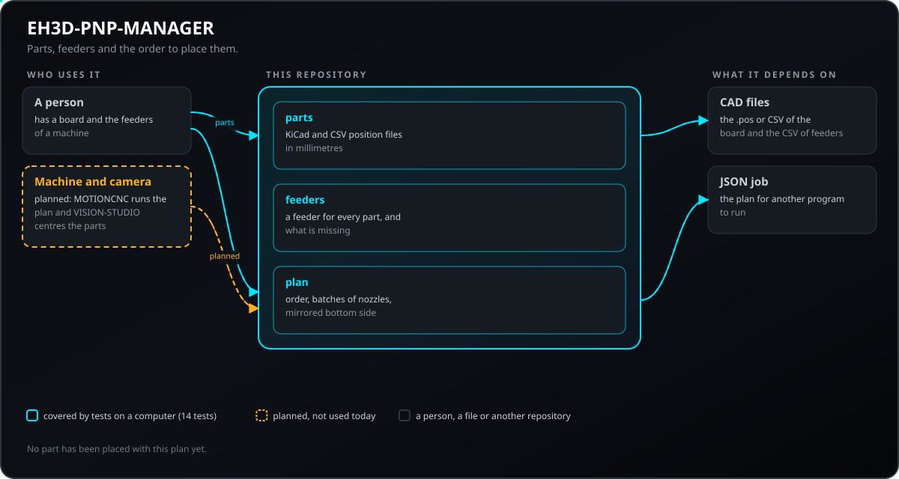
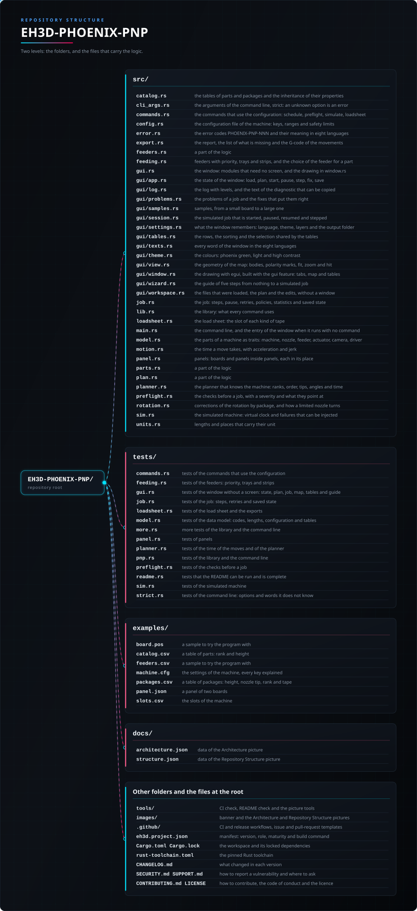

<p align="center">
  
</p>

# 📖 EH3D-PHOENIX-PNP

<p align="center"><a href="README.md">🇺🇸 English</a> | <a href="README_spa.md">🇪🇸 Español</a> | <a href="README_fra.md">🇫🇷 Français</a> | <a href="README_ita.md">🇮🇹 Italiano</a> | <a href="README_deu.md">🇩🇪 Deutsch</a> | 🇨🇳 <b>中文</b> | <a href="README_jpn.md">🇯🇵 日本語</a> | <a href="README_por.md">🇵🇹 Português</a></p>

### 贴片装配：位置、供料器和贴装顺序

<p align="center">
  
  
  
  
  
</p>

---

**诚实检查 - 当前真正能运行的内容：** 一个 Rust 库和一个命令行程序（`phoenix-pnp`），有 344 个可在计算机上运行的测试：读取电路板的位置文件，为每个元件分配供料器（支持优先级、托盘和料带），从文件读取机器设置，为最多六个吸嘴的贴装头规划贴装顺序（等级、吸嘴头、角度限制、移动时间、拼板），写出上料表，并在模拟机器上逐步执行计划，可注入故障。它还有一个窗口（用 `--features gui` 构建），其逻辑在没有屏幕的情况下经过测试；绘制本身不在测试范围内，也没有在屏幕上检查过。它不控制任何机器：没有在机器上试过，也没有用真实文件集合检查过。

---

> **安全状态：** 本程序不控制任何机器，也不是安全系统。它的输出在机器上运行之前必须由人检查；这里的任何内容都没有在真实硬件上运行过。


## 📋 速览

| | |
|---|---|
| 版本 | `0.0.5` |
| 成熟度 | 脚手架 |
| 测试 | 344 |
| 技术栈 | Rust |
| 真实硬件 | 未试过：这里的任何内容都没有在机器上运行过 |

**跳转到：** [概述](#-概述) · [架构](#-架构) · [快速开始](#-快速开始) · [测试](#-测试) · [结构](#-仓库结构) · [相关项目](#-相关项目)

## 🚦 项目状态

每一行是本仓库的一个部分，灯号表示它今天做到了哪一步。内容依据仓库能够展示的证据（测试、构建、运行），而不是计划。

🟢 已完成并验证 · 🟡 可用，有已知限制 · 🟠 部分完成或尚未验证 · 🔴 未完成或不可用

| 领域 | 状态 | 在这里的含义 |
|---|---|---|
| 核心 | 🟡 | 读取电路板的位置文件，为每个元件分配供料器（优先级、托盘、料带），为最多六个吸嘴的贴装头规划贴装顺序（等级、吸嘴头、角度限制和移动时间），规划拼板并写出上料表；已在计算机上用正常和损坏的输入测试，但没有用真实文件集合测试。 |
| 命令行 | 🟡 | `phoenix-pnp` 运行与库相同的函数（`parts`、`check`、`plan`、`schedule`、`preflight`、`simulate`、`loadsheet`、`config-check`, `check-bottom`, `tables-check`）并打印结果；每个错误都以带 `PHOENIX-PNP-NNN` 代码的消息和非零退出码返回。 |
| 测试 | 🟡 | 344 个测试通过（`cargo test`），包括正常情况、边界情况、损坏的输入和小型生成的用例。 |
| 机器配置 | 🟡 | 带版本号的 `键 = 值` 文件、会指出行号的校验器以及安全限制（Z 行程、X 和 Y 的限位、重试次数、吸嘴角度）；这些值没有与真实机器比对过。 |
| 模拟器与作业 | 🟡 | 虚拟时钟、按概率（带种子）或在选定位置注入的故障、重试、警报与搁置两种策略、反复故障后停用的供料器、暂停、单步执行以及可用于恢复的已保存状态；只是模拟，没有驱动过任何机器。 |
| 安全 | 🟡 | 纯安全 Rust（`forbid(unsafe_code)`）：处理收到的文件时不会 panic，错误的值会返回带原因的错误；没有独立审查。 |
| 窗口 | 🟠 | 一个 egui 窗口（用 `--features gui` 构建；不带命令运行 `phoenix-pnp` 即可打开）：作业、零件、封装、供料器、上料表、机器、问题和日志等页面，显示贴装头路径、极性标记和下一个零件的工作台地图，五步向导，带可撤销修复的问题列表，可暂停、继续和单步的模拟作业，以及八种语言。其逻辑在没有屏幕的情况下经过测试；绘制不在测试范围内，也没有在屏幕上检查过。还有拼板页（含基准点和移动零件的拟合）和电路板页、文件选择器、可撤销编辑的供料器与封装表、会记住的列宽，以及在 Windows 上无控制台打开的独立程序（`phoenix-pnp-gui`）。 |
| 真实硬件 | 🔴 | 未试过：这里的任何内容都没有在机器上运行过。 |
| 文档 | 🟡 | 八种语言的 README、更新日志，以及由 `docs/` 绘制的两张图。 |

## 🎯 概述

* **元件**（`src/parts.rs`）：KiCad 的 `.pos` 文件或 CSV（逗号或分号、引号、按名称查找表头），位置单位可为 mm、mil 或英寸，角度归一到 0-360，面为顶面或底面；每个不合理的行都会带行号被拒绝，重复的位号是错误。
* **不贴装的零件、示例的表格和作业报告**（`src/parts.rs`、`src/commands.rs`、`src/job.rs`）：CSV 中名为 `dnp`、`do not place` 或 `fitted` 的列（或 `--dnp R1,R2`）会让零件不进入计划、上料表和检查，并在报告中列出；`tables-check` 读取表格（`--parts`、`--packages`、`--catalog`、`--feeders`、`--slots`），并给出每个错误的代码和行号；`simulate --report-csv 文件` 把作业统计写成表头永不改变的 CSV。`examples/` 里有带 `dnp` 列的电路板、各种供料器以及常见封装表。
* **供料器**（`src/feeders.rs`）：供料器的 CSV（编号、值、封装、取料位置、剩余数量）；每个元件得到第一个值和封装相同（不区分大小写）的供料器；没有供料器的元件和将耗尽的供料器会被报告，同类的第二个供料器接替。
* **计划**（`src/plan.rs`）：按最近优先走过各贴装位置，并切分成一到六个吸嘴的批次，批内供料器也按最近优先访问，底面按板宽镜像，计划给出行程和时间估计，并写成 JSON 作业。
* **表格与设置**（`src/catalog.rs`、`src/config.rs`、`src/rotation.rs`）：数值可继承的零件表和封装表（先零件，再封装，再默认值）、`键 = 值` 格式的机器配置文件（`examples/machine.cfg` 说明每个键）、CSV 位置文件列名的更多写法，以及按封装的旋转修正。
* **不止料带的供料器**（`src/feeding.rs`）：优先级、托盘、料带和被停用的供料器；无论文件顺序如何，元件的供料器选择都相同。
* **机器的规划器**（`src/planner.rs`、`src/motion.rs`）：等级（依次贴装的块）、顺序策略、吸嘴头及其更换、吸嘴角度的限制、含加速度和加加速度的移动时间、更短的路径（2-opt）以及元件原点的修正。
* **拼板、上料表与导出**（`src/panel.rs`、`src/loadsheet.rs`、`src/export.rs`）：拼板中的电路板和拼板、每种料带的槽位、报告、缺料清单，以及只移动贴装头的 G 代码。
* **拼板的基准点**（`src/fiducial.rs`）：把基准点的实测位置拟合到设计位置（两个点用相似变换，三个及以上用仿射拟合），拼板的零件按拟合移动并旋转；每个点都有残差，某点偏离超过 `fiducial_max_residual_mm` 的拟合会被拒绝（`--fiducials 文件` 配合 `--panel`，或窗口的拼板页）。
* **规划器和模拟器的更多功能：** 托盘单元格被取空的顺序（按行、按列或蛇形）、同时计入路程和去换头位置往返的吸嘴头顺序搜索（`tip_strategy = optimize`，受 `tip_opt_max_evals` 和 `tip_opt_time_limit_s` 限制）、按封装和按供料器设置的故障概率（`sim_part_fail`、`sim_feeder_fail`）及其统计和每小时零件数，以及显示底面各规则所得角度的 `check-bottom`。
* **对位步骤** (`src/job.rs`, `src/sim.rs`, `src/model.rs`)：`align = on` 时，作业在吸取零件后用相机查看，并按所见修正贴装（贴装头移到目标位置减去零件的偏移，吸嘴少转零件的旋转量）；`pick_tolerance_mm` 会丢弃偏移更大的零件，并按 `error_policy` 重新吸取；`align_passes`（1 到 5）和 `align_settle_s` 设定查看次数和每次之前的等待，它们计入计划时间；模拟相机有偏移、误差和可注入的故障 (`sim_align_*`, `sim_camera_fail_rate`)；修正量（平均值、最大值、丢弃的零件）出现在文本、JSON 报告和 `--report-csv` 的 `align` 行中。默认关闭：此时作业与以往完全一样。未在机器上试过。
* **模拟器与作业**（`src/sim.rs`、`src/job.rs`、`src/preflight.rs`、`src/model.rs`）：作业前的检查、带虚拟时钟和可注入故障的机器，以及可暂停、单步执行、保存并恢复的作业。
* **窗口**（`src/gui.rs`、`src/gui/`）：窗口除绘制之外的工作都不需要屏幕（已载入的文件、规划及其问题与修复、模拟作业、地图的几何、共享选择的表格、五步向导和八种语言的文字），并经过测试；只有用 `--features gui` 构建的 `src/gui/window.rs` 用 egui 绘制。模拟速度、主题以及为未知封装的零件绘制的大小是 `machine.cfg` 的键（`gui_steps_per_s`、`gui_theme`、`gui_part_size_mm`）。

## 🧩 在 EH3D 中的角色

EH3D-PHOENIX-PNP 是 EH3D Fabrication Suite 的一个程序。目前它以库、命令行和窗口（用 `--features gui` 构建）的形式工作；窗口还没有套件其他程序共用的外观。它读写简单的文件，因此可以单独使用，也可以用在其他程序之间。

## 🏛️ 架构

<p align="center">
  
</p>


本仓库各部分如何配合：谁使用它、它包含什么、它依赖什么。图由 `docs/architecture.json` 绘制并与代码核对。

## ✨ 功能

* **库加命令行：** `phoenix-pnp` 的每个命令都是库中的函数，套件中的其他程序无需启动进程即可调用。
* **严格的命令行：** 写错的选项（`--powr`）或多余的词会产生指明它的错误，而不是被忽略；否则程序会用默认值生成输出。
* **损坏输入的测试：** 测试还会输入空文件、乱码、巨大数字和被截断的文件，任何情况都不允许 panic。
* **不猜测：** 没有意义的值是一个说明哪个值、为什么的错误，绝不是只是看起来正确的结果。
* **没有 unsafe 代码：** 库和程序中都有 `#![forbid(unsafe_code)]`。
* **两张表用同一个读取器，大板也很快：** 位置文件和供料器文件由同一个读取器读取（逗号或分号，带引号的字段可含分隔符或换行），五万个元件的检查、分配和规划瞬间完成，计划绝不会覆盖它所依据的文件，未知选项会报错，镜像底面时 `--origin-x` 指明板子左边缘的位置。

## 🔒 安全与防护

| 威胁 | 防御 |
|---|---|
| 损坏、被截断或为空的文件 | 不会 panic：测试在每个位置截断有效输入并输入乱码 |
| 没有意义的数字（负数、非有限值、过大的数） | 以指出该值的错误拒绝；不会被舍入成看似合理的值 |
| 不安全的内存使用 | 带 `forbid(unsafe_code)` 的纯安全 Rust |

**没有防御的内容：** 无错误产生的结果不等于经过验证的结果。这里没有任何内容了解机器的极限，程序也没有经过独立审查。请私下报告漏洞（见 [SECURITY.md](SECURITY.md)）。

## 🔌 接口

库为 `eh3d_phoenix_pnp`（`use eh3d_phoenix_pnp::...`），命令行为 `phoenix-pnp`。命令如下；每个命令把结果打印到标准输出，把错误以非零退出码报告到标准错误。没有网络访问。

```text
EH3D-PHOENIX-PNP/
├── src/
│   ├── catalog.rs                               零件表和封装表及其属性的继承
│   ├── cli_args.rs                              命令行参数，严格：未知选项即错误
│   ├── commands.rs                              使用配置的命令、tables-check 和 check-bottom
│   ├── config.rs                                机器的配置文件：键、范围和安全限制
│   ├── error.rs                                 错误代码 PHOENIX-PNP-NNN 及其八种语言的含义
│   ├── export.rs                                报告、缺料清单和移动的 G 代码
│   ├── feeders.rs                               逻辑的一部分
│   ├── feeding.rs                               带优先级、托盘和料带的供料器，以及元件供料器的选择
│   ├── fiducial.rs                              拼板的基准点：测量基准点的拟合与零件的校正
│   ├── gui.rs                                   窗口：无需屏幕的模块，以及 window.rs 中的绘制
│   ├── gui/app.rs                               窗口的状态：载入、规划、开始、暂停、单步、修复、保存
│   ├── gui/browse.rs                            文件选择器：文件夹和文件、上一级、输入的路径
│   ├── gui/log.rs                               带级别的日志，以及可复制的诊断文本
│   ├── gui/problems.rs                          作业的问题及解决它们的修复
│   ├── gui/samples.rs                           示例，从小型电路板到大型电路板
│   ├── gui/session.rs                           可开始、暂停、继续和单步的模拟作业
│   ├── gui/settings.rs                          窗口记住的内容：语言、主题、图层、文件夹和列宽
│   ├── gui/shot.rs                              窗口的截图模式（--shot）：其参数
│   ├── gui/tables.rs                            表格的行、排序和共享的选择
│   ├── gui/texts.rs                             窗口的每个词（八种语言）
│   ├── gui/theme.rs                             配色：凤凰绿、浅色和高对比度
│   ├── gui/view.rs                              地图的几何：元件外形、极性标记、适应、缩放和点选
│   ├── gui/window.rs                            用 egui 绘制（用 gui 特性构建）：页面、地图和表格
│   ├── gui/wizard.rs                            从零到模拟作业的五步向导
│   ├── gui/workspace.rs                         已载入的文件、规划和编辑，无需窗口
│   ├── gui_main.rs                              作为独立程序的窗口，在 Windows 上没有控制台
│   ├── job.rs                                   作业：步骤、暂停、重试、策略、统计和已保存状态
│   ├── lib.rs                                   库：每个命令所使用的部分
│   ├── loadsheet.rs                             上料表：每种料带的槽位
│   ├── main.rs                                  命令行，以及不带命令运行时窗口的入口
│   ├── model.rs                                 以 trait 表示的机器部件：机器、吸嘴、供料器、执行器、相机、驱动
│   ├── motion.rs                                包含加速度和加加速度的移动时间
│   ├── panel.rs                                 拼板：拼板中的电路板和拼板，各在其位
│   ├── parts.rs                                 位置文件和不贴装的零件
│   ├── plan.rs                                  逻辑的一部分
│   ├── planner.rs                               了解机器的规划器：等级、顺序、吸嘴头及其搜索、角度和时间
│   ├── preflight.rs                             作业前的检查，含严重程度及其所指对象
│   ├── rotation.rs                              按封装的旋转修正，以及受限吸嘴如何转动
│   ├── sim.rs                                   模拟机器：虚拟时钟和可注入的故障
│   └── units.rs                                 带单位的长度和位置
├── tests/
│   ├── align.rs                                 对位步骤的测试：相机、修正后的位置、容差和时间
│   ├── commands.rs                              使用配置的命令的测试
│   ├── feeding.rs                               供料器测试：优先级、托盘和料带
│   ├── gui.rs                                   无屏幕的窗口测试：状态、规划、作业、地图、表格和向导
│   ├── job.rs                                   作业测试：步骤、重试和已保存状态
│   ├── loadsheet.rs                             上料表和导出的测试
│   ├── model.rs                                 数据模型测试：代码、长度、配置和表格
│   ├── more.rs                                  库和命令行的更多测试
│   ├── panel.rs                                 拼板及其基准点的测试
│   ├── planner.rs                               移动时间和规划器的测试
│   ├── pnp.rs                                   库和命令行的测试
│   ├── preflight.rs                             作业前检查的测试
│   ├── readme.rs                                验证 README 可运行且完整的测试
│   ├── sim.rs                                   模拟机器的测试
│   ├── strict.rs                                命令行测试：它不认识的选项和词
│   └── tables.rs                                不贴装零件、tables-check 以及作业 CSV 报告的测试
├── examples/
│   ├── board.pos                                试用的示例
│   ├── board_dnp.csv                            带 dnp 列的电路板：其中两个零件不贴装
│   ├── catalog.csv                              零件表：等级和高度
│   ├── feeders.csv                              试用的示例
│   ├── feeders_kinds.csv                        各种供料器：料带、料条、托盘和一个已关闭的
│   ├── machine.cfg                              机器设置，每个键均有说明
│   ├── marks.csv                                拼板基准点的实测位置
│   ├── packages.csv                             封装表：高度、吸嘴头、等级和料带
│   ├── packages_common.csv                      常见封装表（从 0201 电阻到 QFN），请按自己的零件调整
│   ├── panel.json                               由两块板组成的拼板
│   └── slots.csv                                机器的槽位
├── docs/
│   ├── architecture.json                        架构图数据
│   ├── structure.json                           结构图数据
│   └── windows-console.md                       在 Windows 上窗口为何是独立程序
├── tools/                                       CI 和 README 检查及绘图工具
├── images/                                      横幅图以及架构和仓库结构图片
├── .github/                                     CI 与发布工作流、Issue 和 PR 模板
├── eh3d.project.json                            清单：版本、角色、成熟度和构建命令
├── Cargo.toml Cargo.lock                        工作区及其锁定的依赖
├── rust-toolchain.toml                          固定的 Rust 工具链
├── CHANGELOG.md                                 每个版本的变更
├── SECURITY.md SUPPORT.md                       如何报告漏洞及在哪里提问
└── CONTRIBUTING.md CODE_OF_CONDUCT.md LICENSE   参与贡献、行为准则和许可证
```

## ⚙️ 配置

机器和规划器通过由 `键 = 值` 行组成的文本文件配置（`--config 文件`），格式与套件中其他程序相同；`examples/machine.cfg` 列出每个键的默认值及作用。缺少的键保持默认值；未知的键、重复书写的键或超出范围的键都会产生指出行号的错误。命令行选项（`--nozzles`、`--speed`、`--order`、`--side`）优先于文件。

标记零件不贴装的列及其用词也是设置：`header_dnp` 和 `header_fitted` 增加列名，`dnp_yes_words` 和 `dnp_no_words` 增加表示“是”和“否”的词。名为 `dnp`、`do not place`、`do not populate`、`do not mount`、`do_not_place`、`not fitted` 或 `no montar` 的列，遇到“是”（`yes`、`y`、`true`、`1`、`x`）就排除该零件；名为 `fitted`、`populate`、`populated`、`mount`、`mounted` 或 `montar` 的列，遇到“否”（`no`、`n`、`false`、`0`、`-`）就排除该零件；空单元格表示贴装，其他任何词都是指出行号的错误。

封装表和零件表（`--packages`、`--catalog`）是 CSV 文件，空单元格会继承；拼板（`--panel`）是 JSON 文件；机器的槽位（`loadsheet`）是带 `id,x,y,max_width_mm` 的 CSV。超过 `max_file_bytes` 的文件会被拒绝。每个错误都有代码 `PHOENIX-PNP-NNN`，其消息使用键 `language` 或 `--lang` 指定的语言（`en`、`es`、`de`、`fr`、`it`、`ja`、`zh` 或 `pt`）：

| 代码 | 含义 |
|---|---|
| `PHOENIX-PNP-001` | 文件超过允许的大小 |
| `PHOENIX-PNP-002` | 零件数量超过上限 |
| `PHOENIX-PNP-003` | 配置中有一行不是“键 = 值” |
| `PHOENIX-PNP-004` | 配置中有未知的键 |
| `PHOENIX-PNP-005` | 配置中的某个值无效 |
| `PHOENIX-PNP-006` | 配置中的某个值超出范围 |
| `PHOENIX-PNP-007` | 该配置是为更新版本的程序编写的 |
| `PHOENIX-PNP-008` | 配置中有键重复 |
| `PHOENIX-PNP-009` | 某项设置超出安全限制 |
| `PHOENIX-PNP-010` | 零件或封装表中有无效的行 |
| `PHOENIX-PNP-011` | 零件或封装被重复定义 |
| `PHOENIX-PNP-012` | 旋转偏移规则无效 |
| `PHOENIX-PNP-013` | 供料器表中有无效的行 |
| `PHOENIX-PNP-014` | 拼板文件无效 |
| `PHOENIX-PNP-015` | 拼板嵌套过深或电路板过多 |
| `PHOENIX-PNP-016` | 槽位表无效 |
| `PHOENIX-PNP-017` | 计划的某项设置无效 |
| `PHOENIX-PNP-018` | 吸嘴无法在其限位内转到该角度 |
| `PHOENIX-PNP-019` | 吸嘴已吸着零件，不能再取另一个 |
| `PHOENIX-PNP-020` | 吸嘴上没有可贴装的零件 |
| `PHOENIX-PNP-021` | 该零件没有可用的供料器 |
| `PHOENIX-PNP-022` | 多次尝试后仍无法拾取该零件 |
| `PHOENIX-PNP-023` | 多次尝试后供料器仍无法前进 |
| `PHOENIX-PNP-024` | 多次尝试后仍无法贴装该零件 |
| `PHOENIX-PNP-025` | 保存的状态属于另一个作业 |
| `PHOENIX-PNP-026` | 保存的作业状态无效 |
| `PHOENIX-PNP-027` | 作业已暂停、已完成或因错误而停止 |
| `PHOENIX-PNP-028` | 作业前检查发现了错误 |
| `PHOENIX-PNP-029` | 长度或角度无效 |
| `PHOENIX-PNP-030` | 驱动程序未接受该命令 |
| `PHOENIX-PNP-031` | 模拟器注入了故障 |
| `PHOENIX-PNP-032` | 基准点无效，或无法确定位置 |
| `PHOENIX-PNP-033` | 装配标记既不是“是”也不是“否”，或要排除的位号未知 |
| `PHOENIX-PNP-034` | 位置文件无效 |
| `PHOENIX-PNP-035` | 相机发现零件的偏移超过了容差 |
| `PHOENIX-PNP-036` | 相机没有给出零件的测量值 |

## 🚀 快速开始

需要稳定版 Rust 工具链（1.95 或更新）。

```bash
cargo build --release
cargo test
cargo run --release -- plan examples/board.pos examples/feeders.csv examples/plan.json --nozzles 2
cargo run --release -- schedule examples/board.pos examples/feeders.csv examples/schedule.json --config examples/machine.cfg --packages examples/packages.csv --catalog examples/catalog.csv
cargo run --release -- simulate examples/board.pos examples/feeders.csv --config examples/machine.cfg --state examples/job_state.json --steps 5
cargo run --release -- loadsheet examples/board.pos examples/slots.csv examples/loadsheet.csv --packages examples/packages.csv
cargo run --release -- check-bottom examples/board.pos
cargo run --release -- schedule examples/board_dnp.csv examples/feeders.csv examples/schedule_dnp.json --config examples/machine.cfg --packages examples/packages.csv --catalog examples/catalog.csv
cargo run --release -- tables-check --parts examples/board_dnp.csv --packages examples/packages_common.csv --feeders examples/feeders_kinds.csv --slots examples/slots.csv --config examples/machine.cfg
cargo run --release -- simulate examples/board.pos examples/feeders.csv --config examples/machine.cfg --report-csv examples/job_report.csv
cargo run --release -- schedule examples/feeders.csv examples/schedule_panel.json --panel examples/panel.json --fiducials examples/marks.csv --config examples/machine.cfg
cargo run --release --features gui -- --shot screen.png examples/board.pos examples/feeders.csv examples/machine.cfg   # a picture of the window
cargo run --release --features gui
```

要在不手动打开窗口的情况下截取窗口图像，请使用 `--shot FILE.png` 运行（还可用 `--size WxH`, `--theme phoenix|light|contrast`, `--wait N`, `--lang CODE`, `--open FILE`, `--replace`）：它按该尺寸打开，保存 PNG，不保留任何设置并自动关闭（写入文件成功时退出码为 0，否则为 1，参数错误时为 2）。

最后一行会打开窗口；用 `--features gui` 构建时，不带命令运行 `phoenix-pnp` 也会打开（在 Linux 上，窗口需要 X11 或 Wayland 以及 OpenGL 的开发文件）。带上命令时，程序仍是命令行。在 Windows 上，`phoenix-pnp-gui`（用同一特性构建）会在没有控制台的情况下打开窗口；见 `docs/windows-console.md`。

## 🧪 测试

测试套件共有 344 个测试（`cargo test`，在 CI 中于 Windows 和 Linux 上运行）。它们检查正常情况、边界情况和损坏的输入：空文件、乱码和被截断的文件绝不会引发 panic。由固定种子生成的小型用例（每次运行得到相同的数字）检查：计划不依赖文件顺序，路径绝不会变长，在任意位置保存并恢复的作业与从未停止的作业结果相同，长度和角度可来回换算。CI 还会运行 `cargo fmt --check`、把警告当作错误的 `cargo clippy` 以及 `python -I tools/ci_validate.py`。

## 🏗️ 构建与发布

版本号位于 `Cargo.toml` 和 `eh3d.project.json`；每个版本在 [CHANGELOG.md](CHANGELOG.md) 中都有条目。`build.bat` / `build.sh` 构建程序，`test.bat` / `test.sh` 运行测试，`run.bat` / `run.sh` 用示例运行。版本发布在 GitHub 上。

## 📂 仓库结构

<p align="center">
  
</p>

<details>
<summary>目录树的文本版</summary>

```text
EH3D-PHOENIX-PNP/
├── src/
│   ├── catalog.rs                               零件表和封装表及其属性的继承
│   ├── cli_args.rs                              命令行参数，严格：未知选项即错误
│   ├── commands.rs                              使用配置的命令、tables-check 和 check-bottom
│   ├── config.rs                                机器的配置文件：键、范围和安全限制
│   ├── error.rs                                 错误代码 PHOENIX-PNP-NNN 及其八种语言的含义
│   ├── export.rs                                报告、缺料清单和移动的 G 代码
│   ├── feeders.rs                               逻辑的一部分
│   ├── feeding.rs                               带优先级、托盘和料带的供料器，以及元件供料器的选择
│   ├── fiducial.rs                              拼板的基准点：测量基准点的拟合与零件的校正
│   ├── gui.rs                                   窗口：无需屏幕的模块，以及 window.rs 中的绘制
│   ├── gui/app.rs                               窗口的状态：载入、规划、开始、暂停、单步、修复、保存
│   ├── gui/browse.rs                            文件选择器：文件夹和文件、上一级、输入的路径
│   ├── gui/log.rs                               带级别的日志，以及可复制的诊断文本
│   ├── gui/problems.rs                          作业的问题及解决它们的修复
│   ├── gui/samples.rs                           示例，从小型电路板到大型电路板
│   ├── gui/session.rs                           可开始、暂停、继续和单步的模拟作业
│   ├── gui/settings.rs                          窗口记住的内容：语言、主题、图层、文件夹和列宽
│   ├── gui/shot.rs                              窗口的截图模式（--shot）：其参数
│   ├── gui/tables.rs                            表格的行、排序和共享的选择
│   ├── gui/texts.rs                             窗口的每个词（八种语言）
│   ├── gui/theme.rs                             配色：凤凰绿、浅色和高对比度
│   ├── gui/view.rs                              地图的几何：元件外形、极性标记、适应、缩放和点选
│   ├── gui/window.rs                            用 egui 绘制（用 gui 特性构建）：页面、地图和表格
│   ├── gui/wizard.rs                            从零到模拟作业的五步向导
│   ├── gui/workspace.rs                         已载入的文件、规划和编辑，无需窗口
│   ├── gui_main.rs                              作为独立程序的窗口，在 Windows 上没有控制台
│   ├── job.rs                                   作业：步骤、暂停、重试、策略、统计和已保存状态
│   ├── lib.rs                                   库：每个命令所使用的部分
│   ├── loadsheet.rs                             上料表：每种料带的槽位
│   ├── main.rs                                  命令行，以及不带命令运行时窗口的入口
│   ├── model.rs                                 以 trait 表示的机器部件：机器、吸嘴、供料器、执行器、相机、驱动
│   ├── motion.rs                                包含加速度和加加速度的移动时间
│   ├── panel.rs                                 拼板：拼板中的电路板和拼板，各在其位
│   ├── parts.rs                                 位置文件和不贴装的零件
│   ├── plan.rs                                  逻辑的一部分
│   ├── planner.rs                               了解机器的规划器：等级、顺序、吸嘴头及其搜索、角度和时间
│   ├── preflight.rs                             作业前的检查，含严重程度及其所指对象
│   ├── rotation.rs                              按封装的旋转修正，以及受限吸嘴如何转动
│   ├── sim.rs                                   模拟机器：虚拟时钟和可注入的故障
│   └── units.rs                                 带单位的长度和位置
├── tests/
│   ├── align.rs                                 对位步骤的测试：相机、修正后的位置、容差和时间
│   ├── commands.rs                              使用配置的命令的测试
│   ├── feeding.rs                               供料器测试：优先级、托盘和料带
│   ├── gui.rs                                   无屏幕的窗口测试：状态、规划、作业、地图、表格和向导
│   ├── job.rs                                   作业测试：步骤、重试和已保存状态
│   ├── loadsheet.rs                             上料表和导出的测试
│   ├── model.rs                                 数据模型测试：代码、长度、配置和表格
│   ├── more.rs                                  库和命令行的更多测试
│   ├── panel.rs                                 拼板及其基准点的测试
│   ├── planner.rs                               移动时间和规划器的测试
│   ├── pnp.rs                                   库和命令行的测试
│   ├── preflight.rs                             作业前检查的测试
│   ├── readme.rs                                验证 README 可运行且完整的测试
│   ├── sim.rs                                   模拟机器的测试
│   ├── strict.rs                                命令行测试：它不认识的选项和词
│   └── tables.rs                                不贴装零件、tables-check 以及作业 CSV 报告的测试
├── examples/
│   ├── board.pos                                试用的示例
│   ├── board_dnp.csv                            带 dnp 列的电路板：其中两个零件不贴装
│   ├── catalog.csv                              零件表：等级和高度
│   ├── feeders.csv                              试用的示例
│   ├── feeders_kinds.csv                        各种供料器：料带、料条、托盘和一个已关闭的
│   ├── machine.cfg                              机器设置，每个键均有说明
│   ├── marks.csv                                拼板基准点的实测位置
│   ├── packages.csv                             封装表：高度、吸嘴头、等级和料带
│   ├── packages_common.csv                      常见封装表（从 0201 电阻到 QFN），请按自己的零件调整
│   ├── panel.json                               由两块板组成的拼板
│   └── slots.csv                                机器的槽位
├── docs/
│   ├── architecture.json                        架构图数据
│   ├── structure.json                           结构图数据
│   └── windows-console.md                       在 Windows 上窗口为何是独立程序
├── tools/                                       CI 和 README 检查及绘图工具
├── images/                                      横幅图以及架构和仓库结构图片
├── .github/                                     CI 与发布工作流、Issue 和 PR 模板
├── eh3d.project.json                            清单：版本、角色、成熟度和构建命令
├── Cargo.toml Cargo.lock                        工作区及其锁定的依赖
├── rust-toolchain.toml                          固定的 Rust 工具链
├── CHANGELOG.md                                 每个版本的变更
├── SECURITY.md SUPPORT.md                       如何报告漏洞及在哪里提问
└── CONTRIBUTING.md CODE_OF_CONDUCT.md LICENSE   参与贡献、行为准则和许可证
```

</details>

## 🗺️ 路线图与已知限制

**目前已知的限制**

* 窗口的绘制没有在屏幕上检查过；表格不记忆列宽，也没有拼板和电路板页面、点动和摄像头。
* 没有在机器上试过，也没有用真实文件集合测试过，也没有经过独立审查；它对机器所做的一切都是模拟。
* 它不读取其他贴片程序的文件；CSV 底面角度的规则（`bottom_rotation`）没有与任何 CAD 程序的真实文件比对过。
* 还没有相机、没有视觉取料修正，也没有真实机器的驱动；计划是一个 JSON 文件，供其他程序执行。

**下一步**

* 让窗口达到套件其他程序共用的外观，并补上缺少的部分：拼板和电路板页面、可记忆的列宽以及封装表的编辑。
* 电路板和拼板的基准点，以及 EH3D-VISION-STUDIO 的相机修正；只有在真实机器上试过之后才把计划发送给机器。
* 用真实文件和套件中的其他程序试用。

## 🌍 语言

README 和文本提供英语、西班牙语、法语、意大利语、德语、汉语、日语和欧洲葡萄牙语版本。

## 🔗 相关项目

* [EH3D-VISION-STUDIO](https://github.com/JuanenRac/EH3D-VISION-STUDIO): 摄像头、基准点和检测
* [EH3D-MOTIONCNC](https://github.com/JuanenRac/EH3D-MOTIONCNC): 机器控制程序
* [EH3D-GERBERVIEWER](https://github.com/JuanenRac/EH3D-GERBERVIEWER): Gerber 层查看器
* [EH3D-TOOL-MANAGER](https://github.com/JuanenRac/EH3D-TOOL-MANAGER): CAM 程序共用的刀具库
* [EH3D-SUITE-LAUNCHER](https://github.com/JuanenRac/EH3D-SUITE-LAUNCHER): 查找并启动套件程序的中心

## 📚 文档

* [更新日志](CHANGELOG.md)
* [架构与结构数据](docs/architecture.json)：绘制两张图所用的数据。

## 🤝 参与贡献与社区

* 提交拉取请求前请运行 `cargo fmt --check`、`cargo clippy --all-targets -- -D warnings`、`cargo test` 和 `python -I tools/ci_validate.py`：必须全部通过。见 [CONTRIBUTING.md](CONTRIBUTING.md) 和[行为准则](CODE_OF_CONDUCT.md)。
* README 有八种语言：修改文字要在八个文件中同时进行，两张图由 `tools/make_architecture.py` 和 `tools/make_structure.py` 根据 `docs/architecture.json` 和 `docs/structure.json` 绘制。
* 请私下报告漏洞：[SECURITY.md](SECURITY.md)。问题、想法和报告：electrohobby3d@gmail.com（[SUPPORT.md](SUPPORT.md)）。

## 👤 作者

**JuanenRac (Electro Hobby 3D)** · electrohobby3d@gmail.com

## 📜 许可证

软件：GPL-3.0-or-later。见 [LICENSE](LICENSE)。套件的硬件设计使用 CERN OHL-S。
